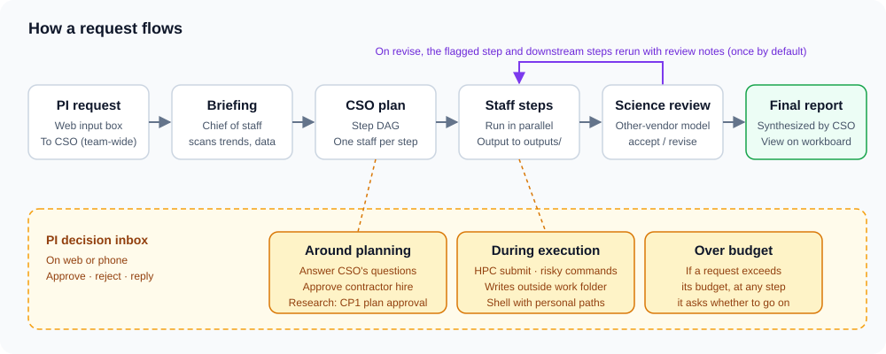
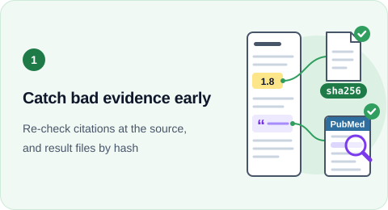
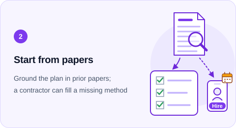
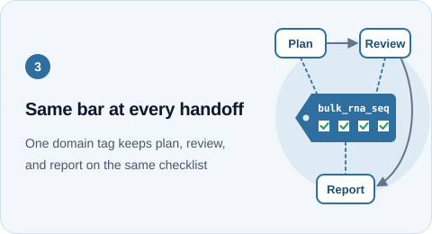
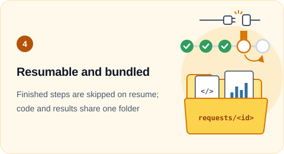

# labhq — HQ for a one-person bioinformatics lab (v0.5)

<!-- badges:start -->
[](https://code.claude.com/docs/en/overview)
[](https://github.com/openai/codex)
[](docs/manual.md#설정-포인트)
[](docs/manual.md#설정-포인트)
[](docs/manual.md#설정-포인트)
[](docs/manual.md#연결된-도구)
[](https://www.ebi.ac.uk/chembl/)
[](https://clinicaltrials.gov/)
[](https://platform.opentargets.org/)
[](https://pubmed.ncbi.nlm.nih.gov/)
[](https://www.biorxiv.org/)
[](https://github.com/ehojune/bioinfo-agent)
[](https://github.com/jmiao24/Paper2Agent)
[](docs/manual.md#연결된-도구)
[](docs/manual.md#연결된-도구)

[](https://github.com/ehojune/bioinfo-team-3d/actions/workflows/test.yml)
[](https://www.python.org/)
[](LICENSE)
[](LICENSE-CC-BY-SA-4.0.txt)
[](patch_notes/README.md)
<!-- badges:end -->

<p align="center"><a href="README.md">한국어</a> · <b>English</b></p>

The [manual](docs/manual.en.md), [PI Q&A](docs/pi-qa.en.md), [research protocol](docs/research_protocol.en.md) and [vocabulary tables](docs/vocabulary.en.md) are available in English; other detailed docs and the web UI are in Korean.

labhq is a bioinformatics **multi-agent orchestration platform** that runs Claude Code and Codex like **lab staff**.
Write a request in the web office and the CSO plans it, staff split the execution, and science review leads to a report.
Risky or costly actions are approved by the PI on the web or a phone.
The project began by taking inspiration from the research-team structure of [The Virtual Biotech](https://doi.org/10.1126/science.aeg6779).

| 2.5D office (`/`) | 3D office (`/3d`) |
|---|---|
|  |  |

The mock demo (`labhq demo --web`): in about 13 seconds one request goes through the CSO plan, staff work, a decision card, and the report.
Still frames: [2.5D](docs/media/office-25d.png) · [3D](docs/media/office-3d.png)

## How it works



- The default roster defines 13 roles: 8 on Claude Code and 5 on Codex. [Staff YAML](agents/core/) is the source for engines, models, and tools; local solo staff and contractors are separate.
- Routine, well-defined analyses go to the [bioinfo-agent](https://github.com/ehojune/bioinfo-agent) staff member. It is a Claude Code agent that proposes a matching nf-core Nextflow pipeline and resource plan, and after approval runs it and returns a MultiQC QC verdict.
- If the team lacks a method, a paper or its code is turned into an agent with [Paper2Agent](https://github.com/jmiao24/Paper2Agent) and hired as a **contractor**.
- When a job is submitted to HPC (SGE, PBS, Slurm), the staff session rests until the job ends, then resumes the same session.
- The CSO asks only about permissions, cost, data access, choices only the PI knows (disease, cohort), and analysis depth. It decides the rest of the design itself and records it as **assumptions** in the plan and report.
- Each step leaves a record in its work folder: instructions, outputs, engine, and cost.

## Four things labhq works hard on

Each step is checked, and its evidence is kept so it can be re-verified.

<table>
<tr>
<td width="50%" valign="top">



**Catch bad evidence early**

Science review, a claim ledger, and output sha256 records help check report evidence. `labhq verify` re-checks anchors and file hashes.

Limits: anchors and CP2 require the research lane. Matching hashes do not prove content correct, and the review miss rate is unmeasured. [Evidence and limits](docs/reference/readme-evidence.md#card-1)

</td>
<td width="50%" valign="top">



**Start from papers**

Before planning, papers and reviews supply a checklist of required analyses. With PI approval, Paper2Agent contractors can fill missing methods.

Limits: prior-research steps were checked on four test requests. Hiring from a real paper remains unverified and requires the separately installed skill. [Evidence and limits](docs/reference/readme-evidence.md#card-2)

</td>
</tr>
<tr>
<td width="50%" valign="top">



**Same bar at every handoff**

A topic key passes the same checklist to planning, science review, and solo handling. A corpus of [1,286 papers](docs/reference/topic_papers.md) is organized into supporting references by topic. The checklist covers 45 domains and 135 items; research-lane domain packs use the same keys.

Limits: 42 domains beyond the first three have not run on real requests. Reduced omissions and an advantage over the semantic baseline remain unmeasured. [Evidence and limits](docs/reference/readme-evidence.md#card-3)

</td>
<td width="50%" valign="top">



**Resumable and bundled**

SQLite preserves requests, steps, and approvals for resume. A request bundle gathers hash-checked outputs and code.

Limits: the limit/login-wait fixes have only test evidence and re-login needs a person. Bundles gather outputs from the same PC runner; verified reruns need a separate receipt. [Evidence and limits](docs/reference/readme-evidence.md#card-4)

</td>
</tr>
</table>

## Compared with standalone AI sessions and research workbenches

| | labhq | Claude Code / Codex alone | Research workbench |
|---|---|---|---|
| Review | ✅ Other-vendor reviewer\* | ❌ Same model checks itself | ⚠️ Separate-context check when on |
| Standard | ✅ Prior papers, domain checklists | ⚠️ Model's discretion | ⚠️ Depends on chosen skill |
| Evidence trail | ✅ Output hash, anchor re-check | ⚠️ Scripts and logs left behind | ✅ Output provenance, rerun compare |
| Approval | ✅ Web / phone cards | ⚠️ Inside the session | ✅ Approval modes, phone remote |
| After a stop | ✅ From the stopped step | ⚠️ Session resume only | ✅ Remote job recovery |
| Literature | ⚠️ Search, citation, full-text requests | ⚠️ Depends on attached tools | ✅ Library, PDF, screening |
| Speed / cost | ❌ Big task 144 min, $31 | ✅ Same task 19 min | — |

\* The default reviewer is Codex/GPT-6-Astra: another vendor for Claude analysis and the same vendor for Codex analysis. Workbench features came from documentation; the app was not run.

**Fits**: handing over evidence and reproduction materials, or approving long analyses from the web or phone.
**Remaining gaps**: standalone Astra led on total score and speed in the earlier blind bench. Reproduction materials and report length have since changed; a new comparison is pending. The optional solo route skips review by default. [Conditions, scores, and limits](docs/reference/readme-evidence.md#comparison-evidence)

## Example: analyzing public lung adenocarcinoma data

> Download the public GEO lung adenocarcinoma dataset GSE10072 and analyze tumor vs normal differential expression, GSEA, STRING hubs, and clustering. If there are same-patient pairs, reflect that structure.

- 1 hour 17 minutes, 12 steps. The PI answered three cards (install check, plan approval, evidence approval).
- A model accounting for 33 pairs found 554 DE genes, and cell proliferation pathways were higher in tumors. Marker genes from the original paper were also reproduced.
- Every number in the report carries an evidence mark, and the report passed a science review by another company's model.

[See the original request, cards, figures, and report](docs/examples/gse10072/README.md)

## Annotation, semantics, ontology


Records get meaning in three layers. The lower the layer, the firmer; the higher, the lighter we keep it.

| Layer | What it is | In labhq |
|---|---|---|
| Annotation | Tags attached to data and evidence | A PI-reviewed 125-key vocabulary (79 keys linked to [EDAM](https://github.com/edamontology/edamontology)), evidence kind and source level, output file sha256 |
| Semantics | Agreements on what to judge with the tags | CP1 approved-plan hash, rule packs per topic, input-fit verdicts, report evidence anchors |
| Ontology | Relations between tags | A few parent-child relations and an object view of provenance, owner and approval state. Computed as a shadow for now |

The shadow only records. `semantics: ab` (the `labhq init` preset) gives reuse candidates to half of research requests as a reference, so the effect can be compared; the effect has not yet been evaluated. [Semantic model](docs/manual.en.md#semantic-model-and-ontology) · [Vocabulary, topics, checklists](docs/vocabulary.en.md)

## Getting started on the web

### 1. Look around first (no API key or cluster)

```powershell
git clone https://github.com/ehojune/bioinfo-team-3d.git
cd bioinfo-team-3d
py -3 -m venv .venv
.\.venv\Scripts\python.exe -m pip install -e ".[dev]"
.\labhq.cmd demo --web
```

On POSIX, use `python3 -m venv .venv`, `./.venv/bin/python -m pip install -e ".[dev]"`, and `./labhq.sh demo --web`. The demo selects a separate free port even if a real office is running. Open only the URL printed by the demo terminal. Its mock banner remains visible during the roughly 15–30 second request.

### 2. Install and configure

You need Python 3.10+ and Git. After installing above, check the CLI with `.\labhq.cmd --help`.

```powershell
.\labhq.cmd init
.\labhq.cmd -c config\labhq.yaml doctor
```

`init` creates `config/labhq.yaml` and asks about bioinfo-agent, HPC, optional APIs and development logs. It preserves existing configurations. Before real requests, install your staff CLIs (Claude Code, Codex) and **log in yourself**; npm CLIs also need Node.js. Then check readiness with `doctor`.

To check a fresh install without logging in, use a new or empty folder:

```powershell
.\.venv\Scripts\python.exe scripts\clean_install_check.py --work-dir ..\labhq-clean-check
```

That folder retains the installation, isolated state, separate stdout/stderr and `receipt.json`: each step is PASS/FAIL, while human authentication and real models are SKIP. [Commands and verdicts](docs/reference/clean-install-922.md) · [Configuration details](docs/manual.en.md)

### 3. Start it

Run this from a fresh PowerShell or cmd window. `labhq.cmd` calls the repository's `.venv` Python directly, so PowerShell ExecutionPolicy does not apply.

```powershell
.\labhq -c config\labhq.yaml up
.\labhq -c config\labhq.yaml open
```

`up` detaches the gateway and runner and keeps logs and process records under the state directory. `down` refuses while work is active or cannot be checked; use `down --force` only after confirming that work may be interrupted. On POSIX, use `./labhq.sh -c config/labhq.yaml up`, then `open`.

After restarting the PC, run the same `up` and `open` commands from the repository folder.

If the runner is off, a **러너 꺼짐** (Runner off) bar shows at the top of the web office. Requests sent meanwhile do not fail; they wait for a runner to connect (up to 24 hours).

### 4. First request

1. Type a small public-data request (e.g. "public penguin data QC summary"). If the CSO asks a question, press **답하고 진행** (Reply and continue).
2. Approve cards in the **결정** (Decisions) tab to continue. Rejecting a clarifying, budget, resume, CP1, or CP2 card ends the request. Clarifying, budget, CP1, and CP2 cards wait up to 7 days by default.
3. Follow progress and outputs on the **작업판** (Workboard), read the **최종 보고서** (Final report), and use **이어 묻기** (Follow up) to ask more.
4. **요청 취소** (Cancel request) stops running work and keeps a partial report of finished steps. While a request runs, **이 요청에 메모** (Note on this request) reaches the next plan or step.

Pick a staff member or drag a yellow note onto a desk to give work directly. Attach GitHub URLs, DOIs, and paths with **참고** (Reference).
[Phone access](docs/manual.en.md#starting-and-connecting) · [Screens and approvals](docs/manual.en.md#web-office)

## Using it safely

- The PI decides on HPC submission, risky shell commands, writes outside the work folder, budget overruns, and contractor hiring.
- Original controlled-access (DUA) data is never opened with file tools; it is handled only inside HPC jobs.
- Staff run under the PI's account, but personal paths such as `~/.ssh` and browser profiles are hidden. Claude staff have three layers of path checks. Codex staff (5 of the default 13 roles) receive sandbox read denials and guidance on Windows elevated sandbox, and guidance alone elsewhere. The path guard is not a sandbox, so it cannot stop a staff member that is determined.

Details are in [Safety measures](docs/manual.en.md#safety-measures).

## Roadmap

| Version | Goal |
|---|---|
| v0.25 | The PI trials labhq on public data — **declared 2026-10-04** |
| v0.5 | The PI does research locally on their own public data — **declared 2026-10-08** |
| v0.75 | The PI does research on public data on HPC |
| v0.9 | The PI does research on controlled data (on HPC) |
| v0.95 | Another researcher installs from the docs alone and finishes one case on public data |
| v1 | Another researcher solves up to two research problems on their own controlled data |
| v1.25 | Goes beyond research to write papers |

Each version has pass criteria, and meeting them moves it on to the next version. Features merged since the v0.5 declaration passed tests and CI; their behavior and scientific benefit on real research requests remain unverified. The criteria, current status, and remaining work are in the [manual's roadmap](docs/manual.en.md#roadmap).

Facilities support requirements and readiness evidence are distinguished in the [support policy table](docs/reference/facilities-support-983.md) (Korean). A doctor readiness result does not prove that a support request or recovery succeeded.

## Further reading

| Document | Who it is for |
|---|---|
| [Manual](docs/manual.en.md) | Readers who want depth: command line, config, safety measures, the research lane, known limits |
| [PI Q&A](docs/pi-qa.en.md) | What the PI asked, the answers, and the decisions made |
| [Research protocol](docs/research_protocol.en.md) | The research lane's contract and checkpoints |
| [References](docs/references.en.md) | Literature and projects used for design, implementation, and tool connections |
| [Vocabulary, topics, checklists](docs/vocabulary.en.md) | Readers who want tables of what each topic is, its checklist, and the key vocabulary terms |
| [Patch notes](patch_notes/README.md) | What changed |
| [AGENTS.md](AGENTS.md) · [HANDOFF.md](HANDOFF.md) | Developers changing labhq: rules, structure, and current queue (Korean) |
| [Reference records](docs/reference/README.md) | Evidence and historical decisions, for lookup only |

The code is [GPL-3.0-or-later](LICENSE); docs, figures, and data tables are [CC BY-SA 4.0](LICENSE-CC-BY-SA-4.0.txt). Exceptions are in the [manual's license section](docs/manual.en.md#license).
