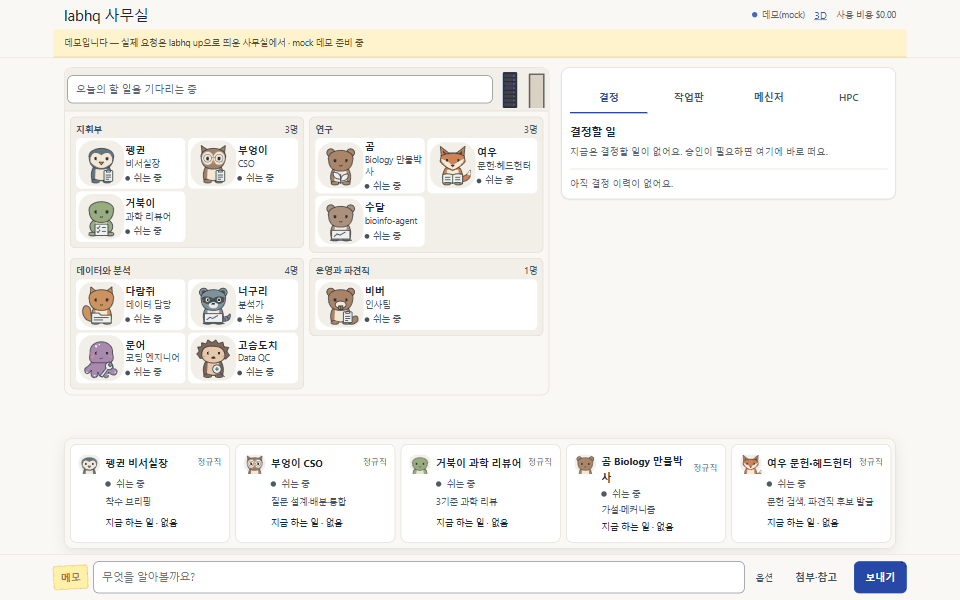
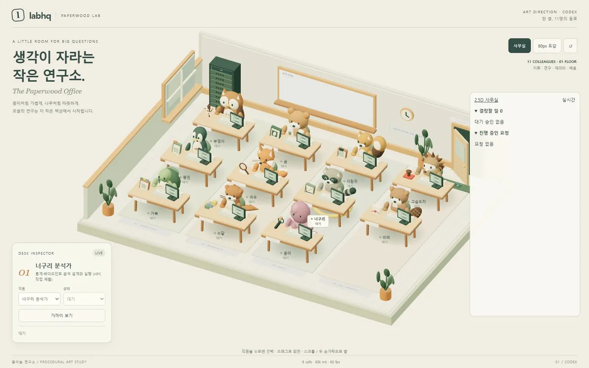
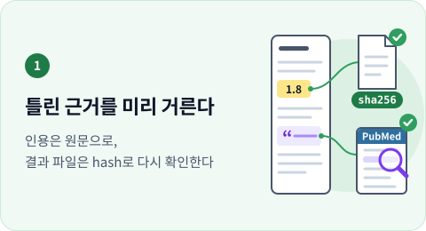
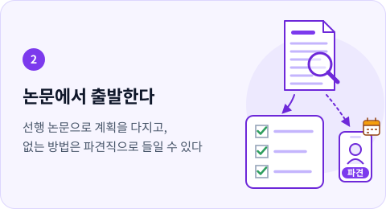
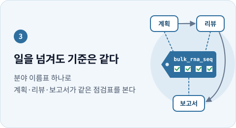

# labhq — 혼자 운영하는 바이오인포 연구소 HQ (v0.5)

<!-- badges:start -->
[](https://code.claude.com/docs/en/overview)
[](https://github.com/openai/codex)
[](docs/manual.md#설정-포인트)
[](docs/manual.md#설정-포인트)
[](docs/manual.md#설정-포인트)
[](docs/manual.md#연결된-도구)
[](https://www.ebi.ac.uk/chembl/)
[](https://clinicaltrials.gov/)
[](https://platform.opentargets.org/)
[](https://pubmed.ncbi.nlm.nih.gov/)
[](https://www.biorxiv.org/)
[](https://github.com/ehojune/bioinfo-agent)
[](https://github.com/jmiao24/Paper2Agent)
[](docs/manual.md#연결된-도구)
[](docs/manual.md#연결된-도구)

[](https://github.com/ehojune/bioinfo-team-3d/actions/workflows/test.yml)
[](https://www.python.org/)
[](LICENSE)
[](LICENSE-CC-BY-SA-4.0.txt)
[](patch_notes/README.md)
<!-- badges:end -->

<p align="center"><b>한국어</b> · <a href="README.en.md">English</a></p>

labhq는 Claude Code와 Codex를 **연구소 직원**처럼 부리는 바이오인포 **멀티 에이전트 오케스트레이션 플랫폼**입니다.
웹 사무실에 요청을 적으면 CSO가 계획을 세우고, 직원이 나눠 실행한 뒤 과학 리뷰와 보고서로 이어집니다.
위험한 일과 돈이 드는 일은 PI가 웹이나 폰에서 승인합니다.
이 프로젝트는 [The Virtual Biotech](https://doi.org/10.1126/science.aeg6779)의 연구팀 구조를 벤치마킹하며 시작했습니다.

| 2.5D 사무실 (`/`) | 3D 사무실 (`/3d`) |
|---|---|
|  |  |

mock 데모(`labhq demo --web`)입니다. 약 13초 영상에 계획·직원 작업·카드 승인·보고서가 이어집니다.
정지 화면: [2.5D](docs/media/office-25d.png) · [3D](docs/media/office-3d.png)

## 어떻게 일하나


- 기본 역할 설정은 13개(Claude Code 8개·Codex 5개)입니다. 엔진·모델·도구는 [직원 YAML](agents/core/)이 기준이며, 로컬 단독 직원과 파견직은 별도입니다.
- 반복·정형 분석은 [bioinfo-agent](https://github.com/ehojune/bioinfo-agent) 직원이 맡습니다. 분석에 맞는 nf-core Nextflow 파이프라인과 자원 계획을 내고 승인 뒤 실행·MultiQC 판정을 맡는 Claude Code 에이전트입니다.
- 팀에 없는 방법이 필요하면 논문·코드를 [Paper2Agent](https://github.com/jmiao24/Paper2Agent)로 바꿔 **파견직**으로 채용합니다.
- HPC(SGE·PBS·Slurm)에 잡을 내면 직원 세션은 잡이 끝날 때까지 쉬었다가 같은 세션으로 이어 갑니다.
- CSO는 권한·비용·데이터 접근, PI만 아는 선택(질병·코호트), 분석 깊이만 묻습니다. 나머지 설계는 스스로 정하고 계획과 보고서에 **가정**으로 적습니다.
- 연구 단계의 결과는 계획이 그 단계에 선언한 `claim_ids` 안의 주장만 담을 수 있고, 결과 교정 요청도 이 목록을 그대로 알려 줍니다.
- 이어 가기가 DOI·PMID 참조가 있는 요청의 단계를 재사용할 때는 식별자만 고정한 것이므로, 카드와 보고서가 "내용은 확인하지 않음"을 한 줄 알립니다.
- 보고서 검토를 기다리는 연구 요청을 GitHub로 옮기려 하면(`labhq storage <id> --to github`) 먼저 보고서 카드에 적힌 번호와 hash로 `labhq review-done <id> --revision <번호> --sha256 <hash>`를 하라고 안내합니다. 같은 명령에 `--storage github`를 붙이면 검토와 저장 선택을 한 번에 할 수 있습니다.
- 단계마다 작업 폴더에 지시문·산출·엔진·비용 기록이 남습니다. 산출로 폴더를 선언하면 그 안의 파일을 파일마다 hash와 함께 모읍니다(hash가 있는 파일이 하나도 없거나 파일이 200개를 넘는 폴더는 단계가 미완료로 끝납니다).

## labhq가 공들인 네 가지

단계마다 점검하고 근거를 다시 확인하도록 남깁니다.

<table>
<tr>
<td width="50%" valign="top">



**틀린 근거를 미리 거른다**

과학 리뷰와 claim 장부·산출 sha256을 겹쳐 보고서 근거를 확인합니다. `labhq verify`는 앵커와 파일 hash를 다시 검사합니다.

한계: 앵커·CP2는 연구 lane에서만 작동하며 hash 일치는 내용의 정확성을 보장하지 않습니다. 리뷰의 누락률도 미측정입니다. [근거·한계](docs/reference/readme-evidence.md#카드-1)

</td>
<td width="50%" valign="top">



**논문에서 출발한다**

같은 주제의 논문·리뷰로 필수 분석을 점검합니다. 본문 확보·보충자료 상태와 Methods/QC 위치를 남깁니다. 부족한 방법은 PI 승인 뒤 Paper2Agent 파견직으로 보강합니다.

한계: 선행 연구 단계는 시험 요청 4건에서 확인했습니다. 실제 논문으로 파견직 채용까지 간 사례는 없고 skill 설치가 필요합니다. [근거·한계](docs/reference/readme-evidence.md#카드-2)

</td>
</tr>
<tr>
<td width="50%" valign="top">



**일을 넘겨도 기준은 같다**

topic 키로 계획·과학 리뷰·단독 처리에 같은 점검표를 넘깁니다. 논문 [1,286편](docs/reference/topic_papers.md)을 분야별 근거 목록으로 정리했습니다. 현재 45개 분야·135항목이며 연구 lane의 분야 pack도 같은 키를 씁니다.

한계: 처음 3개 밖의 42개 분야는 실제 요청에서 돌지 않았습니다. 누락 감소와 의미 모델의 기준선 대비 이점도 미측정입니다. [근거·한계](docs/reference/readme-evidence.md#카드-3)

</td>
<td width="50%" valign="top">


**끊겨도 잇고, 묶어서 남긴다**

SQLite에 요청·단계·승인을 남겨 중단 지점부터 잇고, 끝나면 hash로 확인한 산출과 코드를 요청 묶음에 모읍니다.

환경 계획은 소비 단계의 runner별로 나누고 binding을 승인 계획에 저장해 재개 시 복원합니다. 환경 경로 별칭은 아직 활성화하지 않았으며 daemon 연결과 실제 WSL·엔진 보호는 미검증입니다.

한계: 한도·로그인 대기 수정은 test로만 확인했고 재로그인은 사람이 합니다. 묶음은 같은 PC runner 산출만 모으며 재실행 검증은 별도 receipt가 필요합니다. [근거·한계](docs/reference/readme-evidence.md#카드-4)

</td>
</tr>
</table>

## 단독 AI 세션·연구 workbench와 비교

| | labhq | Claude Code·Codex 단독 | 연구 workbench |
|---|---|---|---|
| 리뷰 | ✅ 다른 회사 리뷰어\* | ❌ 같은 모델 자기 검토 | ⚠️ 켜면 별도 맥락 검토 |
| 분석 기준 | ✅ 선행 논문·분야 점검표 | ⚠️ 모델 재량 | ⚠️ 고른 skill 따라 |
| 근거 추적 | ✅ 산출 hash·앵커 재검사 | ⚠️ 남긴 스크립트·로그 | ✅ 산출 출처·재실행 비교 |
| 승인 | ✅ 웹·폰 카드 | ⚠️ 세션 안에서 | ✅ 승인 모드·폰 원격 |
| 중단 뒤 | ✅ 멈춘 단계부터 | ⚠️ 세션만 재개 | ✅ 원격 잡 복구 |
| 문헌 관리 | ⚠️ 검색·인용·본문 요청 | ⚠️ 붙인 도구 따라 | ✅ 서재·PDF·선별 |
| 속도·비용 | ❌ 큰 과제 144분·$31 | ✅ 같은 과제 19분 | — |

\* 기본 과학 리뷰어는 Codex/GPT-6-Astra입니다. Claude 분석에는 다른 회사, Codex 분석에는 같은 회사 리뷰입니다. workbench는 문서 조사만 했으며 실행하지 않았습니다.

**맞는 경우**: 근거와 재현 자료를 묶어 넘기거나 긴 분석의 결정만 웹·폰으로 할 때.
**남은 약점**: 기존 눈가림 bench의 총점·속도는 단독 Astra가 앞섰습니다. 재현 자료와 보고서 길이를 고쳤지만 새 비교는 아직입니다. 작은 요청의 선택형 solo 경로는 기본으로 리뷰를 생략합니다. [비교 조건·점수·한계](docs/reference/readme-evidence.md#비교-근거)

## 예시: 공개 폐선암 데이터 분석

> GEO 공개 폐선암 데이터 GSE10072를 내려받아 종양 대 정상 차등발현, GSEA, STRING 허브, 군집을 분석해 줘. 같은 환자 짝이 있으면 그 구조를 반영해 줘.

- 1시간 17분, 12단계. PI는 카드 세 장(설치 확인, 계획 승인, 근거 승인)에 답했습니다.
- 짝 33쌍을 반영한 모형으로 DE 유전자 554개를 찾았고, 종양에서 세포 증식 경로가 높았습니다. 원 논문의 표지 유전자도 재현됐습니다.
- 보고서의 수치마다 근거 표시가 달려 있고, 다른 회사 모델의 과학 리뷰를 통과했습니다.

[요청 원문, 카드, 그림, 보고서 보기](docs/examples/gse10072/README.md)

## 어노테이션·시맨틱·온톨로지


기록에 뜻을 붙이는 층은 셋입니다. 아래 층일수록 단단하고, 위로 갈수록 가볍게 둡니다.

| 층 | 무엇인가 | labhq에서 |
|---|---|---|
| 어노테이션 | 데이터와 근거에 붙는 이름표 | PI 검토 어휘 125개(79개 EDAM 연결), 근거 종류·출처 수준·파일 sha256 |
| 시맨틱 | 이름표로 무엇을 판정할지 정한 약속 | 승인 계획 hash(CP1), topic별 규칙 pack, 입력 적합성 판정, 보고서 근거 앵커 |
| 온톨로지 | 이름표 사이의 관계 | 작은 상하위 관계와 출처·담당·승인 상태의 객체 뷰. 현재는 그림자 계산 |

그림자는 켜도 기록만 하며 `semantics: ab`는 연구 요청 절반에 재사용 후보를 참고로 줍니다. 현재는 효과 비교 단계입니다. [의미 모델](docs/manual.md#의미-모델과-온톨로지) · [어휘·topic·점검표](docs/vocabulary.md)

## 웹으로 시작하기

### 1. 먼저 둘러보기 (API 키·클러스터 없이)

```powershell
git clone https://github.com/ehojune/bioinfo-team-3d.git
cd bioinfo-team-3d
py -3 -m venv .venv
.\.venv\Scripts\python.exe -m pip install -e ".[dev]"
.\labhq.cmd demo --web
```

POSIX에서는 `python3 -m venv .venv`, `./.venv/bin/python -m pip install -e ".[dev]"`, `./labhq.sh demo --web`을 씁니다.
실제 사무실이 떠 있어도 데모는 다른 빈 port를 고릅니다. 터미널에 출력된 데모 주소만 여세요.
데모 화면에는 `데모(mock)` 표시와 안내 띠가 보이며 요청 하나가 약 15~30초 동안 진행됩니다.

### 2. 설치와 설정

전제: Python 3.10+와 Git. 위 설치 뒤 `.\labhq.cmd --help`로 CLI를 확인합니다.

```powershell
.\labhq.cmd init
.\labhq.cmd -c config\labhq.yaml doctor
```

`init`은 `config/labhq.yaml`을 만들고 bioinfo-agent·HPC·선택형 API·개발 기록을 묻습니다. 기존 설정은 보존합니다. 실제 요청 전에는 직원 CLI(Claude Code·Codex)를 설치하고 **사람이 로그인**해야 합니다. npm CLI는 Node.js도 필요합니다. 그 뒤 `doctor`의 실행 준비를 확인합니다.

로그인 없이 새 설치를 검사하려면 아래 명령을 씁니다. `..\labhq-clean-check`는 새 폴더나 빈 폴더여야 합니다.

```powershell
.\.venv\Scripts\python.exe scripts\clean_install_check.py --work-dir ..\labhq-clean-check
```

단계별 PASS/FAIL과 인증·실제 모델 SKIP은 그 폴더의 `receipt.json`에 남습니다. 설치판·격리 state·stdout/stderr도 보존합니다. [재현 명령·판정](docs/reference/clean-install-922.md) · [설정 상세](docs/manual.md)

### 3. 띄우기

PowerShell이나 cmd의 새 창에서 실행합니다. `labhq.cmd`가 `.venv` Python을 직접 써서 PowerShell ExecutionPolicy에 걸리지 않습니다.

```powershell
.\labhq -c config\labhq.yaml up
.\labhq -c config\labhq.yaml open
```

`up`은 gateway와 runner를 창과 분리해 띄우고 state 폴더의 로그와 프로세스 기록으로 관리합니다. `down`은 진행 중 요청이 있거나 상태를 확인할 수 없으면 거부하며, 확인하고 끝내려면 `down --force`를 씁니다. POSIX 명령은 `./labhq.sh -c config/labhq.yaml up`과 `open`입니다.

PC를 다시 켜도 저장소 폴더에서 같은 `up`·`open` 명령을 씁니다.

러너가 꺼져 있으면 웹 상단에 **러너 꺼짐** 띠가 뜹니다. 그동안 보낸 요청은 실패하지 않고 러너가 붙을 때까지 기다립니다(최대 24시간).

### 4. 첫 요청

1. 입력창에 작은 공개 데이터 요청을 적습니다(예: “공개 펭귄 데이터 QC 요약”). CSO가 묻는 카드에는 **답하고 진행**을 누릅니다.
2. **결정** 탭에서 승인하면 이어 갑니다. 확인 질문·예산·재개·CP1·CP2 거절은 요청을 끝냅니다. 확인 질문·예산·CP1·CP2는 기본 7일까지 기다립니다.
3. **작업판**에서 진행·산출, **최종 보고서**에서 결과를 보고 **이어 묻기**로 더 묻습니다.
4. **요청 취소**는 실행을 끊고 끝난 단계의 부분 보고서를 남깁니다. 실행 중 **이 요청에 메모**는 다음 계획·단계부터 전달됩니다.

직원을 고르거나 노란 메모를 책상에 끌면 직접 맡깁니다. GitHub URL·DOI·경로는 **참고**로 붙입니다.
내 LLM-wiki 폴더는 `labhq wiki connect <폴더>`로 읽기 전용 참고자료로 연결할 수 있습니다(설정 `wiki:`, 기본 꺼짐). 지금은 색인과 검색 명령까지이며, 직원이 쓰는 도구와 보고 반영은 다음 단계입니다. 노트마다 상대 경로·줄·해시·수정 시각·원문 DOI를 기록하고, 요약 노트는 원논문 독해로 치지 않습니다. 실제 사용은 미검증입니다. ([#827](https://github.com/ehojune/bioinfo-team-3d/issues/827))
[폰 접속](docs/manual.md#띄우기와-접속) · [화면·승인 상세](docs/manual.md#웹-사무실)

## 안전하게 쓰려면

- HPC 제출, 위험한 셸 명령, 작업 폴더 밖 쓰기, 예산 초과, 파견직 채용은 PI가 정합니다.
- 통제(DUA) 데이터 원본은 파일 도구로 열지 않고 HPC 잡 안에서만 다룹니다.
- 직원은 PI 계정으로 돌지만 `~/.ssh`·브라우저 프로필 같은 개인 경로는 가립니다. 이 차단은 Claude 직원에게 세 겹으로 걸립니다. Codex 직원(기본 13개 역할 중 5개)은 Windows elevated sandbox에서 sandbox 읽기 거부와 지침을, 그 밖 환경에서는 지침만 받습니다. 경로 가드는 sandbox가 아니어서 작정한 직원까지 막지는 못합니다.

자세한 기준은 [안전 장치](docs/manual.md#안전-장치)에 있습니다.

## 로드맵

| 버전 | 목표 |
|---|---|
| v0.25 | PI가 공개 데이터로 labhq를 시험한다 — **2026-10-04 선언** |
| v0.5 | PI가 자기 공개 데이터로 로컬에서 연구한다 — **2026-10-08 선언** |
| v0.75 | PI가 HPC에서 공개 데이터로 연구한다 |
| v0.9 | PI가 통제 데이터로 연구한다(HPC 위) |
| v0.95 | 다른 연구자가 문서만 보고 설치해 공개 데이터로 한 건을 끝낸다 |
| v1 | 다른 연구자가 자기 통제 데이터로 연구 문제를 두 개까지 푼다 |
| v1.25 | 연구를 넘어 논문을 쓴다 |

버전마다 통과 기준이 있고, 채우면 다음 버전으로 넘어갑니다. v0.5 선언 뒤 병합된 기능은 test·CI를 통과했지만 실제 연구 요청의 동작·과학적 효용은 미검증입니다. 기준과 지금 상태, 남은 일은 [매뉴얼의 로드맵](docs/manual.md#로드맵)에 있습니다.

요청 하나의 전체 시간 상한(`orchestrator.request_wall_clock_s`, 기본 꺼짐)은 [요청 전체 시간 상한](docs/reference/request-deadline.md)에 정리했습니다. 상한을 켠 실제 요청은 아직 돌려 보지 않았습니다.

시설팀 지원의 필수·선택 여부와 준비 증거는 [지원 요구 판정표](docs/reference/facilities-support-983.md)로 구분합니다. doctor의 준비 판정은 실제 지원 요청·복구 성공을 보증하지 않습니다.

## 더 읽기

| 문서 | 읽는 사람 |
|---|---|
| [매뉴얼](docs/manual.md) | 명령줄, 설정, 안전 장치, 연구 lane, 알려진 한계까지 깊이 보려는 사람 |
| [PI Q&A](docs/pi-qa.md) | PI가 물은 것과 답, 내린 결정 |
| [연구 수행 규약](docs/research_protocol.md) | 연구 lane의 계약과 checkpoint |
| [참고 자료 (References)](docs/references.md) | 설계·구현·도구 연결에 참고한 문헌과 프로젝트 |
| [어휘·topic·점검표](docs/vocabulary.md) | topic이 무엇인지, topic별 점검표, 핵심 단어(어휘 키)를 표로 보려는 사람 |
| [패치노트](patch_notes/README.md) | 바뀐 내용 |
| [AGENTS.md](AGENTS.md) · [HANDOFF.md](HANDOFF.md) | labhq를 고치는 개발자: 규칙·구조·현재 작업 순서 |
| [참고 기록](docs/reference/README.md) | 검증 근거와 이전 결정이 필요할 때만 조회 |

코드는 [GPL-3.0-or-later](LICENSE), 문서·그림·데이터 표는 [CC BY-SA 4.0](LICENSE-CC-BY-SA-4.0.txt)입니다. 예외는 [매뉴얼의 라이선스](docs/manual.md#라이선스)에 있습니다.
