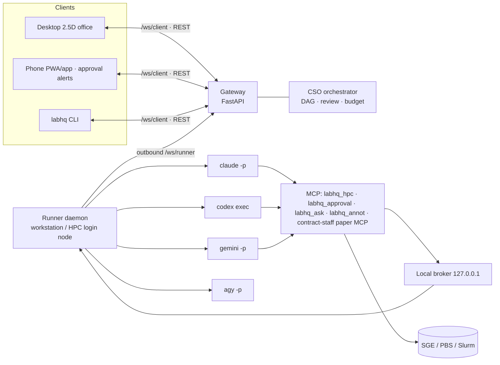
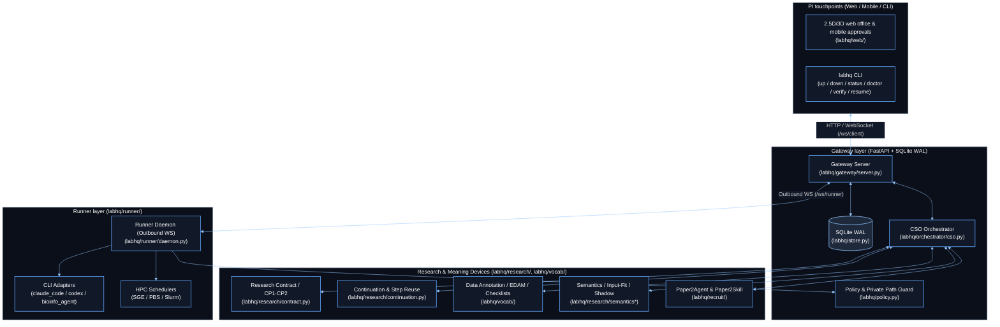
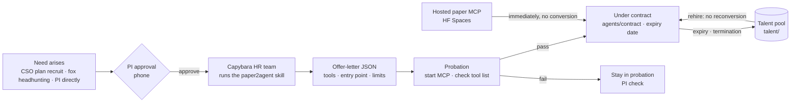

# labhq manual

> English edition of [manual.md](manual.md) (Korean, the source of truth). When the Korean manual changes, update this file in the same PR. The README, PI Q&A, research protocol and vocabulary tables also have English editions; other linked documents (HANDOFF, `reference/` and so on) are still in Korean.

If you are new, start with "Getting started on the web" in the [README](../README.en.md). This document comes after that: command line, configuration, safety measures, the research lane, known limits.
The PI's questions and decisions are in [PI Q&A](pi-qa.en.md); development rules and the work queue are in [AGENTS.md](../AGENTS.md) and [HANDOFF.md](../HANDOFF.md) (Korean).
For how the development checkout preserves author and agent marks, see [Git hooks](reference/git-hook-authorship.md).

| Chapter | What it covers |
|---|---|
| [What the PI sees](#what-the-pi-sees) | Plain-language conversion (`pi_language.py`) and Korean style check (`korean_qc.py`) |
| [Core concepts](#core-concepts) | Terms that come up often |
| [Tour: the mock demo](#tour-the-mock-demo) | See the office without API keys |
| [Installation and first setup](#installation-and-first-setup) | `labhq init`, instances, HPC consultation, doctor |
| [Starting and connecting](#starting-and-connecting) | gateway and runner, browser and phone |
| [Web office](#web-office) | 2.5D and 3D screens and features |
| [Command line (CLI)](#command-line-cli) | `send`, `approve`, `verify`, `recruit`, and more |
| [Structure and events](#structure-and-events) | Request flow, architecture, events, REST, environment failures |
| [Staff and tools](#staff-and-tools) | Org chart, connected tools, bioinfo-agent |
| [Contract staff](#contract-staff-paper2agent) | Paper2Agent hiring and contracts |
| [Safety measures](#safety-measures) | Approval gates, data zones, PI private paths, budget |
| [Per-project GitHub reports](#per-project-github-reports) | Issues, report commits, public guard |
| [Research lane and verification](#research-lane-and-verification) | CP1 and CP2, claim anchors, `labhq verify` |
| [Semantic model and ontology](#semantic-model-and-ontology) | Preparing to reuse earlier results: provenance model, EDAM, shadow, A/B |
| [Configuration reference](#configuration-reference) | State, HPC, staff, engines, reference material, semantic model |
| [Comparison bench](#comparison-bench) | labhq versus a single session |
| [Known limits](#known-limits) | What to check on first run |
| [Components and status](#components-and-status) · [Roadmap](#roadmap) | What is done and what remains |
| [Background](#background-the-virtual-biotech) · [File layout](#file-layout) · [License](#license) | |

## What the PI sees

`labhq` rewrites every notice the PI reads in the web and mobile inbox and in messengers into easy plain Korean (`labhq/pi_language.py`), and checks the style of reports and summaries (`labhq/korean_qc.py`, built-in `humanizer` skill).

- Approval cards, questions, messenger messages and report notifications are shown as plain text in the order `what it wants to do → why → what happens if approved / when finished`.
- Card summaries strip Markdown headings, bold and table marks. The command and the original code stay in the card's and messenger's "Details" fold.
- Tool, compute-server, budget and hiring cards show a one-line description, the reason and the result. The plain-language summary never changes the real approval authority or the command that runs.
- Simple shell and file commands are summarized by rules. For compound commands, the staff member's own explanation and the original command are both kept, and labhq never asserts on its own that nothing outside the work folder is affected.
- If a staff member answered in English, the card does not pass off a machine translation as the original: the Korean notice and the English original are shown separately.

## Core concepts

Terms that appear often in this document.

| Concept | One-line meaning | Details |
|---|---|---|
| gateway | The server that stores requests, approvals and events in SQLite and connects web, phone and CLI (`labhq gateway`) | [Structure](#structure-and-events) |
| runner | The daemon that actually launches staff CLIs. It only uses outbound connections to the gateway (`labhq runner`) | [Structure](#structure-and-events) |
| Staff and engine | A staff member is a YAML file (`agents/core/`) giving role, model and tools. The engine is the CLI that runs them (Claude Code, Codex; also Gemini and a generic `cli` adapter) | [Staff](#staff-and-tools) |
| CSO, plan, step | The CSO splits a request into a plan (a JSON DAG); one staff member takes each step | [Structure](#structure-and-events) |
| orchestrate and direct requests | orchestrate starts from the CSO's plan. direct (`--agent`) goes straight to one staff member. `--plan-only` returns only the plan | [CLI](#command-line-cli) |
| Research lane | Requests the CSO classifies as research when `research.enabled` is on. They follow a fixed plan and PI checkpoints | [Research lane](#research-lane-and-verification) · [Research protocol](research_protocol.en.md) |
| Checkpoints CP1–CP4 | Gates where a research request waits for a PI decision. CP1 (plan) and CP2 (evidence, when `evidence_checkpoint` is on) are wired; CP4 (acceptance) is opt-in via `final_checkpoint`; CP3 (selection) is not yet | [Research protocol §5](research_protocol.en.md#5-pi-checkpoints-and-completion) |
| claim and evidence | The contract for writing a research step's result as claims and the evidence for them (`result v2`). Evidence must point to outputs actually collected | [Research protocol §3](research_protocol.en.md#3-staff-result-contract) |
| domain pack | A bundle of field-specific judgment rules (`id@version`). Packs exist for single-cell DE and bulk two-condition DE | [Research lane](#research-lane-and-verification) |
| Approvals and the inbox | The PI decides HPC submission, risky commands, budget overruns and hiring. Pending items and history gather in the web inbox | [Safety measures](#safety-measures) · [Web office](#web-office) |
| labhq_ask and consultation | The MCP tool a blocked staff member uses to ask. The CSO or a peer answers once in a read-only consultation; only risky matters go to the PI | [Connected tools](#connected-tools) · [Configuration](#configuration-reference) |
| Data zone | A grade per path: public, internal, restricted (`policy.data_zones`). Restricted originals are not opened by file tools; they are handled only inside HPC jobs | [Data zones](#data-zones) |
| Write gate | Claude staff get pre-approved writes only inside the work, project and upstream folders. Writes elsewhere go through approval | [Write scope](#approval-gate-and-write-scope) |
| PI private paths | A list that hides the PI's personal files (`~/.ssh`, browser profiles, labhq config and so on) from staff when they run under the same account (`policy.private_paths`). Claude staff get three layers (deny rules, gate, instructions); Codex staff under the Windows elevated sandbox get two (sandbox read denial and instructions); other engines get instructions only. It cannot stop a script that builds a path at run time | [PI private paths](#pi-private-paths) |
| Work folder, manifest, outputs | Each step gets a folder under `runner.workspace_root`. `manifest.json` records engine, model, session and cost; only files under `outputs/` count as output | [Components](#components-and-status) · [Structure](#structure-and-events) |
| Round log | A development log kept per request. It can be pushed to `dev_log.repo` (private) | [Configuration](#configuration-reference) · [HANDOFF](../HANDOFF.md) |
| Instance | `--instance <name>` runs several labs on one PC. Config, state, ports and tokens are separate; engine logins and limits are shared | [Installation](#installation-and-first-setup) |
| Subscription-limit wait | A step that hits an engine subscription limit is held until the reset time and resumed automatically | [Components](#components-and-status) |
| Semantic model | Two models that re-read the record of finished requests. The provenance model counts output lineage and reuse candidates; the object view counts links among staff, requests, jobs and approvals | [Semantic model](#semantic-model-and-ontology) · [Configuration](#configuration-reference) |
| ontology and EDAM | 125 PI-reviewed vocabulary keys (`labhq/vocab/`), and the public bioinformatics ontology EDAM (75 terms) linked to 79 of those keys | [Semantic model](#semantic-model-and-ontology) · [Configuration](#configuration-reference) |
| Data-type declaration | An optional feature where the CSO writes data_type and format keys on a step's outputs (`plan.declare_output_types`, off by default) | [Configuration](#configuration-reference) |
| Input–method fit | A verdict (`fit`, `mismatch`, `unknown`) on whether a step input's declared type suits the method. Runs in shadow only | [Semantic model](#semantic-model-and-ontology) · [Configuration](#configuration-reference) |
| Shadow | Computed and recorded, but never used for planning, approval or execution. The default is `semantics: off` | [Semantic model](#semantic-model-and-ontology) · [Configuration](#configuration-reference) |
| A/B and judgment window | `semantics: ab` gives reuse candidates to the CSO as a reference for half of research requests only. The two arms are compared in units of 10 requests or 3 weeks | [Semantic model](#semantic-model-and-ontology) · [Configuration](#configuration-reference) |
| Actions A1 and A2 | A1 only records whether the 7 existing actions were possible at that moment. A2 runs only a single `request.followup` that the PI confirmed in the terminal | [Configuration](#configuration-reference) |
| Reuse candidate | An output of an earlier request with the same input hash and target data type, worth using again | [Semantic model](#semantic-model-and-ontology) · [Configuration](#configuration-reference) |

## Tour: the mock demo

Runs without API keys or a cluster.

```bash
py -3 -m venv .venv
.\.venv\Scripts\python.exe -m pip install -e ".[dev]"
.\labhq demo --web
```

On POSIX use `python3 -m venv .venv`, `./.venv/bin/python -m pip install -e ".[dev]"` and `./labhq.sh demo --web`. Add `--phone` for the phone.
Even if a real office is running, the demo picks a different free port. Open only the printed demo address; you will see a `Demo (mock)` mark and a notice band.
A web request runs over about 15–30 seconds and shows the time left until the next request. Time spent waiting for phone approval is separate and is not mixed into the real decision record.
To see only the UI without a gateway, run `python -m http.server --directory labhq/web 8000`, then open `http://127.0.0.1:8000/?demo=1`.

## Installation and first setup

Prerequisites: Python ≥ 3.10, Git, and the staff CLIs you configure installed and logged in. CLIs installed through npm also need Node.js.

```bash
.\labhq init
.\labhq -c config\labhq.yaml doctor
```

On POSIX use `./labhq.sh init` and `./labhq.sh -c config/labhq.yaml doctor`.

`labhq init` copies the example config, generates a random gateway token, and asks for the HPC and bioinfo-agent paths.
A new config starts with the behavior the PI tested (#613): `research.enabled` and `research.evidence_checkpoint`; the domain packs `bulk_tumor_normal@3` and `single_cell_de@3`; `semantics: {mode: ab, actions: confirm}`; `plan.declare_output_types: true`; and `runner.workspace_root` placed in the `internal` zone so the semantic model can hash outputs. To turn any of these off, change the value in the config. This list is `REFERENCE_BEHAVIOUR` in `labhq/init_defaults.py`, and `tests/test_init_defaults.py` fails if it drifts from the example config or the `init` result. Personal values such as tokens, paths and people's names are not in the list. The `pipeline_pr` consent, `dev_log.repo` and `BIOINFO_AGENT_DIR` differ by person and PC, so they are asked for or searched for rather than switched on by default. An existing config is not migrated.
The bioinfo-agent folder is searched in this order: `--bioinfo-agent <folder>`, an existing `BIOINFO_AGENT_DIR`, common locations such as `D:/bioinfo-agent` and `~/bioinfo-agent`, then `/mnt/d/bioinfo-agent` under WSL. If none is found, init asks (it does not ask with `--yes`); if still unknown, it prints "bioinfo-agent not connected — …" and writes the config without the link. A path found or given is stored as an absolute path even if it was relative (a staff task reads relative paths against its own work folder, which would break the link). The `bioinfo-agent` row of `doctor` warns about whether it is connected, and also warns about a config that has a relative path.
`dev_log.repo` (the private repository for the development log) is asked once by `init` as owner/name; Enter leaves it empty. When empty, the log stays on this PC only and the `dev log` row of `doctor` explains how to set it.
For a new config, init also asks about consent to public PR contributions of pipeline code. Only `y` (case-insensitive) consents; Enter, `--yes` or any other answer leaves it off.
If there is no AlphaGenome API key yet, init asks once at the end. Enter skips it; key storage is described in [Public-resource lookup tools](#public-resource-lookup-tools).

init also asks for a GitHub token once (optional, #687). It is used to organize request results into a GitHub repository and announce them as issues. Before asking, init shows the permissions needed. A fine-grained token needs Repository creation (or Administration write), Contents write and Issues write, with Repository access set to All repositories. A classic token needs the `repo` scope. If you press Enter to skip, results are stored locally only; later you can rerun `labhq init` or set the `GITHUB_TOKEN` environment variable. If a token is already stored, init asks whether to take a new one. Replace an expired, revoked or re-scoped token here; Enter keeps it. A pasted token is stored only in `github.token_file` (default `~/.labhq/secrets-github/github_token`), readable only by this account like the AlphaGenome key, and never appears in the config file, on screen or in logs. An environment variable takes precedence. Only the gateway process reads the file, at startup; it is not passed to staff, runner or MCP processes. For staff this file is a private path and reads are blocked. Staff CLIs do not use the development GitHub App bot identity, and the user's own GitHub login stored on this PC is separate from it. The doctor that follows checks the permissions (see [Where results are saved](#where-results-are-saved) below).
init also asks about institutional literature access (optional, #826). It asks for your institution, the official HTTPS proxy prefix your library gives (of the form `https://…login?url=`), the literature services you use, and a contact email for Unpaywall; press Enter to skip any you do not know or want to do later. Do not paste an address from the address bar after logging in. A new config keeps only the proxy (`literature.institution_proxy`) and the email (`annot.unpaywall_email`) and leaves the institution session off. Turn it on yourself after checking the institution's and publishers' terms. An existing config file is not changed; init only tells you which settings to fill in. It does not ask for passwords, cookies or API keys, and does not connect. There is no dedicated automatic connection for Web of Science Research Assistant or Nexus Connect yet. Address formats received and what was verified: [reference](reference/institution-literature-826.md).
`python scripts/clean_install_check.py` checks init → doctor → mock request → request bundle → verify → down in a fresh clone and venv under a temporary HOME, then by default deletes the temporary folder. To keep the installation and the separated stdout/stderr logs, add `--work-dir <new-empty-folder>`; to choose the PASS/FAIL/SKIP JSON path, add `--receipt <local-receipt.json>`. The installation, logs and receipt contain personal paths and are local-only evidence; do not push them to a public repository ([details](reference/clean-install-922.md)). It does not log in to a real staff CLI or call a model. The check is isolated from the shell that started it, so the variables Git Bash exports (`MSYSTEM`, `MSYS*`, `MINGW*`, `EXEPATH`, `ORIGINAL_*`) are not passed on: with them set, the `mingw64` `git.exe` dies in the fresh-clone step. Only the fresh-clone step has been checked from Git Bash; the whole run through installation and the mock request has not been compared across shells.

**Running the research mode to the end with the mock engine.** Under the default config `labhq init` writes (research on), with `runner.force_engine: mock` the CSO returns a plan that passes the research contract, and the request goes plan → CP1 → steps → CP2 → review → report and ends `done`. Put `[multistep]` in the request text for a two-step plan where s2 depends on s1, or `[branched]` for a branched plan with two branches (b1, b2) and a synthesis step s3 that reads both. Without a token the plan has one step. `[step-fail]` fails s2 of a multistep plan and `[branch-fail]` fails s2, the second branch, of a branched plan. The failure stays in the report limits and the CP2 warning, while the other branch and the synthesis step still run. `[all-branch-fail]` fails both branches of a branched plan: the synthesis step is skipped and the request ends `failed` (outcome `research_failed`) without CP2. In a team plan outside the research mode (`work_kind: simple`), `[step-fail]` fails the third step (bioinfo-agent); the later steps are skipped and, after one replan, the whole request ends `failed`. Each step has one worker write one output file (`outputs/result<number>.tsv`); topics where a domain pack applies, and a branch that fails, are not imitated. The tests are in `tests/test_e2e_mock.py`.
To run several labs on one PC, run `labhq init --instance <name>` and then add the same
`--instance <name>` to every command. Config, state, runs, talent, ports and tokens are separated per instance.
Engine logins and usage limits are shared by all instances.
The scheduler is detected through `qsub`/`qstat` (SGE, PBS) and `sbatch`/`sinfo` (Slurm); if the type cannot be narrowed to one, init asks (it stops with `--yes`).
If a scheduler tool exists, init runs the HPC consultation (#119). It collects queues, PEs, memory resources and the PBS flavor with read-only queries (SGE `qconf -sql`, `-spl`, `-sp`, `-sc`; PBS `qstat -Q`, `qstat -B -f`, `pbsnodes -a`; Slurm `sinfo`), writes a draft `hpc:` block into the config and shows it.
After saving the config, init shows the submit command for a `sleep 1` test job (1 core, 5 minutes), submits it once only if the PI answers `y`, and tracks it to the end. With `--yes` or `--dry-run` it does not ask, and inside a controlled zone it does not submit.
With no cluster, `scheduler: none`; heavy steps run only through the local CLI, and the CSO says in the plan which steps cannot. The consultation does not decide `ssh_host` or the data-account switch (`submit_prefix`) ([Configuration reference](#configuration-reference)).
`--yes` accepts defaults and `--dry-run` shows the changes and doctor checks without creating files. An existing config is preserved and replaced only with `--force`.
On Windows, init leaves out the restricted zone; if a personal Codex instruction file exists it adds a staff-only `CODEX_HOME`, and if `~/.claude` exists it adds a Claude-staff-only `CLAUDE_CONFIG_DIR` (`~/.labhq/claude-staff`), and prints the login commands a person must run.
init asks for the work folder as `runner.workspace_root` when it creates a new config. If the Windows system drive is under 128 GiB or its free space is below the warning threshold, init points to candidate fixed data drives with room. Choose a path on the drive you want yourself. `--yes` keeps the existing default path and never moves or deletes anything automatically.

If the Codex `bin` is empty or `auto`, the highest-version folder in the Windows app is chosen, and mtime is used only when versions cannot be compared. doctor prints the chosen path. Without the app, PATH is used.

**When configurations overlap (#613).** If labhq instances with different config files run on one PC, they can mix each other's records and approvals or open the wrong office. A running gateway and runner write their own *identity* at startup: the config file that started them, and fingerprints of `gateway.state_dir`, `runner.state_dir`, `runner.id` and the port (both are hashes; no secrets). The files are `labhq-gateway-owner.json` in the gateway state folder and `labhq-runner-owner.json` in the runner state folder; the gateway also returns the same hash as `identity` in `/api/health` (no paths or tokens). `doctor` (the `instance` row) and `up` compare the identity of whoever holds the state folder, runner state folder and port against the current config, and report in plain Korean with the command to fix it. They only read; the default `doctor` uses no network. `--runtime` checks the authenticated gateway state.
- Same state folder: if a process with a different identity is alive, `up` does not start and points to `labhq -c <that config> open` or `down`. If it is still running with a config that changed after this config file started it, `up` points to `down` then `up`. If it is not alive but the config that last used the folder differs, it only warns.
- Same runner state folder: two runners must not share `runner-<id>.sqlite3`, the control folder and the input hash cache, so this is blocked even when `runner.id` differs. Starting `labhq runner` or `labhq gateway` directly does the same check at startup and does not start while blocked.
- Same port: if a gateway of another config runs on this port (only when that config's process record points to that config), `up` stops and tells you which config it is and `labhq -c <that config> open`. A gateway that answers with the same token but whose `identity` differs from this config is not used, and an older gateway that does not report an identity is accepted only if this config's process record vouches for it. A gateway that is not accepted is not written to `labhq-last-config.json` or the primary config.
- Primary config: the config path of the first successful `up` is written once to `labhq-primary-config.json` in the default state folder (`~/.labhq/state`). Running `doctor` or `up` with another config warns; to change it, use `labhq -c <new config> up --make-primary`. Instances made with `--instance` are deliberately separate, so they do not become the primary config and are not compared.
`up` writes `labhq-last-config.json` in that state folder only after confirming it is its own gateway. If the config file is deleted, that record is ignored.

Before running, use `labhq doctor` to check config, engines, staff and compute tools. `labhq doctor --json` writes `capabilities.json` in the runner state directory, and connects to public data sites only when `--network` is added. The `runner_capabilities` in this manifest are facts computed from the same config and roster as what the runner reports. The `research lane` row tells you whether the research lane runs to the end. With only `research.enabled` on, it warns that the lane stops after CP1; `evidence_checkpoint` must also be on to proceed to CP2, review and report. A misspelled key under `research` is an error at startup.
doctor separates **config readiness** from **operational readiness**. Before deployment, use `doctor --runtime`. A stale or unknown PID identity of a daemon fails; a pristine or normal down is shown separately. Remote and foreground roles do not require a local PID and are verified by the authenticated gateway and runner connection (including a running WSL runner). Past up/down history with no PID record is resolved only when this authentication and connection are confirmed; a missing record without authentication, and history lookup errors, keep failing.

For an instance that uses a reviewed independent owner Job on Windows, doctor shows `contained_verified` once it confirms the four daemon generations with the operator contract pin outside state, `contained-runtime.json`, and a fresh owner challenge. It also checks the deployment path and hash of the actual inspection code. The default detached check is kept and does not erase authentication or runner connection failures. The lifetime cap of the owner receipt is `runner.contained_max_s` (default 5400 s, minimum 60, maximum 86400); for a long research run such as 15 hours, the issuing owner must use the same value (#938). It does not confirm staff children, request termination or a research GO. [Receipt and RPC contract and limits](reference/contained-runtime.md).
The `disk` row of doctor reads the drive free space of the work folder, temp, and the Codex/Claude staff homes. If the gateway state folder (`gateway.state_dir`, SQLite and events) is on a different drive, that drive is read separately; on the same drive the row is not repeated. If the folder does not exist yet, the nearest existing parent is checked. The default warning is under 10 GiB or under 5%, adjustable with `runner.disk_warning_free_gb` and `runner.disk_warning_free_percent` (0 disables that criterion). For the work folder and gateway state folder drives, free space under `runner.disk_fail_free_gb` (default 2 GiB, the same threshold the runner uses to ask the PI before a task starts) is a fail (0 means no fail). Temp and staff-home drives stop at warn. A failed lookup is also a warn. When a step copies an earlier step's outputs to `inputs/<step>`, the runner first compares the total file size with the free space on the work drive; if the total exceeds the free space, it stops before copying any content and records, in the activity log and the staff briefing, that the input cannot be used, with the reason (size needed and free). On drives where real usage differs from file size, such as compressed volumes, this calculation is not guaranteed. The staff member asks the CSO, and the original outputs are untouched. If free space cannot be read, the copy proceeds within the existing limit as before, and if the disk fills during the copy it reports `disk full during copy`. A download that a staff member makes through a shell has an unknown size in advance, so this input-copy check does not block it, but the shell command check below looks at it separately.

**Shell download and unpack check** (#678): when a Claude staff member runs `curl`, `wget`, `unzip`, `tar`, `7z x`, `git clone`, `fasterq-dump`, `prefetch`, `aws`, `gsutil` or `rsync` through Bash, even a command the policy allows first looks at the free space of the target drive. The target folder is the one named by `-o`, `-O`, `-P`, `--output-dir`, `-d`, `-C` or the folder argument of `git clone`, otherwise the work folder. Other paths written in the same command are read too (a `curl` with several outputs, the place an earlier `cd` moved to, the target of a redirection `> file`, `>> file` or `&> file`), and if any of them is on a drive below the floor the PI is asked. The command is read the way bash reads it: `;` and `#` inside quotes are text, `#` starts a comment only at the start of a word (`url#frag` is one word), and `2>&1`-style descriptor duplication is not a file. The value of a clustered option such as `curl -Lo file` and a `-d` that follows the patterns of `unzip file -x pattern -d folder` are read as well. If free space is below `runner.disk_fail_free_gb` (default 2 GiB), whatever the size, or unpacking a known size would take it below that, the PI is asked through an approval card. The size is the uncompressed total of the zip listing for `unzip`, 4 times the archive size (an estimate) for `tar` and `7z x`, and unknown for downloads and the other commands. With an unknown size nothing is blocked, and only a warning goes to the work board when free space is under the warning levels (`runner.disk_warning_free_gb`, `disk_warning_free_percent`). It never only blocks: if the PI approves, the command goes on. Commands it cannot parse (pipes, variables, substitutions) and drives it cannot read are left alone. Rules pre-approved in `--allowedTools` such as `Bash(unzip *)` or `Bash(git clone *)` are removed for staff with the approval gate so the check applies. The shell commands of a local job the runner starts itself get the same check (#1167). If a command the policy allows heads for a drive with too little space, the same approval card asks before the job starts. Free space below `runner.disk_fail_free_gb` asks even when the size is unknown; with an unknown size and space only under the warning levels, it only logs a warning. An error during the check never blocks a command the policy allows. Not covered: Codex, Gemini and cli staff (the engine sandbox runs their commands itself), PowerShell's `Invoke-WebRequest` and `Expand-Archive`, a prefix rule (`Bash(ls *)`) that pre-approves a whole chain, and a disk that fills during a command. When a task starts (#678), the runner reads free space on the work-folder drive again. Below `runner.disk_fail_free_gb` (default 2 GiB, 0 turns it off) it does not start the task and asks the PI with a **Low disk space** card. Approval starts it; if the PI declines or does not answer within 24 hours (a time limit set by the runner), it does not start and records the reason. While this card is open, the web shows the request as waiting for a PI decision. The judgment uses the free space of the drive of the work folder this run actually uses (including cases where resume or retry uses a different drive), and is made before the work folder is created or an execution slot is taken. Below the warning threshold (10 GiB / 5% above), it only logs a warning in the work-board log and proceeds. If the drive cannot be read it does not block, and the automatic environment fix (`facilities_fix`) is not subject to this check. A folder for large raw data is set with the optional `runner.bulk_data_root`. If set, the staff briefing gets one line, "Download large raw data (several GB or more) under this folder", with the free space. This folder is outside the work folder, so it gives no new write permission and writes go through the usual approval judgment. If it spans a controlled zone, it is not used in the briefing and a warning is logged. If unset, nothing changes. A configured work folder is included in the pre-publication private-path check regardless of its name. [Verification evidence](reference/disk-preflight-752.md).

**Disk watch while a task runs** (#678): for what the earlier check cannot stop (a download of unknown size, commands that Codex, Gemini and cli staff run themselves inside the engine sandbox, a drive that fills during one command), the runner reads the free space of the work folder, the runner state folder, `runner.bulk_data_root` and the project folders the staff member may write every `runner.disk_watch_s` seconds (default 30, 0 turns it off) while the task runs. If any is below `runner.disk_fail_free_gb` (default 2 GiB), it halts that task once and keeps its session. The halted task reaches the PI as the usual `Halted · can resume` card, and the task log says the disk is below the floor. After you free space and resume, the new turn checks the disk again when it starts (below the floor it asks the PI whether to start). Set `runner.disk_watch_halt: false` to log a warning without halting. If the halt fails it is tried again at the next beat, and a drive it cannot read is skipped. A facilities fix is not watched because clearing a full work folder is its job. Limits: a task that writes more than the free space between two reads has already filled the drive (the 2 GiB floor is the cushion), and when the gateway is on another PC its database drive is not visible to the runner (doctor's gateway drive row covers it).

doctor checks only the engines the roster uses, and groups the skipped network and dry-run login checks into one line. If you set `runner.contract_dir`, doctor reads that folder instead of the default `agents/contract`, and matches the runner on contract validity and duplicate-ID precedence. It does not move or edit expired contracts. If there is any fail, no active staff, or any roster engine executable is missing, doctor ends with `Ready to run: no` and the reasons. Other warns do not change readiness.

`runner.facilities_support` defaults to `unspecified` (always WARN). `required` is FAIL when absent, failed, unconfirmed, dry-run or mock; `optional` is OK only for ready. init preserves an existing explicit value (including with `--force`). See the [verdict table and limits of readiness evidence](reference/facilities-support-983.md).

| doctor item | Verdict | Fix command |
|---|---|---|
| Paper2Agent | fail if the recruiter or skill is missing, or the installed copy differs from the configured commit. skip for mock and demo | `labhq doctor --fix` |

`--fix` installs Paper2Agent at the configured `recruit.skill_commit` and checks again. If the download fails, it leaves a fail with a hint to check the network and source/ref. If you use a separate config file, add the same `-c <config>`. `init` defers the installation check and does not download the skill. Run `doctor --fix` before real staff runs.
npm's `.cmd`/`.bat` shims can corrupt multi-line prompts, so labhq unwraps only standard npm shims and runs them with Node.js.
Shims it cannot unwrap are refused. To specify one directly on Windows, use `engines.<engine>.bin` and `prefix_args` (check the installed package path).

For Codex staff login isolation, follow the dedicated `CODEX_HOME` note in [Known limits](#known-limits). `labhq doctor` checks the setup.

### Analyzing in this PC's WSL

Choose the Windows config and run `labhq -c <config> setup-wsl --check` to check tools, plugin and runner connection. Analysis readiness needs all of: the bioinfo manifest, the bioinfo-analyze skill, Java, Nextflow, the WSL Claude CLI, and the staff account login. Only a WSL confirmed ready at connection and roster refresh gets priority assignment; if not ready, native is used.

On an installation without WSL configured, `doctor` prints only a line saying the optional feature is off. After you run `setup-wsl --check` yourself or enable WSL, it reports each readiness item and the real WSL staff login path.

1. Start the gateway with `labhq -c <config> up`.
2. `labhq -c <config> setup-wsl` prepares the missing Nextflow (24.10.5), editable labhq venv and runner config. It saves enablement only after confirming analysis readiness and the connection. It only gives guidance for Claude CLI installation and login and for administrator commands.
3. After that, `up` and `down` also start and stop the WSL runner. To control it separately, use `wsl-runner start` or `wsl-runner stop` with the same config. It reuses the existing supervisor and process-identity checks.

**When WSL is not ready (#612).** When work given to `bioinfo-agent` (a direct request or an already planned step) has nowhere to go and the config has `runner.wsl`, one card per request asks "WSL is not ready yet. Set it up?". A yes makes the gateway run the same preparation as `setup-wsl` in a thread. Fifteen minutes is the limit of the wait: a preparation already started cannot be stopped, and no other setup is started until it ends. If another native runner hosts the same agent (for instance, briefly disconnected), the existing wait applies and no card is shown. If commands that need administrator rights remain, the card and the error show them, and the request stops at once instead of waiting for a runner (cost $0). A no or a timeout is not asked again within the same request. If the gateway is not on the PC that has WSL, nothing runs and only `labhq setup-wsl` is suggested. The card and feed carry item names and fixed advice, never installer output.

**Running in this PC's WSL (#612).** You can pick WSL when you send a request: `labhq send --wsl`, the "In WSL" checkbox of the web request box, or `run_where: "wsl"` in the API (default `auto`). Picking it opens the card above once per request before planning reads the staff list (it asks even when another native runner also hosts the agent); on a yes it waits until the WSL runner owns the agent after the preparation, then pins that request's `bioinfo-agent` work to the WSL runner (`session_runner`). A pinned task goes only to the WSL runner even while another request's `bioinfo-agent` work is still unfinished on a native runner, and a resend or a recovery after a gateway restart goes to the same runner; if the WSL runner drops for a moment the task waits for it instead of running natively. A native runner that tries to take the work is refused at no cost. The wait for the WSL runner is at most 5 minutes, and if `runner.wsl` is not configured, the check or setup fails, or there is a no or a timeout, nothing is waited for: the reason is left in the request's `run_where_note` and the request goes on without WSL. Planning is told "the PI chose to run in this PC's WSL" only for a request that actually got WSL; one that chose it but goes on without it is told the `run_where_note` reason and "runs without WSL" instead, so the plan does not assume WSL. A CP1 revise request and follow-ups keep the same choice. The choice applies to `bioinfo-agent` only, so adding it to a request addressed to another staff member is refused (400 in the API, an error in the CLI and the web box). The HPC and local choices, and the "run location card" that lets automatic planning pick WSL, come with #578.

| `runner.wsl` setting | Default / purpose |
|---|---|
| `distro`, `user` | `Ubuntu-22.04`, the distro's default user |
| `id` | `lab-wsl` — if it equals the Windows runner's at activation, config and start are refused |
| `bioinfo_agent` | `/mnt/d/bioinfo-agent` |
| `root` | `.local/share/labhq/wsl-<config hash>` in the Linux home; separates venv, state, logs and staff config |
| `gateway_url` | the existing address → the Windows NAT address if localhost fails. Default ports ws 80, wss 443 |
| `enabled` | true when setup's connection check succeeds |

The token is passed over stdin and kept in a 600 config file inside a 700 folder on Linux. It is not stored on the Windows mount. If NAT cannot connect, bind the gateway to an address reachable from WSL and check the firewall. Setup does not change the bind or the firewall.

Work uses the same `/mnt/<drive>/…` folder as the Windows `runner.workspace_root`. Regardless of where the gateway is, work, result and event paths are converted through the target runner's `runtime_env`, joining project, reference, `inputs/<step>`, manifest and bundle. `/home` work folders and UNC paths are refused. Setup copies the Windows approval and budget policy and the reference roots (including projects), and also converts personal and controlled-zone paths. A conversion failure is a config refusal; if you changed the policy or reference roots, run `wsl-runner stop` and then setup again.

Each staff member has exactly one responsible runner. If a task is running or its delivery result is uncertain, the assignment is kept and new tasks go to that runner too. When everything is finished, bioinfo-agent prefers the ready WSL, and falls back to the connected Windows staff if WSL is disconnected. If only the WSL start fails in `up`, it prints one warning line and the native start still completes as a success. The CSO reflects the connected runner's Nextflow and Docker checks in the plan. The WSL Claude CLI and staff login (`root/claude-staff`) are prepared separately; setup does not log in. The run-location choice card is stage 2 of #612.

## Starting and connecting

```bash
.\labhq -c config\labhq.yaml up
.\labhq -c config\labhq.yaml open
```

The Windows wrapper runs `.venv\Scripts\python.exe` directly, so no venv activation or PowerShell ExecutionPolicy change is needed. `up` starts the gateway and runner as separate background processes (each role goes through a supervisor; see **Supervisor** below) and leaves logs and process records, including creation time, in the state folder. `up` and `down` for the same instance are serialized by a state-folder lock; if another command is in progress, the exit code is 2. On POSIX use `./labhq.sh`.

**Supervisor (#589):** `up` starts one small supervisor per role (gateway, runner) (`python -m labhq.supervisor`), and the gateway and runner start as that supervisor's children. When `up` ends, a process that `up` started directly keeps recording the dead `up`'s PID as its parent. Windows can hand that number to another process, and a tool that kills a tree by parent PID alone (such as `/T` termination in test code) kills that process, taking the gateway and runner down with it. labhq's own termination path checks creation time (#597), but outside code cannot be fixed, so labhq keeps the parent PID from being reused. The supervisor stays alive as long as the gateway and runner do, so its PID as a parent is not reused, and the supervisor's own parent (`up`) is not reused because the supervisor opens handles to 4 ancestor processes at start (while a handle is open, even a finished process's PID is not returned). The supervisor also records when the gateway and runner ended and their exit codes as `child_exit` in `<role>-supervisor-diagnostics.jsonl`. A forced kill cannot leave the process's own `exit` record, so this is the only clue. If it cannot open an ancestor handle (permissions, or the parent already ended), the role still starts and the reason goes to a `parents_pinned` row in the same file. `up` does not finish until the supervisor has pinned its ancestors and recorded the role (up to 20 seconds).

If the supervisor cannot record the role and fails to start, `up` cleans up the supervisor. If that cleanup also fails, it keeps the PID record, reports the termination error and PID, and exits with code 2. The next `down` or `up` rechecks the same supervisor record (#627).

With `supervisor.restart: true`, a role that ended by itself (with a nonzero exit code) is restarted. Exit code 2 means labhq refused to start (a config refusal, or the ownership record of #613 showing another config is using the same state folder); the same refusal would repeat, so it is not restarted and only `restart_skipped` is recorded. It first waits `backoff_s` (5 s), then doubles up to `backoff_cap_s` (120 s), and if more than `max_restarts` (5) restarts occur within `restart_window_s` (600 s), it leaves the role as is. **It is off by default**, so abnormal exits are not hidden. A role stopped by `down` or the web shutdown is not restarted (the `labhq-<role>.stopping` marker file is written first, and `up` removes it). If you run `up` while the supervisor is restarting, it does not start another supervisor and waits for the role to respond. A gateway or runner started before this change has no supervisor, and `status` says "no supervisor (pre-supervisor mode)". Running `down` then `up` puts it under a supervisor. If a supervisor process record exists but the process is gone while the role is alive, `status` and `doctor` warn (an unprotected state).

If you leave the 2.5D or 3D web open, it reports gateway disconnection and runner disconnection separately. The warning stays during reconnection and clears when the connection returns. A disconnection alone cannot tell shutdown from a network problem, and closing the web does not send a notification through an external channel.

On Windows, `up` first requests Job breakaway with the real Python interpreter (keeping the venv choice). Only on a confirmed refusal or residue does it clean up the direct child through an owned handle and then try a temporary local WMI bootstrap once. After checking the nonce, creation time, executable, current user and that no Job owns it, it sends the ACK, and the bootstrap enters the supervisor with the same PID. A sharing violation (winerror 32) while another handle holds the receipt or ACK file, and the EACCES that Python's file open leaves without a winerror, are read again within the existing wait limit, and the number of retries is recorded in the failure record. Other winerrors and errnos stop immediately. On unknown or cleanup failure it stops and does not remove the flag. There is no service, Task Scheduler or elevation. `logs/detached-launch.jsonl` records the attempts, refusals and verification steps and any Job residue or lookup errors; even if the log write fails before return, it tries to clean up the owned child. Operational readiness checks that none belong to a Job, using query-only handles that pin the current PID and creation time of the role and supervisor. It does not substitute past logs or HTTP authentication, and if it cannot confirm, a restart through the verified path is required. A deployment must confirm both `doctor --runtime` exit 0 and `runtime_readiness.ready=true`. A disappearance with no record alone does not establish a forced Job kill. [Evidence and verification limits](reference/windows-runtime-795.md). If WMI startup is delayed, check the fixed stage and elapsed time. The provider wait limit is 15 s (the 20 s request expiry minus 5 s for the bootstrap to start; a margin, not a measured bound), and a timeout still counts as a failure ([diagnostic limits](reference/windows-provider-793.md)).

**When it stopped without warning:** `status` shows the local PID record and the last heartbeat and exit before attempting a connection, and `doctor` shows them without network. Lookups do not delete PID records. A missing process with no exit is `suspected abnormal exit`. The files below accumulate per gateway and runner in `gateway.state_dir/logs/` of the config (also when started directly).

| File to look at after the next stop | Contents |
|---|---|
| `<role>-diagnostics.jsonl` | UTC time, PID and parent PID, start, a heartbeat every 10 minutes (RSS bytes, Windows handle count), exception type, signal, uvicorn shutdown, exit reason and code |
| `<role>-fault.log` | faulthandler's native fault traceback, and the call stack of uncaught Python exceptions |
| `<role>.log` | Unbuffered stdout/stderr of the `up` child, uvicorn and general runner logs |
| `<role>-supervisor-diagnostics.jsonl` | The supervisor's own start and exit, `parents_pinned` (the pinned ancestor PIDs), `child_start`, `child_exit` (the role's PID, exit code, uptime, whether `down` was requested), `restart_scheduled`, `restart_giving_up` |
| `<role>-supervisor.log` | The supervisor's stdout/stderr (errors from a supervisor that failed to start are left here) |

Unsupported resource values are `null`. Exception messages and settings are not put into the diagnostic JSON. A heartbeat is a record that the process was alive; it does not guarantee the gateway was responding. Exit hooks do not run on a forced kill or `os._exit()`, so also look at the Windows Application/System events from the same time as the last heartbeat ([Python atexit](https://docs.python.org/3/library/atexit.html)). The native fault record also does not catch every external termination ([faulthandler](https://docs.python.org/3/library/faulthandler.html)). For an instance already running, this applies from the next start.

`down` refuses with exit 2 if there are requests in progress or waiting (including those waiting for a PI decision), follow-up questions running on a finished request, a hiring in progress (`labhq recruit`), a finished request still writing records (before writing the cancellation report, or copying the request bundle: `finishing request`), or if the authenticated state cannot be confirmed (gateway `/api/shutdown-readiness`, #500, #521). The refusal text gives the stage (cancellation record, report bundle save, result save, PI interpretation), and the report-bundle stage also gives elapsed time (`n minutes in`; the other stages do not record a start time). If a job building a request bundle exceeds 10 minutes (`FINISHING_STUCK_S`), it is reported as `stuck finishing` and does not block shutdown; that request keeps `bundle_pending` and rebuilds the bundle at the next start (#658). The hiring count is per runner process, so restarting the runner drops hirings from the previous process (`process` in `runner.hello`). Use `down --force` only when you accept the interruption; it ends only the runner process tree whose identity matches, and the gateway. For each role it ends the supervisor first (writing the marker first so it does not restart), then whatever remains of the role. If the supervisor's identity cannot be confirmed, it stops with exit 2 before ending anything. On POSIX it waits up to 10 seconds after SIGTERM, and if still alive it sends SIGKILL, confirms termination and removes the record. After stopping the recorded processes, it checks once more whether the gateway still answers (waiting up to 3 seconds right after shutdown). If a gateway or runner started outside `up`, such as by a script or another window, and with no PID record still answers (for a gateway on another PC, only while this config's runner id is still connected), it does not finish with `stopped`; it reports "a gateway/runner started by something other than `up` is still running" and exits 2. `down` cannot stop that process, so end it yourself and run `up` again. Only when there is nothing to stop and the gateway does not answer does it print `Stopped: no recorded process` and exit 0. On Windows it does not use `taskkill /T`. A process created before its parent is not treated as a child even if the parent PID matches; it opens the candidate's handle first to pin the PID, rechecks the parent PID with a second lookup, and ends it with that handle, so the gateway and runner are never ended together because another process inherited a PID after `up` finished (#589; adapter cancellation and timeout, and the runner's version-probe timeout, work the same way). `down` waits up to 10 seconds per process for the supervisor, the role and their children to actually end. If any does not, it reports the role and PID and exits 2, keeping the PID record so you can try again.

**After restarting the PC**

Whether the gateway is local is judged from the URL hostname and this PC's addresses. It is checked even with a `0.0.0.0` bind combined with a TLS proxy, and if the address cannot be confirmed it is treated as possibly local.

```powershell
cd <labhq repository>
.\labhq -c config\labhq.yaml up
.\labhq -c config\labhq.yaml open
```

If the config path is missing or the gateway client token is the default `change-me`, it does not start. When the gateway is off or returns an HTTP error, `open` and other API commands print one line and exit 2 instead of a traceback.
To view the offline demo on a phone, the PC and phone must be on the same Wi-Fi ([Web office](#web-office)).
The gateway stores requests, approvals and events locally, so run it on a VM or home PC that can keep its state directory
(the runner waits in a reconnect loop). If no runner is connected, or the runner for a needed staff member is off, new requests and steps in progress do not fail: they wait as `waiting_for_runner` and resume when a runner attaches (PI check R15). Nothing has been sent, so there is no cost. If `gateway.runner_wait_s` (default 86400 s) is exceeded, the request ends with a Korean reason saying "start a runner with labhq up (or labhq runner), then send again". A staff member no runner has ever handled does not wait and fails at once. Each time a runner attaches or changes its roster, waiting steps are judged again; if the runner that attached does not handle that staff member (the contract ended or the yaml was deleted while it was off, or a runner handling only other staff attached first on a freshly started gateway) and there is no other runner to wait for, the wait ends at once with "none of the connected runners handles that staff member" (#521). `runner_online` in `GET /api/health`, the runner line of `labhq status`, and the **Runner off** band at the top of the web show the connection. When the gateway restarts, it records `runner.offline` (`reason: gateway_restarted`) for each runner the previous process thought was connected, so even a page that reconnected without a refresh shows this band until the runner returns. The simplest setup is to turn on Tailscale on the gateway machine and the phone and connect by the tailnet address.
If you must open it to the public internet, put it behind a TLS proxy (Caddy or similar) and be sure to replace the token.

### Shutting down from the web

In the **Shut down** button at the top of 2.5D and 3D, check the titles and counts of requests in progress, PI decisions pending, and follow-up, hiring and finishing states.

| Choice | Behavior |
|---|---|
| **Turn labhq off** | Turns off the runner and gateway when everything is finished. Blocked while work is in progress. |
| **Turn off anyway** | Read the interruption warning and press **Stop the work in progress and turn labhq off** once more. When you turn it on again, you continue from the resume card. A report or bundle that was being saved can be lost. |
| **Close the tab only** | labhq keeps running. When you open it again you continue from where you were. If the browser blocks closing the tab, close it yourself. |

The confirmation window shows the server address you connected to. Even if you press it from another PC, it turns off **the instance on the server PC**. Enter does not shut it down.
It calls `POST /api/shutdown` with the PI token and uses `down`'s state recheck, lock and PID identity checks unchanged. If the `up` PID record for this gateway and runner is missing or does not match, it refuses.
The order is runner first; the gateway sends the response and then **shuts itself down normally** (running shutdown hooks and closing open connections). If the gateway waited for its own shutdown, they would wait on each other and end in a forced kill, so a detached watcher process forces it off only if it does not finish within 30 seconds (`state/logs/gateway-exit-watch.log`).
`stopping` in the response is an acknowledgment. After shutdown, when the server connection drops, the screen shows **Done. You can close this tab.** The browser alone cannot tell a network loss from a process exit. If the server answers that shutdown failed, or the confirmation time passes, it leaves a failure notice.

## Web office

The common 2D components follow the [Design E + Character 1 selection record](design/2026-10-13/README.md) (Korean). Colors, type and spacing are managed in `web/ui/tokens.css` and common components in `web/ui/components.css`; replacing the characters is a follow-up task.

The recent-request list on the 2D **work board** shows the full title, status and review-pending state. Press one to switch to that request. Steps are ordered in progress, check, waiting; empty lists are hidden and finished steps are folded. The request sentence appears only once, in this list. The step flow line above the tabs shows the owner, the current step and the number done, and is visible on any tab. A staff card is a small picture, a name and a one-line status; press it to see role, employment type and duties in the detail sheet.

The **messenger** puts the sender and time above the bubble and the body below. Long text, commands and original code unfold in **Details**. The request input's **Send** is a 48px primary button; recipient, team or not, work type and project are in **Options**, and reference material is in **Attach / reference**. In note mode during a run, new-request options are hidden.

- The penguin chief of staff explains technical messages and staff-to-staff English conversation in Korean in two sentences or fewer. The original is kept in **Details**, and delivery does not wait for translation.
- Approval cards without an easy explanation also get one. An existing explanation and the approval target and command are not changed.
- Tool cards distinguish list lookup, file read, program location check, install, network, write and delete, and show the work location, the step and its purpose, the rule that applied, the risk grade and the approve/decline result. A paper-skill build shows the paper title and the actual owner's name (for example the Beaver HR team). 2.5D, 3D and `labhq approvals` use the same explanation, and the CLI original is viewed with `labhq approvals --details`. No interpreter model is used for a command interpreted by template.
- Simple reads of the current work folder (for a paper-skill build task, that build's folder) and of mounted plugins are allowed. Parent paths that contain the workspace or talent common roots or other staff folders are excluded from the read exception. Staff's Paper2Agent reference material is opened under that skill only for paper-skill build tasks. Credentials, private paths and other tasks' stored outputs stay protected. A staff member's own stored outputs are read only through file tools.
- Access to controlled or private paths is marked risk **High · needs confirmation** even for reads. The location name is attached after checking the absolute path, separators, case and the real link target. Read grants for managed folders also apply to Codex's read-only profile; Bash paths are interpreted by POSIX rules and ambiguous ones are asked about.
- Staff activity uses an easy summary and keeps the original command in **Details**. Even in auto mode, when an approval card appears it explains which rule is asking. Existing policy applies to writes, deletes and unclear scripts.
- `pi_language` settings: `enabled: true`, `model: haiku`, `per_request_usd: 0.50`, `per_message_usd: 0.05`, `timeout_s: 30`. Confirmed costs and unknown-cost items are also counted once in the running request's budget. The call cap is reserved first, so the translation cap holds after a failure or restart, and no call is made once the request budget is spent. A translation is accepted only as one paragraph with no line breaks and at most two sentences, so that format is written directly into the prompt (the card's "what → why → result" structure and the line-break list rule are not attached). On the runner it runs in the consultation slot, not a research-step slot, so it is not cancelled by waiting more than 30 seconds behind a running step. For a translation whose cost is unknown because of a timeout, the cost record names the model configured for this translation, not the staff member's default model (#942).
- If the request text, a path or reference material touches a controlled zone of the policy, or the judgment is unclear, it is not sent to the explainer model.
- Text is judged English if it has at least 8 Latin letters and Latin letters are at least 60% of Latin plus Hangul letters. Code and paths are also explained. English technical terms inside a Korean explanation are allowed; code and paths are rejected. Results and failures are stored per message and not retranslated.
- A failed follow-up question is still shown as failed after translation. The interpreter is left out of the request steps, research round records and the reconnect task list, and included in cost totals and the finishing work before shutdown. The original task and events remain in the raw audit ledger.
- With no model, a lost connection, an exceeded cap or a failed translation, the original is shown with **Could not translate**. Messages that do not belong to a request and originals over 12,000 characters are delivered the same way.
- For writable staff, vendored skills are read through the `labhq-bundled-skills` plugin verified in Claude and through the work folder's `.agents/skills` in Codex. The distribution wheel carries the plugin manifest, SKILL and templates together. Read-only runs turn the skill tool off and put only the banned-phrase, jargon and comma rules and the graphical-abstract green check rules into the prompt.
- Eight banned phrases outside quotation marks in reports and summary READMEs are recorded as `PASS`/`WARN`; the polish-preservation check is a follow-up.

The 2.5D messenger opens the latest 40 items and, as you scroll up, appends earlier records 40 at a time. It shows a notice while loading and **This is the beginning** at the end. After a refresh it queries the stored record again. Separately from the memory cap of staff activity and the feed, it keeps questions, answers, staff messages and report notifications, and excludes tool output, thinking and debug. Events deleted by the retention cap before the upgrade cannot be recovered.

When a report is finished, the request becomes **Report review pending**, and a done mark on the whiteboard with **Open report**, one notification, a done mark on staff, and a **Report review** card in the Decisions tab appear. Failures and cancellations show **Waiting for result check**. Press **See result and reason** to jump straight to the failure reason, remaining results and next action on the work board. A request before PI review also sorts as unfinished and is included in the automatic selection when you first open the page. A request you picked yourself stays selected.

After reading the report, press **Review done** (**Checked** for a failure or cancellation) to finish. A normal review card has no deadline or auto-approval and does not block other requests. A CP4 research draft has an acceptance deadline. While staff are asking and answering each other, it shows **Waiting for an answer**; it shows waiting-for-approval only when a real PI decision card exists.

To try it on a phone on the same Wi-Fi, run `labhq demo --web --phone` and open the printed `/3d` URL. Approvals are pressed on the phone or handled automatically after 120 seconds by default.
`/` is the 2.5D office and `/3d` is the 3D office. The two screens share the `state.js` reducer and `/ws/client` without a build, and connect with the same client token.
When you reopen it, it opens the most recently active of the requests still awaiting review or confirmation and those in progress or interrupted. If everything is settled, it starts at **Waiting for a new request**, and an ended request with `pi_reviewed_at` recorded can be found again, with its report and storage location, in the folded **Past requests** of 2.5D and 3D. While a follow-up question is running or waiting, even a request whose review is done stays on the work board, and folds back into **Past requests** when it ends. The cost at the top sums only the cost recorded since this `up`; the cumulative total is shown in the past-requests bundle and the cost tooltip. The browser's last selection is restored only when it is not a past request. **Continuing** on the whiteboard shows for a request that has a resume event or was already running when you connected.
Before the gateway's first snapshot arrives, 2.5D shows cost, the office board, the Decisions tab and request cards as "Loading", and without a token shows "Enter a token to load …". This keeps it from looking like an empty office or $0.00.

The 2D office tells staff apart by small full-body animals and job props. Status appears as a dot and text beside the picture, and waiting for a decision is emphasized in navy. On a phone, the office's analysis zone and command area come first and pictures stay at 64px or more. It follows the OS reduced-motion setting. The editor (a beaver) sits in the operations and contract-staff zone with pen and paper props.
- 2.5D: the Decisions, Work board, Messenger and HPC tabs of the Command Center on the right, and a row of staff cards below. On a phone, the step flow and tabs are attached together above the panel and the staff row is folded. Decision history is grouped by request and shows the latest 10 first. At a width of 1000px or more, the office, Command Center, staff row and input share one screen without overlapping, and you resize by dragging the edge beside the office and above the staff row, or with arrow keys. In the default layout, Decisions and Work board take more than half the screen. Double-click returns to the default; the sizes and whether the staff area is open or closed are remembered per browser for demo, live and instance. Sizes saved from an earlier layout are replaced by the new default.
- 3D: DOM approve/decline with the real roster, status markers, request board and notes. Name tags float above each staff member's head. The done mark returns to waiting after 3 seconds, and the waiting-for-approval time keeps updating. The "An approval request has arrived" notice is cleared when that approval ends by approve, decline, timeout or restart (the same as the 2.5D notice). Reconnection recovers with `since`, and event gaps with a snapshot.
- Demo: `/3d?demo=1`. With no data it shows an empty office and an empty request list.
- Request input, hiring and contract management are done in 2.5D. The feature descriptions below are for 2.5D.

| Status | In the office | Color (taken from genome-browser base colors) |
|---|---|---|
| Thinking · running a command | Typing, monitor on. Commands show run time in minutes | Green (A) |
| Waiting for a PI decision · waiting for a turn | Hand raised and exclamation mark, or a waiting motion | Amber (G) |
| Local compute · HPC · waiting for work or a response | Breathing and a speech bubble. Local, HPC or mixed is told apart by observed jobs; with no information, waiting for work or a response | Blue (C) |
| Problem | Shaking, sweat drop | Red (T) |
| Done | A hop, a check mark | — |

- Back-wall **whiteboard**: handling mode (team, solo, direct assignment) and stage (briefing → plan → run → review → report). A research request stays in plan while waiting for CP1 approval and moves to run once the first step is sent. The plan stage's owner and status are in the flow line above the tabs; instructions and outputs are on the work board. The handling-mode names in 3D request rows are the same.
- **Server rack**: lights for the 8 most recent HPC jobs (local jobs excluded). **Entrance**: the door opens and contract staff walk in.
- On the right (the top tabs of the panel on a phone): **Decisions**, **Work board**, **In-house messenger**, the HPC list. The 2D phone screen shows decision cards before the office. The Decisions tab badge is the number of approvals, hiring proposals and report reviews waiting, and is hidden at 0. A login wait is shown as a separate operational problem.
- A 2D decision card is ordered **question → 2–3 fact cells → easy explanation → approve/decline → note**. Check the original and command in **Details**. Missing resource or cost values are not guessed; they show **Not provided**. The approve button is full width and 48px, and status uses a dot and text together.
- Each past decision shows local date and time and a **Request report** link (when there is a report). **×** hides it only from this browser's list; the gateway decision and audit record are kept. Hiding is saved in localStorage per mode and instance, and if saving is blocked it holds only on the current page. Pending cards have no ×.
- Long lines in staff **Activity and Thinking/debug**, the messenger and decision details unfold when you press the folded line or **…**, and fold again when pressed. Keyboard Enter and Space work the same. Only the received original is unfolded, and a line the server reported as truncated gets **(truncated by the server at N characters)**.
- If a task is running, the staff sheet and 2.5D/3D do not show the staff member as resting. After reconnecting, tasks, tools and waits are restored. Commands and file paths read as one line, and the input original unfolds. An output-stall warning and a runner disconnection come before the running mark.
- **Finished requests and late events:** A finished request (done, failed, cancelled, rejected, or waiting for report review) does not react on screen when an event that starts or holds work arrives late (a task dispatch, a staff status that starts work, review, plan and route, a step start, wait or resume). A completed step does not turn back into progress or revision, and a staff member does not look busy again. Follow-up work, cost, cards and step endings still apply to a finished request. An event with the same number is applied once, and after a reconnect the snapshot does not restore a running task of a finished request (#1170).
- **Follow-up** under the **work board** of a finished request: without creating a new request, the CSO (for a team request) or the staff member who had it (for a direct or solo request) reads the earlier report and outputs in the same session and writes the answer in a new work folder. It is read-only, so for new analysis a new request is recommended. A cancelled request no longer runs turns, so it does not accept follow-ups (#521). If a runner other than the one that made that session now handles the same staff id, the follow-up declines with the reason (the work folder is on that PC), and consultation opens a new session. Because read-only must be enforced by the engine (Claude file tools and approval gate, Codex's write-root limit), follow-ups and consultation are not sent to `engine: cli`, Gemini or Antigravity staff, and the reason is returned. Follow-ups and consultation run on the runner's read-only allowlist, not by removing things from the staff config (no MCP, plugin or hook beyond the approval gate), and a change to a file outside the allowed folder is treated as a failure ([Known limits](#known-limits)). The snapshot received on connection carries only the first 2,000 characters of a long answer; **View full text** loads the whole answer of that request (2.5D and 3D).

**Cancelling a request** (PI check R13): a request that has not finished (in progress, waiting, interrupted) is stopped with the **Cancel request** button on the request line, `labhq cancel <request id>`, or `POST /api/requests/{id}/cancel`. It sends a stop to the runner for each running task, closes limit and login waits and the request's cards (including the resume card), changes the status to `cancelled`, and leaves a short report listing the finished steps and output paths. It is not started again. If the gateway stops before the report is written, it finishes writing at the next start, and until then the cost of tasks whose result was not sent stays as cost unknown (#521). For jobs already submitted to HPC, check on the cluster. **Cancel task** on a step card stops only that step. The proposed change for the automatic monitor is `cancel <id> --active-only --expected-created-at <creation time>`. A separate `/cancel-active` path checks the server's current state and exact creation time at once, and if the request is already complete or waiting for report review, it skips without leaving a PI decision. An older gateway refuses it with 404 and it does not retry as a normal cancel. The existing manual cancel behavior is kept.

The proposed observation for automatic monitoring is the authenticated `GET /api/requests/{id}/task-attempts?expected_created_at=<exact creation time>`. It returns the durable task attempts of the same snapshot (including briefing, review and retry), the allowed cleanup fields, cost and hold, and excludes prompts, argv and paths. A task ID that remains only in cost or hold is a missing UNKNOWN, and the 1000-row / 1 MiB cap or a wrong identity is incomplete. The Job-close contract report is not a directly measured OS descendant count of 0.

A request status of `cancelled` does not mean the staff process has ended. The `cleanup_evidence` of a task result is `job_close_contract_enforced` only when the Windows wrapper itself reported it entered a KILL_ON_CLOSE Job before creating the CLI and that wrapper has ended. If the Job was turned off, if it could not be confirmed, if the wait did not finish, if it was cancelled during startup, or if only a runner restart happened, it is `UNKNOWN`. This judgment trusts the code and execution environment of the labhq wrapper the runner launched, and rests on the assumption that the wrapper holds the one Job handle, neither duplicated nor inherited, until the end. It is not OS isolation (a sandbox), not a measured count of 0 processes left in the Job, and does not cover processes launched outside the Job such as COM, WMI or services (#863).

**Notes during a run:** when you pick a running CSO request, the input box below defaults to **Note on this request** (switchable to **New request**). A note does not interrupt the current turn; it is passed to the plan, replan, steps, resume, revision, review and final report that start afterward, and is kept with its send time on the request card and the 3D request board. The research lane reflects notes in the plan before CP1, but after CP1 it does not change the frozen plan and only uses them as reference. A direct request given to one staff member has no next turn, so it does not take notes; use **Follow-up** after it ends. Pressing **Send** with a direct request selected goes as a new request, not a note. The CLI is `labhq note <request_id> "text"`.
- A CSO clarifying question is answered per question with option buttons and a free-input box. An answered question is not asked again, and when a new question arises the card appears once more (at most 2 cards per request). **Answer and proceed** is sent only when every question is answered, and 2.5D and 3D use the same card. A staff hard-stop question (`Staff question · PI confirmation`: installation, data zone, budget cap, and destructive work such as real deletion) also needs one option chosen with the same buttons before it is sent, if there are options. Table format, sample exclusion, and regenerating an explicitly named `outputs/` output are answered by the CSO. Overwriting where the original, input or target is unclear is asked of the PI
- The first line of a decision card shows the request sentence so you know which request the card belongs to. A card with a fixed decline result (resume, CP1, CP2, staff question) gets one line saying what happens if you decline. A resume card also closes, like other decision cards, after `policy.approvals.pi_decision_timeout_s` (default 7 days), so it shows the time left. Waits and remaining times over 2 hours are written in hours and days
- If the POSIX runner's TERM/HUP handler is the default or ignored, it installs a shutdown path. It leaves shutdown evidence, cancels work, and waits for the result record of a dispatch that is in acceptance. If the connection is alive it also waits for the result acknowledgment, for a total wait of at most 5 seconds. Unacknowledged results stay in the outbox and are sent on reconnect. During shutdown, new dispatches are not run and are answered with an interrupted result. A user handler and the two-press Ctrl+C policy are kept. [Verification scope](reference/runner-signals-664.md).
- Request status is shown split into in progress, waiting for runner, waiting for limit, waiting for login, waiting for environment-fix approval, waiting for PI decision, interrupted, done, failed, cancelled and declined. After a gateway restart `interrupted` is not a failure and continues from the resume card in the Decisions tab. When you approve the resume, it changes without a refresh to `Waiting for runner` (showing the staff needing a connection) → `In progress`. When a limit, login or environment wait clears and a decision card is unanswered, it returns to `Waiting for PI decision`, as in the gateway
- The messenger writes a card that expired unanswered as "closed because of timeout", not as a PI decline
- Alerts in the staff log (waiting for UAC approval, a file change in a read-only run, a step failure and so on) appear as a screen notification as well as in the messenger
- Staff card row below: a small picture, a name and a one-line status. Press one to open the detail sheet. Closing the area with **×** enlarges the work area and **Show staff cards** at the bottom right restores it. On a phone, **Show staff** unfolds the row.
- Office props are tab entrances. The blackboard opens the work board, the HPC rack opens HPC, and the door opens the messenger. When a decision is waiting, the blackboard blinks and opens the Decisions tab (#57).
- Pressing a staff card opens the detail sheet. **Activity** is tool use and speech; **Thinking and debug** is the engine's thinking and debug lines that are not posted to the feed (the latest 60 lines per staff member) (#57). The capability card at the top of the sheet shows permissions (Claude `permission_mode`, Codex `sandbox`), reasoning effort, whether follow-up and consultation are possible (not for engines that cannot enforce read-only) and session resumption, the MCP the runner actually attaches, and the cost used in the requests on this screen, based on the roster the runner sent and the engine adapter.
- Input box below: to the CSO (the whole team) or directly to a specific staff member. On desktop, **dragging the yellow note onto a desk** hands it to that staff member
- **Reference** button: attaches GitHub URLs, DOIs, PMIDs, URLs and runner paths as chips. It passes only locations, not files, and the PI's default reference can be dropped from this request with one chip
- Press a staff member for the detail card: what they are doing now, engine and model, recent activity, and, for contract staff, extend or end the contract

On a phone, open it in Safari and choose **Share → Add to Home Screen** to get a full-screen app-like view. With Tailscale on the gateway and the phone,
you can connect safely from outside. A native iOS app is on the roadmap as a SwiftUI (or Expo) app using the same WebSocket protocol.

### Staff controls

The detail sheet of a running staff member shows **Send direction** (an input box, 2,000 characters), **Pause**/**Resume** and **Stop** buttons (#59). If a staff member does two tasks at once, each task gets its own line. The same actions are available as `labhq task steer|pause|resume|halt <task_id> ["direction"]` and `POST /api/tasks/{id}/steer|pause|resume|halt` (PI token). Unlike cancel, they do not discard the session. If a request is cancelled while entering a stop wait, the wait record and the resume button are cleaned up.

These apply not to the task but to the **step** the task belongs to. The turn after a step's HPC wait, a retry, and the resume turn after a stop are all the same step. Only plan-step tasks and directly assigned tasks accept them. Tasks such as consultation, follow-up, review, briefing, prior research and hiring are refused by the API and CLI with 409 and have no line in the sheet.

| Action | Claude (writable run) | Codex, Gemini, Antigravity, `engine: cli`, read-only Claude |
|---|---|---|
| Send direction | Delivered once after the next tool call ends (PostToolUse `additionalContext`) | Does not reach this turn; it is prepended to the prompt of the same step's next turn |
| Pause | Holds the next tool call for up to 5 minutes, and if still paused then, denies it with "paused by the PI" (PreToolUse deny). Tools the approval gate auto-allows are also blocked | This turn continues, and the same step's next turn is not sent until resumed |
| Resume | Releases the pause. A stopped step sends its next turn | Same |
| Stop | Stops with `{"continue": false}` before and after the next tool call. If it cannot stop within 60 seconds, the runner ends the process | Ends the process immediately |
| A turn holding an HPC job or question wait | Stop is refused ("use Pause"). A stop received while entering the wait becomes a pause of that step, and the job, question and the turn after the wait remain | Same |
| A turn not yet started (execution order, preparation, pause wait) | Pause blocks the start, and after resume the input hash is refreshed just before running. A direction is prepended to the prompt at start, and Stop does not start and ends immediately as `halted` | Same |

- **Where controls are kept**: until used, the gateway keeps them per step (direction queue, pause mark, stop request). A direction counts as used when a hook delivers it or when the CLI starts with a prompt that contains it, a pause when it is resumed, and a stop when a `halted` result appears. They are not deleted by deadline. The runner applies them only to the task it currently holds (`runner.state_dir/control/<task>.json`, outside the staff write scope, every read and write under a file lock), and when the task ends it returns undelivered directions as `task.result`, which the gateway puts back on that step. Controls for a task it does not hold are returned with `control.nack`, and the gateway sends the controls again after sending the task frame. This includes directions that arrived between the dispatch notice and the frame. A direction not used by the time the step ends is reported in the staff record and messenger as "direction change not delivered".
- Directions pile up to 20 per step; on overflow the oldest are dropped, and the number dropped is reported with the next delivery. If the task is cancelled while preparing delivery, or the delivery of a previous revision is rejected, that task's directions and the dropped-count notice are kept for the next turn.
- If the shutdown settlement starts first, Stop is refused. If Stop handling starts first, it settles the result after the save and send judgment so the response and the pause state agree.
- Even if you resume while disconnected, the runner's pause is released on reconnect. When the request or step ends, controls are not sent to remaining running tasks either.
- A stopped result is `halted`, not a failure, and keeps the session id obtained. The step waits for PI resume with no retry or environment fix (the request is `Waiting for PI decision`, capped at `pi_decision_timeout_s`), and if session resumption is supported and an id exists, it continues in the same session. A resume sent right after the result is saved but before the wait is registered is also kept. A pause set before the stop is also released with it, and if you paused again after stopping, it remains. Directions sent in the meantime are prepended to the resume turn. The work board shows `Stopped · can resume`, and when the cap passes or the request is cancelled, the resume button disappears. If the runner goes off after the stop is sent and the task is cut off, it ends as `halted` instead of failing. While a paused step waits for its next turn, the request is still `Waiting for PI decision`, and you resume from the last task line.
- `engine: cli` may send `session_id` in a `status` or `started` event at start. If there is no id when stopping, the result and log show "same-session resume not possible". In this case, or for Gemini and Antigravity, which do not support session resumption, the new turn gets the original instruction and a summary of the previous result.
- A Claude hook starts Python once per tool call. A tool call held during a pause can raise a no-response warning but is not cut off.
- Claude Code runs a hook command through bash (Git Bash on Windows). Before, the backslashes of the executable path were eaten by bash on Windows and the command was not found, so the steer, pause and halt hooks, the runaway breaker's restriction and CSO decision hooks, and the write-receipt hook silently did not run on Windows (#1030). The executable is now given as a quoted forward-slash path.
- Same-session resume after a stop, and independence from other requests, are checked with a mock engine by `tests/test_59_halt_resume_e2e.py`. The real network and CLI segments are simulated by this test, so they were not verified.

## Command line (CLI)

**Work kind** next to the web office input (auto, simple, research) decides whether this request goes to CP1 and CP2 when the research lane is on. If auto, the [intake rules](research_protocol.en.md) decide, and research can only be sent to the team (CSO). Whatever you do in the web office can also be done on the command line. Choose the config with `LABHQ_CONFIG` (or `--instance <name>`).

```bash
labhq send "Find the cell types with high CD276 in public lung adenocarcinoma scRNA-seq, through QC"   # CSO orchestration
labhq send --project my-project "Standard QC for the new WGS batch"       # also report the result to that project's GitHub
labhq send --agent analyst "Volcano plot from the DE results in outputs/"  # directly to one staff member
labhq send --team "Even if it looks small, include an independent review"  # turn off automatic solo handling and force the team
labhq send --work-kind simple "Metadata table for GSE10072 samples"        # without CP1/CP2 even if the research lane is on (research forces the opposite)
labhq send --ref scverse/scanpy --ref doi:10.1038/nature12373 "Reproduce it the same way"  # reference pointers (repeatable)
labhq send --plan-only "Write only the analysis plan with the same roster"  # ends before execution and science review
labhq send --plan-only --cso-model gpt-6-astra "Compare plans for the same request"  # change the CSO model for this request only
labhq send --dry-run "Preview calls and cost for the same request"        # no model, tool or network calls
labhq note req_123 "Please also make a table"                            # delivered from the next step of a running request
labhq cancel req_123         # cancel a request: stop running tasks, clean up waits and cards, partial-result report. Same if done twice
labhq task steer task_123 "Look at chr1 only"   # staff control during a run: steer | pause | resume | halt (#59)
labhq watch                  # live events. Approval results are written as allowed, declined, revision requested or timed out
labhq approvals              # pending approvals → labhq approve <id> [--deny --note "..."], CP2 uses --choice approve|revise|deny (revise requires --note)
labhq approve <clarify-id> --note "1: a, 2: b"  # a question card is not sent without an answer, and the request is kept
labhq approve <question-id> --note "a"          # same for a staff question with options. Options appear in approvals and the decline message as a) b) …
labhq verify <request_id>    # recheck output sha256 and report claim anchors on the runner PC (--json, --bundle audit.zip)
labhq report <request_id> --pdf   # save a report with figures as PDF (--out file). Without a browser, HTML and the reason
labhq recruit --repo https://github.com/scverse/scanpy --focus "Preprocessing and clustering" --ttl 14   # if the hiring runner is off, it is not sent and returns 409
labhq talent                 # talent pool
labhq contract extend c_scanpy --days 14    # extend | release | activate | rehire
```

If a model safeguard refuses the plan, the `model_refused` reason is stored and shown in the web and `status`. There is no automatic retry or model switch. If you choose, on the decision card, another allowed CSO model or a revised request wording and approve, it plans as a new request and goes through the existing approval and safety checks again. "End as is" does not create a new request. The original failure record is kept. If the new plan of a continuation is refused, the previous round's result, end outcome and the cause of refusal are kept separately, and a previous result is not overwritten even when step names are the same. In that case, choosing another model resumes the same request and planned round from a new plan and CP1, keeping cumulative cost and budget. Only a wording revision explicitly creates a new request. A card whose request, plan or refusal record has changed is not applied.

`labhq send` (the default, which waits) and `labhq watch <request_id>` print, after the line saying the request ended and the report, the request bundle path and reproducibility grade that follow (`Request bundle:` and `Reproducibility grade:`), then finish. The gateway saves the finished record first and builds the bundle afterwards, so this information arrives late as a separate `request.bundle` event, and the CLI waits up to 60 seconds for that event (or the bundle field of the request record). A request that ran no step and has no bundle is not waited for, and if it does not finish within 60 seconds it says "the request bundle is still being built" and ends, and the path appears later in `labhq status`.

`send --dry-run` reads only the local config and staff YAML. It shows the calls up to the briefing, prior-research survey and first CSO plan, and the count per staff member, and leaves later steps that can be known only once a model makes the plan as **undetermined**. The `model_tier` in `agents/core/*.yaml` and `recruit.contract_model_tier` of contract staff are one of `fast`, `balanced` or `reasoning`. The per-call range is read from one place, `model_tier_prices`, and if the official source and check date are not written or the value is empty, it is **cost unknown**.

`model_tiers` (in `config/labhq.yaml`) is a table of which model each tier (`fast`, `balanced`, `reasoning`) means on each engine. It is empty by default, and while empty a tier picks no model, so every staff member runs the `model` in its own YAML (no model name or price is made up). Filling it in does two things. (1) A staff member whose YAML has **no** `model` runs the model its tier means on its engine. A `model` written in the staff YAML always wins, and a task's `agent_overrides` and the CSO model choice (`cso_model`) also come before the tier. (2) After a request, the cost summary reports a staff member whose **declared tier means another model than the one that actually ran** as `model_tier_mismatch:<staff>:<tier>:<model that ran>`, and the cost line reads like `선언 등급과 다른 모델: lit_scout(fast) → claude-opus-5-5`. An alias and a full name count as one model (`opus` is `claude-opus-5-5`; `gpt-6` is not `gpt-6-luna`). With no entry for the engine, or an empty table, there is no warning. A tier does not change effort, and `send --dry-run` shows `(tier·model)` on each row, or **model undetermined** when no model can be named. A way for a plan step to carry its own `model_tier` is open (`orchestrator.step_model_tiers`, off by default), but **CSO choosing a tier per step does not exist yet** (it is one part of #625 step 2, and only a stored plan's value is followed). When on, a step's tier can only be **lowered from** its staff member's declared `model_tier`: a higher one is put back to the declared tier by the server and noted in the plan warnings. `validation` and `report` steps never go below `balanced`, and a staff member with no declared tier ignores a step tier. The step tier is part of the plan hash, so the PI sees and approves it at CP1 (a plan without it keeps its hash). The runner runs the step on the `model_tiers` model of that engine, ahead of the staff YAML's explicit `model` (only a lower tier is ever sent), and changes nothing when the table has no entry for the engine. The cost record keeps the step's tier, so a deliberately lowered step is not flagged as `model_tier_mismatch`.

`labhq codex-review` is in [Per-project GitHub reports](#per-project-github-reports), and the bench and semantics commands are in [Comparison bench](#comparison-bench) and [Semantic model and ontology](#semantic-model-and-ontology).

### Searching past requests

`labhq recall "gene"` finds done, failed, cancelled and declined requests in the current instance. `--instance NAME` is also supported.
It gives the same results as `GET /api/knowledge/search?q=gene` authenticated with the client token, at most 5 items with 2,000 characters of body in total.

- The search term is 2–200 characters, taken literally. Three or more characters use SQLite FTS5 trigram; two characters, or an environment without trigram support, use a LIKE search over the latest 2,000 indexed items.
- Only the gateway writes, to its own `state_dir/knowledge.sqlite3`, the request ID, a redacted request summary, step status, `failure_kind` and the request source. Logs, output files and original references are not search material.
- Restricted sentences are replaced with a marker, and private references and secrets are masked. Material whose format cannot be determined is excluded, and the current masking rules are also applied at search time.
- At startup it processes past requests 25 at a time and continues from a checkpoint. A newly completed request stays a single item even if reprocessed. An indexing failure does not change request completion and is retried after 30 seconds or at the next completion.
- The `local recall` row of `labhq doctor` shows the index count, the last success time and whether the LIKE fallback is in use. Automatic injection of search results into prompts, reflection and a registry do not exist yet.

### Request lifetime and PI review

**Partial-failure marker** (#1220): a request can end `done` although some steps or branches failed. If any step recorded a failed or skipped result, the status label becomes `완료 · 일부 실패 N` (done · N failed), and `labhq status` (`일부 실패한 단계: s2, s3`) and the completion line of `labhq watch` say which steps. The web request list and detail status and the PDF report header use the same label. The request summary (`/api/requests`) carries `failed_steps`. It is neither a new status nor a new outcome value: it is computed on the spot from the step results the request already holds, so it is not stored. Only steps that recorded a result are counted, so a request that left plan steps unused on purpose (`plan_only`, a solo route that keeps the team plan, a plan approved with the evidence checkpoint off) does not get it, and neither does a `failed` or `cancelled` one. The limitations section of a research report names the branch beside the step id (`B1 (갈래 B): 단계 실패 …`). No notification pop-up is raised.

Even if only the runner stops or restarts, the gateway stores the request as `interrupted` and opens one resume card. The shutdown evidence also stays in task cancellations during shutdown and in restart-recovery results.

A follow-up question also stays as `interrupted` and can accept questions again. A consultation query ends its wait with the interruption reason and a retry notice, and a result edit resumes automatically when the editor runner reconnects. The asyncio cancellation of a task cancel or gateway shutdown is propagated as is.

`labhq request mark-interrupted <id>` corrects only a failed request whose stored shutdown evidence (exit code, cancellation and shutdown-in-progress marks, or a gateway signal record within 10 seconds before the failure) matches, and opens a resume card. The previous state is kept in an event, and it refuses when there is no evidence.

The order is run and report writing → **Report review pending** → PI **Review done**. A failure, cancellation or decline is also finished after you check the result and the reason. On the CLI use `labhq review-done <request_id>`. `status` shows review pending, and `send` and `watch` end after printing the report. The gateway keeps the execution result and stores the PI confirmation time (`pi_reviewed_at`), the audit record and a `request.reviewed` event together. Pressing it again does not record a duplicate.

### Solo handling

Among ordinary requests, the CSO hands off to solo only a lookup, a table, one QC, one figure, or a literature list that one staff member can finish in about 30 minutes and one turn. The plan's DAG remains visible as a fallback, and if the solo answer or output is empty or fails, it continues as `solo failed → team`. The research lane, HPC, controlled data and several dependent steps are always team. You can force the team with **To the team** on the web or `--team` on the CLI, and `--agent` and `--team` cannot be used together.

Without `orchestrator.solo_agent`, the feature is off. For example, connect the roster's `solo` staff member as below. With `solo_review: true`, a solo result also goes through one science review; the default is `false`.

```yaml
# agents/core/solo.yaml
id: solo
name: Solo handler
role: Handle a small request in one turn
engine: codex
model: gpt-6-astra
effort: ultra
```

```yaml
# config/labhq.yaml
orchestrator:
  solo_agent: solo
  solo_review: false
```

## Structure and events


A request flows in the order above. A request classified as research follows the [research lane](#research-lane-and-verification).

The chief of staff briefs within 400 words. It receives the same runner capability summary as the plan, distinguishes the current report from unknown for scheduler, tools and environment, and writes `none` and `no` as unavailable and unknown as unconfirmed. For a reanalysis of a public GEO, SRA or ArrayExpress accession or a named cohort, it opens the PMC or publisher full text and summarizes preprocessing and normalization, pairing and repeated measures, covariates and batch, the statistical model and thresholds, and validation in 5 lines. If it could not open the full text, it says so. The original study's Methods are only a reference; only the choices that fit the current question are rewritten.

The CSO asks only about permission, cost or access (installation, budget, controlled data, HPC), disease, cohort or sample scope that only the PI knows, and analysis depth. A depth question puts a recommendation with time and cost first among the options. The CSO decides the public dataset, model, filter, control and method, and records them with reasons under **Assumptions** of an ordinary plan. Assumptions are visible in the web, in `labhq watch` and in the final report's methods, and can be changed during a run with a [note](#web-office). The research lane uses the same question criteria but records the assumptions in the frozen protocol.

The ordinary-lane science review attaches P1, P2 or P3 to each finding. P1 is a problem that changes the conclusion if fixed, P2 is one where the conclusion is the same but the evidence or wording is weak, and P3 is minor. Only P1 triggers a replan or revision, and the request is marked failed only when P1 remains after the revision cap. P2 is left as one line per finding (the problem only) under `Review notes` in the final report's discussion, P3 as a count only, and the original findings go in the science appendix. labhq attaches this section, and a section of the same name that the model wrote is deleted regardless of heading level (#373). Old stored reviews that had no priority are treated as P1 when restarted.

The science report is ordered title → abstract → introduction (background and question) → methods → results (figures and tables) → discussion (interpretation and limits) → conclusion → references → appendix. `report.md` is the body, and `report_appendix.md` holds the checklist table, review verdict, findings and assumptions. References gather the given accessions, PMIDs and DOIs with the same extractor as `SOURCES.md`. It keeps the easy-Korean rule (#569) and the roughly 4,000-character principle, and result numbers are written once. For now it matches the form; paper-level quality of literature, introduction and discussion is a task for after v1.

Operating information goes in `execution_record` and the bundle's `execution_record.md`. It holds step status, output paths, tool failures, cost, report warnings and bundle conversion, and the web and CLI show it separately from the science appendix. The per-staff tool table gives only step, staff, tool name, call count and failure count, not commands, paths or arguments. Success, failure, correction and resume turns are merged once per task id, and a failure without an id counts as `unknown tool error`. The round log and labhq-rounds keep only the report location, not the science body. It links only when a remote URL exists, as for a published GitHub summary, and the bundle and Nextflow local paths are shown as masked path text. The body keeps only one line on the effect of a warning and "see the execution record". Existing reports are read as they are, and the claim anchor check reads only the body.

Any step that runs a script (an analysis step, and also a QC re-computation, an interval check or a literature extraction) declares and saves its run scripts under `outputs/scripts/` and the mapping tables and gene set copies that determined the result under `outputs/reference/`, and keeps only discardable files in `.tmp`. A step that ran scripts leaves the version and package list of the interpreter that ran them (`<interpreter> --version`, `<interpreter> -m pip freeze`) in `outputs/env/<step id>.txt`. If it merely overwrites what the lock of a prior environment step wrote, it is skipped, and packages installed directly (such as `./.pylib`) always go in its own record. The reproducibility grade of a request bundle becomes `replayable` only when this record exists. The methods state the seed and the tool and data versions. A script that is not declared goes into the request bundle but not into the result repository (the published edition), so that step cannot be re-run from the edition (#792).
Files in `outputs/env/`, `outputs/scripts/` and `outputs/reference/` stay in `unreported_outputs` even if left out of the declaration, and go into the request bundle, MANIFEST and RO-Crate. A retry, a rerun after a question answer, or a review revision in the same work folder inherits the previous run's list, except for files the new run reported as official outputs. They are hidden only from the unreported-output warnings that people see, such as the runner log, the CP2 card and `labhq verify`.

### Disk writes and slow disks

labhq waits until each state write has surely reached the disk (fsync) before going to the next step. Hundreds of such writes happen while one request flows. When the disk is slow (a folder an antivirus scans, a network drive, a slow CI disk), this wait blocked the event loop, and API responses, WebSocket, heartbeat and other requests stopped together (#606).

Writes are now done by write-only threads (`labhq/durable.py`). There is one thread for work-folder files and one per SQLite file, each processing its own queue (FIFO) in order. The caller waits for completion with `await`, so "write, then the next step" is unchanged, and while it waits the loop does other work.

- Writes to the same file or the same DB finish in the order called, and a read after a write sees what was written.
- If a write fails, the exception arrives at the place that `await`ed.
- Even if the caller is cancelled, a write already queued runs to the end. Writes that must go together (a sent message and the "sent" mark, the state that closes a task and its result) go as one unit. For a task whose result has already gone out, a cancellation result is not sent separately. If the runner receives the cancel of a task it has not yet received, it records that id, and a dispatch that follows is not started but answered with a cancelled result only (#1149).
- On shutdown (gateway shutdown hook, runner shutdown, process exit), it finishes all pending writes before leaving.
- If it dies suddenly, a file is either the old version or the new one (the temp-file, fsync and replace order as is). SQLite keeps what was committed. Only writes that had not started are lost, and a step waiting for such a write could not have moved on anyway.
- fsyncs are not batched or deferred. Each write returns only after reaching the disk. There are two exceptions. First, the commit by which the runner deletes outbox rows once the gateway acks them is held back for up to 0.5 seconds after the previous such commit, and the acks that arrive meanwhile share it (#1125). The rows stay in the outbox until acked and the gateway's `runner_cursor` ignores numbers it already stored, so if the runner dies before the delete, the resend arrives once more and is ignored; the result is the same. Shutdown and reconnect do not wait for the 0.5 seconds and commit at once. Second, `RESULT.md` is the latest copy of `RESULT_<task>.md`, so it is not fsynced and only `RESULT_<task>.md` is (#1154). The same result text is also in the outbox (`task.result`), so if the runner dies suddenly only `RESULT.md` can be left old, empty or missing, and you recover from the fsynced `RESULT_<task>.md` (or the outbox).

SQLite separates read and write connections (WAL), so reads do not wait for a commit.

The gateway's event, request, result add/delete and report-review saves are awaited on the same DB writer. Saves for the same request are serialized, and state and delivery are reflected after the commit. Even on cancellation it confirms the commit result, and it records completion after the reported task cost is saved. A quota-wait cancellation is delivered before the save wait. Even if the caller of a request cancel disconnects, the cancel is delivered after the runner cancel, card cleanup and terminal record finish. A WebSocket send is at most 10 seconds per client, and on cancellation or timeout the connection is closed to trigger a reconnect replay.

Ordinary approval creation, decision, timeout, close and runner delivery/ACK are also awaited on the DB writer. Card deletion, decision and delivery rows are saved in one transaction, and races on the same card are serialized. After confirming the commit result, it removes the card, completes the future and delivers; reconnect delivery rereads the latest row after ACK or timeout. A runner approval delivery is at most 10 seconds, and on timeout it unregisters the connection and keeps the delivery row. Even if cancelled during a save, it confirms the success or error of the commit it started. A cancel during storage selection keeps the existing contract of retrying with the stored selection. Publishing an event saves the event, its request snapshot, the task activity the runner message carried and the runner's processing position (cursor) in one transaction (#1129, #1132): both are saved or neither is, and if the save fails the in-memory request is put back to the stored value. Before, the event could remain while the request save failed.

The runner's work-folder writes (`manifest.json`, `TASK*.md`, `RESULT*.md`, staff CLI config files, contract-staff contract files) and the outbox and ack were moved to the writer too. The gateway's ordinary approvals (#976), task cancel intent (#979) and plan-rehire contract save (#980) are also async. Runner activity and halt/resume task intent (#982) are awaited on the same SQLite writer and merge only the relevant field into the latest row inside the transaction. Saving of PI and runner control state, and deleting the row on result or expiry, are also serialized per task, and memory and notifications are reflected after the commit. A deletion marker prevents a late runner message from reviving it, and a new PI control controls a living step again. Step controls also serially update the latest row and handle wake-up and delivery after the commit. The runner's `task.accepted` and `task.result` records and the PI translation reservation are also awaited on the writer (#606), and the work-folder creation, the default skill copy and the private-path resolution at the start of a step run on a separate thread. The sync boundaries that remain are the task record of `dispatch` (the span where the runtime binding that would be delivered is judged once more just before it is recorded, so no await was put there, #674) and dedicated recovery, initialization and the CLI. The hiring preflight read was moved to async in #984. A step's record (`runs.<task_id>` in `manifest.json`) is written once at the start; what follows the run, the outputs' environment and the input hashes, is merged into the end-of-step write and committed with one fsync before `task.result` is sent (#1137). That is not a delayed fsync: accounting during the run is still written at once, and a step cut short writes what it had gathered. For the earlier survey list, see the [write-site map](status/2026-10-15-1125-store-writes-off-loop.md) (Korean).

### Topic checklists and the prior-research standard

A checklist is `topic → [{id, check, why}]` in `labhq/vocab/topic_checklists.yaml`, and all 45 approved topics have items (135 items). The source literature for the items is in [topic checklist sources](reference/topic_checklists_sources.md). A list of PMID-verified source papers per topic (30 or more, #446) is in [source papers by topic](reference/topic_papers.md). When several topics use the same id, a single bare `id` answer applies to all of them, or you give one `topic.id` answer for every declared topic. When the check differs (such as `library_qc` for ATAC and ChIP), the correction message joins the two with ` / `. Each item is defined under an approved topic key in `output_types.yaml`, and the full table is in [Vocabulary, topics, checklists](vocabulary.en.md). The plan and replan prompts do not carry the check text. The runner writes `topic_checklists.tsv` (topic, id, check, why) in the CSO work folder, and the prompt says only "read only the rows of the topics you declared" (PI decision 2026-10-05, #420). So even as topics grow, the prompt stays at about 650 characters. When an answer is missing, the correction request attaches that check text. A PLAN answer is `checklist: {id: "step:<step id>" | "assumption: <one line>" | "not_applicable: <reason>"}`. The ordinary lane fixes once on omission and then proceeds with a warning; the research lane stops with a PLAN validation error. An `assumption` answer leaves one line each in the report's limits. `not_applicable` is a check that does not apply to the request, so it is not used as a limit and is left out of the report body. A check that applies but could not be done (for example, no independent cohort) is answered with `assumption: <reason>` (bench C, #373).

`variant_effect` (#621) attaches to requests that interpret the effect of a specific variant (SNV, indel, missense, regulatory, splicing). It has six checks: population frequency (gnomAD), ClinVar classification and review status, VEP annotation on the MANE transcript, AlphaMissense for coding missense, predictions such as AlphaGenome (when a key exists) or SpliceAI for non-coding and splicing variants, and agreement among the evidence and its limits. Predictions are written in the limits as not clinical evidence, and an ACMG/AMP classification is made only on request. The ids do not overlap with other topics.

Before planning, `orchestrator.precedent_agent` runs in parallel with the chief of staff and, from 2–4 recent papers and best-practice reviews, finds the required and recommended analyses for the same assay and question type. Required items become a `precedent.<n>` checklist, and recommended items out of scope are left in the PLAN's `suggested_next`. On failure it only leaves a warning and plans on; stored survey results are not rerun at restart. The review and solo handling receive the same list, and the report splits what was done, what was not and the next analyses in a `Prior-research standard` section with citations. If the prior survey saved a full text (`text_file` and `text_sha256` of `fulltext_receipt`, at most 4 papers), that text is copied for every research step to the read-only `inputs/precedent/` (#951). The runner copies only when the path is a regular file inside the work root and outside the data zones, the tool receipt next to the text points to the same paper and hash, and the bytes equal the declared hash; if any one mismatches, only that text is dropped with a reason and the step continues (if all texts are dropped, `inputs/precedent` is empty). A step is told to read first, before looking things up, and to cite by file and line. The report writer receives the list of stored texts of the whole request, and distinguishes a step that did not obtain a text (a step-level gap) from a request with no source material. With no stored text, behavior is unchanged. When you press the fox in the web (2.5D staff sheet, 3D selection panel), the current request's prior-research list appears and shows, per paper, plan reference, advisory skill and whether it was hired for reproduction. Pressing a row opens the method built as a skill, its status, the generated version and hash, the steps it will be or was attached to, and the result references. A result reference is not evidence of a tool call or of utility.

Every plan also receives a list of public resources by result kind (variant, gene, region, protein, compound, literature) (`labhq/vocab/public_resources.tsv`, PI decision 2026-10-06). If a result points to a specific variant, gene or region, it adds a step that looks it up in the matching resource and has the resource's version recorded. The list is only a reference, and the CSO also plans resources outside the list (COSMIC, DisGeNET and so on) when needed. To add a resource, put one `result·resource·use` line in the TSV. For variants, staff look up through the [public-resource lookup tools](#public-resource-lookup-tools).

Checklists do not act too strictly (PI decision 2026-10-07, #446). The CSO does every check the material allows, and answers a check that applies but cannot be done with `assumption: <why it could not>`. An omission with a reason is accepted. An `assumption` or `not_applicable` answer whose reason is empty or a placeholder (`-`, `n/a`, `none` and so on) is the same as an omission and takes the correction path above. An `assumption` answer with a reason leaves, per item, one plan warning `Check not done <topic>/<id>: <reason>`. It shows one line at a time in the web feed and in the warnings of the research CP1 card, and the `Report warnings` of an ordinary report count and list the items. After a replan, warnings are rebuilt against the new checklist, so old warnings for checks now done disappear and an item whose reason changed counts as one. The web feed also does not repost a line already shown for the same request. If a research plan approved at CP1 before #446 contains placeholder reasons, it does not fail on restart, and items without a reason are recorded in the request's `checklist_reasonless`. It does not create an approval card or stop the run. The research lane also requires an answer for every item, but an `assumption` with a reason passes PLAN validation. The reviewer does not flag an item omitted for a valid reason, and records an issue (then P1) only when the reason is wrong or a missing check changes the conclusion.

The reviewer answers one `checklist` line for each declared check item and each required prior standard (#586). A line has `id`, `status` (done, partly, not_done) and `evidence` (a step id or output path). The fields are optional, so old stored reviews remain valid, and a line that cannot be read drops only that field, not the whole review. If the reviewer judges partly or not_done an item the plan answered with `step:<id>`, and there is no P1 or P2 finding naming that id, labhq adds one P2 finding. Being P2, the verdict does not change, and it appears as one line in the report's `Review notes`. `assumption` and `not_applicable` answers add no finding. The execution record gets a `Checklist` table (item, owning step, review verdict, evidence). If the reviewer did not answer, or there is no review, the verdict cell is `-`. If the same id was answered differently per topic, the review context carries that id separately as `topic.id` lines (that topic's check text and plan answer) and the reviewer also answers by that id, so each verdict links only to that topic's answer, and the table has one line per topic. One topic's `done` does not make a miss for another topic's `step:` answer, nor for an `assumption` answer. A bare `id` line applies as one verdict to every topic that has no line of its own. When reviewing a solo result (`solo_review`), the plan steps did not run, so the P2 finding is attached to `solo handling` and the table's owning step is also `solo handling`.

### Common result contract for reports

The original, request bundle, GitHub summary, PDF and web report show, on the first screen, `question → answer → limits → representative figure → result table → how to reproduce → evidence footnotes → execution record` in the same order. The summary and PDF add `analysis pipeline` under the answer. If there is no figure or table, a reason for omission is written instead of a blank. The web renders this Markdown into safe HTML and does not show the internal `[[claim:…]]` notation to the reader.

A CommonMark parser splits code regions, which are skipped in asset and evidence collection and claim-number substitution. CSV, TSV and Excel links are classified as result tables.

The `Source evidence per claim` table of research reports and summaries links claim → evidence → DOI/PMID and location in the source. Full text, abstract only, not found, paywalled and unjudged are shown separately from whether it supports. It also records the first empirical source, re-citation and circular citation, Methods/QC location and missing supplements. Unresolved claims and evidence rejected at CP2 are not promoted to conclusions. The summary does not carry the source evidence of internal material steps and their substeps. [Record fields and verification scope](reference/claim-source-display-904.md).

| Request kind | Items required before it ends |
|---|---|
| Research | question, answer, limits, how to reproduce, evidence footnotes, execution record |
| Ordinary | question, answer, limits, execution record |
| Failure | question, answer, limits, execution record |

Before the final report and research CP4, the same checker checks that referenced tables, figures and files exist, table shape, reasons for omission, exposure of internal notation, and placement of negative results in the `Results` section. If there is a problem, it leaves a warning and blocks CP4 completion. Publication approval and the internal-material check apply as before.

README, report.md and RESULT.md outputs and the web report are rendered with CommonMark, and if `**`, `__` or `[[` remain in the body, it tells you the location and how to fix it. The runner checks after writing the current response to RESULT.md, and output warnings are limited to 20 in total plus one line for the overflow. Code examples are excluded. The GitHub summary is also checked before publishing. Emphasis wraps only short words, and a particle is not attached directly after a closing emphasis mark following punctuation. Negative results also go under subheadings of the `Results` section.

### Request bundle

When a request ends, the terminal state and report are saved first, and `runner.workspace_root/requests/<request_id>/` is built once on a worker thread. It is built only when the gateway and runner are on the same PC and the host of the step manifest matches. On another PC, or when a step work folder cannot be found, a warning is left in the web, CLI and operating record instead of a path. A request cancelled before its first work folder existed is a normal cancel and gets no such warning; a recorded work folder that has gone missing is lost data and warns even after a cancel. A request that ended without running any step (a CP1 revision request, a cancellation or failure before work) has nothing to bundle, so neither a bundle nor a warning is left. At the end, when moving the temporary folder to the final folder, if a Windows sharing lock occurs (WinError 5, when an antivirus or indexer holds the file right after copying), it retries up to four times at 0.2, 0.5, 1 and 2 second intervals, and leaves a warning if it still fails. If the terminal commit still has a bundle-pending mark, the next gateway rebuilds only that request once. Leftover temporary and partial folders are removed with the same replace rules. A rebuild failure also records a warning and clears the mark, and older requests with no mark are not touched. A build error does not change the request result.

| Path | Contents |
|---|---|
| `report.md` · `report_appendix.md` | Paper-format body and science appendix |
| `execution_record.md` | Tool call counts per step and staff, execution record, report warnings, bundle conversion |
| `claims.json` | Research requests only. Per-step claim and evidence ledger, CP2 record, anchor check. `[[claim:<step>/<claim>]]` in the report is the `id` in `ledgers.<step>.claims` |
| `steps/<step_id>/outputs/` | Outputs recorded with both path and sha256 in the final step result, then outputs the next step used without reporting |
| `steps/<step_id>/jobs/*.sh` | HPC job scripts the runner submitted, with sha256 recorded |
| `link_inputs.py` | A script linking a step folder's `inputs/<earlier step>` to `steps/<earlier step>/outputs` (only when there is a dependency) |
| `rerun_receipt.json` | A receipt created only when the bundle was rerun elsewhere and verified |
| `README.md` | The step dependency order and the script rerun commands |
| `MANIFEST.tsv` | Relative path, size, sha256, step, original absolute path, copy status |
| `INPUTS.tsv` | Path, size, mtime, sha256 or the reason for omission, of external input files opened by a step |
| `ro-crate-metadata.json` | RO-Crate 1.1 and Process Run Crate 0.5 JSON-LD metadata |

A step folder keeps the structure of the original workdir's `outputs/`. The bundle does not walk the folder; it opens, with a handle that does not follow links, only the outputs that the runner recorded and hashed at run time. If the current hash differs from the record, or a file check or cap check fails, it does not copy, leaves the reason in `MANIFEST.tsv` and marks the bundle `incomplete`. Files a step wrote to `outputs/` without reporting (figures, gene-set copies and so on) can also be read by scripts, so they are copied. After copying all recorded outputs, it copies within the remaining cap, and since they have no hash from run time, writes their status as `copied (unreported)`. If such files are missing, the bundle does not become `incomplete`, and only the count is left in the appendix. A step reads earlier steps' outputs as `inputs/<earlier step id>/` inside its work folder. "Earlier steps" are not just direct dependencies but every ancestor step reached through other steps. A direct dependency's result goes up to the body; for the others only the file list enters the prompt. A new DAG dispatch passes the output list and hashes collected from the completed ancestor steps of the same request (#665). The runner checks the request, step and success state of the manifest run linked to the result task id, and the file hashes, and copies into `inputs/<step_id>/` with a handle that does not follow links. It does not open the original sibling folder as an extra work path, the copy is allowed to be read only through the existing private and read-root gates, and Codex uses a native profile that writes only `outputs/` and `.tmp/`. A rejected partial input is deleted, and if cleanup fails it blocks the run ([input evidence and caps](reference/ancestor-inputs-665.md)). If an input is missing or the hash, path or size check fails, it records the reason and has the step ask the CSO, and does not route around to the original path. Size caps follow `runner.input_hash_max_file_bytes` and `input_hash_max_total_bytes`. A retry updates only the previous labhq copy list and preserves source files and unknown existing inputs. A legacy dispatch with no collection metadata keeps the existing link method and failure notice. In the shared-account HPC mode (`hpc.submit_prefix`) of a legacy dispatch, the job runs as another account in `hpc_out/` and the submission check rejects every link in the work folder, so it makes no links and gives the original path. In the bundle, `python link_inputs.py` sets the same links again (or copies if that fails). The README runs scripts from each `steps/<step_id>/`, and replaces the absolute paths of the steps above with paths relative to that folder. Markdown links are relative to the document. For Python it uses the command the runner reported, and if unknown, writes `python` with a warning. Other absolute paths are left in the manifest and appendix. The pre-revision version is listed only in the appendix's `Superseded` list.

The bundle README, appendix, MANIFEST, RO-Crate and the web and CLI request screens state the reproducibility grade and the reason (the distinction in `docs/research_protocol.en.md`). `replayable` applies when all recorded outputs were copied, each step that produced data has a script, each step that used a script has an environment record (`outputs/env/`) of its own or of an earlier step, and no absolute path remains in the copied scripts. If any is missing, it is `documented`. Input hashes and the omission count are not in the grade criteria. `rerun_verified` is given only when there is a valid `rerun_receipt.json` containing the request ID, time, and the sha256 of the original and rerun MANIFESTs.

Before launching a staff CLI, the runner lists and hashes the project, upstream and reference folders with the same held-directory walker as for outputs (except the step's own work folder and the run folders under `runner.workspace_root` that are reached through a parent folder). The record is the pre-run content the step read, and a file whose content changed when looked at again after the step ended gets `changed_during_step` and a warning (project and upstream folders are writable by staff). Even if a step fails or is cancelled, the pre-run record remains. It does not follow links, junctions or sub-mounts, and restricted zones and `policy.private_paths` are recorded as `restricted` and `private` respectively without opening the files. It uses `runner.input_hash_max_file_bytes` (default 2 GiB) per file, `runner.input_hash_max_total_bytes` (default 20 GiB) of cache misses per step, and `reference_scan_max_entries` and `reference_scan_max_depth` for file count and depth. The cache is the single file `runner.state_dir/input-sha256-cache.json`, and its key is (real path, size, mtime_ns) plus the file ID read from the open file and the POSIX ctime. A file swapped for the same size with mtime restored (`cp -p`, `os.utime`) is also rehashed. Windows has no ctime, so a file edited in place with size and mtime restored goes unnoticed. If the cache is corrupt, it is discarded and rebuilt.

The RO-Crate is built from the same inventory after path rewriting and the final hash. Only steps with execution results are written as `CreateAction`, and the staff CLI and engine are `SoftwareApplication`. Outputs, reports, scripts and environment records are `File`; since `INPUTS.tsv` is not an actual read, it is recorded not as the step's `object` but as a measured value of the pre-run scan `Observation`. Private and restricted rows do not export names or hashes. The crate's size and sha256 go into `MANIFEST.tsv`, and the crate does not include a manifest checksum to avoid a cycle.

| runner setting | Default | What it does in the input record |
|---|---:|---|
| `input_hash_max_file_bytes` | 2 GiB | Large files are skipped as `too_large` |
| `input_hash_max_total_bytes` | 20 GiB | If a step's new hash reads exceed it, skipped as `total_limit` |
| `reference_scan_max_entries` · `reference_scan_max_depth` | 20,000 · 16 | Caps on file count and folder depth |



The runner uses only **outbound** connections to the gateway, so no port needs to be opened on the lab PC or HPC.

### Overall layers and module architecture

The codebase divides into four layers: **PI touchpoints (Web, Mobile, CLI)**, the **Gateway and CSO control layer**, the **research contract and Meaning Devices layer**, and the **Runner and execution layer**. The diagram below shows how requests, approvals, research contracts, meaning devices and the execution daemon mesh across the code modules.



| Layer | Core modules | Main responsibilities |
|---|---|---|
| **Orchestrator** | `labhq/orchestrator/cso.py` | Request classification (simple/research), `PLAN_SCHEMA` DAG generation, CP1 and CP2 gates, cross-vendor review, final report synthesis |
| **Gateway & Storage** | `labhq/gateway/server.py`, `labhq/store.py`, `durable.py` | FastAPI REST and WebSocket (`/ws/client`, `/ws/runner`) broadcast, approval and question lifecycle, SQLite WAL state ledger (`StateStore`) and the async fsync write queue |
| **Policy & Guard** | `labhq/policy.py`, `private_paths.py` | Bash and PowerShell command syntax checks and path extraction, blocking of external and sensitive paths (`private_paths`) and data zones (`data_zones`) |
| **Runner & Adapters** | `labhq/runner/daemon.py`, `workspace.py`, `labhq/adapters/` | Per-step isolated work folders (`inputs/`, `outputs/`), the JSON-schema structured-output contract and slot repair (`slot_repair`), CLI, WSL and HPC execution |
| **CLI & Lifecycle** | `labhq/cli.py`, `supervisor.py`, `doctor.py` | Starting, stopping and checking background daemons, supervising child processes and recording exit codes, checking environment, login and runtime readiness |
| **Research Contract** | `labhq/research/contract.py`, `continuation.py`, `labhq/evidence/claims.py` | CP1 plan-hash freeze, `result v2` claim, evidence and output sha256 matching, independent evidence-group judgment, continuation reuse |
| **Meaning Devices (6 kinds)** | `labhq/vocab/`, `labhq/research/packs.py`, `semantics*`, `semantic_device_report.py` | Vocabulary and EDAM annotation (`output_types.yaml`), 45 field checklists (`topic_checklists.yaml`), domain analysis packs, input–operation fit (`input_fit`), the meaning-device audit report (`semantic_report.md`), provenance and object shadows and A/B observation |
| **Bundle & Publication** | `labhq/request_bundle.py`, `portfolio.py`, `result_storage.py`, `reproduction_receipt.py`, `verify.py` | Request bundle and RO-Crate creation, offline integrity recheck (`labhq verify`), reproduction verification receipt, GitHub lab summary and PDF publication |

Step outputs are counted only under `outputs/` of that step's work folder. A plan's `outputs` is required, and logs, conversion records and previews can be declared as `optional_outputs`. If an optional output is missing, the step proceeds and leaves it in the step and report warnings, but a missing required output is incomplete as now. A declared output folder (`outputs/literature`) is collected not as one folder entry but as the files inside it, each with its hash (#1058). A later step takes only files that have a hash, so a folder with no hashed file (empty, too large, or only links), a step that collects more than 200 files or more bytes in total than `runner.input_hash_max_total_bytes`, a step whose declared folder holds a hard-linked file (a later step refuses it) and a step whose declared folder was not seen whole are incomplete. When the scan of the whole `outputs/` stopped at a limit, each declared folder is walked on its own with the same limits to check it was seen whole, so an undeclared subtree or a note from an earlier scan does not fail it (#1065). The inputs a later step takes from its ancestors share one total per step (`runner.input_hash_max_total_bytes`); an ancestor larger than what earlier ancestors left is refused whole, with "cumulative input budget" (needed, left, total) as the reason. It is never copied in part, and the bytes a refused ancestor copied are given back to the total so a later ancestor is not refused for them. Before, the folder was listed without a hash, the step passed, and the next step then refused all of that step's outputs. If a CSO plan tells a step to write a declared output at the work-folder root (`./answer.md`), it is corrected to `./outputs/answer.md` before running and left in a `request.plan` warning. The declared output path is also carried as is in the step prompt. A plan that declares something outside `outputs/`, such as an absolute path or `..`, is requested once more from the CSO, and if it is still wrong, no step is sent and the request ends as failed (#220). Records that labhq itself writes and reads back under `outputs/` (`outputs/external_lookup_status.jsonl`, `outputs/annotation_queries.jsonl`, `outputs/literature_access.jsonl`) can be neither declared by a plan as an output nor named in a step instruction. A plan that does, whether the instruction would read, report or write it, is requested once more from the CSO in the same way. Only an upstream step's record reached as `inputs/<step>/outputs/<name>` is allowed, and a longer file name such as `external_lookup_status.jsonl.md` is not a reserved name (#676). Of the lines a staff member wrote into such a file, a JSON object with no `tool` key is not counted in CP2's "unread malformed records" line; only a line in labhq's format that breaks its rules, and a line that is not JSON, are counted. Character substitution and format conversion are handled by the staff member with a single Python script in their own work folder (#716).

At start, the runner tells the CSO whether R, Python analysis packages, Docker, Nextflow, Java and WSL exist. For Python, it checks all of `python3`, `python` and `py` on the PATH that the staff shell calls, picks the one with the most analysis packages, and reports that command name too (on one PC the two may be different Pythons). It looks at labhq's own interpreter only when none is on the PATH. A case where the staff PATH is changed separately through `env.PATH` of the engine config is not yet reflected. The CSO installs only binary wheels, and for packages that need a build it plans an alternative and switches without asking the PI when installation fails.

Installation inside the work folder (`pip install --target ./.pylib`, a work-folder virtual environment, `./.rlib`, pinned versions) is allowed by default, and the plan prompt says not to use "no new packages" in the plan's `resource_limits` as a default. If there is finally no tool to read the downloaded material, the step leaves an `unavailable` evidence row whose `status_detail` starts with `Tool unavailable:`, and that line goes up to the CP2 warnings as "Tool unavailable". Changes to the system or shared environments stay blocked (#669). If more packages are needed, the CSO splits the environment step into one clone per consuming runner. Each clone builds that runner's virtual environment in its own work folder and declares `outputs/env/requirements.lock.txt` plus `outputs/env/runner-manifest.json`, which holds the runner, runtime and path binding. The binding is kept in the approved plan and in saved/resumed state, and dispatch is pinned to that runner. A changed runner or an unclear binding is refused, and so is a runner whose currently reported runtime (`windows`, `linux`, `wsl`) differs from the binding or is not reported at dispatch time. The extra environment clone steps added per runner do not count toward `orchestrator.max_steps`. A verified environment is used when the consuming step is a Claude, Codex or Gemini staff member (#674). For Claude its `.venv` folder becomes a read-only root like a reference folder (Edit and Write refused); Codex's sandbox already reads outside the work folder (measured on Windows), so it is not opened separately; Gemini cannot express a read-only root and gets the path only. For all three, the consuming step gets the environment variable `LABHQ_ENV_PYTHON` with the absolute path of the verified interpreter and `PYTHONDONTWRITEBYTECODE=1`, and the briefing gets a `[Runner environment]` paragraph. Before opening it the runner scans the links below `.venv` for any that lead into a controlled data zone; if one does, or the listing cannot finish (the file cap is 10 times `runner.reference_scan_max_entries`), the environment is not opened and the consuming step is refused at zero cost. An environment on a path where no write-deny rule can be made (UNC) is not opened, and a read-only consuming step is refused before it starts instead of running without the environment. The grant goes away when the task ends. The link scan, the UNC refusal and the read-only-step refusal above apply to all three engines the same way. Consuming steps of antigravity and cli staff have no way to receive the environment and are still refused. Whether Codex's sandbox on WSL and Linux reads outside the work folder, and whether Codex and Gemini actually run that interpreter, are not verified, and real WSL and engine protection (OS isolation, #666) are not verified. The environment step is also checked before it starts: the runner verifies its own binding (contract format, that the binding's runner ID equals this runner and the dispatch's session_runner, the actual runtime, and the dispatch's step ID) and, if anything differs or is missing, does not start the engine and refuses at zero cost. The environment step itself is also checked on its final turn (not while it waits for a job or a question): the runner verifies that the collected `runner-manifest.json` has the hash and content of the approved plan's binding and that the interpreter exists, and fails the step as `incomplete` if not. Before a consuming step starts, the runner checks in its own run record (`manifest.json`) that the environment step succeeded for this request, that the hash and content of the collected `runner-manifest.json` equal the approved plan's binding, and that the interpreter really exists, and it does not start the engine if any of these differ. Even when all pass, the consuming step stays refused because no protected alias that hands the verified environment to it exists yet, and the refusal reason tells the two cases apart. The runner's input validation follows the interpreter link of a Linux or WSL venv (the default `python -m venv` layout) by hand and accepts it only if the target is a plain executable inside the venv, or a root-owned executable that group and others cannot write under a system runtime (`/usr/bin`, `/usr/local/bin`, `/usr/lib`, `/bin`); any other target is refused (measured with a WSL Ubuntu-22.04 venv; other distributions and engine protection are not verified). When a step ends, the runner hashes this file and writes `complete`, `partial` or `unavailable` and the reason into `manifest.json`. An HPC analysis writes the versions and package list to `outputs/env/` inside the job script, so it does not write the login-node environment in its place. An environment step must also use the `.venv` interpreter path directly or give a `--target` inside its own folder, conda `-p`, or uv pip `--python` path. Every shell call of a step that uses a shared environment goes through the Claude approval gate, which rejects bare `pip install` and installs outside the work folder. A simple variable or `$env:NAME` assignment in PowerShell and a `NAME=value` prefix in Bash are not treated as a program if there is no install command on the right. So `PYTHONPATH=./.pylib:$PYTHONPATH python ...` is allowed, but hiding an install command in a variable and running it is rejected. Using an unquoted variable, command substitution or array in the executable position, or a non-literal in a shell-code reinterpretation position, is rejected regardless of arguments. A single variable wrapped in quotes such as `"$PY"` allows only literal arguments with no install verb. If this variable receives an R install call (`install.packages(` and so on), it is treated as Rscript and the `lib=` rule applies the same. A variable in the argument position of another program counts as an install only when an install verb follows (`python de.py "$IN" "$OUT"` and `cp "$A" "$B"` are allowed). For wrappers such as `nohup`, `sudo`, `time`, `timeout`, `nice`, `env` and `xargs`, the word after the options is treated as the executable. For `uv`, `uvx`, `conda`, `mamba`, `micromamba`, `pixi`, `poetry`, `npx` and `pnpm`, global options (`uv --project p run`, `conda -n env run`) are skipped by a table to find the subcommand, and the word that the `run` or `dlx` kind runs is treated as the executable. If an option not in the table comes before the subcommand, or the runner is unknown, every word after it is treated as an executable position (#535). R install calls are matched only on executable-position words, so text passed as a script argument such as `python wrapper.py "$IN" "install.packages('x')"` is allowed (#533). For python and Rscript, a variable before the script path (could be `-m`, `-c` or a module) and a `-c` or `-e` code starting with a variable are rejected, and a variable after the script path is allowed (but even `python "$f"` is rejected if the script path is a variable). Reflecting the work folder of a nested shell, a command whose install destination is outside is also rejected. `R CMD INSTALL` must also name a local `-l` or `--library`. Later steps only run the shared interpreter, and extra packages are installed in each step's `./.pylib` (`--target`) or `./.rlib`. The per-step `outputs/env/<step>.txt` also includes `pip freeze --path ./.pylib` or the R package table.

The runner compares `outputs/` before and after a run and leaves the size and sha256 of new and changed files in `runs.<task_id>.observed_outputs` of `manifest.json`. For Claude staff, it also attaches `tool_use_id` when the PostToolUse time and the file time are close and unique, and for Codex staff, where it is ambiguous or there is no information, leaves it empty. `TaskResult.output_sha256` records the hashes of collected outputs, and `unreported_outputs` records observed outputs the staff member did not report (`runner.output_hash_max_bytes`, default 512 MiB). A direct request has no plan output list, so it collects every allowed regular file in `outputs/`, and the request bundle, RO-Crate and `labhq verify` treat these as `direct` step outputs.

The Windows runner makes the staff Python trust the OS trust store too. If institutional security equipment inspects TLS, its root is only in the Windows store and not in the certifi that `requests` uses, so `CERTIFICATE_VERIFY_FAILED` occurs (9th mock dry run). The runner writes a PEM combining certifi and the OS store at the workspace root and sets `SSL_CERT_FILE` and `REQUESTS_CA_BUNDLE`. It rereads the store at each spawn and rewrites the file if it changed. If the PI sets only one of the two, the other variable uses the same file, and if both are set, it leaves them alone. Turn it off with `runner.system_ca_bundle: false`.

| Event | Meaning | UI mapping idea |
|---|---|---|
| `agent.status` (queued · working · waiting · hibernating · done · error) | Staff status | Typing / hand raised / sleeping zZ / applause / sweat. In both 2.5D and 3D, the owner of the current request's step takes priority, and if it has not started, it shows `Waiting for turn`. Review-pending of past requests gets the short request title, and only requests the CSO also took part in are counted. |
| `agent.tool` · `agent.log` · `agent.usage` | Tool use, speech, cost | Tool icon, speech bubble, cost gauge |
| `task.dispatched` · `task.result` | Work assigned and done | Papers move between desks |
| `approval.requested` · `approval.resolved` | Approval request and result | Phone push, a red flag on the desk |
| `job.submitted` · `job.state` · `jobs.finished` | HPC jobs | Server-room rack lights, a wake-up alarm |
| `request.plan` · `request.step_attempt` · `request.step_retry` · `request.step_skipped` · `request.step_done` · `request.review` · `request.completed` | Request progress | A failed branch is skipped, a transient failure is tried up to 2 times. A failure report opens with three lines giving the step, cause and PI action, and the full instruction and output stay in the round record and work folder (#331) |
| `request.step_quota_wait` · `request.step_quota_resumed` | Subscription limit parked and resumed | The `MM-DD HH:MM` reset time, the maximum wait deadline (`orchestrator.quota_default_wait_s` default 3600 s, `quota_max_wait_s` default 7 days) and a `Resume now` button (releases every step waiting on the same engine) |
| `request.step_login_wait` · `request.step_login_resumed` · `engine.login_wait` · `engine.login_resumed` | Login parked and resumed | The login command per engine and a `Logged in · retry` button |
| `recruit.suggested` · `recruit.status` · `recruit.done` · `roster.updated` · `contract.warning` | Contract staff | A new chick at the entrance, an expiry date on the nameplate, a rehire hash warning |
| `request.created` · `github.posted` · `github.failed` | Request intake, GitHub report | A link in the messenger |
| `request.followup` · `request.followup_done` | A follow-up question and answer on a finished request | The question and answer list on the work board |
| `request.note` | A PI note sent to a running request | Shown with the time on the request card and work board |
| `request.resume_waiting` · `request.resumed` · `request.resume_timeout` | After resume approval: runner wait, resume, wait exceeded | `Waiting for runner` (the missing staff) → `In progress`; if exceeded, `Interrupted` and a new resume card. The runner-wait target of an ordinary dispatch is also restored from the snapshot, so even if pushed outside the latest 200 events, only that staff member is shown as waiting. |
| `request.continued` | After a research-review revise, the PI approved continuing, or chose request-revision at CP2 and moved to a new plan (`round`; for CP2, `trigger: cp2_revise`) | The `Continuation round` cell of CP1, CP2 and continuation cards |

REST (Bearer `client_token`): `GET /api/agents`, `GET|POST /api/requests` (`status`, `limit`; body `references` and `default_references`. For a direct request, the staff member is accepted if present in one of the connected runner, the stored runner roster, or `runner.agents_dir`, and it waits for the runner; if in none, 404), `GET /api/requests/{id}`, `GET /api/requests/{id}/report-pdf` (a PDF with figures; without a browser, HTML and `X-Labhq-Reason`), `POST /api/requests/{id}/notes` (`{"text"}`, unfinished requests only, 2,000 characters and 20 items), `POST /api/requests/{id}/followup` (`{"text"}`, finished requests only, one at a time),
`GET|POST /api/approvals[/{id}]`, `POST /api/tasks/{id}/cancel`, `POST /api/tasks/{id}/steer|pause|resume|halt` ([Staff controls](#staff-controls)), `POST /api/requests/{id}/steps/{step}/resume-quota`, `POST /api/recruit`, `POST /api/contracts/{agent_id}`,
`GET /api/projects`, `GET /api/approvals/history`, `POST /api/projects/{id}/prs/{n}/codex-review`, `GET /api/events`, `GET /api/health`. A phone receives a snapshot plus events through `/ws/client` and can approve directly with `{"type":"approval.resolve",...}`.

POSTs that must not apply twice on a double click (`/api/requests`, `/api/recruit`, `/api/contracts/{agent_id}`, `/api/projects/{id}/prs/{n}/codex-review`) take an `Idempotency-Key` header (up to 64 characters). A request with the same path, key and body is applied once and gets the first response again; if the first is still running, it waits for that result. A different key or body is a new request, and without a key every call applies as before. A request refused before anything was applied (4xx, or the frame could not be sent to the runner) is not remembered, so the same key may be sent again. Any other failure may have reached the runner or GitHub, so the same key gets a 409; check the state and send a new key. The memory lives inside the gateway process, up to 10 minutes and 512 entries, and is lost on restart. The web sends one key while a contract sheet stays open and until a send succeeds; the CLI (`send`, `recruit`, `contract`, `codex-review`) sends one per run.

A task cancel (`POST /api/tasks/{id}/cancel`) is sent to the runner in the task record (even after the gateway is started again). If the runner is disconnected, the cancel is kept and sent when that runner reconnects, and is deleted when the task ends or is abandoned. The prior-research survey of a request that ends early is also stopped through the same path.

Every gateway event carries `schema_version: 1` and a `seq` that continues across restarts. `/ws/client?since=<seq>` and `/api/events?since=<seq>` resend later events. For a `since` older than the retention cap, a `replay_gap` snapshot replaces the screen state.

Messenger lookup is `GET /api/messenger` and needs the PI Bearer `client_token`. Without `request_id` it returns all requests, and with it only that request. `limit` defaults to 40 with a maximum of 200 (out of range is 422), and `before` takes the `next_before` of the previous response. The events of the response `{events, has_more, next_before}` are ordered oldest to newest within the page, and the cursor points to older records excluding that `seq`. They are kept in the event replay buffer and a separate SQLite `messenger_events`, so they persist when the gateway is reopened. Report notifications do not duplicate the report body.

### Report PDF

The report body (`report.md`) holds up to 11 figures in all as Markdown images. An analysis step declares 1–2 key figures as SVG in `outputs` and `key_figures`, and the report puts them in "Results" or states in one line why they are missing. Supporting figures are not subject to a missing-figure warning. For old bundles with no declaration, it warns only when there are figure outputs but no result figure at all. The alt text is only `Figure N. Name`. One graphical abstract (`graphical_abstract.svg`) is the first figure under the title. matplotlib uses `svg.fonttype="none"` and a Korean font stack so Korean stays as `<text>`. `labhq verify` reports as WARN a missing result figure, a PNG or JPEG without an SVG, and an SVG without Korean `<text>`. A WARN does not block the exit 0/1 verdict or `--bundle` creation.

A PDF is made only when needed. For a finished request, use the **Save as PDF** button of the web request detail (2.5D and 3D) or `labhq report <request_id> --pdf [--out file]`, and the gateway builds it with `GET /api/requests/{id}/report-pdf`.

- Order: from the bundle's `report.md` and `report_appendix.md` it builds one HTML page with figures (data: URI), Korean fonts and print CSS, then runs this PC's Edge or Chrome headless and prints it to PDF. The layout is a cover (request, time, status), the paper-format body, and the science appendix. Figures at external addresses are not included, and "No figure" is written in their place.
- Figure policy (#608, #690): figures have no size limit and use the originals in the request bundle. Up to 11 figures (graphical abstract included) go into one report. The 1 MB and 5 MB caps are also not applied to the figure copies of the summary. A tall figure only has its display size reduced to fit the printable area with CSS `max-height: 220mm`. It is not re-encoded or resampled, and SVG stays vector, which matches the PI policy of preserving original quality.
- Size notice: the default of `github.edition_pdf_max_mb` is unlimited (`null`). Even with a value it only leaves a warning and does not re-encode figures to JPEG or shrink the PDF. The PDF prints the original HTML once.
- graphical abstract: the final report step declares `outputs/graphical_abstract.svg` and the generating code. The CSO is read-only and links this file as the first figure under the title. If the file is missing, labhq draws the existing SVG flow chart.
- The browser is searched in the order `gateway.report_browser`, PATH, standard install locations. If it is not found, or printing does not finish within 60 seconds, it gives HTML and says why (open it in a browser and "Save as PDF"). There are no dependencies such as LaTeX or GTK.
- The result goes in `runner.workspace_root/requests/<request_id>-report/`, and the PDF is not rewritten if the values printed on the cover (status, review stage) and the bundle's `report.md`, `report_appendix.md` and MANIFEST are unchanged. It is not written inside the bundle folder, so `labhq verify` is not affected.
- It is not made (409) for an unfinished request, a request with no report, or a request that touched a controlled data zone, and the reason is given. It uses the same judgment as the summary of result storage (#558).

### Login wait

When a Claude Code or Codex login expires, the request stops at `waiting_login`. Requests of the same engine share one wait, and the login guidance card also appears only once.

- Defaults: retry every 600 seconds, fail after 86,400 seconds (`orchestrator.login_retry_s`, `login_wait_max_s`)
- Resume at once: `Logged in · retry` in the web, or `labhq resume <request ID> <step ID>`
- The CLI also shows once, for step waits and the current wait of the new `labhq watch`, the login command that fits the runner OS and the expanded staff path.
- The wait and its deadline are kept across restarts. Credentials are not stored.
- There is one deadline per request and engine, and it is cleared only when every turn being recovered in that request (per step; per query for consultation) has ended. A turn that ends first does not restart the deadline of the remaining turns.

### Step failure and missing evidence cells

| Class | Handling |
|---|---|
| environment | The existing facilities-team recovery and diagnosis path |
| contract: only required evidence cells missing | Asks the same staff session once, per cell id, `attempted_found / attempted_none / not_attempted + reason`. Does not ask for the whole result JSON again |
| Output contract and other step failures | Skips only dependent steps and continues independent steps. The research lane proceeds to CP2 if any step succeeded, and reviews the failure list together |

- A row code makes from a cell answer is `origin: slot_repair`; if there is no answer or the session cannot be continued, `origin: omitted_by_output`. All are `unavailable` and neither support nor refute a claim. Even `attempted_found` is not accepted as a finding without original evidence.
- The cell question uses the ordinary request budget, and if one task's reserved amount does not fit within the cap, it is left as `omitted_by_output` without asking.
- Blanks, whether attempted, the reason, and failed or skipped steps are left in CP2, the reviewer and the report **Limits**. A step's success does not mean the evidence is satisfied. The plan hash, step binding and original output checks stay ([decision](decisions.md)).
- If no step finished independently, the request fails. A budget, PI refusal (`ask_rejected`) or PI cancel/stop (`halted`) stops the request even if there are successful steps, and a change to the frozen PLAN receives a new CP1.
- The error signature and request id go into the configured development log. If there is no development-log repository, they go to `dev-reports.jsonl` in state. The PI is not asked to contact developers, and on a successful record **Automatically reported to the development team** is shown. Originals, paths and tokens are not put in this record.

### Environment failure and error signatures

A step that failed because something is missing on the runner PC is an `environment` failure (#35). The web work board, report and `labhq status` show "Environment problem: cause — what to do", and the step result and events carry the signature `id`, `cause` and `hint`.

Staff ask the facilities team for a diagnosis with `labhq_ask(to="facilities")`. The facilities team sees only the stored doctor check names and statuses and allowed excerpts of error files, and answers with the cause, the evidence and what the PI should do. The snapshot is not a live check, and `skip` means unconfirmed. It uses no shell, install, HPC, plugin or external MCP, and passes only permission and policy decisions to the CSO or PI. This consultation does not run automatic failure diagnosis or canaries.

| Signature | What |
|---|---|
| `python_module_missing` | `ModuleNotFoundError`, `No module named` |
| `command_not_found` | `command not found`, `is not recognized as an internal or external command`, Korean Windows messages (`내부 또는 외부 명령`, `용어가 cmdlet`), and the `executable not found` the adapter emits when the staff CLI executable is missing |
| `r_package_missing` | `there is no package called` |
| `disk_full` | `No space left on device`, `ENOSPC`, `There is not enough space on the disk`, `디스크 공간이 부족합니다` |
| `network_name_resolution` | `Could not resolve host`, `getaddrinfo failed`, `ENOTFOUND`, `ProxyError` |
| `docker_daemon_down` | `Cannot connect to the Docker daemon` |
| `codex_sandbox_setup` | The Codex staff home's elevated sandbox needs preparation (`sandbox_setup_required`) |

- An expired login (`login`) and a limit (`quota`) are separated first. An expired login goes to the login wait as now.
- Only failure text is examined: the step error, the tail of the staff CLI's stderr (failed runs only), and the output of failed shell and tool calls. The output of successful commands is not looked at.
- For failed-command output only the last failure is examined. If a successful shell command follows it (for example after `pip install`), it is dropped from the evidence.
- A signature found only in failed-command output or CLI stderr is weak evidence. If the step error explains it separately (timeout, rate limit, 5xx, permission denied, cancellation, turn limit and so on), that wins. If an output is missing, `Next:` names the output first.
- A skipped step (`skipped`) only carries over the error of the step above, so it is not counted separately as an environment problem.
- If a signature's `fix` points to the `labhq/facilities/fixes.yaml` allowlist, a `facilities_fix` card asks "install <name> in this step's own folder and rerun once". After approval it reruns the original step once in the same workdir and sandbox, and continues the session if resume is possible. If the request is cancelled while the card is being stored, the request stays cancelled and the card is closed; a closed card is not announced again (#1148).
- Automatic install candidates use only the verified Python import → PyPI distribution and R package → CRAN/Bioconductor tables in `labhq/facilities/packages.yaml`. A name not in the table gets no approval card.
- An `environment` failure with no approved-recovery candidate asks the facilities team for a diagnosis only once. It reads only the signature, the needed error excerpt and the stored doctor summary, and answers with advice. It does not pass on the original request, plan or conversation session, and its answer does not run commands or widen the allowlist.
- Whether a diagnosis was made is stored per request and logical step. A restart only collects existing consultation results and does not rerun an unclear result. It keeps the ask cap, budget and diagnosis deadline, and if the facilities team is absent, offline, cancelled or the budget is short, it keeps the original failure and hint. A failure of the consultation or recovery itself, an approval decline or timeout, and a failure after recovery get no further diagnosis.
- For Python, it runs `-m pip install --target ./.pylib <verified distribution>` with that step's interpreter and puts `./.pylib` first on the import path. For R, it runs `install.packages()` for CRAN and `BiocManager::install()` for Bioconductor into `./.rlib`. The runner does not run staff outputs or executables in the work folder and does not install packages itself. Versions, URLs, paths and options are refused.
- Only for `disk_full` does the runner itself empty the work folder's temporary cache. It cleans before events and `manifest.json`, and keeps earlier records in memory and writes them after the cleanup.
- After a restart, approve, decline and timeout all consume the stored decision and resume the original request. A decline, timeout, failed fix and a second environment failure end as the original `environment` failure. The research plan hash and the budget gate do not change.
- Signature matching rules: the `pattern` of `signatures.yaml` is matched against the start of the actual error line after quoted lines (`pytest` `E ` and `>`, `file:line:`, log `grep`) are stripped, and an automatic fix is linked as `fix` only for items registered in the separate allowlist (`fixes.yaml`).

## Staff and tools

There are 13 default role configs (8 Claude Code, 5 Codex). The local `solo` below and contract staff are not counted. The number actually registered depends on installation, login and engine readiness.

| Character | id | Duty | Default engine/model | Codex sandbox | Tools |
|---|---|---|---|---|---|
| 🦉 Owl CSO | `cso` | Question design, task allocation, evidence integration (no analysis) | Claude Code / opus | — | Read, Glob, Grep only |
| 🐧 Penguin chief of staff | `chief_of_staff` | Kickoff briefing: trends, data access, risks | Claude Code / sonnet | — | Web |
| 🐻 Bear Biology polymath | `biologist` | Hypotheses, mechanisms, confounders | Claude Code / opus | — | Web |
| 🦦 Otter bioinfo-agent | `bioinfo-agent` | Repetitive, standard analyses | Claude Code + bioinfo plugin | — | HPC* |
| 🐿️ Squirrel data steward | `data_steward` | Data acquisition, manifests and checksums | Claude Code / sonnet | — | HPC* |
| 🦊 Fox literature scout and headhunter | `lit_scout` | Literature and contract-staff candidate search | Codex / gpt-6-luna | workspace-write | live web, PubMed, bioRxiv |
| 🦝 Raccoon analyst | `analyst` | Analysis design and execution | Claude Code / opus | — | HPC* |
| 🐙 Octopus engineer | `engineer` | Pipelines, tools, tests | Codex / gpt-6.1-sol | workspace-write | web disabled, HPC* |
| 🦔 Hedgehog Data QC | `qc_reviewer` | PASS/WARN/FAIL QC | Claude Code / sonnet | — | HPC* |
| 🐢 Turtle science reviewer | `sci_reviewer` | Three-criteria cross-review | Codex / gpt-6-astra | writes only its own outputs/ and .tmp/ | live web, `labhq_annot` `pdb` and `chembl` |
| Capybara HR team | `recruiter` | Paper2Agent conversion and verification | Claude Code / opus | — | Skill, Agent |
| 🦁 Lion solo handler | `solo` | Handles one request alone from plan to report | Local config | Local config | Local config |
| 🐹 Facilities team | `facilities` | Environment error diagnosis, PI action guidance | Codex / gpt-6.1-sol | read-only | Only the diagnostic evidence passed to it |
| 🦫 Beaver editor | `editor` | Organizes results, reproduction method and sources of a finished request | Codex / gpt-6-luna | read-only | Passed summary material, prompt check rules |
| 🐥 Contract staff | `c_<slug>` | Applies a paper's method | Claude Code / sonnet | — | Paper MCP, skill |

Assignment criteria approved by the PI on 2026-10-19 ([#732](https://github.com/ehojune/bioinfo-team-3d/issues/760#issuecomment-6263295610)): standard bioinformatics goes to bioinfo-agent/nf-core, and simple tasks are handled directly. For a complex pipeline that does not exist, it codes it directly, asks the PI whether to contribute, and opens a bioinfo-agent PR only on yes. Even for non-pipeline analysis, exploration, preprocessing and core statistics on the same data and question are planned as one analysis step and not handed between staff; only independent work with a different dataset, question or evidence branch is split. Biological interpretation, independent technical and scientific QC steps, a different company's science review, and the CP1 and CP2 approval and evidence checks are kept separate ([#799](https://github.com/ehojune/bioinfo-team-3d/issues/799); speed and quality effects not measured). Check the actual assignee in the CSO plan.

Engine, model and tools are changed per staff member in `agents/core/*.yaml`. (Example: `engine: codex`, `model: gpt-6-luna`)
To use a solo staff member, write `id: solo`, `name`, `role`, `engine`, `model`, `sandbox` and `system_prompt` in the gitignored `agents/core/solo.local.yaml` and specify `orchestrator.solo_agent: solo`. Even if `character` is omitted, the web shows it as a lion.
For Codex staff, state `web_search="live"` if `tools` has `WebSearch` or `WebFetch`, and `"disabled"` if not.
`HPC*` is wired only when the scheduler is not `none`.

For an existing installation, after updating, add only the new `facilities.yaml` to `runner.agents_dir/core/`. The existing roster is not overwritten. The PI checks staff engine readiness with `labhq doctor --json`, and after work is finished restarts the runner, and it is registered. A staff member that fails the engine readiness check drops out of the roster.

### Connected tools

A list built from the regular staff configs (`agents/core/*.yaml`) and labhq's wiring code. It does not mean installation, login or network connection succeeded, and contract-staff examples and the PI's personal connectors are excluded.
`scripts/integrations.py` builds this table and the README badges from the staff configs. The table below is a hand translation of the generated table in [manual.md](manual.md#연결된-도구); the generator does not update this copy.

| Kind | Name | What | Used by | Source |
|---|---|---|---|---|
| Built-in MCP | labhq_annot | Public-resource lookup: Ensembl VEP, gnomAD, ClinVar, ChIP-Atlas, ENCODE cCRE, GTEx; Europe PMC full text; OpenAlex, Crossref and Unpaywall literature search and access; variant-effect prediction models when an API key exists (versions recorded, cached) | [analyst](../agents/core/analyst.yaml), [bioinfo-agent](../agents/core/bioinfo-agent.yaml), [biologist](../agents/core/biologist.yaml), [lit_scout](../agents/core/lit_scout.yaml) | [runner](../labhq/runner/daemon.py) · [staff config](../agents/core/) |
| Built-in MCP | labhq_approval | PI approval requests | [analyst](../agents/core/analyst.yaml), [bioinfo-agent](../agents/core/bioinfo-agent.yaml), [biologist](../agents/core/biologist.yaml), [chief_of_staff](../agents/core/chief_of_staff.yaml), [cso](../agents/core/cso.yaml), [data_steward](../agents/core/data_steward.yaml), [editor](../agents/core/editor.yaml), [qc_reviewer](../agents/core/qc_reviewer.yaml), [recruiter](../agents/core/recruiter.yaml) | [runner](../labhq/runner/daemon.py) · [staff config](../agents/core/) |
| Built-in MCP | labhq_ask | When blocked, ask the CSO, facilities team, a peer or the PI and continue in the same session (CSO first, only risky matters to the PI) | [analyst](../agents/core/analyst.yaml), [bioinfo-agent](../agents/core/bioinfo-agent.yaml), [biologist](../agents/core/biologist.yaml), [chief_of_staff](../agents/core/chief_of_staff.yaml), [cso](../agents/core/cso.yaml), [data_steward](../agents/core/data_steward.yaml), [editor](../agents/core/editor.yaml), [engineer](../agents/core/engineer.yaml), [facilities](../agents/core/facilities.yaml), [lit_scout](../agents/core/lit_scout.yaml), [qc_reviewer](../agents/core/qc_reviewer.yaml), [recruiter](../agents/core/recruiter.yaml), [sci_reviewer](../agents/core/sci_reviewer.yaml) | [runner](../labhq/runner/daemon.py) · [staff config](../agents/core/) |
| Built-in MCP | labhq_hpc | HPC submission and monitoring (when the scheduler is not none) | [analyst](../agents/core/analyst.yaml), [bioinfo-agent](../agents/core/bioinfo-agent.yaml), [data_steward](../agents/core/data_steward.yaml), [engineer](../agents/core/engineer.yaml), [qc_reviewer](../agents/core/qc_reviewer.yaml) | [runner](../labhq/runner/daemon.py) · [staff config](../agents/core/) |
| External MCP | ChEMBL | Compound and bioactivity search | [biologist](../agents/core/biologist.yaml), [lit_scout](../agents/core/lit_scout.yaml) | [Claude for Life Sciences](https://www.anthropic.com/news/healthcare-life-sciences) · [MCP](https://hcls.mcp.claude.com/chembl/mcp) · [staff config](../agents/core/) |
| External MCP | ClinicalTrials.gov | Clinical trial search | [biologist](../agents/core/biologist.yaml), [lit_scout](../agents/core/lit_scout.yaml) | [Claude for Life Sciences](https://www.anthropic.com/news/healthcare-life-sciences) · [MCP](https://hcls.mcp.claude.com/clinical_trials/mcp) · [staff config](../agents/core/) |
| External MCP | Open Targets | Target–disease evidence search | [biologist](../agents/core/biologist.yaml), [lit_scout](../agents/core/lit_scout.yaml) | [Claude for Life Sciences](https://www.anthropic.com/news/healthcare-life-sciences) · [MCP](https://mcp.platform.opentargets.org/mcp) · [staff config](../agents/core/) |
| External MCP | PubMed | Biomedical paper search | [biologist](../agents/core/biologist.yaml), [lit_scout](../agents/core/lit_scout.yaml), [sci_reviewer](../agents/core/sci_reviewer.yaml) | [Claude for Life Sciences](https://www.anthropic.com/news/healthcare-life-sciences) · [MCP](https://pubmed.mcp.claude.com/mcp) · [staff config](../agents/core/) |
| External MCP | bioRxiv / medRxiv | Preprint search | [biologist](../agents/core/biologist.yaml), [lit_scout](../agents/core/lit_scout.yaml), [sci_reviewer](../agents/core/sci_reviewer.yaml) | [Claude for Life Sciences](https://www.anthropic.com/news/healthcare-life-sciences) · [MCP](https://hcls.mcp.claude.com/biorxiv/mcp) · [staff config](../agents/core/) |
| Claude Code plugin | bioinfo-agent (`bioinfo`) | Loads the bioinfo plugin (plugin_dirs) | [bioinfo-agent](../agents/core/bioinfo-agent.yaml) | [staff config](../agents/core/) |
| skill | Paper2Agent | Converts a paper and code into contract staff (needs setup-paper2agent) | [recruiter](../agents/core/recruiter.yaml) | [Paper2Agent](https://github.com/jmiao24/Paper2Agent) · [staff config](../agents/core/) · [hiring code](../labhq/recruit/paper2agent.py) |
| skill | bioinfo:bioinfo-analyze | Existence check before running (required_skills) | [bioinfo-agent](../agents/core/bioinfo-agent.yaml) | [staff config](../agents/core/) |
| skill | graphical-abstract | Claude plugin and Codex .agents/skills (required_skills) | [analyst](../agents/core/analyst.yaml), [cso](../agents/core/cso.yaml), [editor](../agents/core/editor.yaml) | [staff config](../agents/core/) |
| skill | humanizer | Claude plugin and Codex .agents/skills (required_skills) | [analyst](../agents/core/analyst.yaml), [biologist](../agents/core/biologist.yaml), [cso](../agents/core/cso.yaml), [editor](../agents/core/editor.yaml), [qc_reviewer](../agents/core/qc_reviewer.yaml) | [staff config](../agents/core/) |
| Engine feature | Claude Code | Staff execution engine | [analyst](../agents/core/analyst.yaml), [bioinfo-agent](../agents/core/bioinfo-agent.yaml), [biologist](../agents/core/biologist.yaml), [chief_of_staff](../agents/core/chief_of_staff.yaml), [cso](../agents/core/cso.yaml), [data_steward](../agents/core/data_steward.yaml), [qc_reviewer](../agents/core/qc_reviewer.yaml), [recruiter](../agents/core/recruiter.yaml) | [staff config](../agents/core/) |
| Engine feature | Codex | Staff execution engine | [editor](../agents/core/editor.yaml), [engineer](../agents/core/engineer.yaml), [facilities](../agents/core/facilities.yaml), [lit_scout](../agents/core/lit_scout.yaml), [sci_reviewer](../agents/core/sci_reviewer.yaml) | [staff config](../agents/core/) |
| Engine feature | Codex web search | WebSearch / WebFetch → web_search="live" | [lit_scout](../agents/core/lit_scout.yaml), [sci_reviewer](../agents/core/sci_reviewer.yaml) | [adapter](../labhq/adapters/codex.py) · [staff config](../agents/core/) |

### Public-resource lookup tools

`labhq_annot` is a built-in MCP that looks up variants, regions, genes and papers in public databases (#435, #697, #720, #744). It is attached to staff that have `annot` in `builtin_mcp` (analyst, bioinfo-agent, biologist, lit_scout, and the narrowed chief_of_staff and sci_reviewer). It is not attached by default to read-only runs such as follow-ups, consultation and reviews; the one exception is the tools a staff file names in `annot_tools` that a read-only run may keep, `pdb` and `chembl`. The staff member that gets this exception today is sci_reviewer.

A staff file's `annot_tools` narrows which of these tools that staff member gets (#1200). Without it the server offers all of them. A list such as `annot_tools: [fulltext, unpaywall]` offers only those, and an empty list `[]` offers none. If a name is one the server does not have, `labhq_annot` refuses to start, so a typo cannot quietly open or close a tool. The server applies it for every engine, and the staff roster the CSO plans from lists only the tools the staff member really has. The `sci_reviewer` gets only `pdb` and `chembl` (#1055): it checks a structure or compound claim with these tools, not by calling RCSB or ChEMBL from a shell, so the lookup counts against the request limit and the raw answer is kept. Giving the tools does not block shell HTTP (that is separate work). The default `chief_of_staff` gets only the seven literature tools (`fulltext`, `key_fulltext`, `citation_chase`, `preprints`, `openalex_works`, `crossref_doi`, `unpaywall`); a lookup tool added later stays closed to it until it is listed. A read-only run (review, follow-up, consult) does not get `labhq_annot` by default. There is one exception: when a staff file lists `annot` in `builtin_mcp` and names `annot_tools`, only those of the named tools that a read-only run may keep (`pdb`, `chembl`) remain (`READ_ONLY_ANNOT_TOOLS`, #1055). The staff file's list can only narrow that allowed set, never widen it, and a sender's override does not change it. Widening the allowed set is a separate decision made in code. Do not set the environment variable `LABHQ_ANNOT_TOOLS` yourself: the runner passes it to the server (`*` means no restriction).

A read-only run (review, blind draft, consult, follow-up, slot repair) cannot use some of the tools a staff prompt tells it to use. So the read-only profile appends `## Tools in this read-only run` once at the end of the prompt, naming the tools this run really has (for Claude the file tools; for Codex the read-only shell, which may write only in `outputs/` and `.tmp/`; the web tools a Codex staff member kept; and the `labhq_annot` tools on its allowlist), and tells the model not to call any other tool and to say what it could not check (#1224). A tool the staff file denies outright with `disallowed_tools` (such as `Write`) is left out of the list; a tool denied only in part (`Read(./data/**)`) stays. No staff prompt has to be edited one by one.

| Tool | DB | Accepts | Version recorded |
|---|---|---|---|
| `vep(variants, assembly, species)` | Ensembl REST VEP (human GRCh38 includes the AlphaMissense plugin) | `chr:pos:ref:alt`, HGVS, rsID | The Ensembl release from `/info/data` (the grch37 server for GRCh37). AlphaMissense license and citation in `source.additional_sources` |
| `gnomad(variants, dataset)` | gnomAD GraphQL | `chr:pos:ref:alt`, rsID. chrM goes to the mtDNA-specific query (includes heteroplasmy) | dataset ID (e.g. `gnomad_r4`) |
| `clinvar(variants_or_ids, assembly)` | NCBI E-utilities ClinVar | The three above + VCV number, Variation ID | The build and last update from einfo |
| `chipatlas(genes_or_regions, genome, antigen_class, cell_class, threshold, distance_kb, permutations, wait_s, request_id)` | ChIP-Atlas enrichment analysis (DDBJ WABI) | A gene list (background: all RefSeq) or a region list (background: random permutation). Mixing them makes the other kind an item error | Update date of `experimentList.tab` |
| `chipatlas_targets(antigens, genome, distance_kb, genes, top)` | ChIP-Atlas target genes table | Protein names (e.g. POU5F1), TSS ±1, 5, 10 kb | Update date of the table file |
| `encode(regions, assembly)` | ENCODE cCRE registry (GRCh38, mm10) | Region `chr:start-end` (1-based, closed interval), `chr:pos` | Registry version, annotation, file accession, release date (e.g. V4, ENCSR800VNX, ENCFF420VPZ) |
| `gtex(genes_or_variants, tissues, dataset, eqtl)` | GTEx Portal API v2 | Gene symbol, Ensembl ID, `chr:pos:ref:alt` (GRCh38), rsID | dataset name, GENCODE, dbSNP (e.g. GTEx Analysis v10, GENCODE v39) |
| `pdb(ids_or_queries, top)` | RCSB PDB (Data API, Search API) | PDB ID (4 characters); any other string is a full-text search; 25 per call | the response's `revision_date` (the API gives no release number), license CC0 1.0 |
| `chembl(targets_or_compounds, kind, limit)` | ChEMBL REST | `kind` `target` or `compound`: ChEMBL IDs or search text; `activity`: target ChEMBL IDs only; 25 per call | `chembl_db_version` from `status.json`, license CC BY-SA 3.0 |
| `alphagenome(variants_or_intervals, outputs, ontology_terms, sequence_length, organism)` | Google DeepMind AlphaGenome (official `alphagenome` client) | `chr:pos:ref:alt`, `chr:start-end` (hg38, mm10) | Client version and default model (ALL_FOLDS) |
| `alphagenome_variant(variants, sequence_length, ontology_terms, tissues, top)` | AlphaGenome recommended variant scorer | `chr:pos:ref>alt` or `chr:pos:ref:alt` (GRCh38) | SDK, API v1, ALL_FOLDS, scorer settings |
| `fulltext(ids)` | Europe PMC → Unpaywall and OpenAlex legal OA locations | PMID, PMCID, DOI, 20 papers at a time | REST version and the source actually read. Answers cached for 30 days |
| `key_fulltext(papers)` | Allowed OA → institutional session → PI-provided PDF | Up to 20 key papers for the conclusion. Title, DOI/ID, key reason, needed section/table, attempted routes | Full-text acquisition route, PDF request status, access-failure ledger |
| `citation_chase(paper_id, limit)` | Europe PMC REST references and citations | One PMID, PMCID or DOI. Up to 1,000 papers per direction (backward and forward) | REST version. Answers cached for 30 days |
| `preprints(query, limit)` | Europe PMC REST `SRC:PPR` | bioRxiv and medRxiv search terms. Up to 100 papers | REST version. Answers cached for 30 days |
| `openalex_works(query, filters, limit)` | OpenAlex Works | Search expression, filter list. Up to 200 papers | API response and search cap. Answers cached for 30 days |
| `crossref_doi(dois)` | Crossref REST | Up to 50 DOIs | version, license, relation, update-to, retraction. Answers cached for 30 days |
| `unpaywall(dois)` | Unpaywall API v2 | Up to 50 DOIs | Legal OA location. Answers cached for 30 days; shown as disabled if no email is set |

**AlphaGenome Atlas — [PR #1186](https://github.com/ehojune/bioinfo-team-3d/pull/1186), merged on 2026-10-31**

- Staff query precomputed scores with `labhq_annot`'s `alphagenome_atlas(variants, requested_scorers, ontology_terms, gene_ids, top, assembly)`, not a separate CLI subcommand. Input is 1–10 GRCh38 SNVs in `chr:pos:ref>alt` format; the default scorer is `RNA_SEQ`. Scorer, ontology and gene filters are supported; results include raw/quantile scores, metadata, provenance and usage terms. Missing or empty results do not establish no effect and never trigger automatic inference.
- Atlas queries with the current key on every call and neither reads existing disk caches nor writes new ones. Duplicate variants are combined only within a call; missing ontology values remain exempt from ontology filtering.
- The runner needs `ALPHAGENOME_API_KEY` and `alphagenome>=0.10.0`; the existing key file is not used. Keys and aliases are removed from staff environments. Within the existing request approval scope, only roles allowed to use `annot` receive a task lookup grant; read-only tasks and Atlas denies are refused. Task completion, error or cancellation revokes the grant and later calls are refused. Immediate termination of an in-flight SDK call is not guaranteed. A request-wide lookup limit also refuses Atlas calls.
- Turning it on: Atlas takes the key only from the environment variable `ALPHAGENOME_API_KEY` of the runner process. It is separate from the key file `labhq init` stores (for the inference tools) and is not written to a config file. To set it as a Windows user environment variable so the key shows on neither the screen nor the command history, run this once in PowerShell (the input is masked and the value is never printed):

```powershell
$k = Read-Host 'AlphaGenome API key' -AsSecureString
[Environment]::SetEnvironmentVariable('ALPHAGENOME_API_KEY', [System.Net.NetworkCredential]::new('', $k).Password, 'User')
Remove-Variable k
```

  Do not write the key on a command line such as `setx ALPHAGENOME_API_KEY <key>`: it stays in the history. Do not paste the key into an issue, the room or a log. Open a new terminal and restart the runner with `labhq down` and `labhq up` for it to take effect. On POSIX, in Bash or zsh use `read -rs ALPHAGENOME_API_KEY && export ALPHAGENOME_API_KEY` in that shell only and start the runner from the same shell (the `read` of a plain `/bin/sh` such as dash has no `-s` and this line fails there; use `stty -echo; read ALPHAGENOME_API_KEY; stty echo; export ALPHAGENOME_API_KEY` instead). Install the SDK (`alphagenome>=0.10.0`) into the virtual environment the runner uses. The documented installation does not activate it, so call that Python directly instead of relying on activation: on Windows `.\.venv\Scripts\python.exe -m pip install -e ".[alphagenome]"`, on POSIX `./.venv/bin/python -m pip install -e ".[alphagenome]"`. The `AlphaGenome Atlas` row of `labhq doctor` saying `key in environment, SDK present` means it is ready; the row does not check real access. The staff that use Atlas are those that get `annot` and either have no `annot_tools` or list `alphagenome_atlas` there (analyst, bioinfo-agent, biologist, lit_scout); `chief_of_staff` and the read-only `sci_reviewer` do not get it.
- Start check: if a launch setting (engine arguments, prefix, MCP server environment, Claude settings) carries the key **value**, or the environment variable name `ALPHAGENOME_API_KEY` in any form (set, listed, referenced, an `Env:\` path), the run is refused before it starts with `Atlas credentials/config overrides…`. The only exceptions are the configured key file path (`annot.alphagenome_key_file`: with `~` expanded, absolute, and its real path) and the private-path list and Claude rules labhq writes for that path. So staff that use `annot` run normally on a PC where `labhq init` stored the key file (#1225). A relative setting that is only a file name is not an exception, and the same name inside any other path is refused.
- Isolated installation checks covered CLI help, MCP stdio, an SDK mock round trip and HTTP 403 after grant revocation. Dependencies were copied from the existing approved installation. **Live Atlas queries and the installed Codex sandbox shell remain UNVERIFIED**. These checks do not approve new service calls or research runs. [Installation evidence and limits](reference/alphagenome-atlas-621.md#installed-package-verification-rev12).

- An item with a wrong format comes back as an error for that item only, and the rest are looked up. An item error is a lookup failure, and `found: false` means the lookup succeeded but the DB does not have it.
- Limits: VEP sends in batches of 200, and on 429 waits `Retry-After` and sends again (up to 5 times; a wait over 2 minutes is returned as a failure). gnomAD is 10 per minute, so up to 50 new variants per call; ClinVar is sent at 3 per second. Rate control is per tool process, so if several staff call at once the sum can exceed the limit, and the retry absorbs it.
- If you give ClinVar `chr:pos:ref:alt`, it searches the interval from the VCF padding base to the base after the end of ref. This is because ClinVar indexes an indel at the first changed base. Each record gets a `match`: `exact` (the same allele; even if the position differs within a repeat, the same variant is exact), `other_allele` (a different variant in the same interval), `not_compared` (could not compare because of GRCh37). On GRCh38, if there is no same allele, `exact_match: false` and its meaning are attached. The VCF is taken as left-normalised.
- Each result carries `source: {db, release_or_version, url, queried_at, request_sha256}`. The same content accumulates one line at a time in the work folder's `outputs/annotation_queries.jsonl` (no variant list, only count and hash), and the full DB response stays in `outputs/annotation/<tool>-<request hash>-<content hash>.json` and goes into the request bundle. Repeating the same request does not overwrite the earlier file, and you can check the file with `result_sha256` of the log line.
- Cache: an answer for the same (tool, version, options, input) is reused from `runner.state_dir/annot_cache`. When the version changes, it asks again. gnomAD and literature API answers are looked up again after 30 days. Transient errors are not stored.
- Variant effect uses `alphagenome_variant`. It scores with the recommended difference scorers of the installed SDK for expression, splicing, accessibility, histone, TF, contact and so on. The default and maximum window is 1 MB and is centered on the middle of the REF span (a many-base REF such as a deletion is not left lopsided). Up to 10 variants per call and alleles of 1,000 bp. It returns a Korean summary and the top `top` rows by `abs(quantile_score)` (default 20, maximum 100), and keeps the top 1,000 rows and whether it was truncated in the file and cache. Only signed scores are explained as increase or decrease, and an absolute difference gives no direction. `|quantile| ≥ 0.99` is only a display criterion for large-effect candidates, not clinical evidence. `ontology_terms` and `tissues` are at most 20 each and are **filtered after the lookup**, so call volume does not shrink. The SDK, model and scorer settings go into the cache key. Optional install: `pip install 'labhq[alphagenome]'`; without a key or the SDK, the tool is not registered as before and doctor gives guidance. [Sources, score interpretation and API terms](reference/alphagenome-variant.md).
- AlphaMissense (#621): for human GRCh38, `vep` also sends the Ensembl VEP option `AlphaMissense=1` (confirmed with a real response on 2026-10-15: `transcript_consequences[].alphamissense = {am_pathogenicity, am_class}`, attached only to missense transcripts). Each result carries `alphamissense`. For a missense, the summary shows the 0–1 score and class of the chosen MANE (or canonical, if none) transcript in the form `AlphaMissense: 0.93 (likely pathogenic)`. If that transcript has no score, it is left as `no score (this transcript)`, and scores from other transcripts are shown separately in `alphamissense_other`. If it is not a missense, `not applicable`. The classes are `likely_pathogenic` (score > 0.564), `ambiguous`, and `likely_benign` (< 0.34); the old names on the GRCh37 server (`pathogenic`, `benign`) are also read. `status` is `ok`, `not_applicable` (not a missense), `no_score` (a missense with no score), `unavailable` (plugin failure), or `not_requested` (GRCh37 or a non-human species). Ensembl silently ignores options it does not know, so `no_score` means "not in the table or not attached".
- If Ensembl rejects AlphaMissense (400, 500), the same request is sent once more without the plugin to save the rest of the VEP result, and that item is marked `unavailable` and not cached. Since the option is in the cache key, an answer stored before AlphaMissense is not reused as a complete answer.
- The license of AlphaMissense predictions is CC BY 4.0, so attribution (Cheng et al. 2023 Science) is required. Releases before 2024-03-13 were CC BY-NC-SA 4.0 (non-commercial). DeepMind states it has not validated or approved it for clinical use, and predictions are not clinical evidence. The license, terms of use and citation are left in the result's `source.additional_sources` and in `outputs/annotation_queries.jsonl`. REST does not give the data version, so only the Ensembl release is recorded.
- Paper full text (#697, #744): if there is no Europe PMC full text, `fulltext` looks in turn at the legal OA locations of Unpaywall and OpenAlex. Text confirmed from a PDF or HTML is kept only in `.tmp/literature/<id>.md`, and a PDF fragment with too little structure is `format_failure`. If it cannot read, it leaves the reason and answers from the abstract or bibliographic data, and transient errors are not cached. `access_level` is the level actually read. A compressed (`Content-Encoding`) response is also decompressed only once for reading (#954), and a lookup or save exception for one paper is left only as a reason (`exception type: description`) in that ID's result, so it does not fail the other IDs in the same call. The call fails only if every ID fails.
- Key-paper full text (#745, #746): when no allowed OA exists, `key_fulltext` uses, one DOI at a time, the dedicated browser profile the PI logged in to or the institutional proxy, only if `literature.institution_enabled` is on. TDM permission and permission to send to an external model must each also be on, and it keeps the request interval and the daily cap. labhq does not read or store passwords, cookies or tokens. On failure it asks with one card giving the title, DOI, key reason, needed section/table and attempted routes. The PI uploads a PDF on the card or puts it in the named file in `.tmp/literature/inbox/`. If no file arrives within 2 hours by default (`pdf_request_timeout_s`), it closes the card and proceeds with the abstract or another OA paper. The failure status is left in `outputs/literature_access.jsonl` and the report limits. PDFs and extracted text do not leave `.tmp/literature/`.
- PDF approval boundary: if permission for external model reading is off, no card opens. An upload succeeds only after the runner confirms the save, and is recorded as full text only when the requested section or table is confirmed in the approved file.
- Literature discovery (#720, #744): `citation_chase` finds references and citing papers, `preprints` bioRxiv and medRxiv, and `openalex_works` multidisciplinary candidates. It does not pre-filter candidates by OA. A Crossref or Unpaywall lookup is not evidence that the text was read. Staff keep, separately, the full candidates per direction and the denominators for selected, obtained and conclusion evidence, and also count OpenAlex-only evidence.
- The contact email for Unpaywall goes in `annot.unpaywall_email`. If empty, the `unpaywall` tool answers `enabled: false` and does not call the API. `key_fulltext` for key conclusion papers also first looks for legal OA locations with the same email, and if empty it skips only Unpaywall while the other legal OA, institutional session and PDF request order continue as is. The value is not put in results, lookup records or cache keys.
- Variants and regions that came from controlled-zone data are also looked up. No warning, approval or refusal is attached (PI decision 2026-10-06). So Claude calls with `--allowedTools` and Codex in approve mode, without approval.
- `labhq_annot` API lookups share a 20-minute cap from a step's first lookup, including the public and institutional automatic lookups of `key_fulltext` and request-interval waits. The wait and elapsed time are reported in the work-board log (#676), and while waiting for a response the staff card shows `Waiting for external response, minute n / cap 20 min`, and the same phrase is attached to that step's line in `labhq status` (it adds the time elapsed since the last progress notice so it never shows beyond the cap, and clears it when the lookup ends or times out). Every `labhq_annot` tool (variant, regulatory, literature, `key_fulltext`, AlphaGenome) goes through this executor, and a test fails if a new tool does not. A timeout is left in `outputs/external_lookup_status.jsonl`. Instead of automatically calling again, staff go on with the remaining work and write the missing lookups in the report. Only the PI's PDF-approval wait time is deducted from the budget, and lookup time already used is kept. The approval policy does not change. On cancellation, the institutional browser confirms the owned process ended and only a completed PDF is reflected. An AlphaGenome SDK thread that cannot be interrupted is counted against the residual-call cap. When a step ends, the runner rereads this record and counts timeouts, failures, cancellations and records with no end, per tool, and shows them in work-board warnings, report warnings, and, for a successful research step, the CP2 card and `## Limits`. It shows them even if there is no matching row in the ledger, and distinguishes a record it could not read from a missing file. This record is only a record in the staff workspace and not proof of a call or of reading the text, so it does not fill an evidence cell and does not change a step's success or the required-output verdict. [Scope and verification basis](reference/external-wait-676.md).
- Whole-request lookup cap (#858, optional): if you set a number in `annot.request_lookup_limit`, `labhq_annot` allows only that many HTTP requests to public services in one request. The runner counts once just before each request is sent. A failed request, a retry, a followed redirect, and a request sent per paper or item each count once. A request that is not allowed is not sent and comes back as a tool error. The request is identified by the token the runner issues per task, not a value the staff wrote. All staff and steps of the same request, and runner restarts, share one `runner.state_dir/lookup_admission.sqlite3`. When the request cannot be confirmed, nothing is sent either. When the cap is on, the AlphaGenome tools, which cannot be counted per request, and the institutional-browser route of `key_fulltext` are not used. If empty (the default), nothing is counted. If there are two runners, each counts separately. If you turn on `research.live_source_check`, the gateway's live source checks (Crossref, doi.org, NCBI) also go into the same per-request counter (#891), and a retry counts once each. When the cap is reached, that lookup is not sent and is shown as `could not verify` (`requires_verification`, reason `lookup_limit`) and continues. It differs from `no evidence` (`not_found`). On a PC that uses the same config, the gateway and `labhq verify` count in the same file as the runner, and if the cap is empty, nothing is counted and behavior is unchanged. Web search and other MCP or shell connections are not blocked by this cap, so to use the cap as evidence you must remove those routes from the staff configuration. With the cap on, the CSO plan (and re-plan), the precedent search and every step prompt state this request's usage as a fact: "N of M used, K left" (retries and redirects included, by agent, the count of this PC's runner, separate from any number written in the request text, which labhq does not enforce). With no cap nothing is written; with a cap whose counter cannot be read it says UNKNOWN, never zero. A new request is a new budget and does not inherit another request's usage; a continuation or resume of the same request keeps accumulating (#1088).
- Concurrent lookups and PDF approval waits within the same step are handled in turn. While waiting for approval, no new lookup starts in the same step, and other steps are independent. [Scope and limits](reference/approval-wait-784.md).
- ChIP-Atlas enrichment runs as a job on the DDBJ server. After submission it checks for the result file every 15 seconds and waits up to `wait_s` (default 600 s, maximum 1500 s). If time runs out, the error message carries the `request_id`, and it does not call again automatically. Only when explicitly asked to resume, you attach that value to the same input and options and receive the result. At submission it records in the cache the `request_id`, the hash of input and options, and the release then, so trying to resume with different input or options is an error. If `experimentList.tab` was updated in between, the answer is recorded with the release at submission, is not cached, and carries a `release_note`. A `request_id` with no submission record (another PC, no cache) is answered but not cached and carries a `request_id_note`. Gene symbols are sent in the spelling written, and the cache is divided by that spelling (case carries meaning, as `Sox2` in mm10). The result is the overlap count, log10 Q and fold enrichment per experiment (SRX), and the answer summarizes the best value per protein and the top 20 experiments.
- ENCODE cCRE: the SCREEN GraphQL API needs a personal API key (renewed every 90 days), so it is not used. It finds the newest cCRE registry file (GRCh38 V4 bed.gz, about 33 MB) in the ENCODE portal REST, checks the md5, keeps it in the cache and counts overlaps itself. Only the first call takes download time.
- GTEx: gene IDs are looked up with the dataset's GENCODE version (gtex_v10 is v39, gtex_v8 is v26). eQTLs are fetched up to 1,000 rows per item and the total count is returned too. If you choose tissues, it fetches per tissue, and the 1,000-row limit and total count are also counted per tissue. A tissue name is `tissueSiteDetailId` (e.g. `Liver`, `Whole_Blood`), and a name that does not exist makes the whole call an error.
- RCSB PDB and ChEMBL (#1187): structure and compound lookup tools. `pdb` returns a structure summary for a PDB ID (title, experimental method, resolution, deposit, release and revision dates, bound ligands, primary citation); any other string is a full-text search and the best `top` (1-25) are summarized. Coordinate files are not downloaded. `chembl` takes IDs or search text for target and compound (best 5), and for `activity` the measurements of a target ChEMBL ID (`standard_type`, value, unit, assay, document), up to `limit` (1-200) rows in pages of 100. A cut list is marked `truncated` and must not be quoted as complete. Activities come from different assays, so compare only the same `standard_type` and unit. A missing record is `found=false`; a bad input is an error for that item only. The raw response is kept as `answer.raw` in the result file under `outputs/annotation/`, and the tool answer carries only the summary. The request spacing is 0.2 s for RCSB and 0.5 s for ChEMBL; neither service's official rate limit could be confirmed from its official documentation, so these are conservative values. A PDB answer is cached for 7 days; ChEMBL's DB version is part of the cache key, so a new version is fetched anew. The license is recorded in `source` as a name and a URL. The chief of staff gets only the literature tools, so it does not get these two.
- The inference tools `alphagenome` and `alphagenome_variant` are registered only when a key exists (separate from the Atlas environment key). When it first sets up, `labhq init` asks once "Paste your AlphaGenome API key if you have one, otherwise Enter" (the input is not shown on screen). Enter skips, and running `labhq init` again later asks again. The key is stored only in the file `annot.alphagenome_key_file` (default `~/.labhq/secrets/alphagenome_api_key`). On POSIX it is 0600; on Windows the ACL of the folder and file is rewritten as a single entry for the current account. Pre-existing explicit entries are also removed and no SYSTEM or Administrators entry is left (a SYSTEM service has backup privilege and needs no entry). Only the location goes in the config file. The reason it does not use an environment variable is that staff processes inherit the runner's environment. The key is read from the file when the MCP server starts and is not put in command lines, logs, events or prompts, and doctor shows only `AlphaGenome: key present/absent`. The key file is also part of the PI private paths. The access restriction is on the folder that holds the key file, so that folder must be dedicated to the key. If it is a folder with other files, the home folder, or a folder containing labhq state, the work folder or config, saving is refused. If you run the runner under a separate account, the runner account must be able to read the key, so run `labhq init` once more in the runner window ([runner-only account](runner-account.md#alphagenome-키-선택), Korean). Install the client in the runner's Python with `pip install alphagenome`; even with a key, without the client the tool is not registered and doctor gives a warn.
- An AlphaGenome answer is a per-track summary. For a variant it is the maximum absolute alt−ref change and its position and the per-allele totals; for an interval it is the per-track mean and maximum signal and position within the requested interval (not the whole prediction window), the top 10 tracks go in the answer, and the whole-track summary goes in the result file. `window` in the answer is the prediction window and `summarised_over` is the range summarised. Sequence lengths are 16KB, 100KB (default), 500KB and 1MB, centered on the variant or interval. Calling a 1 bp resolution output (everything except CHIP_HISTONE and CHIP_TF) at 500KB or 1MB without `ontology_terms` is refused because it is several GB per variant. It waits up to 30 seconds for the client connection and 300 seconds per item for the prediction, and on a connection failure or timeout, the remaining items of the same call fail at once. A client call runs on a new thread each time, so it does not block other tools, and a stuck call does not hold the next call. A timed-out thread cannot be cut, so it is counted until it ends, and when 4 pile up a new call is refused at once (call again after a while, or restart labhq). It is for non-commercial research and is not used for clinical judgment ([terms](https://alphagenome.google/terms)).

### Criteria for dividing roles, engines and tools

| Criterion | Where it applied | Basis |
|---|---|---|
| Divide by the duties of a one-PI bioinformatics lab | The whole role list | What changed when moving the Virtual Biotech structure ([Background](#background-the-virtual-biotech)) |
| The highest-grade model for seats with heavy judgment, coordination and risk management | CSO (opus) | PI decision (2026-10-01): the CSO answers a blocked staff member's question first in the PI's place, and escalates only risky matters to the PI |
| Opus for judgment work, sonnet for standard and repetitive work | biologist, analyst, recruiter / chief_of_staff, data_steward, qc_reviewer | First design |
| Reviewers from a different vendor | sci_reviewer (Codex) | So that the same model does not share blind spots |
| Only the tools the job needs | The CSO reads only, HPC only for staff who compute, web only for research and review staff | A principle visible from the table. No separate record was written |
| Engines changed with circumstances | engineer=Codex (PI decision), lit_scout=Gemini CLI → Antigravity (personal account blocked) → Codex gpt-6-luna (Gemini retired) | STATUS.md |

The criteria confirmed by record are the division by duty, cross-vendor review, and the first design of opus for judgment and sonnet for repetition. The reason per role,
tool assignment, `max_turns` and model grade have not been verified yet and are measured in the #40 bench. The engine is chosen by whether it supports MCP, resume, hooks and budget caps (#39). In the first experiment (#27), bioinfo-agent was not assigned and a write task went to a read-only reviewer.

### Connecting bioinfo-agent

For standard bioinformatics analysis, it prefers the nf-core pipelines bioinfo-agent supports. Simple collection, processing and lookups go straight to a suitable staff member,
and a complex new implementation outside support is assigned to the engineer or analyst. The chosen pipeline or the other reason for assignment is left in the plan.

`policy.bioinfo_agent.pipeline_pr: true` only activates the per-candidate approval path. When a finished pipeline candidate names its manifest and source files,
an approval card opens, and only after the PI answers `yes` separately for each candidate does it go through the existing public, secrets and data checks and get sent to GitHub.
Before approval, or after a decline, GitHub is not called. Automatic fork creation is not supported now, so even after approval, write access to the public upstream is needed,
and without it the candidate stays as `pipeline PR waiting`.
Set the bioinfo Claude Code plugin directory in the runner environment variable `BIOINFO_AGENT_DIR` (`labhq init` finds it and puts it in `engines.claude_code.env`, and asks if it cannot find it). Before running, it
checks that the plugin name (`bioinfo`) and the skills in `required_skills` really exist, and does not start if not (the error does not carry the path).
Before launching the CLI, it leaves the plugin name, version and content hash in the run manifest's `plugins`. Only this staff member reads the
plugin with `--plugin-dir` and, with `--disable-slash-commands` dropped, uses the `bioinfo:bioinfo-analyze` skill. The setting source is then only
`local` (so a leftover `.claude/skills` in the workspace does not intrude). Other staff's skill blocking,
`--setting-sources project,local`, exclusion of the personal `CLAUDE.md`, and the auto-memory block stay as they are.
When Nextflow runs, it copies the four files report, timeline, trace and DAG to `outputs/pipeline_info/` and declares them as outputs. bioinfo-agent's default Nextflow config turns on all four records.

Other custom CLI staff can use `engine: cli` and `cli.command` (`labhq/adapters/cli.py`).

## Contract staff (Paper2Agent)

The default of `recruit.enabled` is `true`. An instance that does not use hiring or paper skills sets it to `false`. Then direct hiring and installation, plan conversion and deferred preparation, attaching paper skills, and contract activation, extension and rehire are refused, while contract release is allowed. `doctor` skips only the Paper2Agent check that is explicitly turned off, and `--fix` does not install either. With the default settings, a missing recruiter or skill keeps failing. Other staff's ordinary work and the authentication and runtime checks are unchanged.



`labhq setup-paper2agent` installs to match the recruiter's real engine. Claude puts it under `labhq-paper2agent/skills/paper2agent` in the staff `CLAUDE_CONFIG_DIR` (`~/.labhq/claude-staff` if unset) and connects it as a plugin to the recruiter only. Personal-settings isolation is kept. Codex uses the configured staff `CODEX_HOME/skills/paper2agent`, and Codex staff in the same home also see it. Since it keeps the existing home that shares login and the Windows sandbox, no Codex home dedicated to the recruiter is made.

After copying a new skill it replaces the installation, and on failure restores the existing one. If restoring fails, it shows the backup path. The old `~/.claude/skills/paper2agent` and `~/.agents/skills/paper2agent` are cleaned up only if they are labhq copies with a source and a valid commit in `.labhq-source.json`; the user's copies and links are preserved.

`labhq setup-paper2agent --commit <40-hex>` (or `recruit.skill_commit`) installs only that commit. If the checkout is at a different commit, it stops without touching the existing installation. If not pinned, it installs the latest HEAD and prints that commit. If you change `recruit.skill_source`, it compares with the origin of the cached checkout, and if different or the origin cannot be read, it does not pull but makes a new clone alongside and swaps it in (the old checkout is kept if the clone fails). The installed commit is left in `.labhq-source.json` in the skill folder and carried into the contract's `verification.paper2agent_commit` at hiring.

At install time it also patches known upstream defects into the installed copy. The four `str(path.relative_to(root))` in `paper2skill/scripts/reading_package.py` produce backslash paths on Windows and misalign the bundle's `files` and `evidence` keys, so they are changed to `.as_posix()`. An already fixed copy is not touched again, and if the text to patch does not match (upstream changed), the installation stops and the existing one is left as is. The result of applying (`applied`, `already_patched`, `file_absent`) is left in `patches` of `.labhq-source.json` with the pinned upstream commit, and `labhq doctor` reports an old unpatched installation as not ready (`--fix` installs again).

### Three types

| Type | Input | Paper2Agent path | What it can do |
|---|---|---|---|
| Consultant `consultant` | Paper PDF (+ supplements) | Paper2Skill → `SKILL.md` + text, figures, tables | Questions on methods and results, advice interpreting our results |
| Technician `technician` | Code repository | Paper2MCP → MCP tools verified by reproducing the tutorial | Apply that paper's method to new data |
| Full package `full` | Both | Both | All of the above |

### How it works
The method of prior research is used as a reference skill for this request without hiring (#549 C). Reading and utility of real institutional or PDF literature are unverified.

- The CSO picks at most 2 papers whose method fits and writes DOI/PMID, reason and owning step in `paper_skills`.
- Before CP1 it only checks the receipt declaration holding the paper ID, the stored text hash, extraction status and method/QC line ranges. If there is only an `access_level=full_text` string, or extraction is partial or needed evidence is missing, it leaves a material-request reason and omits it. Evidence that depends on supplements requests the material until a separate artifact link exists. If the body alone is enough, it does not require supplements. Automatic PDF and HTML extraction is not complete just because part of the text was obtained. If the source range is partial or unknown, no paper skill is made.
- A paper whose full text could not be reached (only the abstract was checked, or the text could not be obtained) gets no skill and is used only as plan reference. The omission reason states `Only the abstract was checked` (`access_level=abstract` in the prior-research citation) or `Could not confirm full-text access`, visible in the prior-research list and plan warnings (#670). If there is a text but extraction is partial, the existing reason is kept.
- If a paper whose title is a meta-analysis or systematic review (`meta-analysis`, `systematic review`, `메타분석`) becomes a skill, the same skill is also attached read-only to the plan's `lit_scout` step (the step that extracts included studies), besides the chosen step. The added step is left in `extraction_step_ids` and included in the plan hash. If there is no `lit_scout` step, nothing is added.
- For institutional or PI PDFs, obtaining it successfully and the extraction range are distinguished. A `pdftotext` success is still unknown, so it is not used as skill input. Either a supported JATS full text that holds the needed Methods/QC must be obtained, or PDF range verification and OCR must be added (not implemented).
- Paper2Skill checks the original receipt, text hash and evidence range after approval. Reuse also needs the same receipt and skill hash, and a changed or missing text stops for re-confirmation. The CP1 plan is kept. This check is not evidence of reading, tool calls or utility.
- [Paper-skill preparation](reference/paper-skill-waiting-671.md): the approved at most two papers are prepared within the existing concurrency and cost limits, and steps share the build. At step start it uses only what is already prepared, and if unfinished it does not wait and records that it omitted it. Even if finished later, it does not add the file to a step that has started. `runner.task_timeout_s` is the build's lifetime cap and not a step's wait time. The time and money limits are separate.
- A temporary skill whose ownership and hash were checked, and `inputs/paper_skills/<skill_id>.md`, are injected into that step and removed after the run. The injected document gets read permission only. `called=true` requires that the exact skill ID and folder/document hash reference in the successful result match the retained copy. Without evidence it leaves `false` and the reason. This is a result-reference record and is not evidence of a real tool call or scientific utility ([contract](reference/paper-skills-798.md)).
- Ordinary conversion, hash-check and attach failures are left as warnings, and a talent-pool skill for the same paper is reused after a hash check (no probation or contract). A change of approval or selection requires interruption and re-approval, and shutdown and cancellation propagate as is.

The flow of hiring a separate staff member is as follows.

1. **Hiring before planning** — reproducing a paper is done by a technician or full contract staff. `recruit.step_ids` names one or more steps in the plan without duplicates,
   and the draft writes the regular staff member to take over on failure. A wrong proposal is sent back to plan correction before approval.
   Hiring approval is bundled into one card before CP1 and includes **put to work immediately once probation passes**. The talent pool
   rehires only if the conversion input, probation record and hash match. If the repo or focus changed or the previous conversion input is missing, it converts again. The conversion cost is added to the request budget only once.
   The scope approval of an ordinary request is obtained before hiring. If declined, no hiring happens.
   On restart it checks the contracts of the remaining steps. An ended contract is reassigned to a regular staff member before the plan is fixed, and after it is fixed the request ends as failed.
   A valid contract waits for the runner only while there is an unfinished owning step. A resume card does not open repeatedly because of the runner of a finished step or an ended contract.
2. **Conversion** — the HR team runs the paper2agent skill in `talent/<slug>/build`. `--json-schema` enforces the offer-letter format and
   `--max-budget-usd` caps the cost.
3. **Probation** — labhq itself starts the delivered MCP server and checks the tool list (for a consultant, it checks the skill exists). If the
   `offer_status` that Paper2Agent returned is a draft state (`mechanical_failure`, `unreviewed`, `unresolved_discrepancies`, `partial`, `blocked`),
   it stays in `probation` even if the tools come up, and the reason is written in `verification.probation_reason`. If both pass, `active`.
   A `probation` contract staff member shows in the roster and staff card as `Probation (waiting for PI approval)`, but is left out of CSO assignment, direct requests and consultation, and the runner also
   refuses to run it. When the PI approves with `labhq contract activate c_<slug>`, it takes work.
4. **Contract** — `agents/contract/c_<slug>.yaml`. Secrets are stored only as `${ENV}` placeholders. When the `[contract]` tag and the tool list
   appear in the roster, it takes the matching step of **this request** and the plan is fixed. A hiring decline, failure or timeout goes to regular-staff reassignment,
   and a Paper2Agent doctor failure to skipping the hire, with the reason written in the plan and CP1. The hiring wait cap is `runner.task_timeout_s`.

   Reproducing an existing method (contract staff) and the implementation owner work in parallel and are then compared. For Nextflow, bioinfo-agent takes a supported nf-core pipeline,
   and the engineer or analyst takes a complex new implementation outside support. Contract staff handle the method and tool spec and verification. The manual hiring API (`POST /api/recruit`) is also kept.

   | Item | Source |
   |---|---|
   | `source_commit` | Offer letter. If not a 40-digit hex, it is dropped and written in `verification.provenance_notes` |
   | `code_license` · `weights_license` | Offer letter |
   | `external_services[{host, what_is_sent}]` | Offer letter. The hosts the tool connects to at run time and what it sends. host accepts only `hostname[:port]`, and if given as a URL only the hostname is kept and the rest (credentials, path, query) is dropped |
   | `skill_sha256` · `mcp_sha256` · `mcp_path` | Computed by labhq itself (the same content and mode hash as `plugin_provenance`). `.venv`, `__pycache__` and so on are excluded. If the MCP comes only as a ZIP, that file is measured, and what was measured is left in `mcp_path`. If `mcp_args` runs a server file outside it, that folder is also measured as `mcp_entry_path` and `mcp_entry_sha256`. If the hash of a delivered part cannot be measured, it is left in probation |

   The staff card and hiring feed show the first 7 characters of the commit, the license and the external-transmission hosts. `labhq talent` also prints the commit and external transmission.
   A paper advisory skill appears in `labhq talent` as "created", one line each. Which step it is attached to and whether the result referenced it is checked in the request record. The line also carries facts read from the skill folder's files: the `SKILL.md` name, the size of the paper text file (the skill folder holds the paper text, so it **lives only in this PC's talent folder and is not copied into the request bundle**), the number of figure, table, supplementary figure and supplementary table files, and whether a supplement is present. It is not a summary of the paper: it shows which files are there, not what the skill concludes. There is no "public" column, because the license is not known. The request and date that built the skill come from this PC's gateway record (`gateway.sqlite3`), opened **read-only**, as the first request that made the skill `ready` (a reuse does not count), shown as `만든 요청 req_… · date(요청 기록)`. When the record file is missing, unreadable, or does not hold that request, the receipt file's time is shown as `기록 시각(파일) date(reason)`, which is not a request's date. A folder replaced by a symlink or a Windows junction is not followed and these facts are left out. A folder with only `build/` and no receipt (an unfinished build) is counted on a last line, `빌드 미완료 폴더 N개`, and is not used as a paper skill. `labhq talent --history` shows the usage history across requests from the same record file, read-only (the gateway may be off). For each skill it lists the requests that selected it, the steps it was attached to and the result reference, based on the most recent 500 requests, and says that older requests are not counted. A result reference only records that a result cited the skill; it is no proof that a tool was called or that the skill helped. The same history is in `GET /api/paper-skills` (authentication required), and the fox panel's paper card in the request detail shows the other requests' uses in a `이전 사용` row on the same basis. The request itself is left out of its own list, the row does not appear when the gateway sends no history, and "none" means none within the most recent 500.
5. **Work** — installs the paper skill in the workspace (`.claude/skills`, `.agents/skills`) and connects the paper MCP. The contract prompt makes it a rule
   "if outside the verified scope, do not improvise, return to the CSO".
6. **Expiry and rehire** — an expired contract moves automatically to the talent pool when loaded. The build is kept, so `rehire` is immediate.
   On rehire it measures the skill and MCP folder hashes again, and if they differ from hiring, it raises a `contract.warning` feed warning and
   shows it in `verification.rehire_changed` and the staff card. A part with no recorded hash is shown like `skill (no hash)`. Rehire is not blocked.

### Cautions
- Conversion **installs and runs third-party code**. If possible, run the runner in a container or VM or under a dedicated account.
  The default is `permission_mode: auto` + phone approval of risky commands.
- The paper2agent skill needs a host that can start parallel subagents (Claude Code, Codex).
- Contract staff with `external_services` do not take a step whose input touches a restricted zone. If the request body, reference paths, project folder,
  or the instructions of that step and earlier steps contain a restricted path, it counts as that step (a path-string judgment). The CSO plan is rejected by validation and
  redone, and the runner also refuses the same work before launching the engine. A question (`colleague:<id>` ask) is the same. The runner sends the asking task's
  judgment in the ask token, and if that task or request touches restricted, it does not open a consultation with external-transmission contract staff (before copying refs).
  An undeclared external transmission cannot be stopped.
- In a consultation's reference files (refs), an entry that does not exist or is a sentence instead of a path is left out alone and the consultation goes on; the
  prompt records the entry and the reason as `참고 파일 제외` (#1043). A ref that points outside the work folder, passes through a link, is a folder or is a restricted-zone file still refuses the whole consultation.
- Passing probation means "the selected tools start and respond", not a guarantee of the scientific correctness of the whole repository.
  Before important analysis, we recommend having the QC owner reproduce the paper's example (the formal probation evaluation on the roadmap).

## Safety measures


### Runaway detection (shadow)

If the signal continues after a warning, the breaker rises one level at a time (warn → constrain → stop). It rises only when there is a new observation, and from one level to the next takes at least `runner.breaker_beat_s` (default 10 seconds). If only a warning is raised and things go quiet, it clears by itself, but from constrain onward it stays until the PI releases it (`POST /api/tasks/{id}/breaker/release`). constrain leaves only read tools (Read, Glob, Grep) to Claude staff whose hooks run, and an engine with no hooks is merely shown as `enforcement: unsupported` and is not counted as restricted. stop halts the session with the existing halt path, preserving it, only when `runner.breaker_hard_stop: true`, and if off (the default) only displays it. From constrain onward, consecutive tool errors no longer raise the level (a refused call is counted as an error); only repeats of the same input go up to stop. When a stop becomes a halt, the gateway records it like the PI's own halt, so it is sent again when the runner reconnects. The PI's release carries a command ID and the restriction episode, and the gateway stores it before sending; until the runner acknowledges it with `agent.breaker`, the same command is sent again on every reconnect, dispatch and gateway restart. `sent` only means the frame went out, not that it was applied. The runner applies a resent command once, and answers `stale` without applying a command that points at an earlier restriction. The episode ID includes a value made fresh for each task run, so after a runner restart or a task sent again, a command saved during the earlier run no longer matches and is answered `stale`. A staff card on the work board shows a "Release limit" button while a task is restricted. Claude Code is defined to send a `compact_boundary` frame when it compacts its context (seen in the 2.1.310 executable's frame definitions; not yet observed in a real compaction session), so the runner then restarts the repeat and error counts and lifts a warning, because redoing earlier work right after compaction is not a runaway. A restriction stays until the PI lifts it. The Codex (`exec --json`), Gemini and Antigravity adapters have no such signal and so no such exception. While restricted, a tool call outside the read tools is still put to the CSO one call at a time. The hook asks the runner broker (`/restricted`) and the gateway's CSO decides by fixed rules (no model call): the same call is judged once per restriction (asking again is refused whatever the first answer was), at most 5 calls pass per restriction, and it refuses when the restriction episode the runner reported differs from the one the gateway knows, the request is older than 90 seconds (a request replayed after a reconnect was already refused at the hook and is not judged), or the task has ended or is being cancelled. No answer within 30 seconds, or a broker that cannot be reached, is a refusal. A halt or pause the PI gives while the hook waits still wins over a yes. A yes only withdraws the objection for that one call: the normal permission checks (work folder, approval cards) still apply and the restriction stays until the PI lifts it. The decision is left in the staff record as one line, "the CSO allowed/refused". The call's content is not put in the runner record, the resend queue or the feed: only the tool name and a fingerprint are sent. The list of judged calls and the allowance count are kept in the gateway state and survive a gateway restart. It applies only to Claude staff whose hooks run.

Eight consecutive identical tool and input calls, or 5 consecutive failed tool calls, raise one warning per signal. The staff member keeps running. Claude, Codex and Antigravity compute the SHA-256 fingerprint of the tool name and original input before the preview. JSON key order is sorted and string whitespace is preserved. Events send only the existing preview and the hash. An unreported input, or a truncated preview with no fingerprint, is excluded from the repeat count and breaks the consecutive count. Several error lines of one call count as one failure.

### Approval gate and write scope

`taskkill /IM` that ends several processes by name (including Git Bash `//IM` and filters), `pkill`, `killall`, selecting by name with `skill`, `Stop-Process -Name` and `Get-Process name | Stop-Process` are refused without an approval card. It also checks inside chains, fallbacks, conditionals, wrappers, redirections and script blocks. It checks literals, locale quotes, EncodedCommand execution, substitution, PID passing, PowerShell variables, parenthesized expressions and Kill/MemberName calls, and also refuses a `kill` target of 0 or negative ([P1 basis and boundary](reference/process-stop-681-followup.md)). Specify a PID after checking the PID and start time of a process whose command line has your own work-folder path. OS isolation of dynamically assembled commands is separate, and the existing runner cleanup that verifies PID and start time is kept. A tool to track and clean up arbitrary background PIDs (#675) is not implemented yet (#681 partly resolved).

HPC submission (by core and time criteria), risky shell commands, budget overruns and hiring contract staff are decided by the PI in the inbox. File and shell calls of Claude staff pass the approval gate, while staff on other engines rely on the sandbox and instructions (see the section below and [Known limits](#known-limits)). A tool with no shell, file or MCP rule is allowed only if it is in `policy.approvals.auto_allow_tools` (default: Read, Glob, Grep, LS, WebSearch, WebFetch, TodoWrite, Skill, StructuredOutput, ToolSearch, and BashOutput, KillShell, TaskOutput and TaskStop, which read or stop the background output of a Bash that already passed the approval gate), and the rest is asked of the PI. `Monitor`, which runs shell commands, is an example. `Task`, `Agent`, `Workflow`, `TeamCreate` and `TeamDelete` are refused even if put in this list (#421).
Work-folder auto-allow accepts only a closed grammar. Variables, assignments, substitution, indirect execution and Python bodies are sent to a card. `cd` is allowed only once at the very start and with `&&` chaining. Only non-writable system executables found as shell built-ins or on the staff PATH are accepted, and the resolved path is recorded. A PowerShell colon operand goes to a card unless the real working path is proven ([rules](reference/tool-approval-grammar.md)).

| Action | Approval |
|---|---|
| `rm -rf tmp/`, `.tmp/paper-review`, absolute-path deletion inside the real work folder | Not needed |
| Deleting the folder itself, `..`, writes through link, junction or hard link, credentials, other work paths | Confirm |
| Commands outside the grammar, paths built at run time | Confirm |
| Scripts and executed code outside the write scope | Confirm every time |

A plan to reduce repeated approvals further is OS sandbox isolation, handled in a separate issue. [Grammar and replay basis](reference/tool-approval-grammar.md).

A bare `Write` or `Edit` of Claude staff is pre-allowed narrowed to the `Edit(//…/**)` rules of the work, project and upstream folders. For a folder written as a link or junction, one rule is placed on the written form and one on the real path (Claude allows only if both match). Writes elsewhere pass the approval gate (#219). If a shell write target starts with `~`, it is expanded to that shell's home and compared with the allowed write folders. Bash looks at `HOME` (if absent, `USERPROFILE` and `HOMEDRIVE`+`HOMEPATH`), and PowerShell on Windows looks at both `USERPROFILE` and `HOMEDRIVE`+`HOMEPATH`. If it cannot be expanded, such as `~user`, `~+` or `~-`, it asks, and read paths are left as they are (#521).

### Data zones

`policy.data_zones`. Attaches a public, internal or restricted grade to each path. Specify controlled originals by absolute path. Recommended: a dedicated Linux runner account, a zone owned by the data account with permission `0700`, `hpc.submit_prefix: ["sudo", "-n", "-u", "data-account"]`, and the required settings `hpc.user: data-account` and `hpc.job_group: lab-jobs`. Put the runner and the data account in the same group. `sudoers` allows only `qsub` and `qdel` for job submission and cancellation (`sbatch` and `scancel` for Slurm). A switched job's relative output goes to the returned `output_dir` (`hpc_out/`), and only aggregated results go in the shared folder. When a restricted zone is configured, a Windows runner refuses to start, and a POSIX runner also refuses if its account can read or traverse the original. `policy.allow_runner_read_restricted: true` is an explicit exception that leaves a warning.

An alias of a work, project or reference folder that points at an internal zone gets Claude's Read approval. Even if the link check is not finished, it does not use a bare Read and judges the real path at the gate. For an open root that overlaps an internal or restricted zone, it also gives no folder-level Read pre-allow, so an alias created inside the same root during a run is also sent to the gate.

### PI private paths

`policy.private_paths`. The gateway, runner and staff CLIs run under the PI's account by default (PI decision 2026-10-03). The PI's personal files are blocked in three layers for Claude staff, two layers for Codex staff under the Windows elevated sandbox, and one layer of instructions for staff on other engines. If the key is absent the default list is used, and `[]` turns it off. If you write the list yourself, the default list drops out, so write the items you need again.
- Default list: `~/.ssh`, `~/.aws`, `~/.azure`, `~/.gnupg`, `~/.docker`, `~/.kube`, `~/.config/gh`, `~/.config/gcloud`, `~/.git-credentials`, `~/.netrc`, `~/.claude`, `~/.claude.json`, `~/.codex`, `~/.gemini`, `~/.env`, Chrome, Edge and Firefox profiles (under `AppData` on Windows; on Linux `~/.config/google-chrome`, `~/.config/microsoft-edge`, `~/.mozilla`), the config file the runner read, the gateway state folder, `engines.claude_code.env.CLAUDE_CONFIG_DIR` (the Claude staff config folder), `engines.codex.env.CODEX_HOME` (the staff Codex login folder, when set), and the AlphaGenome key file (`annot.alphagenome_key_file`, when present).
- A file holding the gateway config separately (such as a gateway.yaml with `client_token`) is not in the default list. Add it to `policy.private_paths` yourself.
- For a research step that receives earlier steps' outputs as read-only `inputs/`, the whole work root (`runner.workspace_root`) is closed as a private path and only that step's work folder is opened. Claude's Edit/Write deny rules then attach not to the whole root but only to top-level items not on the way to the work folder (other date folders, files in the root), so the step can write to its own `outputs/` and `.tmp/` (#946; a deny rule takes precedence over an allow rule, so blocking the whole root would let it write no outputs at all). The staff-only Claude config folder keeps Edit/Write deny on the whole path. Other steps' folders inside the work folder are blocked by the approval gate without a deny rule.
- While private paths are on (it is on even if no path to block remains; only `[]` turns it off), every Claude shell command that touches the registry goes to PI approval regardless of key (the PI's `GITHUB_TOKEN` is in `HKCU\Environment`. `reg`, `HKCU:`/`HKLM:`, `Registry::`, the registry PSDrive, `winreg`, `Microsoft.Win32`, `StdRegProv`, `GetEnvironmentVariable(…, 'User')`, and line continuations are joined and examined too). It also asks when these words appear in a commit message or grep pattern, an accepted false positive. The list of notations is `REGISTRY_ACCESS` in `labhq/private_paths.py`.
- A nonexistent path is silently skipped. A path that contains or equals the work folder, `workspace_root`, reference or project folder is left out of that task and recorded in the doctor `private paths` row and the work log. The plugin and the recruiter's Paper2Agent skill open only their own paths for reading. The login, history, other tasks, settings and todos of the parent `CLAUDE_CONFIG_DIR` and `CODEX_HOME` stay protected (Read denied, Claude Bash needs PI approval). The Codex Windows elevated profile also denies the home and opens only the skill path for read.
- Claude saves long tool output (including MCP results) in `projects/<work folder slug>/` of the config folder and rereads it. So Claude staff use a dedicated config folder (`CLAUDE_CONFIG_DIR`), and inside it only that task's `projects/<slug>/` is opened for reading. Login files, history, other tasks' folders and writes are blocked, and the PI's `~/.claude` is blocked entirely.
- The PI logs in once: `CLAUDE_CONFIG_DIR="$HOME/.labhq/claude-staff" claude` then `/login` (on Windows `$env:CLAUDE_CONFIG_DIR = Join-Path $HOME '.labhq/claude-staff'; claude`). If unset, doctor `claude staff config` warns, and if it points to the PI's `~/.claude` or inside it, it fails.

| Layer | Target | What it does |
|---|---|---|
| File-tool deny | Claude | Read, Edit and Write deny rules on the path and below it (`//c/Users/...`, `/**`). Also for the real path of links and junctions and Windows 8.3 short names (`SSH~1`). The pre-allowed Read, Grep and Glob are narrowed to `Read(//folder/**)` of the work, project and reference folders, so reads outside those and reads that escape through a link are denied by the gate on the real path (including the `\\localhost\C$\` and `\\?\` notations) |
| Shell-mention approval | Claude Bash and PowerShell | Shell commands are not pre-allowed (not even `Bash(python *)`), so all go to the gate. Only a command where a private path is visible or reached through a link gets PI approval, and the rest is allowed at once. Absolute paths, `~`, `$HOME`, `%USERPROFILE%`, `$env:USERPROFILE`, `%LOCALAPPDATA%`, Git Bash `/c/...`, notations split by quotes, `/./`, `..`, regardless of `/` or `\`. Case is ignored only on Windows and case-insensitive volumes. A relative path after `cd` is read against that folder; if there is no private path under the folder, only words containing `..` are matched (words of a long `python -c` script are not counted), and if there is one, all words are matched. If words to match or path candidates to resolve exceed 256, it does not judge and goes to PI approval. A name that is not in the work folder cannot be a link and is not resolved. The `ask` rule also remains as the first layer |
| Sandbox read denial | Codex (Windows, `windows_sandbox: elevated`) | Passes that task's private paths (including real paths) as `"deny"` entries of the Codex permission profile (#382). The profile extends the same built-in as the staff member's `sandbox` (`:workspace`, `:read-only`) and is used instead of `-s`. The sandbox account cannot read those paths, so paths a shell command builds are blocked too. Unelevated refuses deny-read and does not start, so it is not passed. For `danger-full-access` staff and other OSes, instructions only |
| Instructions | All staff | The "PI personal files" section at the end of the role instructions. It uses only `~` notation and the last folder name of paths outside home, and puts no absolute path |

The Claude Bash sandbox policy contract (#666) has its capability disabled and its launcher refuses to run. Actual settings enforcement and protection are **UNVERIFIED**; it does not provide whole-process isolation.

What it cannot block:
- Gemini, Antigravity and cli staff, and Codex staff not on Windows elevated, get only instructions. There is nothing that intercepts file or shell reads. Antigravity's `auto` and Gemini's `bypassPermissions` (yolo) run without confirmation.
- Claude staff also miss paths built at run time. Examples are a path assembled with `python -c` such as `os.path.join('..', '.ssh', 'x')`, and a path opened by a script written in the work folder (`python evil.py`) (measured in PR #324). It means a staff member allowed both work-folder writes and the shell can read every private path in two steps. This guard blocks visible access and mistakes, not a determined staff member. To block even that, a [dedicated account](runner-account.md) (Korean) is needed. `cd ~ && cat .ssh/x` is caught because the gate rereads the relative path from the `cd` target, but a folder decided at run time such as `cd "$(…)"` and globs (`~/.ss?`) are missed. A staff member whose `permission_mode` is `auto` or `bypassPermissions` (the HR team's default is `auto`) may not go through the gate. For a staff member without `approval` in `builtin_mcp`, every shell command is refused and a warning is left in the work log.
- doctor keeps giving the `runner account isolation` warning that there is no OS account separation. Dedicated-account separation is an [advanced option](runner-account.md) (Korean).

### Switched-job workspace

The runner makes inputs with a private umask (`077`) and, before submission, removes group and other permissions from existing inputs too. At submission it gives group traverse only to `workspace_root` and the date folder, and the parent paths beyond that must be traversable by the data-account. The data account uses only job scripts, `hpc_out/` and logs.

### Stop conditions at a glance

| Boundary | Global default and actual behavior |
|---|---|
| Work time | `runner.task_timeout_s`: 6 hours per CLI call. The wall-clock limit for a whole request is turned on with `orchestrator.request_wall_clock_s` (seconds, default 0 = off, 60 or more to turn on). It is fixed when the request is accepted; the gateway cancels an in-progress request past its deadline, time in `waiting_pi` (a PI decision card) is added to the deadline, and nothing from report review onward is cut. With it on, `labhq status` prints one line per running request, `시간 상한: 꺼짐` (off) or `시간 상한: 켜짐 90분 · 남은 N분 · PI 대기 제외 N분` (on, time left, PI waiting time not counted), and adds that the clock is stopped while it waits for the PI. The request panel of the web board shows the same line for an active request only (`시간 상한 켜짐 90분 · 남은 N분 …`, or `시간 상한 꺼짐` when off) and recomputes it every 15 seconds. The web adds its own clock to `wall_clock.deadline_at` that the gateway sent with the snapshot and with the request's creation (counted from when the request was accepted, with closed PI waits included), so a request that starts later than it was accepted never reads longer than the gateway's real deadline. Only a gateway that sends no `deadline_at` falls back to the creation time plus the limit. A PI wait still open is added by the web itself, so a PI wait that began after the snapshot is not subtracted until the next snapshot (a reconnect) and the time left can read shorter than it is (the early-warning side). With a gateway that sends no limit the line is hidden, never shown as off. The request's cost line also names a staff member that ran another model than its declared tier as `선언 등급과 다른 모델: …` (when the `model_tiers` table is filled in, see above). Details are in [Request wall-clock limit](reference/request-deadline.en.md). The time limit of a resumed new call is distinguished from the request's original deadline. |
| Cost | `policy.budget.per_task_usd=5`, `per_request_usd=30`. If the request has `budget_usd`, that value is used. Pre-reservation defaults to `reserve_before_dispatch=true` (#1139), and unknown cost is not treated as free. |
| HTTP lookups | `annot.request_lookup_limit=null`: no count limit by default. If set, built-in annot and live source checks use the same request ledger and keep counting after a runner restart. It is not a cap on staff's direct HTTP or on all third-party MCP. |
| Failure | A transient failure is tried up to `orchestrator.step_max_attempts=2`. There is no global rule that stops a whole request at 2 failures. |
| PI cards | A decision card is 7 days by default, a tool gate 1 hour. The resume card deadline is based on its original creation time, and exceeding it is `resume_timed_out`. At restart, other decision cards are closed and return to the resume card. |

Per-request time, cost and lookup caps and the stop and response conditions follow a separate approval contract. A restart does not reset deadlines, caps or counters. A past execution approval is not a GO for a new run. For code locations and the limits of fake-recovery reproduction, see the [comparison table](reference/recovery-stop-924.md) (Korean).

On resume, finished steps are reused. A task whose stop result was already stored continues after approval with a new task ID, and does not open a resume card repeatedly for the same stop result.

**Support and recovery conditions of the limited v1 (2026-10-26):** the goal of [#882](https://github.com/ehojune/bioinfo-team-3d/issues/882) is to verify a public-literature request end to end on a Windows gateway/runner. The integrated shutdown proof and a separate GO come first, and HPC, WSL, institutional login and raw data are outside this verification scope. It is not a state where v1 operational support is declared complete.

| Item | Implementation basis and remaining checks |
|---|---|
| Local jobs and cancellation | [#937](https://github.com/ehojune/bioinfo-team-3d/pull/937) job record reload and [#968](https://github.com/ehojune/bioinfo-team-3d/pull/968) the cancel-resend regression to a recovered runner are merged. With an alternate transport and a harmless job, zero residue in the cancel tree, no completion wake-up and preservation of other requests were checked. Job termination is not guaranteed while the runner is off. |
| Storage and ownership | #967 ownership race and the #966, #972, #976, #979, #980, #982 storage boundaries, and the #984 hiring-preflight read conversion are merged. Control state applies a per-task async commit and revival prevention after deletion. Step controls are also async, and sync boundaries such as the remaining saves and dispatch of result receipt remain, so #606 is OPEN. Real-disk and operational performance are unverified. |
| Operationally unverified | Real WebSocket reconnection, a gateway OS restart, a real request on a new installation, repeated recovery and a support request end to end are unverified. The [new-installation mock check](reference/clean-install-922.md) and regression CI are not counted as an operational PASS. |

### Approval and budget

`policy.approvals`, `policy.budget`. With `hpc_core_hours_threshold: 0`, every submission needs approval. Even below the threshold, a script with a scheduler directive (`#SBATCH`, `#$`, `#PBS`, `#BSUB`) needs approval. `per_task_usd` is enforced only through Claude's `--max-budget-usd`. For Codex, Gemini and Antigravity, run time is limited with `runner.task_timeout_s`. A cost that was not reported is not added as 0 (#270). New records are left as `None`, and old numeric-0 records are read as they are. If only tokens are reported, as with Codex, it `estimates` using a versioned price table (`labhq/costs.py`: source, check date, model ID), converting only when the model ID matches exactly and all billable token items are present. The rest are counted separately as `N cost-unknown items`. The web, CLI and report show `confirmed $a + estimated $b + N cost-unknown items` and per-engine subtotals, and an estimate is not an invoice. Unit prices are for OpenAI API Standard and short context (up to 272K input per call, the Codex default), so if you raise `model_context_window` in the staff `CODEX_HOME`, the estimate is a lower bound. The request cap judges each cost-unknown task as having used `per_task_usd` (the whole request cap if 0), and approval of the budget is asked if exceeded (the card summary states the cap that will be raised if approved, normally twice the current cap, and for a request with reservation before sending turned on it is not smaller than the currently held amount plus the cap (`per_task_usd`) of one next task, so one raise does not immediately open a second card. #940), and the report does not write a request that still has cost-unknown items as within budget. If a research report's last turn exceeds it for the first time, there is nothing more to do, so no card is raised and an overrun record and the report are left. If the report turn waits for a question answer or an HPC job, a wake turn runs afterwards, so it is not the last. If exceeded, a budget card appears before the wake turn, and a record without a card is left only in the last turn finished through wake. If the price table's check date is over 90 days old, it warns. A research plan's `budget_usd` is the amount execution will use, so at CP1 approval it is added to the cost spent so far to become the request cap (a plan budget of $3.00 + $2.96 spent through planning gives $5.96), and it cannot exceed the configured cap (the request budget, or `per_request_usd` if none) ([research lane](#research-lane-and-verification)).

**Reservation before sending** (#862, on by default since #1139): for the PI-wording translation task, the cost-unknown is held not at the ordinary per-item reservation but only at that translation's reservation ceiling (#940). With `policy.budget.reserve_before_dispatch` on (the default), just before sending a model call the CSO reserves that call's cap from the request budget in advance. This covers plan, briefing, prior research, step, retry, cell question, review, report, hiring and environment diagnosis. The call cap is the smallest of the task, the staff member (`max_budget_usd`) and `per_task_usd`, and if none exists, the remaining budget. While the request has at least one cent left, what is held is the smaller of that call cap and the remaining budget (#1139), so a request budget below `per_task_usd` (default $5) is not asked about at its first call, and the call is sent capped at that amount. With less than one cent left it is not clipped and asks with a card. Every call cap is rounded down to whole cents wherever it came from (a remaining $0.019 holds $0.01, and `per_task_usd = 0.015` holds $0.01). A cap that would fall below one cent is refused rather than sent, and while reservation is on, a `per_task_usd` above 0 and below 0.01 is rejected when the settings load (0 means no cap). The reason is that the Claude CLI writes the call cap in cents, so without rounding down it could spend more than was held and more than the request has left. Float noise from a subtraction (`2.0 - 1.98`) does not cost a cent. If already-spent cost, the per-item reservation of cost-unknown items, reservations in progress and this cap together exceed the request cap, it does not send. An ordinary call asks with a budget card, and hiring and environment diagnosis skip without asking. The cap of a sent call is lowered to the reserved amount. The actual conversion task of a plan hire also inherits the smallest of the parent reservation, the remaining amount and `recruit.max_budget_usd`. It rounds down to Claude CLI's cent unit and does not send below 1 cent. Internal conversion cost is counted only once under its own task ID. Even if a cancel misses the Python return, after the same runner's durable result check it does not reserve the parent cost twice. If there is no trustworthy result or link evidence, or the runner restarted, UNKNOWN is kept. A reservation is kept in the request record and stays until that call's cost (or its cost-unknown reservation) is counted, even after cancellation, a lost result or a gateway restart. A call that resumes earlier work after a gateway restart does not reserve anew and uses the earlier work's reservation. A call cancelled or restarted before the gateway saved the task was not sent, so the reservation is released. If the remaining budget is 0 or the cap value is not a finite positive number, it does not send. If turned off with `false`, no reservation is made before sending and it allows by looking only at cost already spent, as before. With the default on, parallel steps each hold their call cap, and a later call whose cap would push the total past the request cap asks with a budget card before it is sent. The gateway and the runner each read this setting, so with `false` on only one of them a pre-plan hire (`plan_recruit`) ends as `failed`; keep the two config files the same. Paper-skill preparation and PI-sentence interpretation use their own original reservation. This cap is labhq's cost record and estimate basis and does not guarantee the provider's invoice. Codex has no cost-limit flag during a run, so it can spend more than the reserved amount, and the overage is recorded after it ends and only blocks the next call.

Regardless of this setting, a call that failed while the gateway was sending it to the runner after saving the task may have reached the runner, so it is recorded as cost unknown (#862). A cost-unknown item is held at `per_task_usd` and enters the request-cap judgment, so even with reservation off, the budget card can appear slightly early after such a failure.

**Decision-card deadlines** (PI check R5). The cards that decide the request itself (clarifying question `clarify`, staff question `question`, scope `scope`, budget `budget`, CP1 `research_plan`, CP2 `research_evidence`, continuation `research_continue`, resume `resume`) wait for `policy.approvals.pi_decision_timeout_s` (default 604800 s, 7 days). Meanwhile the request status is `waiting_pi` and the card can be answered at any time. If the deadline passes, the request ends as `clarify_timed_out`, `budget_timed_out`, `plan_timed_out`, `evidence_timed_out`, `out_of_scope_timed_out` or `resume_timed_out`, distinguished from a decline. `policy.approvals.timeout_s` (default 3600 s) is used only for gate cards such as tool permission, HPC submission and large downloads. When the gateway restarts, open decision cards are closed and the request returns to a resume card. The resume card states the beginning of the request sentence, the receipt time and the remaining steps. For a first research plan stopped before CP1 approval, the same card states the whole frozen plan (`plan_canonical`) as the CP1 card does, with the step summary, cost estimate and execution cap, and approving it is recorded once as the CP1 approval for that plan hash (`approval.via=resume_card`). So it does not ask the CP1 card again right after resume. If the plan changed in between (hash mismatch), it is a continuation round, it is a re-approval after steps already ran, the semantic devices stopped, or there is a paper skill or reassignment notice, the CP1 card is asked again as is (#654). The approval record is deleted together when the CP1 receipt is saved, so the answer survives even if the gateway stops before that. For a request stopped after all steps finished (CP2, review, continuation card, or report turn), the remaining steps are written as "none", and approving brings back the decision card where it stopped. If continuation was decided but there is no new plan yet, it reads "Continuation round n: from the new plan and CP1". A request with no plan (a direct request, or one stopped before planning) is written as "the whole request" and approving it runs again from the start. When the runner restarts or a staff member moves to another runner, tool-permission cards raised by the earlier runner process are closed as `expired` when the new runner attaches (PI check R2), because the process that would answer is already gone. The runner keeps the incarnation even on restart, so whether it was a restart or a reconnect is told by `process` of `runner.hello` (a new value per process). If the same process attached again, the cards remain. When the task that raised a card sends its result, that task's cards are closed the same way ("closed because that task ended"). A notification-only `codex_sandbox_setup` card is kept.

Resume cost and Codex tokens are summed as per-call increments (#82). The raw cumulative values are kept in the runner run record, and if there is no resume baseline, that increment is shown as cost unknown. The request cost summary is split by staff (`by_agent`) in addition to by engine (`by_engine`), and appears on the web request line as "who spent how much". Old records without staff information have no per-staff line.

## Per-project GitHub reports

### Where results are saved

For a research request, after the briefing before CP1 and after the report **Review done**, it asks **Organize the results in a GitHub repository?** The closing question shows your first choice in one line, and you can choose again among keep, local, new repository and existing repository. Before you answer, the editor does not make the summary.

| Choice | Where it is kept |
|---|---|
| Local only (default) | The `requests/<request id>-editor/` folder next to the request bundle |
| New GitHub repository | Edit the proposed name and choose public or private. Created after publication approval, and used if it already exists |
| Existing GitHub repository | Enter `owner/repository`. For a public repository you must choose public to publish |

When you first choose GitHub, you can turn on **Also upload progress at each step?** (off by default). If on, each time a step finishes it updates the status table `progress/README.md` of
`github.progress_branch` (default `labhq/progress`) and the publishable Markdown, SVG and code.
It does not carry internal-step outputs, and a file caught by the pre-publication check is left in the status table as **removed by check**. It cannot be turned on for a controlled-data request.
A transient failure does not stop the request and is tried again at the next step. If the token or Contents permission is missing, it tells you once and turns off progress publishing for that request.
The final summary is published as is to main (or the chosen final branch) after review done and publication approval.

A plan revision decided with `--project` or continued from that request does not ask again. An ordinary request asks when `github.ask_storage: true`.
The token is read from the gateway's `github.token_env` environment variable, or if absent from the token file `labhq init` saved. If the token or permission is missing, the card shows the missing permission and how to add it (`labhq init`) and proceeds locally. You do not type a token into the card.

You can answer the closing question together with `labhq review-done <request id> --storage keep|local|github|existing [--name <name>] [--visibility public]`. The web's review done also opens the same card. A GitHub choice is processed after a nameless `POST /user/repos` probe, and if permission is insufficient, it makes a local summary with a one-line notice. If you add `--storage` to a request that has no closing question, it neither reviews nor stores, and returns 409 with `--to github` and `--redraft` guidance.

**Deciding the storage location later:** open the choice card with **Decide storage location** in the 2.5D and 3D decision list or `labhq storage <request id>`. Even after review is finished, the button stays until you choose a storage location. A cancelled request is stored only if it has a partial report. This card has no deadline and can be answered after a restart, and an already recorded choice is resolved at restart. A new repository is private by default. If before review, the editor makes the summary after **Review done**; if already reviewed, right after the choice, and it gets publication approval.

**Moving a request finished locally to GitHub later (#688):** `labhq storage <request id> --to github [--name <repository name>] [--visibility public]`. It moves only requests that have a local summary. It checks the token first. It finds the owner with `GET /user` and checks repository-creation permission with a nameless `POST /user/repos` (nothing is created). If permission is missing, it tells you what is missing and leaves things locally as they are. If confirmed, it switches to a new repository (private by default, default name `labhq-<request id>`), and the editor remakes the summary with the repository front-page layout. Nothing is uploaded before you approve on the publication card. A request that is not CP4 waits for **Review done** if the report is not reviewed yet. A CP4 request that is still waiting in the report review (`review_pending`) is refused instead, with the way forward: run `labhq review-done <request id> --revision <number> --sha256 <hash>` first, using the numbers on the report card, or add `--storage github [--name <repository name>] [--visibility public]` to that command to do the review and the storage choice in one step. The gateway reads the GitHub token when it starts, so restart it after adding a new token and run this afterwards. With a fine-grained token, Repository access must be All repositories to upload to a new repository. For a request whose publication failed, use `--republish` or `--redraft`; for one already published, use `--rebuild`.

### The editor and checking the summary

The beaver editor (`editor`) polishes the README with the `humanizer` and `graphical-abstract` rules. A polish that fails the preservation checks for numbers, links, citations, headings and table shape is discarded and the base draft is used.

| Path | Contents |
|---|---|
| `README.md` | In order: question → answer and limits → graphical abstract → representative figure → report, result table and reproduction links → short table of branches, showing only the research question. How to run and seeds are stated; no local paths. Beside each figure it lists the tables the same script handles (it cannot tell which table belongs to which figure, and says so for same-named figures). The environment section lists the files under `run/environment/` with pinned versions (requirements, conda, poetry, uv, Pipfile, renv), or says there is no record. An automatic graphical abstract is labeled as carrying numbers copied from the conclusion sentences |
| `report/` | Paper-format science report md and PDF. Claim footnotes in the PDF are shown as `[Evidence n]` and a list at the end |
| `run/` | A short reproduction guide, work instructions, request, decision, execution, cost and revision history. Earlier rounds, review notes and unapplied corrections go here. Execution report, diagram, timeline and `nextflow/` |
| `code/<step>/outputs/`, `figures/`, `tables/` | Scripts that preserve the original run folder, SVG, and publishable aggregate tables. A table the report links is checked for existence, columns and row shape |
| `studies/<branch id>-<name>/` | Per-branch code, figures, tables, status, and an input → method → QC → result link table |
| `docs/reference/` | Lookup-only step reports and review notes. Linked from the branch README |
| `REFERENCES.md`, `DATA_AND_LICENSES.md` | PMID, DOI, GEO and per-material source, access, redistribution and required citation. If there is no structured reference, it restores the complete terms-of-use table of the input README |
| `CITATION.cff` | Written only when the setting `result_storage.authors` (a list of names, empty by default) or the request's `authors` has a name; the request's value wins. Otherwise no file is made and the README says the citation is undecided (no author entered). No author or DOI is invented |
| `.env.example` | Lists only the `LABHQ_INPUT_*` variables the published scripts read, with empty values. Written only when a script reads such a variable, and holds no personal path. Copy it outside the repository (for example `../inputs.env`), fill in the paths, export it in the shell with `set -a; . ../inputs.env; set +a`, then run; keep no `.env` inside the repository so personal paths are not committed to a public repo. If a variable is not exported, a Python script stops with a `KeyError` naming it, a shell script stops with an error naming it, and an R script carries on with an empty string; if it is exported empty the path is empty. labhq adds no code that reads `.env` |

Each GitHub commit message is `kind: path (step x) — request summary` per file (summary up to 60 characters, cleaned for publication). The per-step progress commits (`labhq 진행 <step>: path`) carry no request summary.

For a branch plan, the combined outputs are at the root and branch outputs in `studies/`. For a table left out, the root and branch README list only name, reason, row count and main columns. The `outputs/literature/` originals, original inputs and unreported files are not included. A branch report puts only Markdown declared with `output_types: report` in `docs/reference/`. For an old plan with no `output_types` at all, only tables of public material are restored as candidates after checking the aggregate name and columns, a rectangular shape, absence of identifier columns, and absence of small cells of 1–9. A table of internal material needs an aggregate-table declaration. If even one attribution is missing, the whole request is treated as internal. Publication stops if a broken link, wrong table shape, secret, local path, signed URL, material-guide placeholder, report claim anchor or Korean banned phrase remains. A controlled-data request is not sent to the editor or published.

**Execution report (#756):** `run/pipeline_diagram.svg` draws only the steps with an execution record, with owner, input, output and QC bands, and `run/run_timeline.svg` and `run/run_report.md` list each step's start, end, elapsed time, owner and cost. If there is no record, it is left as `no record` and no 0-won amount or time is invented, and plan steps that did not run are listed separately. Internal-material steps are shown only as `internal material step N`. The Nextflow report, timeline, trace and DAG a step left in `outputs/pipeline_info/` go into `run/nextflow/` (20 MB per file). Records of internal-material steps and records whose private paths could not be rewritten are left out, with the reason. If there is no record, it says Nextflow was not used. The README links it under the answer so the graphical abstract stays the first figure, and the PDF includes both figures. The basis is in [Execution report record](reference/run-report-756.md).

`run/reproduce.md` holds only the lock and versions, input settings, per-step run folders and commands, expected outputs, and the public / restricted reproduction scope. It lists commands only for scripts that the edition carries. A script that is in the request bundle but was left out of the edition (not a declared output, or dropped by a size or format limit), and a script that uses workspace paths (`manifest.json`, `inputs/<previous step>/…`, the step's declared `outputs/…`), which move in the edition and so may not run as they are, are named in the section "Differences between the edition and the run", and their steps are listed apart as "cannot be re-created from the edition alone". The bundle's `link_inputs.py` is not in the edition, so it is not mentioned (#792). A long instruction is split into `run/task_record.md`. Personal absolute paths in code are replaced by a unique `LABHQ_INPUT_*` reference per path, and a line that could not be converted automatically has its path removed and a manual-check comment added. Python copies get a compile check before publication.

In a summary table, a row missing only the last `note`, `notes`, `comment` or `comments` cell is repaired with an empty cell and recorded in `docs/reference/table_repairs.md`. Original values are preserved, and missing or extra other columns are still blocked. `mcp__…` tool names and URLs containing `__` in auto-generated evidence tables are shown as inline code. The real emphasis-error check stays.

The PDF cover uses only the report's formal title and research question and wraps automatically. A short paragraph after consecutive figures is checked as the same group, and figures are placed at 80% width. Figures are not re-encoded or resampled. Only the figure preview on the publication card is limited to 1 MB per file and 5 MB in total. If there is no browser, only the PDF is omitted and the reason is left. See the [graphical abstract SVG example](media/graphical-abstract-example.svg).

When you set the storage location again after the report's **Review done**, the editor makes the summary. When you check the documents and figures on the **Editor summary check** card and press **I checked · upload**,
for a new repository the summary selected above is published only at one representative path. A compatibility copy of `labhq/results/<request id>/` is not made. For an existing repository, it publishes under that subpath for compatibility. If you press **Keep local only**, nothing is written to GitHub.
`github.auto_publish_results: true` skips the publication card but still waits until report review is done. The server also refuses publication approval before review.
If the publication-response deadline passes, the draft is preserved and the approval is recovered at restart. An explicit decline is not asked again.
A cancelled request also gets its partial result organized, and while organizing or publishing work remains, normal shutdown is refused. A project that forbids public publication stays local.
The PI must check text inside figures and personal information in original files.
If the editor is not connected or drafting fails, the base summary made from records is used. A publication failure does not change the research result.
The compatibility `SOURCES.md` is also kept. The editor gets the full report text, and if too long, it gets the outline and whole sections and is told which sections are missing.
For a summary whose publication card is open, was declined, or failed, `labhq storage <request id> --redraft` reruns the editor and makes the card anew. A summary already published or one whose publication has started is refused. An old resume card of a finished request is cleared when the request ends or review done is marked, and at restart.

**Remaking a published summary with the current editor (#754):** `labhq storage <request id> --rebuild [--name <new repository name>] [--visibility public]`. It accepts only an already published request. It reruns the editor to build the summary anew with the current editor and uploads only after you approve on the publication card (the card appears even if `auto_publish_results` is on). Without `--name`, it uploads to the same repository as a new commit. Files that existed only in the earlier edition are not deleted. With `--name`, after the same token probe as `--to github`, it uploads to a new repository (private by default) and does not touch the original repository. Under the README title of the remade edition it writes in one line the labhq version and commit, the date remade, and the original repository. The repository, branch and report address of earlier editions are left in the request's `result_storage.editions`. It is refused for a request before review done, during a bundle update, continued by a revision request, a controlled-data request, or one with organizing or publishing in progress. If you decline the card or publication fails, use `--redraft` or `--republish` as they are.

**Reproduction verification receipt (#748):** the summary's `run/reproduction_receipt.json` records the public code and lock hashes, the Python compile, R parse and `bash -n` results, tool versions and run conditions. Without Rscript or bash, it is `unavailable`. The default run status is `not_rerun`, and if a needed input variable is absent, `blocked_input`, and variable values and personal paths are not included. When run, it is `pass` only if that run itself creates or rewrites the output each script declared, and files left by an earlier script of the same step are not counted (#771). A Python run puts only the script folder (modules published together) and the running interpreter's site-packages on the import path, and does not use `PYTHONPATH`, user site or the calling folder (#772, #794). Failures, missing tools and unchecked items are also left in the common report and the bench's `run.json`, `score.json` and `comparison.json`. The bench collects after the asynchronous bundle result is settled within the request time limit, and does not record a bundle-wait timeout as an empty receipt. A syntax PASS is not a run PASS. [Check scope and basis](reference/reproduction-receipt.md). #774, in development, distinguishes setting and deleting environment variables from reading inputs. Checks such as R parse, Python compile and `bash -n` must finish within 10 seconds per tool call by default, and if exceeded, that file's syntax result is `timeout`. On a PC with slow Windows startup, starting a single `Rscript` alone was observed to take 7–10 seconds (#898), so CI's real R tests allow 60 seconds per call, but the product default is unchanged.

**When the pre-publication check stops (#713):** it checks secrets, local paths, signed URLs, and Python syntax (for internal material, also small cells of 1–9). Items that remain even after rewriting personal paths in code block publication. If caught, it sets the storage status to `failed` and tells you the check and the file name. After fixing, rebuild with `--redraft`.
**When publication fails:** if the token is a fine-grained token (`github_pat_…`) that allows only selected repositories, it cannot create a new repository (403) and publication fails. As guided, create it with gh with the failed environment token unset, adding `--add-readme`, or create it on the GitHub web by adding a README. Add that repository to the token's repository access and give Contents: Read and write, then run `labhq storage <request id> --republish`. Even if you choose an empty repository, it makes the default branch with the first file and then uploads the rest. To rerun the editor, use `--redraft`. An already published summary, a controlled-data request and a request before review done are refused. When you lack permission to write to an existing repository (403, 404), add the repository to the token in the same way. `labhq doctor` judges by actual permission, not by the beginning of the token (#687). It uses probes that create nothing. It sends a nameless `POST /user/repos`, a content-less `PUT contents` to one of my repositories, and a title-less `POST issues`, and with permission it gets 422, without it 403 (measured 2026-10-16). A classic token is judged by `repo` in `X-OAuth-Scopes`. A missing permission is warned in one line by name. If the network is down, it leaves "check at first publication" instead of a warning. The access range of a fine-grained token (selected repositories only / All repositories) cannot be known from the API, so only guidance is attached. If only selected repositories are allowed, the token cannot even access a private repository it created itself (measured GET 404). If there is no token, "results are stored locally" is shown as ok.

Next step: Notion storage will be added later.

### Progress reports for registered projects

The team communicates internally through the in-house messenger (the event stream of the web office) and at the same time **posts progress to each project's GitHub repository.**
When you specify a project on a request (`--project`, the project choice in the web input box):

1. One issue per request — `[labhq] <request>` (at restart it checks the existing issue by request ID)
2. The CSO plan table, the science review result (first revision request → second pass), and contract staff joining go in as comments (unposted ones are delivered after restart)
3. The final report is committed as `labhq/reports/<date>-<request>.md`, a summary and link are left on the issue, and it is closed (work already finished is not rerun at restart)
4. If you give `local_dir`, the agents work in that project's clone

Configuration is in `github:` and `projects:` of `config/labhq.example.yaml`. The token is read from the `GITHUB_TOKEN` environment variable on the gateway host, and if absent the gateway reads the `github.token_file` that `labhq init` saved when it starts
(a fine-grained PAT, read/write of Issues, Contents and Pull requests on that repository). **Public guard**: controlled-access paths and strings that look like secrets (query credentials such as `token`, `sig` and `X-Amz-*` in URLs, `jsessionid`, `session` and `code` values, `user:password@` userinfo, and the path of Slack, Discord, Teams and Telegram webhook URLs; the same for JSON-escaped URLs and webhooks percent-encoded inside another URL) are masked,
and for a `visibility: public` repository, nothing is posted unless `allow_public_reports: true`.
The controlled-access path judgment is the same as the access policy (separators, case, `.`/`..` normalization). A line containing such a path is masked entirely,
and issue titles, bodies, comments, reports and commit messages are all checked. If a root such as `/` or `E:/` is set as a controlled zone, nothing is posted.

bioinfo-agent prefers the supported nf-core pipelines, and a complex new implementation outside support is assigned to the engineer or analyst. Only controlled data zones, going over the cost cap, and program installation are escalated to the PI.
A new pipeline is handed over as `outputs/pipeline/<name>/manifest.json` and UTF-8 text files in the same folder. `policy.bioinfo_agent.pipeline_pr: true` is not consent to automatic contribution; it only activates the per-candidate approval path. For each finished candidate, the approval card shows the full source, whose public reference cleanup is done, with its fingerprint, target repository and base. If the PI separately answers `yes`, the gateway creates the branch and PR with its own GitHub token without truncating the approved source. Before approval or after a decline, GitHub is not called. It accepts only code (`.nf`, `.config`, `.groovy`, `.py`, `.R`, `.sh`), pipeline files in set places (`README.md`, `docs/*.md`, `nextflow_schema.json` and so on), and `assets/samplesheet*.csv` whose every row points to https test data. Other files, secrets and absolute paths are refused, and outputs of a turn that did not finish or failed are not uploaded. If there is no write permission after approval, the request ends as is and remains in the web as `pipeline PR waiting`.

`labhq codex-review <project> <PR number>` leaves one Codex review-request comment on that project's PR. The common rule of the built-in staff (`ROLE_FOOTER` in `labhq/adapters/base.py`) works the same way: it replies to inline review findings without a mention, leaves one review request at the top of the PR after pushing all fixes, and does not call again while a review is running. This is because each comment that contains a mention starts a separate review session.

## Research lane and verification

If there is a paper-reproduction step, before CP1 it completes hiring approval → conversion and probation → active assignment. CP1 shows the confirmed assignee and the reason for reassignment.


### Turning it on

The `research` setting, off by default.
Domain rules are added with packs in `active_packs` (`id@version`) (example: `active_packs: [single_cell_de@3, bulk_tumor_normal@3]`).
`single_cell_de@3` judges single-cell donor, scale and model, and `bulk_tumor_normal@3` judges the pairing, filter, DE criteria and positive control of a bulk two-condition design.
The basis for pairing (`pairing_evidence`) is chosen only from a list of metadata sources such as GEO characteristics and sample title, and if it says there is pairing, there must be at least one source.
Expression similarity cannot be evidence (#369).
The CSO puts into the plan only packs whose `applies_when` matches.
Both versions apply by request topic (`single_cell_rna_seq`, `bulk_rna_seq` and `microarray_expression`).
Existing approved requests of `bulk_tumor_normal@1`, `@2` and `single_cell_de@2` resume with the stored version and hash.
If the config has a version that no longer exists or a pack folder that does not exist, the gateway reports the remaining versions and does not start (#170).
A request that has a research contract, continued with `research.enabled` turned off, sends nothing and stops with `research_disabled`.
If you turn off `research.enabled`, new requests go to the ordinary lane.
If you turn off only `research.evidence_checkpoint`, a new request does not run steps after CP1 approval and ends as `plan_approved`.
A request that already has a research contract uses, on resume, the frozen execution flag (`execution_enabled`) and the CP2 receipt as they are.

### CP1

With `enabled: true`, the CSO sorts a request into research and simple work.
Converting, aggregating, summarizing the original text, and organizing, extracting or downloading into tables or lists what is in the source is simple work.
If it includes inference such as analysis, prediction, comparison or relationship, or running a computation (run and so on), it is research even if a table is also requested.
A request that directly names one staff member is simple work unless it is explicitly marked research.
The classification rules are in section 1 of the [research protocol](research_protocol.en.md).
Research validates the plan (PLAN) with a schema, fixes it by hash, and then gets PI approval (CP1).
If the plan changes after approval, it needs approval again.
If independent kinds of evidence are requested together, such as literature, public omics and domestic statistics, it makes `branches` and a per-step `branch` and puts a final synthesis step. A request that uses only one method keeps the existing PLAN.
A branch plan is limited by `orchestrator.max_branches` (default 5), `max_branch_steps` (default 8) and up to 3 synthesis steps. The total cap is `number of branches × branch cap + 3`, and if exceeded, it does not truncate but asks once to reduce and receives it again. Without branches it uses `max_steps` (default 12).
A branch that needs a data-extraction file or an internal folder asks a clarifying question before CP1. The main contrast of an exposure-group hypothesis is exposed group versus the rest or versus the least exposed group, and the reason for the reference category is written in the plan.
The plan's `protocol.packs` (id, version, sha256) is filled in by labhq from the applied pack snapshot, not by the CSO, and the CSO prompt shows `pack_values_keys` for each pack (field, validator and acceptance keys; acceptance is a rule id).
If the plan fails validation, it gathers all schema and pack problems, puts them into the correction prompt at once (the remaining problem text as is), and lets it fix up to 3 times. If problems remain after 3 times, it ends without a CP1 card, writing `outcome: plan_invalid` and the list of remaining problems in the report (#222; 3 corrections is #948). In a branch plan with a `branch: synthesis` step, if the first synthesis step does not take the last step of each branch in `depends_on`, before the check labhq fills in the dependencies of the synthesis step with the fewest missing branches (the first step on a tie) and leaves in the plan `warnings` "labhq filled in the depends_on of synthesis step … with …". If there is no synthesis step at all, or filling in would make a cycle, it does not fix and returns it as a problem. Even if the CSO separately declares a branch named `synthesis`, synthesis is a reserved combining lane, so that branch is counted neither as something to be read nor as an out-of-branch dependency to forbid.
An analysis in the request that is not negated must be in both `brief.scope` and the execution step `instruction`, and if either is missing, CP1 raises a `request scope missing` warning. A standalone `DE` is read as DEG, and wording that explicitly excludes a named analysis is dropped from the scope.
The CP1 cost basis is only completed requests with `unknown_count: 0` and overlapping topics. Retry, wake and result-correction costs are summed per plan `step_id` to give actual step averages per staff, engine and model. Even if the measurement is lower than the plan value, the execution cap is not reduced, and if there is no basis, it shows the plan value and `insufficient measured records`.
The card shows the question, hypothesis and completion condition, the branch table, the step list, the cost basis and the execution cap. The plan hash is only in the detail (`target_sha256`).
A plan may carry an optional `selection_record` (#890). When writing the plan, the CSO also writes the original question, premises, success criteria, the alternatives actually considered (each with `rejected_because`), and the observations that would change the judgment (`change_signals`), and if no alternative was considered, it leaves it empty rather than inventing any. This record is part of the plan, so it goes into the plan hash, and if you add an alternative or reason after approval, the hash changes and approval is needed again. A plan without it keeps the same hash as before. The CP1 card summary gives one line (`Selection record: n alternatives considered · m observations that would change the judgment`, or `No selection record`), and the whole is visible in the web card's `Selection record`. A missing record does not block approval. It exists only in the research lane's plan and not yet in the ordinary plan (`PLAN_SCHEMA`).
**Request revision** on the CP1 card (a note is required) ends the current request without steps as `plan_revision_requested` and opens a new research request. The new request attaches a `[CP1 revision request · <earlier request id>]` note to the same sentence and inherits the reference material (the request's own; the PI's default references as `default_references`), clarifying-question answers, notes sent during the run, the originally requested budget and the project. The planner receives the earlier plan that was not approved (`revision_of`) and the note, fixes that plan, and a new CP1 appears. The inherited clarifying-question answers are not counted in the new request's clarifying-question count. The two requests point to each other with `revised_from` and `revised_to`. If the project or CSO model has dropped out of the config and a new request cannot be opened, it ends as `plan_revision_failed` and the note stays in the report. A revision request with no note asks the card again, and if empty all three times, it ends like a decline. A revision request exists only at the first CP1 before steps run. It is not on the CP1 of a continuation round or a CP1 asked again after steps ran (`detail.revise_allowed: false`). The CLI is `labhq approve <id> --choice revise --note "what to fix"`.

### Steps and CP2

With `evidence_checkpoint: true` also on, after CP1 the research steps run under the `result v2` claim and evidence contract, and at the CP2 card the PI chooses approve, request revision or reject.
**Request revision** has the CSO make a new plan with the points to fix written in the note, and the PI approves it at a new CP1 (PI check R10). A continuation card does not appear separately.
After that it is the same as continuation after a review revise: only the steps the new plan changed and the steps below them run again, and the rest are reused (see "Review and continuation" below).
A revision request needs a note. The web does not send an empty note, and `labhq approve <id> --choice revise` refuses without `--note`. If an empty note arrives by another route, it raises the CP2 card again and asks for a note (up to three times, and if there is never one, it ends without a new plan).
If the `research.revise_continuations` cap is reached, a revision request ends the request as it does now (`evidence_revision_requested`). Then the card summary and button (`Request revision (ends the request)`) say so and no note is needed.
The CP2 card groups claim evidence by branch and shows step, status, evidence kind and marks (rejected evidence, lost evidence), and folds the ledger JSON.
The decision is read only from the web card button or the choice value of `labhq approve <id> --choice approve|revise|deny`, and the note is not read.
If there is no choice value, it does not approve and asks again (up to three times).
If an `artifact_refs` path is not an output the step collected or an output of a finished ancestor step (it need not be a direct parent) (`<workdir_id>/<path>`), that evidence is rejected, and the reason is left on the card and receipt.
Even if the ledger passes the contract when a step ends, if there is such a citation, while corrections remain it gives the once-collected output list and has the citation fixed (#485).
If this correction fails, or only writes anew or leaves as is files that were not collected, the step passes with its pre-correction result and CP2 rejects that row.
When a step ends, the runner looks at the table format and the literature access record. It warns of errors in table delimiters and cell counts, and for literature counts candidates, selected, obtained (text, abstract, bibliographic) and conclusion evidence with different denominators. For a conclusion-evidence paper that could not be read, it leaves the ID and reason. This ledger and the existing whole-lookup and conclusion-evidence tallies go into the CP2 card and the report's `## Limits` (`## Report warnings` for an ordinary request). The PMID, PMCID, DOI and OpenAlex ID in the same response are matched as aliases of one paper (#697, #710, #735, #744). Stored full-text and abstract records from the pre-CP1 precedent search (`analysis_precedents`) are merged in under the same aliases, and the line states how many papers they add and how many were partial extractions. Without stored records the line is unchanged (#1090).
Files under `__pycache__` are left out of the unreported-output list (they remain in the observation record). The staff run environment gets `PYTHONDONTWRITEBYTECODE=1` so they are not made in the first place (if the config or runner environment has a value, that value is used).
If a step stops because it needs a decision (`blocking_decision`), before the output and ledger checks the CSO answers first, and only a hard-stop question goes up to the PI. A turn that leaves only a question is not reported as step done, and once the answer arrives it continues in the same step.
A research request does not enter the ordinary replan, review and synthesis.
A staff member's StructuredOutput JSON parse error is retried automatically in the same session (`runner.structured_output_retries`, default 2, 0 turns it off). The retry is not a loop inside the runner but the gateway sending the same session again as a new dispatch, so it goes through the same request-budget check as other turns (#673). When the request has no remaining budget, or the parallel steps leave none after subtracting the share they can still use, it stops with a format error without asking the PI for more budget. This flow applies only to the step turn (`run_step`), and other calls such as planning and consultation are retried inside the runner as before. The original error text is stored in `.tmp/structured_output_failures/` in the work folder. A truncated plan is received again with step descriptions, repetition and large tables shortened, and non-ASCII characters are not expanded into `\u` escapes.
If a valid plan exceeds `orchestrator.plan_max_chars` (default 50,000 characters), the real size and the cap are recorded as a warning but it is not truncated. A retry is made only within the smaller of the task limit and the request's remaining limit, and cost and usage are summed with the earlier calls.

If a step's result ledger still breaks the contract after correction (`research.result_corrections`, default 2), only the wrong rows (links, evidence, claims) are rejected and it proceeds with the rest. A step's result, and a correction request, may state only the claims in the `claim_ids` the plan declared for that step. No claim id outside that list is created, and a row that is not evidence (a hypothesis, mechanism or background row) is never made a claim: it is linked as context to one of the declared claims or left out of the links. When the request asks for hypotheses, mechanisms or a grade-by-grade summary as findings, the plan must declare a claim for each in that step's `claim_ids` beforehand (#1066).
The rejected rows and reasons stay in the CP2 card and report metadata.
For example, if a failed or zero-result lookup was linked as supporting, only that link is removed and the attempt record stays.
Evidence that cites one source under two different independence groups is not merged into one group; only the later row is rejected. Merging would hide the independence the employee declared wrongly, while rejecting leaves "re-citation is not independent" on the CP2 card and never inflates the count of independent evidence.
A claim the step did not declare is rejected alone with its links (shown at CP2 as losing its evidence) and the rest is kept (#1054). Before, one such claim beside a row the rejection above could save failed the whole step. A step that has none of its own claims to begin with, or none left after the out-of-step claims were rejected, still fails. (When there is no out-of-step claim and the declared claims all lose their evidence, it still goes to CP2 with an empty claim ledger, as before.) The removed links are listed as rejected rows too.
Structural defects such as the plan hash, steps and required evidence cells are not patched by rejection and are treated as a step failure.
A branch PLAN is approved only if each branch terminal reaches the synthesis step through a dependency path. If a branch step fails, only that branch's later steps are skipped, and instead of the failed files, result text and work folder, only the reason and the last completed step are passed to synthesis. If there is not a single successful terminal, it leaves a per-branch status table and ends before CP2. The blocking behavior of a PLAN without branches does not change.
The synthesis report puts each branch's actual analysis and result into the summary, conclusion and graphical abstract. Even a non-significant result states the number of tests, the criterion and the number passed. An alternative analysis separates what was done and its result, its meaning and limits, and why a direct test is impossible, and states whether the representative contrast matches the hypothesis.
A research end that is not a success (`report_incomplete`, review revise, CP2 decline, revision request or timeout, budget refusal) leaves a one-line reason in the request's `error`, and the web feed shows `The request failed: <reason>`. For a `report_incomplete` where a report came out, the reason is "A report came out, but the claim check found problems" and the claim-check result is in the execution record. For a request that ended without a reason, the web shows the neutral phrase "The request was not treated as complete. Check the reason in the report and execution record".

### Review and continuation

**Blind draft** (`research.blind_draft`, default `false`, #889): if on, right after CP1 approval and before the first step is sent, the `reviewer_agent` writes one independent draft from only the original request sentence, the reference material and the PI's clarifying-question answers. The plan, steps and outputs are not put in the prompt; it runs read-only and uses the existing budget reservation and cancel paths. Isolation is by input (there is no separate file isolation). The draft body, sha256 and UTC time are sealed as `sealed` in `research_contract.blind_draft` and not rewritten after restart. If you resume a request that already has a main result, it does not write the draft and records `unavailable` (`results_exist`); if a main result already existed when the draft finished, `late`; and if the draft task fails, `unavailable`. In every case it is not used in review and the request continues. Because it runs sequentially, the request is delayed by the draft task's time. The research review receives the sealed draft (only when the hash matches) and leaves the comparison in the optional field `blind_comparison` of the review JSON (`missed_alternatives`, `differing_conclusions`, `evidence_gaps`). That the draft and the main answer agree is not counted as evidence, and an unreadable `blind_comparison` drops only that field, not the whole review. A continuation round uses the first round's sealed draft as is.

On approval at CP2, the `reviewer_agent` reviews the claims once against the ledger and output files.
A CP2 revision request enters the same continuation. The difference is only that it writes a new plan directly without a card and puts the PI note (`continuation.pi_request`) into the new plan and new review prompts instead of the review's P1 findings. The new CP1 card summary begins with "Continuation round n plan (reflecting the CP2 revision request)".
If there are P1 findings and it is revise, it does not rerun the fixed plan as is.
Instead, a **continuation** card (`research_continue`) appears. The card lays out the review's P1 findings in the order step, problem, fix, and the original JSON is folded.
If declined or unanswered, it ends as `research_review_revise` as now.
On approval, the CSO receives the review's P1 findings and the earlier plan and writes a new plan, the PI approves a new CP1 (a new `plan_sha256`), and then only changed steps and new steps run.
After that, CP2, review and report are the same. The report writer receives the earlier round review's P1 findings (the PI note, for a CP2 revision request) and in the "What was fixed in the previous round" section writes one line per finding on how it was fixed or that it could not be, and the finding also remains in the audit appendix. If the writer leaves that section out, labhq attaches the section from the earlier round's findings list (it does not make the request fail).
Reuse is allowed only when the per-step normalized spec, declared inputs, dependency output hashes, declared tool settings, that step's paper-skill selection and conversion result, and the scientific brief and scope, hypothesis, protocol and pack contracts all match. Similar wording is not taken to mean the same thing. A revision of an independent step or branch does not remove unaffected candidates, but a change to the global scientific contract or a pack definition is rechecked conservatively.
**Before** the CP1 card, outputs are verified with the existing safe walker. For a request's file and folder inputs, the gateway and runner compare sha256 and sorted lists before and after the run and preserve them per step. The next round reuses only when inputs, spec, tools and outputs are the same, and the card shows the reason for rejection. Past runs with no record, references whose content is unconfirmed such as URLs and GitHub, and read failures or changes are not reused. DOI and PMID references are the exception: only the identifier list is pinned in the receipt (`unreceipted`, #1061), so the same list is reused. A reference added, removed or replaced, or a changed order or spelling, is not reused, and a revision, correction or retraction of the work a DOI names is not checked. The evidence of a reused step still shows its first lookup date in each row's `accessed_at`; the continuation card and the report show one line saying that the DOI and PMID references of the reused steps were pinned by identifier only and their content was not checked. An older request recorded without this receipt is still not reused. It keeps the reference-roots, controlled-zone and private-path checks, and also rejects links, hard links, special files, exceeding the scan cap and exceeding a total of 256 MiB. If the gateway cannot read the runner's input, it rejects. A directory **output** has no manifest contract and is not reused.
Only verified candidates go into `continuation.reuse_snapshot`, tying the plan hash and snapshot hash to the CP1 receipt and shown as is on the card. After approval, at resume and right before actual dispatch, it rechecks the evidence, and if it changed it **does not silently rerun but stops and requires a new CP1 approval**. It is not a feature that locks files against change.
A re-approval also checks the evidence of the current round's completed results and keeps them as candidates, and does not run them again. If the input, tool or output evidence of such a result is broken, it stops with the record preserved. Tool settings are recorded at step dispatch, not the value before waiting at CP1.
A reused result is a copy tied to the new plan hash, and the original round and task are left in `continuation.reused_from`. See [evidence contract and limits](reference/continuation-reuse-797.md) (Korean).
The earlier rounds' plan, results, CP2 and review remain in `research_contract.rounds`.
The number of continuations is set by `research.revise_continuations` (default 2, 0 means do not ask), counting review revise and CP2 revision requests together. The clarifying-question card cap is counted anew each round, but the record that filters out already-answered questions looks at all rounds. An old answer with no round written (a version before counting per round) is counted toward the current round's cap since it is not known which round it belongs to. Cost accumulates in the same request budget. If the new plan changes the question or protocol, no step is reused and a cost similar to round 1 is spent again, and if round 1 used close to the cap, a budget card appears as soon as you continue (dry run 10-08: round 1 $25.86, cap $30).
Even if the gateway comes back up midway, an answered card is not asked again.
Even if the new plan is byte-identical to the earlier plan (the same `plan_sha256`), it gets new CP1, CP2 and review again and does not use the earlier round's approval.
If a continuation ends before step execution (cancel, resume decline or timeout, new CP1 decline or timeout, plan failure, budget-card decline, error), it restores the earlier round's plan, hash, CP1 approval, pack snapshot, CP2 receipt, review, results and the request's execution cap and then writes the terminal record. For a cancel, resume decline or timeout, whether steps ran is determined by whether the gateway task record has a step task of that round. It also restores if the gateway stopped after the new CP1 and the reuse check and before the first step was sent.
A new plan that did not run is left in `continuation.declined_plan`, and the reason it ended in `continuation.ended_before_dispatch`.
`labhq verify` reports as a problem a completed-step ledger tied to a `plan_sha256` different from the fixed plan.
A continuation card also, like other decision cards, closes as a timeout after `policy.approvals.pi_decision_timeout_s` (default 7 days).
A finished request cannot be continued later, so make a new request.

### Report and verify

On accept, the CSO writes a report with `[[claim:<step_id>/<claim_id>]]` on every conclusion and numeric sentence, labhq checks the anchors, and if there is no problem it is `research_reported`. If there is a problem, it does not end at once; it gives the CSO the problem text and the list of citable claims and sends it back at most 2 times (`REPORT_CORRECTIONS`) to fix, saying "do not redo the analysis, attach an anchor to each conclusion" (#956; the correction count is `research_contract.report_corrections`). It rechecks with the fixed report, and if problems remain to the end, it appends a "Claim check" after the body and ends as `report_incomplete`.
Failed lookups are kept separately in the report.
The protocol is [`docs/research_protocol.en.md`](research_protocol.en.md) (#90).

A card note is not a decision and is passed to whoever takes the next work (PI check R11). A CP1 approval note goes into the prompts of all steps of that plan, a CP2 approval note into the review and report prompts (for a continued request, the earlier round's CP2 note too), and a continuation note and the immediately preceding CP2 note into the new plan prompt (a CP2 revision-request note goes into the new plan only once as the revision request itself, and also goes into the new review prompt). The prompt takes at most 2,000 characters and marks it as truncated, and the full text remains in the receipt and the report audit appendix. A reused step does not run again, so it does not receive the new CP1 note. A plan may carry a numeric `budget_usd` (optional). When CP1 is approved, the cost spent up to approval (briefing, precedent, clarifying questions, planning steps; for a continued request, including work of earlier rounds) plus `budget_usd` becomes the request's execution cap, and if exceeded, a budget card appears (R17). But if the PI wrote a budget on the request (`--budget`, the request's `budget_usd`), the execution cap is that request budget, and the sum of the plan's `budget_usd` and the cost spent is shown on the CP1 card only as a reference estimate (#944: a $40 request fell to a plan estimate of $9.70 and the budget card appeared twice from just two task reservations). If the request has no budget, the sum above is the cap within the range that does not exceed the configured cap `policy.budget.per_request_usd`. Either way, work whose held amount (cost spent plus task reservations) exceeds the cap is not sent and a budget card appears. The last line of the CP1 card summary (`Execution cap $5.96 (plan budget $3.00 + $2.96 spent through planning)`) and `detail.budget` (`plan_budget_usd`, `spent_before_plan_usd`, `cap_usd`) show the cap and its breakdown. A continuation round recounts with the cost spent up to that round's CP1. Right after approval it judges once with the cost spent so far against the new cap, so even a request that ends without running steps (`plan_only`, `evidence_checkpoint` off) gets a budget card if the configured cap is lower than the cost already spent. The step and review prompts get one line of the actual execution cap, separately from the `protocol.resource_limits` wording. A plan that wrote true/false in `budget_usd` fails validation and gets corrected. The audit appendix of a continued request keeps the earlier round's CP2 note in full with its round. A plan with no `budget_usd` uses the request budget or policy cap as now.

`labhq verify <request_id>` reads the gateway's request record, and in the work folder on the runner PC rehashes the outputs under the same rules (read only up to the cap, do not follow links or junctions, controlled zones excluded) and compares them with the record. If there is a request bundle, it first refuses links and junctions and then checks JSON structure, references, path containment, the request ID, the format of MANIFEST required fields, and the size and sha256 across file ↔ `MANIFEST.tsv` ↔ crate. For a file the crate declares as `File`, it checks existence and hash regardless of MANIFEST status, and if the status differs from the crate's record, it reports a problem (#475). Metadata JSON that is nested too deeply does not end in an error and is reported as a problem. If the crate or README recorded in MANIFEST is missing or the README cannot be read, it is not treated as the older format. External inputs are compared only between the hashes written in `INPUTS.tsv` and the crate, and it is not shown as having rehashed the original. An older bundle with no crate keeps the existing judgment. A research request also reruns the report anchor check, and unreported outputs appear as warnings. With no problem it is exit 0; a mismatch, missing file or anchor problem is 1; and if it could not inspect to the end because the request or work folder is missing, 2. A figure WARN does not change the verdict and `--bundle` is made even at exit 0/1. `--bundle out.zip` and the **Audit bundle** in the web request detail contain `README.md`, `report.md`, `report_appendix.md`, `execution_record.md`, `claims.json` and `artifacts.json` and do not include output files. The old `Appendix: execution record` is also split into operating records when made. If the gateway has no work folder, it contains only the records and points to rechecking with `labhq verify` on the runner PC. A failure of the built-in MCP (hpc, ask) returns as isError and ends with "This failure is neither evidence nor proof of absence". An ordinary step leaves Findings, Evidence, Not established and Method changes blocks, and an Evidence path that was not collected and a failed tool call go up as final-report warnings instead of being rejected (#58).

### Final draft acceptance (CP4)

`research.final_checkpoint: true` applies only to new research execution requests (default `false`). CP1-only, `plan_only`, simple and direct are excluded, and the value fixed at creation and the contract version do not change by a config change or restart.

- A draft that passed review accept and the report check is reviewed on the existing **Report review pending** card. **Review done** is the CP4 acceptance and there is no separate card.
- The CLI uses `review-done <id> --revision <n> --sha256 <hash>` as shown in `status`. To reject, add `--reject`.
- It is `done` only if the body, audit and claim hashes and the receipt match. A rejection, deadline passing, cancellation or content change is not completion. The deadline is fixed at draft save time from `policy.approvals.pi_decision_timeout_s`.
- A restart reuses the stored draft and a valid receipt. CP4 revision and resynthesis are not supported. GitHub reporting and issue closing already configured, publishing the editor summary, and the local search index proceed after acceptance. A rejection or expiry is reported as a failure and the issue is left open. The acceptance itself grants no new publishing, sending or HPC permission.
- The request bundle's `final_checkpoint.json` preserves the pre-path-substitution draft and the receipt. After the decision, the existing bundle is also updated. The same hash is linked in `claims.json`, and `verify` checks for omissions and mismatches. An old bundle keeps the existing judgment.

## Semantic model and ontology

If you declare the kind of a step's outputs, before plan approval (CP1) it checks known mismatches between input and method and asks the CSO to revise the plan. Items with no declaration are left as "unknown". The device report separates the evidence of checklists, declarations, fixed packs and reuse from items not yet measured. There is no evidence yet that research results improved.


Input validation at plan time and the shadow computation after a request ends are separate. Input validation stays even if the shadow is turned off. The shadow is used to measure effect by recording the provenance of past results and reuse candidates.

| Term | Meaning |
|---|---|
| Semantic model | A map tying together the records of finished requests. The provenance model (#136) answers "who made this result and can it be reused", and the object view answers "who took what and what is waiting for approval" |
| Ontology | The word list used for the map. The labhq vocabulary (`labhq/vocab/output_types.yaml`) has data 30, format 28, operation 22, topic 45, 125 keys in total (PI review 2026-10-04, 23 topics on 2026-10-06 #420). The branch cap is data 36, format 32, operation 24, and topic has no cap (PI 2026-10-05). Only topic names go into the plan prompt, and aliases from the survey (`hic` → `hi_c` and so on) are turned into approved keys |
| EDAM | A shared bioinformatics ontology. 79 of the 125 keys link to 75 EDAM terms (`edam_subset.yaml`). Judgment is by local key, and the EDAM ID is attached only as metadata |
| Data-type declaration | The CSO writes a kind key on a step's outputs (`plan.declare_output_types`, off by default). Without a declaration, every judgment below is "unknown" |
| Input–method fit | Matches a step input's declared kind against the local relation table (`labhq/research/input_fit.yaml`). Known mismatches are corrected in the existing pre-CP1 validation (first plan + 3 corrections), and the shadow only observes counts |
| Shadow | `semantics: shadow`. After a request ends the gateway computes separately and leaves only ID, kind, hash and count in `state_dir/semantics/`. Planning, approval, execution and the web screen are the same as when it is off |
| A/B and judgment window | `semantics: ab`. Splits research requests in half by ID hash and gives reuse candidates (artifact ID, data type, ID of the request that made it) to only one side (advisory) as a reference for the CSO plan. At whichever comes first of 10 requests or 3 weeks, it decides whether to drop, keep or widen |

In a single research request it intervenes as follows.

1. A/B intervenes once after seeing the CSO's first plan draft. The result is left as `OK · N candidates`, `OK but 0 candidates`, `not evaluated (reason)` or `error (code)`. If there are candidates, both sides plan once more, and only the advisory side receives the list.
2. It does not intervene in step execution, review or the report.
3. When the request ends, the shadow counts the input–method fit per step and adds this result to the map.

Original data, paths and the request body do not go into the record, and files in controlled zones are not even hashed. But the request ID and hash remain, so do not put `state_dir` in a public location.
How to view: `labhq semantics report` is the overall aggregate, and `labhq semantics report --request req_...` is the comparison for one request (`--json` supported). For the values to turn it on and off and the automatic-stop conditions see [Configuration reference](#configuration-reference), and for limits see [Known limits](#known-limits).

Only a request that has a research contract records, in `semantic_report.md` and `semantic_report.json`, the judgments and effects of the vocabulary and EDAM, checklist, analysis pack, semantics, operational ontology and shadow request. You can open the actual Markdown on the CP2 card, and the end bundle freezes the checklist at run time and the completed shadow observations. The summary path is `run/semantic_report.md`, and it can be turned off with `research.semantic_report: false`. #796: the CP1 mainline evaluator (`research/input_fit.py`) is independent of Shadow off and removal and uses the same relation table and semantic hash as the observer adapter. It corrects known input-kind–operation mismatches in the existing two plan validations and leaves the before-and-after warnings on the card. An unknown declaration is unverified, and an EDAM mapping itself is not fit evidence. The same report and the bench comparison show checklist initial omission or correction and review verdict, declaration and fit, fixed pack values, and reuse candidates and plan adoption, with denominators and basis. Independent criteria met, actual use and effect on scientific performance are written as they are when not measured. Passing the removal check is not evidence of scientific utility. Shadow observation is kept for measuring utility but the actions and Shadow add-on extensions are frozen, and disabling and cleanup are considered after the utility judgment. It does not delete the observer or run the removal script now.

The per-request view shows in plain language the stored shadow's input–method verdicts, output kinds, reuse candidates, warnings and action judgments, and the actual steps, reported outputs and approval decisions. If there is no record, it says so and does not fill in by recomputation. A per-input-kind list does not exist in earlier shadow records, so it is shown as unverifiable. It does not verify file contents.

Ordinary and solo requests also record at the end in `shadow` and `ab`. Only research requests receive the A/B plan reference, and a request resumed after a restart and finished uses the same end path. The epoch changes only when newly opened with `semantics enable`. If a gateway started with a different config file uses the same state folder, the per-request view reports the mismatch and `labhq up` does not treat it as a success. It does not assert a past config from the current config or PID record alone.

For a research request, before CP1 it checks the semantics state, epoch and last record, and the hashes and counts of the vocabulary, EDAM, checklists and packs. The CP1 and CP2 cards and the per-request report show off, not evaluated, error and OK with 0 separately. Not-evaluated and error requests are removed from the A/B denominator and counted separately. An error stores only `code·device·stage·at·message`, and a violation of the information boundary still stops it automatically.

The report checks the structure and counts (integers 0 or more) of nested aggregates. A damaged request row is excluded whole and counted in `broken_lines` of the JSON and `broken lines` in the text. The absence of an optional field from an earlier version and the `declarations: null` a worker left are allowed, and fractional delay values are preserved. The stored log is not changed.

## Configuration reference

The items of the config file (`config/labhq.yaml`). Safety-related items are in [Safety measures](#safety-measures), and the research protocol is in [Research lane](#research-lane-and-verification).

For cleaning up test requests, only list the candidates with `python scripts/purge_test_requests.py --database <gateway.sqlite3>`. The default markers are three: the exact phrase `save outputs/counts.tsv`, agent `worker` and mode `direct`. Deletion adds `--apply --gateway-stopped --config <config> --backup <new file>` only during maintenance with the gateway off. It first makes a SQLite backup and deletes only matching requests and events. Demo phrases are not selected automatically.

- **Live source check** (`research.live_source_check`, default `false`): if on, it checks Crossref, doi.org and NCBI before the CP2 card and in `labhq verify`. A round kept after deciding to continue is not asked again at restart before the new plan. `labhq verify` also rechecks the hashes of each step's own cited outputs and of the outputs of every ancestor step in the plan. `research.live_source_contact` is the administrator email put in the API User-Agent and mailto, and its default is an empty string. If `annot.request_lookup_limit` is set, this check's HTTP requests also count toward that cap (#891).
- **PDF report browser** (`gateway.report_browser`, default `null`): the path of the Edge or Chrome executable that prints the PDF. If empty, it is searched on PATH and in standard install locations ([Report PDF](#report-pdf)).
- **PDF size notice** (`github.edition_pdf_max_mb`, default `null`): above the chosen MB it only leaves a warning. The report PDF and figures are not reduced ([Report PDF](#report-pdf)).
- **Runner ownership**: if different configs acquire the same `runner.state_dir` at the same time, only one succeeds. It confirms and records the owner inside an OS lock and does not overwrite another living owner. An ended owner is replaced at the next start. Start is aborted if acquiring or recording fails, so retry after a moment. The lock file is not deleted. `runner.broker_port` is claimed as an owned resource too. Even if the config file, state folders and runner id all differ, a second runner on the same broker port stops before starting with a message that another config's runner already uses the port, instead of a port-bind error (`labhq-broker-port-<port>.json` in this account's default state folder, same OS-lock method; runners under different OS accounts do not see each other's record, so that case is not blocked). A live runner of the same config that already holds the port keeps its record. An ended owner is replaced at the next start (#618).
- **State** (`gateway.state_dir`, `runner.state_dir`): default `~/.labhq/state`. Requests, cost, approvals and jobs are stored in SQLite WAL. After a resume approval it waits for the needed runner (`gateway.resume_wait_s`, default 300 s), but the connection-wait limit is not applied to the completion of an accepted task. It continues completed direct requests, DAGs, control steps and the review-revision count. Only tasks sent before the resume are picked up, and a call newly sent after the resume (such as a replan after a clarify answer) runs anew even in the same step. An uncertain task is resent only to the same runner generation, and a tracked HPC job continues by wake without resubmission. A query routed again after resume waits for the runner to reconnect and takes over that query's consultation, and if it cannot, asks again in a new session and workdir (#93). The CSO plan, the final report and a follow-up wait while an earlier task holding the same session and workdir (a consultation whose answer was lost by a restart, a follow-up that became interrupted) is running in the current runner generation and continue in that turn, and if it is not known whether it ended, open a new session and workdir (#112, #144).
- **Lab scope** (`lab.scope`, #36): a one-line description used to judge the scope of ordinary requests. If empty, it uses "one-PI bioinformatics lab" and the list of main fields. The CSO judges the scope as in, borderline or out together with the plan, and if out, before running steps a **Scope check** card asks whether to proceed or stop. If you stop, it ends with no execution cost (only briefing and planning cost), and borderline runs and leaves one line in the report.
- **Replanning** (`orchestrator.max_failure_replans`, default 1; `max_replans`, default 0): the first value is the cap on replanning the remaining DAG after a step failure, the second after a review revise. If you write only `max_replans` as in old configs, the same value is used for both paths.
- **CLI no-response** (`runner.stall_warn_s` default 600 s, `stall_retry_s` default 1200 s): with no output, it first warns once. But a call waiting for an answer to an open PI card, such as tool permission or HPC submission, leaves only a debug record and raises no stall warning. At the retry time, only if there is no tool call in progress on the output stream and no child command, it ends the process tree and retries the same step as transient. A UAC or process-lookup failure is rechecked periodically, and if the stream cannot be interpreted or there is a call started and not finished, it does not terminate. An engine that supports session resume continues the same session. If retry is smaller than warn, the warn value is used, and 0 for each value turns that feature off.
- **Step memory** (`runner.step_memory_limit_gb`): 0 turns it off. On Windows, before creating the real CLI, it puts the wrapper itself in a Job object and limits the subtree total. On POSIX and WSL it limits the tree total with `MemoryMax` of a usable user `systemd-run --scope`. If that method is unavailable, it applies `RLIMIT_AS` per process and also lowers the default from 60% to 40% of available memory. Linux available memory uses the minimum of physical RAM and `memory.max` from the current cgroup v2 up to the visible mount root. The existing v1 fallback is also kept ([detection basis](reference/cgroup-memory-726.md)). An end at the cap is recorded as `memory_limit` and suggests chunked processing and, for categorical regression over a million rows, a binomial GLM that groups by per-cell frequency.
- **Solo handling** (`orchestrator.solo_agent`, default `null`; `solo_review`, default `false`): sets the roster staff member of [Solo handling](#solo-handling) above and the optional review. The route decision, solo result, review and fallback are stored in the request state, and after a restart it waits for the next step's runner.
- **Prior-research standard** (`orchestrator.precedent_agent`, default `lit_scout`): `null` skips the literature-standard step. Any other failure or parse error is a plan warning.
- **HPC** (`hpc:`): `scheduler: sge | pbs | slurm`. For SGE, the PE name (`smp`/`threads`…), the memory resource (`h_vmem` is usually per slot, so
  total memory is divided by the core count), and `h_rt`. PBS uses templates for Torque (`nodes=1:ppn=…`) and PBS Pro (`select=1:ncpus=…`, `pro: true`).
  Slurm submits with `sbatch --parsable`, reads status with `squeue` (running) and `sacct` (after finishing), and cancels with `scancel`. Options are in `slurm.sbatch_args`
  (default `--nodes=1 --ntasks=1 --cpus-per-task={cores} --mem={mem} --time={walltime} --export=NONE`), and the partition is `default_queue` or the queue at submission.
  If `--account` or `--qos` is needed, add it to `sbatch_args`. Other placeholders, values that are not options, and `-M`/`--cluster`/`--clusters` that send to another cluster are rejected when the config is read.
  A staff script's `#SBATCH` is also rejected before submission by the same judgment, and if it still went to another cluster (`SBATCH_CLUSTERS` and so on), that job is not tracked and the cluster and id are reported as an error.
  `hpc_status` and `hpc_cancel` accept only job ids that start with a digit. Options, Torque `qdel all`, and values that select several jobs such as an SGE job name are not passed to the scheduler.
  The approval judgment and submit command of `hpc_submit` are made by the runner itself. `hpc_cancel` cancels only that staff member's jobs of the same task and request, and their array tasks, among the ids the runner submitted and received. An id the staff member reports is not a basis. Other jobs on a shared data-account are cancelled by the PI directly.
  A `job_group` submission first checks external parent traversal and then makes `jobs`, `logs` and `hpc_out`.
  Scheduler commands receive only `PATH`, `HOME`, locale and scheduler variables such as `SGE_*`, `PBS_*`, `SLURM_*` and `SBATCH_*`. So even `#$ -V` and `#PBS -V` cannot pass the broker token or API keys to a job.
  If qsub and sbatch work only on the login node, specify `ssh_host` — then the workspace must be on a shared filesystem.
  **HPC disabled**: with `scheduler: none`, HPC submission, queue, status, cancel and internal command execution are refused as errors and HPC jobs are not updated.
  **Local jobs** (#675): computation over 10 minutes is submitted with `job_submit(command, name, expected_minutes)`, `job_status`, `job_list` and `job_cancel` of `labhq_job` ([analyst](../agents/core/analyst.yaml), [bioinfo-agent](../agents/core/bioinfo-agent.yaml), Claude staff only). Other engines such as Codex are refused, to block execution outside the OS sandbox, and `labhq_job` is not connected to those staff and the prompt does not mention this tool (#1003). Staff on these engines, for computation over 10 minutes, use `labhq_hpc` (when present), split into pieces that finish, or ask the PI. The approval gate that refuses detaching commands (`nohup`, a trailing `&`) without a card applies only to Claude staff. It works without an HPC scheduler but the WSL runner is not supported. The runner judges the command at the approval gate, takes a slot and starts it with a small wrapper. Concurrent runs are `runner.max_parallel`, and the log and exit code `exit` are kept in the runner state folder. After submitting, the staff member ends the turn, and the step wakes on completion with `jobs.finished`. The step flow, task card and 3D request line show the computation name and observed state, and staff and characters distinguish local and HPC waiting. Progress and expected finish time are not estimated. If there is no submit event at reconnection, only the ID and "checking status" of `pending_jobs` are shown. Step and request cancel (`task.cancel`, `task.jobs_cancel`) end the confirmed job tree and do not wake the step. It also applies to a cancel during start, and the status of a finished job is not changed to cancelled. A runner restart picks up by checking PID and creation time, and if it ended, reads done or failed from `exit`, and with no basis it is `unknown_finished`. Even after `labhq down`, jobs keep running and the next runner picks them up, so they remain if the runner is not turned on again. If the submit response is cut off, check with `job_list` before resubmitting. `nohup … &`, a trailing `&`, `setsid`, `disown`, `Start-Process` (without `-Wait` and `-Verb`), `Start-Job` and the same commands in a nested shell are refused without a card and `job_submit` is suggested. Installation into a shared environment is also refused as in an ordinary shell. However, Claude's pre-allowed shell commands (for example `python *`) may not pass the gate, so there is no guarantee that every workaround is blocked.
  A stored job stays in its last state and is not regarded as done or an empty queue. The local runner connection and analysis path are kept, but this is not an OS sandbox that blocks an arbitrary shell's HPC access ([verification scope](reference/scheduler-none-829.md)).
- **Staff** (`agents/core/*.yaml`): `engine`, `model`, `effort` (Claude Code and Codex only), `tools` (pre-allowed), `builtin_mcp` (`approval`, `hpc`, `annot`),
  `permission_mode`, `project_dirs`.
  The write scope is in [Approval gate and write scope](#approval-gate-and-write-scope).
  `labhq_ask` is attached automatically to MCP-capable staff and is off in read-only consultation. The targets are `cso`, `facilities`, `colleague:<agent_id>` and `pi`. A `facilities` question is received by the messenger's "Facilities team" and continues its own consultation session within the request. If the facilities team is not in the roster, the CSO answers, but a query the facilities team was receiving before a restart waits for the runner to reconnect up to `gateway.resume_wait_s` (#113). If it cannot reconnect, it passes to the CSO.
  Even a cached or adopted answer then tells the facilities team's absence and the actual CSO who handled it, and is distinguished by `fallback_reason=facilities_unavailable`. If the facilities team stays absent, a repeated query in the same step is refused. If there is no basis for resolution, it stops the step and asks the PI to decide on support recovery, and the CSO's answer is not a facilities diagnosis, fix or successful recovery (#983).
- **Engine executables** (`engines`): `bin`, `prefix_args`, `extra_args` and `env` of `claude_code`, `codex`, `gemini` and `antigravity`.
  `isolate_user_config` of Claude and Codex (on by default) keeps the PI's personal CLI settings out of staff sessions ([Known limits](#known-limits)). It drops the `CLAUDE_*` and `CODEX_*` variables of the session that started the runner (it keeps only `CLAUDE_CONFIG_DIR` and the login variables for Claude, and only `CODEX_HOME`, `CODEX_API_KEY` and `CODEX_CA_CERTIFICATE` for Codex, #146; the `claude_parent_session_env` row of `labhq doctor` shows how many such variables the current environment still holds, and several are normal inside an agent session) and lays `engines.*.env` and the task env on top. Gemini and Antigravity do not have this option. Codex's `windows_sandbox` is the sandbox mode put back on Windows. Unknown keys are rejected as errors.
  Antigravity has no MCP, and `permission_mode: default` is `--sandbox` and `auto` is `--sandbox --dangerously-skip-permissions`.
- **Reference material** (`pi_profile.references`, `runner.reference_roots`, #36): the request's `references` (`labhq send --ref`, the web **Reference** chips) and the PI's default references are put into briefing, plan and step prompts as pointers. The kinds are `github` (writes only the URL and branch, no clone), `doi`, `pmid`, `url` and `path`. For `url`, so a signed URL's credential does not leak, the query and fragment are removed and only scheme, host and path are stored, shown, put in prompts and published, and the original stays only in the gateway's internal store. A `path` must be inside `reference_roots` or a project's `local_dir`, and is rejected if it overlaps a controlled data zone. A path starting with `~` is not expanded by the gateway but stored as written and expanded by the runner to its own account's home. The gateway and runner may be on different hosts or accounts (WSL, HPC), and if the gateway-side root is `~/refs` or `/home/<account>/refs`, they are compared relative to home. After the runner rechecks the real path, it opens it without write permission. Before opening, it scans the folder, and if there is even one symlink or junction that resolves outside the folder or into a controlled zone, or a sub-mount, or it exceeds the cap (`runner.reference_scan_max_entries` 20,000, `reference_scan_max_depth` 16 levels), it does not open that reference, removes it from the prompt too, and leaves the reason. A controlled zone written as a link is also compared by real path, and a reference that contains the work folder or a project folder is dropped with the reason left. For Claude it gives `--add-dir` and Edit/Write deny rules, Codex reads without `--add-dir`, and the approval gate asks the PI about shell writes into it. Pre-allowed shell commands (`Bash(python *)` and so on) are not a sandbox and cannot block, so complete read-only is left to OS permissions. The runner warns once per path about a writable reference path. Default references are fixed when the request is made and are removed with `default_references: false` (`--no-default-refs`). Private paths go only in the uncommitted `config/labhq.yaml`. Project GitHub reports and round records mask a path as `<reference-path>` regardless of POSIX, Windows, UNC or home notation (even if another account's home name has spaces or JSON escapes, #183). The PI's default `github` masks the URL, `owner/repo` and the clone folder name, and `url` masks the URL as `<private-reference>`. A `url` whose first host name is a code repository such as `github`, `gitlab`, `gitea` or `git` (`github.example.edu`) is treated as a repository and its `owner/repo` and clone folder name are also masked (#181). A github or url and a DOI or PMID attached directly to a request are left as they are.
  #677: the same path check applies to literal reads of a reference folder attached to the request and passed by the runner check. A leading `cd` is connected only with `&&`, and it judges `cat`, `grep -c`, `wc`, `od -N`, `sha256sum` with a file named directly, and up to 128 `*.zip` inputs. Writes to a reference folder, commands mixing external reads and writes, credentials and controlled zones are not auto-allowed. For PowerShell it judges `New-Item -ItemType Directory [-Force] <path> | Out-Null` in the work folder by absolute and relative path. `python --version` must also pass the existing system-executable trust check. Inline Python and heredocs cannot guarantee import targets and side effects from the AST alone, and `sha256sum -c` indirectly opens paths inside the manifest, so they are left to an approval card.
- **Request topic and pack application** (#375): `topics` of the ordinary and research PLAN are assay/modality and field keys. labhq removes duplicates and sorts, and in the ordinary lane drops unknown keys with a warning, while the research lane receives a correction PLAN. Only a pack that matches at least one of `applies_when.topics_any` is applied and only that pack's `pack_values` are required. If topics are empty, a conditional pack is not applied and CP1 shows a warning, and the judgment and the basis topics are fixed in the PLAN and audit record. An old string `applies_when` is read as a pack with no topic condition, and as before topics the PLAN answers with a value or one `{"not_applicable": "<reason>"}` (not forced to apply by topic). Research approved before topics resumes with the pack rules of that time. A pack id written without a version number (when only one version is configured) and checklist answers written as `topic.id` or `topic/id` are converted to the exact key before validation.
- **Output data-type declaration** (`plan.declare_output_types`, default `false`, #221, #151): if on, `output_types: [{name, data_type, format}]` is attached to CSO plan steps and direct staff responses, and the list of data and format keys is passed along. A direct response usually puts the answer in `response` and the declaration of files actually saved in `output_types`. Only keys are accepted as values. Unknown keys, a different branch, an unpaired name, a duplicate of the same file, more entries than outputs, and over 8 KiB are dropped, and the plan warning and the request's `output_types_stats` leave only fixed codes and counts. An unknown or wrong declaration does not by itself fail contract validation. Known input–operation mismatches are corrected in the existing CP1 validation. It cannot stop a case where the engine refuses at the schema stage, so two engine probes are needed before turning it on. The runner attaches records only to outputs actually collected, and if there is no format declaration, it fills it in from the extension only for the same vocabulary version (`inferred`, one layer of `.gz`, `.txt` not filled). data_type is not inferred and is not filled from pack values either. A research plan's declaration goes into the CP1 hash with the vocabulary version (`vocab`), and an empty declaration is dropped from serialization so the hash of an earlier approved plan is unchanged. If off, including direct, the prompt, schema and dispatch meta are the same as before. The declaration is read by the CP1 input-kind validation and the shadow model and is not used for permission, budget, zone, dispatch, review or claims. If the optional `labhq/vocab/edam_subset.yaml` is missing or broken, keys stay local and the declaration works as is. If the vocabulary or mapping changes, the version hash changes, and a declaration of another version is not reinterpreted but read as unknown (`vocab_changed`). The EDAM tables (`edam_map.yaml`, `edam_subset.yaml`, 79 of 125 keys link to 75 EDAM terms) are CC BY-SA 4.0, and the source and version are in `labhq/vocab/NOTICE.md`.
- **Semantic model shadow** (`semantics`, default `off`, #150): with `semantics: shadow`, after a request ends (including a request that ended with failed or cancelled steps), one daemon thread of the gateway computes two models within `timeout_s` (default 5 s, maximum 10 s). The provenance semantic model (#136) counts reuse candidates of earlier outputs and the audit lineage of this output, and the object and link view counts staff, requests, steps, tasks, jobs, data assets, approvals, outputs and their links, and does not count a woken task's job as waiting even after its checkpoint is deleted. The result is left only as ID, kind, hash and count in `gateway.state_dir/semantics/shadow.jsonl`, and the prompt, plan, approval, result, round record and web screen are the same as off. If `state_dir` is inside a git work tree (even if pointed to through a link), it is not turned on. Output hashes are read only if the runner is on the same PC (the host of `manifest.json` matches, inside `runner.workspace_root` of the gateway config) and the work folder is an allowed zone. A public project reads only the `public` zone, otherwise only `public` and `internal`, so to measure hashes, write `workspace_root` as `internal` in `policy.data_zones`. A direct request's plan does not declare outputs, so the runner leaves regular files under the work folder's `outputs/` as result outputs (#221). It does not follow symlinks, junctions, mounts and controlled zones, leaves out the `RESULT*.md` labhq writes and names that cannot be read as UTF-8, and counts only within at most 200 (the shadow hash cap) and `runner.reference_scan_max_entries` and `reference_scan_max_depth`. When the cap is reached a warning is left in the work log. The hash is read only up to half of `timeout_s`, and if exceeded, that request is left incomplete while the two-model computation goes on to the end. It turns itself off without redeployment and leaves the reason in `disabled.json` if any of these holds: 3 failures in a row, 3 of the last 20, a task stuck over 10 seconds, 5 busy in a row, 1 information-boundary violation, 1 `wrong_identity` mark, or no SQLite JSON1 functions at start (`sqlite_json1_missing`). Request, task and approval IDs and hashes labhq made are not reexamined as information-boundary originals. `doctor` and `status` show the stop reason, time and `labhq semantics enable`, and for an old `request_id:identifier` misjudgment they say it can be released but do not turn it on automatically. The consecutive and recent failure counts are left in `breaker.json` and continue to be counted within the same epoch even after the gateway is turned on again. `labhq semantics report` shows the number of requests, the metrics of the two models, the auto-off history and removal proposals. `labhq semantics mark` accepts only candidate refs recorded on that request line, and for a nonexistent request or ref it writes nothing and refuses. If a value is wrong, only semantics is turned off and a warning appears once. To remove, check with `python scripts/semantics_shadow_remove.py --check` and then run without `--check`.
  It compares the declared kind of a step's inputs against the local operation relation table (`labhq/research/input_fit.yaml`) and leaves only the counts of `fit`, `mismatch` and `unknown` and the relation-table version hash on the same shadow line, and the report counts per version separately (#151). The operation set on the step agent takes priority over the pack, and a declaration of another vocabulary version is read as unknown. Even without the EDAM table, the local-key judgment is the same. This after-the-fact observation does not change planning, approval, dispatch or execution, and the separate mainline CP1 validation is kept without Shadow.
  `semantics: ab` fixes half by research request ID hash as advisory and half as the existing shadow arm (#149 decision 15). If the advisory arm has #267 selector candidates, it gives only the artifact ID, data type and creating request ID as a reference for the CSO plan, and does not send paths, file contents or the request body.
  For both arms it fixes on the request the candidate IDs chosen at planning (for the shadow arm, the IDs that would have been shown), and the shadow line leaves only the arm, its candidate count, whether the plan used one of them, and cost. Ordinary and direct requests have no advisory, so no arm either.
  If there are candidates, both arms receive a plan once more (the shadow arm with the same prompt). So the number of CSO calls is the same, and the only difference between the two arms is the candidate list.
  `labhq semantics report` compares only research requests, by arm, with requests, candidates, reference rate, failure rate, cost and the judgment window (10 requests or 3 weeks).
  A reuse candidate is counted only when the already recorded output hash, the public link, the input hash observed from the same-host runner's allowed references at the end of each request, and the declared data type of the output the PI named are all the same. A direct request's target type is read from the staff declaration of the named output that request actually made. If there is no declaration, it is `type_unknown` or `target_type_unknown` as before. Past inputs are not read again, and with no basis they are excluded as `input_unknown` and `target_type_unknown` respectively before ranking. A request that used an earlier output as input is compared by replacing it with that output's root input only when there is an `input_refs` edge in the plan (including ordinary requests, #268) or an allowed reference that points at that output's path itself, and an input that is only the same bytes counts by its own hash (#269). Staff IDs are blocked at the information boundary regardless of length (under 6 characters only when the whole value is equal, #266). The `info_boundary` record and report leave only the name and class of the cell that was hit, not the value.
- **Action-layer shadow** (`semantics.actions`, default `off`, #149 decision 13 A1): with `semantics: {mode: shadow, actions: shadow}`, it computes whether the 7 existing actions on the object view (`approval.decide`, `ask.answer`, `request.followup`, `task.cancel`, `recruit.start`, `contract.update`, `hpc.submit`) were possible at that moment and their preconditions, and only records them. Observation is only when the request ends (the `actions` cell of the same B1 line) and when a follow-up is accepted, refused or ends (a `type: followup` line), and as per the B1 boundary leaves only fixed names, true/false and counts. A condition at a time not in the record is left as unknown and not filled with the current roster. The execution allowlist is empty and does not grow with any setting, and `hpc.*` is always `refused_p3` until the P3 decision. `actions: confirm` records like shadow and permits the PI CLI's A2 execution (below). Other values turn off only actions and leave B1 as is. A computation failure or timeout is counted together in the B1 breaker window, and a successful follow-up observation is not put in the window (#260). The `labhq semantics report` gets an A1 section (window, taken, mismatches, unobserved, A2 review material). To turn it off use `actions: off` or delete the key, and to remove, check with `python scripts/semantics_shadow_remove.py --only actions --check`, then run without `--check` and delete the `actions` key from the config (if left, all of semantics is off).
- **Action execution A2** (`semantics.actions: confirm`, #149 decision 16): when the PI types `labhq semantics action run request.followup <rid>` in the terminal, it rechecks the preconditions (request ended, no follow-up running, a staff member connected to answer, a read-only engine, settlement of the earlier run) on the spot with GET, shows the target, text and cost, and takes y/N. On y it sends once through the existing `POST /api/requests/{rid}/followup`. This is the only action that executes; the rest only record shadow, and `hpc.*` is always refused. If any condition is unknown, it does not send. It refuses if there are staff-task environment variables, it is a staff config copy, there is no TTY, or the gateway address is not loopback. The record leaves only id, status, condition true/false and character count in `gateway.state_dir/semantics/actions/`, and does not keep the text. It writes the execution id before sending, and if it gets no response, it leaves `unknown` and does not send again. A new execution for that request is refused until the PI checks the web record and closes it with `labhq semantics action check <id>`. `check` writes separately what the server received (accepted) and that the follow-up ended (completion). The y is only input at that terminal and is not proof of the sender's identity.
- **Round record** (`dev_log`): `repo` is the private record repository, and `source_repo` is used for labhq commit links. If `enabled` and `repo` exist, at doctor and gateway start it checks whether it is public with `github.token_env` and `api_url` (5-second total limit). Only private is `ok`; public or a failed check (no token, authentication failure, timeout) is a warning, and the gateway tells the PI log once per running instance. This check is not publication approval, and the check just before each write and `allow_public` are unchanged. For a direct request it records up to 200 output paths under the work folder's `outputs/`. If it exceeds the GitHub body limit, it drops the JSON, and if still long, it publishes each section of the operating record reduced line by line and keeps the full text in local `rounds/`. For the rate limit it follows the server's wait time. A record accumulated without a token is published again when you add a token and restart. The end conditions and procedure follow [Round record #69](reference/handoff-history-2026-10-19.md#개발-라운드-기록-69) (Korean).

- **Semantic-device status**: the web restores per-request stops and warnings from the snapshot even when the events are old. A device load error that affected the plan stays in CP1 and the execution record even if a later check succeeds. The error log leaves only a fixed code and the exception class and drops the body and traceback.

### Linking my LLM-wiki (#827)

Attach your own LLM-wiki folder (a pile of notes) as a read-only reference. It is off by default. The folder is never pasted into a prompt whole; note pieces are searched, and the originals are never changed. **Now covered: the index and search commands and the staff tool (`labhq_wiki`).** The evidence rule and public-report masking do not exist yet, and nothing was verified against a real user wiki.

| Command | What it does |
|---|---|
| `labhq wiki connect <folder>` | Checks the folder (files to index, skipped items) and prints the `wiki:` lines to add. You add the settings yourself |
| `labhq wiki reindex` | Re-indexes only changed notes (hashes only when size, mtime or file ID changed). Notes that vanished leave the index |
| `labhq wiki status` | Linked or not, documents, chunks, origins, stale notes, last refresh, any connection problem. An index that belongs to another folder is not shown as usable |
| `labhq wiki search "<query>"` | Shows note path, lines, freshness, the first 12 characters of the content hash and a snippet |
| `labhq wiki disconnect` | Deletes the index only. The wiki folder is not touched |

Settings (`wiki:`, `enabled: false` by default):

| Key | Default | Meaning |
|---|---|---|
| `root` | — | The wiki folder. Its **real path must be inside `runner.reference_roots`**. The connection is refused if the folder itself is a link, a link in its path moves the real path outside the allowed root (an alias that stays inside the allowed root is accepted), a mount point lies between the allowed root and the folder, or it overlaps a controlled zone, a private path, the work folder or the state folder. Below the folder, links, mounts, hidden folders and files with credential-like names are never read |
| `external_model_allowed` | `false` | Decides whether the tool that hands note text to a staff model (`labhq_wiki`) is attached. It must be `true` |
| `extensions` | `.md`, `.txt` | v1 reads only these two (no images or PDFs) |
| `stale_days` | 365 | A note last modified longer ago than this is marked `stale` |
| `max_files`, `max_file_bytes` | 5,000 files · 2 MiB | Larger ones are skipped when indexing |

On Windows, a note rewritten in place with the same size and its modification time restored goes unnoticed (when creation time and file ID are unchanged, the same limit as the input-hash cache). If a tool does that, run `labhq wiki disconnect` and then `reindex` to rebuild from scratch.

Each note keeps: relative path, heading path, line range, whole-file sha256, modification time, the one source it points to (a DOI, PMID or URL taken from frontmatter `source:` or a body link) and `freshness` (`ok`, `stale`, `source_missing`, `disputed`; frontmatter `status: disputed|superseded` gives `disputed`). Search results are always marked `access_level: wiki_summary` and `verified_against_primary: false`: a wiki summary is not a reading of the original paper. Instructions inside a note are data and are never executed.

The staff tool `labhq_wiki` (`search`, `read`, `status`) is attached only on a runner with `wiki.enabled` and `external_model_allowed: true`, and only to staff whose `builtin_mcp` lists `wiki` (`lit_scout`, `biologist`; the read-only `sci_reviewer` does not get it). Read-only runs (follow-ups, consultations) do not get it. `search` returns up to 10 hits; `read` returns a line range (up to 200 lines per call) of an indexed note only, so an absolute path, `..` or an unindexed file is `not_found`. Every `search` and `read` call appends one v1 line to `outputs/wiki_queries.jsonl`: hashes and lengths only, never the query or note text, and every hit is `source_level: tertiary`. Neither the tool result nor the log shows the wiki root path.

The `wiki` row of `labhq doctor` shows the link, document count, whether an index exists and stale notes; it never builds or refreshes the index. The index is a disposable sqlite under `runner.state_dir/wiki/` on the runner side and can be deleted.

## Comparison bench

Call the fixed-step tier comparison fixture from Python as follows. `settings` is a LabHQ `Settings` instance and the output path must not exist. Only `engines="mock"` is accepted; live execution is disabled.

```python
import time
from labhq.bench import MockTierCostControl, run_fixed_tier_pair

control = MockTierCostControl(10, valid_until=time.monotonic() + 300, verified=True)
result = await run_fixed_tier_pair(
    output_path, settings, {"reasoning": "model-a", "balanced": "model-b"},
    cost_control=control, worst_case_units={"reasoning": 4, "balanced": 6},
)
```

Model IDs and integer cost units are synthetic. Each bound must cover the entire arm, including retries; reuse the same control instance across pairs and retries. This mock admission does not establish a real provider spending cap, and mock scores are not measurements of model quality or cost. See the [tier comparison fixture](reference/model-tier-bench-625/README.md).

The default comparison arms per the PI decision (2026-10-01, #40). A real run uses the PI machine's subscriptions.

| arm | model · effort |
|---|---|
| `labhq` | Claude staff with `opus=sonnet` substituted, Codex staff as configured |
| `sonnet-max` | `claude -p --model sonnet --effort max` (the Claude CLI's highest effort) |
| `sol-ultra` | `codex exec -m gpt-5.6-sol -c model_reasoning_effort="ultra"` |
| `astra-ultra` | `codex exec -m gpt-6-astra -c model_reasoning_effort="ultra"` |

```bash
labhq bench list
labhq bench run inco-kras-g12c --dry-run
labhq bench run inco-kras-g12c --arms labhq,sonnet-max,sol-ultra,astra-ultra --output ~/.labhq/bench
labhq bench run inco-kras-g12c --arms labhq --staff-model opus=sonnet
labhq bench run inco-kras-g12c --arms sol-ultra,astra-ultra
labhq bench report inco-kras-g12c
labhq bench rescore inco-kras-g12c --all  # rescore with the current checks; --run-id ID, or the latest run if omitted; the earlier verdict is kept in score.json
labhq bench test-agent --arms labhq,sonnet-max --engines mock
```

Set the per-arm `engine` (`claude_code`/`codex`), `model` and `effort` in `bench.arms`.
Specifying this mapping replaces the default baseline. Opus can also be added as a separate arm.
The default of `bench.staff_model` is `{opus: sonnet}`, and `{}` turns the substitution off. `--staff-model FROM=TO` can be repeated.
The original staff YAML is preserved, and the result table records the model and effort at run time.

Results accumulate in `case-id/<run-id>/<arm>/`. `run` and `report` merge the latest result of each arm into
`case-id/comparison.md` and `comparison.json`. A per-run comparison table and `test-agent-summary.*` are also left.
Real and mock are gathered separately, and a mock report is seen with `report --engines mock`.
The default folder is `$LABHQ_BENCH_DIR` or `~/.labhq/bench`.

The fixed reference material and initial prompt in `labhq/bench_data/cases/` are the same for all arms. The material and checkers are also included in the wheel. Scripted PI answers are given only to LabHQ questions.
Each arm writes the same per-case JSON result block at the end of its report. LabHQ status and cost phrases go before this block. Scoring is based on those values, and format failures and wrong values are counted separately. The sentence check is a supplementary item that looks at the basis and limits statements.
A non-interactive baseline's inability to detect a question or lack of an answer is shown in the table. Personal settings are isolated, and it refuses if a Codex global `AGENTS.md` exists.
The Claude baseline allows its own arm's file writes and simple commands. See [permission scope and Windows constraints](reference/bench-permissions.md) and [calibration of 15 real answers](../bench/calibration.md) (Korean).
Every arm uses the case's `timeout_s` (or `runner.task_timeout_s` if absent). The baseline ends the CLI process tree on timeout or cancellation.
Exceeding the budget is a refusal by default. If you specify `--approve-budget-up-to 3` for `run` or `test-agent` in an experiment, it approves only when labhq's total request budget is within 3 times the case budget.
The table records the number of budget approvals and the final cost / original budget multiple. Even if approved, exceeding the original budget is FAIL, and this is not an option that limits the cost of parallel steps already running. If cost-unknown items are mixed in, the cap is also `cost unknown` (test-agent does not pass), and if the confirmed part alone exceeds it, FAIL. A Codex arm uses an estimated cost if the model is in the price table.

## Known limits

What to check on first run is here too.

- Runaway detection compares only the first 4,096 characters of the canonical input, so it cannot tell differences after that. A legacy event with no original fingerprint compares only inputs that were not truncated. It is a warn-only shadow mode and there is no automatic stop yet (#59 ②).
- The Windows Store and Python Install Manager execution-alias folders are removed from the PATH of the runner and staff CLIs. If doctor finds a `python3` alias on the PATH, it warns how to turn it off in the Windows app execution aliases.
- Windows limits a staff CLI command line to 32,000 characters. A long prompt is passed through the TASK file in the work folder, and if it still overflows (for example when per-folder rules grow because of many ancestor steps), Claude staff's `--settings` is passed as a file `.labhq-settings/<task>.json` next to the work folder. A staff member's write rules cover only their own work folder, so this file cannot be changed without going through the shell write gate. If it still overflows, the step fails with the reason.
- The blocking of read-only workspace instruction files judges the Claude Code and Codex names registered in the adapter. On Windows and macOS the comparison ignores case (`claude.md` is also `CLAUDE.md`, #190). If a new CLI introduces another name, the list must be updated.
- Codex 0.155.0-alpha.16's default approval policy `never` for `exec` made MCP calls fail (#24135). Only for labhq's built-in MCP does it set `default_tools_approval_mode="approve"` and obtains phone approval inside the tool.
- Codex's output schema is turned into a strict copy just before running, and an optional `null` in the response is removed according to the original schema before validation.
- A Gemini CLI 0.57.0 personal account gave `IneligibleTierError`, an empty stdout and exit code 0. This account uses Antigravity, and the Gemini adapter is kept for Workspace accounts.
- Antigravity 1.2.11 has no per-call approval hook. A headless tool denial may be left only in `denied_actions`. Do not assign it to staff who access controlled data.
- Claude Code 2.1.282 gives `is_error: true` together with `subtype: success` when logged out.
- A `--permission-prompt-tool` response must be a single text block. If there is a structured result that mcp 2.x attaches, Claude rejects it, so the approval tool turns structured output off.
- Blocking installation into a shared environment is enforced only on Python and R package-manager commands the Claude approval gate sees directly. The executable is judged by the basename of the path, and R checks `lib=` per install call. Indirect installs by Codex, Gemini, Antigravity and inside shell scripts rely only on the common instructions, so it cannot make the shared environment read-only through OS permissions.
- It does not track `set` expansion values on the same line in cmd, and treats `%VAR%` and `!VAR!` of `/v:on` as dynamic values and judges conservatively.
- Claude compares permission rules against POSIX-normalized paths. On Windows only `Read(//c/Users/...)` is blocked, so labhq converts drive paths to that form.
- On Windows, if the work folder is under TEMP, Claude's Bash (Git Bash) shows that folder as `/tmp/...`, and Claude file tools write the same notation to `C:\tmp\...` (measured with 2.1.282, `tests/fixtures/real/claude_code/claude_windows_write_paths.json`). If the Git Bash meaning is inside the work folder, the approval gate fixes it to that path and allows it, and if not, shows the `C:\tmp\...` that would really be written and asks for approval. If TMP or TEMP is absent or they differ, it does not fix it (#219). A pre-allowed Read does not go through the gate, so a read of `/tmp/...` ends as "file not found".
- Staff CLIs start without the PI's personal settings (`isolate_user_config`). The default run is under the PI's account and personal files are blocked by [PI private paths](#pi-private-paths). To block them by OS permissions, follow the [runner-only account procedure](runner-account.md) (advanced, optional; Korean).
  - Claude: `--setting-sources project,local --disable-slash-commands` plus excluding the user CLAUDE.md drops all hooks, skills, plugins, personal subagents and global instructions (measured `claude_isolated.jsonl`).
  - Codex: `--ignore-user-config --ignore-rules` drops config.toml (plugins, notify hooks, MCP). The global AGENTS.md in `CODEX_HOME` has no flag to turn it off, so if that file exists, the staff task is refused. After `codex login` in a staff-only `CODEX_HOME`, specify it in `engines.codex.env.CODEX_HOME`. `engines.codex.allow_global_agents_md: true` only during development.
  - Codex on Windows: skipping config.toml also drops `[windows] sandbox`, which blocks writes, and the exit code is 0. labhq puts `windows.sandbox="elevated"` back.
  - When the Codex app updates, the elevated-sandbox preparation of the staff `CODEX_HOME` can become invalid (#328). On a successful run in which a shell command ran at least once, the runner writes the version of the Codex that run started into `CODEX_HOME/.labhq-sandbox-ok.json`, and if it differs from the current version, doctor warns and shows the PowerShell command for the PI to type. If an unattended run stops from this error, it informs the inbox once per runner. `bin: auto` picks the highest version among app folders that have codex.exe.
  - **On one PC, the elevated sandbox can be used by only one Codex home** (#382). The elevated preparation newly changes the passwords of the PC-wide accounts `CodexSandboxOffline` and `CodexSandboxOnline` and writes that value only into its own home. If the PI's own Codex (`~/.codex`) is also elevated, the two homes invalidate each other and the approval window (UAC) appears alternately. Leave the PI's home at `[windows] sandbox = "unelevated"`. If you delete the key, the Codex app starts the elevated setup again.
    - Pre-run check (it looks only at file times, with no administrator rights and no secret contents): it refuses without starting Codex when `setup_marker.json` is empty or broken, when the staff home's `.sandbox-secrets/sandbox_users.json` is older than the time the account password was changed, or when the home finished setup but the sandbox accounts have disappeared (Codex reinstalled). This is because starting would raise an approval window or stall the shell. doctor also gives a fail for the same reason.
    - On the first "sandbox setup required" during a run, it ends the Codex process tree. This keeps the approval window from appearing again for each next shell command.
    - doctor warns if the runner account's Codex home (`$CODEX_HOME`, or `~/.codex` if absent) is not the staff home and its config.toml is elevated or lacks that key.
  - agy: it did not read global instructions (measured). The user `settings.json` permissions and MCP have no option to turn off.
- Review, follow-up and consultation write only to their own `outputs/` and `.tmp/`. They cannot change `inputs/` (including links), earlier steps' outputs, other tasks, projects or controlled zones. The review JSON is saved in `outputs/review.json` and also returned in the final response. They run with an allowlist profile (`labhq/adapters/read_only.py`). They take from the staff member only the name, role, instructions, model, limits, `project_dirs`, forbidden tools (`disallowed_tools`) and Codex web search, and do not see the sender's overrides. They isolate even with `isolate_user_config: false`.
  - Claude: opens only Read, Glob, Grep, Write and Edit and sends all writes to the approval gate. It allows without approval only ordinary files in its own `outputs/` and `.tmp/`, and refuses links, hard links and other writes. It turns off user settings, plugins and hooks and connects only the approval MCP.
  - Codex: uses a workspace-write profile that adds only its own `outputs/` and `.tmp/` write roots to the default read permission. It gives no write permission to the cwd, the global temp folder or projects. It turns off MCP, user settings, hooks, plugins, apps, computer_use, browser_use, multi_agent and memories and keeps native web search.
  - If `engines.<engine>.prefix_args` has an option (starting with `-`, judged after environment-variable expansion), it does not run. prefix_args goes in front of all arguments, and in a measurement (codex-cli 0.159.2) a `--dangerously-bypass-approvals-and-sandbox` before `exec` overrode `-s read-only` and wrote files. Put only the script path in prefix_args and options in `extra_args` (read-only runs drop them).
  - From `engines.<engine>.env`, only login, config-location and API-connection variables (`CLAUDE_CONFIG_DIR`, `CODEX_HOME`, API key, Bedrock, Vertex, proxy, CA, `PATH`, `HOME`; the list is `READ_ONLY_ENV_KEEP`) are used. The rest, such as `CLAUDE_CODE_PLUGIN_DIRS` and `NODE_OPTIONS`, are removed, and the removed names (not values) are left in the work feed. In a measurement (Claude 2.1.282), a plugin given by env was loaded even into read-only runs (#145).
  - Instruction files in the work folder: they keep a file left by an earlier write run from changing the role instructions (#147). Codex reads `AGENTS.override.md` in the work folder before the `AGENTS.md` that labhq writes, so if that file exists, Codex execution is refused whether for a follow-up or an ordinary step. A read-only run refuses if there is anything the engine reads as instructions or settings and that has no flag to turn off (Claude's `AGENTS.md` and `AGENTS.override.md`, and in Codex's `.agents/` anything other than the contract skills labhq installed, and `.codex/`). A contract-skill copy is regarded as labhq's only if identical to the original (#165), and if a folder above it (`.agents`, `.claude/skills` and so on) is a link, it is not deleted and execution is refused (#190). The project config in `.codex/` (notify, MCP, hooks) runs outside the sandbox. In a measurement (codex-cli 0.159.2) it was not read in an untrusted work folder, and under a trusted `runner.workspace_root` it was not measured (#148). Claude's work-folder `CLAUDE.md`, `CLAUDE.local.md`, `.claude/CLAUDE.md` and `.claude/rules` are excluded through `claudeMdExcludes`, even those of subfolders (Claude loads a folder's CLAUDE.md when it reads a file in a subfolder). The files are not deleted, and whether to move them is the PI's decision.
  - After-the-fact check: the runner lists the work folder and the writable project, upstream and reference folders without following links before and after the run and compares (kind, size, mtime, and ctime on POSIX). If anything changed, it makes the result a failure, raises a warning in the PI feed and leaves it in the manifest's `read_only_changes`. It does not undo it. If items exceed `runner.read_only_check_max_entries` (50,000) or there is an unreadable folder, it does not run.
  - Limits: Windows has no ctime, so an edit that keeps the size and restores mtime cannot be seen. A change to a folder that another task on the same runner was writing is left out of the comparison with the reason noted, and what another runner or process wrote is caught as a failure. It does not look at its own `outputs/` and `.tmp/`, the `.labhq/`, `manifest.json` and `events.jsonl` that labhq writes, or outside the watched folders (home and so on). A hook in Claude managed settings cannot be turned off.
- Windows accepts command lines only up to 32,767 characters. If a staff CLI command exceeds 32,000 characters, the adapter passes a short prompt pointing to the TASK file in the work folder instead of the prompt, and if it still overflows, it writes the length and refuses before running. Previously this failure looked like `executable not found` (research plan replanning, #222).
- A labhq MCP call waits for the longest wait of approval and query plus 120 seconds. It passes a per-server `timeout` and `MCP_TOOL_TIMEOUT` to Claude, and `tool_timeout_sec` (default 60 s) to Codex. A fake-clock test checks that a 90-second response is received exactly once with the 1,320-second setting of both adapters. A 90-second call also finished on real Claude 2.1.282 and Codex 0.162.0-alpha.17.2 (#276).
- `scripts/probe_inbound_mcp.py` leaves a summary and diagnostics, and exits 0 only when `ok`, the exact marker, one server/tool call each and zero tool errors. Claude inbound also checks sender success and the refusal notice and log (refuse) and the queue record (accept/unset). `--no-sender` checks only MCP.
- When a staff CLI ends without a result event (including an immediate exit with no output), the task error, an event (`CLI 종료 증거`) and `.labhq/exit_evidence.json` in the work folder carry its exit code, run time, the last 8 stderr lines and the MCP servers' start status (only what Claude Code reports) (#1045). labhq's own Job announcement line is left out. Secrets and restricted-zone paths are masked, and a normal run that gave a result gets nothing added.
- If the staff CLI does not finish within `runner.exit_grace_s` (default 45 s) after it emitted the last turn event, it keeps the received result and ends the process tree (#330). After a no-response warning it tells the automatic retry time, and says that directly cancelling a step in the research lane ends the request as failed (#433). It does not end during a long child command, an unknown child process or a UAC wait. Even if it cannot read the Windows process command line or the POSIX process tree, it only leaves a warning. A POSIX with neither `/proc` nor a compatible `ps` is a known limit (#473). For Codex MCP server env, values it already has are passed by name only through `env_vars` instead of on the command line.
- Staff cannot use tools that start multiple agents. Claude refuses `Workflow`, `TeamCreate`, `TeamDelete`, `Task` and `Agent`. The only exception is the recruiter, which has `Agent` pre-allowed in `agents/core/recruiter.yaml`, used for parallel sub-agents during Paper2Agent conversion. Codex turns off `multi_agent`, `memories`, `apps` and `plugins` in every run. This is to prevent agents and tools labhq cannot approve or count, and memories of other requests, from mixing in (#421).
- Claude staff cannot use `SendMessage` or `ListAgents`, and with `crossSessionInbound: refuse` they do not receive messages sent by the PI's other Claude sessions either. The bench's Claude arm is the same. Support was confirmed in the [official Claude docs](https://code.claude.com/docs/en/cross-session-messaging#turn-off-cross-session-messaging) and installed version 2.1.289. Only managed settings, which rank above `--settings`, can loosen this value.
- Slurm (#120) was verified only with fake `sbatch`/`squeue`/`sacct`/`scancel` fixtures and was not run on a real cluster.
  - A finished job is read with `sacct`. Without accounting (slurmdbd), it uses `squeue`'s last status, and a job that also disappears from `squeue` is checked three times and then woken as `unknown_finished` (exit code unknown).
  - A status not in the status table is watched as `unknown` while the controller holds the job, and if it is only in `sacct` after disappearing, woken as `unknown_finished`. `REVOKED` is a failure.
  - Status commands run as the runner account without `submit_prefix`. With `PrivateData=jobs`, jobs submitted by another account are not visible, so after three checks it wakes as `unknown_finished`.
  - `--export=NONE` is inherited by `srun` inside the job. If you use `srun` after `module load`, put `export SLURM_EXPORT_ENV=ALL` in the script.
  - Directives in a script such as `#SBATCH --array` and `--gres`, SGE `#$ -t` and `-pe`, and PBS `#PBS -J` are not included in the core-hour calculation. So if there is even one directive, it goes to the approval screen with the directive list regardless of the threshold.
  - SGE `qsub` also reads `.sge_request` in the submit folder and home. If a staff member writes that file with a shell, it can request resources outside the approval calculation (environment variables are reduced by the list above so the token is not passed).
  - `PBS_DPREFIX` of a remote PBS (`ssh_host`) cannot be checked locally. In this configuration, even a script with no visible directive always gets PI approval.
- **A path-based guard is not a sandbox that blocks shell workarounds.** Isolate originals with account and file permissions.
- The public guard masks only URL secrets that can be recognized by name or host ([GitHub reports](#per-project-github-reports)). A secret inside the path without a name, such as a self-hosted webhook (`/hooks/<id>`), has no general rule and may be published as is. Do not attach such URLs to requests or references.
- Every folder opened for a task has its links scanned with the same controlled-zone judgment (#132). A reference folder also rejects links that go outside the folder; an earlier-step folder (upstream) is not opened to the next step if it has a link that goes to a controlled zone or cannot be resolved, or cannot be fully scanned within the cap (its files are read through the approval gate). A project folder is a place for work, so it is left open, and Claude read and write deny rules are attached to links that go to a controlled zone and to other links that lead through them (aliases pointing at the same folder, links that return to the folder itself). If there is such a link, or it cannot be fully scanned within the cap, it warns once. A sub-mount is not opened and a warning is given, but scanning continues beyond it (#182). A Claude deny rule cannot be used for UNC paths (format not measured), so if a UNC project folder has a controlled-zone link, the Claude step is refused, and a reference folder that resolves to UNC (a network drive) is not opened to Claude (#177). A deny rule is compared by the path written, so in a step with such a link, as with private-path blocking, it does not pre-allow shell commands for Claude and narrows reads to `Read(//folder/**)` of the work folder. If it is read through another notation of the same link (an 8.3 short name `DATA~1`, case), the real path is outside the folder, so it goes to the approval gate, and the gate compares by real path and refuses (#178, measured on Windows 11: both the 8.3 name and case notation of a junction got Read denied and a shell approval request). Other engines cannot block that link. A directory link that goes outside the folder is followed and the links beyond are also looked at. It does not open inside a controlled zone, and if there is no controlled zone, it does not scan. Scanning 20,200 items took about 35 ms on Windows 11.
- The paths labhq writes directly in the work folder (`.labhq/`, `outputs/`, `jobs/`, `AGENTS.md`, `TASK*.md`, `manifest.json`, `events.jsonl`, `outputs/RESULT*.md`) do not follow links (#165). If one of them is a link in a reused work folder, it refuses to run. It also does not write to a folder that became a link during the run, and if it cannot write the result file, it leaves the result as a failure.
- The shell write check does not treat a `>` inside a command's quotes, comments or heredocs as a redirect. But only when every command on that line reads the quoted text purely as characters (`echo`, `cat`, `grep`, string methods such as `.Replace()`). If there is a command that can run quoted text as code (`bash -c`, `source`, `os.system` in `python -c`, PowerShell `&`, `. `, `[scriptblock]` and so on), or the judgment is ambiguous, it checks the original as before and asks the PI (PR #340, a false positive where a harmless string substitution raised an approval card in a mock dry run). The `w`, `W`, `s///w` and `-i` of `sed` and the output options of curl and wget are caught as separate writes, and sed execute commands (`e`, `s///e`) and settings files or variable scripts keep the original check. A redirect (`2>/dev/null`, `2>$null`) is not read as the command's destination and only gets the redirect check.
- `sed -i` catches the input file as a write regardless of option order or script source, and the output path of curl and wget also unwraps attached quotes.
- If a curl or wget output path has a variable mixed in (`-o "C:/x/$f"`), it checks from the literal part before the variable whether it is outside the allowed write folder. The same goes for combined options (`-fsSLo`, `-qO`), abbreviated long options (`--out`), other options that write files (curl `-D`, `-c`, `--trace`; wget `-o`, `-a`), and `-OutFile` of PowerShell `Invoke-WebRequest` and `Invoke-RestMethod` and their aliases (`iwr`, `irm`, and `curl` and `wget` in Windows PowerShell).
- The link check is done once when the runner starts a task. It does not see a link made during the run, a hard link, or a bind mount within the same filesystem. Claude Read drops the pre-allow of open roots that overlap a controlled zone, so an alias made during the run also goes to the real-path gate. The approval gate also compares read paths by real path, and a shell, MCP or Glob call whose path candidates exceed 256 and could not all be resolved is asked of the PI. Pre-allowed shell commands and Codex's reads do not go through the gate. Block the controlled zone with OS permissions so the runner account cannot read it.
- The output-type declaration (#221) has not yet been turned on with the real CLIs. The conditions before turning it on are the Claude and Codex schema probes, an off/on plan comparison for the same request and engine (plan validation, correction calls, execution results), and a real token measurement of prompt+schema (the 500-character rule is only a character count and tokens are unmeasured). `declared` is the CSO's claim and `inferred` is only an extension, so neither is a content check. A wrong declaration with an allowed key still passes, so the next run's declarations are reviewed fully by a person, and if wrong answers are ≥20% with review n≥5, turn it off and fix (a proposed value). The kind tally on the shadow line counts, per EDAM ID of the optional subset, only outputs in the work folder of an allowed zone on the same host, and the rest are `withheld`. The combination of ID and quantity can also reveal research content, so keep `state_dir` in a private location. A research staff member's `ArtifactRef.data_type` and `format` are not used until the research step runs, and without a version at dispatch they are unknown. The EDAM table is CC BY-SA 4.0, the same as docs and data (#252, [License](#license)). To roll back: turning the setting off only stops consumption and the records remain. If you revert the code, a research plan holding a non-empty declaration cannot be read because of the strict schema, so check before reverting whether such a request exists. A shim that drops the key changes the approval hash, so it is not used.
- The research lane fills only the values of packs among `research.active_packs` whose `applies_when` matches the request. Only the applied packs go into the CP1 hash and review rules (#222). In the pack combination table (`allowed_combinations`), a pack field's cell goes through the same check as a PLAN answer, so a user pack with a cell no answer can satisfy (including `null`) is rejected at load (#369). A core PLAN field's cell is checked against the PLAN schema type.
- The semantic-model shadow (#150) is a device that measures how empty the real records are, not evidence of effect. The output-type declaration (`plan.declare_output_types`, #221) is off by default, so live records now have no declarations and 0 reuse candidates is normal (`type_unknown`). The outputs of a remote runner cannot have their hash read and are `hash_unknown`, and putting the creation-time hash into provenance is a separate issue. The hash only checks whether it is the same as the bytes first seen after the request ended, and is not proof that the run made it. Although the record has no paths or body, the request id and hash remain, so do not put `state_dir` in a public location. The information-boundary check is a format check and a match against known originals and is not a sandbox, and the thresholds for proposing discard are all unmeasured proposed values. On Windows, while the shadow hashes, it does not stop the runner from deleting that file or moving it under another name, but if another file is `os.replace`d onto that name, Windows cannot overwrite an open file and that write can fail (#161).
- The action-layer shadow (A1) executes nothing. A2 executes only `request.followup` from the PI CLI ([Configuration reference](#configuration-reference)). The runner gives staff, as `LABHQ_CONFIG`, a copy of the config with the gateway token emptied (`runner.state_dir/staff/`). So the client token is in none of the env, MCP settings or config files labhq gives staff. If the runner is under the same OS account as the PI (the default), the original config file is blocked by the default list of [PI private paths](#pi-private-paths). Staff on engines other than Claude get only instructions, so to block by OS permissions, use a [runner-only account](runner-account.md) (advanced, optional; Korean). An approval the runner made uses the runner clock and a decision uses the gateway clock, so expiry judgments can be off. The end time of a task execution interval is not recorded, so its length is not measured, and the number of waiting jobs at cancellation is also unknown, so that mismatch is counted as undeterminable. A follow-up observes only the REST path, and when the worker queue is full, it holds up to 20 behind and drops and counts overflow. A follow-up that became interrupted by a gateway restart has no end line and remains unfinished.

## Components and status

- **Included**: the live web office (2.5D and 3D, phone-ready), the runner daemon, 4 CLI adapters (Claude Code · Codex · Gemini ·
  a generic CLI for self-made agents), SGE/PBS/Slurm HPC tools (MCP), the approval gate, the gateway, the CSO orchestrator,
  **per-project GitHub updates**, contract-staff hiring, contracts and talent pool, a mock engine, and tests
- **Not yet**: an iOS app (for now, add the web to the home screen and use it like an app — [Web office](#web-office)), a governance layer ([Roadmap](#roadmap))

Things that were not requested but were added because needed.

| # | Component | Why it is needed | Status |
|---|---|---|---|
| 1 | **Phone approval gate** | A person decides HPC submission (by core and time criteria), risky bash, budget overruns and hiring contract staff | Implemented |
| 2 | **Controlled-access data zones** | So DUA data originals do not enter LLM conversations: file tools blocked, Bash on those paths needs approval, originals are processed only inside HPC jobs and only summaries are read | Implemented (guardrails, [Safety measures](#safety-measures)) |
| 3 | **HPC sleep/wake** | Do not keep an LLM session on during long jobs → end the turn after submission, and a job that already finished while the agent ran is resumed in the same session | Implemented |
| 3-1 | **Subscription-limit wait** | Park same-engine steps until the reset time of Claude Code, Codex and agy and resume automatically. Default wait 1 hour, at most 7 days after first detection | Implemented |
| 4 | **Cross-vendor science review** | The Virtual Biotech's three-criteria review + a different company's model to spread blind spots | Implemented |
| 5 | **Budget cap · model tiering** | Caps per task (`--max-budget-usd`) and per request, phone approval if exceeded. Opus for judgment, sonnet for repetitive work | Implemented |
| 6 | **Lab notebook / provenance record** | Per task `TASK.md`, `manifest.json` (spec hash, engine, model, session, cost), `events.jsonl`, `jobs.jsonl`, job scripts and logs | Implemented |
| 7 | **Talent pool** | Rehire contract staff once hired without reconversion | Implemented |
| 8 | **Agent performance review** | Regression tests on every model or prompt change with a small task set whose answers are known (for example finding a known bad-QC sample) | Roadmap |
| 9 | **Project memory** | Inject per-project decision logs and glossaries as CLAUDE.md/AGENTS.md to avoid repeating the same question | Roadmap |
| 10 | **Fan-out mode** | Process "the same task × thousands of items" (variant, paper and sample screening) in parallel with a cheap model + JSON schema + source field | Roadmap |
| 11 | **Clarifying-question loop** | Before planning, the CSO asks and the PI answers on the phone, then it replans. 2–4 options per question (buttons), whether free input is allowed, depth (about 30/60/90 minutes) (#34, #36) | Implemented |
| 12 | **Kill switch · audit** | Task and request cancel (web, CLI, API), the full event log | Partial |
| 13 | **Workflow engine first** | Analysts and engineers use nf-core/Snakemake, with version and container pinning as the default policy | Prompt policy |
| 14 | **Staff query `labhq_ask`** | Ask the CSO, facilities team or peers, escalate only hard stops to the PI's phone, then resume the same session | Implemented |

## Roadmap

The version definitions were set by the PI (2026-10-03). The same day, by PI decision ⑥ (#298), pass criteria were attached to each version, controlled data and HPC were split into v0.75 and v0.9, and another person's installation and onboarding (v0.95) were put before v1. Meeting the pass criteria moves on to the next version. The work queue in [HANDOFF](../HANDOFF.md) follows this table for work order.

| Version | Definition | Pass criteria | Now | Remaining |
|---|---|---|---|---|
| v0.25 | The PI tries labhq on public data | At least 4 of 5 PI public-data requests reach a report without developer help. At most 3 approval cards per request (excluding installation and budget questions) | **Declared 2026-10-04.** Basis is the lead's rehearsal before the PI's own dry run: 4 of the 5 requests in the PI request set reached review accept, and cards were 0–1 per request (excluding installation and budget). Defects found in the rehearsal (gate false positives, the upper-step results of a revision round, web-token entry, the CSO's awareness of the PC's circumstances, replanning on step failure) were fixed. Before that came private-path blocking for same-account runs, a staff-only config folder, and fixes of defects from mock dry runs 2–12 | Attach the PI's own dry-run results to #373 |
| v0.5 | The PI researches locally with their own public data | Two research-lane requests run through CP2 approval and the report, and `labhq verify` shows no problem (exit 0) | **Declared 2026-10-08.** Basis: with the real CLIs, two research requests went through CP1 → 12 steps → CP2 → review accept → a claim-anchor report, and `labhq verify` was exit 0. The 10th mock dry run (GSE10072, 58 anchors, 0 problems) and the 8th v0.5 dry run (GSE19804 60 pairs + validation GSE32863, 22 claims, 31 evidence, 1 rejected, 48 anchors, 0 problems, hashes of 67 outputs matched, RO-Crate and MANIFEST comparison passed). Runs 1–7 of the second request stopped on defects that showed up only in real requests, all fixed (#467 #470 #474 #476 #478 #480 #483 #486). With `evidence_checkpoint` on, the research lane goes after CP2 approval to a report with review and claim-anchor checks. If step evidence cites a file that was not collected, it is fixed once before CP2 (#487). The request bundle is described with RO-Crate (Process Run Crate) and MANIFEST, and `labhq verify` compares the copy (#471). For a request that needs packages, an environment plan is made per runner, and additional installs by later steps are isolated to their own folder (#344, #456, #674). After revise, the PI can continue with a new CP1 and only changed steps run again (code and tests; both requests had review accept, so not measured with the real CLIs). CP4 is wired to the opt-in review done (mock verification). There is no CP3. There are two packs, `single_cell_de@3` and `bulk_tumor_normal@3`. Source papers per topic are 30 or more for all 43 topics, 1286 in all ([list](reference/topic_papers.md)) | Measure continuation, and attach the PI's own dry-run results to the current channel [#883](https://github.com/ehojune/bioinfo-team-3d/issues/883) |
| v0.75 | The PI researches on HPC with **public** data | With a cluster runner, submit at least 1 public-data analysis job, receive it to the end and put it in a report | Slurm was verified only with fake fixtures. No analysis job is submitted until the real HPC access method is decided | Confirm HPC access and submission conditions ([earlier discussion](reference/handoff-history-2026-10-19.md#결정-대기-pi), Korean), a Linux cluster runner, real submission |
| v0.9 | The PI researches with controlled data (on HPC) | Finish one controlled-data study and show by audit record that the originals did not leave the cluster or go into LLM conversations | The Windows runner does not start if a restricted zone exists. Source papers per topic are 30 or more for all 43 topics | Runner account separation, a controlled-data trial |
| v0.95 | Another researcher installs from the documents alone and finishes one study with public data | Installation, doctor fail 0 and one request completed, with no developer involvement | Automated rehearsal on a Windows fresh clone and venv through mock request, bundle, verify and down. There are `labhq init`, doctor and a Windows runner-only account procedure | A real outside researcher completing it, automating account separation |
| v1 | Another ordinary researcher solves up to two research problems with their own controlled data | Two research problems completed | None | Proceeds on top of v0.9 and v0.95 |
| v1.25 | Beyond research, write a paper | One manuscript draft. Figures and citations link to outputs through claim anchors | None | Manuscript, citations, figures |

Long-term tasks tied to a version:
- v0.75 — staff control during a run (steer, pause, halt) and the runaway breaker (#59). Staff control is in ([Staff controls](#staff-controls)). Breaker detection went in first as a shadow: when the runner sees the same tool and input 8 times in a row or 5 failed tool calls in a row, it raises one `agent.breaker` event and feed warning, and the staff member is not stopped
- v1 — memory across requests and project memory (#60), performance review (an evaluation set) and the formal probation evaluation (reproducing a paper's example)

Outside versions:
- **iOS app**: a SwiftUI (or Expo) app on the same WebSocket protocol and approval push (APNs). Until then, the home-screen web app
- **Governance layer**: an institution above the labs that handles rules, audit and budget. The structure is on hold
- fan-out mode (#62), triggers: schedule, issue label, webhook (#61)
- Cloud-resident agents (#79), choosing the project-report channel (#70)
- Changing staff models in the office (drag and drop), Tauri desktop packaging

## Background: The Virtual Biotech

The structure labhq was modeled on.

[The Virtual Biotech](https://doi.org/10.1126/science.aeg6779) from the Zou lab at Stanford (Science 2026; among the authors, Jiacheng Miao is first author of Paper2Agent) is
a structure of **4 divisions · 11 agents · over 100 tools** modeled directly on a real biotech organization.

**Leadership**
- **Virtual CSO** — does not analyze directly. Knows what to ask, whom to ask, and how to integrate evidence from several layers.
  Asks the user back about intent before expensive analysis.
- **Chief of staff** — while the CSO talks with the user, briefs in parallel on field trends, data status and recent announcements through web search.
- **Science reviewer** — evaluates question, evidence and thoroughness and requests revisions.

**Divisions**: target discovery and prioritization / target safety / modality selection / Clinical Officers

**Scientist agents appearing in the text**: statistical genetics, single-cell (atlas), functional genomics, biological pathway,
target biologist, pharmacologist, clinical-trial specialist

**What to learn from how it operates**
- Each agent is given **only a subset** of MCP tools that fits its specialty (separation of duties)
- Massive parallelism: about 37,000 clinical-trial specialist agents were launched to extract 56,000 Phase II/III clinical trials **while recording sources**
- The UI offers the reasoning process, tools in use, and downloads of data, code and reports (auditability)
- Cost of about $46–54 per case, under a day

### What changed in moving to our lab

| Virtual Biotech | labhq | Reason |
|---|---|---|
| 4 drug-discovery divisions | The duties of a one-PI bioinformatics lab (biology, data, literature, analysis, coding, QC) | The domain is different |
| About 100 prebuilt custom MCPs | Regular staff use the CLI's default tools + `labhq_hpc`, and missing methods are **topped up as needed by contract staff (paper MCP)** | Tools cannot all be built in advance |
| Single vendor | Vendor and model chosen per staff member, **reviewer from a different vendor** | To prevent the same model's shared blind spots |
| API calls from the cloud | A local runner submits to HPC (SGE/PBS/Slurm) → sleep → wake | Large and controlled-access data never leave the cluster |
| — | Phone approval gate, budget cap, data zones, lab notebook | A form one person can supervise |

## Publishing to your own repository

A Windows selection refusal is shown with a dedicated error. If a prerequisite step fails, the coverage report is skipped and diagnostic artifacts are preserved. A successful run goes through both coverage and receipt verification.

Development CI reduces only prose with identical protected examples and markup, and only specified records. For the manual, development instructions and policy, only sentence-boundary line breaks with the same content and structure are candidates. Reuse on main needs the same tree, workflow and policy, coverage, and success evidence of the required gates. Linux 3.10/3.12 and the Windows nightly and workflow_dispatch are exhaustive. The routine Windows run applies one required OS-boundary check and a 10-minute job cap. If optional evidence is wrong, it fails fast and does not widen to exhaustive. A timeout is also a failure. The clean-install, official validator and MCP gates are kept ([judgment and evidence boundary](reference/ci-reuse.md)). The required 3D screen check gives each screen up to 30 seconds for browser start and up to 20 seconds for the UI check, and finishes within 60 seconds in total including cleanup.

```bash
./scripts/publish_github.sh          # create the public repository <your account>/labhq with the gh CLI + push
./scripts/check_public.sh            # pre-publication check: secrets, real config files, large and genomic data files
```

## File layout

```
labhq/
  settings.py  models.py  policy.py  private_paths.py  registry.py  cli.py
  supervisor.py  store.py  durable.py  doctor.py  verify.py  request_bundle.py  reproduction_receipt.py
  portfolio.py  result_storage.py  report_contract.py  report_pdf.py  korean_qc.py
  web/          index.html, state.js, ui/*.js (2.5D office) · lab3d/ (3D) · vendor/three · manifest · icon
  integrations/ github · rounds (project issues, summary and report commits, public guard, round record, Codex review request)
  adapters/     base · claude_code · codex · gemini · antigravity · cli (custom agents) · read_only · mock
  runner/       daemon (gateway connection, execution, job watching) · approvals (local broker) · workspace (lab notebook, output scan) · bioinfo_agent
  tools/        scheduler (SGE/PBS/Slurm) · hpc_mcp · approval_mcp · ask_mcp · annot_mcp · _mcpcompat
  gateway/      server (FastAPI, WS, REST) · shutdown (shutdown handling)
  orchestrator/ cso (briefing → prior research/contract staff → plan DAG → CP1/CP2 → review → report)
  research/     contract (CP1, CP2, result v2) · continuation (step reuse) · packs (domain rules) ·
                semantics* (provenance/object shadow, input fit, A/B) · semantic_device_report (meaning-device report)
  evidence/     claims (claim and evidence ledger validation) · literal_check (citation and number matching)
  recruit/      paper2agent (paper MCP hiring, probation, contracts) · paper_skills (paper-methodology advisory skills)
  facilities/   signatures · fixes · packages (environment-failure error signatures, automatic-recovery allowlist)
  vocab/        output_types.yaml (125 keys) · topic_checklists.yaml (45 fields, 135 items) ·
                edam_subset.yaml · public_resources.tsv · declare · topic_checklists
  skills/       built-in writing and diagram skill plugins (humanizer, graphical-abstract)
agents/core/*.yaml       13 default roles (8 Claude Code, 5 Codex, including bioinfo-agent)
agents/contract/         contract-staff contracts (+ template, hosted AlphaGenome example)
config/labhq.example.yaml
scripts/                 publish_github.sh · check_public.sh · integrations.py · vocab_tables.py · patch_notes.py
tests/                   scheduler parsers · policy · registry · research contract/semantic model · MCP servers · adapters (fake CLI) ·
                         GitHub reports/summaries (fake API) · web (Node/browser) · whole flow (mock)
```

## License

| Target | License |
|---|---|
| Code — executable files such as `.py`, `.js`, `.html`, `.css`, `.sh`, `.cjs`, and tests | [GPL-3.0-or-later](../LICENSE) |
| Everything else — documents such as the README, `docs/` and `patch_notes/`, figures and video, data tables (`labhq/vocab/`, including tables extracted from EDAM), and the role definitions in `agents/` | [CC BY-SA 4.0](../LICENSE-CC-BY-SA-4.0.txt) |
| Exception — `labhq/web/vendor/three/` (three.js) | [MIT](../labhq/web/vendor/three/LICENSE) in that folder |
| Exception — `labhq/evidence/literal_check.py` and `tests/test_literal_check.py` (modified from OKF Loremaster) | [Apache-2.0](../labhq/evidence/LICENSE-APACHE-2.0.txt) and [NOTICE](../labhq/evidence/NOTICE.md) in the evidence folder |
| Exception — `labhq/web/lab3d/assets/placeholder.gltf` | CC0-1.0 stated in the file |

If you modify and distribute the code, publish the source under the same GPL; if you use the documents or data, credit the source and share under the same CC BY-SA. The source and version of the EDAM tables are written in the NOTICE next to that file.

## Interpreter reservation accounting

Before dispatch, the interpreter records the task, attempt, ceiling and source in a separate ledger. The request bound sums the same task as the research hold only once and replaces it with the confirmed cost. A reservation interrupted before task registration is also preserved, and shown as a missing task in the `translation_reservations_v1` projection of `/task-attempts`. Per-task basis is not inferred from the existing aggregate reservation.
