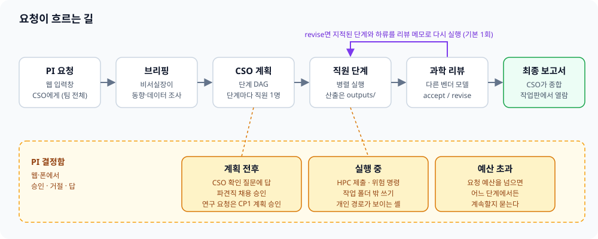
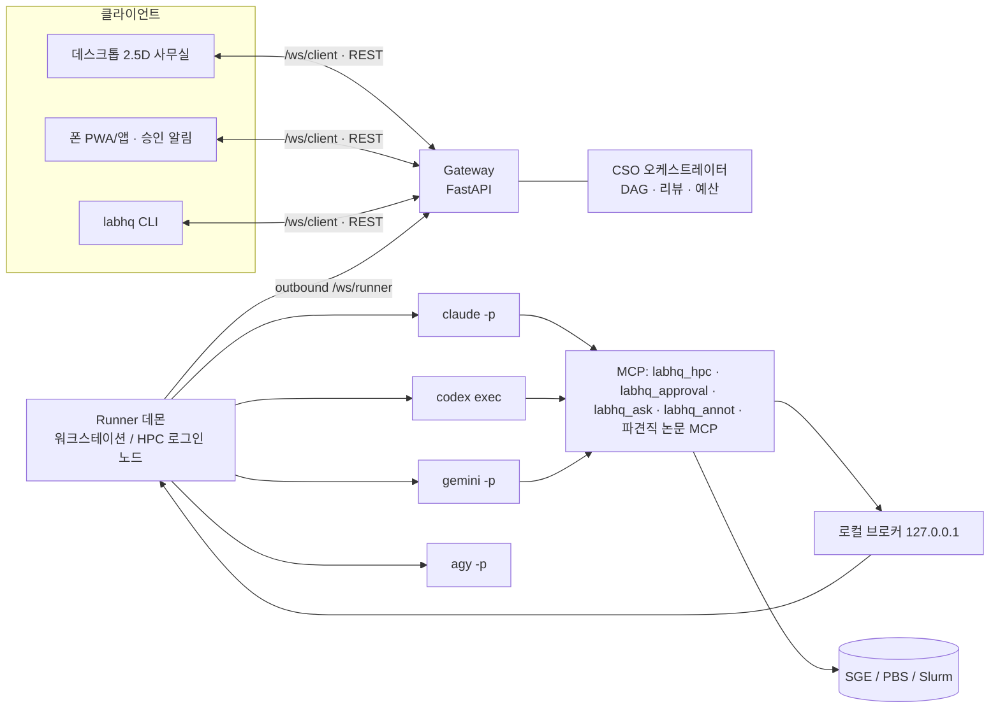
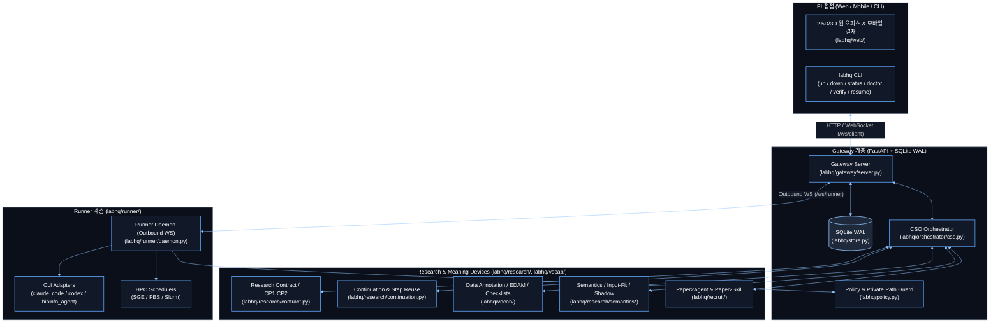
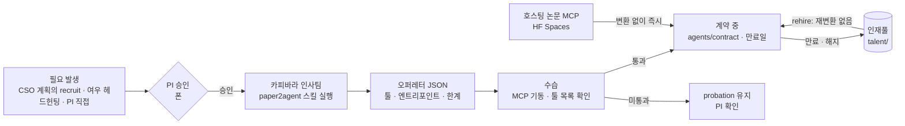
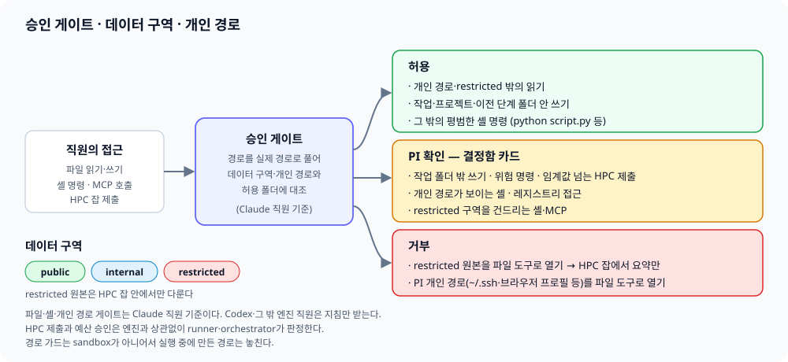
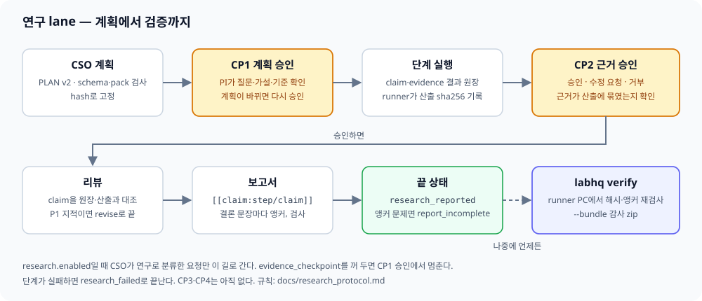
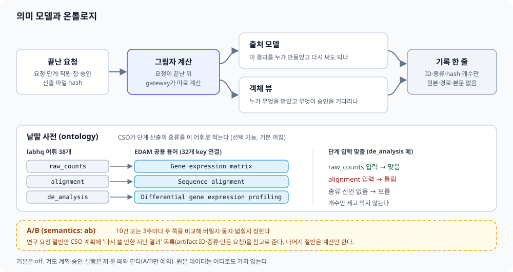

# labhq 매뉴얼

처음이라면 [README](../README.md)의 "웹으로 시작하기"부터 보세요. 이 문서는 그다음입니다: 명령줄, 설정, 안전 장치, 연구 lane, 알려진 한계.
PI의 질문과 결정은 [PI Q&A](pi-qa.md)에, 개발 규칙과 작업 큐는 [AGENTS.md](../AGENTS.md)·[HANDOFF.md](../HANDOFF.md)에 있습니다.
영문판: [manual.en.md](manual.en.md), [research_protocol.en.md](research_protocol.en.md), [pi-qa.en.md](pi-qa.en.md), [vocabulary.en.md](vocabulary.en.md). 이 문서를 고치면 영문판도 같은 PR에서 고칩니다.
개발 checkout의 author·agent 표식 보존 규칙은 [Git hooks](reference/git-hook-authorship.md)를 참고하세요.

| 장 | 무엇 |
|---|---|
| [PI에게 보이는 글](#pi에게-보이는-글) | 평문 변환(`pi_language.py`)과 한국어 문체 점검(`korean_qc.py`) |
| [핵심 개념](#핵심-개념) | 자주 나오는 말 |
| [둘러보기: mock 데모](#둘러보기-mock-데모) | API 키 없이 사무실 보기 |
| [설치와 첫 설정](#설치와-첫-설정) | `labhq init`, 인스턴스, HPC 상담, doctor |
| [띄우기와 접속](#띄우기와-접속) | gateway·runner, 브라우저·폰 |
| [웹 사무실](#웹-사무실) | 2.5D·3D 화면과 기능 |
| [명령줄(CLI)](#명령줄cli) | `send`·`approve`·`verify`·`recruit` 등 |
| [구조와 이벤트](#구조와-이벤트) | 요청 흐름, 아키텍처, 이벤트, REST, 환경 실패 |
| [직원과 도구](#직원과-도구) | 조직도, 연결된 도구, bioinfo-agent |
| [파견직 제도](#파견직-제도-paper2agent) | Paper2Agent 채용·계약 |
| [안전 장치](#안전-장치) | 승인 게이트, 데이터 구역, PI 개인 경로, 예산 |
| [프로젝트별 GitHub 보고](#프로젝트별-github-보고) | 이슈·보고서 커밋, 공개 가드 |
| [연구 lane과 검증](#연구-lane과-검증) | CP1·CP2, claim 앵커, `labhq verify` |
| [의미 모델과 온톨로지](#의미-모델과-온톨로지) | 지난 결과 재사용 준비: 출처 모델, EDAM, 그림자, A/B |
| [설정 포인트](#설정-포인트) | 상태, HPC, 직원, 엔진, 참고 자료, 의미 모델 |
| [비교 bench](#비교-bench) | labhq와 단일 세션 비교 |
| [알려진 한계](#알려진-한계) | 첫 실행 때 확인할 것 |
| [구성요소와 상태](#구성요소와-상태) · [로드맵](#로드맵) | 된 것과 남은 것 |
| [배경](#배경-the-virtual-biotech) · [파일 구조](#파일-구조) · [라이선스](#라이선스) | |

## PI에게 보이는 글

`labhq`는 웹·모바일 결정함과 메신저에서 PI가 읽는 모든 안내문을 쉬운 한국어 평문으로 정리하고(`labhq/pi_language.py`), 보고서·정리본의 문체를 검사합니다(`labhq/korean_qc.py`, 내장 `humanizer` 스킬).

- 승인 카드·질문·메신저·보고 알림은 `무엇을 하려는지 → 왜 → 승인하면/끝나면 무슨 결과` 순서의 평문으로 변환되어 표시됩니다.
- 카드 요약에서는 마크다운 제목·굵게·표 기호를 걷어내고, 실행 명령과 코드 원문은 카드와 메신저의 ‘자세히’ 펼침 영역에 보존합니다.
- 도구·계산 서버·예산·채용 카드는 한 줄 설명, 이유, 결과를 함께 보여 주며, 평문 요약이 실제 승인 권한이나 실행 명령을 바꾸지는 않습니다.
- 단순한 셸·파일 명령은 규칙 기반으로 요약하고, 복합 명령은 직원이 적은 설명과 명령 원문을 함께 남기며 작업 폴더 밖에 영향이 없다고 임의로 단정하지 않습니다.
- 직원이 영어로 답한 경우에도 자동 번역문으로 가장하지 않고 한국어 안내와 영어 원문을 구분해 표시합니다.

## 핵심 개념

이 문서에 자주 나오는 말입니다.

| 개념 | 한 줄 뜻 | 자세히 |
|---|---|---|
| gateway | 요청·승인·이벤트를 SQLite에 저장하고 웹·폰·CLI를 잇는 서버(`labhq gateway`) | [구조](#구조와-이벤트) |
| runner | 직원 CLI를 실제로 띄우는 데몬. 게이트웨이로 나가는 연결만 쓴다(`labhq runner`) | [구조](#구조와-이벤트) |
| 직원과 엔진 | 직원은 역할·모델·도구를 적은 YAML(`agents/core/`), 엔진은 그 직원을 돌리는 CLI(Claude Code·Codex, 그 밖에 Gemini와 범용 `cli` 어댑터) | [직원](#직원과-도구) |
| CSO·계획·단계 | CSO가 요청을 단계로 나눈 계획(JSON DAG)을 세우고, 단계마다 직원 한 명이 맡는다 | [구조](#구조와-이벤트) |
| orchestrate·direct 요청 | orchestrate는 CSO 계획부터 시작한다. direct(`--agent`)는 직원 한 명에게 바로 간다. `--plan-only`는 계획만 받는다 | [CLI](#명령줄cli) |
| 연구 lane | `research.enabled`일 때 CSO가 연구로 분류한 요청. 고정된 계획과 PI checkpoint를 따른다 | [연구 lane](#연구-lane과-검증) · [연구 규약](research_protocol.md) |
| checkpoint CP1~CP4 | 연구 요청이 PI 결정을 기다리는 관문. CP1 계획·CP2 증거(`evidence_checkpoint`를 켤 때)는 연결됐고 CP4 수용은 `final_checkpoint` opt-in이며 CP3 선택은 아직이다 | [연구 규약 §5](research_protocol.md#5-pi-checkpoint와-완료) |
| claim·evidence | 연구 단계 결과를 주장과 근거로 나눠 적는 계약(`result v2`). 근거는 실제로 모은 산출을 가리켜야 한다 | [연구 규약 §3](research_protocol.md#3-직원-결과-계약) |
| domain pack | 분야별 판정 규칙 묶음(`id@version`). 단일세포 DE와 벌크 두 조건 DE pack이 있다 | [연구 lane](#연구-lane과-검증) |
| 승인·결정함 | HPC 제출·위험 명령·예산 초과·채용은 PI가 정한다. 웹 결정함에 대기 건과 이력이 모인다 | [안전 장치](#안전-장치) · [웹 사무실](#웹-사무실) |
| labhq_ask·상담(consult) | 막힌 직원이 묻는 MCP 도구. CSO나 동료가 읽기 전용 상담으로 한 번 답하고, 위험한 것만 PI에게 간다 | [연결된 도구](#연결된-도구) · [설정](#설정-포인트) |
| 데이터 구역 | 경로마다 붙는 등급 public·internal·restricted(`policy.data_zones`). restricted 원본은 파일 도구로 열지 않고 HPC 잡 안에서만 다룬다 | [데이터 구역](#데이터-구역) |
| 쓰기 게이트 | Claude 직원은 작업·project·upstream 폴더 안에만 미리 허락된 쓰기를 한다. 그 밖 쓰기는 승인을 거친다 | [쓰기 범위](#승인-게이트와-쓰기-범위) |
| PI 개인 경로 | 같은 계정 실행에서 PI 개인 파일(`~/.ssh`·브라우저 프로필·labhq 설정 등)을 직원에게서 가리는 목록(`policy.private_paths`). Claude 직원은 차단 규칙·게이트·지침 세 겹, Windows elevated sandbox의 Codex 직원은 sandbox 읽기 거부와 지침 두 겹, 다른 엔진 직원은 지침만 받는다. 실행 중에 경로를 만드는 스크립트까지는 막지 못한다 | [PI 개인 경로](#pi-개인-경로) |
| 작업 폴더·manifest·outputs | 단계마다 `runner.workspace_root` 아래 폴더가 생긴다. `manifest.json`에 엔진·모델·세션·비용이 남고, 산출은 `outputs/` 아래만 센다 | [구성요소](#구성요소와-상태) · [구조](#구조와-이벤트) |
| 라운드 기록 | 요청마다 남는 개발 기록. `dev_log.repo`(private)에 올릴 수 있다 | [설정](#설정-포인트) · [HANDOFF](../HANDOFF.md) |
| 인스턴스 | `--instance <이름>`으로 한 PC에 연구소를 여럿 띄운다. 설정·state·포트·token은 나뉘고 엔진 로그인·한도는 공유한다 | [설치](#설치와-첫-설정) |
| 구독 한도 대기 | 엔진 구독 한도에 걸린 단계를 reset 시각까지 세워 두었다가 자동으로 재개한다 | [구성요소](#구성요소와-상태) |
| 의미 모델 | 끝난 요청의 기록을 다시 읽는 두 모델. 출처 모델은 산출의 계보와 재사용 후보를, 객체 뷰는 직원·요청·잡·승인 사이의 연결을 센다 | [의미 모델](#의미-모델과-온톨로지) · [설정](#설정-포인트) |
| ontology·EDAM | PI가 검토한 어휘 125개 key(`labhq/vocab/`)와, 그중 79개 key를 이은 공개 생명정보 ontology EDAM(용어 75개) | [의미 모델](#의미-모델과-온톨로지) · [설정](#설정-포인트) |
| 데이터 종류 선언 | CSO가 단계 산출에 data_type·format key를 적는 선택 기능(`plan.declare_output_types`, 기본 꺼짐) | [설정](#설정-포인트) |
| 입력–방법 적합성 | 단계 입력의 선언 종류가 그 방법에 맞는지 `fit`·`mismatch`·`unknown`으로 세는 판정. 그림자로만 돈다 | [의미 모델](#의미-모델과-온톨로지) · [설정](#설정-포인트) |
| 그림자(shadow) | 계산해 기록만 하고 계획·승인·실행에는 쓰지 않는 방식. 기본은 `semantics: off` | [의미 모델](#의미-모델과-온톨로지) · [설정](#설정-포인트) |
| A/B·판단 창 | `semantics: ab`는 연구 요청 절반에만 재사용 후보를 CSO 참고로 준다. 10건 또는 3주 단위로 두 arm을 비교한다 | [의미 모델](#의미-모델과-온톨로지) · [설정](#설정-포인트) |
| 액션 A1·A2 | A1은 기존 액션 7종이 그때 가능했는지 기록만 한다. A2는 PI가 터미널에서 확인한 `request.followup` 하나만 실행한다 | [설정](#설정-포인트) |
| 재사용 후보 | 앞선 요청의 산출 가운데 입력 hash와 목표 data type이 같아 다시 쓸 만한 것 | [의미 모델](#의미-모델과-온톨로지) · [설정](#설정-포인트) |

## 둘러보기: mock 데모

API 키·클러스터 없이 돌아갑니다.

```bash
py -3 -m venv .venv
.\.venv\Scripts\python.exe -m pip install -e ".[dev]"
.\labhq demo --web
```

POSIX에서는 `python3 -m venv .venv`, `./.venv/bin/python -m pip install -e ".[dev]"`, `./labhq.sh demo --web`을 씁니다. 폰은 `--phone`을 더합니다.
실제 사무실이 떠 있어도 데모는 다른 빈 port를 고릅니다. 출력된 데모 주소만 열면 `데모(mock)` 표시와 안내 띠가 보입니다.
웹 요청은 약 15~30초에 걸쳐 진행되고 다음 요청까지 남은 시간을 보여 줍니다. 폰 승인을 기다리는 시간은 별도이며 실제 결정 기록과 섞이지 않습니다.
게이트웨이 없이 UI만 보려면 `python -m http.server --directory labhq/web 8000` 뒤 `http://127.0.0.1:8000/?demo=1`을 엽니다.

## 설치와 첫 설정

전제: Python ≥ 3.10, Git, 설정한 직원 CLI의 설치·로그인. npm 설치 CLI는 Node.js도 필요합니다.

```bash
.\labhq init
.\labhq -c config\labhq.yaml doctor
```

PowerShell:

POSIX에서는 `./labhq.sh init`, `./labhq.sh -c config/labhq.yaml doctor`를 씁니다.

`labhq init`은 예시 설정을 복사해 gateway token을 무작위로 만들고 HPC·bioinfo-agent 경로를 묻습니다.
새 설정은 PI가 시험한 동작으로 시작합니다(#613): `research.enabled`·`research.evidence_checkpoint`, 분야 팩 `bulk_tumor_normal@3`·`single_cell_de@3`, `semantics: {mode: ab, actions: confirm}`, `plan.declare_output_types: true`, 그리고 의미 모델이 산출물 hash를 재도록 `runner.workspace_root`를 `internal` 구역으로 둡니다. 끄려면 설정에서 각 값을 바꾸세요. 이 목록은 `labhq/init_defaults.py`의 `REFERENCE_BEHAVIOUR`이고, `tests/test_init_defaults.py`가 예시 설정·`init` 결과와 어긋나면 실패합니다. 토큰·경로·사람 이름 같은 개인 값은 목록에 없습니다. `pipeline_pr` 동의, `dev_log.repo`, `BIOINFO_AGENT_DIR`은 사람이나 PC마다 달라 기본값으로 켜지 않고 묻거나 찾습니다. 이미 있는 설정은 옮기지 않습니다.
bioinfo-agent 폴더는 `--bioinfo-agent <폴더>`, 이미 있는 `BIOINFO_AGENT_DIR`, `D:/bioinfo-agent`·`~/bioinfo-agent` 같은 흔한 위치, WSL의 `/mnt/d/bioinfo-agent` 순으로 찾습니다. 못 찾으면 묻고(`--yes`면 묻지 않음) 끝내 모르면 "bioinfo-agent 연결 안 됨 — …"을 알리고 연결 없이 설정을 씁니다. 찾거나 받은 경로는 상대 경로여도 절대 경로로 바꿔 저장합니다(직원 task는 자기 작업 폴더 기준으로 상대 경로를 읽어 연결이 깨지기 때문입니다). `doctor`의 `bioinfo-agent` 행이 연결 여부를 warn으로 알리고, 상대 경로로 적힌 설정도 warn합니다.
`dev_log.repo`(개발 기록을 올릴 비공개 저장소)는 `init`이 owner/name으로 한 번 묻고 Enter면 비워 둡니다. 비어 있으면 기록은 이 PC에만 남고 `doctor`의 `dev log` 행이 설정하는 법을 알려 줍니다.
새 설정에서는 pipeline 코드의 공개 PR 기여 동의도 묻습니다. `y`(대소문자 무관)만 동의이며 Enter·`--yes`·그 밖의 답은 끔입니다.
AlphaGenome API 키가 아직 없으면 마지막에 한 번 묻습니다. Enter로 건너뛸 수 있고, 키 보관은 [공개 자원 조회 도구](#공개-자원-조회-도구)에 있습니다.

GitHub 토큰도 한 번 묻습니다(선택, #687). 요청 결과를 GitHub 저장소로 정리하고 이슈로 알릴 때 씁니다. 묻기 전에 필요한 권한을 보입니다. fine-grained 토큰은 Repository creation(또는 Administration 쓰기)·Contents 쓰기·Issues 쓰기가 필요하고 Repository access는 All repositories여야 합니다. classic 토큰은 `repo` 범위면 됩니다. Enter로 건너뛰면 결과는 로컬에만 저장하고, 나중에 `labhq init`을 다시 돌리거나 `GITHUB_TOKEN` 환경 변수를 설정하면 됩니다. 토큰이 저장돼 있으면 init은 새 토큰을 받을지 묻습니다. 만료·취소됐거나 권한을 바꾼 토큰은 여기서 바꾸고, Enter면 그대로 둡니다. 붙여 넣은 토큰은 AlphaGenome 키처럼 이 계정만 읽는 `github.token_file`(기본 `~/.labhq/secrets-github/github_token`)에만 두고, 설정 파일·화면·로그에는 남기지 않습니다. 환경 변수가 있으면 그쪽이 먼저입니다. 파일의 토큰은 gateway 프로세스만 시작할 때 읽고, 직원·runner·MCP 프로세스에는 넘기지 않습니다. 직원에게는 이 파일이 개인 경로라 읽기가 막힙니다. 직원 CLI는 개발용 GitHub App 봇 신원을 쓰지 않으며, 이 PC에 저장된 사용자 GitHub 로그인 권한은 이와 별개입니다. 바로 이어지는 doctor가 권한을 확인합니다(아래 [결과 저장 위치](#결과-저장-위치) 참고).
기관 문헌 접근도 묻습니다(선택, #826). 소속 기관, 도서관이 안내하는 공식 HTTPS 프록시 접두(`https://…login?url=` 형태), 쓰는 문헌 서비스, Unpaywall 연락 email을 묻고, 모르거나 나중에 하려면 Enter로 넘어갑니다. 로그인한 뒤 주소창의 주소는 붙이지 마세요. 새 설정에는 프록시(`literature.institution_proxy`)와 email(`annot.unpaywall_email`)만 남기고 기관 세션은 꺼 둡니다. 기관·출판사 이용 조건을 확인한 뒤 직접 켜세요. 기존 설정 파일은 바꾸지 않고 채울 설정 이름만 알려 줍니다. 비밀번호·cookie·API 키는 묻지 않고 접속도 하지 않습니다. Web of Science Research Assistant·Nexus Connect 전용 자동 연결은 아직 없습니다. 받는 주소 형식과 확인 범위: [참고](reference/institution-literature-826.md).
`python scripts/clean_install_check.py`는 임시 HOME의 새 clone·venv에서 init → doctor → mock 요청 → 요청 묶음 → verify → down을 검사한 뒤 기본 호출에서는 임시 폴더를 지웁니다. 설치판·분리 stdout/stderr 로그를 남기려면 `--work-dir <새-빈-폴더>`를, PASS/FAIL/SKIP JSON 경로를 지정하려면 `--receipt <로컬-receipt.json>`을 붙이세요. 설치판·로그·receipt는 개인 경로가 담긴 로컬 전용 증거이므로 공개 저장소에 올리지 않습니다([상세](reference/clean-install-922.md)). 실제 직원 CLI 로그인이나 모델 호출은 하지 않습니다.
한 PC에서 여러 연구소를 띄우려면 `labhq init --instance <이름>`을 실행한 뒤 각 명령에 같은
`--instance <이름>`을 붙이세요. 설정·state·runs·talent·포트·token이 인스턴스별로 나뉩니다.
엔진 로그인과 사용량 한도는 모든 인스턴스가 공유합니다.
스케줄러는 `qsub`/`qstat`(SGE·PBS)과 `sbatch`/`sinfo`(Slurm)로 찾고, 종류를 하나로 정할 수 없으면 묻습니다(`--yes`면 멈춤).
스케줄러 도구가 있으면 HPC 상담을 합니다(#119). 읽기 전용 조회(SGE `qconf -sql`·`-spl`·`-sp`·`-sc`, PBS `qstat -Q`·`qstat -B -f`·`pbsnodes -a`, Slurm `sinfo`)로 큐·PE·메모리 리소스·PBS 종류를 모아 `hpc:` 초안을 설정에 넣고 보여 줍니다.
설정을 저장한 뒤 `sleep 1` 시험 잡(1코어, 5분)의 제출 명령을 보여 주고, PI가 `y`라고 답할 때만 한 번 제출해 끝날 때까지 추적합니다. `--yes`·`--dry-run`에서는 묻지 않고, 통제 구역 안에서는 제출하지 않습니다.
클러스터가 없으면 `scheduler: none`이고, 무거운 단계는 로컬 CLI로만 돌리며 그럴 수 없는 단계는 CSO가 계획에서 밝힙니다. `ssh_host`·데이터 계정 전환(`submit_prefix`)은 상담이 정하지 않습니다([설정 포인트](#설정-포인트)).
`--yes`는 기본값을 수락하고 `--dry-run`은 파일 생성 없이 변경과 doctor 점검을 보여 줍니다. 기존 설정은 보존하며 `--force`일 때만 교체합니다.
Windows에서는 restricted 구역을 빼고, 개인 Codex 지침이 있으면 직원 전용 `CODEX_HOME`을, `~/.claude`가 있으면 Claude 직원 전용 `CLAUDE_CONFIG_DIR`(`~/.labhq/claude-staff`)을 넣고 사람이 실행할 로그인 명령을 안내합니다.
작업 폴더는 새 설정을 만들 때 `runner.workspace_root`로 묻습니다. Windows 시스템 드라이브가 128 GiB 미만이거나 여유 공간이 경고 기준보다 작으면 여유 있는 고정 데이터 드라이브 후보를 안내합니다. 원하는 드라이브를 포함한 경로를 직접 고르세요. `--yes`는 기존 기본 경로를 유지하며 자동 이동·삭제는 하지 않습니다.

Codex `bin`이 비어 있거나 `auto`이면 Windows 앱에서 판본이 가장 높은 폴더를 고르고, 판본을 비교할 수 없을 때만 mtime을 씁니다. doctor는 고른 경로를 표시합니다. 앱이 없으면 PATH를 사용합니다.

**다른 설정이 겹칠 때(#613).** 한 PC에서 설정 파일이 다른 labhq가 함께 돌면 서로의 기록·승인을 섞거나 엉뚱한 사무실을 열게 됩니다. 실행 중인 gateway와 runner는 시작할 때 자기 *정체*를 적어 둡니다: 시작한 설정 파일, 그리고 `gateway.state_dir`·`runner.state_dir`·`runner.id`·포트의 지문(둘 다 해시이고 비밀값은 없음). 파일은 gateway state 폴더의 `labhq-gateway-owner.json`과 runner state 폴더의 `labhq-runner-owner.json`이고, gateway는 `/api/health`의 `identity`로도 같은 해시를 돌려줍니다(경로·token 없음). `doctor`(`instance` 행)와 `up`은 state 폴더·runner state 폴더·포트를 쥔 쪽의 정체를 지금 설정과 비교해 쉬운 한국어와 고치는 명령으로 알립니다. 읽기만 하며 기본 `doctor`는 네트워크를 쓰지 않습니다. `--runtime`은 인증된 gateway 상태를 확인합니다.
- 같은 state 폴더: 다른 정체의 프로세스가 살아 있으면 `up`은 시작하지 않고 `labhq -c <그 설정> open`·`down`을 안내합니다. 이 설정 파일이 시작한 뒤 바뀐 설정으로 아직 돌고 있으면 `down` 뒤 `up`을 안내합니다. 살아 있지는 않지만 마지막으로 그 폴더를 쓴 설정이 다르면 경고만 합니다.
- 같은 runner state 폴더: `runner-<id>.sqlite3`, control 폴더, 입력 hash cache를 두 runner가 함께 쓰면 안 되므로 `runner.id`가 달라도 막습니다. `labhq runner`·`labhq gateway`를 직접 띄워도 시작할 때 같은 검사를 하고 막힌 채로 시작하지 않습니다.
- 같은 포트: 다른 설정의 gateway가 이 포트에서 돌면(그 설정의 프로세스 기록이 그 설정을 가리킬 때만) `up`이 멈추고 어느 설정인지와 `labhq -c <그 설정> open`을 알립니다. 같은 token으로 답하는 gateway도 `identity`가 이 설정과 다르면 쓰지 않고, 정체를 알려 주지 않는 이전 판 gateway는 이 설정의 프로세스 기록이 보증할 때만 받아들입니다. 받아들이지 않은 gateway는 `labhq-last-config.json`·주 설정에 적지 않습니다.
- 주 설정: 처음 `up`이 성공한 설정 경로를 기본 state 폴더(`~/.labhq/state`)의 `labhq-primary-config.json`에 한 번 적습니다. 다른 설정으로 `doctor`·`up`하면 경고하고, 바꾸려면 `labhq -c <새 설정> up --make-primary`를 씁니다. `--instance`로 만든 인스턴스는 일부러 따로 쓰므로 주 설정이 되지 않고 비교하지도 않습니다.
`up`이 자기 gateway임을 확인한 뒤에만 그 state 폴더에 `labhq-last-config.json`을 남깁니다. 설정 파일이 지워지면 그 기록은 무시합니다.

실행 전 `labhq doctor`로 설정·엔진·직원·계산 도구를 점검하세요. `labhq doctor --json`은 러너 상태 디렉터리에 `capabilities.json`을 쓰고, `--network`를 붙일 때만 공개 데이터 사이트에 접속합니다. 이 manifest의 `runner_capabilities`는 러너가 보고하는 기능과 같은 설정·roster에서 산출한 사실입니다. `research lane` 행은 연구 lane이 끝까지 도는지 알려 줍니다. `research.enabled`만 켜면 CP1 뒤 멈춘다는 warn이 뜨고, `evidence_checkpoint`까지 켜야 CP2·리뷰·보고서로 갑니다. `research` 아래 오타 키는 시작할 때 오류입니다.
doctor는 **설정 준비**와 **운영 준비**를 나눠 표시합니다. 배포 전에는 `doctor --runtime`을 사용하세요. daemon의 stale·unknown PID 정체는 실패하며 pristine·정상 down은 별도로 표시합니다. remote·foreground 역할은 로컬 PID를 요구하지 않고 인증된 gateway와 runner 연결로 확인합니다(켜진 WSL runner도 포함). PID 기록이 모두 없는 과거 up/down 이력은 이 인증·연결이 확인된 경우만 해소하며, 인증 없는 missing과 이력 조회 오류는 계속 실패합니다.

Windows에서 검토한 독립 owner Job을 쓰는 인스턴스는 state 밖의 운영자 계약 pin, `contained-runtime.json`, fresh owner challenge로 네 daemon 세대를 확인하면 `contained_verified`로 표시합니다. 실제 검사 코드의 배포 경로·hash도 대조합니다. 기본 detached 검사는 유지하며 인증·runner 연결 실패를 지우지 않습니다. owner receipt의 수명 상한은 `runner.contained_max_s`(기본 5400초, 하한 60·상한 86400)이고, 15시간처럼 긴 연구 실행은 발급하는 owner도 같은 값으로 맞춰야 합니다(#938). 직원 자식·요청 종료·연구 GO를 확인한 값은 아닙니다. [receipt·RPC 계약과 한계](reference/contained-runtime.md).
doctor의 `disk` 행은 작업·임시·Codex/Claude 직원 홈의 드라이브 여유를 읽습니다. gateway 상태 폴더(`gateway.state_dir`, SQLite·이벤트)가 이들과 다른 드라이브에 있으면 그 드라이브도 따로 읽고, 같은 드라이브면 행을 반복하지 않습니다. 폴더가 아직 없으면 가장 가까운 기존 부모를 검사합니다. 기본 경고는 10 GiB 미만 또는 5% 미만이며 `runner.disk_warning_free_gb`·`runner.disk_warning_free_percent`로 바꿉니다(각각 0이면 해당 기준 해제). 작업 폴더와 gateway 상태 폴더의 드라이브는 여유가 `runner.disk_fail_free_gb`(기본 2 GiB, runner가 task 시작 전 PI에게 묻는 기준과 같음) 미만이면 fail입니다(0이면 fail 없음). 임시·직원 홈 드라이브는 warn까지입니다. 조회 실패도 warn입니다. 단계가 앞 단계 산출을 `inputs/<단계>`로 복사할 때는 runner가 먼저 파일 크기 합을 작업 드라이브 여유와 비교해, 크기 합이 여유보다 크면 파일 내용을 복사하기 전에 멈추고 그 입력을 쓸 수 없다고 이유(필요·여유 크기)와 함께 활동 기록과 직원 안내에 남깁니다. 압축 볼륨처럼 실제 사용량이 파일 크기와 다른 드라이브에서는 이 계산이 맞는다고 보장하지 않습니다. 직원은 CSO에게 묻고, 원본 산출은 그대로입니다. 여유를 읽지 못하면 이전처럼 상한 안에서 복사하고, 복사 중 디스크가 차면 `disk full during copy`로 알립니다. 직원이 셸로 받는 다운로드는 크기를 미리 알 수 없어 이 검사가 막지 않습니다. task를 시작할 때(#678)는 runner가 작업 폴더 드라이브의 여유를 다시 읽습니다. `runner.disk_fail_free_gb`(기본 2 GiB, 0이면 끔) 아래이면 task를 시작하지 않고 **디스크 여유 부족** 카드로 PI에게 묻습니다. 승인하면 시작하고, 거절하거나 24시간 안에 답이 없으면(runner가 건 시간 제한) 시작하지 않고 이유를 남깁니다. 웹은 이 카드가 열려 있는 동안 요청을 PI 결정 대기로 보여 줍니다. 판단은 실제로 이번 실행이 쓰는 작업 폴더(재개·재시도로 다른 드라이브를 쓰는 경우 포함)의 드라이브 여유를 기준으로 하며, 작업 폴더를 만들거나 실행 슬롯을 잡기 전에 합니다. 경고 기준(위 10 GiB·5%) 아래이면 작업판 로그에 경고만 남기고 진행합니다. 드라이브를 읽지 못하면 막지 않고, 환경 자동 수정(`facilities_fix`)은 이 검사를 받지 않습니다. 큰 원자료용 폴더는 선택 설정 `runner.bulk_data_root`로 정합니다. 값이 있으면 직원 브리핑에 "큰 원자료(수 GB 이상)는 이 폴더 아래에 받으세요"가 여유 공간과 함께 한 줄 들어갑니다. 이 폴더는 작업 폴더 밖이라 쓰기에 새 허가를 주지 않으며 평소처럼 승인 판정을 거칩니다. 통제 구역에 걸치면 브리핑에 쓰지 않고 경고를 남깁니다. 값이 없으면 지금과 같습니다. 설정한 작업 폴더는 이름과 무관하게 게시 전 개인 경로 검사에 포함됩니다. [검증 근거](reference/disk-preflight-752.md).

doctor는 roster가 쓰는 엔진만 검사하고, 생략한 네트워크·dry-run 로그인 검사는 한 줄로 묶습니다. `runner.contract_dir`를 지정하면 기본 `agents/contract` 대신 그 폴더를 읽고, 계약 유효성·중복 ID 우선순위도 runner와 맞춥니다. 만료 계약의 파일 이동·수정은 하지 않습니다. fail이 하나라도 있거나, 활성 직원이 없거나, roster 엔진 실행 파일이 하나라도 없으면 끝에 `실행 준비: 아니오`와 이유를 표시합니다. 다른 warn은 준비 여부를 바꾸지 않습니다.

`runner.facilities_support`는 기본 `unspecified`(항상 WARN)입니다. `required`는 부재·실패·미확인·dry-run·mock이면 FAIL이며, `optional`은 ready만 OK입니다. init은 기존 명시 값을 보존합니다(`--force` 포함). [판정표와 준비 증거의 한계](reference/facilities-support-983.md)를 확인하세요.

| doctor 항목 | 판정 | 고치는 명령 |
|---|---|---|
| Paper2Agent | recruiter·skill이 없거나 설정한 commit과 설치본이 다르면 fail. mock·데모는 skip | `labhq doctor --fix` |

`--fix`는 설정한 `recruit.skill_commit`에 맞춰 Paper2Agent를 설치한 뒤 다시 검사합니다. 다운로드에 실패하면 네트워크·source/ref 확인 안내와 fail을 남깁니다. 별도 설정 파일을 쓴다면 같은 `-c <config>`를 붙이세요. `init`은 설치 검사를 미루며 skill을 내려받지 않습니다. 이후 실제 직원 실행 전에는 `doctor --fix`를 실행하세요.
npm의 `.cmd`/`.bat` shim은 여러 줄 prompt를 손상시킬 수 있어 labhq가 표준 npm shim만 Node.js로 풀어 실행합니다.
풀 수 없는 shim은 거부합니다. Windows에서 직접 지정하려면 `engines.<engine>.bin`과 `prefix_args`를 쓰세요(설치된 package 경로 확인).

Codex 직원 로그인 격리는 [알려진 한계](#알려진-한계)의 전용 `CODEX_HOME` 안내를 따릅니다. `labhq doctor`가 구성을 점검합니다.

### 이 PC의 WSL에서 분석하기

Windows 설정을 선택해 `labhq -c <설정> setup-wsl --check`로 도구·plugin·runner 연결을 확인합니다. 분석 준비에는 bioinfo manifest·bioinfo-analyze skill·Java·Nextflow·WSL Claude CLI와 직원 계정 로그인이 모두 필요합니다. 연결·roster 갱신 때 준비가 확인된 WSL만 우선 배정하며, 미준비 상태면 native를 씁니다.

WSL을 설정하지 않은 설치에서 `doctor`는 선택 기능이 꺼졌다는 한 줄만 냅니다. `setup-wsl --check`를 직접 실행하거나 WSL을 활성화한 뒤에는 개별 준비 상태와 실제 WSL 직원 로그인 경로를 안내합니다.

1. `labhq -c <설정> up`으로 gateway를 켭니다.
2. `labhq -c <설정> setup-wsl`로 없는 Nextflow(24.10.5)·editable labhq venv·runner 설정을 준비합니다. 분석 준비와 연결을 모두 확인한 뒤 활성화를 저장합니다. Claude CLI 설치·로그인과 관리자 명령은 안내만 합니다.
3. 이후 `up`·`down`이 WSL runner도 시작·종료합니다. 따로 제어하려면 같은 설정으로 `wsl-runner start` 또는 `wsl-runner stop`을 씁니다. 기존 supervisor와 프로세스 신원 검사를 재사용합니다.

**WSL이 준비되지 않았을 때(#612).** `bioinfo-agent`에게 맡긴 일(직접 요청이나 이미 계획된 단계)이 갈 곳이 없고 설정에 `runner.wsl`이 있으면, 요청마다 한 번 "WSL 준비가 덜 됐어요. 셋업할까요?" 카드가 뜹니다. 승인하면 gateway가 `setup-wsl`과 같은 준비를 thread에서 돌립니다. 15분은 기다림의 상한이라 이미 시작한 준비는 멈추지 못하고, 끝날 때까지 다른 셋업은 새로 시작하지 않습니다. 다른 native runner가 같은 직원을 맡고 있으면(잠시 끊긴 경우) 카드 없이 기존 대기 경로를 씁니다. 관리자 권한이 필요한 명령이 남으면 카드와 오류에 그 명령을 보여 주고, 요청은 runner를 기다리지 않고 바로 멈춥니다(비용 $0). 거절하거나 시간이 끝나도 같은 요청 안에서는 다시 묻지 않습니다. gateway가 WSL이 있는 PC가 아니면 실행하지 않고 `labhq setup-wsl`을 안내만 합니다. 카드와 피드에는 설치 출력이 아니라 항목 이름과 고정 안내만 남습니다. 자동 계획이 WSL을 고르게 하는 "실행 위치 카드"는 #578과 함께 옵니다.

| `runner.wsl` 설정 | 기본값 / 용도 |
|---|---|
| `distro`, `user` | `Ubuntu-22.04`, 배포판 기본 사용자 |
| `id` | `lab-wsl` — 활성화 때 Windows runner와 같으면 설정·시작 거부 |
| `bioinfo_agent` | `/mnt/d/bioinfo-agent` |
| `root` | Linux 홈의 `.local/share/labhq/wsl-<설정 해시>`; venv·state·로그·직원 설정을 분리 |
| `gateway_url` | 기존 주소 → localhost 실패 시 Windows NAT 주소. 기본 포트 ws 80·wss 443 |
| `enabled` | setup의 연결 확인 성공 시 true |

토큰은 stdin으로 전달하고 Linux의 700 폴더 안 600 설정 파일에 둡니다. Windows mount에는 저장하지 않습니다. NAT에서 연결이 안 되면 gateway를 WSL에서 닿는 주소에 bind하고 방화벽을 확인하세요. setup이 bind나 방화벽을 바꾸지는 않습니다.

작업은 Windows `runner.workspace_root`와 같은 `/mnt/<drive>/…` 폴더를 씁니다. gateway 위치와 무관하게 대상 runner의 `runtime_env`로 작업·결과·이벤트 경로를 변환해 project·reference·`inputs/<step>`·manifest·bundle을 잇습니다. `/home` 작업 폴더·UNC 경로는 거부합니다. setup은 Windows 승인·예산 정책과 reference root(프로젝트 포함)를 복사하고 개인·통제 구역 경로도 변환합니다. 변환 실패는 설정 거부이며, 정책이나 reference root를 바꿨다면 `wsl-runner stop` 후 setup을 다시 실행하세요.

직원마다 담당 runner는 하나입니다. 실행 중이거나 전송 결과가 불확실한 task가 있으면 담당을 유지하고 새 task도 그 runner에 보냅니다. 모두 끝나면 bioinfo-agent는 준비된 WSL을 우선하며, WSL이 끊겼으면 연결된 Windows 직원으로 돌아갑니다. `up`에서 WSL 시작만 실패하면 경고 한 줄을 출력하고 native 시작은 성공으로 마칩니다. CSO는 연결된 runner의 Nextflow·Docker 확인을 계획에 반영합니다. WSL Claude CLI·직원 로그인(`root/claude-staff`)은 별도 준비하며 setup은 로그인하지 않습니다. 실행 위치 선택 카드는 #612 2단계입니다.

## 띄우기와 접속

```bash
.\labhq -c config\labhq.yaml up
.\labhq -c config\labhq.yaml open
```

Windows wrapper는 `.venv\Scripts\python.exe`를 직접 실행하므로 venv 활성화나 PowerShell ExecutionPolicy 변경이 필요 없습니다. `up`은 gateway와 runner를 분리된 background process로 띄우고(역할마다 감독 프로세스를 거칩니다. 아래 **감독 프로세스**) state 폴더에 로그와 생성 시각을 포함한 프로세스 기록을 남깁니다. 같은 instance의 `up`·`down`은 state 폴더 lock으로 직렬화되며, 다른 명령이 진행 중이면 exit 2입니다. POSIX에서는 `./labhq.sh`를 씁니다.

**감독 프로세스(#589):** `up`은 역할(gateway, runner)마다 작은 감독 프로세스를 하나씩 띄우고(`python -m labhq.supervisor`), gateway·runner는 그 감독의 자식으로 시작됩니다. `up`이 끝나면 `up`이 직접 띄운 프로세스는 죽은 `up`의 PID를 부모로 계속 기록합니다. Windows는 그 번호를 다른 프로세스에 다시 줄 수 있고, 부모 PID만 보고 트리를 끄는 도구(테스트 코드의 `/T` 종료 등)가 그 프로세스를 끄면 gateway·runner가 함께 죽습니다. labhq 자신의 종료 경로는 생성 시각을 확인하지만(#597) 밖의 코드는 고칠 수 없으므로, 부모 PID가 재사용되지 않게 합니다. 감독은 gateway·runner가 사는 동안 살아 있어 그 부모 PID는 재사용되지 않고, 감독 자신의 부모(`up`)는 시작할 때 조상 프로세스 4개의 handle을 열어 둬서 재사용되지 않습니다(열린 handle이 있으면 끝난 프로세스의 PID도 반환되지 않습니다). 감독은 gateway·runner가 끝난 시각과 종료 코드도 `<role>-supervisor-diagnostics.jsonl`에 `child_exit`로 남깁니다. 강제 종료는 프로세스 자신의 `exit` 기록을 남기지 못하므로 이것이 유일한 단서입니다. 조상 handle을 열지 못해도(권한·이미 끝난 부모) 역할은 시작하고, 이유는 같은 파일의 `parents_pinned` 행에 남깁니다. `up`은 감독이 조상을 고정하고 역할을 기록할 때까지(최대 20초) 끝나지 않습니다.

감독이 역할 기록을 남기지 못해 시작에 실패하면 `up`이 감독을 정리합니다. 이 정리도 실패하면 PID 기록을 보존하고 종료 오류와 PID를 알리며 exit 2로 끝납니다. 다음 `down`·`up`은 같은 감독 기록을 다시 확인합니다(#627).

`supervisor.restart: true`로 켜면 스스로 끝난(종료 코드 0이 아닌) 역할을 다시 시작합니다. 종료 코드 2는 labhq가 시작을 거부한 경우(설정 거부, 다른 설정이 같은 state 폴더를 쓰고 있다는 #613의 소유 기록)라 같은 거부가 되풀이되므로 다시 시작하지 않고 `restart_skipped`만 남깁니다. 처음엔 `backoff_s`(5초) 뒤에, 이어서 두 배씩 `backoff_cap_s`(120초)까지 기다리고, `restart_window_s`(600초) 안에 `max_restarts`(5)번을 넘기면 그대로 둡니다. **기본은 꺼짐**이라 비정상 종료가 가려지지 않습니다. `down`과 웹 종료로 멈춘 역할은 다시 시작하지 않습니다(`labhq-<role>.stopping` 표시 파일을 먼저 남기고, `up`이 지웁니다). 감독이 다시 시작하는 중에 `up`을 실행하면 감독을 하나 더 띄우지 않고 역할이 응답하길 기다립니다. 이 변경 전에 시작한 gateway·runner는 감독이 없고, `status`가 "감독 없음(감독 도입 전 방식)"이라고 알립니다. `down` 뒤 `up`을 하면 감독 아래로 들어갑니다. 감독 프로세스 기록이 있는데 프로세스가 없고 역할만 살아 있으면 `status`·`doctor`가 경고합니다(보호받지 못하는 상태).

2.5D·3D 웹을 열어 두면 gateway 연결 끊김과 runner 미연결을 별도로 알립니다. 재연결 중에도 경고를 유지하고 연결이 돌아오면 지웁니다. 연결 끊김만으로 종료와 네트워크 문제를 구별하지는 않으며, 웹을 닫았을 때 외부 채널로 알림을 보내지는 않습니다.

Windows `up`은 실제 Python interpreter로 Job breakaway를 먼저 요청합니다(venv 선택 유지). 확인된 거부·잔류에만 direct 자식을 소유 handle로 정리한 뒤 임시 local WMI bootstrap을 한 번 시도합니다. nonce·생성 시각·실행 파일·현재 사용자·모든 Job 비소속 확인 뒤 ACK하며 bootstrap은 같은 PID로 supervisor에 진입합니다. receipt·ACK 파일을 다른 handle이 잡고 있을 때의 공유 위반(winerror 32)과, Python 파일 열기가 winerror 없이 남기는 EACCES는 기존 대기 상한 안에서 다시 읽고 그 횟수를 실패 기록에 남깁니다. 다른 winerror·errno는 바로 중단합니다. unknown·정리 실패는 중단하고 flag를 빼지 않습니다. 서비스·Task Scheduler·승격은 없습니다. `logs/detached-launch.jsonl`에는 시도·거부·검증 단계와 Job 잔류/조회 오류를 남기며, 반환 전 로그 쓰기가 실패해도 소유 자식의 정리를 시도합니다. 운영 준비는 role·supervisor의 현재 PID와 생성 시각을 고정한 조회 전용 handle로 모든 Job 비소속을 확인합니다. 과거 로그나 HTTP 인증만으로 대신하지 않으며 확인 불가하면 검증된 경로로 재시작해야 합니다. 배포는 `doctor --runtime` exit 0과 `runtime_readiness.ready=true`를 모두 확인해야 합니다. 기록 없는 소멸만으로 Job 강제 종료를 확정하지 않습니다. [근거·검증 경계](reference/windows-runtime-795.md). WMI 기동이 지연되면 고정 단계와 경과 시간을 확인합니다. provider 대기 상한은 15초이고(요청 만료 20초에서 bootstrap 시작 여유 5초를 뺀 값, 측정한 상한이 아니라 여유를 둔 값) timeout은 계속 실패로 처리합니다([진단 한계](reference/windows-provider-793.md)).

**예고 없이 꺼졌을 때:** `status`는 연결을 시도하기 전에, `doctor`는 네트워크 없이 로컬 PID 기록과 마지막 heartbeat·exit를 보여 줍니다. 조회는 PID 기록을 지우지 않습니다. 프로세스가 없고 exit도 없으면 `비정상 종료 의심`입니다. 아래 파일은 설정의 `gateway.state_dir/logs/`에 gateway·runner별로 쌓입니다(직접 실행한 경우도 동일).

| 다음 종료 때 볼 파일 | 내용 |
|---|---|
| `<role>-diagnostics.jsonl` | UTC 시각·PID·부모 PID, 시작, 10분 간격 heartbeat(RSS bytes·Windows handle 수), 예외 종류, signal, uvicorn 종료, exit reason/code |
| `<role>-fault.log` | faulthandler의 native fault traceback, 잡히지 않은 Python 예외의 호출 스택 |
| `<role>.log` | `up` 자식의 버퍼링을 끈 stdout/stderr, uvicorn·runner 일반 로그 |
| `<role>-supervisor-diagnostics.jsonl` | 감독 자신의 시작·exit와 `parents_pinned`(고정한 조상 PID), `child_start`, `child_exit`(역할의 PID·종료 코드·가동 시간·`down` 요청 여부), `restart_scheduled`, `restart_giving_up` |
| `<role>-supervisor.log` | 감독의 stdout/stderr(감독이 시작하지 못했을 때의 오류가 여기 남습니다) |

지원하지 않는 자원 값은 `null`입니다. 예외 메시지·설정은 진단 JSON에 넣지 않습니다. heartbeat는 프로세스 생존 기록이며 gateway 응답 여부를 보장하지 않습니다. 강제 종료·`os._exit()`에서는 exit hook이 실행되지 않으므로 마지막 heartbeat와 같은 시각의 Windows Application/System 이벤트를 함께 봅니다([Python atexit](https://docs.python.org/3/library/atexit.html)). native fault 기록도 모든 외부 종료를 잡지는 못합니다([faulthandler](https://docs.python.org/3/library/faulthandler.html)). 현재 실행 중인 인스턴스에는 다음 시작부터 적용됩니다.

`down`은 진행 중이거나 대기 중인 요청(PI 결정 대기 포함), 끝난 요청에서 돌고 있는 이어 묻기, 진행 중인 채용(`labhq recruit`), 아직 기록을 쓰는 끝난 요청(취소 보고서를 쓰기 전이거나 요청 묶음을 복사하는 중, `마무리 중인 요청`)이 있거나 인증된 상태를 확인할 수 없으면 exit 2로 거부합니다(gateway `/api/shutdown-readiness`, #500·#521). 거부 문구는 단계(취소 기록·보고서 묶음 저장·결과 저장·PI 해석)를 적고, 보고서 묶음 단계는 경과 시간(`n분째`)도 적습니다(나머지 단계는 시작 시각을 기록하지 않습니다). 요청 묶음을 만드는 작업이 10분(`FINISHING_STUCK_S`)을 넘기면 `멈춘 마무리`로 알리고 종료를 막지 않으며, 그 요청은 `bundle_pending`이 남아 다음 시작 때 묶음을 다시 만듭니다(#658). 채용 수는 러너 프로세스 기준이라, 러너를 다시 시작하면 이전 프로세스의 채용은 빠집니다(`runner.hello`의 `process`). 중단을 감수할 때만 `down --force`를 쓰며, 신원이 맞는 runner 프로세스 트리와 gateway만 종료합니다. 역할마다 감독을 먼저 끝내고(다시 시작하지 않도록 표시를 먼저 남깁니다) 그 뒤 역할에 남은 것을 끝냅니다. 감독의 신원을 확인할 수 없으면 아무것도 끝내기 전에 exit 2로 멈춥니다. POSIX는 SIGTERM 뒤 최대 10초 기다리고, 남아 있으면 SIGKILL한 뒤 종료를 확인하고 기록을 지웁니다. 기록된 프로세스를 멈춘 뒤에는 gateway가 아직 답하는지 한 번 더 확인합니다(종료 직후 최대 3초 기다림). 스크립트나 다른 창처럼 `up` 밖에서 시작해 PID 기록이 없는 gateway·runner가 계속 답하면(gateway가 다른 PC에 있으면 이 설정의 runner id가 아직 연결돼 있을 때만) `종료`로 끝내지 않고 "`up`이 아닌 방법으로 시작한 gateway/runner가 아직 실행 중"이라고 알리며 exit 2로 끝납니다. 그 프로세스는 `down`이 멈추지 못하니 직접 끈 뒤 `up`을 다시 실행하세요. 멈출 것이 아무것도 없고 gateway도 답하지 않을 때만 `종료: 기록된 프로세스 없음`을 출력하고 exit 0입니다. Windows에서는 `taskkill /T`를 쓰지 않습니다. 부모 PID가 같아도 부모보다 먼저 만들어진 프로세스는 자식으로 보지 않고, 후보의 handle을 먼저 열어 PID를 고정한 뒤 두 번째 조회로 부모 PID를 다시 확인해 그 handle로 종료하므로, `up`이 끝난 뒤 다른 프로세스가 물려받은 PID 때문에 gateway·runner가 함께 종료되는 일이 없습니다(#589; adapter 취소·시간 초과와 runner의 버전 조사 시간 초과도 같은 방식). `down`은 supervisor·role과 그 자식이 실제로 끝날 때까지 프로세스마다 최대 10초 기다립니다. 하나라도 끝나지 않으면 역할과 PID를 알리고 exit 2로 끝내며, PID 기록을 유지해 다시 시도할 수 있습니다.

**PC를 다시 켰을 때**

gateway의 로컬 여부는 URL hostname과 이 PC 주소로 판단합니다. `0.0.0.0` bind와 TLS proxy를 함께 써도 확인하며, 주소를 확인하지 못하면 로컬 가능성으로 봅니다.

```powershell
cd <labhq 저장소>
.\labhq -c config\labhq.yaml up
.\labhq -c config\labhq.yaml open
```

설정 경로가 없거나 gateway client token이 `change-me` 기본값이면 시작하지 않습니다. `open`과 다른 API 명령은 gateway가 꺼졌거나 HTTP 오류가 나면 traceback 대신 한 줄과 exit 2를 돌려줍니다.
오프라인 데모를 폰으로 보려면 PC와 폰이 같은 Wi-Fi에 있어야 합니다([웹 사무실](#웹-사무실)).
게이트웨이는 요청·승인·이벤트를 로컬에 저장하므로 상태 디렉터리를 유지할 수 있는 VM이나 집 PC에서 돌립니다
(러너는 재접속 루프로 대기). 러너가 하나도 연결되지 않았거나 필요한 직원의 러너가 꺼져 있으면, 새 요청과 진행 중 단계는 실패하지 않고 `waiting_for_runner`로 기다렸다가 러너가 붙으면 이어 갑니다(PI 점검 R15). 아무것도 보내지 않은 상태라 비용도 없습니다. `gateway.runner_wait_s`(기본 86400초)를 넘기면 "labhq up(또는 labhq runner)으로 러너를 켠 뒤 다시 보내세요"라는 한국어 이유로 끝납니다. 어느 러너도 맡은 적 없는 직원은 기다리지 않고 바로 실패합니다. 러너가 붙거나 명단을 바꿀 때마다 기다리던 단계가 다시 판정해, 붙은 러너가 그 직원을 맡지 않고(꺼져 있는 동안 계약이 끝났거나 yaml을 지운 경우, 처음 켠 gateway에서 다른 직원만 맡은 러너가 먼저 붙은 경우) 기다릴 다른 러너도 없으면 기다림을 바로 끝내고 "연결된 러너 중 그 직원을 맡은 곳이 없다"고 알립니다(#521). `GET /api/health`의 `runner_online`, `labhq status`의 러너 줄, 웹 상단의 **러너 꺼짐** 띠가 연결 여부를 보여 줍니다. gateway가 다시 시작되면 이전 프로세스가 연결돼 있다고 본 러너마다 `runner.offline`(`reason: gateway_restarted`)을 남기므로, 새로고침 없이 다시 붙은 페이지도 러너가 돌아올 때까지 이 띠를 보입니다. 가장 간단한 구성은 게이트웨이 머신과 폰에 Tailscale을 켜고 tailnet 주소로 접속하는 것.
공개 인터넷에 열어야 한다면 TLS 프록시(Caddy 등) 뒤에 두고 토큰을 반드시 교체하세요.

### 웹에서 종료하기

2.5D·3D 상단 **종료하기**에서 진행 요청의 제목·건수, PI 결정 대기, 이어 묻기·채용·마무리 상태를 확인합니다.

| 선택 | 동작 |
|---|---|
| **labhq 끄기** | 일이 모두 끝났을 때 runner와 gateway를 끕니다. 진행 중이면 막습니다. |
| **그래도 끄기** | 중단 경고를 읽고 **진행 중인 일을 중단하고 labhq 끄기**를 한 번 더 눌러야 합니다. 다시 켜면 재개 카드에서 이어 갑니다. 저장 중이던 보고서·묶음은 유실될 수 있습니다. |
| **탭만 닫기** | labhq는 계속 돌아갑니다. 다시 열면 이어서 봅니다. 브라우저가 탭 닫기를 막으면 직접 닫으세요. |

확인 창에는 접속한 서버 주소를 표시합니다. 다른 PC에서 눌러도 **서버 PC의 인스턴스**를 끕니다. Enter로는 종료하지 않습니다.
PI 토큰으로 `POST /api/shutdown`을 호출하며 `down`의 상태 재확인·잠금·PID 신원 검사를 그대로 씁니다. 이 gateway와 runner의 `up` PID 기록이 없거나 맞지 않으면 거부합니다.
순서는 runner를 먼저 끄고, gateway는 응답을 보낸 뒤 **스스로 정상 종료**합니다(종료 hook을 실행하고 열린 연결을 닫음). gateway가 자기 종료를 기다리면 서로 기다리다 강제 종료로 끝나므로, 분리된 감시 프로세스가 30초 안에 끝나지 않을 때만 강제로 끕니다(`state/logs/gateway-exit-watch.log`).
응답의 `stopping`은 접수 표시입니다. 화면은 종료 후 서버 연결이 끊기면 **끝났습니다. 이 탭을 닫아도 됩니다.**를 표시합니다. 네트워크 단절과 프로세스 종료를 브라우저만으로 구별하지는 못합니다. 서버가 종료 실패를 응답하거나 확인 시간이 지나면 실패 안내를 남깁니다.

## 웹 사무실

2D 공통 부품은 [시안 E + 캐릭터 1 선택 기록](design/2026-10-13/README.md)을 따른다. 색·글자·간격은 `web/ui/tokens.css`, 공통 부품은 `web/ui/components.css`에서 관리하며 캐릭터 교체는 후속 작업이다.

2D **작업판** 위의 최근 요청 목록은 제목 전체·상태·검토 대기를 보여 줍니다. 누르면 그 요청으로 전환합니다. 단계는 진행·확인·대기 순이며 빈 목록은 숨기고 완료 단계는 접습니다. 요청 문장은 이 목록에 한 번만 표시합니다. 탭 위 단계 흐름 줄은 담당·현재 단계·완료 수를 보여 주며 어느 탭에서도 보입니다. 직원 카드는 작은 그림·이름·상태 한 줄이고 누르면 역할·고용 형태·하는 일을 상세 시트에서 봅니다.

**메신저**는 보낸 사람과 시각을 말풍선 위에, 본문을 아래에 둡니다. 긴 글·명령·코드 원문은 **자세히**에서 펼칩니다. 요청 입력의 **보내기**는 48px 주 버튼이고 받는 사람·팀 여부·작업 종류·프로젝트는 **옵션**, 참고 자료는 **첨부·참고**에 있습니다. 실행 중 메모 모드에서는 새 요청 옵션을 숨깁니다.

- 펭귄 비서실장이 기술 메시지와 직원 간 영어 대화를 두 문장 이내의 한국어로 설명합니다. 원문은 **자세히**에 보존하며 전달은 번역을 기다리지 않습니다.
- 쉬운 설명이 없는 승인 카드에도 설명을 붙입니다. 이미 있는 설명과 승인 대상·명령은 바꾸지 않습니다.
- 도구 카드는 목록 조회·파일 읽기·프로그램 위치 확인·설치·네트워크·쓰기·삭제를 구분하고, 작업 위치·단계와 목적·걸린 규칙·위험 등급·승인/거절 결과를 보여 줍니다. 논문 스킬 빌드는 논문 제목과 실제 담당 이름(예: 비버 인사팀)을 표시합니다. 2.5D·3D·`labhq approvals`가 같은 설명을 쓰며 CLI 원문은 `labhq approvals --details`로 봅니다. 템플릿으로 해석한 명령에는 통역 모델을 쓰지 않습니다.
- 현재 작업 폴더(논문 스킬 빌드 작업은 해당 빌드 폴더)와 장착한 플러그인의 단순 읽기는 허용합니다. workspace·talent 공용 root와 다른 직원 폴더를 품는 상위 경로는 읽기 예외에서 제외합니다. staff의 Paper2Agent 참고 자료는 논문 스킬 빌드 작업에만 해당 스킬 하위로 엽니다. 자격 증명·개인 경로·다른 작업의 저장 출력은 계속 보호합니다. 자기 저장 출력은 파일 도구로만 읽습니다.
- 통제·개인 경로 접근은 읽기라도 위험 등급을 **높음·확인 필요**로 표시합니다. 위치 이름은 절대경로·구분자·대소문자와 실제 링크 목적지를 확인해 붙입니다. 관리 폴더 읽기 grant는 Codex의 read-only profile에도 적용하며, Bash 경로는 POSIX 규칙으로 해석하고 모호하면 묻습니다.
- 직원 활동에는 쉬운 요약을 쓰고 명령 원문은 **자세히**에 둡니다. auto에서도 승인 카드가 뜨면 어떤 규칙 때문에 묻는지 설명합니다. 쓰기·삭제·불명확한 스크립트에는 기존 정책을 적용합니다.
- `pi_language` 설정: `enabled: true`, `model: haiku`, `per_request_usd: 0.50`, `per_message_usd: 0.05`, `timeout_s: 30`. 확인된 비용과 비용 모름 건은 실행 중 요청 예산에도 한 번만 반영합니다. 호출 상한을 먼저 예약해 실패·재시작 뒤에도 번역 상한을 유지하며 요청 예산이 소진되면 호출하지 않습니다. 번역은 줄바꿈 없는 한 문단·두 문장 이내만 받아들이므로 그 형식을 prompt에 직접 적고(카드용 "무엇을→왜→결과" 구조와 줄바꿈 목록 규칙은 붙이지 않습니다), runner에서는 연구 단계 슬롯이 아니라 상담(consult) 슬롯에서 돌려 실행 중인 단계 뒤에서 30초를 넘겨 기다리다 취소되지 않게 합니다. 시간 초과로 비용을 모르는 번역의 비용 기록에는 직원 기본 모델이 아니라 이 번역에 설정한 모델을 적습니다(#942).
- 요청 문장·경로·참고 자료가 policy의 통제 구역에 닿거나 판정이 불명확하면 설명 모델에 보내지 않습니다.
- 영문자 8개 이상이며 영문자·한글 중 영문자가 60% 이상이면 영어로 판정합니다. 코드·경로도 설명 대상입니다. 한국어 설명 속 영문 기술 용어는 허용하고 코드·경로는 거부합니다. 메시지별 결과와 실패를 저장해 재번역하지 않습니다.
- 실패한 이어 묻기는 번역 후에도 실패로 표시합니다. 통역은 요청 단계·연구 round 기록·재접속 작업 목록에서 빼고, 비용 집계와 종료 전 마무리 작업에는 포함합니다. 원 task·event는 감사용 raw ledger에 남습니다.
- 모델 없음·연결 끊김·상한 초과·번역 실패는 원문과 **번역 못 함**으로 표시합니다. 요청에 속하지 않는 메시지와 12,000자를 넘는 원문도 같은 방식으로 전달합니다.
- 쓰기 가능한 직원의 vendored skill은 Claude에서 검증된 `labhq-bundled-skills` plugin으로, Codex에서 작업 폴더 `.agents/skills`로 읽습니다. 배포 wheel은 plugin manifest·SKILL·template을 함께 싣습니다. 읽기 전용 실행은 skill 도구를 끄고 금지 표현·전문어·쉼표와 그래픽 초록 점검 규칙만 prompt에 넣습니다.
- 보고서와 정리본 README의 따옴표 밖 금지 표현 8종은 `PASS`/`WARN`으로 기록하며 윤문 보존 검사는 후속 연결입니다.

2.5D 메신저는 최근 40건을 열고, 위로 스크롤하면 이전 기록을 40건씩 이어 붙입니다. 불러오는 중에는 안내를, 마지막에는 **처음입니다**를 표시합니다. 새로고침해도 저장된 기록을 다시 조회합니다. 직원 활동·feed의 메모리 상한과 별개로 질문·답·직원 메시지·보고 알림을 보관하며 도구 출력·생각·디버그는 제외합니다. 업그레이드 전에 보관 상한으로 삭제된 이벤트는 복구되지 않습니다.

보고서가 끝나면 **보고서 검토 대기**로 바뀌고 화이트보드의 완료 표시·**보고서 열기**, 알림 한 번, 직원 완료 표시와 결정 탭의 **보고서 검토** 카드가 나타납니다. 실패·취소는 **결과 확인 대기**로 표시합니다. **결과·이유 보기**를 누르면 작업판 위의 실패 이유·남은 결과·다음 행동으로 바로 이동합니다. PI 검토 전 요청도 끝나지 않은 요청으로 정렬하며 처음 열 때의 자동 선택에 포함합니다. 직접 고른 요청은 그대로 유지합니다.

보고서를 읽은 뒤 **검토 완료**(실패·취소는 **확인 완료**)를 누르면 마무리됩니다. 일반 검토 카드에는 기한·자동 승인이 없으며 다른 요청을 막지 않습니다. CP4 연구 초안에는 수용 기한이 있습니다. 직원끼리 묻고 답하는 동안은 **답 기다리는 중**, 실제 PI 결정 카드가 있을 때만 승인 대기를 표시합니다.

같은 Wi-Fi의 폰에서 체험하려면 `labhq demo --web --phone`을 실행하고 출력된 `/3d` URL을 엽니다. 승인은 폰에서 누르거나 기본 120초 뒤 자동 처리됩니다.
`/`는 2.5D, `/3d`는 3D 사무실입니다. 두 화면은 빌드 없이 `state.js` reducer와 `/ws/client`를 공유하며 같은 client token으로 연결합니다.
다시 열면 검토·확인이 남은 요청과 진행·중단된 요청 중 최근 활동한 것을 엽니다. 모두 정리됐으면 **새 요청을 기다리는 중**으로 시작하고, `pi_reviewed_at`이 기록된 종료 요청은 2.5D·3D의 접힌 **지난 요청**에서 보고서와 저장 위치를 다시 찾습니다. 이어 묻기가 실행·대기 중이면 검토를 마친 요청도 작업판에 남고, 끝나면 다시 **지난 요청**으로 접힙니다. 위쪽 비용은 이번 `up` 뒤 기록된 비용만 합치며, 전체 누적액은 지난 요청 묶음과 비용 툴팁에 표시합니다. 브라우저의 마지막 선택은 지난 요청이 아닐 때만 복원합니다. 화이트보드의 **이어서 진행 중**은 재개 이벤트가 있거나 접속 당시 이미 실행 중이던 요청에 표시됩니다.
2.5D는 gateway의 첫 스냅샷이 오기 전에는 비용·사무실 판·결정 탭·요청 카드를 "불러오는 중"으로 보이고, 토큰이 없으면 "토큰을 넣으면 … 불러와요"로 보입니다. 빈 사무실이나 $0.00으로 보이지 않게 하려는 것입니다.

2D 사무실은 작은 전신 동물과 직무 소품으로 직원을 구분합니다. 상태는 그림 옆 점과 글자로 보이며 결정 대기는 남청색으로 강조합니다. 폰에서는 사무실의 분석 구역·지휘부를 먼저 배치하고 그림은 64px 이상으로 유지합니다. OS의 움직임 줄이기 설정을 따릅니다. 편집자(비버)는 운영과 파견직 구역에 펜과 종이 소품으로 앉습니다.
- 2.5D: 오른쪽 Command Center의 결정·작업판·메신저·HPC 탭과 아래 직원 카드 줄. 폰에서는 단계 흐름과 탭이 패널 위에 함께 붙고 직원 줄은 접혀 있습니다. 결정 이력은 요청별로 묶어 최근 10건부터 보여 줍니다. 가로 1000px 이상에서는 사무실·Command Center·직원 줄·입력창이 서로 겹치지 않게 한 화면을 나눠 쓰고, 사무실 옆과 직원 줄 위 경계를 끌거나 화살표로 크기를 바꿉니다. 기본 배치는 결정·작업판이 화면 절반 이상을 차지합니다. 더블클릭하면 기본값으로 돌아가며 크기와 직원 영역의 열림·닫힘은 브라우저의 데모·라이브·instance별로 기억합니다. 이전 배치에서 저장한 크기는 새 기본값으로 바뀝니다.
- 3D: 실제 roster·상태 표지·요청 보드·메모가 있는 DOM 승인/거절. 이름표는 각 직원 머리 위에 뜹니다. 완료 표시는 3초 뒤 대기로 돌아가며 승인 대기 시간은 계속 갱신됩니다. "승인 요청이 왔어요" 알림은 그 승인이 승인·거절·시간 초과·재시작으로 끝나면 지워집니다(2.5D 알림도 같음). 재연결은 `since`, 이벤트 공백은 snapshot으로 복구합니다.
- 데모: `/3d?demo=1`. 데이터가 없으면 빈 사무실과 빈 요청 목록을 표시합니다.
- 요청 입력·채용·계약 관리는 2.5D에서 합니다. 아래 기능 설명은 2.5D 기준입니다.

| 상태 | 사무실에서 | 색 (게놈 브라우저 염기색에서 따옴) |
|---|---|---|
| 생각하는 중 · 명령 실행 중 | 타이핑, 모니터 켜짐. 명령은 실행 시간을 분 단위로 표시 | 초록 (A) |
| PI 결정 기다리는 중 · 차례 기다리는 중 | 손 들기·느낌표 또는 대기 움직임 | 호박색 (G) |
| 로컬 계산 · HPC · 작업·응답 대기 | 호흡·말풍선. 관측된 job으로 로컬/HPC/혼합을 구분하며 정보가 없으면 작업·응답 대기 | 파랑 (C) |
| 문제 발생 | 흔들림, 땀방울 | 빨강 (T) |
| 완료 | 폴짝, 체크 표시 | — |

- 뒷벽 **화이트보드**: 처리 방식(팀·단독·직접 맡김)과 단계(브리핑 → 계획 → 실행 → 리뷰 → 보고). 연구 요청은 CP1 승인을 기다리는 동안 계획에 머물고 첫 단계를 보내면 실행으로 넘어갑니다. 계획 단계의 담당·상태는 탭 위 흐름 줄에서, 지시·산출물은 작업판에서 봅니다. 3D 요청 행의 처리 방식 이름은 같습니다.
- **서버 랙**: 최근 HPC 작업 8개의 불빛(로컬 job 제외), **입구**: 파견직이 들어올 때 문이 열리고 걸어 들어옴
- 오른쪽(폰에서는 패널 맨 위 탭): **결정**, **작업판**, **사내 메신저**, HPC 목록. 2D 폰 화면은 결정 카드를 사무실보다 먼저 보여 줍니다. 결정 탭 배지는 승인·채용 제안·보고서 검토 대기 수이며 0건이면 숨깁니다. 로그인 대기는 별도 운영 문제로 표시합니다.
- 2D 결정 카드는 **질문 → 사실 2~3칸 → 쉬운 설명 → 승인·거절 → 메모** 순서입니다. 원문·명령은 **자세히**에서 확인합니다. 없는 자원·비용 값은 추측하지 않고 **미제공**으로 표시합니다. 승인 버튼은 전폭·48px이며 상태는 점과 글자를 함께 씁니다.
- 지난 결정마다 로컬 날짜·시각과 **요청 보고서** 링크(보고서가 있을 때)를 보여 줍니다. **×**는 이 브라우저의 목록에서만 숨기며 gateway 결정·감사 기록은 보존합니다. 숨김은 모드·인스턴스별 localStorage에 저장하고, 저장이 막히면 현재 페이지에서만 유지합니다. 대기 카드에는 ×가 없습니다.
- 직원 **활동·생각/디버그**, 메신저와 결정 detail의 긴 줄은 접힌 줄이나 **…**를 눌러 펼치고 다시 눌러 접습니다. 키보드 Enter·Space도 같습니다. 받은 원문만 펼치며 서버가 잘랐다고 알린 줄에는 **(서버에서 N자로 잘림)**을 붙입니다.
- 실행 중인 task가 있으면 직원 시트와 2.5D·3D에 쉬는 중으로 표시하지 않습니다. 재연결해도 task·도구·대기를 복원합니다. 명령·파일 경로는 한 줄로 읽고 입력 원문은 펼칩니다. 출력 중단 경고와 runner 연결 끊김은 실행 표시보다 먼저 나옵니다.
- 끝난 요청의 **작업판** 아래 **이어 묻기**: 새 요청을 만들지 않고 팀 요청은 CSO, direct·단독 요청은 맡았던 직원이 같은 세션에서 앞선 보고서·산출물을 읽고 새 작업 폴더에 답을 씁니다. 읽기 전용이라 새 분석이 필요하면 새 요청을 권합니다. 취소한 요청은 더 이상 turn을 돌리지 않으므로 이어 묻기를 받지 않습니다(#521). 그 세션을 만든 runner가 아닌 다른 runner가 지금 같은 직원 id를 맡고 있으면 이어 묻기는 이유를 밝히고 거절하고(작업 폴더가 그 PC에 있음), 상담은 새 세션으로 엽니다. 읽기 전용은 엔진이 강제해야 해서(Claude 파일 도구·승인 게이트, Codex 쓰기 루트 제한) `engine: cli`·Gemini·Antigravity 직원에게는 이어 묻기와 상담을 보내지 않고 이유를 돌려줍니다. 이어 묻기·상담은 직원 설정에서 지우는 방식이 아니라 러너의 읽기 전용 허용 목록으로 돌고(승인 게이트 외 MCP·plugin·hook 없음), 허용 폴더 밖 파일이 바뀌면 실패로 처리합니다([알려진 한계](#알려진-한계)). 접속할 때 받는 snapshot에는 긴 답의 앞 2,000자만 실리고, **전문 보기**를 누르면 그 요청의 전체 답을 불러옵니다(2.5D·3D).

**요청 취소**(PI 점검 R13): 끝나지 않은 요청(진행·대기·중단됨)은 요청 줄의 **요청 취소** 버튼, `labhq cancel <요청 ID>`, `POST /api/requests/{id}/cancel`로 멈춥니다. 도는 작업마다 runner에 중단을 보내고, 한도·로그인 대기와 그 요청의 카드(재개 카드 포함)를 닫은 뒤 상태를 `cancelled`로 바꾸고 끝난 단계와 산출 경로를 적은 짧은 보고서를 남깁니다. 다시 시작되지 않습니다. 보고서를 쓰기 전에 gateway가 멈추면 다음 시작 때 마저 쓰며, 그때까지 결과를 보내지 않은 작업의 비용은 비용 모름으로 남깁니다(#521). HPC에 이미 낸 작업은 클러스터에서 확인합니다. 단계 카드의 **작업 취소**는 그 단계만 멈춥니다. 자동 monitor용 변경안은 `cancel <id> --active-only --expected-created-at <생성시각>`입니다. 별도 `/cancel-active` 경로가 서버의 현재 상태·정확한 생성시각을 한 번에 확인하며, 이미 완료되거나 보고서 검토 대기이면 PI 결정을 남기지 않고 생략합니다. 구판 gateway는 404로 거부하고 일반 취소로 재시도하지 않습니다. 기존 수동 취소 동작은 유지합니다.

자동 감시용 관측 변경안은 인증된 `GET /api/requests/{id}/task-attempts?expected_created_at=<정확한 생성시각>`입니다. 같은 snapshot의 durable task attempts(briefing·review·retry 포함), 허용된 cleanup 필드, 비용·hold를 반환하며 prompt·argv·경로는 제외합니다. 비용·hold 등에만 남은 task ID는 누락 UNKNOWN이고, 1000행·1MiB 상한 또는 잘못된 identity는 incomplete입니다. Job close 계약 보고는 OS 자손 수 0을 직접 측정한 값이 아닙니다.


요청 상태가 `cancelled`여도 직원 프로세스가 끝났다는 뜻은 아닙니다. 작업 결과의 `cleanup_evidence`는 Windows wrapper가 CLI를 만들기 전에 KILL_ON_CLOSE Job에 들어갔다고 스스로 알렸고 그 wrapper가 끝났을 때만 `job_close_contract_enforced`입니다. Job을 끈 경우, 확인하지 못한 경우, 대기가 끝나지 않은 경우, 시작 도중 취소된 경우, runner 재시작만 있는 경우는 `UNKNOWN`입니다. 이 판정은 runner가 띄운 labhq wrapper의 코드와 실행 환경을 믿고, wrapper가 복제·상속하지 않은 유일한 Job handle을 끝날 때까지 쥔다는 가정에 기댑니다. OS 격리(sandbox)가 아니고 Job에 남은 프로세스가 0개임을 잰 값도 아니며, COM·WMI·서비스처럼 Job 밖에서 띄운 프로세스는 다루지 않습니다(#863).

**실행 중 메모:** 진행 중인 CSO 요청을 고르면 아래 입력창이 기본으로 **이 요청에 메모**가 됩니다(**새 요청**으로 바꿀 수 있음). 메모는 현재 turn을 끊지 않고 이후에 시작하는 계획·재계획·단계·재개·수정·review·최종 보고서에 전달되며, 요청 카드와 3D 요청 보드에 보낸 시각과 함께 남습니다. 연구 lane은 CP1 전 계획에 메모를 반영하지만 CP1 뒤에는 동결 계획을 바꾸지 않고 참고만 합니다. 한 직원에게 바로 맡긴 direct 요청에는 다음 turn이 없으므로 메모를 받지 않으며, 끝난 뒤 **이어 묻기**를 씁니다. direct 요청을 고른 채 **보내기**를 누르면 메모가 아니라 새 요청으로 갑니다. CLI는 `labhq note <request_id> "text"`입니다.
- CSO 확인 질문은 질문마다 선택지 버튼과 자유 입력칸으로 답합니다. 답한 질문은 다시 묻지 않으며, 새 질문이 생기면 카드가 한 번 더 뜹니다(요청당 최대 2장). 모든 질문에 답해야 **답하고 진행**이 보내지고, 2.5D·3D가 같은 카드를 씁니다. 직원의 hard-stop 질문(`직원 질문 · PI 확인`: 설치·데이터 구역·예산 상한과 실제 삭제 등 파괴 작업)도 선택지가 있으면 같은 버튼으로 하나를 골라야 보내집니다. 표 형식·표본 제외와 명시한 `outputs/` 산출 재생성은 CSO가 답합니다. 원본·입력 또는 대상이 불명확한 덮어쓰기는 PI에게 묻습니다
- 결정 카드 첫 줄에 어느 요청의 카드인지 요청 문장을 보여 줍니다. 거절 결과가 정해진 카드(재개·CP1·CP2·직원 질문)에는 거절하면 어떻게 되는지 한 줄을 붙입니다. 재개 카드도 다른 결정 카드처럼 `policy.approvals.pi_decision_timeout_s`(기본 7일) 뒤 닫히므로 남은 시간을 보여 줍니다. 2시간이 넘는 대기·남은 시간은 시간·일로 적습니다
- POSIX runner의 TERM/HUP handler가 기본값·무시 값이면 종료 경로를 설치합니다. 종료 증거를 남기며 작업을 취소하고 acceptance 중인 dispatch의 결과 기록을 기다립니다. 연결이 살아 있으면 결과 확인도 기다리며 총 대기는 최대 5초입니다. 확인되지 않은 결과는 outbox에 남겨 재연결 때 보냅니다. 종료 중 새 dispatch는 실행하지 않고 중단 결과로 응답합니다. 사용자 handler와 Ctrl+C의 두 번 종료 정책은 유지합니다. [검증 범위](reference/runner-signals-664.md).
- 요청 상태는 진행 중·러너 기다림·한도 대기·로그인 대기·환경 수정 승인 대기·PI 결정 대기·중단됨·완료·실패·취소됨·거부됨으로 나눠 보입니다. gateway 재시작 뒤 `중단됨`은 실패가 아니며 결정 탭의 재개 카드로 이어 갑니다. 재개를 승인하면 새로고침 없이 `러너 기다림`(연결이 필요한 직원 표시) → `진행 중`으로 바뀝니다. 한도·로그인·환경 대기가 풀릴 때 답하지 않은 결정 카드가 있으면 gateway처럼 `PI 결정 대기`로 돌아갑니다
- 메신저는 답 없이 기한이 지난 카드를 PI의 거절이 아니라 "시간 초과로 닫혔어요"로 적습니다
- 직원 로그의 alert(UAC 승인 대기, 읽기 전용 실행의 파일 변경, 단계 실패 등)는 메신저와 함께 화면 알림으로도 뜹니다
- 아래 직원 카드 줄: 작은 그림·이름·상태 한 줄. 누르면 상세 시트가 열립니다. **×**로 영역을 닫으면 작업 영역이 늘고 우하단 **직원 카드 보기**로 복원합니다. 폰에서는 **직원 보기**로 줄을 펼칩니다.
- 사무실 소품은 탭 입구입니다. 칠판은 작업판, HPC 랙은 HPC, 문은 메신저를 엽니다. 결정이 기다리면 칠판이 깜박이고 결정 탭을 엽니다(#57).
- 직원 카드를 누르면 상세 시트가 열립니다. **활동**은 도구 사용과 말, **생각·디버그**는 피드에 올리지 않는 엔진의 생각·디버그 줄(직원마다 최근 60줄)입니다(#57). 시트 위쪽 capability card는 권한(Claude `permission_mode`, Codex `sandbox`), 추론 강도, 이어 묻기·상담 가능 여부(읽기 전용을 강제하지 못하는 엔진은 안 됨)와 세션 이어 쓰기, runner가 실제로 붙이는 MCP, 이 화면에 있는 요청들에서 쓴 비용을 runner가 보낸 roster와 엔진 adapter 기준으로 보여 줍니다.
- 아래 입력창: CSO에게(팀 전체) 또는 특정 직원에게 직접. 데스크톱에서는 노란 **메모를 책상에 끌어다 놓으면** 그 직원에게 맡김
- **참고** 버튼: GitHub URL·DOI·PMID·URL·러너 경로를 칩으로 붙입니다. 파일은 올리지 않고 위치만 넘기며, PI 기본 참고는 칩 하나로 이번 요청에서 뺄 수 있습니다
- 직원을 누르면 상세 카드: 지금 하는 일, 엔진·모델, 최근 활동, 파견직이면 계약 연장·종료

폰에서는 Safari로 열고 **공유 → 홈 화면에 추가**하면 앱처럼 전체 화면으로 뜹니다. 게이트웨이와 폰에 Tailscale을 켜 두면
밖에서도 안전하게 접속됩니다. iOS 네이티브 앱은 같은 WebSocket 프로토콜을 쓰는 SwiftUI(또는 Expo) 앱으로 로드맵에 있습니다.

### 직원 제어

실행 중인 직원의 상세 시트에 **방향 보내기**(입력칸, 2,000자), **일시 정지**/**재개**, **멈추기** 버튼이 뜹니다(#59). 한 직원이 작업 둘을 동시에 하면 작업마다 줄이 따로 생깁니다. 같은 동작은 `labhq task steer|pause|resume|halt <task_id> ["방향"]`와 `POST /api/tasks/{id}/steer|pause|resume|halt`(PI 토큰)로도 됩니다. 취소와 달리 세션을 버리지 않습니다. 멈춤 대기에 들어가다 요청이 취소돼도 대기 기록과 재개 버튼을 정리합니다.

요청은 작업(task)이 아니라 그 작업이 속한 **단계**에 걸립니다. 단계의 HPC 대기 뒤 turn, 재시도, 멈춤 뒤 재개 turn이 모두 같은 단계입니다. 계획 단계 작업과 직접 맡긴 작업만 받습니다. 상담·이어 묻기·리뷰·브리핑·선행 연구·채용 같은 작업은 API·CLI가 409로 거절하고 시트에 줄이 없습니다.

| 동작 | Claude (쓰기 가능한 실행) | Codex·Gemini·Antigravity·`engine: cli`, 읽기 전용 Claude |
|---|---|---|
| 방향 보내기 | 다음 도구 호출이 끝나면 한 번 전달(PostToolUse `additionalContext`) | 이번 turn에는 닿지 않고, 같은 단계의 다음 turn 프롬프트 앞에 붙음 |
| 일시 정지 | 다음 도구 호출을 최대 5분 붙잡고, 그때도 정지 중이면 "PI가 일시 정지함"으로 거부(PreToolUse deny). 승인 게이트가 자동 허용하는 도구도 막힘 | 이번 turn은 계속하고, 같은 단계의 다음 turn을 재개할 때까지 보내지 않음 |
| 재개 | 정지를 풂. 멈춘 단계는 다음 turn을 보냄 | 같음 |
| 멈추기 | 다음 도구 호출 앞뒤에서 `{"continue": false}`로 멈춤. 60초 안에 멈추지 못하면 runner가 프로세스를 끝냄 | 바로 프로세스를 끝냄 |
| HPC 잡·질문 대기가 걸린 turn | 멈추기는 거절("일시 정지를 쓰세요"). 대기에 들어가며 받은 멈춤은 그 단계의 일시 정지가 되고, 잡·질문과 대기 뒤 turn은 남음 | 같음 |
| 아직 시작하지 않은 turn(실행 순서·준비·정지 대기) | 정지는 시작을 막고, 재개 후 실행 직전에 입력 hash를 갱신함. 방향은 시작할 때 프롬프트 앞에 붙고, 멈추기는 시작하지 않고 바로 `halted`로 끝냄 | 같음 |

- **제어는 어디에 남나**: 쓰일 때까지 gateway가 단계마다 보관합니다(방향 대기열, 정지 표시, 멈춤 요청). 방향은 hook이 전달하거나 그 방향을 담은 프롬프트로 CLI가 시작될 때, 정지는 재개할 때, 멈춤은 `halted` 결과가 나올 때 쓰인 것으로 봅니다. 기한으로 지우지 않습니다. runner는 지금 맡은 작업에만 적용하고(`runner.state_dir/control/<task>.json`, 직원 쓰기 범위 밖, 모든 읽기·쓰기는 파일 잠금 아래), 작업이 끝나면 전달하지 못한 방향을 `task.result`로 돌려줘 gateway가 그 단계에 다시 둡니다. 맡지 않은 작업의 제어는 `control.nack`으로 돌려보내고, gateway는 작업 frame을 보낸 뒤 제어를 다시 보냅니다. dispatch 알림과 frame 사이에 도착한 방향도 포함합니다. 단계가 끝날 때까지 쓰이지 않은 방향은 직원 기록과 메신저에 "전달 못 한 방향 수정"으로 알립니다.
- 방향은 단계마다 20개까지 쌓이고, 넘치면 오래된 것부터 버리고 버린 수를 다음 전달에 함께 알립니다. 전달 준비 중 취소되거나 이전 revision의 전달이 거부되면 그 작업의 방향과 버린 수 알림을 다음 turn에 남깁니다.
- 종료 정산이 먼저 시작되면 멈추기를 거절합니다. 멈추기 처리가 먼저 시작되면 저장·전송 판정 뒤 결과를 정산해 응답과 정지 상태를 맞춥니다.
- 연결이 끊긴 동안 재개해도 재연결 때 runner의 정지가 풀립니다. 요청이나 단계가 끝나면 남은 실행 작업에도 제어를 보내지 않습니다.
- 멈춘 결과는 실패가 아니라 `halted`이고, 확보한 session id를 남깁니다. 단계는 재시도·환경 수정 없이 PI 재개를 기다리고(요청은 `PI 결정 대기`, 상한 `pi_decision_timeout_s`), 세션 재개를 지원하고 id가 있으면 같은 세션으로 이어 갑니다. 결과 저장 직후 대기 등록 전에 보낸 재개도 보관합니다. 멈추기 전에 걸어 둔 일시 정지도 함께 풀리고, 멈춘 뒤 다시 일시 정지했으면 남습니다. 그동안 보낸 방향은 재개 turn 앞에 붙습니다. 작업판에는 `멈춤 · 재개 가능`으로 보이고, 상한이 지나거나 요청을 취소하면 재개 버튼이 사라집니다. 멈춤을 보낸 뒤 runner가 꺼져 작업이 끊겨도 실패 대신 `halted`로 끝납니다. 정지된 단계가 다음 turn을 기다리는 동안에도 요청은 `PI 결정 대기`이고, 마지막 작업 줄에서 재개합니다.
- `engine: cli`는 시작 시 `status` 또는 `started` 이벤트에 `session_id`를 보내도 됩니다. 멈출 때 id가 없으면 결과와 로그에 "같은 세션 재개 불가"를 표시합니다. 이 경우나 세션 재개를 지원하지 않는 Gemini·Antigravity는 새 turn에 원래 지시와 이전 결과 요약을 넘깁니다.
- Claude hook은 도구 호출마다 Python을 한 번 띄웁니다. 정지 중 붙잡힌 도구 호출은 무응답 경고를 낼 수 있지만 끊지는 않습니다.
- hook 명령은 Claude Code가 bash(Windows는 Git Bash)로 실행합니다. 예전에는 Windows에서 실행 파일 경로의 백슬래시가 bash에서 사라져 명령을 찾지 못했고, 그 결과 steer·pause·halt·폭주 차단기의 제한과 CSO 판정·쓰기 영수증 hook이 Windows에서 조용히 동작하지 않았습니다(#1030). 지금은 실행 파일을 슬래시 경로로 따옴표에 담아 냅니다.
- 멈춤 뒤 같은 세션 재개와 다른 요청의 독립성은 `tests/test_59_halt_resume_e2e.py`가 mock 엔진으로 확인합니다. 실제 network·CLI 구간은 이 시험이 시뮬레이션하므로 검증하지 않았습니다.

## 명령줄(CLI)

웹 사무실 입력창 옆 **작업 종류**(자동 판단·간단한 일·연구)는 연구 lane이 켜져 있을 때 이 요청을 CP1·CP2로 보낼지 정합니다. 자동이면 [접수 규칙](research_protocol.md)이 정하고, 연구는 팀(CSO)으로만 보낼 수 있습니다. 웹 사무실에서 하는 일은 명령줄로도 됩니다. 설정은 `LABHQ_CONFIG`(또는 `--instance <이름>`)로 고릅니다.

```bash
labhq send "공개 폐선암 scRNA-seq에서 CD276 고발현 세포유형을 찾고 QC까지"   # CSO 오케스트레이션
labhq send --project my-project "새 WGS 배치 표준 QC"                     # 결과를 그 프로젝트 GitHub에도 보고
labhq send --agent analyst "outputs/의 DE 결과로 volcano plot"             # 한 직원에게 직접
labhq send --team "작아 보여도 독립 검토까지 해 줘"                       # 자동 단독 처리를 끄고 팀 강제
labhq send --work-kind simple "GSE10072 시료 메타데이터 표"            # 연구 lane이 켜져 있어도 CP1·CP2 없이(research면 반대로 강제)
labhq send --ref scverse/scanpy --ref doi:10.1038/nature12373 "같은 방식으로 재현"  # 참고 자료 포인터(여러 번)
labhq send --plan-only "같은 roster로 분석 계획만 작성"                   # 실행·과학 리뷰 전에 종료
labhq send --plan-only --cso-model gpt-6-astra "같은 요청의 계획 비교"     # 이 요청의 CSO 모델만 변경
labhq send --dry-run "같은 요청의 호출·비용 미리 보기"                    # 모델·도구·네트워크 호출 없음
labhq note req_123 "표도 함께 만들어 주세요"                            # 실행 중 요청의 다음 단계부터 전달
labhq cancel req_123         # 요청 취소: 도는 작업 중단, 대기·카드 정리, 부분 결과 보고서. 두 번 해도 같음
labhq task steer task_123 "chr1만 보세요"   # 실행 중 직원 제어: steer | pause | resume | halt (#59)
labhq watch                  # 실시간 이벤트. 승인 결과는 허가·거절·수정 요청·시간 초과로 나눠 적음
labhq approvals              # 대기 중 승인 → labhq approve <id> [--deny --note "..."], CP2는 --choice approve|revise|deny(revise는 --note 필수)
labhq approve <clarify-id> --note "1: a, 2: b"  # 질문 카드는 답이 없으면 보내지 않고 요청을 유지
labhq approve <question-id> --note "a"          # 선택지가 있는 직원 질문도 같음. 선택지는 approvals와 거절 메시지에 a) b) …로 나옴
labhq verify <request_id>    # runner PC에서 산출 sha256과 보고서 claim 앵커를 다시 검사(--json, --bundle audit.zip)
labhq report <request_id> --pdf   # 그림이 들어간 보고서를 PDF로 저장(--out 파일). 브라우저가 없으면 HTML과 이유
labhq recruit --repo https://github.com/scverse/scanpy --focus "Preprocessing and clustering" --ttl 14   # 채용 담당 러너가 꺼져 있으면 보내지 않고 409
labhq talent                 # 인재풀
labhq contract extend c_scanpy --days 14    # extend | release | activate | rehire
```

모델 안전장치가 계획을 거부하면 `model_refused` 사유를 저장하고 웹·`status`에 표시합니다. 자동 재시도나 모델 전환은 하지 않습니다. 결정 카드에서 허용된 다른 CSO 모델 또는 수정한 요청 문구를 직접 고르고 승인하면 새 요청으로 계획하며 기존 승인·안전 검사를 다시 거칩니다. ‘그대로 종료’는 새 요청을 만들지 않습니다. 원래 실패 기록은 보존합니다. 이어 가기의 새 계획이 거부된 경우 이전 round 결과·종료 outcome과 거절 원인은 별도로 남기며, 단계 이름이 같아도 이전 결과를 덮어쓰지 않습니다. 이때 다른 모델 선택은 같은 요청·예정 round를 새 계획과 CP1부터 재개하며 누적 비용·예산을 유지합니다. 문구 수정만 명시적으로 새 요청을 만듭니다. 요청·계획·거절 기록이 바뀐 카드는 적용하지 않습니다.

`labhq send`(기다리는 기본 동작)와 `labhq watch <request_id>`는 요청이 끝났다는 줄과 보고서 뒤에, 이어서 오는 요청 묶음 경로와 재현 등급(`요청 묶음:`·`재현 등급:`)까지 출력하고 끝납니다. gateway는 끝났다는 기록을 먼저 저장한 뒤 묶음을 만들기 때문에 이 정보는 별도 `request.bundle` 이벤트로 늦게 오며, CLI는 그 이벤트(또는 요청 기록의 묶음 필드)를 최대 60초 기다립니다. 단계를 하나도 돌리지 않아 묶음이 없는 요청은 기다리지 않고, 60초 안에 끝나지 않으면 "요청 묶음을 아직 만드는 중"이라고 알리고 끝나며 경로는 나중에 `labhq status`에 나옵니다.

`send --dry-run`은 로컬 설정과 직원 YAML만 읽습니다. 브리핑·선행 연구 조사·첫 CSO 계획까지의 호출과 직원별 수를 보여 주고, 모델이 계획을 만들어야 알 수 있는 뒤 단계는 **미정**으로 남깁니다. `agents/core/*.yaml`의 `model_tier`와 파견직의 `recruit.contract_model_tier`는 `fast`·`balanced`·`reasoning` 중 하나입니다. 호출당 범위는 `model_tier_prices` 한 곳에서 읽으며, 공식 출처와 확인일을 적지 않았거나 값이 비어 있으면 **비용 모름**입니다.

`labhq codex-review`는 [프로젝트별 GitHub 보고](#프로젝트별-github-보고)에, bench·semantics 명령은 [비교 bench](#비교-bench)와 [의미 모델과 온톨로지](#의미-모델과-온톨로지)에 있습니다.

### 과거 요청 검색

`labhq recall "유전자"`로 현재 instance의 완료·실패·취소·거부 요청을 찾습니다. `--instance NAME`도 지원합니다.
client token으로 인증한 `GET /api/knowledge/search?q=유전자`와 같은 결과이며 최대 5건, 본문 합계 2,000자입니다.

- 검색어는 2~200자의 문자 그대로입니다. 3자 이상은 SQLite FTS5 trigram, 2자 또는 trigram 미지원 환경은 최근 색인 2,000건의 LIKE 검색을 씁니다.
- gateway만 자기 `state_dir/knowledge.sqlite3`에 요청 ID·가린 요청 요약·step 상태·`failure_kind`·요청 출처를 씁니다. 로그·산출 파일·원본 reference는 검색 자료가 아닙니다.
- restricted 문장은 marker로 바꾸고 private reference·비밀값은 가립니다. 형식을 판정하지 못한 자료는 제외하며 검색 시에도 현재 가림 규칙을 적용합니다.
- 시작 시 과거 요청을 25건씩 처리하고 checkpoint부터 이어 갑니다. 새 완료 요청은 재처리해도 한 건으로 남습니다. 색인 실패는 요청 완료를 바꾸지 않으며 30초 뒤 또는 다음 완료 때 재시도합니다.
- `labhq doctor`의 `local recall` 행은 색인 수·마지막 성공 시각·LIKE fallback 여부를 보여 줍니다. 검색 결과의 prompt 자동 주입·reflection·registry는 아직 없습니다.

### 요청 수명과 PI 검토

runner만 종료·재시작돼도 gateway는 요청을 `중단됨`으로 저장하고 재개 카드를 한 장 엽니다. 종료 중 task 취소와 재시작 복구 결과에도 종료 근거가 남습니다.

이어 묻기도 `interrupted`로 남아 다시 질문을 받습니다. 상담 질의는 중단 이유와 재시도 안내로 대기를 끝내며, 결과 편집은 편집자 runner가 다시 연결되면 자동으로 재개합니다. 작업 취소·gateway 종료의 asyncio 취소는 그대로 전파합니다.

`labhq request mark-interrupted <id>`는 저장된 종료 근거(종료 코드·취소와 종료 중 표시, 또는 실패 직전 10초 안의 gateway 신호 기록)가 일치하는 failed 요청만 정정하고 재개 카드를 엽니다. 이전 상태는 이벤트에 남기며 근거가 없으면 거부합니다.

실행과 보고서 작성 → **보고서 검토 대기** → PI **검토 완료** 순서입니다. 실패·취소·거부도 결과와 이유를 확인한 뒤 마무리합니다. CLI에서는 `labhq review-done <request_id>`를 씁니다. `status`에 검토 대기가 보이며 `send`·`watch`는 보고서 출력 후 종료합니다. gateway는 실행 결과를 보존하고 PI 확인 시각(`pi_reviewed_at`)·감사 기록·`request.reviewed` 이벤트를 함께 저장합니다. 다시 눌러도 중복 기록하지 않습니다.

### 단독 처리

일반 요청 중 한 직원이 약 30분·한 턴 안에 끝낼 조회, 표, QC 한 건, 그림 한 장, 문헌 목록만 CSO가 단독으로 보냅니다. 계획의 DAG는 폴백용으로 그대로 보이며, 단독 답·산출이 비거나 실패하면 `단독 실패 → 팀`으로 이어 갑니다. 연구 lane, HPC, 통제 데이터, 여러 의존 단계는 늘 팀입니다. 웹 **팀으로** 또는 CLI `--team`으로 팀을 강제할 수 있고 `--agent`와 `--team`은 함께 쓸 수 없습니다.

`orchestrator.solo_agent`가 없으면 기능은 꺼집니다. 예를 들어 roster의 `solo` 직원을 아래처럼 연결합니다. `solo_review: true`면 단독 결과도 과학 리뷰 한 번을 거치며, 기본은 `false`입니다.

```yaml
# agents/core/solo.yaml
id: solo
name: 단독 처리 직원
role: 작은 요청 한 턴 처리
engine: codex
model: gpt-6-astra
effort: ultra
```

```yaml
# config/labhq.yaml
orchestrator:
  solo_agent: solo
  solo_review: false
```

## 구조와 이벤트



요청은 위 순서로 흐릅니다. 연구로 분류된 요청은 [연구 lane](#연구-lane과-검증)을 따릅니다.

비서실장은 400단어 안에서 브리핑합니다. 계획과 같은 runner capability 요약을 받아 scheduler·도구·환경의 현재 보고와 unknown을 구분하고, `none`·`no`는 사용 불가, unknown은 미확인으로 적습니다. 공개 GEO·SRA·ArrayExpress accession이나 이름 있는 cohort의 재분석이면 PMC 또는 출판사 본문을 열고, 전처리·정규화, 짝·반복측정, 공변량·batch, 통계 모형·임계값, 검증을 5줄 안에 요약합니다. 본문을 못 열었으면 그대로 밝힙니다. 원 연구 Methods는 참고일 뿐이며, 현재 질문과 맞는 선택만 다시 씁니다.

CSO는 설치·예산·통제 데이터·HPC 같은 권한/비용/접근, PI만 아는 질병·코호트·시료 범위, 분석 깊이만 묻습니다. 깊이 질문은 시간·비용을 적은 권장안을 첫 선택지로 둡니다. 공개 데이터셋, 모형, 필터, 대조, 방법은 CSO가 정하고 일반 계획의 **가정**에 이유와 함께 남깁니다. 가정은 웹·`labhq watch`·최종 보고서의 방법에서 보이며, 실행 중에는 [메모](#웹-사무실)로 바꿀 수 있습니다. 연구 lane은 같은 질문 기준을 쓰되 가정을 동결 protocol에 기록합니다.

일반 lane 과학 리뷰는 지적마다 P1·P2·P3를 붙입니다. P1은 고치면 결론이 바뀌는 문제, P2는 결론은 같지만 근거나 표현이 약한 문제, P3는 사소한 문제입니다. P1만 재계획·수정하고, 수정 상한 뒤 P1이 남을 때만 요청을 실패로 표시합니다. P2는 최종 보고서 논의의 `리뷰 참고`에 지적마다 한 줄(문제만)로, P3는 건수만 남기고 지적 원문은 과학 부록에 둡니다. 이 절은 labhq가 붙이며, 모델이 쓴 같은 이름의 절은 제목 수준과 상관없이 지웁니다(#373). 우선순위가 없던 옛 저장 리뷰는 재시작할 때 P1로 봅니다.

과학 보고서는 제목 → 요약(Abstract) → 서론(배경·질문) → 방법 → 결과(그림·표) → 논의(해석·한계) → 결론 → 참고 → 부록 순서입니다. `report.md`는 본문, `report_appendix.md`는 점검표 표·리뷰 판정과 지적·가정을 담습니다. 참고는 주어진 accession·PMID·DOI를 `SOURCES.md`와 같은 추출기로 모읍니다. 쉬운 한국어(#569)와 약 4,000자 원칙을 유지하고 결과 수치는 한 번만 적습니다. 지금은 형식을 맞추며 논문 수준의 문헌·서론·논의 품질은 v1 이후 과제입니다.

운전 정보는 `execution_record`와 묶음의 `execution_record.md`에 둡니다. 단계 상태·산출 경로·도구 실패·비용·보고서 경고·묶음 변환을 담고, 웹·CLI에서 과학 부록과 따로 보여 줍니다. 직원별 도구 표에는 단계·직원·도구 이름·호출 수·실패 수만 적고 명령·경로·인자는 적지 않습니다. 성공·실패·교정·재개 turn을 task id별로 한 번씩 합치며, id 없는 실패는 `도구 미상 오류`로 셉니다. 라운드 기록과 labhq-rounds에는 과학 본문 대신 보고서 위치만 남깁니다. 게시된 GitHub 정리본처럼 원격 URL이 있을 때만 링크하고, 묶음·Nextflow 로컬 경로는 가린 경로 텍스트로 표시합니다. 본문에는 경고의 영향과 “실행 기록 참고”만 한 줄 남깁니다. 기존 보고서는 그대로 읽고 claim anchor 검사는 본문만 읽습니다.

분석 단계는 실행 스크립트를 `outputs/scripts/`, 결과를 좌우한 대응표·gene set 사본을 `outputs/reference/`에 선언·저장하고, `.tmp`에는 버려도 되는 파일만 둡니다. 스크립트를 돌린 단계는 그 스크립트를 실행한 인터프리터로 판과 패키지 목록(`<인터프리터> --version`·`<인터프리터> -m pip freeze`)을 `outputs/env/<단계 id>.txt`에 남깁니다. 앞 환경 단계의 lock이 쓴 것을 그대로 덮으면 생략하고, 직접 설치한 패키지(`./.pylib` 등)는 언제나 자기 기록에 넣습니다. 요청 묶음의 재현 등급은 이 기록이 있어야 `replayable`이 됩니다. 방법에는 seed와 도구·데이터 버전을 적습니다.
`outputs/env/`·`outputs/scripts/`·`outputs/reference/` 파일은 선언에서 빠져도 `unreported_outputs`에 남아 요청 묶음·MANIFEST·RO-Crate에 들어갑니다. 같은 작업 폴더에서 retry·질문 답 뒤 재실행·리뷰 수정을 해도 앞 실행 목록을 이어받되, 새 실행에서 정식 산출로 보고한 파일은 뺍니다. runner 로그·CP2 카드·`labhq verify`처럼 사람이 보는 미보고 산출 경고에서만 숨깁니다.

### 디스크 쓰기와 느린 디스크

labhq는 상태를 쓸 때마다 디스크에 확실히 내려갈 때까지(fsync) 기다린 뒤 다음 단계로 갑니다. 요청 하나가 흐르는 동안 이런 쓰기가 수백 번 일어납니다. 디스크가 느리면(백신이 검사하는 폴더, 네트워크 드라이브, 느린 CI 디스크) 이 대기가 event loop을 막아서, 그동안 API 응답·WebSocket·heartbeat와 다른 요청이 같이 멈췄습니다(#606).

이제 쓰기는 쓰기 전용 thread(`labhq/durable.py`)가 합니다. 작업 폴더 파일용 thread가 하나, SQLite 파일마다 하나씩 있고, 각자 대기열(FIFO)을 순서대로 처리합니다. 부르는 쪽은 `await`으로 끝나기를 기다리므로 "쓰고 나서 다음 단계"는 그대로이고, 기다리는 동안 loop은 다른 일을 합니다.

- 같은 파일이나 같은 DB에 대한 쓰기는 부른 순서대로 끝나고, 쓴 뒤의 읽기는 쓴 내용을 봅니다.
- 쓰기가 실패하면 그 예외가 `await`한 곳으로 옵니다.
- 부른 쪽이 취소돼도 이미 넣은 쓰기는 끝까지 갑니다. 함께 가야 하는 쓰기(보낸 메시지와 "보냈다"는 표시, 작업을 닫는 상태와 결과)는 한 묶음으로 갑니다. 결과가 이미 나간 task에는 취소 결과를 따로 보내지 않습니다.
- 종료할 때(gateway 종료 hook, runner 종료, 프로세스 종료)는 대기 중인 쓰기를 모두 끝낸 뒤 나갑니다.
- 갑자기 죽어도 파일은 옛것이나 새것 한쪽입니다(임시 파일, fsync, 교체 순서 그대로). SQLite는 커밋된 데까지입니다. 아직 시작하지 않은 쓰기만 사라지는데, 그 쓰기를 기다리던 단계는 어차피 다음으로 가지 못했습니다.
- fsync를 모아서 한꺼번에 하거나 미루지 않습니다. 쓰기마다 디스크에 내려간 뒤에 돌아옵니다.

SQLite는 읽기 연결과 쓰기 연결을 나눠(WAL) 읽기가 커밋을 기다리지 않습니다.

Gateway의 event·request·결과 추가/삭제·보고서 검토 저장은 같은 DB writer에서 await합니다. 같은 request의 저장은 직렬화하며 commit 뒤 상태와 전송을 반영합니다. 취소돼도 commit 결과를 확인하며, 보고된 task 비용 저장 뒤 완료를 기록합니다. quota 대기 취소는 저장 대기 전에 전달합니다. 요청 취소 호출자가 끊겨도 runner 취소·카드 정리·terminal 기록을 마친 뒤 취소를 전달합니다. WebSocket 전송은 client마다 최대 10초이며 취소·시간 초과 때 연결을 닫아 재연결 replay를 유도합니다.

일반 승인 생성·결정·timeout·close·runner 전달/ACK도 DB writer에서 await합니다. 카드 삭제·결정·전달 행은 한 transaction으로 저장하며 같은 카드의 경쟁을 직렬화합니다. commit 결과를 확인한 뒤 카드 제거·future 완료·전달을 진행하고, 재접속 전달은 ACK·timeout 뒤 최신 행을 다시 읽습니다. runner 승인 전달은 최대 10초이며 시간 초과 때 연결 등록을 해제하고 전달 행을 보존합니다. 저장 중 취소돼도 시작한 commit의 성공·오류를 확인합니다. storage 선택 중 취소는 저장된 선택으로 재시도하는 기존 계약을 유지합니다.

Runner의 작업 폴더 쓰기(`manifest.json`, `TASK*.md`, `RESULT*.md`, 직원 CLI 설정 파일, 파견직 계약 파일)와 outbox·ack도 writer로 옮겼습니다. Gateway 일반 승인(#976)·task 취소 intent(#979)와 plan-rehire 계약 저장(#980)도 async입니다. runner activity·halt/resume task intent(#982)는 같은 SQLite writer에서 await하며 transaction 안의 최신 row에 해당 필드만 병합합니다. PI·runner의 control-state 저장과 result/만료에 따른 해당 row 삭제도 task별로 직렬화해 commit 뒤 memory·알림을 반영합니다. 삭제 표식은 늦은 runner 메시지의 부활을 막고 새 PI 제어는 살아 있는 step을 다시 제어합니다. step 제어도 최신 row를 직렬 갱신하고 commit 뒤 wake·전송을 처리합니다. result 수신의 나머지 저장·dispatch와 전용 복구·초기화/CLI의 sync 경계는 남습니다(#606). 채용 preflight 읽기는 #984에서 async로 전환했습니다. 이전 조사 목록은 [쓰기 지점 지도](status/2026-10-15-1125-store-writes-off-loop.md)를 봅니다.

### topic 점검표와 선행 연구 기준

점검표는 `labhq/vocab/topic_checklists.yaml`의 `topic → [{id, check, why}]`이고, 승인된 topic 45개 모두에 항목이 있습니다(135항목). 항목의 근거 문헌은 [topic 점검표 근거](reference/topic_checklists_sources.md)에 있습니다. topic마다 PMID를 검증한 근거 논문 목록(30편 이상, #446)은 [topic별 근거 논문](reference/topic_papers.md)에 있습니다. 여러 topic이 같은 id를 쓰면 bare `id` 답 하나를 모두에 적용하거나, 선언한 모든 topic에 `topic.id` 답을 하나씩 냅니다. 점검 내용이 다르면(ATAC와 ChIP의 `library_qc` 등) 교정 메시지에서 두 내용을 ` / `로 잇습니다. 각 항목은 `output_types.yaml`의 승인된 topic key 아래에 정의되며 전체 표는 [어휘·topic·점검표](vocabulary.md)에서 볼 수 있습니다. 계획·재계획 프롬프트에는 점검 내용을 싣지 않습니다. 러너가 CSO 작업 폴더에 `topic_checklists.tsv`(topic, id, check, why)를 쓰고, 프롬프트는 "선언한 topic의 줄만 읽어라"라고만 적습니다(PI 결정 2026-10-05, #420). 그래서 topic이 늘어도 프롬프트는 약 650자로 같습니다. 답이 빠지면 고침 요청에 그 점검 내용을 붙입니다. PLAN의 답은 `checklist: {id: "step:<step id>" | "assumption: <한 줄>" | "not_applicable: <이유>"}`입니다. 일반 lane은 누락 시 한 번 고친 뒤 경고로 진행하고, 연구 lane은 PLAN 검증 오류로 멈춥니다. `assumption` 답은 보고서 한계에 한 줄씩 남습니다. `not_applicable`은 요청에 해당하지 않는 점검이라 한계로 쓰지 않고 보고서 본문에서 뺍니다. 해당하는데 못 한 점검(예: 독립 코호트가 없음)은 `assumption: <이유>`로 답합니다(벤치 C, #373).

`variant_effect`(#621)는 특정 변이의 효과를 해석하는 요청(SNV·indel, missense, 조절, 스플라이싱)에 붙습니다. 점검은 여섯 가지입니다: 집단 빈도(gnomAD), ClinVar 분류와 review status, VEP의 MANE transcript 주석, 암호화 missense의 AlphaMissense, 비암호화·스플라이싱 변이의 AlphaGenome(키가 있을 때)이나 SpliceAI 같은 예측, 증거끼리의 일치와 한계. 예측은 임상 근거가 아니라고 한계에 적고, ACMG/AMP 분류는 요청이 있을 때만 합니다. id는 다른 topic과 겹치지 않습니다.

계획 전 `orchestrator.precedent_agent`가 비서실장과 병렬로 최근 논문·best-practice review 2–4편에서 같은 assay·질문 유형의 필수·권장 분석을 찾습니다. 필수 항목은 `precedent.<n>` 점검표가 되고, 범위 밖 권장 항목은 PLAN `suggested_next`에 남습니다. 실패하면 경고만 남기고 계획하며, 저장된 조사 결과는 재시작 때 다시 돌리지 않습니다. 리뷰와 단독 처리도 같은 목록을 받고, 보고서는 인용을 붙인 `선행 연구 기준` 절로 한 일·못 한 일·다음 분석을 나눕니다. 선행 조사가 본문을 저장했으면(`fulltext_receipt`의 `text_file`·`text_sha256`, 최대 4편) 연구 단계마다 그 본문이 읽기 전용 `inputs/precedent/`로 복사됩니다(#951). runner는 경로가 작업 root 안의 보통 파일이고 데이터 구역 밖이며 본문 옆의 도구 receipt가 같은 논문·hash를 가리키고 바이트가 선언한 hash와 같을 때만 복사하고, 어느 하나라도 어긋나면 그 본문만 사유와 함께 빼고 단계는 계속합니다(모든 본문이 빠지면 `inputs/precedent`는 비어 있습니다). 단계는 조회하기 전에 먼저 읽고 파일·줄로 인용하라는 안내를 받습니다. 보고서 작성자는 요청 전체의 저장 본문 목록을 받아, 한 단계가 본문을 얻지 못한 것(단계 수준 공백)과 요청에 원문 자료가 없는 것을 구분합니다. 저장 본문이 없으면 동작은 그대로입니다. 웹에서 여우를 누르면(2.5D 직원 시트, 3D 선택 패널) 현재 요청의 선행 연구 목록이 나오고 논문마다 계획 참고·자문 스킬·재현 채용 여부를 보입니다. 행을 누르면 스킬로 만든 방법, 상태, 생성 버전과 hash, 붙을·붙은 단계, 결과 참조가 열립니다. 결과 참조는 도구 호출이나 효용의 증거가 아닙니다.

모든 계획은 결과 종류(변이·유전자·영역·단백질·화합물·문헌)별 공개 자원 목록도 받습니다(`labhq/vocab/public_resources.tsv`, PI 결정 2026-10-06). 결과가 특정 변이·유전자·영역을 가리키면 맞는 자원에서 조회하는 단계를 넣고 자원의 판본을 기록하게 합니다. 목록은 참고일 뿐이고, CSO는 목록 밖 자원(COSMIC, DisGeNET 등)도 필요하면 계획합니다. 자원을 더하려면 TSV에 `result·resource·use` 한 줄을 넣습니다. 변이는 직원이 [공개 자원 조회 도구](#공개-자원-조회-도구)로 조회합니다.

점검표는 지나치게 엄격하게 굴지 않습니다(PI 결정 2026-10-07, #446). CSO는 자료가 허락하는 점검을 모두 하고, 해당하는데 못 하는 점검은 `assumption: <못 한 이유>`로 답합니다. 이유가 있는 생략은 받아들입니다. 이유가 비었거나 자리표시(`-`, `n/a`, `없음` 등)인 `assumption`·`not_applicable` 답은 누락과 같아서 위의 교정 경로를 탑니다. 이유가 있는 `assumption` 답은 항목마다 계획 경고 `점검 못 함 <topic>/<id>: <이유>`를 한 번 남깁니다. 웹 피드에 한 줄씩 뜨고 연구 CP1 카드의 경고에도 보이며, 일반 보고서의 `보고서 경고`는 건수와 항목을 셉니다. 재계획 뒤에는 새 점검표 기준으로 경고를 다시 만들어, 이제 하는 점검의 옛 경고는 사라지고 이유가 바뀐 항목도 한 건으로 셉니다. 웹 피드도 같은 요청에서 이미 보인 줄은 다시 올리지 않습니다. #446 전에 CP1 승인된 연구 계획이 자리표시 이유를 담고 있으면 재시작해도 실패하지 않고, 이유 없는 항목을 요청의 `checklist_reasonless`에 남깁니다. 승인 카드를 만들거나 실행을 멈추지는 않습니다. 연구 lane도 모든 항목에 답을 요구하지만 이유가 있는 `assumption`은 PLAN 검증을 통과합니다. 리뷰어는 맞는 이유로 생략한 항목을 지적하지 않고, 이유가 틀렸거나 빠진 점검이 결론을 바꿀 때만 issue(그때는 P1)로 남깁니다.

리뷰어는 선언한 점검 항목과 필수 선행 기준마다 `checklist` 한 줄을 답합니다(#586). 줄은 `id`, `status`(done·partly·not_done), `evidence`(단계 id나 산출 경로)입니다. 필드는 선택이라 옛 저장 리뷰도 그대로 유효하고, 읽을 수 없는 줄은 리뷰 전체가 아니라 그 필드만 버립니다. 계획이 `step:<id>`로 답한 항목을 리뷰어가 partly나 not_done으로 판정하면, 그 id를 이름으로 든 P1·P2 지적이 없을 때 labhq가 P2 지적을 하나 더합니다. P2라 판정은 바뀌지 않고 보고서 `리뷰 참고`에 한 줄로 실립니다. `assumption`·`not_applicable` 답은 지적을 더하지 않습니다. 실행 기록에는 `점검표`(항목·담당 단계·리뷰 판정·근거) 표가 붙습니다. 리뷰어가 답하지 않았거나 리뷰가 없으면 판정 칸은 `-`입니다. 같은 id를 topic별로 다르게 답했으면 리뷰 문맥이 그 id를 `topic.id` 줄(그 topic의 점검 내용과 계획 답)로 따로 싣고 리뷰어도 그 id로 답하므로, 각 판정을 그 topic의 답에만 잇고 표도 topic마다 한 줄입니다. 한 topic의 `done`이 다른 topic의 `step:` 답에 miss를 만들지 않고, `assumption` 답에도 만들지 않습니다. bare `id` 줄은 자기 줄이 없는 topic 전체에 하나의 판정으로 적용됩니다. 단독 처리 결과를 리뷰할 때(`solo_review`)는 계획 단계가 실행되지 않았으므로 P2 지적이 `단독 처리`에 달리고 표의 담당 단계도 `단독 처리`입니다.

### 보고서 공통 결과 계약

원본·요청 묶음·GitHub 정리본·PDF·웹 보고서는 첫 화면에 `질문 → 답 → 한계 → 대표 그림 → 결과표 → 재현 안내 → 근거 각주 → 실행 기록`을 같은 순서로 표시합니다. 정리본과 PDF는 답 아래에 `분석 파이프라인`을 더합니다. 그림·표가 없으면 빈칸 대신 생략 사유를 적습니다. 웹은 이 Markdown을 안전한 HTML로 그리며 `[[claim:…]]` 내부 표기를 독자에게 보이지 않습니다.

CommonMark 파서로 코드 영역을 나눠 asset·근거 수집과 claim 번호 치환에서 건너뜁니다. CSV·TSV·Excel 링크는 결과표로 분류합니다.

연구 보고서와 정리본의 `주장별 원문 근거` 표는 claim→evidence→DOI/PMID·원문 위치를 잇습니다. 전문·초록만·못 구함·유료 막힘·미판정은 지지 여부와 따로 표시합니다. 최초 실증 출처·재인용·순환 인용, Methods/QC 위치와 보충자료 누락도 남깁니다. 미해결 claim과 CP2 거부 근거는 결론으로 승격하지 않습니다. 정리본에는 내부 자료 단계와 그 하위 단계의 원문 근거를 싣지 않습니다. [기록 필드·검증 범위](reference/claim-source-display-904.md).

| 요청 종류 | 끝나기 전 필수 항목 |
|---|---|
| 연구 | 질문·답·한계·재현 안내·근거 각주·실행 기록 |
| 일반 | 질문·답·한계·실행 기록 |
| 실패 | 질문·답·한계·실행 기록 |

최종 보고서와 연구 CP4 전에 같은 검사기가 참조한 표·그림·파일의 존재, 표 모양, 생략 사유, 내부 표기 노출, 음성 결과의 `결과` 절 배치를 검사합니다. 문제가 있으면 경고를 남기고 CP4 완료를 막습니다. 게시 승인과 내부 자료 검사는 그대로 적용됩니다.

README·report.md·RESULT.md 산출물과 웹 보고를 CommonMark로 렌더해 본문에 `**`·`__`·`[[`가 남으면 위치와 고칠 방법을 알립니다. runner는 현재 응답을 RESULT.md에 쓴 뒤 검사하며 산출 경고는 전체 20개와 초과 안내 한 줄로 제한합니다. 코드 예시는 제외합니다. GitHub 정리본은 게시 전에도 검사합니다. 강조는 짧은 낱말만 감싸고 문장부호 뒤 닫는 강조 기호 바로 다음에 조사를 붙이지 않습니다. 음성은 `결과` 절 하위 제목에도 둡니다.

### 요청 묶음

요청이 끝나면 terminal 상태와 보고서를 먼저 저장하고 `runner.workspace_root/requests/<request_id>/`를 worker thread에서 한 번만 만듭니다. gateway와 runner가 같은 PC이고 단계 manifest의 host가 일치할 때만 생성합니다. 다른 PC이거나 단계 작업 폴더를 찾지 못하면 경로 대신 웹·CLI와 운전 기록에 경고를 남깁니다. 단계를 하나도 돌리지 않고 끝난 요청(CP1 수정 요청, 작업 전 취소·실패)은 묶을 것이 없으므로 묶음도 경고도 남기지 않습니다. 마지막에 임시 폴더를 최종 폴더로 옮길 때 Windows 공유 잠금(WinError 5, 복사 직후 백신·색인기가 파일을 잡는 경우)이 나면 0.2·0.5·1·2초 간격으로 네 번까지 다시 시도하고, 그래도 안 되면 경고를 남깁니다. terminal commit에 묶음 대기 표시가 남아 있으면 다음 gateway가 그 요청만 한 번 다시 만듭니다. 남은 임시·부분 폴더는 같은 교체 규칙으로 지웁니다. 재생성 실패도 경고를 기록하고 표시를 지우며, 표시 없는 예전 요청은 건드리지 않습니다. 생성 오류는 요청 결과를 바꾸지 않습니다.

| 경로 | 내용 |
|---|---|
| `report.md` · `report_appendix.md` | 논문 형식 본문과 과학 부록 |
| `execution_record.md` | 단계·직원별 도구 호출 수, 실행 기록·보고서 경고·묶음 변환 |
| `claims.json` | 연구 요청만. 단계별 claim·근거 원장, CP2 기록, 앵커 검사. 보고서의 `[[claim:<단계>/<claim>]]`은 `ledgers.<단계>.claims`의 `id` |
| `steps/<step_id>/outputs/` | 최종 단계 결과에 경로와 sha256이 함께 기록된 산출물, 그다음 단계가 보고하지 않고 쓴 산출 |
| `steps/<step_id>/jobs/*.sh` | runner가 제출하며 sha256을 기록한 HPC 잡 스크립트 |
| `link_inputs.py` | 단계 폴더의 `inputs/<앞 단계>`를 `steps/<앞 단계>/outputs`로 잇는 스크립트(의존이 있을 때만) |
| `rerun_receipt.json` | 다른 곳에서 묶음을 다시 실행해 검증한 경우만 생기는 receipt |
| `README.md` | 단계 의존 순서와 스크립트 재실행 명령 |
| `MANIFEST.tsv` | 상대경로·크기·sha256·단계·원래 절대경로·복사 상태 |
| `INPUTS.tsv` | 단계에 연 외부 입력 파일의 경로·크기·mtime·sha256 또는 생략 이유 |
| `ro-crate-metadata.json` | RO-Crate 1.1·Process Run Crate 0.5 JSON-LD metadata |

단계 폴더는 원래 workdir의 `outputs/` 구조를 유지합니다. 묶음은 폴더를 순회하지 않고 runner가 실행 때 기록하고 hash한 산출만 링크를 따르지 않는 handle로 엽니다. 현재 hash가 기록과 다르거나 파일 확인·상한 검사가 실패하면 복사하지 않고 `MANIFEST.tsv`에 이유를 남기며 묶음을 `incomplete`로 표시합니다. 단계가 보고하지 않고 `outputs/`에 쓴 파일(그림, gene-set 사본 등)도 스크립트가 읽을 수 있어 복사합니다. 기록된 산출을 모두 복사한 뒤 남은 상한 안에서 복사하고, 실행 때 hash가 없어 상태를 `copied (unreported)`로 적습니다. 이런 파일이 빠져도 묶음은 `incomplete`가 되지 않고 부록에 개수만 남습니다. 단계는 앞 단계 산출을 작업 폴더 안 `inputs/<앞 단계 id>/`로 읽습니다. 앞 단계는 직접 의존 단계만이 아니라 다른 단계를 거쳐 이어지는 모든 조상 단계입니다. 직접 의존 단계는 결과 본문까지, 나머지는 파일 목록만 프롬프트에 들어갑니다. 새 DAG dispatch는 같은 요청의 완료된 조상 단계에서 수집한 산출 목록·hash를 전달합니다(#665). runner는 결과 task id에 연결된 manifest run의 요청·step·성공 상태와 파일 hash를 확인하고, 링크를 따르지 않는 handle로 `inputs/<step_id>/`에 복사합니다. 원래 sibling 폴더를 추가 작업 경로로 열지 않으며, 복사본은 기존 private/read-root 게이트로 읽기만 허용하며 Codex는 `outputs/`·`.tmp/`만 쓰는 native profile을 사용합니다. 거부된 부분 입력은 지우고 정리에 실패하면 실행을 막습니다([입력 증거·상한](reference/ancestor-inputs-665.md)). 입력이 없거나 hash·경로·크기 검사가 실패하면 이유를 남기고 CSO에게 묻게 하며 원래 경로로 우회시키지 않습니다. 크기 상한은 `runner.input_hash_max_file_bytes`·`input_hash_max_total_bytes`를 따릅니다. 재시도는 이전 labhq 복사 목록만 갱신하며 출처 파일과 알 수 없는 기존 입력은 보존합니다. 수집 메타데이터가 없는 구형 dispatch는 기존 링크 방식과 실패 안내를 유지합니다. 구형 dispatch의 공유 계정 HPC 모드(`hpc.submit_prefix`)에서는 잡이 다른 계정으로 `hpc_out/`에서 돌고 제출 검사가 작업 폴더의 링크를 모두 거부하므로 링크를 만들지 않고 원래 경로를 줍니다. 묶음에서는 `python link_inputs.py`가 같은 링크를 다시 겁니다(안 되면 복사). README는 각 `steps/<step_id>/`에서 스크립트를 실행하고, 위 단계 절대경로는 그 폴더 기준 상대경로로 바꿉니다. Markdown 링크는 문서 기준입니다. Python은 runner가 보고한 명령을 쓰고, 모르면 `python`과 경고를 함께 적습니다. 다른 절대경로는 manifest와 부록에 남깁니다. 수정 전 판은 부록의 `대체됨` 목록에만 적습니다.

묶음 README·부록·MANIFEST·RO-Crate와 웹·CLI 요청 화면에는 재현 등급과 이유를 적습니다(`docs/research_protocol.md`의 구분). `replayable`은 기록 산출이 모두 복사됐고, 데이터를 낸 단계마다 스크립트가, 스크립트를 쓴 단계마다 자기나 앞 단계의 환경 기록(`outputs/env/`)이 있고, 복사한 스크립트에 절대경로가 남지 않았을 때입니다. 하나라도 빠지면 `documented`입니다. 입력 hash·생략 수는 등급 기준에 넣지 않습니다. `rerun_verified`는 request ID·시각·원본/재실행 MANIFEST sha256이 든 유효한 `rerun_receipt.json`이 있을 때만 줍니다.

runner는 직원 CLI를 띄우기 전에 project·upstream·참고 폴더를 산출과 같은 held-directory walker로 나열하고 hash합니다(단계 자신의 작업 폴더와, 상위 폴더를 거쳐 들어가는 `runner.workspace_root` 아래 실행 폴더는 빼고). 기록은 단계가 읽은 실행 전 내용이며, 단계가 끝난 뒤 다시 보아 내용이 바뀐 파일에는 `changed_during_step`을 붙이고 경고합니다(project·upstream 폴더는 직원이 쓸 수 있습니다). 단계가 실패하거나 취소돼도 실행 전 기록은 남습니다. 링크·junction·하위 mount는 따라가지 않고, restricted 구역과 `policy.private_paths`는 파일을 열지 않은 채 각각 `restricted`·`private`로 남깁니다. 파일당 `runner.input_hash_max_file_bytes`(기본 2 GiB), 단계당 cache miss `runner.input_hash_max_total_bytes`(기본 20 GiB), 파일 수·깊이는 `reference_scan_max_entries`·`reference_scan_max_depth`를 씁니다. cache는 `runner.state_dir/input-sha256-cache.json` 하나이며, 키는 (실제 경로, 크기, mtime_ns)에 열린 파일에서 읽은 파일 ID와 POSIX ctime을 더한 것입니다. 같은 크기로 바꿔치고 mtime을 되돌린 파일(`cp -p`, `os.utime`)도 다시 hash합니다. Windows에는 ctime이 없어 같은 파일을 제자리에서 고쳐 쓰고 크기·mtime을 되돌리면 알아채지 못합니다. cache가 깨지면 버리고 다시 만듭니다.

RO-Crate는 경로 rewrite와 최종 hash 뒤의 같은 inventory에서 만듭니다. 실행 결과가 있는 단계만 `CreateAction`으로 적고 직원 CLI·engine은 `SoftwareApplication`으로 둡니다. 산출·보고서·script·환경 기록은 `File`이며, `INPUTS.tsv`는 실제 read가 아니므로 단계의 `object`가 아니라 실행 전 scan `Observation`의 측정값으로 기록합니다. private·restricted 행은 이름과 hash를 내보내지 않습니다. crate의 size·sha256은 `MANIFEST.tsv`에 들어가고, crate에는 순환을 피하려고 manifest checksum을 넣지 않습니다.

| runner 설정 | 기본값 | 입력 기록에서 하는 일 |
|---|---:|---|
| `input_hash_max_file_bytes` | 2 GiB | 큰 파일은 `too_large`로 생략 |
| `input_hash_max_total_bytes` | 20 GiB | 단계의 새 hash 읽기가 넘으면 `total_limit`로 생략 |
| `reference_scan_max_entries` · `reference_scan_max_depth` | 20,000 · 16 | 파일 수·폴더 깊이 상한 |



러너가 게이트웨이로 **나가는** 연결만 쓰므로 연구실 PC나 HPC에 포트를 열 필요가 없습니다.

### 전체 계층 구조와 모듈 아키텍처

코드베이스는 크게 **PI 접점(Web·Mobile·CLI)**, **Gateway·CSO 제어 계층**, **연구 계약·의미 장치(Meaning Devices) 계층**, **Runner·실행 계층**의 네 층으로 나뉩니다. 아래 다이어그램은 요청·승인·연구 계약·의미 장치·실행 데몬이 코드 모듈 사이에서 어떻게 맞물리는지 보여 줍니다.



| 계층 | 핵심 모듈 | 주요 책임 |
|---|---|---|
| **Orchestrator** | `labhq/orchestrator/cso.py` | 요청 분류(simple/research), `PLAN_SCHEMA` DAG 생성, CP1·CP2 관문, 이종 벤더 교차 리뷰, 최종 보고서 합성 |
| **Gateway & Storage** | `labhq/gateway/server.py`, `labhq/store.py`, `durable.py` | FastAPI REST·WebSocket(`/ws/client`·`/ws/runner`) 브로드캐스트, 승인·질문 수명주기, SQLite WAL 상태 원장(`StateStore`) 및 비동기 fsync 쓰기 큐 |
| **Policy & Guard** | `labhq/policy.py`, `private_paths.py` | Bash·PowerShell 명령 구문 검사와 경로 추출, 외부·민감 경로(`private_paths`) 및 데이터 구역(`data_zones`) 차단 |
| **Runner & Adapters** | `labhq/runner/daemon.py`, `workspace.py`, `labhq/adapters/` | 단계별 격리 작업 폴더(`inputs/`·`outputs/`), JSON schema 정형 출력 계약과 슬롯 복구(`slot_repair`), CLI·WSL·HPC 실행 |
| **CLI & Lifecycle** | `labhq/cli.py`, `supervisor.py`, `doctor.py` | 백그라운드 데몬 기동·중지·상태 확인, 자식 프로세스 감시·종료 코드 기록, 환경·로그인·런타임 준비도 점검 |
| **Research Contract** | `labhq/research/contract.py`, `continuation.py`, `labhq/evidence/claims.py` | CP1 계획 해시 동결, `result v2` 주장·근거·산출물 sha256 대조, 독립 근거 그룹 판정, 이어 가기(continuation) 재사용 |
| **Meaning Devices (6종)** | `labhq/vocab/`, `labhq/research/packs.py`, `semantics*`, `semantic_device_report.py` | 단어장·EDAM 어노테이션(`output_types.yaml`), 45개 분야 점검표(`topic_checklists.yaml`), 도메인 분석 pack, 입력–연산 적합성(`input_fit`), 의미 장치 감사 보고서(`semantic_report.md`), 출처·객체 그림자 및 A/B 관측 |
| **Bundle & Publication** | `labhq/request_bundle.py`, `portfolio.py`, `result_storage.py`, `reproduction_receipt.py`, `verify.py` | 요청 묶음·RO-Crate 생성, 오프라인 무결성 재검증(`labhq verify`), 재현 검증 receipt, GitHub 연구소 정리본·PDF 출판 |

단계 산출은 그 단계 작업 폴더의 `outputs/` 아래에서만 셉니다. 계획의 `outputs`는 필수이며, 로그·변환 기록·미리보기는 `optional_outputs`로 선언할 수 있습니다. 선택 산출이 빠지면 단계는 진행하고 단계·보고서 경고에 남기지만, 필수 산출 누락은 지금처럼 incomplete입니다. CSO 계획이 선언한 산출을 작업 폴더 루트(`./answer.md`)에 쓰라고 하면 실행 전에 `./outputs/answer.md`로 고치고 `request.plan` 경고에 남깁니다. 단계 prompt에도 선언한 산출 경로가 그대로 실립니다. 절대 경로나 `..`처럼 `outputs/` 밖을 선언한 계획은 CSO에게 한 번 다시 받고, 그래도 틀리면 어떤 단계도 보내지 않고 요청을 실패로 끝냅니다(#220). 글자 치환·형식 변환은 직원이 자기 작업 폴더의 Python 스크립트 하나로 처리합니다(#716).

러너는 시작할 때 R·Python 분석 패키지·Docker·Nextflow·Java·WSL 유무를 CSO에 알립니다. Python은 직원 셸이 부르는 PATH의 `python3`·`python`·`py`를 모두 검사해 분석 패키지가 가장 많은 것을 고르고, 그 명령 이름을 함께 알립니다(같은 PC에서 둘이 다른 Python일 수 있습니다). PATH에 없을 때만 labhq 자신의 interpreter를 봅니다. 엔진 설정의 `env.PATH`로 직원 PATH를 따로 바꾼 경우는 아직 반영하지 않습니다. CSO는 binary wheel만 설치하고, 빌드가 필요한 패키지는 대체안을 계획해 설치 실패 때 PI에게 묻지 않고 바꿉니다.

작업 폴더 안 설치(`pip install --target ./.pylib`, 작업 폴더 virtual environment, `./.rlib`, 판본 고정)는 기본 허용이며 계획의 `resource_limits`에 "새 패키지 금지"를 기본으로 쓰지 않도록 계획 prompt에 적습니다. 받은 자료를 읽을 도구가 끝내 없으면 단계는 `status_detail`이 `도구 없음:`으로 시작하는 `unavailable` 근거 행을 남기고, 그 줄이 CP2 경고에 "도구 없음"으로 올라옵니다. 시스템·공유 환경 변경은 계속 막습니다(#669). 패키지가 더 필요하면 CSO는 환경 단계를 소비 단계의 runner별 clone으로 나눕니다. 각 clone은 자기 작업 폴더에 해당 runner의 virtual environment를 만들고 `outputs/env/requirements.lock.txt`와 runner·runtime·경로 binding을 담은 `outputs/env/runner-manifest.json`을 선언합니다. 이 binding은 승인 계획과 저장·재개에 보존되고 dispatch는 해당 runner에 고정됩니다. runner가 바뀌거나 binding이 불명확하면 실행을 거부하고, dispatch 직전에 그 runner가 지금 알리는 runtime(`windows`·`linux`·`wsl`)이 binding과 다르거나 알리지 않아도 거부합니다. runner별로 늘어난 환경 clone 단계는 `orchestrator.max_steps`에 세지 않습니다. 환경 interpreter를 소비 단계에 연결하는 경로 별칭은 아직 제공하지 않으며 실제 WSL·엔진 보호는 검증하지 않았습니다(#674). 환경 단계는 시작 전에도 runner가 자기 binding을 확인해(계약 형식, binding의 runner ID와 이 runner·session_runner의 일치, 실제 runtime, dispatch의 step ID) 하나라도 어긋나거나 빠지면 엔진을 시작하지 않고 비용 없이 거부합니다. 환경 단계 자신도 마지막 턴(job이나 질문을 기다리는 중이 아닐 때)에 수집된 `runner-manifest.json`의 hash와 내용이 승인 계획의 binding과 같은지, interpreter가 있는지 runner가 확인하고, 어긋나면 그 단계를 `incomplete`로 실패 처리합니다. 소비 단계를 받은 runner는 실행 전에 자기 run 기록(`manifest.json`)에서 그 환경 단계가 이 요청에서 성공했는지, 수집된 `runner-manifest.json`의 hash와 내용이 승인 계획의 binding과 같은지, interpreter가 실제로 있는지를 확인하고 하나라도 어긋나면 엔진을 시작하지 않습니다. 모두 통과해도 검증한 환경을 소비 단계에 넘기는 보호된 별칭이 아직 없어서 소비 단계는 계속 거부되고, 거부 사유가 그 차이를 알려 줍니다. runner의 입력 검증은 Linux·WSL venv의 interpreter 링크(`python -m venv` 기본 구조)를 직접 따라가, 대상이 venv 안의 일반 실행 파일이거나 root 소유이고 group·other가 쓸 수 없는 시스템 runtime(`/usr/bin`·`/usr/local/bin`·`/usr/lib`·`/bin`) 안의 실행 파일일 때만 받아들이고 그 밖의 대상은 거부합니다(WSL Ubuntu-22.04 venv로 실측, 그 밖의 배포판·엔진 보호는 미검증). runner는 단계가 끝날 때 이 파일을 hash해 `manifest.json`에 `complete`·`partial`·`unavailable`과 이유를 적습니다. HPC 분석은 로그인 노드 환경을 대신 적지 않도록 잡 스크립트 안에서 판본·package 목록을 `outputs/env/`에 씁니다. 환경 단계도 `.venv`의 interpreter 경로를 직접 쓰거나 자기 폴더 안 `--target`, conda `-p`, uv pip `--python` 경로를 지정해야 합니다. 공유 환경을 쓰는 단계의 모든 shell 호출은 Claude 승인 게이트를 거치며, bare `pip install`과 작업 폴더 밖 설치를 거절합니다. PowerShell의 단순 변수·`$env:NAME` 대입과 Bash의 `NAME=value` 접두사는 오른쪽에 설치 명령이 없으면 프로그램으로 보지 않습니다. 그래서 `PYTHONPATH=./.pylib:$PYTHONPATH python ...`은 허용하지만, 변수에 설치 명령을 숨겨 실행하면 거절합니다. 실행 파일 자리에 따옴표 없이 변수·명령 치환·배열을 쓰거나 셸 코드 재해석 자리에 비리터럴을 쓰면 인자와 무관하게 거절합니다. `"$PY"`처럼 따옴표로 감싼 단일 변수는 설치 동사가 없는 리터럴 인자만 허용합니다. 이 변수가 R 설치 호출(`install.packages(` 등)을 받으면 Rscript로 보고 `lib=` 규칙을 똑같이 적용합니다. 다른 프로그램의 인자 자리에 있는 변수는 설치 동사가 뒤따를 때만 설치로 봅니다(`python de.py "$IN" "$OUT"`, `cp "$A" "$B"`는 허용). `nohup`·`sudo`·`time`·`timeout`·`nice`·`env`·`xargs` 같은 wrapper는 옵션 다음 단어를 실행 파일로 봅니다. `uv`·`uvx`·`conda`·`mamba`·`micromamba`·`pixi`·`poetry`·`npx`·`pnpm`은 전역 옵션(`uv --project p run`, `conda -n env run`)을 표로 건너뛰어 subcommand를 찾고, 그 `run`·`dlx`류가 실행하는 단어를 실행 파일로 봅니다. 표에 없는 옵션이 subcommand 앞에 있거나 모르는 실행기면 그 뒤 모든 단어를 실행 파일 자리로 봅니다(#535). R 설치 호출은 실행 파일 자리 단어에만 걸어, `python wrapper.py "$IN" "install.packages('x')"`처럼 script 인자로 넘긴 글은 허용합니다(#533). python·Rscript는 script 경로 앞의 변수(`-m`·`-c`·module이 될 수 있음)와 변수로 시작하는 `-c`·`-e` 코드를 거절하고, script 경로 뒤의 변수는 허용합니다(`python "$f"`처럼 script 경로가 변수여도 거절). 중첩 shell의 작업 폴더를 반영해 설치 목적지가 밖인 명령도 거절합니다. `R CMD INSTALL`도 로컬 `-l`·`--library`를 명시해야 합니다. 뒤 단계의 추가 패키지는 각 단계의 `./.pylib`(`--target`) 또는 `./.rlib`에 설치합니다. 단계별 `outputs/env/<단계>.txt`에는 `pip freeze --path ./.pylib` 또는 R package 표까지 넣습니다.

러너는 실행 전후의 `outputs/`를 비교해 새 파일과 바뀐 파일의 크기·sha256을 `manifest.json`의 `runs.<task_id>.observed_outputs`에 남깁니다. Claude 직원은 PostToolUse 시각과 파일 시각이 가깝고 유일할 때 `tool_use_id`도 붙이며, 애매하거나 정보가 없는 Codex 직원은 비워 둡니다. `TaskResult.output_sha256`은 수집된 산출의 해시를, `unreported_outputs`는 직원이 보고하지 않은 관찰 산출을 기록합니다(`runner.output_hash_max_bytes` 기본 512 MiB). direct 요청은 계획 산출 목록이 없으므로 `outputs/`의 허용된 정규 파일을 모두 수집하며, 요청 묶음·RO-Crate·`labhq verify`는 이를 `direct` 단계 산출로 다룹니다.

Windows 러너는 직원 Python이 OS 신뢰 저장소도 믿게 합니다. 기관 보안 장비가 TLS를 검사하면 그 루트는 Windows 저장소에만 있고 `requests`가 쓰는 certifi에는 없어 `CERTIFICATE_VERIFY_FAILED`가 납니다(9차 모의 시운전). 러너는 certifi와 OS 저장소를 합친 PEM을 workspace 루트에 쓰고 `SSL_CERT_FILE`·`REQUESTS_CA_BUNDLE`을 지정합니다. spawn마다 저장소를 다시 읽고 파일이 달라졌으면 다시 씁니다. PI가 둘 중 하나만 정하면 다른 변수도 같은 파일을 쓰고, 둘 다 정했으면 그대로 둡니다. `runner.system_ca_bundle: false`로 끕니다.

| 이벤트 | 의미 | UI 매핑 아이디어 |
|---|---|---|
| `agent.status` (queued · working · waiting · hibernating · done · error) | 직원 상태 | 타이핑 / 손들기 / 잠자기 zZ / 박수 / 땀. 2.5D·3D 모두 현재 요청의 담당 단계를 우선하고 아직 시작하지 않았으면 `차례 대기`로 표시합니다. 지난 요청의 검토 대기에는 짧은 요청 제목을 붙이며 CSO도 참여한 요청만 셉니다. |
| `agent.tool` · `agent.log` · `agent.usage` | 도구 사용·발화·비용 | 도구 아이콘, 말풍선, 비용 게이지 |
| `task.dispatched` · `task.result` | 업무 배정·완료 | 서류가 책상 사이를 이동 |
| `approval.requested` · `approval.resolved` | 승인 요청·결과 | 폰 푸시, 책상 위 빨간 깃발 |
| `job.submitted` · `job.state` · `jobs.finished` | HPC 작업 | 서버실 랙 불빛, 기상 알람 |
| `request.plan` · `request.step_attempt` · `request.step_retry` · `request.step_skipped` · `request.step_done` · `request.review` · `request.completed` | 요청 진행 | 실패한 가지는 skip, 일시적 실패는 최대 2회 시도. 실패 보고서 첫머리는 단계·원인·PI 조치를 세 줄로 알리고, 지시문·출력 전문은 round 기록과 작업 폴더에 남긴다(#331) |
| `request.step_quota_wait` · `request.step_quota_resumed` | 구독 한도 주차·재개 | `MM-DD HH:MM` reset 시각, 최대 대기 기한(`orchestrator.quota_default_wait_s` 기본 3600초, `quota_max_wait_s` 기본 7일)과 `지금 재개` 버튼(같은 엔진에서 기다리는 단계를 모두 풂) |
| `request.step_login_wait` · `request.step_login_resumed` · `engine.login_wait` · `engine.login_resumed` | 로그인 주차·재개 | 엔진별 로그인 명령과 `로그인했어요 · 다시 시도` 버튼 |
| `recruit.suggested` · `recruit.status` · `recruit.done` · `roster.updated` · `contract.warning` | 파견직 | 입구에 새 병아리, 명패에 만료일, 재고용 hash 경고 |
| `request.created` · `github.posted` · `github.failed` | 요청 접수, GitHub 보고 | 메신저에 링크 |
| `request.followup` · `request.followup_done` | 끝난 요청에 이어 묻기와 답 | 작업판의 질문·답 목록 |
| `request.note` | 실행 중 요청에 보낸 PI 메모 | 요청 카드·작업판에 시각과 함께 표시 |
| `request.resume_waiting` · `request.resumed` · `request.resume_timeout` | 재개 승인 뒤 runner 기다림·재개·기다림 초과 | `러너 기다림`(빠진 직원) → `진행 중`, 초과면 `중단됨`과 새 재개 카드. 일반 dispatch의 runner 대기 대상도 snapshot에서 복원하므로 최근 200개 이벤트 밖으로 밀려나도 해당 직원만 대기로 표시합니다. |
| `request.continued` | 연구 리뷰 revise 뒤 PI가 이어 가기를 승인했거나 CP2에서 수정 요청을 골라 새 계획으로 넘어감(`round`, CP2면 `trigger: cp2_revise`) | CP1·CP2·이어 가기 카드의 `이어 가기 차수` 칸 |

REST (Bearer `client_token`): `GET /api/agents`, `GET|POST /api/requests` (`status`, `limit`; 본문 `references`·`default_references`. direct 요청의 직원은 연결된 runner·저장된 runner roster·`runner.agents_dir` 중 한 곳에 있으면 받아서 runner를 기다리고, 어디에도 없으면 404), `GET /api/requests/{id}`, `GET /api/requests/{id}/report-pdf`(그림이 든 PDF, 브라우저가 없으면 HTML과 `X-Labhq-Reason`), `POST /api/requests/{id}/notes` (`{"text"}`, 미종료 요청만, 2,000자·20개), `POST /api/requests/{id}/followup` (`{"text"}`, 끝난 요청만, 한 번에 하나),
`GET|POST /api/approvals[/{id}]`, `POST /api/tasks/{id}/cancel`, `POST /api/tasks/{id}/steer|pause|resume|halt` ([직원 제어](#직원-제어)), `POST /api/requests/{id}/steps/{step}/resume-quota`, `POST /api/recruit`, `POST /api/contracts/{agent_id}`,
`GET /api/projects`, `GET /api/approvals/history`, `POST /api/projects/{id}/prs/{n}/codex-review`, `GET /api/events`, `GET /api/health`. 폰은 `/ws/client`로 스냅샷+이벤트를 받고 `{"type":"approval.resolve",...}`로 바로 승인할 수 있습니다.

task 취소(`POST /api/tasks/{id}/cancel`)는 task 기록의 runner로 보냅니다(gateway를 다시 띄운 뒤에도). runner가 끊겨 있으면 취소를 보관했다가 그 runner가 다시 연결될 때 보내고, task가 끝나거나 버려지면 지웁니다. 일찍 끝나는 요청의 선행 연구 조사도 같은 경로로 멈춥니다.

모든 게이트웨이 이벤트에는 `schema_version: 1`과 재시작 후에도 이어지는 `seq`가 붙습니다. `/ws/client?since=<seq>`와 `/api/events?since=<seq>`는 이후 이벤트를 재전송합니다. 보관 상한을 지난 `since`에는 `replay_gap` 스냅샷으로 화면 상태를 교체합니다.

메신저 조회는 `GET /api/messenger`에 PI Bearer `client_token`이 필요합니다. `request_id`를 생략하면 전체 요청, 지정하면 해당 요청만 조회합니다. `limit`은 기본 40·최대 200(범위 밖은 422), `before`는 이전 응답의 `next_before`를 넣습니다. 응답 `{events, has_more, next_before}`의 이벤트는 페이지 안에서 과거→최근 순서이며, 커서는 해당 `seq`를 제외한 더 오래된 기록을 가리킵니다. 이벤트 재전송 버퍼와 별도 SQLite `messenger_events`에 보관하므로 gateway를 다시 열어도 유지됩니다. 보고 알림에는 보고서 본문을 중복 저장하지 않습니다.

### 보고서 PDF

보고서 본문(`report.md`)에는 그림을 모두 11장까지 마크다운 이미지로 넣습니다. 분석 단계는 핵심 그림 1~2개를 SVG로 `outputs`와 `key_figures`에 선언하고, 보고서는 이를 "결과"에 넣거나 빠진 이유를 한 줄로 적습니다. 보조 그림은 누락 경고 대상이 아닙니다. 선언이 없는 예전 묶음은 그림 산출이 있는데 결과 그림이 하나도 없을 때만 경고합니다. alt는 `그림 N. 이름`만 씁니다. graphical abstract 1장(`graphical_abstract.svg`)은 제목 아래 첫 그림입니다. matplotlib은 `svg.fonttype="none"`과 한국어 글꼴 묶음을 써서 한글을 `<text>`로 남깁니다. `labhq verify`는 결과 그림 누락, SVG 없는 PNG·JPEG, 한글 `<text>` 없는 SVG를 WARN으로 적습니다. WARN은 exit 0/1 판정과 `--bundle` 생성을 막지 않습니다.

PDF는 필요할 때만 만듭니다. 끝난 요청에서 웹 요청 상세(2.5D·3D)의 **PDF로 받기** 버튼이나 `labhq report <request_id> --pdf [--out 파일]`을 쓰면 gateway가 `GET /api/requests/{id}/report-pdf`로 만듭니다.

- 순서: 묶음의 `report.md`·`report_appendix.md`로 그림(data: URI)·한글 글꼴·인쇄 CSS를 갖춘 HTML 한 장을 만들고, 이 PC의 Edge·Chrome을 headless로 돌려 PDF로 인쇄합니다. 구성은 표지(요청·시각·상태), 논문 형식 본문, 과학 부록입니다. 외부 주소의 그림은 넣지 않고 그 자리에 "그림 없음"을 적습니다.
- 그림 정책(#608, #690): 그림에는 크기 제한이 없고 요청 묶음의 원본을 씁니다. 한 보고서에 11장(graphical abstract 포함)까지 넣습니다. 정리본의 그림 사본에도 1 MB·5 MB 상한을 적용하지 않습니다. 세로로 긴 그림은 인쇄 가능 영역에 맞춰 CSS `max-height: 220mm`로 표시 크기만 줄입니다. 재인코딩·재샘플링하지 않으며 SVG는 벡터 그대로라 PI 방침인 원본 품질 보존과 맞습니다.
- 크기 알림: `github.edition_pdf_max_mb`의 기본은 무제한(`null`)입니다. 값을 적어도 경고만 남기며 그림을 JPEG로 재인코딩하거나 PDF를 줄이지 않습니다. PDF는 원본 HTML을 한 번만 인쇄합니다.
- graphical abstract: 최종 보고서 단계는 `outputs/graphical_abstract.svg`와 생성 코드를 선언합니다. CSO는 읽기 전용이며 이 파일을 제목 아래 첫 그림으로 링크합니다. 파일이 없으면 labhq가 기존 SVG 흐름도를 그립니다.
- 브라우저는 `gateway.report_browser`, PATH, 표준 설치 위치 순으로 찾습니다. 못 찾거나 인쇄가 60초 안에 안 끝나면 HTML을 주고 이유를 알립니다(브라우저로 열어 "PDF로 저장"). LaTeX·GTK 같은 의존성은 없습니다.
- 결과는 `runner.workspace_root/requests/<request_id>-report/`에 두고, 표지에 찍히는 값(상태·검토 단계)·묶음의 `report.md`·`report_appendix.md`·MANIFEST가 그대로면 PDF를 다시 쓰지 않습니다. 묶음 폴더 안에는 쓰지 않아 `labhq verify`가 영향을 받지 않습니다.
- 끝나지 않은 요청, 보고서가 없는 요청, 통제 데이터 구역을 건드린 요청에는 만들지 않고(409) 이유를 알립니다. 결과 저장(#558)의 정리본과 같은 판정을 씁니다.

### 로그인 대기

Claude Code나 Codex 로그인이 만료되면 요청은 `waiting_login`에서 멈춥니다. 같은 엔진의 요청은 하나의 대기를 공유하며, 로그인 안내 카드도 한 번만 뜹니다.

- 기본값: 600초마다 재시도, 86,400초 뒤 실패(`orchestrator.login_retry_s`, `login_wait_max_s`)
- 즉시 재개: 웹의 `로그인했어요 · 다시 시도` 또는 `labhq resume <요청 ID> <단계 ID>`
- CLI는 단계 대기와 새 `labhq watch`의 현재 대기에도 runner OS·펼친 직원 경로에 맞는 로그인 명령을 한 번 보여 줍니다.
- 재시작해도 대기와 마감은 유지됩니다. 자격 증명은 저장하지 않습니다.
- 마감은 요청·엔진마다 하나이고, 그 요청에서 복구 중인 turn(단계마다, 상담은 질의마다)이 모두 끝나야 지웁니다. 먼저 끝난 turn이 남은 turn의 마감을 새로 시작시키지 않습니다.

### 단계 실패와 누락된 증거 칸

| 분류 | 처리 |
|---|---|
| environment | 기존 시설팀 복구·진단 경로 |
| contract: 필수 증거 칸만 누락 | 같은 직원 세션에 칸 id별 `attempted_found / attempted_none / not_attempted + reason`을 한 번 질문. 전체 결과 JSON을 다시 요구하지 않음 |
| 출력 계약·그 밖의 단계 실패 | 의존 단계만 건너뛰고 독립 단계 계속. 연구 lane은 성공한 단계가 있으면 CP2로 진행하며 실패 목록을 함께 검토 |

- 칸 답변으로 코드가 만든 행은 `origin: slot_repair`, 답이 없거나 세션을 잇지 못하면 `origin: omitted_by_output`입니다. 모두 `unavailable`이며 주장을 지지·반박하지 않습니다. `attempted_found`도 원본 근거가 없으면 발견 사실로 인정하지 않습니다.
- 칸 질문은 일반 요청 예산을 쓰며, 한 task 예약액이 상한 안에 들어오지 않으면 질문 없이 `omitted_by_output`으로 남깁니다.
- 빈칸·시도 여부·이유와 실패·건너뛴 단계는 CP2, reviewer, 보고서 **한계**에 남습니다. 단계 성공은 증거의 충족을 뜻하지 않습니다. 계획 hash·step binding·원본 산출 검사는 유지합니다([결정](decisions.md)).
- 독립적으로 완료한 단계가 없으면 요청 실패입니다. 예산·PI 거절(`ask_rejected`)·PI 취소/중지(`halted`)는 성공 단계가 있어도 요청을 멈추며, frozen PLAN 변경은 새 CP1을 받습니다.
- 오류 서명·요청 id는 설정된 개발 기록에 포함합니다. 개발 기록 저장소가 없으면 state의 `dev-reports.jsonl`에 남깁니다. PI에게 개발자 연락을 맡기지 않고 기록 성공 시 **개발팀에 자동 보고됨**을 표시합니다. 원문·경로·토큰은 이 기록에 넣지 않습니다.

### 환경 실패와 오류 서명

runner PC에 무언가 없어서 실패한 단계는 `environment` 실패입니다(#35). 웹 작업판·보고서·`labhq status`에 "환경 문제: 원인 — 할 일"을 보여 주고, 단계 결과와 이벤트에 서명 `id`·`cause`·`hint`를 남깁니다.

직원은 `labhq_ask(to="facilities")`로 시설팀에 진단을 묻습니다. 시설팀은 저장된 doctor 검사명·상태와 허용된 오류 파일 발췌만 보고 원인·근거·PI가 할 일을 답합니다. snapshot은 실시간 검사가 아니며 `skip`은 미확인입니다. 셸·설치·HPC·plugin·외부 MCP는 쓰지 않고, 권한·정책 결정만 CSO나 PI에게 넘깁니다. 이 상담은 자동 실패 진단·canary를 실행하지 않습니다.

| 서명 | 무엇 |
|---|---|
| `python_module_missing` | `ModuleNotFoundError`, `No module named` |
| `command_not_found` | `command not found`, `is not recognized as an internal or external command`, 한국어 Windows의 `내부 또는 외부 명령`·`용어가 cmdlet`, 직원 CLI 실행 파일이 없을 때 어댑터가 내는 `executable not found` |
| `r_package_missing` | `there is no package called` |
| `disk_full` | `No space left on device`, `ENOSPC`, `There is not enough space on the disk`, `디스크 공간이 부족합니다` |
| `network_name_resolution` | `Could not resolve host`, `getaddrinfo failed`·`ENOTFOUND`, `ProxyError` |
| `docker_daemon_down` | `Cannot connect to the Docker daemon` |
| `codex_sandbox_setup` | Codex 직원 홈의 elevated sandbox 준비 필요(`sandbox_setup_required`) |

- 로그인 만료(`login`)와 한도(`quota`)를 먼저 가립니다. 로그인 만료는 지금처럼 로그인 대기로 갑니다.
- 보는 곳은 실패 문구뿐입니다: 단계 오류, 직원 CLI의 stderr 끝부분(실패한 실행만), 실패한 셸·도구 호출의 출력. 성공한 명령의 출력은 보지 않습니다.
- 실패한 명령 출력은 마지막 실패 하나만 봅니다. 그 뒤에 성공한 셸 명령이 있으면(예: `pip install` 뒤) 증거에서 뺍니다.
- 실패한 명령 출력이나 CLI stderr에서만 찾은 서명은 약한 증거입니다. 단계 오류가 따로 설명하면(timeout, rate limit, 5xx, 권한 거부, 취소, turn 한도 등) 그쪽을 따릅니다. 산출물이 빠졌으면 `Next:`는 산출물을 먼저 말합니다.
- 건너뛴 단계(`skipped`)는 위 단계의 오류를 옮겨 적을 뿐이라 따로 환경 문제로 세지 않습니다.
- 서명의 `fix`가 `labhq/facilities/fixes.yaml` allowlist를 가리키면 `facilities_fix` 카드가 "이 단계 전용 폴더에 <이름> 설치 후 한 번 다시 실행"을 묻습니다. 승인 뒤 같은 workdir·sandbox에서 원 단계를 한 번만 다시 돌리며, session resume이 가능하면 이어 씁니다.
- 자동 설치 후보는 `labhq/facilities/packages.yaml`의 검증된 Python import→PyPI distribution·R package→CRAN/Bioconductor 표만 씁니다. 표에 없는 이름은 승인 카드를 만들지 않습니다.
- 승인 복구 후보가 없는 `environment` 실패는 시설팀에 한 번만 진단을 묻습니다. 서명·필요한 오류 발췌·저장된 doctor 요약만 읽고 조언을 답합니다. 원 요청·계획·대화 세션은 넘기지 않으며 답변으로 명령을 실행하거나 allowlist를 넓히지 않습니다.
- 진단 여부는 요청·논리 단계별로 저장합니다. 재시작은 기존 상담 결과만 회수하며 불명확한 결과를 다시 실행하지 않습니다. ask 상한·예산·진단 기한을 지키고 시설팀 부재·offline·취소·예산 부족이면 원 실패와 hint를 보존합니다. 상담·복구 자체의 실패, 승인 거절·시간 초과, 복구 후 재실패는 추가 진단하지 않습니다.
- Python은 그 단계 interpreter로 `-m pip install --target ./.pylib <검증된 distribution>`을 실행하고 `./.pylib`을 import 경로 맨 앞에 둡니다. R은 CRAN이면 `install.packages()`, Bioconductor면 `BiocManager::install()`을 `./.rlib`에 실행합니다. runner는 직원 산출물이나 작업 폴더 안 실행 파일을 실행하지 않으며 패키지를 직접 설치하지 않습니다. 버전·URL·경로·옵션은 거부합니다.
- `disk_full`만 runner가 직접 작업 폴더의 임시 캐시를 비웁니다. event·`manifest.json`보다 먼저 정리하고, 앞선 기록은 메모리에 두었다가 정리 뒤 씁니다.
- 재시작 뒤 승인·거절·시간 초과는 모두 저장된 결정을 소비하며 원 요청을 재개합니다. 거절·시간 초과·수정 실패·두 번째 환경 실패는 원래 `environment` 실패로 끝납니다. 연구 계획 hash와 예산 gate는 바꾸지 않습니다.
- 서명 매칭 규칙: `signatures.yaml`의 `pattern`은 인용 줄(`pytest` `E `·`>`, `파일:줄:`, 로그 `grep`)을 먼저 걷어낸 뒤 실제 오류 줄 첫머리에 맞춰 대조하며, 자동 수정은 별도 allowlist(`fixes.yaml`)에 등록된 항목만 `fix`로 연결됩니다.

## 직원과 도구

기본 역할 설정은 13개(Claude Code 8개·Codex 5개)입니다. 아래 로컬 `solo`와 파견직은 이 수에 넣지 않습니다. 실제 등록 인원은 설치·로그인·엔진 준비에 따라 다릅니다.

| 캐릭터 | id | 직무 | 기본 엔진/모델 | Codex sandbox | 도구 |
|---|---|---|---|---|---|
| 🦉 부엉이 CSO | `cso` | 질문 설계·업무 배분·증거 통합 (분석 안 함) | Claude Code / opus | — | Read·Glob·Grep만 |
| 🐧 펭귄 비서실장 | `chief_of_staff` | 착수 브리핑: 동향·데이터 접근성·리스크 | Claude Code / sonnet | — | 웹 |
| 🐻 곰 Biology 만물박사 | `biologist` | 가설·메커니즘·교란요인 | Claude Code / opus | — | 웹 |
| 🦦 수달 bioinfo-agent | `bioinfo-agent` | 반복·정형 분석 전담 | Claude Code + bioinfo plugin | — | HPC* |
| 🐿️ 다람쥐 데이터 담당 | `data_steward` | 데이터 확보, 매니페스트·체크섬 | Claude Code / sonnet | — | HPC* |
| 🦊 여우 문헌·헤드헌터 | `lit_scout` | 문헌·파견직 후보 검색 | Codex / gpt-6-luna | workspace-write | live 웹·PubMed·bioRxiv |
| 🦝 너구리 분석가 | `analyst` | 분석 설계·실행 | Claude Code / opus | — | HPC* |
| 🐙 문어 엔지니어 | `engineer` | 파이프라인·도구·테스트 | Codex / gpt-6.1-sol | workspace-write | 웹 disabled·HPC* |
| 🦔 고슴도치 Data QC | `qc_reviewer` | PASS/WARN/FAIL QC | Claude Code / sonnet | — | HPC* |
| 🐢 거북이 과학 리뷰어 | `sci_reviewer` | 3기준 교차 리뷰 | Codex / gpt-6-astra | 자기 outputs/·.tmp/만 쓰기 | live 웹 |
| 카피바라 인사팀 | `recruiter` | Paper2Agent 변환·검증 | Claude Code / opus | — | Skill·Agent |
| 🦁 사자 단독 처리 | `solo` | 한 요청을 계획부터 보고까지 단독 처리 | 로컬 설정 | 로컬 설정 | 로컬 설정 |
| 🐹 시설팀 | `facilities` | 환경 오류 진단·PI 조치 안내 | Codex / gpt-6.1-sol | read-only | 전달된 진단 근거만 |
| 🦫 비버 편집자 | `editor` | 끝난 요청의 결과·재현 방법·출처 정리 | Codex / gpt-6-luna | read-only | 전달된 정리 자료·prompt 점검 규칙 |
| 🐥 파견직 | `c_<slug>` | 논문의 방법 적용 | Claude Code / sonnet | — | 논문 MCP·skill |

PI 2026-10-19 승인 배정 기준([#732](https://github.com/ehojune/bioinfo-team-3d/issues/760#issuecomment-6263295610)): 표준 생물정보학은 bioinfo-agent/nf-core, 단순 작업은 직접 처리합니다. 없는 복잡한 파이프라인은 직접 코딩한 뒤 기여 여부를 PI에게 묻고 yes일 때만 bioinfo-agent PR을 엽니다. pipeline이 아닌 분석도 같은 데이터·질문의 탐색·전처리·핵심 통계는 직원 사이에 넘기지 않고 한 분석 단계로 계획하며, 데이터셋·질문·근거 갈래가 다른 독립 작업만 나눕니다. 생물학적 해석, 독립 technical·scientific QC 단계, 다른 회사 과학 리뷰, CP1·CP2 승인·근거 검사는 따로 둡니다([#799](https://github.com/ehojune/bioinfo-team-3d/issues/799), 속도·품질 효과는 미측정). 실제 담당은 CSO 계획에서 확인합니다.

엔진·모델·도구는 `agents/core/*.yaml`에서 직원별로 바꿉니다. (예: `engine: codex`, `model: gpt-6-luna`)
단독 처리 직원을 쓰려면 gitignore 대상인 `agents/core/solo.local.yaml`에 `id: solo`, `name`, `role`, `engine`, `model`, `sandbox`, `system_prompt`를 적고 `orchestrator.solo_agent: solo`로 지정합니다. `character`를 생략해도 웹에는 사자로 나옵니다.
Codex 직원은 `tools`에 `WebSearch`나 `WebFetch`가 있으면 `web_search="live"`, 없으면 `"disabled"`를 명시합니다.
`HPC*`는 scheduler가 `none`이 아닐 때만 배선됩니다.

기존 설치는 업데이트 뒤 `runner.agents_dir/core/`에 새 `facilities.yaml`만 추가하세요. 기존 roster는 덮어쓰지 않습니다. PI가 `labhq doctor --json`으로 직원 엔진 준비를 확인하고 작업이 끝난 뒤 runner를 다시 시작하면 등록됩니다. 엔진 준비 검사에 실패한 직원은 roster에서 빠집니다.

### 연결된 도구

정규직 설정(`agents/core/*.yaml`)과 labhq 배선 코드에서 만든 목록입니다. 설치·로그인·네트워크 연결 성공을 뜻하지 않으며, 파견직 예시와 PI 개인 커넥터는 제외합니다.
`scripts/integrations.py`가 직원 설정에서 이 표와 README 배지를 만듭니다.

<!-- integrations:start -->
| 종류 | 이름 | 무엇 | 쓰는 직원 | 출처 |
|---|---|---|---|---|
| 내장 MCP | labhq_annot | 공개 자원 조회: Ensembl VEP·gnomAD·ClinVar·ChIP-Atlas·ENCODE cCRE·GTEx, Europe PMC 본문, OpenAlex·Crossref·Unpaywall 문헌 검색·접근, API 키가 있으면 변이 효과 예측 모델 (판본 기록·캐시) | [analyst](../agents/core/analyst.yaml), [bioinfo-agent](../agents/core/bioinfo-agent.yaml), [biologist](../agents/core/biologist.yaml), [lit_scout](../agents/core/lit_scout.yaml) | [runner](../labhq/runner/daemon.py) · [직원 설정](../agents/core/) |
| 내장 MCP | labhq_approval | PI 승인 요청 | [analyst](../agents/core/analyst.yaml), [bioinfo-agent](../agents/core/bioinfo-agent.yaml), [biologist](../agents/core/biologist.yaml), [chief_of_staff](../agents/core/chief_of_staff.yaml), [cso](../agents/core/cso.yaml), [data_steward](../agents/core/data_steward.yaml), [editor](../agents/core/editor.yaml), [qc_reviewer](../agents/core/qc_reviewer.yaml), [recruiter](../agents/core/recruiter.yaml) | [runner](../labhq/runner/daemon.py) · [직원 설정](../agents/core/) |
| 내장 MCP | labhq_ask | 막히면 CSO·시설팀·동료·PI에게 묻고 같은 세션으로 이어 가기 (CSO 먼저, 위험한 것만 PI) | [analyst](../agents/core/analyst.yaml), [bioinfo-agent](../agents/core/bioinfo-agent.yaml), [biologist](../agents/core/biologist.yaml), [chief_of_staff](../agents/core/chief_of_staff.yaml), [cso](../agents/core/cso.yaml), [data_steward](../agents/core/data_steward.yaml), [editor](../agents/core/editor.yaml), [engineer](../agents/core/engineer.yaml), [facilities](../agents/core/facilities.yaml), [lit_scout](../agents/core/lit_scout.yaml), [qc_reviewer](../agents/core/qc_reviewer.yaml), [recruiter](../agents/core/recruiter.yaml), [sci_reviewer](../agents/core/sci_reviewer.yaml) | [runner](../labhq/runner/daemon.py) · [직원 설정](../agents/core/) |
| 내장 MCP | labhq_hpc | HPC 제출·감시 (scheduler가 none이 아닐 때) | [analyst](../agents/core/analyst.yaml), [bioinfo-agent](../agents/core/bioinfo-agent.yaml), [data_steward](../agents/core/data_steward.yaml), [engineer](../agents/core/engineer.yaml), [qc_reviewer](../agents/core/qc_reviewer.yaml) | [runner](../labhq/runner/daemon.py) · [직원 설정](../agents/core/) |
| 외부 MCP | ChEMBL | 화합물·생물활성 검색 | [biologist](../agents/core/biologist.yaml), [lit_scout](../agents/core/lit_scout.yaml) | [Claude for Life Sciences](https://www.anthropic.com/news/healthcare-life-sciences) · [MCP](https://hcls.mcp.claude.com/chembl/mcp) · [직원 설정](../agents/core/) |
| 외부 MCP | ClinicalTrials.gov | 임상시험 검색 | [biologist](../agents/core/biologist.yaml), [lit_scout](../agents/core/lit_scout.yaml) | [Claude for Life Sciences](https://www.anthropic.com/news/healthcare-life-sciences) · [MCP](https://hcls.mcp.claude.com/clinical_trials/mcp) · [직원 설정](../agents/core/) |
| 외부 MCP | Open Targets | 표적–질병 근거 검색 | [biologist](../agents/core/biologist.yaml), [lit_scout](../agents/core/lit_scout.yaml) | [Claude for Life Sciences](https://www.anthropic.com/news/healthcare-life-sciences) · [MCP](https://mcp.platform.opentargets.org/mcp) · [직원 설정](../agents/core/) |
| 외부 MCP | PubMed | 생의학 논문 검색 | [biologist](../agents/core/biologist.yaml), [lit_scout](../agents/core/lit_scout.yaml), [sci_reviewer](../agents/core/sci_reviewer.yaml) | [Claude for Life Sciences](https://www.anthropic.com/news/healthcare-life-sciences) · [MCP](https://pubmed.mcp.claude.com/mcp) · [직원 설정](../agents/core/) |
| 외부 MCP | bioRxiv / medRxiv | preprint 검색 | [biologist](../agents/core/biologist.yaml), [lit_scout](../agents/core/lit_scout.yaml), [sci_reviewer](../agents/core/sci_reviewer.yaml) | [Claude for Life Sciences](https://www.anthropic.com/news/healthcare-life-sciences) · [MCP](https://hcls.mcp.claude.com/biorxiv/mcp) · [직원 설정](../agents/core/) |
| Claude Code plugin | bioinfo-agent (`bioinfo`) | bioinfo plugin 로드 (plugin_dirs) | [bioinfo-agent](../agents/core/bioinfo-agent.yaml) | [직원 설정](../agents/core/) |
| skill | Paper2Agent | 논문·코드를 파견직으로 변환 (setup-paper2agent 필요) | [recruiter](../agents/core/recruiter.yaml) | [Paper2Agent](https://github.com/jmiao24/Paper2Agent) · [직원 설정](../agents/core/) · [채용 코드](../labhq/recruit/paper2agent.py) |
| skill | bioinfo:bioinfo-analyze | 실행 전 존재 확인 (required_skills) | [bioinfo-agent](../agents/core/bioinfo-agent.yaml) | [직원 설정](../agents/core/) |
| skill | graphical-abstract | Claude plugin·Codex .agents/skills (required_skills) | [analyst](../agents/core/analyst.yaml), [cso](../agents/core/cso.yaml), [editor](../agents/core/editor.yaml) | [직원 설정](../agents/core/) |
| skill | humanizer | Claude plugin·Codex .agents/skills (required_skills) | [analyst](../agents/core/analyst.yaml), [biologist](../agents/core/biologist.yaml), [cso](../agents/core/cso.yaml), [editor](../agents/core/editor.yaml), [qc_reviewer](../agents/core/qc_reviewer.yaml) | [직원 설정](../agents/core/) |
| 엔진 기능 | Claude Code | 직원 실행 엔진 | [analyst](../agents/core/analyst.yaml), [bioinfo-agent](../agents/core/bioinfo-agent.yaml), [biologist](../agents/core/biologist.yaml), [chief_of_staff](../agents/core/chief_of_staff.yaml), [cso](../agents/core/cso.yaml), [data_steward](../agents/core/data_steward.yaml), [qc_reviewer](../agents/core/qc_reviewer.yaml), [recruiter](../agents/core/recruiter.yaml) | [직원 설정](../agents/core/) |
| 엔진 기능 | Codex | 직원 실행 엔진 | [editor](../agents/core/editor.yaml), [engineer](../agents/core/engineer.yaml), [facilities](../agents/core/facilities.yaml), [lit_scout](../agents/core/lit_scout.yaml), [sci_reviewer](../agents/core/sci_reviewer.yaml) | [직원 설정](../agents/core/) |
| 엔진 기능 | Codex 웹 검색 | WebSearch / WebFetch → web_search="live" | [lit_scout](../agents/core/lit_scout.yaml), [sci_reviewer](../agents/core/sci_reviewer.yaml) | [adapter](../labhq/adapters/codex.py) · [직원 설정](../agents/core/) |
<!-- integrations:end -->

### 공개 자원 조회 도구

`labhq_annot`은 변이·영역·유전자와 논문을 공개 DB에서 조회하는 내장 MCP입니다(#435, #697, #720, #744). `builtin_mcp`에 `annot`이 있는 직원(analyst·bioinfo-agent·biologist·lit_scout)에게 붙고, 이어 묻기·상담 같은 읽기 전용 실행에는 붙지 않습니다.

| 도구 | DB | 받는 것 | 판본 기록 |
|---|---|---|---|
| `vep(variants, assembly, species)` | Ensembl REST VEP (사람 GRCh38은 AlphaMissense 플러그인 포함) | `chr:pos:ref:alt`·HGVS·rsID | `/info/data`의 Ensembl release (GRCh37은 grch37 서버). AlphaMissense는 `source.additional_sources`에 라이선스와 인용 |
| `gnomad(variants, dataset)` | gnomAD GraphQL | `chr:pos:ref:alt`·rsID. chrM은 mtDNA 전용 query로 보냄(heteroplasmy 포함) | dataset ID (예: `gnomad_r4`) |
| `clinvar(variants_or_ids, assembly)` | NCBI E-utilities ClinVar | 위 셋 + VCV 번호·Variation ID | einfo의 build와 last update |
| `chipatlas(genes_or_regions, genome, antigen_class, cell_class, threshold, distance_kb, permutations, wait_s, request_id)` | ChIP-Atlas enrichment analysis (DDBJ WABI) | 유전자 목록(배경: RefSeq 전체) 또는 영역 목록(배경: random permutation). 섞으면 다른 쪽이 항목 오류 | `experimentList.tab` 갱신일 |
| `chipatlas_targets(antigens, genome, distance_kb, genes, top)` | ChIP-Atlas target genes 표 | 단백질 이름(예: POU5F1), TSS ±1·5·10 kb | 표 파일의 갱신일 |
| `encode(regions, assembly)` | ENCODE cCRE registry (GRCh38·mm10) | 영역 `chr:start-end`(1부터, 닫힌 구간)·`chr:pos` | registry 판본·annotation·파일 accession·공개일 (예: V4, ENCSR800VNX, ENCFF420VPZ) |
| `gtex(genes_or_variants, tissues, dataset, eqtl)` | GTEx Portal API v2 | 유전자 기호·Ensembl ID, `chr:pos:ref:alt`(GRCh38)·rsID | dataset 이름·GENCODE·dbSNP (예: GTEx Analysis v10, GENCODE v39) |
| `alphagenome(variants_or_intervals, outputs, ontology_terms, sequence_length, organism)` | Google DeepMind AlphaGenome (공식 `alphagenome` client) | `chr:pos:ref:alt`·`chr:start-end` (hg38·mm10) | client 판본과 기본 모델(ALL_FOLDS) |
| `alphagenome_variant(variants, sequence_length, ontology_terms, tissues, top)` | AlphaGenome 권장 변이 scorer | `chr:pos:ref>alt` 또는 `chr:pos:ref:alt` (GRCh38) | SDK·API v1·ALL_FOLDS·scorer 설정 |
| `fulltext(ids)` | Europe PMC → Unpaywall·OpenAlex 합법 OA 위치 | PMID·PMCID·DOI, 한 번에 20편 | REST 판본과 실제 읽은 출처. 답은 30일 캐시 |
| `key_fulltext(papers)` | 허용 OA → 기관 세션 → PI 제공 PDF | 결론 핵심 논문 최대 20편. 제목·DOI/ID·핵심 이유·필요 절/표·시도 경로 | 본문 확보 경로·PDF 요청 상태·접근 실패 원장 |
| `citation_chase(paper_id, limit)` | Europe PMC REST references·citations | PMID·PMCID·DOI 한 편. 앞·뒤 방향별 최대 1,000편 | REST 판본. 답은 30일 캐시 |
| `preprints(query, limit)` | Europe PMC REST `SRC:PPR` | bioRxiv·medRxiv 검색어. 최대 100편 | REST 판본. 답은 30일 캐시 |
| `openalex_works(query, filters, limit)` | OpenAlex Works | 검색식·filter 목록. 최대 200편 | API 응답과 검색 상한. 답은 30일 캐시 |
| `crossref_doi(dois)` | Crossref REST | DOI 최대 50개 | version·license·relation·update-to·철회. 답은 30일 캐시 |
| `unpaywall(dois)` | Unpaywall API v2 | DOI 최대 50개 | 합법 OA 위치. 답은 30일 캐시; email 미설정 시 비활성 표시 |

- 형식이 틀린 항목은 그 항목만 오류로 돌아오고 나머지는 조회합니다. 항목 오류는 조회 실패이고, `found: false`는 조회에 성공했는데 DB에 없다는 뜻입니다.
- 한도: VEP는 200개씩 나눠 보내고, 429면 `Retry-After`만큼 기다려 다시 보냅니다(최대 5회, 2분이 넘는 대기는 실패로 돌려줌). gnomAD는 분당 10회라 한 호출에 새 변이 50개까지, ClinVar는 초당 3회로 보냅니다. 속도 조절은 도구 프로세스마다 따로라 여러 직원이 동시에 부르면 합이 한도를 넘을 수 있고, 그때는 재시도가 받습니다.
- ClinVar에 `chr:pos:ref:alt`를 주면 VCF padding base부터 ref 끝 다음 base까지 구간으로 찾습니다. ClinVar는 indel을 처음 바뀐 base에 색인하기 때문입니다. record마다 `match`가 붙습니다: `exact`(같은 allele, repeat 안에서 위치가 달라도 같은 변이면 exact), `other_allele`(같은 구간의 다른 변이), `not_compared`(GRCh37이라 비교 못 함). GRCh38에서 같은 allele이 없으면 `exact_match: false`와 그 뜻이 붙습니다. VCF는 left-normalise된 것으로 봅니다.
- 결과마다 `source: {db, release_or_version, url, queried_at, request_sha256}`가 붙습니다. 같은 내용이 작업 폴더 `outputs/annotation_queries.jsonl`에 한 줄씩 쌓이고(변이 목록은 넣지 않고 개수와 hash만), DB 응답 전체는 `outputs/annotation/<도구>-<요청 hash>-<내용 hash>.json`에 남아 요청 묶음에 들어갑니다. 같은 요청을 다시 해도 앞 파일을 덮어쓰지 않고, 로그 줄의 `result_sha256`으로 파일을 확인할 수 있습니다.
- 캐시: 같은 (도구, 판본, 옵션, 입력)의 답은 `runner.state_dir/annot_cache`에서 다시 씁니다. 판본이 바뀌면 다시 묻습니다. gnomAD와 문헌 API 답은 30일 뒤 다시 조회합니다. 일시 오류는 저장하지 않습니다.
- 변이 효과는 `alphagenome_variant`를 씁니다. 발현·스플라이싱·접근성·histone·TF·contact 등 설치된 SDK의 권장 차이 scorer로 점수를 구합니다. 기본·최대 창은 1MB, 호출당 변이 10개·allele 1,000 bp까지입니다. 한국어 요약과 `abs(quantile_score)` 상위 `top`행(기본 20, 최대 100)을 돌려주고 파일·캐시에는 상위 1,000행과 잘림 여부를 남깁니다. 부호 있는 점수만 증가·감소로 설명하며 절대 차이는 방향 미제공입니다. `|quantile| ≥ 0.99`는 큰 효과 후보의 표시 기준일 뿐 임상 근거가 아닙니다. `ontology_terms`·`tissues`는 각각 최대 20개이며 **조회 후 필터**라 호출량은 줄지 않습니다. SDK·모델·scorer 설정이 캐시 키에 들어갑니다. 선택 설치는 `pip install 'labhq[alphagenome]'`; 키·SDK가 없으면 기존처럼 도구를 등록하지 않고 doctor가 안내합니다. [출처·점수 해석·API 이용 조건](reference/alphagenome-variant.md).
- AlphaMissense(#621): 사람 GRCh38의 `vep`는 Ensembl VEP 옵션 `AlphaMissense=1`을 함께 보냅니다(2026-10-15 실제 응답으로 확인: `transcript_consequences[].alphamissense = {am_pathogenicity, am_class}`, missense transcript에만 붙음). 결과마다 `alphamissense`가 붙습니다. missense는 요약에 고른 MANE(없으면 canonical) transcript의 점수 0~1과 분류를 `AlphaMissense: 0.93 (병원성 가능성 높음)` 꼴로 보여 줍니다. 그 transcript에 점수가 없으면 `점수 없음 (이 transcript)`으로 두고, 다른 transcript의 점수는 `alphamissense_other`에 따로 밝힙니다. missense가 아니면 `해당 없음`입니다. 분류는 `likely_pathogenic`(점수 > 0.564) 병원성 가능성 높음, `ambiguous` 불확실, `likely_benign`(< 0.34) 양성 가능성 높음이고, GRCh37 서버의 옛 이름(`pathogenic`·`benign`)도 읽습니다. `status`는 `ok`·`not_applicable`(missense 아님)·`no_score`(missense인데 점수 없음)·`unavailable`(플러그인 실패)·`not_requested`(GRCh37이나 사람이 아닌 종)입니다. Ensembl은 모르는 옵션을 조용히 무시하므로 `no_score`는 "표에 없거나 붙지 않았다"는 뜻입니다.
- AlphaMissense를 Ensembl이 거부하면(400·500) 같은 요청을 플러그인 없이 한 번 더 보내 나머지 VEP 결과를 살리고, 그 항목은 `unavailable`로 적고 캐시하지 않습니다. 옵션이 캐시 키에 들어가므로 AlphaMissense 전에 저장된 답은 완전한 답으로 다시 쓰이지 않습니다.
- AlphaMissense 예측값의 라이선스는 CC BY 4.0이라 출처 표기(Cheng et al. 2023 Science)가 필요합니다. 2024-03-13 전 배포본은 CC BY-NC-SA 4.0(비상업)이었습니다. DeepMind는 임상용으로 검증·승인하지 않았다고 밝히며, 예측은 임상 근거가 아닙니다. 라이선스·이용 조건·인용은 결과의 `source.additional_sources`와 `outputs/annotation_queries.jsonl`에 남습니다. 데이터 판본은 REST가 알려 주지 않아 Ensembl release로만 기록합니다.
- 논문 본문(#697, #744): `fulltext`는 Europe PMC 본문이 없으면 Unpaywall·OpenAlex의 합법 OA 위치를 차례로 찾습니다. PDF·HTML에서 확인한 본문은 `.tmp/literature/<id>.md`에만 두며, 구조가 부족한 PDF 조각은 `format_failure`입니다. 못 읽으면 사유를 남기고 초록이나 서지로 답하며 일시 오류는 캐시하지 않습니다. `access_level`이 실제로 읽은 수준입니다. 압축(`Content-Encoding`) 응답도 한 번만 풀어 읽고(#954), 한 논문의 조회·저장 예외는 그 ID의 결과에 사유(`예외 종류: 설명`)로만 남겨 같은 호출의 다른 ID를 실패시키지 않습니다. 모든 ID가 실패해야 호출이 실패합니다.
- 핵심 논문 전문(#745, #746): `key_fulltext`는 허용 OA가 없을 때 `literature.institution_enabled`가 켜진 경우에만 PI가 로그인해 둔 전용 browser profile 또는 기관 proxy를 한 DOI씩 씁니다. TDM 허용과 외부 모델 전송 허용도 각각 켜야 하며, 요청 간격·하루 상한을 지킵니다. labhq는 비밀번호·cookie·token을 읽거나 저장하지 않습니다. 실패하면 제목·DOI·핵심 이유·필요 절/표·시도 경로를 한 카드로 요청합니다. PI는 카드에 PDF를 올리거나 `.tmp/literature/inbox/`의 지정 파일에 둡니다. 기본 2시간(`pdf_request_timeout_s`) 안에 파일이 없으면 카드를 닫고 초록 또는 다른 OA 논문으로 진행합니다. 실패 상태는 `outputs/literature_access.jsonl`과 보고서 한계에 남습니다. PDF·추출문은 `.tmp/literature/` 밖으로 나가지 않습니다.
- PDF 승인 경계: 외부 모델 읽기 허용이 꺼져 있으면 카드를 열지 않습니다. 업로드는 runner 저장 확인 뒤에만 성공하며, 승인된 파일에서 요청한 절·표가 확인될 때만 본문으로 기록합니다.
- 문헌 발견(#720, #744): `citation_chase`는 참고문헌과 인용 논문, `preprints`는 bioRxiv·medRxiv, `openalex_works`는 다분야 후보를 찾습니다. OA로 후보를 미리 거르지 않습니다. Crossref·Unpaywall 조회는 본문을 읽었다는 증거가 아닙니다. 직원은 방향별 후보 전체와 선정·확보·결론 근거 분모를 따로 남기고 OpenAlex-only 근거도 셉니다.
- Unpaywall 연락용 email은 `annot.unpaywall_email`에 둡니다. 비어 있으면 `unpaywall` 도구가 `enabled: false`로 답하고 API를 부르지 않습니다. 결론 핵심 논문의 `key_fulltext`도 같은 email로 합법 OA 위치를 먼저 찾으며, 비어 있으면 Unpaywall만 건너뛰고 다른 합법 OA·기관 세션·PDF 요청 순서는 그대로 진행합니다. 값은 결과·조회 기록·캐시 키에 넣지 않습니다.
- 통제 구역 데이터에서 나온 변이·영역도 조회합니다. 경고·승인·거부를 붙이지 않습니다(PI 결정 2026-10-06). 그래서 Claude는 `--allowedTools`, Codex는 approve 모드로 승인 없이 부릅니다.
- `labhq_annot` API 조회는 `key_fulltext`의 공개·기관 자동 조회와 요청 간격 대기를 포함해 단계 첫 조회부터 20분 상한을 공유합니다. 대기·경과 시간을 작업판 로그에 알리고(#676), 응답을 기다리는 동안은 직원 카드가 `외부 응답 대기 n분째 / 상한 20분`을 보이며 `labhq status`의 해당 단계 줄에도 같은 문구가 붙습니다(마지막 진행 알림 뒤 경과 시간을 더해 상한을 넘지 않게 표시하고, 조회가 끝나거나 시간 초과가 나면 지웁니다). `labhq_annot`의 모든 도구(variant·regulatory·문헌·`key_fulltext`·AlphaGenome)는 이 실행기를 거치며, 새 도구가 실행기를 거치지 않으면 test가 실패합니다. 시간 초과는 `outputs/external_lookup_status.jsonl`에 남깁니다. 직원은 자동 재호출 대신 남은 작업을 진행하고 빠진 조회를 보고서에 씁니다. PI PDF 승인 대기 시간만 예산에서 빼며 이미 쓴 조회 시간은 유지합니다. 승인 정책은 바꾸지 않습니다. 기관 브라우저는 취소 시 소유한 process의 종료를 확인하며 완료된 PDF만 반영합니다. 중단할 수 없는 AlphaGenome SDK thread는 잔류 호출 상한에 집계합니다. 단계가 끝나면 runner가 이 기록을 다시 읽어 시간 초과·실패·취소·끝난 기록 없음을 도구별로 세고, 작업판 경고, 보고서 경고, 성공한 연구 단계의 CP2 카드와 `## 한계`에 표시합니다. 원장에 대응 행이 없어도 표시하고, 기록을 읽지 못한 경우도 파일 없음과 구분해 표시합니다. 이 기록은 직원 workspace의 기록일 뿐 호출이나 본문 독해의 증명이 아니므로 증거 칸을 채우지 않고, 단계 성공이나 필수 산출물 판정도 바꾸지 않습니다. [범위·검증 근거](reference/external-wait-676.md).
- 요청 전체 조회 상한(#858, 선택): `annot.request_lookup_limit`에 숫자를 두면 `labhq_annot`이 한 요청에서 공개 서비스로 보내는 HTTP 요청을 그 횟수까지만 허용합니다. runner가 요청마다 보내기 직전에 한 번 셉니다. 실패한 요청, 재시도, 따라간 redirect, 논문·항목마다 보내는 요청도 각각 한 번입니다. 허용되지 않은 요청은 보내지 않고 도구 오류로 돌려줍니다. 요청 구분은 runner가 작업마다 발급한 token의 요청이며, 직원이 적은 값은 쓰지 않습니다. 같은 요청의 모든 직원·단계와 runner 재시작이 `runner.state_dir/lookup_admission.sqlite3` 하나를 함께 씁니다. 요청을 확인할 수 없을 때도 보내지 않습니다. 상한이 켜져 있으면 요청마다 셀 수 없는 AlphaGenome 도구와 `key_fulltext`의 기관 browser 경로는 쓰지 않습니다. 비우면(기본) 세지 않습니다. runner가 둘이면 각자 따로 셉니다. `research.live_source_check`를 켜면 gateway의 출처 실시간 확인(Crossref·doi.org·NCBI)의 요청도 같은 요청 단위 카운터에 들어가며(#891), 재시도도 한 번씩 셉니다. 상한에 닿으면 그 조회는 보내지 않고 `확인 못 함`(`requires_verification`, 사유 `lookup_limit`)으로 표시하고 이어 갑니다. `근거 없음`(`not_found`)과 다릅니다. gateway와 `labhq verify`는 같은 설정을 쓰는 PC에서 runner와 같은 파일을 세며, 상한을 비우면 세지 않고 동작도 그대로입니다. 웹 검색이나 다른 MCP·셸 접속은 이 상한이 막지 않으므로, 상한을 증거로 쓰려면 그런 경로를 직원 구성에서 빼야 합니다.
- 같은 단계의 동시 조회와 PDF 승인 대기를 차례로 처리합니다. 승인 대기 중에는 같은 단계의 새 조회를 시작하지 않으며 다른 단계는 독립적입니다. [범위·한계](reference/approval-wait-784.md).
- ChIP-Atlas enrichment는 DDBJ 서버에서 잡으로 돕니다. 제출 뒤 결과 파일을 15초마다 확인하며 `wait_s`(기본 600초, 최대 1500초)까지 기다립니다. 시간을 넘기면 오류 문구에 `request_id`가 붙고, 자동 재호출은 하지 않습니다. 명시적으로 이어받기를 요청받은 경우에만 같은 입력·옵션에 그 값을 붙여 결과를 받습니다. 제출할 때 `request_id`와 입력·옵션의 hash, 그때의 release를 캐시에 함께 적어 두므로, 다른 입력·옵션으로 이어 받으려 하면 오류입니다. 그 사이 `experimentList.tab`이 갱신됐으면 답을 제출 때 release로 기록하고 캐시하지 않으며 `release_note`를 붙입니다. 제출 기록이 없는 `request_id`(다른 PC·캐시 없음)는 답은 주되 캐시하지 않고 `request_id_note`를 붙입니다. 유전자 기호는 적은 철자 그대로 보내고 캐시도 그 철자로 나눕니다(mm10의 `Sox2`처럼 대소문자가 뜻을 가짐). 결과는 실험(SRX)마다 겹친 수·log10 Q·fold enrichment이고, 답에는 단백질별 최고 값과 상위 실험 20개가 요약됩니다.
- ENCODE cCRE: SCREEN GraphQL API는 개인 API 키(90일마다 갱신)가 필요해서 쓰지 않습니다. ENCODE portal REST에서 가장 새 cCRE registry 파일(GRCh38 V4 bed.gz, 약 33 MB)을 찾아 md5를 확인한 뒤 캐시에 두고 겹침을 직접 셉니다. 첫 호출만 내려받는 시간이 듭니다.
- GTEx: 유전자 ID는 dataset의 GENCODE 판본으로 찾습니다(gtex_v10은 v39, gtex_v8은 v26). eQTL은 항목당 1,000줄까지 받고 전체 개수를 함께 돌려줍니다. 조직을 고르면 조직마다 따로 받아 1,000줄 한도와 전체 개수도 조직마다 셉니다. 조직 이름은 `tissueSiteDetailId`(예: `Liver`, `Whole_Blood`)이고, 없는 이름이면 호출 전체가 오류입니다.
- AlphaGenome은 키가 있을 때만 등록됩니다. `labhq init`이 처음 설정할 때 한 번 "AlphaGenome API 키가 있으면 붙여 넣으세요, 없으면 Enter"라고 묻습니다(입력은 화면에 안 보임). Enter면 넘어가고, 나중에 `labhq init`을 다시 돌리면 다시 묻습니다. 키는 `annot.alphagenome_key_file`(기본 `~/.labhq/secrets/alphagenome_api_key`) 파일에만 저장됩니다. POSIX는 0600, Windows는 폴더와 파일의 ACL을 현재 계정 항목 하나로 새로 씁니다. 미리 있던 명시 항목도 지우고 SYSTEM·Administrators 항목도 두지 않습니다(SYSTEM 서비스는 백업 권한이 있어 항목이 없어도 됩니다). 설정 파일에는 위치만 둡니다. 환경변수를 쓰지 않는 까닭은 직원 프로세스가 runner의 환경을 물려받기 때문입니다. 키는 MCP 서버가 시작할 때 파일에서 읽고 명령줄·로그·이벤트·프롬프트에 넣지 않으며, doctor는 `AlphaGenome: 키 있음/없음`만 보입니다. 키 파일은 PI 개인 경로에도 들어갑니다. 접근 제한은 키 파일이 든 폴더에 걸리므로 그 폴더는 키 전용이어야 합니다. 다른 파일이 있는 폴더, 홈 폴더, labhq state·작업 폴더·설정을 품은 폴더면 저장을 거부합니다. runner를 별도 계정으로 돌리면 키는 runner 계정이 읽어야 하므로 `labhq init`을 runner 창에서 한 번 더 돌립니다([runner 전용 계정](runner-account.md#alphagenome-키-선택)). client는 runner의 Python에 `pip install alphagenome`으로 설치하며, 키가 있어도 client가 없으면 도구가 등록되지 않고 doctor가 warn을 냅니다.
- AlphaGenome 답은 track마다 요약입니다. 변이는 alt−ref 최대 절대 변화와 그 위치, 대립유전자별 합계, 구간은 요청한 구간 안의 track별 평균·최대 신호와 위치이고(예측 창 전체가 아님), 상위 10개 track이 답에, 전체 track 요약이 결과 파일에 남습니다. 답의 `window`는 예측 창, `summarised_over`는 요약한 범위입니다. 서열 길이는 16KB·100KB(기본)·500KB·1MB이고 변이·구간 가운데를 중심으로 잡습니다. 1 bp 해상도 출력(CHIP_HISTONE·CHIP_TF 외 전부)을 `ontology_terms` 없이 500KB·1MB로 부르면 변이 하나에 수 GB라 거부합니다. client 연결은 30초, 항목당 예측은 300초까지 기다리고, 연결 실패나 시간 초과가 나면 같은 호출의 남은 항목은 바로 실패로 돌립니다. client 호출은 매번 새 thread에서 돌아 다른 도구를 막지 않고, 멈춘 호출이 다음 호출을 붙잡지도 않습니다. 시간이 초과된 thread는 끊을 수 없어 끝날 때까지 세어 두며, 4개가 쌓이면 새 호출을 바로 거부합니다(잠시 뒤 다시 부르거나 labhq를 다시 시작). 비상업 연구용이며 임상 판단에 쓰지 않습니다([약관](https://alphagenome.google/terms)).

### 역할·엔진·도구를 나눈 기준

| 기준 | 어디에 적용했나 | 근거 |
|---|---|---|
| 1인 PI 바이오인포 랩의 직무로 나눈다 | 역할 목록 전체 | Virtual Biotech 구조를 옮기며 바꾼 점([배경](#배경-the-virtual-biotech)) |
| 판단·조율·위험 관리가 큰 자리에 가장 높은 등급 모델 | CSO(opus) | PI 결정(2026-10-01): 막힌 직원의 질문에 CSO가 PI 대신 먼저 답하고, 위험한 것만 PI에게 올린다 |
| 판단 업무는 opus, 정형·반복 업무는 sonnet | biologist·analyst·recruiter / chief_of_staff·data_steward·qc_reviewer | 첫 설계 |
| 리뷰어는 다른 벤더 | sci_reviewer(Codex) | 같은 모델끼리 맹점을 공유하지 않게 |
| 도구는 그 일에 필요한 것만 | CSO는 읽기만, HPC는 계산하는 직원만, 웹은 조사·리뷰 직원만 | 표에서 드러나는 원칙. 따로 적어 둔 기록은 없다 |
| 엔진은 사정에 따라 바뀌었다 | engineer=Codex(PI 결정), lit_scout=Gemini CLI → Antigravity(개인 계정 차단) → Codex gpt-6-luna(Gemini 은퇴) | STATUS.md |

기록으로 확인된 기준은 직무 구분, 교차 벤더 리뷰, 판단은 opus·반복은 sonnet이라는 첫 설계입니다. 역할별 이유,
도구 배정, `max_turns`, 모델 등급은 아직 검증하지 않았으며 #40 bench에서 잽니다. 엔진은 MCP·resume·hook·예산 상한
지원 여부로 고릅니다(#39). 첫 실험(#27)에서는 bioinfo-agent가 배정되지 않고 읽기 전용 리뷰어에게 쓰기 작업이 갔습니다.

### bioinfo-agent 연결하기

표준 bioinformatics 분석은 bioinfo-agent가 지원하는 nf-core pipeline을 우선 씁니다. 단순 수집·가공·조회는 알맞은 직원에게 바로 맡기고,
지원 밖의 복잡한 신규 구현은 engineer나 analyst에게 배정합니다. 선택한 pipeline이나 다른 배정 사유는 계획에 남깁니다.

`policy.bioinfo_agent.pipeline_pr: true`는 후보별 승인 경로만 활성화합니다. 완성된 pipeline 후보가 manifest와 소스 파일을 명시하면
승인 카드가 열리고, 후보마다 PI가 별도로 `yes`라고 답한 뒤에만 기존 공개·비밀값·자료 검사를 거쳐 GitHub에 보냅니다.
승인 전이나 거절 뒤에는 GitHub를 호출하지 않습니다. 현재 fork 자동 생성은 지원하지 않아 승인 뒤에도 공개 upstream 쓰기 권한이 필요하며,
권한이 없으면 `pipeline PR 대기`로 남습니다.
러너 환경변수 `BIOINFO_AGENT_DIR`에 bioinfo Claude Code plugin 디렉터리를 지정합니다(`labhq init`이 찾아 `engines.claude_code.env`에 넣고, 못 찾으면 묻습니다). 실행 전에
plugin 이름(`bioinfo`)과 `required_skills`의 skill이 실제로 있는지 확인하고, 없으면 시작하지 않습니다(오류에는 경로를 싣지 않음).
CLI를 띄우기 전에 plugin 이름·version·내용 해시를 run manifest의 `plugins`에 남깁니다. 이 직원만 `--plugin-dir`로
plugin을 읽고 `--disable-slash-commands`를 빼서 `bioinfo:bioinfo-analyze` skill을 씁니다. 이때 setting source는
`local`만 둡니다(작업공간에 남은 `.claude/skills`가 끼어들지 않게). 다른 직원의 skill 차단과
`--setting-sources project,local`, 개인 `CLAUDE.md` 제외, auto memory 차단은 그대로입니다.
Nextflow를 돌리면 report·timeline·trace·DAG 네 파일을 `outputs/pipeline_info/`에 복사해 산출로 선언합니다. bioinfo-agent의 기본 Nextflow 설정이 네 기록을 모두 켭니다.

다른 자체 CLI 직원은 `engine: cli`와 `cli.command`를 사용할 수 있습니다 (`labhq/adapters/cli.py`).

## 파견직 제도 (Paper2Agent)

`recruit.enabled`의 기본값은 `true`입니다. 채용과 논문 스킬을 쓰지 않는 인스턴스는 `false`로 설정합니다. 이때 직접 채용·설치, 계획의 변환과 지연된 준비, 논문 스킬 부착, 계약 활성화·연장·재고용을 거부하며 계약 해제는 허용합니다. `doctor`는 명시적으로 꺼진 Paper2Agent 검사만 생략하고 `--fix`도 설치하지 않습니다. 기본 설정에서는 recruiter나 스킬이 없으면 계속 실패합니다. 다른 직원의 일반 작업과 인증·runtime 검사는 그대로입니다.



`labhq setup-paper2agent`는 recruiter의 실제 엔진에 맞춰 설치합니다. Claude는 직원 `CLAUDE_CONFIG_DIR`(미설정 시 `~/.labhq/claude-staff`) 아래 `labhq-paper2agent/skills/paper2agent`에 두고 recruiter에만 plugin으로 연결합니다. 개인 설정 격리는 유지합니다. Codex는 설정된 직원 `CODEX_HOME/skills/paper2agent`를 쓰며 같은 홈의 Codex 직원도 봅니다. 로그인·Windows sandbox를 공유하는 기존 홈을 유지하므로 recruiter 전용 Codex 홈은 만들지 않습니다.

새 skill 복사 뒤 설치를 교체하고 실패하면 기존 설치를 복구합니다. 복구 실패 시 백업 경로를 표시합니다. 옛 `~/.claude/skills/paper2agent`·`~/.agents/skills/paper2agent`는 `.labhq-source.json`에 source와 유효한 commit이 있는 labhq 사본만 정리하며 사용자 사본·링크는 보존합니다.

`labhq setup-paper2agent --commit <40-hex>`(또는 `recruit.skill_commit`)는 그 commit만 설치합니다. checkout이 다른 commit이면 기존 설치를 건드리지 않고 멈춥니다. 고정하지 않으면 최신 HEAD를 설치하고 그 commit을 출력합니다. `recruit.skill_source`를 바꾸면 캐시 checkout의 origin과 비교해, 다르거나 origin을 읽을 수 없으면 pull하지 않고 옆에 새로 clone한 뒤 바꿔 끼웁니다(clone 실패 때 옛 checkout 유지). 설치한 commit은 skill 폴더의 `.labhq-source.json`에 남고, 채용 때 계약서 `verification.paper2agent_commit`으로 옮겨집니다.

설치할 때 알려진 upstream 결함도 설치본에 패치합니다. `paper2skill/scripts/reading_package.py`의 `str(path.relative_to(root))` 네 곳이 Windows에서 역슬래시 경로를 만들어 bundle의 `files`·`evidence` 키가 어긋나므로 `.as_posix()`로 바꿉니다. 이미 고쳐진 사본은 다시 건드리지 않고, 패치 대상 문구가 맞지 않으면(upstream 변경) 설치를 멈추고 기존 설치는 그대로 둡니다. 적용 결과(`applied`·`already_patched`·`file_absent`)는 `.labhq-source.json`의 `patches`에 고정한 upstream commit과 함께 남고, `labhq doctor`는 패치되지 않은 옛 설치본을 준비 안 됨으로 보고합니다(`--fix`가 다시 설치).

### 세 가지 유형

| 유형 | 입력 | Paper2Agent 경로 | 할 수 있는 일 |
|---|---|---|---|
| 자문형 `consultant` | 논문 PDF(+보충자료) | Paper2Skill → `SKILL.md` + 본문·그림·표 | 방법·결과 질의, 우리 결과 해석 자문 |
| 기술자형 `technician` | 코드 저장소 | Paper2MCP → 튜토리얼 재현으로 검증된 MCP 툴 | 새 데이터에 그 논문의 방법 적용 |
| 풀패키지 `full` | 둘 다 | 둘 다 | 위 전부 |

### 작동 방식
선행 연구의 방법은 채용 없이 이번 요청의 참고 스킬로 씁니다(#549 C). 실제 기관/PDF 문헌의 독해·효용은 미검증입니다.

- CSO는 방법이 맞는 논문을 최대 2편 골라 `paper_skills`에 DOI/PMID·이유·담당 단계를 적습니다.
- CP1 전에는 논문 ID·저장 본문 hash·추출 상태·방법/QC 줄 범위를 담은 receipt 선언만 확인합니다. `access_level=full_text` 문자열만 있거나 부분 추출·필요 근거 누락이면 자료 요청 사유를 남기고 생략합니다. 보충자료에 의존하는 근거는 별도 artifact 연결 전까지 자료를 요청합니다. 본문만으로 충분하면 보충자료를 요구하지 않습니다. 자동 PDF·HTML 추출은 일부 텍스트 확보만으로 완료가 되지 않습니다. 원문 범위가 partial/unknown이면 논문 스킬을 만들지 않습니다.
- 본문에 닿지 못한 논문(초록만 확인했거나 본문을 못 구한 경우)은 스킬을 만들지 않고 계획 참고로만 씁니다. 생략 사유에 `초록만 확인했습니다`(선행 연구 인용의 `access_level=abstract`) 또는 `본문 접근을 확인하지 못했습니다`를 적어, 선행 연구 목록과 계획 경고에서 보입니다(#670). 본문은 있으나 추출이 부분인 경우는 기존 사유를 유지합니다.
- 제목이 메타분석·체계적 문헌고찰(`meta-analysis`·`systematic review`·`메타분석`)인 논문이 스킬이 되면, 선정된 단계 외에 계획의 `lit_scout` 단계(포함 연구를 추출하는 단계)에도 같은 스킬을 읽기 전용으로 붙입니다. 더해진 단계는 `extraction_step_ids`에 남고 계획 hash에 포함됩니다. `lit_scout` 단계가 없으면 더하지 않습니다.
- 기관/PI PDF는 확보 성공과 추출 범위를 구분합니다. `pdftotext` 성공도 unknown이므로 스킬 입력에는 쓰지 않습니다. 필요한 Methods/QC가 있는 지원 JATS 본문을 확보하거나 PDF 범위 검증·OCR을 추가해야 합니다(미구현).
- Paper2Skill은 승인 뒤 원본 receipt·본문 hash·근거 범위를 검사합니다. 재사용도 같은 receipt와 skill hash가 필요하며 본문 변경·실종은 재확인으로 멈춥니다. CP1 계획은 유지합니다. 이 검사는 독해·tool 호출·효용의 증거가 아닙니다.
- [논문 스킬 준비](reference/paper-skill-waiting-671.md): 승인된 최대 두 논문을 기존 동시·비용 한도 안에서 준비하고 단계들이 빌드를 공유합니다. 단계 시작 때 준비된 결과만 쓰며 미완료면 기다리지 않고 생략했다고 기록합니다. 나중 완료해도 시작한 단계에 파일을 더하지 않습니다. `runner.task_timeout_s`는 빌드 수명 상한이며 단계의 대기 시간이 아닙니다. 시간·금액 한도는 별도입니다.
- 소유권·hash를 확인한 임시 스킬과 `inputs/paper_skills/<skill_id>.md`를 해당 단계에 주입하고 실행 뒤 제거합니다. 주입 문서에는 읽기 권한만 줍니다. 성공 결과의 정확한 스킬 ID·폴더/문서 hash 참조와 유지된 사본이 일치해야 `called=true`입니다. 증거가 없으면 `false`와 이유를 남깁니다. 이는 결과 참조 기록이며 실제 tool 호출·과학적 효용의 증거는 아닙니다([계약](reference/paper-skills-798.md)).
- 일반 변환·hash 확인·장착 실패는 경고로 남기며 같은 논문의 인재풀 스킬은 hash 확인 뒤 재사용합니다(수습·계약 없음). 승인·선정 변경은 중단·재승인이 필요하며 shutdown·취소는 그대로 전파합니다.

별도 직원을 채용하는 흐름은 다음과 같습니다.

1. **계획 전 채용** — 논문 재현은 기술자형/full 파견직이 맡습니다. `recruit.step_ids`는 계획에 있는 단계를 중복 없이 하나 이상
   지정하고, 초안에는 실패 시 맡을 정규직을 적습니다. 잘못된 제안은 승인 전에 계획 교정으로 돌립니다.
   채용 승인은 CP1 전 한 장으로 묶으며 **수습 통과하면 바로 투입**을 포함합니다. 인재풀은 변환 입력·수습 기록·hash가 맞아야
   재고용합니다. repo·focus가 바뀌거나 이전 변환 입력이 없으면 다시 변환합니다. 변환 비용은 요청 예산에 한 번만 합산합니다.
   일반 요청의 범위 승인은 채용보다 먼저 받습니다. 거절하면 채용하지 않습니다.
   재시작할 때 남은 단계의 계약을 확인합니다. 종료 계약은 계획 확정 전 정규직으로 재배정하고, 확정 뒤에는 요청을 실패로 끝냅니다.
   유효한 계약은 아직 끝나지 않은 담당 단계가 있을 때만 러너를 기다립니다. 끝난 단계의 러너나 종료 계약 때문에 재개 카드가 반복해서 열리지 않습니다.
2. **변환** — 인사팀이 `talent/<slug>/build`에서 paper2agent 스킬을 실행. `--json-schema`로 오퍼레터 형식을 강제하고
   `--max-budget-usd`로 비용 상한.
3. **수습** — labhq가 납품된 MCP 서버를 직접 띄워 툴 목록을 확인 (자문형은 스킬 존재 확인). Paper2Agent가 돌려준
   `offer_status`가 초안 상태(`mechanical_failure`·`unreviewed`·`unresolved_discrepancies`·`partial`·`blocked`)면
   툴이 떠도 `probation`에 남고 이유가 `verification.probation_reason`에 적힙니다. 둘 다 통과하면 `active`.
   `probation` 파견직은 명단·직원 카드에 `수습(PI 승인 대기)`로 보이지만 CSO 배정·직접 요청·상담에서 빠지고 러너도 실행을
   거부합니다. PI가 `labhq contract activate c_<slug>`로 승인하면 일을 맡습니다.
4. **계약서** — `agents/contract/c_<slug>.yaml`. 비밀값은 `${ENV}` 자리표시자만 저장. 명단에 `[파견직]` 태그와 툴 목록이
   올라가면 **이번 요청**의 해당 단계를 맡고 계획을 확정합니다. 채용 거절·실패·시간 초과는 정규직 재배정으로,
   Paper2Agent doctor 실패는 채용 생략으로 처리하며 이유를 계획·CP1에 적습니다. 채용 대기 상한은 `runner.task_timeout_s`입니다.

   기존 방법 재현(파견직)과 구현 담당은 병렬로 일한 뒤 비교합니다. Nextflow는 지원하는 nf-core pipeline이면 bioinfo-agent가 맡고,
   지원 밖의 복잡한 신규 구현은 engineer나 analyst가 맡습니다. 파견직은 방법·툴 명세와 검증을 담당합니다. 수동 채용 API(`POST /api/recruit`)도 유지합니다.

   | 항목 | 출처 |
   |---|---|
   | `source_commit` | 오퍼레터. 40자리 hex가 아니면 버리고 `verification.provenance_notes`에 적음 |
   | `code_license` · `weights_license` | 오퍼레터 |
   | `external_services[{host, what_is_sent}]` | 오퍼레터. 도구가 실행 중 접속하는 호스트와 보내는 것. host는 `hostname[:port]`만 받고, URL로 오면 hostname만 남기고 나머지(인증·경로·query)는 버림 |
   | `skill_sha256` · `mcp_sha256` · `mcp_path` | labhq가 직접 계산(`plugin_provenance`와 같은 내용·mode hash). `.venv`·`__pycache__` 등은 제외. MCP가 ZIP으로만 오면 그 파일을 재고, 잰 대상은 `mcp_path`에 남김. `mcp_args`가 그 밖의 서버 파일을 실행하면 그 폴더도 `mcp_entry_path`·`mcp_entry_sha256`으로 잼. 납품된 부분의 hash를 못 재면 수습에 남김 |

   직원 카드와 채용 피드에 commit 앞 7자리·license·외부 전송 호스트가 보입니다. `labhq talent`도 commit과 외부 전송을 출력합니다.
   논문 자문 스킬은 `labhq talent`에 "생성됨"으로 한 줄씩 나옵니다. 어느 단계에 붙고 결과에서 참조됐는지는 요청 기록에서 확인합니다.
5. **업무** — 작업공간에 논문 스킬을 설치(`.claude/skills`, `.agents/skills`)하고 논문 MCP를 연결. 계약 프롬프트는
   “검증된 범위 밖이면 즉흥적으로 하지 말고 CSO에 반환”을 규칙으로 둡니다.
6. **만료·재고용** — 만료된 계약은 로드 시 자동으로 인재풀로 이동. 빌드가 보관되어 있어 `rehire`는 즉시.
   재고용 때 skill·MCP 폴더 hash를 다시 재서 채용 때와 다르면 `contract.warning` 피드 경고를 띄우고
   `verification.rehire_changed`와 직원 카드에 표시합니다. 기록된 hash가 없는 부분은 `skill(hash 없음)`처럼 표시합니다. 재고용은 막지 않습니다.

### 주의
- 변환은 **제3자 코드를 설치·실행**합니다. 가능하면 러너를 컨테이너/VM 또는 전용 계정에서 돌리세요.
  기본값은 `permission_mode: auto` + 위험 명령 폰 승인.
- paper2agent 스킬은 병렬 서브에이전트를 띄울 수 있는 호스트(Claude Code, Codex)가 필요합니다.
- `external_services`가 있는 파견직은 입력이 restricted 구역에 닿는 단계를 맡지 않습니다. 요청 본문·참고 경로·프로젝트 폴더,
  그 단계와 선행 단계의 지시에 restricted 경로가 있으면 그 단계로 봅니다(경로 문자열 판정). CSO 계획은 검증에서 거부돼
  다시 짜이고, 러너도 엔진을 띄우기 전에 같은 작업을 거부합니다. 질문(`colleague:<id>` ask)도 같습니다. 러너는 묻는 작업의
  판정을 ask token에 실어 보내고, 그 작업이나 요청이 restricted에 닿으면 외부 전송 파견직에게는 상담을 열지 않습니다(refs 복사 전).
  선언하지 않은 외부 전송은 막지 못합니다.
- 수습 통과는 “선택된 툴이 기동·응답한다”는 뜻이지 저장소 전체의 과학적 정확성 보증이 아닙니다.
  중요한 분석 전에는 QC 담당에게 논문 예제 재현을 시키는 것을 권합니다 (로드맵의 정식 수습 평가).

## 안전 장치



### 폭주 감지 (그림자)

경고 뒤에도 신호가 이어지면 차단기가 한 단계씩 올라갑니다(warn → constrain → stop). 올리는 것은 새 관측이 있을 때뿐이고, 한 단계에서 다음까지 `runner.breaker_beat_s`(기본 10초) 이상 걸립니다. 경고만 나고 조용해지면 저절로 풀리지만 constrain 이후는 PI가 풀 때까지 유지됩니다(`POST /api/tasks/{id}/breaker/release`). constrain은 hook이 도는 Claude 직원에게만 읽기 도구(Read·Glob·Grep)만 남기고, hook이 없는 엔진은 `enforcement: unsupported`로 표시할 뿐 제한한 것으로 세지 않습니다. stop은 `runner.breaker_hard_stop: true`일 때만 기존 halt 경로로 세션을 보존한 채 멈추고, 꺼져 있으면(기본) 표시만 합니다. constrain 이후에는 도구 오류 연속이 단계를 더 올리지 않습니다(거부된 호출이 오류로 집계되기 때문). 같은 입력의 반복만 stop까지 올립니다. stop이 halt로 이어지면 gateway가 PI의 멈추기처럼 기록해 재연결 때 다시 보내고, 해제는 명령 ID와 제한 회차(episode)를 달아 gateway가 저장한 뒤 보내고, runner가 `agent.breaker`로 확인(ACK)할 때까지 연결·배정·gateway 재시작 때마다 같은 명령을 다시 보냅니다. `sent`는 보냈다는 뜻일 뿐 적용 확인이 아닙니다. runner는 같은 명령의 재전송은 한 번만 적용하고, 이미 지나간 제한을 가리키는 명령은 적용하지 않고 `stale`로 답합니다. episode ID에는 task 실행마다 새로 만든 값이 들어 있어서, runner를 다시 켜거나 task를 다시 보내면 이전 실행 때 저장한 명령은 새 제한과 맞지 않아 `stale`이 됩니다. 작업판의 직원 카드에 제한 중이면 "제한 해제" 버튼이 뜹니다. Claude Code는 컨텍스트를 압축하면 `compact_boundary` 프레임을 보내도록 정의돼 있어(2.1.310 실행 파일의 프레임 정의에서 확인했고, 실제 압축 세션에서 받아 본 것은 아닙니다), runner가 그때 반복·오류 집계를 처음부터 다시 세고 경고 단계는 풀어 줍니다. 압축 직후 이전 일을 다시 하는 것은 폭주가 아니기 때문입니다. 제한 단계는 PI가 풀 때까지 그대로입니다. Codex(`exec --json`)·Gemini·Antigravity 어댑터에는 이런 신호가 없어 이 예외가 없습니다. constrain 중에도 읽기 밖의 도구 호출은 CSO에게 한 번씩 물어봅니다. hook이 runner broker(`/restricted`)로 묻고 gateway의 CSO가 정해진 규칙으로 판정합니다(모델 호출 없음): 같은 호출은 제한 하나에 한 번만 판정하고(같은 호출을 다시 하면 처음 답과 상관없이 거절), 허용은 제한 하나에 5번까지이며, runner가 알린 제한 회차와 gateway가 아는 회차가 다르거나 요청이 90초보다 오래됐거나(연결이 끊겼다 돌아와 다시 보낸 요청은 이미 거절된 호출이라 판정에도 쓰지 않습니다) 작업이 끝났거나 취소 중이면 거절합니다. 답이 30초 안에 없거나 broker에 닿지 않으면 거절합니다. 기다리는 동안 PI가 멈추기·일시 정지를 했다면 허용 뒤에도 그것이 먼저입니다. 허용은 그 호출 한 번의 이의를 거두는 것일 뿐이라 기존 권한 검사(작업 폴더·승인 카드)는 그대로 거치고 제한도 PI가 풀 때까지 유지됩니다. 판정은 직원 기록에 "CSO가 허용/거절했어요" 한 줄로 남습니다. 호출 내용은 runner 기록·재전송 대기열·피드 어디에도 싣지 않고 도구 이름과 fingerprint만 보냅니다. 판정한 호출 목록과 허용 횟수는 gateway state에 저장돼 gateway를 다시 켜도 이어집니다. hook이 있는 Claude 직원에게만 적용됩니다.

같은 도구·입력 8회 또는 실패한 도구 호출 5회가 연속되면 신호별로 한 번 경고합니다. 직원은 계속 실행됩니다. Claude·Codex·Antigravity는 preview 전에 도구 이름과 원본 입력의 SHA-256 fingerprint를 계산합니다. JSON 키 순서는 정렬하고 문자열 공백은 보존합니다. 이벤트에는 기존 preview와 hash만 보냅니다. 입력 미보고나 fingerprint 없는 잘린 preview는 반복 횟수에서 제외하고 연속 횟수를 끊습니다. 한 호출의 오류 여러 줄은 실패 한 번으로 셉니다.

### 승인 게이트와 쓰기 범위

이름으로 여러 프로세스를 종료하는 `taskkill /IM`(Git Bash `//IM`·필터 포함), `pkill`, `killall`, `skill`의 이름 선택, `Stop-Process -Name`, `Get-Process 이름 | Stop-Process`는 승인 카드 없이 거부합니다. 연결·fallback·조건문·wrapper·redirection·script block 안도 검사합니다. literal·locale quote·EncodedCommand 실행·치환·PID 전달·PowerShell 변수·괄호식·Kill/MemberName 호출을 검사하며, `kill`의 0·음수 target도 거부합니다([P1 근거·경계](reference/process-stop-681-followup.md)). 자기 작업 폴더 경로가 명령줄에 있는 PID와 시작 시각을 확인한 뒤 PID를 지정하세요. 동적으로 조립한 명령의 OS 격리는 별도이며, 기존 runner의 PID·시작 시각 검증 정리는 유지합니다. 임의 백그라운드 PID 추적·정리 도구(#675)는 아직 구현하지 않았습니다(#681 부분 해결).

HPC 제출(코어·시간 기준), 위험한 셸 명령, 예산 초과, 파견직 채용은 PI가 결정함에서 정합니다. Claude 직원의 파일·셸 호출은 승인 게이트를 거치고, 다른 엔진 직원은 sandbox와 지침에 기댑니다(아래 절과 [알려진 한계](#알려진-한계)). 셸·파일·MCP 규칙이 없는 도구는 `policy.approvals.auto_allow_tools`(기본: Read·Glob·Grep·LS·WebSearch·WebFetch·TodoWrite·Skill·StructuredOutput·ToolSearch, 그리고 이미 승인 게이트를 거친 Bash의 백그라운드 출력을 읽거나 멈추는 BashOutput·KillShell·TaskOutput·TaskStop)에 있을 때만 허용하고, 나머지는 PI에게 묻습니다. 셸 명령을 돌리는 `Monitor`가 그 예입니다. `Task`·`Agent`·`Workflow`·`TeamCreate`·`TeamDelete`는 이 목록에 넣어도 거부합니다(#421).
작업 폴더 자동 허용은 닫힌 문법만 받습니다. 변수·대입·치환·간접 실행·Python 본문은 카드로 보냅니다. `cd`는 맨 앞 한 번과 `&&` 연결만 허용합니다. 셸 내장 또는 staff PATH에서 찾은 쓰기 불가한 시스템 실행 파일만 받으며 해석 경로를 기록합니다. PowerShell의 콜론 operand는 실제 작업 경로가 증명되지 않으면 카드로 보냅니다([규칙](reference/tool-approval-grammar.md)).

| 작업 | 승인 |
|---|---|
| 실제 작업 폴더 안 `rm -rf tmp/`, `.tmp/paper-review`, 절대 경로 삭제 | 불필요 |
| 폴더 자체 삭제, `..`, link·junction·hard link 쓰기, 자격 증명, 다른 작업 경로 | 확인 |
| 문법 밖 명령·실행 중에 만드는 경로 | 확인 |
| 쓰기 범위 밖 스크립트·실행 코드 | 매번 확인 |

반복 승인을 더 줄이는 방안은 OS sandbox 격리로 별도 이슈에서 다룹니다. [문법·재생 근거](reference/tool-approval-grammar.md).

Claude 직원의 맨 `Write`·`Edit`는 작업·project·upstream 폴더의 `Edit(//…/**)` 규칙으로 좁혀 사전 허용합니다. 링크·junction으로 적힌 폴더는 적힌 표기와 실제 경로에 규칙을 하나씩 둡니다(Claude는 둘 다 맞아야 허용). 그 밖 쓰기는 승인 게이트를 거칩니다(#219). 셸 쓰기 대상이 `~`로 시작하면 그 셸의 home으로 펼쳐 쓰기 허용 폴더와 대조합니다. Bash는 `HOME`(없으면 `USERPROFILE`과 `HOMEDRIVE`+`HOMEPATH`), PowerShell은 Windows에서 `USERPROFILE`과 `HOMEDRIVE`+`HOMEPATH`를 모두 봅니다. `~user`·`~+`·`~-`처럼 펼 수 없으면 묻고, 읽기 경로는 그대로 둡니다(#521).

### 데이터 구역

`policy.data_zones`. 경로마다 public·internal·restricted 등급을 붙입니다. 통제 원본은 절대경로로 지정. 권장: Linux 러너 전용 계정, 데이터 계정 소유·권한 `0700`인 구역, `hpc.submit_prefix: ["sudo", "-n", "-u", "data-account"]`, 필수 설정 `hpc.user: data-account`·`hpc.job_group: lab-jobs`. 러너·data-account를 같은 그룹에 넣습니다. `sudoers`는 잡 제출·취소용 `qsub`와 `qdel`(Slurm은 `sbatch`와 `scancel`)만 허용합니다. 전환된 잡의 상대 출력은 반환값의 `output_dir`(`hpc_out/`)에 쓰며, 공유 폴더에는 집계 결과만 둡니다. restricted 구역이 설정되면 Windows 러너는 시작을 거부하며, POSIX 러너 계정이 원본을 읽거나 통과할 수 있어도 거부합니다. `policy.allow_runner_read_restricted: true`는 경고를 남기는 명시적 예외입니다.

internal 구역을 가리키는 작업·project·참고 폴더 별칭은 Claude의 Read 승인을 받습니다. 링크 검사가 끝나지 않아도 bare Read를 쓰지 않고 실제 경로를 gate에서 판정합니다. internal·restricted 구역과 겹치는 열린 root에는 폴더 단위 Read 사전 허용도 주지 않아, 실행 중 같은 root에 생긴 별칭도 gate로 보냅니다.

### PI 개인 경로

`policy.private_paths`. gateway·runner·직원 CLI는 기본으로 PI 계정에서 돕니다(PI 결정 2026-10-03). PI 개인 파일은 Claude 직원에게 세 겹, Windows elevated sandbox의 Codex 직원에게 두 겹, 다른 엔진 직원에게는 지침 한 겹으로 막습니다. 키가 없으면 기본 목록을 쓰고 `[]`이면 끕니다. 목록을 직접 쓰면 기본 목록은 빠지니 필요한 항목을 다시 적습니다.
- 기본 목록: `~/.ssh`·`~/.aws`·`~/.azure`·`~/.gnupg`·`~/.docker`·`~/.kube`·`~/.config/gh`·`~/.config/gcloud`·`~/.git-credentials`·`~/.netrc`·`~/.claude`·`~/.claude.json`·`~/.codex`·`~/.gemini`·`~/.env`, Chrome·Edge·Firefox 프로필(Windows `AppData` 아래, Linux `~/.config/google-chrome`·`~/.config/microsoft-edge`·`~/.mozilla`), runner가 읽은 설정 파일, gateway 상태 폴더, `engines.claude_code.env.CLAUDE_CONFIG_DIR`(Claude 직원 설정 폴더), `engines.codex.env.CODEX_HOME`(직원 Codex 로그인 폴더, 설정했을 때), AlphaGenome 키 파일(`annot.alphagenome_key_file`, 있을 때).
- gateway 설정을 따로 둔 파일(`client_token`이 든 gateway.yaml 등)은 기본 목록에 없습니다. `policy.private_paths`에 직접 넣으세요.
- 선행 단계 산출을 읽기 전용 `inputs/`로 받는 연구 단계는 작업 root(`runner.workspace_root`) 전체가 개인 경로로 닫히고 그 단계의 작업 폴더만 열립니다. 이때 Claude의 Edit/Write 거부 규칙은 root 전체가 아니라 작업 폴더로 가는 길에 없는 최상위 항목(다른 날짜 폴더·root의 파일)에만 붙어서, 단계가 자기 `outputs/`·`.tmp/`에는 쓸 수 있습니다(#946, 거부 규칙이 허용 규칙보다 우선하므로 root 전체를 막으면 산출을 하나도 쓰지 못합니다). 직원 전용 Claude 설정 폴더는 계속 전체 경로에 Edit/Write 거부가 붙습니다. 작업 폴더 안 다른 단계의 폴더는 거부 규칙 없이 승인 게이트가 막습니다.
- 개인 경로가 켜져 있으면(막을 경로가 하나도 남지 않아도 켜진 것이고, `[]`만 끕니다) 레지스트리에 손대는 Claude 셸 명령은 키와 상관없이 모두 PI 승인으로 갑니다(`HKCU\Environment`에 PI `GITHUB_TOKEN`이 있습니다. `reg`·`HKCU:`/`HKLM:`·`Registry::`·레지스트리 PSDrive·`winreg`·`Microsoft.Win32`·`StdRegProv`·`GetEnvironmentVariable(…, 'User')`, 줄 이어쓰기도 이어 붙여 봅니다). 커밋 메시지나 grep 패턴에 이 단어가 들어가도 묻는데, 받아들인 오탐입니다. 표기 목록은 `labhq/private_paths.py`의 `REGISTRY_ACCESS`입니다.
- 없는 경로는 조용히 건너뜁니다. 작업 폴더·`workspace_root`·참고·프로젝트 폴더를 담거나 그와 같은 경로는 그 task에서 빼고 doctor `private paths` 행과 작업 로그에 남깁니다. plugin과 recruiter의 Paper2Agent skill은 해당 경로만 읽기로 엽니다. 상위 `CLAUDE_CONFIG_DIR`·`CODEX_HOME`의 로그인·history·다른 task·settings·todos는 계속 보호합니다(Read 거부, Claude Bash는 PI 승인). Codex Windows elevated profile도 홈을 deny하고 skill 경로만 read로 엽니다.
- Claude는 긴 도구 출력(MCP 결과 포함)을 설정 폴더의 `projects/<작업 폴더 slug>/`에 저장했다가 다시 읽습니다. 그래서 Claude 직원은 전용 설정 폴더(`CLAUDE_CONFIG_DIR`)를 쓰고, 그 안에서 그 task 몫의 `projects/<slug>/`만 읽기로 열립니다. 로그인 파일·history·다른 task 폴더와 쓰기는 막히고, PI `~/.claude`는 통째로 막힙니다.
- 로그인은 PI가 한 번 합니다: `CLAUDE_CONFIG_DIR="$HOME/.labhq/claude-staff" claude` 뒤 `/login`(Windows `$env:CLAUDE_CONFIG_DIR = Join-Path $HOME '.labhq/claude-staff'; claude`). 미설정이면 doctor `claude staff config`가 warn, PI `~/.claude`나 그 안을 가리키면 fail입니다.

| 겹 | 대상 | 하는 일 |
|---|---|---|
| 파일 도구 거부 | Claude | 경로와 그 아래(`//c/Users/...`, `/**`)의 Read·Edit·Write deny 규칙. link·junction의 실제 경로와 Windows 8.3 짧은 이름(`SSH~1`)에도. 미리 허용하는 Read·Grep·Glob은 작업·프로젝트·참고 폴더의 `Read(//폴더/**)`로 좁혀, 그 밖 읽기와 link로 빠지는 읽기는 게이트가 실제 경로로 거부(`\\localhost\C$\`·`\\?\` 표기 포함) |
| 셸 언급 승인 | Claude Bash·PowerShell | 셸 명령은 미리 허용하지 않아(`Bash(python *)`도) 모두 게이트로 감. 개인 경로가 보이거나 link로 이어지는 명령만 PI 승인을 받고 나머지는 바로 허용. 절대경로·`~`·`$HOME`·`%USERPROFILE%`·`$env:USERPROFILE`·`%LOCALAPPDATA%`·Git Bash `/c/...`, 따옴표로 쪼갠 표기·`/./`·`..`, `/`·`\` 무관. 대소문자는 Windows와 대소문자 무시 볼륨에서만 무시. `cd` 뒤 상대 경로는 그 폴더 기준으로 읽는데, 폴더 아래에 개인 경로가 없으면 `..`가 든 단어만 대조하고(긴 `python -c` 스크립트의 단어는 세지 않음), 개인 경로가 있으면 모든 단어를 대조. 대조할 단어나 해석할 경로 후보가 256개를 넘으면 판단하지 않고 PI 승인. 작업 폴더에 없는 이름은 링크일 수 없어 해석하지 않음. `ask` 규칙도 첫 겹으로 남김 |
| sandbox 읽기 거부 | Codex(Windows, `windows_sandbox: elevated`) | 그 task의 개인 경로(실제 경로 포함)를 Codex permission profile의 `"deny"` 항목으로 넘김(#382). profile은 직원의 `sandbox`와 같은 built-in(`:workspace`·`:read-only`)을 잇고 `-s` 대신 씀. sandbox 계정이 그 경로를 못 읽어 셸 명령이 만든 경로도 막힘. unelevated는 deny-read를 거부해 시작하지 않으므로 넘기지 않음. `danger-full-access` 직원과 다른 OS는 지침만 |
| 지침 | 모든 직원 | 역할 지침 끝의 "PI 개인 파일" 절. `~` 표기와 홈 밖 경로의 마지막 폴더 이름만 쓰고 절대경로는 넣지 않음 |

Claude Bash sandbox 정책 계약(#666)은 capability가 꺼져 있고 launcher가 실행을 거부합니다. 실제 설정 적용과 보호 효과는 **UNVERIFIED**이며 전체 프로세스 격리를 제공하지 않습니다.

막지 못하는 것:
- Gemini·Antigravity·cli 직원과 Windows elevated가 아닌 Codex 직원은 지침만 받습니다. 파일·셸 읽기를 가로채는 장치가 없습니다. Antigravity의 `auto`와 Gemini의 `bypassPermissions`(yolo)는 확인 없이 실행합니다.
- Claude 직원도 실행 중에 만든 경로는 놓칩니다. `python -c`로 `os.path.join('..', '.ssh', 'x')`처럼 조립한 경로, 작업 폴더에 써 둔 스크립트(`python evil.py`)가 여는 경로가 그렇습니다(PR #324 실측). 작업 폴더 쓰기와 셸이 둘 다 허용된 직원은 두 단계로 모든 개인 경로를 읽을 수 있다는 뜻입니다. 이 가드는 보이는 접근과 실수를 막을 뿐 작정한 직원은 못 막습니다. 그것까지 막으려면 [전용 계정](runner-account.md)이 필요합니다. `cd ~ && cat .ssh/x`는 게이트가 `cd` 대상에서 상대경로를 다시 읽어 잡지만, `cd "$(…)"`처럼 실행 중에 정해지는 폴더와 glob(`~/.ss?`)은 놓칩니다. `permission_mode`가 `auto`·`bypassPermissions`(인사팀 기본 `auto`)인 직원은 게이트를 거치지 않을 수 있습니다. `builtin_mcp`에 `approval`이 없는 직원은 셸 명령이 모두 거부되며 작업 로그에 경고가 남습니다.
- doctor는 OS 계정 분리가 없다는 `runner account isolation` 경고를 계속 냅니다. 전용 계정 분리는 [고급 선택지](runner-account.md)입니다.

### 전환 잡 작업공간

러너가 private umask(`077`)로 입력을 만들고, 제출 전에 기존 입력에서도 group·other 권한을 제거합니다. 제출 시 `workspace_root`와 날짜 폴더에만 group traverse를 주며, 그 밖의 상위 경로는 data-account가 통과할 수 있어야 합니다. 데이터 계정은 잡 스크립트·`hpc_out/`·로그만 사용합니다.

### 중단 조건 한눈에

| 경계 | 전역 기본값과 실제 동작 |
|---|---|
| 작업 시간 | `runner.task_timeout_s`: CLI 호출당 6시간. 요청 전체 wall time 상한은 별도 실행 계약이 필요합니다. 재개한 새 호출의 시간 제한과 요청의 원래 기한을 구분합니다. |
| 비용 | `policy.budget.per_task_usd=5`, `per_request_usd=30`. 요청의 `budget_usd`가 있으면 그 값을 씁니다. 사전 예약은 `reserve_before_dispatch=false`가 기본이며, 비용 모름을 무료로 보지 않습니다. |
| HTTP 조회 | `annot.request_lookup_limit=null`: 기본 횟수 제한 없음. 설정하면 내장 annot·live 출처 검사가 같은 요청 원장을 쓰고 runner 재시작 뒤에도 이어 셉니다. 직원 직접 HTTP·타사 MCP 전체의 상한은 아닙니다. |
| 실패 | 일시적 실패는 `orchestrator.step_max_attempts=2`까지 시도합니다. 요청 전체가 실패 2회에 중단되는 전역 규칙은 없습니다. |
| PI 카드 | 결정 카드는 기본 7일, 도구 gate는 1시간입니다. 재개 카드 기한은 원래 생성 시각 기준이며, 기한 초과는 `resume_timed_out`입니다. 재시작 때 다른 결정 카드는 닫히고 재개 카드로 돌아갑니다. |

요청별 시간·비용·조회 상한과 중단·응답 조건은 별도 승인 계약을 따릅니다. 재시작으로 기한·상한·counter를 초기화하지 않습니다. 과거 실행 승인은 새 실행의 GO가 아닙니다. 코드 위치와 fake 복구 재현의 한계는 [대조표](reference/recovery-stop-924.md)를 봅니다.

재개하면 완료 단계는 재사용합니다. 이미 중단 결과가 저장된 task는 승인 뒤 새 task ID로 이어 가며, 같은 중단 결과로 재개 카드를 반복해서 열지 않습니다.

**제한된 v1의 지원·복구 조건(2026-10-26):** [#882](https://github.com/ehojune/bioinfo-team-3d/issues/882)의 목표는 Windows gateway/runner에서 공개 문헌 요청을 끝까지 확인하는 것입니다. 통합 종료 증명과 별도 GO가 먼저이며, HPC·WSL·기관 로그인·원자료는 이 확인 범위에서 제외합니다. v1 운영 지원 완료를 선언한 상태는 아닙니다.

| 항목 | 구현 근거와 남은 확인 |
|---|---|
| 로컬 job·취소 | [#937](https://github.com/ehojune/bioinfo-team-3d/pull/937) job 기록 재로드, [#968](https://github.com/ehojune/bioinfo-team-3d/pull/968) 복구 runner에 취소 재전송 회귀가 병합됐습니다. 대체 transport·무해한 job으로 취소 트리 잔류 0·완료 깨움 없음·다른 요청 보존을 확인했습니다. runner가 꺼진 동안에는 job 종료를 보장하지 않습니다. |
| 저장·소유권 | #967 소유권 경쟁과 #966·#972·#976·#979·#980·#982 저장 경계, #984 채용 preflight 읽기 전환 병합. control-state는 task별 async commit·삭제 후 부활 방지를 적용합니다. step 제어도 async이며 result 수신의 나머지 저장·dispatch 등 sync 경계는 남아 #606은 OPEN입니다. 실디스크·운영 성능은 미검증입니다. |
| 운영 미검증 | 실제 WebSocket 재연결·gateway OS 재시작·새 설치에서의 실제 요청·반복 복구·지원 요청 end-to-end는 미검증입니다. [새 설치 mock 검사](reference/clean-install-922.md)와 회귀 CI를 운영 PASS로 세지 않습니다. |

### 승인·예산

`policy.approvals`, `policy.budget`. `hpc_core_hours_threshold: 0`이면 모든 제출을 승인받음. 임계값 아래여도 스크립트에 스케줄러 지시(`#SBATCH`·`#$`·`#PBS`·`#BSUB`)가 있으면 승인받습니다. `per_task_usd`는 Claude의 `--max-budget-usd`에서만 강제됩니다. Codex·Gemini·Antigravity에는 `runner.task_timeout_s`로 실행 시간을 제한합니다. 보고되지 않은 비용은 0으로 더하지 않습니다(#270). 새 기록은 `None`으로 남기고 과거의 숫자 0 기록은 그대로 읽습니다. Codex처럼 token만 보고하면 판본 있는 가격표(`labhq/costs.py`: 출처·확인일·모델 ID)로 `추정`하되, 모델 ID가 정확히 일치하고 과금 token 항목이 모두 있을 때만 환산합니다. 나머지는 `비용 모름 N건`으로 따로 셉니다. 웹·CLI·보고서는 `확인 $a + 추정 $b + 비용 모름 N건`과 엔진별 소계를 보여 주며, 추정은 청구액이 아닙니다. 단가는 OpenAI API Standard·짧은 문맥(호출당 입력 272K 이하, Codex 기본값) 기준이라 staff `CODEX_HOME`에서 `model_context_window`를 키우면 추정은 하한입니다. 요청 상한은 비용 모름 task마다 `per_task_usd`(0이면 요청 상한 전체)를 쓴 것으로 보고 판정해 넘으면 예산 승인을 받으며(카드 요약에 승인하면 올라갈 상한, 보통 지금 상한의 두 배가 적히고, 보내기 전 예약을 켠 요청은 지금 묶인 금액에 다음 작업 한 건의 상한(`per_task_usd`)을 더한 값보다 작지 않아 증액 한 번으로 곧바로 두 번째 카드가 뜨지 않습니다. #940), 보고서는 비용 모름이 남은 요청을 예산 내로 적지 않습니다. 연구 보고서의 마지막 turn에서 처음 넘으면 더 할 일이 없으므로 카드를 띄우지 않고 초과 기록과 보고서를 남깁니다. 보고서 turn이 질문 답이나 HPC job을 기다리면 그 뒤 wake turn이 더 돌므로 마지막이 아닙니다. 넘었으면 wake turn 전에 예산 카드가 뜨고, 카드 없는 기록은 wake까지 끝난 마지막 turn에만 남습니다. 가격표 확인일이 90일을 넘으면 경고합니다. 연구 계획의 `budget_usd`는 집행이 쓸 금액이라 CP1 승인 때 그때까지 쓴 비용에 더해 요청 상한이 되며(계획 예산 $3.00 + 계획까지 쓴 $2.96이면 $5.96), 설정 상한(요청 예산, 없으면 `per_request_usd`)을 넘지는 못합니다([연구 lane](#연구-lane과-검증)).

**보내기 전 예약**(#862, 선택): PI 문구 번역 task의 비용 모름은 건당 일반 예약이 아니라 그 번역의 예약 상한(ceiling)만큼만 묶습니다(#940). `policy.budget.reserve_before_dispatch: true`이면 CSO는 모델 호출을 보내기 직전에 그 호출의 상한을 요청 예산에서 미리 잡습니다. 대상은 계획·브리핑·선행 연구·단계·재시도·칸 질문·리뷰·보고서·채용·환경 진단입니다. 호출 상한은 task·직원(`max_budget_usd`)·`per_task_usd` 중 가장 작은 값이고, 셋 다 없으면 남은 예산입니다. 이미 쓴 비용, 비용 모름 건당 예약, 진행 중인 예약, 이번 상한을 더해 요청 상한을 넘으면 보내지 않습니다. 일반 호출은 예산 카드로 묻고, 채용·환경 진단은 묻지 않고 건너뜁니다. 보낸 호출의 상한은 예약액으로 낮춰집니다. 계획 채용의 실제 변환 task도 상위 예약액·남은 금액·`recruit.max_budget_usd` 중 작은 값을 이어받습니다. Claude CLI의 cent 단위로 내림하고 1cent 미만은 보내지 않습니다. 내부 변환 비용은 자기 task ID로 한 번만 집계합니다. 취소로 Python 반환을 놓쳐도 같은 runner의 durable 결과 확인 뒤 상위 비용을 중복 예약하지 않습니다. 신뢰할 결과·연결 근거가 없거나 runner가 재시작했다면 UNKNOWN을 유지합니다. 예약은 요청 기록에 남아 취소·결과 유실·gateway 재시작 뒤에도 그 호출의 비용(또는 비용 모름 예약)이 집계될 때까지 유지됩니다. gateway 재시작 뒤 이전 작업을 이어받는 호출은 새로 예약하지 않고 이전 작업의 예약을 씁니다. gateway가 작업을 저장하기 전에 취소되거나 재시작된 호출은 보내지 않은 것이므로 예약을 풉니다. 남은 예산이 0이거나 상한 값이 유한한 양수가 아니면 보내지 않습니다. 끄면(기본) 보내기 전 예약을 하지 않고, 이전처럼 이미 쓴 비용만 보고 허용합니다. 논문 스킬 준비와 PI 문장 통역은 원래의 자체 예약을 씁니다. 이 상한은 labhq의 비용 기록·추정 기준이며 공급자 청구액을 보장하지 않습니다. Codex는 실행 중 비용 제한 플래그가 없어 예약액보다 많이 쓸 수 있고, 그 초과는 끝난 뒤 기록되어 다음 호출을 막을 뿐입니다.

이 설정과 상관없이, gateway가 작업을 저장한 뒤 runner로 보내다 실패한 호출은 runner에 닿았을 수 있으므로 비용 모름으로 기록됩니다(#862). 비용 모름 건은 `per_task_usd`로 잡혀 요청 상한 판단에 들어가므로, 예약을 끈 상태에서도 그런 실패 뒤에는 예산 카드가 조금 일찍 뜰 수 있습니다.

**결정 카드의 기한**(PI 점검 R5). 요청 자체를 정하는 카드(확인 질문 `clarify`, 직원 질문 `question`, 범위 `scope`, 예산 `budget`, CP1 `research_plan`, CP2 `research_evidence`, 이어 가기 `research_continue`, 재개 `resume`)는 `policy.approvals.pi_decision_timeout_s`(기본 604800초, 7일) 동안 기다립니다. 그동안 요청 상태는 `waiting_pi`이고 카드는 언제든 답할 수 있습니다. 기한을 넘기면 요청은 `clarify_timed_out`·`budget_timed_out`·`plan_timed_out`·`evidence_timed_out`·`out_of_scope_timed_out`·`resume_timed_out`으로 끝나며 거절과 구분됩니다. `policy.approvals.timeout_s`(기본 3600초)는 도구 권한·HPC 제출·대용량 다운로드 같은 gate 카드에만 씁니다. gateway를 다시 시작하면 열린 결정 카드는 닫히고 요청은 재개 카드로 돌아옵니다. 재개 카드에는 요청 문장 앞부분, 접수 시각, 남은 단계가 적힙니다. CP1 승인 전에 멈춘 첫 연구 계획이면 같은 카드에 CP1 카드와 같은 동결 계획 전체(`plan_canonical`)와 단계 요약·비용 추정·집행 상한이 적히고, 승인하면 그 계획 hash에 대한 CP1 승인으로 한 번만 기록합니다(`approval.via=resume_card`). 그래서 재개 직후 CP1 카드를 또 묻지 않습니다. 계획이 그 사이 바뀌었거나(hash 불일치), 이어 가기 차수이거나, 단계가 이미 돈 뒤의 재승인이거나, 의미 장치가 멈췄거나 paper skill·재배정 안내가 있으면 CP1 카드를 그대로 다시 묻습니다(#654). 승인 기록은 CP1 영수증을 저장할 때 함께 지우므로 그 전에 gateway가 멈춰도 답이 남습니다. 단계가 모두 끝난 뒤(CP2·리뷰·이어 가기 카드·보고서 차례) 멈춘 요청은 남은 단계가 "없음"으로 적히고, 승인하면 멈춘 자리의 결정 카드가 다시 뜹니다. 이어 가기를 결정했지만 새 계획이 아직 없으면 "이어 가기 n차: 새 계획·CP1부터"로 적습니다. 계획이 없는 요청(direct 요청, 계획 전에 멈춘 요청)은 "요청 전체"로 적히고 승인하면 처음부터 다시 돕니다. 러너가 다시 시작되거나 직원이 다른 러너로 옮기면, 이전 러너 프로세스가 띄운 도구 권한 카드는 새 러너가 붙을 때 `expired`로 닫힙니다(PI 점검 R2). 답할 프로세스가 이미 없기 때문입니다. 러너는 다시 시작해도 incarnation을 그대로 쓰므로, 재시작인지 재연결인지는 `runner.hello`의 `process`(프로세스마다 새 값)로 가립니다. 같은 프로세스가 다시 붙은 것이면 카드는 남습니다. 카드를 띄운 작업이 결과를 보내면 그 작업의 카드도 같은 방식으로 닫힙니다("그 작업이 끝나 닫힘"). 알림만 하는 `codex_sandbox_setup` 카드는 남깁니다.

resume 비용·Codex 토큰은 호출별 증분으로 합산합니다(#82). 원 누적값은 runner run 기록에 남기며, 재개 기준값이 없으면 해당 증분은 비용 모름으로 표시합니다. 요청 비용 요약은 엔진별(`by_engine`)에 더해 직원별(`by_agent`)로도 나뉘어 웹 요청 줄에 "누가 얼마"로 보입니다. 직원 정보가 없던 예전 기록에는 직원별 줄이 없습니다.

## 프로젝트별 GitHub 보고

### 결과 저장 위치

연구 요청은 브리핑 뒤 CP1 전과 보고서 **검토 완료** 뒤에 **결과를 GitHub 저장소로 정리할까요?**를 묻습니다. 끝 질문에는 처음 선택을 한 줄로 보이며, 유지·로컬·새 저장소·기존 저장소 중 다시 고릅니다. 답하기 전에는 편집자가 정리본을 만들지 않습니다.

| 선택 | 남기는 곳 |
|---|---|
| 로컬만 (기본) | 요청 묶음 옆 `requests/<요청 id>-editor/` 폴더 |
| 새 GitHub 저장소 | 제안된 이름을 고치고 공개·비공개 선택. 게시 승인 뒤 생성하며 이미 있으면 사용 |
| 기존 GitHub 저장소 | `소유자/저장소` 입력. 공개 저장소에는 공개를 골라야 게시 |

처음 GitHub를 고르면 **진행 과정도 단계마다 올릴까요?**를 켤 수 있습니다(기본 꺼짐). 켜면 단계가 끝날 때마다
`github.progress_branch`(기본 `labhq/progress`)의 `progress/README.md` 상태표와 공개 가능한 Markdown·SVG·코드를 갱신합니다.
내부 단계 산출은 싣지 않고, 게시 전 검사에 걸린 파일은 상태표에 **검사로 뺌**으로 남깁니다. 통제 데이터 요청은 켤 수 없습니다.
일시 실패는 요청을 멈추지 않고 다음 단계에서 다시 시도합니다. 토큰·Contents 권한이 없으면 한 번 알리고 그 요청의 진행 게시를 끕니다.
최종 정리본은 그대로 검토 완료와 게시 승인 뒤 main(또는 선택한 최종 branch)에 게시됩니다.

`--project`로 정했거나 그 요청에서 이어진 계획 수정은 다시 묻지 않습니다. 일반 요청은 `github.ask_storage: true`일 때 묻습니다.
토큰은 게이트웨이의 `github.token_env` 환경 변수, 없으면 `labhq init`이 저장한 토큰 파일에서 읽습니다. 토큰·권한이 없으면 카드가 빠진 권한과 넣는 법(`labhq init`)을 보이고 로컬로 진행합니다. 카드에 토큰을 입력하지 않습니다.

끝 질문은 `labhq review-done <요청 id> --storage keep|local|github|existing [--name <이름>] [--visibility public]`로 함께 답할 수 있습니다. 웹 검토 완료도 같은 카드를 엽니다. GitHub 선택은 이름 없는 `POST /user/repos` 탐침 뒤 처리하며, 권한이 부족하면 한 줄 안내와 함께 로컬 정리본을 만듭니다. 끝 질문이 없는 요청에 `--storage`를 붙이면 검토도 저장하지 않고 409와 `--to github`·`--redraft` 안내를 냅니다.

**나중에 저장 위치 정하기:** 2.5D·3D 결정 목록의 **저장 위치 정하기** 또는 `labhq storage <요청 id>`로 선택 카드를 엽니다. 검토를 마쳐도 저장 위치를 고를 때까지 버튼이 남습니다. 취소된 요청은 부분 보고서가 있어야 저장합니다. 이 카드는 기한 없이 재시작 뒤에도 답하며, 이미 기록된 선택은 재시작 때 해결 처리합니다. 새 저장소는 비공개가 기본입니다. 검토 전이면 **검토 완료** 뒤, 이미 검토했다면 선택 직후 편집자가 정리본을 만들고 게시 승인을 받습니다.

**로컬로 끝난 요청을 나중에 GitHub로(#688):** `labhq storage <요청 id> --to github [--name <저장소 이름>] [--visibility public]`. 로컬 정리본이 있는 요청만 옮깁니다. 먼저 토큰을 확인합니다. `GET /user`로 소유자를 찾고, 이름 없는 `POST /user/repos`로 저장소 만들기 권한을 봅니다(아무것도 만들지 않음). 권한이 없으면 무엇이 빠졌는지 알리고 로컬에 그대로 둡니다. 확인되면 새 저장소(기본 비공개, 이름 기본값 `labhq-<요청 id>`)로 바꾸고, 저장소 첫 화면 구성으로 편집자가 정리본을 다시 만듭니다. 게시 카드에서 승인하기 전에는 아무것도 올리지 않고, 보고서 검토 전이면 **검토 완료**를 기다립니다. fine-grained 토큰이면 Repository access가 All repositories여야 새 저장소에 올릴 수 있습니다. 게시에 실패한 요청은 `--republish`·`--redraft`, 이미 게시한 요청은 `--rebuild`를 씁니다.

### 편집자와 정리본 확인

비버 편집자(`editor`)가 `humanizer`·`graphical-abstract` 규칙으로 README를 다듬습니다. 숫자·링크·인용·제목·표 모양 보존 검사에 실패한 윤문은 버리고 기본 초안을 씁니다.

| 경로 | 내용 |
|---|---|
| `README.md` | 연구 질문만 표시한 질문→답·한계→그래픽 초록→대표 그림→보고서·결과표·재현 링크→짧은 갈래 표 순서. 경로·운영 지시는 넣지 않음 |
| `report/` | 논문 형식 과학 보고서 md·PDF. PDF의 claim 각주는 `[근거 n]`과 끝쪽 목록으로 표시 |
| `run/` | 짧은 재현 안내, 작업 지시, 요청·결정·실행·비용과 수정 이력. 이전 차수·리뷰 참고·미반영 정정은 여기에 둠. 실행 보고서·모식도·타임라인과 `nextflow/` |
| `code/<단계>/outputs/`·`figures/`·`tables/` | 원래 실행 폴더를 보존한 스크립트, SVG, 공개 가능한 집계표. 보고서가 링크한 표는 존재·열·행 shape를 검사 |
| `studies/<갈래 id>-<이름>/` | 갈래별 코드·그림·표·상태와 입력→방법→QC→결과 연결표 |
| `docs/reference/` | lookup-only 단계 보고서·검토문. 갈래 README에서 링크 |
| `REFERENCES.md`·`DATA_AND_LICENSES.md` | PMID·DOI·GEO와 자료별 출처·접근·재배포·필수 인용. 구조화된 reference가 없으면 입력 README의 완전한 이용 조건 표를 복구 |

갈래 계획이면 종합 산출은 루트에, 갈래 산출은 `studies/`에 둡니다. 뺀 표는 루트·갈래 README에 이름·사유·행 수·주요 열만 적습니다. `outputs/literature/` 원문, 원본 입력, 미보고 파일은 싣지 않습니다. 갈래 보고서는 `output_types: report`로 선언한 Markdown만 `docs/reference/`에 둡니다. `output_types`가 전혀 없는 예전 계획은 공개 자료의 표만 집계 이름·열, 직사각형 shape, 식별 열 부재, 1–9 작은 칸 부재를 확인해 후보로 복구합니다. 내부 자료 표는 집계표 선언이 있어야 합니다. 귀속이 하나라도 빠지면 요청 전체를 내부로 봅니다. 깨진 링크, 잘못된 표 shape, 비밀값·로컬 경로·서명 URL, 자료 안내 자리표시, 보고서 claim anchor, 한국어 금지 표현이 남으면 게시를 멈춥니다. 통제 데이터 요청은 편집자에게 보내거나 게시하지 않습니다.

**실행 보고서(#756):** `run/pipeline_diagram.svg`는 실행 기록이 있는 단계만 담당·입력·산출·QC 띠와 함께 그리고, `run/run_timeline.svg`·`run/run_report.md`는 단계별 시작·종료·걸린 시간·담당·비용을 적습니다. 기록이 없으면 `기록 없음`으로 두고 0원이나 시각을 만들지 않으며, 실행하지 않은 계획 단계는 따로 적습니다. 내부 자료 단계는 `내부 자료 단계 N`으로만 표시합니다. 단계가 `outputs/pipeline_info/`에 남긴 Nextflow report·timeline·trace·DAG는 `run/nextflow/`에 넣습니다(파일당 20 MB). 내부 자료 단계의 기록이나 개인 경로를 바꾸지 못한 기록은 빼고 이유를 적습니다. 기록이 없으면 Nextflow를 쓰지 않았다고 적습니다. README는 답 아래에서 링크해 그래픽 초록이 첫 그림으로 남고, PDF는 두 그림을 넣습니다. 근거는 [실행 보고서 기록](reference/run-report-756.md)에 있습니다.

`run/reproduce.md`에는 lock·버전, 입력 설정, 단계별 실행 폴더·명령, 예상 출력, 공개/접근 제한 재현 범위만 둡니다. 긴 지시는 `run/task_record.md`로 분리합니다. 코드의 개인 절대 경로는 경로마다 고유한 `LABHQ_INPUT_*` 참조로 바꾸며, 자동 변환하지 못한 줄은 경로를 지우고 수동 확인 주석을 붙입니다. Python 사본은 게시 전 compile 검사합니다.

정리본 표에서 마지막 `비고`·`note(s)`·`comment(s)` 칸만 빠진 행은 빈 칸으로 보정하고 `docs/reference/table_repairs.md`에 기록합니다. 원본과 값은 보존하며 다른 열 누락·초과는 계속 차단합니다. 자동 생성 근거 표의 `mcp__…` 도구명과 `__`가 든 URL은 inline code로 표시합니다. 실제 강조 오류 검사는 유지합니다.

PDF 표지는 보고서의 정식 제목과 연구 질문만 쓰고 자동 줄바꿈합니다. 연속 그림 뒤 짧은 문단은 같은 묶음으로 검사하고 그림을 80% 폭으로 배치합니다. 그림은 재인코딩·재샘플링하지 않습니다. 게시 카드의 그림 미리보기만 파일당 1 MB·합계 5 MB로 제한합니다. 브라우저가 없으면 PDF만 빼고 이유를 남깁니다. [그래픽 초록 SVG 예시](media/graphical-abstract-example.svg)를 참고하세요.

보고서의 **검토 완료** 뒤 저장 위치를 다시 정하면 편집자가 정리본을 만듭니다. **편집자 정리본 확인** 카드에서 문서·그림을 확인하고 **확인했어요 · 올리기**를 누르면
새 저장소에는 위에서 선별한 정리본을 대표 경로 한 곳에만 게시합니다. `labhq/results/<요청 id>/` 호환 사본은 만들지 않습니다. 기존 저장소는 호환을 위해 그 하위 경로에 게시합니다. **로컬에만 남기기**를 누르면 GitHub에 쓰지 않습니다.
`github.auto_publish_results: true`는 게시 카드를 생략하되 보고서 검토 완료까지 기다립니다. 서버도 검토 전 게시 승인을 거부합니다.
게시 응답 기한이 지나면 초안을 보존하고 재시작 때 승인을 복구합니다. 명시적 거절은 다시 묻지 않습니다.
취소한 요청도 부분 결과를 정리하며, 정리·게시 작업이 남으면 정상 종료를 거부합니다. 공개 게시 금지 프로젝트는 로컬에 남깁니다.
그림 안의 글자나 원본 파일의 개인정보는 PI가 확인해야 합니다.
편집자가 연결되지 않았거나 초안 작성에 실패하면 기록으로 만든 기본 정리본을 씁니다. 게시 실패는 연구 결과를 바꾸지 않습니다.
호환용 `SOURCES.md`도 유지합니다. 편집자에게는 보고서 전문을 넘기며, 너무 길면 개요와 온전한 절을 보내고 어느 절이 빠졌는지 알립니다.
게시 카드가 떠 있거나 거절했거나 게시에 실패한 정리본은 `labhq storage <요청 id> --redraft`로 편집자를 다시 돌려 카드를 새로 만듭니다. 이미 게시한 정리본과 게시가 시작된 정리본은 거부합니다. 끝난 요청의 낡은 재개 카드는 요청이 끝나거나 검토 완료를 표시할 때, 그리고 재시작 때 지웁니다.

**게시한 정리본을 지금 편집기로 다시 만들기(#754):** `labhq storage <요청 id> --rebuild [--name <새 저장소 이름>] [--visibility public]`. 이미 게시한 요청만 받습니다. 편집자를 다시 돌려 지금 편집기로 정리본을 새로 만들고, 게시 카드에서 승인한 뒤에만 올립니다(`auto_publish_results`를 켜도 카드를 띄움). `--name`이 없으면 같은 저장소에 새 커밋으로 올립니다. 이전 판에만 있던 파일은 지우지 않습니다. `--name`이 있으면 `--to github`와 같은 토큰 탐침 뒤 새 저장소(기본 비공개)에 올리고, 원본 저장소는 건드리지 않습니다. 다시 만든 판의 README 제목 아래에는 labhq 판본·commit, 다시 만든 날짜, 원본 저장소를 한 줄로 적습니다. 이전 판의 저장소·branch·보고서 주소는 요청의 `result_storage.editions`에 남습니다. 검토 완료 전, 묶음 갱신 중, 수정 요청으로 이어진 요청, 통제 데이터 요청, 정리·게시가 진행 중인 요청은 거부합니다. 카드를 거절하거나 게시에 실패하면 `--redraft`·`--republish`를 그대로 씁니다.

**재현 검증 receipt(#748):** 정리본의 `run/reproduction_receipt.json`은 공개용 코드·lock hash, Python compile·R parse·`bash -n` 결과, 도구 판본과 실행 조건을 기록합니다. Rscript/bash가 없으면 `unavailable`입니다. 기본 실행 상태는 `not_rerun`, 필요한 입력 변수가 없으면 `blocked_input`이며 변수값·개인 경로는 싣지 않습니다. 실행하면 script마다 선언한 산출을 그 실행이 직접 만들거나 다시 써야 `pass`이고, 같은 단계의 앞 script가 남긴 파일은 세지 않습니다(#771). Python 실행은 script 폴더(함께 게시한 module)와 실행 interpreter의 site-packages만 import 경로에 두고 `PYTHONPATH`·사용자 site·호출한 폴더는 쓰지 않습니다(#772, #794). 공통 보고서와 bench의 `run.json`·`score.json`·`comparison.json`에 실패·도구 없음·미검사도 남깁니다. bench는 요청 제한 시간 안에 비동기 bundle 결과가 확정된 뒤 수집하며, bundle 대기 시간 초과를 빈 receipt로 기록하지 않습니다. 문법 PASS는 실행 PASS가 아닙니다. [검사 범위와 근거](reference/reproduction-receipt.md). 개발 중인 #774는 환경변수 설정·삭제를 입력 읽기와 구분합니다. R parse·Python compile·`bash -n` 같은 검사는 도구 호출마다 기본 10초 안에 끝나야 하며, 넘기면 그 파일의 문법 결과는 `timeout`입니다. Windows 시작이 느린 PC에서는 `Rscript` 한 번을 시작하는 데만 7~10초가 걸린 관측이 있어(#898), CI의 실제 R 시험은 호출당 60초를 주지만 제품 기본값은 그대로입니다.

**게시 전 검사가 멈췄을 때(#713):** 비밀값·로컬 경로·서명 URL, Python 문법(내부 자료면 1–9 작은 칸까지)을 검사합니다. 코드의 개인 경로를 바꾼 뒤에도 남은 항목은 게시를 막습니다. 걸리면 저장 상태를 `failed`로 두고 검사·파일 이름을 알립니다. 고친 뒤 `--redraft`로 다시 만드세요.
**게시에 실패했을 때:** 토큰이 선택한 저장소만 허용하는 fine-grained 토큰(`github_pat_…`)이면 새 저장소를 만들지 못해(403) 게시가 실패합니다. 안내대로 실패한 환경 토큰을 해제한 gh로 `--add-readme`를 붙여 만들거나, GitHub 웹에서 README를 넣어 만드세요. 그 저장소를 토큰의 저장소 접근에 추가하고 Contents: Read and write를 준 뒤 `labhq storage <요청 id> --republish`를 실행합니다. 빈 저장소를 골라도 첫 파일로 기본 branch를 만든 뒤 나머지를 올립니다. 편집자를 다시 돌리려면 `--redraft`를 쓰세요. 이미 게시한 정리본, 통제 데이터 요청, 검토 완료 전 요청은 거부합니다. 기존 저장소에 쓸 권한이 없을 때(403·404)도 같은 방식으로 토큰에 저장소를 추가합니다. `labhq doctor`는 토큰 앞부분이 아니라 실제 권한으로 판정합니다(#687). 아무것도 만들지 않는 탐침을 씁니다. 이름 없는 `POST /user/repos`, 내 저장소 하나에 내용 없는 `PUT contents`, 제목 없는 `POST issues`를 보내, 권한이 있으면 422, 없으면 403이 옵니다(2026-10-16 실측). classic 토큰은 `X-OAuth-Scopes`의 `repo`로 봅니다. 빠진 권한은 이름으로 한 줄 경고합니다. 네트워크가 안 되면 경고 대신 "처음 게시 때 확인"으로 둡니다. fine-grained 토큰의 접근 범위(선택한 저장소만/All repositories)는 API로 알 수 없어 안내만 붙입니다. 선택한 저장소만 허용하면 토큰이 직접 만든 비공개 저장소에도 접근하지 못합니다(실측 GET 404). 토큰이 없으면 "결과는 로컬에 저장"을 ok로 보입니다.

다음 단계: Notion 저장은 나중에 추가합니다.

### 등록한 프로젝트의 진행 보고

팀은 안에서 사내 메신저(웹 사무실의 이벤트 흐름)로 소통하고, 동시에 **각 프로젝트의 GitHub 저장소에 진행 상황을 올립니다.**
요청에 프로젝트를 지정하면(`--project`, 웹 입력창의 프로젝트 선택):

1. 요청마다 이슈 하나 — `[labhq] <요청>` (재시작 때 request ID로 기존 이슈 확인)
2. CSO 계획표, 과학 리뷰 결과(1차 수정 요청 → 2차 통과), 파견직 합류를 코멘트로 (미게시분은 재시작 후 전달)
3. 최종 보고서를 `labhq/reports/<날짜>-<request>.md`로 커밋하고, 이슈에 요약·링크를 남긴 뒤 닫기(재시작 시 완료한 작업은 중복 실행하지 않음)
4. `local_dir`을 주면 에이전트들이 그 프로젝트 클론에서 작업

설정은 `config/labhq.example.yaml`의 `github:`·`projects:`. 토큰은 게이트웨이 호스트의 `GITHUB_TOKEN` 환경변수에서 읽고, 없으면 `labhq init`이 저장한 `github.token_file`을 gateway가 시작할 때 읽습니다
(fine-grained PAT, 해당 저장소의 Issues·Contents·Pull requests 읽기/쓰기). **공개 가드**: 통제접근 경로와 비밀값으로 보이는 문자열(URL의 `token`·`sig`·`X-Amz-*` 같은 query credential, `jsessionid`·`session`·`code` 값, `user:password@` userinfo, Slack·Discord·Teams·Telegram webhook URL의 path 포함. JSON escape된 URL과 다른 URL 안에 percent-encoding된 webhook도 같다)은 가리고,
`visibility: public` 저장소에는 `allow_public_reports: true`가 없으면 아무것도 올리지 않습니다.
통제접근 경로 판정은 접근 정책과 같습니다(구분자·대소문자·`.`/`..` 정규화). 그런 경로가 있는 줄은 통째로 가리고,
이슈 제목·본문·코멘트·보고서·커밋 메시지를 모두 검사합니다. `/`나 `E:/` 같은 루트를 통제 구역으로 두면 아무것도 게시하지 않습니다.

bioinfo-agent는 지원하는 nf-core pipeline을 우선 쓰고, 지원 밖의 복잡한 신규 구현은 engineer나 analyst에게 배정합니다. 통제 데이터 구역·비용 상한 초과·프로그램 설치만 PI에게 올립니다.
새 pipeline은 `outputs/pipeline/<name>/manifest.json`과 같은 폴더의 UTF-8 text 파일로 넘깁니다. `policy.bioinfo_agent.pipeline_pr: true`는 자동 기여 동의가 아니라 후보별 승인 경로만 활성화합니다. 완성된 후보마다 공개용 reference 정리를 마친 소스 전문·fingerprint·대상 저장소·base를 승인 카드에 표시합니다. PI가 별도로 `yes`라고 답하면 게이트웨이가 승인한 소스를 자르지 않고 자기 GitHub token으로 branch·PR을 만듭니다. 승인 전이나 거절 뒤에는 GitHub를 호출하지 않습니다. 코드(`.nf`·`.config`·`.groovy`·`.py`·`.R`·`.sh`)와 정해진 자리의 pipeline 파일(`README.md`·`docs/*.md`·`nextflow_schema.json` 등), 행마다 https 테스트 데이터를 가리키는 `assets/samplesheet*.csv`만 받습니다. 그 밖의 파일·비밀값·절대경로가 있으면 거부하고, 마치지 못했거나 실패한 turn의 산출은 올리지 않습니다. 승인 뒤 쓰기 권한이 없으면 요청은 그대로 끝나고 웹에 `pipeline PR 대기`로 남습니다.

`labhq codex-review <project> <PR번호>`로 그 프로젝트 PR에 Codex 리뷰 요청 댓글을 한 번 남깁니다. 내장 직원 공통 규칙(`labhq/adapters/base.py`의 `ROLE_FOOTER`)도 같은 방식으로 동작합니다: 인라인 리뷰 지적에는 멘션 없이 답하고, 수정을 모두 push한 뒤 PR 상단에 리뷰 요청을 한 번만 남기며, 리뷰가 도는 동안에는 다시 부르지 않습니다. 멘션이 든 댓글마다 리뷰 세션이 따로 뜨기 때문입니다.

## 연구 lane과 검증

논문 재현 단계가 있으면 CP1 전에 채용 승인 → 변환·수습 → active 배정을 마칩니다. CP1은 확정된 담당자와 재배정 사유를 보여줍니다.



### 켜기

`research` 설정, 기본 꺼짐.
도메인 규칙은 `active_packs`의 pack(`id@version`)으로 더합니다(예: `active_packs: [single_cell_de@3, bulk_tumor_normal@3]`).
`single_cell_de@3`은 단일세포 donor·scale·model을, `bulk_tumor_normal@3`은 벌크 두 조건의 pairing·filter·DE 기준·양성 대조를 판정합니다.
짝의 근거(`pairing_evidence`)는 GEO characteristics·sample title 같은 메타데이터 출처 목록에서만 고르고, 짝이 있다고 하면 출처가 하나 이상 있어야 합니다.
발현 유사도는 근거가 될 수 없습니다(#369).
CSO는 `applies_when`이 맞는 pack만 계획에 넣습니다.
두 version 모두 요청 topic으로 적용됩니다(`single_cell_rna_seq`, `bulk_rna_seq`·`microarray_expression`).
기존 `bulk_tumor_normal@1`·`@2`·`single_cell_de@2` 승인 요청은 저장된 version과 hash로 재개합니다.
없어진 version이나 없는 pack 폴더가 설정에 있으면 gateway가 남은 version을 알리고 시작하지 않습니다(#170).
연구 계약이 있는 요청을 `research.enabled`를 끈 채 이어 가면 아무것도 보내지 않고 `research_disabled`로 멈춥니다.
`research.enabled`를 끄면 새 요청은 일반 lane으로 갑니다.
`research.evidence_checkpoint`만 끄면 새 요청은 CP1 승인 뒤 단계를 돌리지 않고 `plan_approved`로 끝납니다.
이미 연구 계약이 있는 요청은 재개할 때 고정된 실행 여부(`execution_enabled`)와 CP2 receipt를 그대로 씁니다.

### CP1

`enabled: true`면 CSO가 요청을 연구와 단순 작업으로 나눕니다.
변환·집계·원문 요약과 출처에 있는 내용을 표·목록으로 정리·추출·다운로드하는 일은 단순 작업입니다.
분석·예측·비교·관계 같은 추론이나 계산 실행(돌려·run 등)이 들어가면 표를 함께 요청해도 연구입니다.
직원 한 명을 직접 지정한 요청은 연구로 명시하지 않는 한 단순 작업입니다.
분류 규칙은 [연구 수행 규약](research_protocol.md) 1절에 있습니다.
연구는 계획(PLAN)을 schema로 검증해 hash로 고정한 뒤 PI 승인(CP1)을 받습니다.
승인 뒤 계획이 바뀌면 다시 승인받습니다.
문헌·공개 오믹스·국내 통계처럼 독립된 근거 종류를 함께 요청하면 `branches`와 단계별 `branch`를 만들고 마지막 종합 단계를 둡니다. 한 방법만 쓰는 요청은 기존 PLAN 그대로입니다.
갈래 계획은 `orchestrator.max_branches`(기본 5)·`max_branch_steps`(기본 8), 종합 3단계까지입니다. 전체 상한은 `갈래 수 × 갈래 상한 + 3`이며 넘으면 자르지 않고 한 번 줄여 다시 받습니다. 갈래가 없으면 `max_steps`(기본 12)를 씁니다.
자료 추출 파일이나 내부 폴더가 필요한 갈래는 CP1 전에 확인 질문을 냅니다. 노출군 가설의 주 대비는 노출군 대 나머지 또는 가장 덜 노출된 집단이며, 기준 범주 이유를 계획에 적습니다.
계획의 `protocol.packs`(id·version·sha256)는 CSO가 아니라 labhq가 적용 pack snapshot으로 채우고, CSO prompt에는 pack마다 `pack_values_keys`(field·validator·acceptance 키, acceptance는 rule id)를 보여 줍니다.
계획이 검증에 걸리면 schema·pack 문제를 모두 모아 교정 prompt에 한 번에 넣고(남은 문제 원문 그대로), 최대 3번 고치게 합니다. 3번 뒤에도 남으면 CP1 카드 없이 `outcome: plan_invalid`와 남은 문제 목록을 보고서에 적어 끝냅니다(#222, 교정 3회는 #948). 갈래 계획에서 `branch: synthesis` 단계가 있는데 첫 synthesis 단계가 각 갈래의 마지막 단계를 `depends_on`으로 받지 않으면, 검사 전에 labhq가 빠진 갈래가 가장 적은 synthesis 단계(동률이면 첫 단계)의 의존성을 채우고 계획 `warnings`에 "labhq가 synthesis 단계 …의 depends_on에 … 채웠습니다"로 남깁니다. synthesis 단계가 아예 없거나 채우면 순환이 되는 경우는 고치지 않고 문제로 돌려줍니다. CSO가 `synthesis`라는 이름의 갈래를 따로 선언해도 synthesis는 예약된 종합 lane이라 그 갈래를 읽어야 할 대상이나 갈래 밖 의존 금지 대상으로 세지 않습니다.
부정하지 않은 요청 분석은 `brief.scope`와 실행 단계 `instruction` 양쪽에 있어야 하며, 한쪽이라도 빠지면 CP1에 `요청 범위 누락` 경고가 뜹니다. 독립된 `DE`는 DEG로 보고, 이름 붙은 분석을 명시적으로 제외한 문구는 범위에서 뺍니다.
CP1 비용 근거는 `unknown_count: 0`이고 topic이 겹치는 완료 요청뿐입니다. 재시도·wake·결과 교정 비용은 계획 `step_id`별로 합쳐 직원·engine·model별 실제 단계 평균을 냅니다. 실측이 계획값보다 낮아도 집행 상한을 줄이지 않으며, 근거가 없으면 계획값과 `실측 기록 부족`을 보입니다.
카드는 질문·가설·완료 조건, 갈래 표, 단계 목록, 비용 근거와 집행 상한을 보입니다. plan hash는 detail(`target_sha256`)에만 있습니다.
계획에는 선택 사항 `selection_record`(#890)를 둘 수 있습니다. CSO가 계획을 쓸 때 원 질문·전제·성공 기준·실제로 검토한 대안(각각 `rejected_because`)·판단을 바꿀 관측(`change_signals`)을 함께 적고, 검토한 대안이 없으면 지어 내지 않고 비웁니다. 이 기록은 계획의 일부라 plan hash에 들어가므로 승인 뒤에 대안이나 이유를 더하면 hash가 달라져 다시 승인받아야 합니다. 없는 계획은 이전과 같은 hash를 유지합니다. CP1 카드 요약은 한 줄(`선택 기록: 검토한 대안 n개 · 판단을 바꿀 관측 m개`, 없으면 `선택 기록 없음`)로 알리고, 웹 카드의 `선택 기록`에 전체가 보입니다. 기록이 없어도 승인은 막지 않습니다. 연구(research) lane의 계획에만 있고 일반 계획(`PLAN_SCHEMA`)에는 아직 없습니다.
CP1 카드의 **수정 요청**(메모 필수)은 지금 요청을 단계 없이 `plan_revision_requested`로 끝내고 새 연구 요청을 엽니다. 새 요청은 같은 문장에 `[CP1 수정 요청 · <이전 요청 id>]` 메모를 붙이고, 참고 자료(요청의 것, PI 기본 참고는 `default_references`로)·확인 질문 답·실행 중 메모·처음 요청한 예산·프로젝트를 이어받습니다. 계획자는 승인받지 못한 이전 계획(`revision_of`)과 메모를 받아 그 계획을 고치고, 새 CP1이 뜹니다. 이어받은 확인 질문 답은 새 요청의 확인 질문 횟수에 세지 않습니다. 두 요청은 `revised_from`·`revised_to`로 서로 가리킵니다. 프로젝트나 CSO 모델이 설정에서 빠져 새 요청을 열 수 없으면 `plan_revision_failed`로 끝나고 보고서에 메모가 남습니다. 메모 없는 수정 요청은 카드를 다시 묻고, 세 번 모두 비면 거절처럼 끝납니다. 수정 요청은 단계가 돌기 전 첫 CP1에만 있습니다. 이어 가기 차수의 CP1이나 단계가 돈 뒤 다시 묻는 CP1에는 없습니다(`detail.revise_allowed: false`). CLI는 `labhq approve <id> --choice revise --note "고칠 점"`입니다.

### 단계와 CP2

`evidence_checkpoint: true`를 함께 켜면 CP1 뒤 연구 단계가 `result v2` claim·evidence 계약으로 실행되고, CP2 카드에서 PI가 승인·수정 요청·거부를 고릅니다.
**수정 요청**은 메모에 적은 고칠 점으로 CSO가 새 계획을 세우고 PI가 새 CP1에서 승인합니다(PI 점검 R10). 이어 가기 카드는 따로 뜨지 않습니다.
그 뒤는 리뷰 revise 뒤 이어 가기와 같습니다: 새 계획이 바꾼 단계와 그 아래 단계만 다시 돌고 나머지는 재사용합니다(아래 "리뷰·이어 가기").
수정 요청에는 메모가 필요합니다. 웹은 빈 메모로 보내지 않고, `labhq approve <id> --choice revise`는 `--note`가 없으면 거절합니다. 다른 경로로 빈 메모가 오면 CP2 카드를 다시 띄워 메모를 묻습니다(세 번까지, 끝내 없으면 새 계획 없이 끝남).
`research.revise_continuations` 상한에 닿았으면 수정 요청도 지금처럼 요청을 끝냅니다(`evidence_revision_requested`). 이때 카드 요약과 버튼(`수정 요청(요청 끝남)`)이 그렇게 알리고 메모는 필요 없습니다.
CP2 카드는 claim 근거를 갈래별로 묶어 단계·상태·근거 종류·표시(거부된 근거, 근거 잃음)를 보여 주고 원장 JSON은 접어 둡니다.
결정은 웹 카드 버튼이나 `labhq approve <id> --choice approve|revise|deny`의 선택값으로만 읽고 메모는 읽지 않습니다.
선택값이 없으면 승인하지 않고 다시 묻습니다(세 번까지).
`artifact_refs` 경로가 그 단계가 모은 산출이나 끝난 조상 단계(직접 상위가 아니어도 됨)의 산출(`<workdir_id>/<path>`)이 아니면 그 evidence는 거부되고, 카드와 receipt에 이유가 남습니다.
단계가 끝날 때 원장이 계약을 통과해도 이런 인용이 있으면, 교정 횟수가 남은 동안 한 번 모은 산출 목록을 주고 인용을 고치게 합니다(#485).
이 교정이 실패하거나 모으지 않은 파일만 새로 쓰거나 그대로 두면 단계는 교정 전 결과로 통과하고 CP2가 그 행을 거부합니다.
단계가 끝나면 runner가 표 형식과 문헌 접근 기록을 봅니다. 표의 구분자·칸 수 오류를 경고하고, 문헌은 후보·선정·확보(본문·초록·서지)·결론 근거를 서로 다른 분모로 셉니다. 못 읽은 결론 근거 논문은 ID와 사유를 남깁니다. 이 원장과 기존 조회 전체·결론 근거 집계는 CP2 카드와 보고서 `## 한계`(일반 요청은 `## 보고서 경고`)에 들어갑니다. 같은 응답의 PMID·PMCID·DOI·OpenAlex ID는 한 논문의 별칭으로 맞춥니다(#697, #710, #735, #744).
보고하지 않은 산출 목록에서 `__pycache__` 아래 파일은 뺍니다(관찰 기록에는 남음). 직원 실행 환경에는 `PYTHONDONTWRITEBYTECODE=1`을 넣어 처음부터 만들지 않습니다(설정이나 runner 환경에 값이 있으면 그 값을 씁니다).
단계가 결정이 필요해 멈추면(`blocking_decision`) 산출·원장 검사 전에 CSO가 먼저 답하고, hard-stop 질문만 PI에게 올립니다. 질문만 남긴 turn은 단계 완료로 알리지 않으며 답을 받으면 같은 단계에서 계속합니다.
연구 요청은 일반 재계획·리뷰·합성에 들어가지 않습니다.
직원의 StructuredOutput JSON 파싱 오류는 같은 세션에서 자동 재시도합니다(`runner.structured_output_retries`, 기본 2회, 0이면 끔). 재시도는 runner 안의 반복이 아니라 gateway가 같은 세션을 새 dispatch로 다시 보내는 것이어서 다른 턴과 같은 요청 예산 확인을 거칩니다(#673). 요청의 남은 예산이 없거나 병렬 단계가 아직 쓸 수 있는 몫을 빼면 남지 않을 때는 PI에게 예산을 더 묻지 않고 형식 오류로 멈춥니다. 이 흐름은 단계 turn(`run_step`)에만 적용되고 계획·상담 등 다른 호출은 이전처럼 runner 안에서 재시도합니다. 오류 원문은 작업 폴더의 `.tmp/structured_output_failures/`에 저장합니다. 잘린 계획은 단계 설명·반복·큰 표를 줄여 다시 받고, 비ASCII 문자는 `\u` escape로 늘리지 않습니다.
유효한 계획이 `orchestrator.plan_max_chars`(기본 50,000자)를 넘으면 실제 크기와 상한을 경고로 기록하되 자르지 않습니다. 재시도는 task 한도와 요청 잔여 한도 중 작은 금액 안에서만 하며, 비용·사용량을 앞선 호출까지 합산합니다.

단계의 결과 원장이 교정(`research.result_corrections`, 기본 2회) 뒤에도 계약을 어기면, 잘못된 행(링크·evidence·claim)만 거부하고 나머지로 진행합니다.
거부한 행과 이유는 CP2 카드와 보고서 메타데이터에 남습니다.
예를 들어 실패하거나 0건인 조회를 근거(supports)로 연결했다면 그 링크만 빼고 시도 기록은 남깁니다.
계획 hash·단계·필수 evidence 칸 같은 구조 결함은 거부로 메우지 않고 단계 실패로 봅니다.
갈래 PLAN은 각 갈래 terminal이 의존 경로로 종합 단계에 닿아야 승인됩니다. 갈래 단계가 실패하면 그 갈래의 뒤 단계만 건너뛰며, 실패한 파일·결과 본문·작업 폴더 대신 이유와 마지막 완료 단계만 종합에 넘깁니다. 성공한 terminal이 하나도 없으면 갈래별 상태 표를 남기고 CP2 전에 끝냅니다. 갈래가 없는 PLAN의 차단 방식은 바뀌지 않습니다.
종합 보고서는 갈래마다 실제 분석과 결과를 요약·결론·그래픽 초록에 넣습니다. 유의하지 않은 결과도 검정 수·기준·통과 수를 씁니다. 대체 분석은 수행·결과, 뜻과 한계, 직접 검정 불가 이유를 나눠 쓰고 대표 대비가 가설과 맞는지 밝힙니다.
성공이 아닌 연구 종료(`report_incomplete`, 리뷰 revise, CP2 거절·수정 요청·시간 초과, 예산 거부)는 요청의 `error`에 한 줄 사유를 남기고, 웹 피드가 `요청이 실패했어요: <사유>`로 보입니다. 보고서가 나온 `report_incomplete`는 사유가 "보고서는 나왔지만 claim 검사에서 문제가 있어요"이고 claim 검사 결과는 실행 기록에 있습니다. 사유 없이 끝난 요청은 웹이 "요청을 완료로 보지 않았어요. 보고서와 실행 기록에서 이유를 확인하세요"라는 중립 문구를 보입니다.

### 리뷰·이어 가기

**블라인드 초안**(`research.blind_draft`, 기본 `false`, #889): 켜면 CP1 승인 직후 첫 단계를 보내기 전에 `reviewer_agent`가 원 요청 문장·참고 자료·PI의 확인 질문 답만으로 독립 초안을 한 번 씁니다. 계획·단계·산출은 prompt에 넣지 않으며 read-only로 실행하고 기존 예산 예약·취소 경로를 그대로 씁니다. 격리는 입력 기준입니다(별도 파일 격리는 없음). 초안 본문·sha256·UTC 시각은 `research_contract.blind_draft`에 `sealed`로 봉인되며 재시작해도 다시 쓰지 않습니다. 주 결과가 이미 있는 요청을 재개하면 초안을 쓰지 않고 `unavailable`(`results_exist`)로, 초안이 끝났을 때 이미 주 결과가 있었으면 `late`로, 초안 task가 실패하면 `unavailable`로 기록합니다. 어느 쪽이든 리뷰에 쓰지 않고 요청은 계속 진행합니다. 순차 실행이라 초안 task 시간만큼 요청이 늦어집니다. 연구 리뷰는 봉인된 초안(해시가 맞을 때만)을 받아 review JSON의 선택 필드 `blind_comparison`(`missed_alternatives`·`differing_conclusions`·`evidence_gaps`)에 대조 결과를 남깁니다. 초안과 주 답이 같다는 사실은 근거로 세지 않으며, 읽을 수 없는 `blind_comparison`은 리뷰 전체가 아니라 그 필드만 버립니다. 이어 가기 차수는 첫 차수의 봉인된 초안을 그대로 씁니다.

CP2에서 승인하면 `reviewer_agent`가 claim을 원장·산출 파일과 대조해 한 번 리뷰합니다.
CP2 수정 요청도 같은 이어 가기로 들어갑니다. 다른 점은 카드 없이 바로 새 계획을 쓰고, 리뷰 P1 지적 대신 PI 메모(`continuation.pi_request`)를 새 계획·새 리뷰 prompt에 넣는다는 것뿐입니다. 새 CP1 카드 요약은 "이어 가기 n차 계획(CP2 수정 요청 반영)"으로 시작합니다.
P1 지적이 있어 revise면 고정된 계획을 그대로 다시 돌리지 않습니다.
대신 **이어 가기** 카드(`research_continue`)가 뜹니다. 카드에는 리뷰 P1 지적이 단계·문제·고칠 점 순서로 펼쳐져 있고, 원문 JSON은 접혀 있습니다.
거절하거나 답이 없으면 지금처럼 `research_review_revise`로 끝납니다.
승인하면 CSO가 리뷰 P1 지적과 이전 계획을 받아 새 계획을 쓰고, PI가 새 CP1(새 `plan_sha256`)을 승인한 뒤 바뀐 단계와 새 단계만 실행합니다.
그 뒤 CP2·리뷰·보고서는 같습니다. 보고서 작성자는 이전 차수 리뷰의 P1 지적(CP2 수정 요청이면 PI 메모)을 받아 "이전 차수에서 고친 것" 절에 지적마다 어떻게 고쳤는지, 못 고쳤는지 한 줄씩 적고, 감사 부록에도 그 지적이 남습니다. 작성자가 그 절을 빠뜨리면 labhq가 이전 차수 지적 목록으로 절을 붙입니다(요청을 실패로 만들지는 않음).
재사용은 단계별 정규화 사양·선언 입력·의존 산출 hash·선언된 도구 설정·해당 단계의 paper-skill 선정/변환 결과·과학적 brief/scope·가설·protocol·pack 계약이 맞을 때만 허용합니다. 문구가 비슷하다는 이유로 같은 뜻이라고 보지 않습니다. 독립 단계/갈래의 수정은 영향 없는 후보를 없애지 않지만, 전역 과학 계약이나 pack 정의 변경은 보수적으로 다시 검사합니다.
CP1 카드 **전에** 기존 안전 walker로 산출을 검증합니다. 요청의 파일·폴더 입력은 gateway와 runner가 실행 전후 sha256·정렬된 목록을 대조해 단계별로 보존합니다. 다음 라운드는 입력·사양·도구·산출이 같을 때만 재사용하며 카드에 거부 이유를 표시합니다. 기록 없는 과거 실행, URL 등 content 미확인 reference, 읽기 실패·변경은 재사용하지 않습니다. reference roots·통제 구역·private path 검사를 지키며 링크·hard link·특수 파일, scan 상한 초과와 총 256 MiB 초과도 거절합니다. gateway에서 runner 입력을 읽지 못하면 거절합니다. 디렉터리 **산출**은 manifest 계약이 없어 재사용하지 않습니다.
검증된 후보만 `continuation.reuse_snapshot`에 넣어 계획 hash·snapshot hash를 CP1 receipt와 묶고 카드에 그대로 보입니다. 승인 뒤·재개 때·실제 dispatch 직전에 증거를 다시 확인하며, 달라졌으면 **조용히 재실행하지 않고 중단하여 새 CP1 승인을 요구**합니다. 파일 변경을 잠그는 기능은 아닙니다.
재승인은 현재 차수의 완료 결과도 증거를 검사해 후보로 보존하며 다시 실행하지 않습니다. 그 결과의 입력·도구·산출 증거가 깨져 있으면 기록을 보존한 채 중단합니다. 도구 설정은 CP1 대기 전 값이 아니라 단계 dispatch에서 기록합니다.
재사용 결과는 새 계획 hash로 묶은 사본이고, 원래 차수·task는 `continuation.reused_from`에 남습니다. [증거 계약과 한계](reference/continuation-reuse-797.md)를 참고하세요.
이전 차수의 계획·결과·CP2·리뷰는 `research_contract.rounds`에 남습니다.
이어 가기 횟수는 `research.revise_continuations`(기본 2, 0이면 묻지 않음)로 정하며 리뷰 revise와 CP2 수정 요청을 합쳐 셉니다. 확인 질문 카드 상한은 차수마다 다시 세되, 이미 답한 질문을 거르는 기록은 모든 차수를 봅니다. 차수가 적히지 않은 예전 답(차수별로 세기 전 버전)은 어느 차수 것인지 모르므로 지금 차수 상한에 셉니다. 비용은 같은 요청 예산에 쌓입니다. 새 계획이 질문·protocol을 바꾸면 재사용되는 단계가 없어 1차와 비슷한 비용이 다시 들고, 1차가 상한 가까이 썼으면 이어 가자마자 예산 카드가 뜹니다(시운전 10-08: 1차 $25.86, 상한 $30).
중간에 gateway가 다시 떠도 답한 카드는 다시 묻지 않습니다.
새 계획이 이전 계획과 바이트까지 같아도(같은 `plan_sha256`) 새 CP1·CP2·리뷰를 다시 받고, 이전 차수의 승인을 쓰지 않습니다.
이어 가기가 단계 실행 전에 끝나면(취소, 재개 거절·시간 초과, 새 CP1 거절·시간 초과, 계획 실패, 예산 카드 거절, 오류) 이전 차수의 계획·hash·CP1 승인·pack snapshot·CP2 receipt·리뷰·결과·요청 집행 상한을 되돌린 뒤 terminal 기록을 씁니다. 취소·재개 거절·시간 초과 때 단계가 돌았는지는 gateway task 기록에 그 차수의 단계 task가 있는지로 정합니다. 새 CP1 뒤 재사용 검사까지 마치고 첫 단계를 보내기 전에 gateway가 멈췄어도 되돌립니다.
돌지 않은 새 계획은 `continuation.declined_plan`에, 끝난 이유는 `continuation.ended_before_dispatch`에 남습니다.
`labhq verify`는 완료 단계 ledger가 고정 계획과 다른 `plan_sha256`에 묶여 있으면 문제로 적습니다.
이어 가기 카드도 다른 결정 카드처럼 `policy.approvals.pi_decision_timeout_s`(기본 7일)가 지나면 시간 초과로 닫힙니다.
이미 끝난 요청은 나중에 이어 갈 수 없으니 새 요청을 냅니다.

### 보고서·verify

accept면 CSO가 결론·수치 문장마다 `[[claim:<step_id>/<claim_id>]]`를 단 보고서를 쓰고, labhq가 앵커를 검사해 문제가 없으면 `research_reported`입니다. 문제가 있으면 바로 끝내지 않고 CSO에게 문제 원문과 인용 가능한 claim 목록을 주며 "분석을 다시 하지 말고 결론마다 앵커를 달라"고 최대 2번(`REPORT_CORRECTIONS`) 되돌려 고치게 합니다(#956, 교정 횟수는 `research_contract.report_corrections`). 고친 보고서로 다시 검사하고, 끝까지 문제가 남으면 본문 뒤에 "Claim check"를 붙여 `report_incomplete`로 끝냅니다.
실패한 조회는 보고서에 따로 남습니다.
규약은 [`docs/research_protocol.md`](research_protocol.md)(#90).

카드 메모는 결정이 아니고 다음 일을 맡은 쪽에 전달됩니다(PI 점검 R11). CP1 승인 메모는 그 계획의 모든 단계 prompt에, CP2 승인 메모는 리뷰와 보고서 prompt에(이어 간 요청은 앞 차수 CP2 메모도), 이어 가기 메모와 직전 CP2 메모는 새 계획 prompt에 들어갑니다(CP2 수정 요청 메모는 새 계획의 수정 요청 자체로 한 번만 들어가고, 새 리뷰 prompt에도 들어갑니다). prompt에는 2,000자까지만 넣고 잘렸다고 표시하며, 전문은 receipt와 보고서 감사 부록에 남습니다. 재사용된 단계는 다시 돌지 않으므로 새 CP1 메모를 받지 않습니다. 계획에는 숫자 `budget_usd`(선택)를 둘 수 있습니다. CP1을 승인하면 승인 때까지 쓴 비용(브리핑·선례·확인 질문·계획 단계, 이어 간 요청은 앞 차수 작업까지)에 `budget_usd`를 더한 값이 요청의 집행 상한이 되고, 넘으면 예산 카드가 뜹니다(R17). 단 PI가 요청에 예산을 적었으면(`--budget`, 요청의 `budget_usd`) 집행 상한은 그 요청 예산이고, 계획의 `budget_usd`와 쓴 비용의 합은 CP1 카드에 참고 추정으로만 보입니다(#944: 요청 $40이 계획 추정 $9.70으로 내려가 작업 예약 두 건만으로 예산 카드가 두 번 떴습니다). 요청 예산이 없으면 설정 상한 `policy.budget.per_request_usd`를 넘지 않는 범위에서 위 합이 상한입니다. 어느 쪽이든 묶인 금액(쓴 비용과 작업 예약)이 상한을 넘는 작업은 보내지 않고 예산 카드를 띄웁니다. CP1 카드 요약 끝줄(`집행 상한 $5.96(계획 예산 $3.00 + 계획까지 쓴 $2.96)`)과 `detail.budget`(`plan_budget_usd`·`spent_before_plan_usd`·`cap_usd`)에 그 상한과 내역이 보입니다. 이어 가기 차수는 그 차수 CP1 때까지 쓴 비용으로 다시 셉니다. 승인 직후 지금까지 쓴 비용을 새 상한으로 한 번 판정하므로, 단계를 돌리지 않고 끝나는 요청(`plan_only`, `evidence_checkpoint` 꺼짐)도 설정 상한이 이미 쓴 비용보다 낮으면 예산 카드가 뜹니다. 단계와 리뷰 prompt에는 `protocol.resource_limits` 문구와 별도로 실제 집행 상한이 한 줄 들어갑니다. `budget_usd`에 true/false를 쓴 계획은 검증에 걸려 교정을 받습니다. 이어 간 요청의 감사 부록에는 앞 차수 CP2 메모도 차수와 함께 전문으로 남습니다. `budget_usd`가 없는 계획은 지금처럼 요청 예산이나 정책 상한을 씁니다.

`labhq verify <request_id>`는 gateway의 요청 기록을 읽고, runner PC의 작업 폴더에서 산출을 같은 규칙(상한까지만 읽기, 링크·junction 안 따라감, 통제 구역 제외)으로 다시 해시해 기록과 비교합니다. 요청 묶음이 있으면 link·junction을 먼저 거부한 뒤 JSON 구조·reference·경로 containment, 요청 ID, MANIFEST 필수 필드 형식, 파일↔`MANIFEST.tsv`↔crate의 size·sha256을 검사합니다. crate가 `File`로 선언한 파일은 MANIFEST status와 상관없이 있는지와 hash를 보고, status가 crate 기록과 다르면 문제로 적습니다(#475). 너무 깊게 중첩된 metadata JSON은 오류로 끝나지 않고 문제로 적습니다. MANIFEST에 기록된 crate·README가 없거나 README를 읽지 못하면 이전 형식으로 간주하지 않습니다. 외부 입력은 `INPUTS.tsv`와 crate에 적힌 hash끼리만 대조하며 원본을 재해시했다고 표시하지 않습니다. crate가 없는 이전 묶음은 기존 판정을 유지합니다. 연구 요청은 보고서 앵커 검사도 다시 돌리고, 보고하지 않은 산출은 경고로 보입니다. 문제가 없으면 exit 0, 불일치·없는 파일·앵커 문제는 1, 요청이나 작업 폴더가 없어 끝까지 검사하지 못하면 2입니다. 그림 WARN은 판정을 바꾸지 않고 exit 0/1에서도 `--bundle`을 만듭니다. `--bundle out.zip`과 웹 요청 상세의 **감사 번들**은 `README.md`·`report.md`·`report_appendix.md`·`execution_record.md`·`claims.json`·`artifacts.json`을 담고 산출 파일은 넣지 않습니다. 예전 `부록: 실행 기록`도 만들 때 운전 기록으로 분리합니다. gateway에 작업 폴더가 없으면 기록만 담고 runner PC의 `labhq verify` 재검사를 안내합니다. 내장 MCP(hpc·ask)의 실패는 isError로 돌아가며 끝에 "이 실패는 증거도 부재 증명도 아닙니다"가 붙습니다. 일반 단계는 Findings·Evidence·Not established·Method changes 블록을 남기며, 모으지 않은 Evidence 경로와 실패한 도구 호출은 거부 대신 최종 보고서 경고로 올라갑니다(#58).

### 최종 초안 수용(CP4)

`research.final_checkpoint: true`는 새 연구 실행 요청에만 적용합니다(기본 `false`). CP1-only·`plan_only`·simple·direct는 제외하며 생성 때 고정한 값과 계약 version은 설정 변경·재시작으로 바뀌지 않습니다.

- 리뷰 accept와 보고서 검사를 통과한 초안을 기존 **보고서 검토 대기** 카드에서 검토합니다. **검토 완료**가 CP4 수용이며 별도 카드는 없습니다.
- CLI는 `status`에 표시된 `review-done <id> --revision <n> --sha256 <hash>`를 씁니다. 거부는 `--reject`를 붙입니다.
- 본문·감사·claim hash와 receipt가 맞아야 `done`입니다. 거부·기한 초과·취소·내용 변경은 완료가 아닙니다. 기한은 초안 저장 시 `policy.approvals.pi_decision_timeout_s`로 고정합니다.
- 재시작은 저장 초안과 유효 receipt를 재사용합니다. CP4 수정·재합성은 지원하지 않습니다. 이미 설정한 GitHub 보고·issue 종료와 편집자 정리본 게시, 로컬 검색 색인은 수용 뒤에 진행합니다. 거부·만료는 실패로 알리고 issue를 열어 둡니다. 수용 자체는 새 게시·전송·HPC 권한을 부여하지 않습니다.
- 요청 묶음의 `final_checkpoint.json`은 경로 치환 전 초안과 receipt를 보존합니다. 결정 뒤에는 기존 묶음도 갱신합니다. `claims.json`에 같은 hash를 연결하고 `verify`가 누락·불일치를 검사합니다. 옛 묶음은 기존 판정을 유지합니다.

## 의미 모델과 온톨로지

단계 산출의 종류를 선언하면 계획 승인(CP1) 전에 입력과 방법의 알려진 불일치를 확인하고 CSO에 계획 수정을 요청합니다. 선언이 없는 항목은 "모름"으로 남깁니다. 장치 보고서는 점검표·선언·고정 pack·재사용의 근거와 아직 측정하지 않은 항목을 구분합니다. 연구 성과가 좋아졌다는 근거는 아직 없습니다.



계획 단계의 입력 검증과 요청이 끝난 뒤의 그림자 계산은 별개입니다. 입력 검증은 그림자를 꺼도 유지됩니다. 그림자는 지난 결과의 출처와 재사용 후보를 기록해 효과를 측정하는 데 쓰입니다.

| 말 | 뜻 |
|---|---|
| 의미 모델 | 끝난 요청의 기록을 묶은 지도. 출처 모델(#136)은 "이 결과를 누가 만들었고 다시 써도 되나", 객체 뷰는 "누가 무엇을 맡았고 무엇이 승인을 기다리나"에 답한다 |
| 온톨로지 | 지도에 쓰는 낱말 사전. labhq 어휘(`labhq/vocab/output_types.yaml`)는 data 30·format 28·operation 22·topic 45, 총 125개 key다(PI 검토 2026-10-04, topic 23개는 2026-10-06 #420). branch 상한은 data 36·format 32·operation 24이고 topic은 상한이 없다(PI 2026-10-05). 계획 프롬프트에는 topic 이름만 들어가고, 조사에서 나온 별칭(`hic` → `hi_c` 등)은 승인된 키로 바뀐다 |
| EDAM | 생물정보학 공용 ontology. 125개 key 중 79개가 EDAM 용어 75개에 이어진다(`edam_subset.yaml`). 판정은 로컬 key로 하고 EDAM ID는 메타데이터로만 붙인다 |
| 데이터 종류 선언 | CSO가 단계 산출에 종류 key를 적는다(`plan.declare_output_types`, 기본 꺼짐). 선언이 없으면 아래 판정은 모두 "모름"이다 |
| 입력–방법 맞춤 | 단계 입력의 선언 종류를 로컬 관계표(`labhq/research/input_fit.yaml`)와 대조한다. CP1 전 기존 검증(첫 계획 + 교정 3회)에서 알려진 불일치를 교정하고, 그림자는 개수만 관측한다 |
| 그림자 | `semantics: shadow`. 요청이 끝난 뒤 gateway가 따로 계산해 `state_dir/semantics/`에 ID·종류·hash·개수만 남긴다. 계획·승인·실행·웹 화면은 꺼 둔 때와 같다 |
| A/B·판단 창 | `semantics: ab`. 연구 요청을 ID hash로 반씩 나눠 한쪽(advisory)에만 재사용 후보(artifact ID·data type·만든 요청 ID)를 CSO 계획 참고로 준다. 10건 또는 3주 가운데 먼저 오는 쪽에서 버릴지·둘지·넓힐지 정한다 |

연구 요청 하나에서는 이렇게 끼어듭니다.

1. CSO의 첫 계획 초안을 보고 A/B가 한 번 낍니다. 결과는 `정상 · 후보 N건`, `정상인데 후보 0건`, `미평가(사유)`, `오류(code)`로 남습니다. 후보가 있으면 두 쪽 모두 계획을 한 번 더 세우고 advisory 쪽만 목록을 받습니다.
2. 단계 실행·리뷰·보고서에는 끼지 않습니다.
3. 요청이 끝나면 그림자가 단계마다 입력–방법 맞춤을 세고 이번 결과를 지도에 더합니다.

데이터 원본·경로·요청 본문은 기록에 들어가지 않고, 통제 구역 파일은 hash도 읽지 않습니다. 다만 request ID와 hash는 남으니 `state_dir`을 공개 위치에 두지 않습니다.
보는 법: `labhq semantics report`는 전체 집계, `labhq semantics report --request req_...`는 요청 하나의 비교입니다(`--json` 지원). 켜고 끄는 값과 자동 중단 조건은 [설정 포인트](#설정-포인트), 한계는 [알려진 한계](#알려진-한계)를 봅니다.

연구 계약이 있는 요청만 `semantic_report.md`·`semantic_report.json`에 단어장·EDAM, 체크리스트, 분석 pack, semantics, 운영 ontology, 그림자 요청의 판단과 영향을 기록합니다. CP2 카드에서 실제 Markdown을 열 수 있고, 종료 묶음은 실행 당시 체크리스트와 완료된 shadow 관측을 고정합니다. 정리본 경로는 `run/semantic_report.md`이며 `research.semantic_report: false`로 끌 수 있습니다. #796: CP1의 mainline 평가기(`research/input_fit.py`)는 Shadow off·제거와 독립이며 observer adapter와 같은 관계표·의미 hash를 씁니다. 기존 두 번의 계획 검증에서 알려진 입력 종류–operation 불일치를 교정하고 전후 경고를 카드에 남깁니다. 모르는 선언은 unverified이며 EDAM 매핑 자체는 fit 증거가 아닙니다. 같은 보고서와 bench 비교는 checklist 초기 누락/교정·review 판정, 선언/fit, 고정 pack 값, 재사용 후보/계획 채택을 분모·근거와 함께 표시합니다. 독립 기준 충족·실제 사용·과학 성능 효과는 미측정이면 그대로 적습니다. 제거 검사 통과는 과학 효용의 증거가 아닙니다. Shadow 관측은 효용 측정용으로 유지하되 actions/Shadow 부가 확장은 동결하고, 효용 판정 뒤 비활성화·정리를 검토합니다. 지금 observer를 지우거나 제거 스크립트를 실행하지 않습니다.

요청별 보기는 저장된 그림자의 입력–방법 판정·산출 종류·재사용 후보·경고·행동 판단과 실제 단계·보고된 산출·승인 결정을 평문으로 보여 줍니다. 기록이 없으면 그대로 알리며 재계산으로 채우지 않습니다. 입력 종류별 목록은 기존 그림자 기록에 없어 확인 불가로 표시합니다. 파일 내용 검증은 하지 않습니다.

일반·단독 요청도 `shadow`와 `ab`에서 종료 시 기록합니다. 연구 요청만 A/B 계획 참고를 받으며, 재시작 뒤 재개해 끝난 요청도 같은 종료 경로를 씁니다. epoch는 `semantics enable`로 새로 열 때만 바뀝니다. 다른 설정 파일로 뜬 gateway가 같은 상태 폴더를 쓰면 요청별 보기가 불일치를 알리고 `labhq up`도 성공으로 처리하지 않습니다. 현재 설정이나 PID 기록만으로 과거 설정을 단정하지는 않습니다.

연구 요청은 CP1 전에 semantics 상태·epoch·마지막 기록과 단어장·EDAM·체크리스트·pack의 hash·개수를 점검합니다. CP1·CP2 카드와 요청별 report는 꺼짐·미평가·오류·정상 0건을 나눠 보여 줍니다. 미평가·오류 요청은 A/B 분모에서 빼고 각각 셉니다. 오류는 `code·device·stage·at·message`만 저장하며 정보 경계 위반은 계속 자동 중단합니다.

report는 중첩 집계의 구조와 개수(0 이상의 정수)를 확인합니다. 손상된 요청 행은 통째로 제외하고 JSON의 `broken_lines`와 텍스트의 `깨진 줄`에 셉니다. 이전 판본의 선택 필드 부재와 worker가 남긴 `declarations: null`은 허용하며 소수 지연값도 보존합니다. 저장 로그는 바꾸지 않습니다.

## 설정 포인트

설정 파일(`config/labhq.yaml`)의 항목입니다. 안전 관련 항목은 [안전 장치](#안전-장치), 연구 규약은 [연구 lane](#연구-lane과-검증)에 있습니다.

테스트 요청 정리는 `python scripts/purge_test_requests.py --database <gateway.sqlite3>`로 후보만 확인합니다. 기본 표지는 정확한 문구 `save outputs/counts.tsv`·agent `worker`·mode `direct` 세 가지입니다. 삭제는 gateway를 끈 유지보수 시간에만 `--apply --gateway-stopped --config <설정> --backup <새 파일>`을 붙입니다. 먼저 SQLite 백업을 만들고 일치한 요청과 이벤트만 지웁니다. 데모 문구는 자동 선택하지 않습니다.

- **Live 출처 검사** (`research.live_source_check`, 기본 `false`): 켜면 CP2 카드 전과 `labhq verify`에서 Crossref·doi.org·NCBI를 확인합니다. 이어 가기를 결정해 보관한 차수는 새 계획 전 재시작에서 다시 묻지 않습니다. `labhq verify`는 각 단계가 인용한 자기 산출물과 계획상 모든 조상 단계 산출물의 hash도 다시 확인합니다. `research.live_source_contact`는 API User-Agent·mailto에 넣을 관리자 email이며 기본값은 빈 문자열입니다. `annot.request_lookup_limit`이 있으면 이 확인의 HTTP 요청도 그 상한에 셉니다(#891).
- **PDF 보고서 브라우저** (`gateway.report_browser`, 기본 `null`): PDF를 인쇄할 Edge·Chrome 실행 파일 경로입니다. 비우면 PATH와 표준 설치 위치에서 찾습니다([보고서 PDF](#보고서-pdf)).
- **PDF 크기 알림** (`github.edition_pdf_max_mb`, 기본 `null`): 선택한 MB를 넘으면 경고만 남깁니다. 보고서 PDF와 그림은 줄이지 않습니다([보고서 PDF](#보고서-pdf)).
- **runner 소유권**: 서로 다른 설정이 같은 `runner.state_dir`을 동시에 획득하면 하나만 성공합니다. OS lock 안에서 owner를 확인·기록하며 살아 있는 다른 owner는 덮어쓰지 않습니다. 종료된 owner는 다음 시작에서 교체합니다. 획득·기록 실패 시 시작을 중단하므로 잠시 뒤 재시도하세요. lock 파일은 지우지 않습니다. `runner.broker_port`도 소유 자원으로 같이 잡습니다. 설정 파일·state 폴더·runner id가 모두 달라도 broker port가 같으면 두 번째 runner는 열지 못하는 포트 오류 대신 "이미 다른 설정의 runner가 쓰는 포트"라는 안내와 함께 시작 전에 멈춥니다(이 계정의 기본 state 폴더에 있는 `labhq-broker-port-<포트>.json`, 같은 OS lock 방식입니다. 다른 OS 계정의 runner와는 기록이 만나지 않아 그 경우는 막지 못합니다). 같은 설정의 살아 있는 runner가 이미 있으면 그 기록은 덮어쓰지 않습니다. 끝난 owner는 다음 시작에서 교체합니다(#618).
- **상태** (`gateway.state_dir`, `runner.state_dir`): 기본 `~/.labhq/state`. SQLite WAL에 요청·비용·승인·잡을 저장합니다. 재개 승인 뒤 필요한 runner를 기다리되(`gateway.resume_wait_s`, 기본 300초), 수락된 task 완료에는 연결 대기 제한을 적용하지 않습니다. 완료된 direct 요청·DAG·제어 단계와 리뷰 수정 횟수를 이어서 처리합니다. 이어받는 task는 재개 전에 보낸 것뿐이고, 재개 뒤 새로 보낸 호출(clarify 답 뒤 재계획 등)은 같은 단계라도 새로 돕니다. 불확실 task는 같은 runner 세대에만 재전송하고, 추적 중인 HPC job은 재제출 없이 wake로 잇습니다. 재개 뒤 다시 route된 질의는 runner 재접속을 기다려 그 질의의 상담을 이어받고, 이어받을 수 없으면 새 session·workdir에서 다시 묻습니다(#93). CSO 계획·최종 보고서와 이어 묻기는 같은 session·workdir를 쥔 이전 task(재시작으로 답을 잃은 상담, interrupted가 된 이어 묻기)가 지금 runner 세대에서 도는 동안 기다렸다가 그 turn에서 잇고, 끝났는지 모르면 새 session·workdir로 엽니다(#112, #144).
- **랩 범위** (`lab.scope`, #36): 일반 요청의 범위 판정에 쓰는 한 줄 설명입니다. 비우면 "one-PI bioinformatics lab"과 주요 분야 목록을 씁니다. CSO가 계획과 함께 범위를 in·borderline·out으로 판정하고, out이면 단계를 실행하기 전에 **범위 확인** 카드로 진행·중단을 묻습니다. 중단하면 실행 비용 없이 끝나고(브리핑·계획 비용만), borderline은 실행하되 보고서에 한 줄을 남깁니다.
- **재계획** (`orchestrator.max_failure_replans`, 기본 1; `max_replans`, 기본 0): 앞 값은 단계 실패, 뒤 값은 리뷰 revise의 남은 DAG 재계획 상한입니다. 예전 설정처럼 `max_replans`만 적으면 두 경로에 같은 값을 씁니다.
- **CLI 무응답** (`runner.stall_warn_s` 기본 600초, `stall_retry_s` 기본 1200초): 출력이 없으면 먼저 한 번 경고합니다. 다만 도구 권한·HPC 제출처럼 열린 PI 카드의 답을 기다리는 호출은 debug 기록만 남기고 중단 경고를 띄우지 않습니다. retry 시각에 출력 스트림상 진행 중인 도구 호출이 없고 하위 명령도 없을 때만 프로세스 트리를 끝내 transient로 같은 단계를 재시도합니다. UAC·process 조회 실패는 주기적으로 다시 확인하며, 스트림을 해석할 수 없거나 시작 뒤 완료되지 않은 호출이 있으면 종료하지 않습니다. session resume을 지원하는 엔진은 같은 session을 잇습니다. retry가 warn보다 작으면 warn 값을 쓰며, 각 값의 0은 그 기능을 끕니다.
- **단계 메모리** (`runner.step_memory_limit_gb`): 0이면 끕니다. Windows는 실제 CLI를 만들기 전에 wrapper 자신을 Job object에 넣어 하위 트리 합계를 제한합니다. POSIX·WSL은 쓸 수 있는 user `systemd-run --scope`의 `MemoryMax`로 트리 합계를 제한합니다. 그 방법이 없으면 `RLIMIT_AS`를 프로세스별로 적용하며 기본값도 가용 메모리의 60%에서 40%로 낮춥니다. Linux 가용 메모리는 물리 RAM과 현재 cgroup v2부터 보이는 mount 루트까지의 `memory.max` 중 최솟값을 씁니다. 기존 v1 fallback도 유지합니다([탐지 근거](reference/cgroup-memory-726.md)). 상한 종료는 `memory_limit`으로 기록하고 조각 처리와 백만 행 이상 범주형 회귀의 칸별 빈도 묶은 이항 GLM을 안내합니다.
- **단독 처리** (`orchestrator.solo_agent`, 기본 `null`; `solo_review`, 기본 `false`): 위 [단독 처리](#단독-처리)의 roster 직원과 선택 리뷰를 정합니다. route 결정·단독 결과·리뷰·폴백은 요청 상태에 저장되며, 재시작하면 다음 단계의 runner를 기다립니다.
- **선행 연구 기준** (`orchestrator.precedent_agent`, 기본 `lit_scout`): `null`이면 문헌 기준 단계를 생략합니다. 그 밖의 실패·파싱 오류는 계획 경고입니다.
- **HPC** (`hpc:`): `scheduler: sge | pbs | slurm`. SGE는 PE 이름(`smp`/`threads`…), 메모리 리소스(`h_vmem`는 보통 슬롯당이라
  총 메모리를 코어 수로 나눔), `h_rt`. PBS는 Torque(`nodes=1:ppn=…`)와 PBS Pro(`select=1:ncpus=…`, `pro: true`)를 템플릿으로.
  Slurm은 `sbatch --parsable`로 제출하고 `squeue`(실행 중)·`sacct`(끝난 뒤)로 상태를, `scancel`로 취소합니다. 옵션은 `slurm.sbatch_args`
  (기본 `--nodes=1 --ntasks=1 --cpus-per-task={cores} --mem={mem} --time={walltime} --export=NONE`), partition은 `default_queue`나 제출 때의 queue입니다.
  `--account`·`--qos`가 필요하면 `sbatch_args`에 더합니다. 다른 placeholder, 옵션이 아닌 값, 다른 cluster로 보내는 `-M`/`--cluster`/`--clusters`는 설정을 읽을 때 거부합니다.
  직원 스크립트의 `#SBATCH`도 같은 판정으로 제출 전에 거부하고, 그래도 다른 cluster로 갔으면(`SBATCH_CLUSTERS` 등) 그 잡을 추적하지 않고 cluster와 id를 오류로 알립니다.
  `hpc_status`·`hpc_cancel`은 숫자로 시작하는 job id만 받습니다. 옵션, Torque `qdel all`, SGE 잡 이름처럼 여러 잡을 고르는 값은 스케줄러에 넘기지 않습니다.
  `hpc_submit`의 승인 판단과 제출 명령은 러너가 직접 합니다. `hpc_cancel`은 러너가 제출해 받은 id 가운데 그 직원의 같은 task·요청 잡과 그 배열 task만 취소합니다. 직원이 알려 온 id는 근거가 되지 않습니다. 공유 data-account의 다른 잡은 PI가 직접 취소합니다.
  `job_group` 제출은 외부 parent traversal을 먼저 확인한 뒤 `jobs`·`logs`·`hpc_out`을 만듭니다.
  스케줄러 명령은 `PATH`·`HOME`·locale과 `SGE_*`·`PBS_*`·`SLURM_*`·`SBATCH_*` 같은 스케줄러 변수만 받습니다. 그래서 `#$ -V`·`#PBS -V`도 broker token이나 API key를 잡에 넘기지 못합니다.
  로그인 노드에서만 qsub·sbatch가 된다면 `ssh_host` 지정 — 이때 작업공간은 공유 파일시스템에 있어야 합니다.
  **HPC 비활성**: `scheduler: none`이면 HPC 제출·큐·상태·취소와 내부 명령 실행을 오류로 거부하고 HPC job을 갱신하지 않습니다.
  **로컬 job**(#675): 10분 넘는 계산은 `labhq_job`의 `job_submit(command, name, expected_minutes)`·`job_status`·`job_list`·`job_cancel`로 냅니다([analyst](../agents/core/analyst.yaml)·[bioinfo-agent](../agents/core/bioinfo-agent.yaml), Claude 직원만). Codex 등 다른 엔진은 OS sandbox 밖 실행을 막기 위해 거절하며, 그 직원에게는 `labhq_job`을 연결하지 않고 프롬프트도 이 도구를 안내하지 않습니다(#1003). 이 엔진의 직원은 10분 넘는 계산에 `labhq_hpc`(있을 때), 끝까지 끝나는 조각으로 나누기, PI에게 묻기를 따릅니다. 떼어 내는 명령(`nohup`·뒤쪽 `&`)을 카드 없이 거절하는 승인 gate는 Claude 직원에게만 적용됩니다. HPC scheduler 없이도 쓰지만 WSL runner는 지원하지 않습니다. runner가 승인 gate로 명령을 판정하고 슬롯을 잡아 작은 wrapper로 시작합니다. 동시 실행은 `runner.max_parallel`개이며 로그·종료 코드 `exit`는 runner 상태 폴더에 둡니다. 직원은 제출 뒤 턴을 끝내고 단계는 완료 시 `jobs.finished`로 깨어납니다. 단계 흐름·task card·3D 요청 줄은 계산명·관측 상태를, 직원·캐릭터는 로컬/HPC 대기를 구분해 표시합니다. 진행률·완료 예정 시각은 추정하지 않습니다. 재접속 때 제출 event가 없으면 `pending_jobs`의 ID·상태 확인 중만 표시합니다. 단계·요청 취소(`task.cancel`·`task.jobs_cancel`)는 확인된 job 트리를 종료하고 단계를 깨우지 않습니다. 시작 중 취소도 적용하며 끝난 job의 상태는 취소로 바꾸지 않습니다. runner 재시작은 PID·생성 시각을 대조해 이어받고, 종료됐으면 `exit`로 완료·실패를 읽으며 근거가 없으면 `unknown_finished`입니다. `labhq down` 뒤에도 job은 돌고 다음 runner가 이어받으므로 runner를 다시 켜지 않으면 남습니다. 제출 응답이 끊기면 재제출 전에 `job_list`로 확인합니다. `nohup … &`·뒤쪽 `&`·`setsid`·`disown`·`Start-Process`(`-Wait`·`-Verb` 없이)·`Start-Job`과 중첩 셸의 같은 명령은 카드 없이 거절하고 `job_submit`을 안내합니다. 공유 환경 설치도 일반 셸처럼 거절합니다. 다만 Claude의 사전 허용 셸 명령(예: `python *`)은 gate를 거치지 않을 수 있어 모든 우회를 막는다는 보장은 없습니다.
  저장된 job은 마지막 상태 그대로 남으며 완료·빈 큐로 간주하지 않습니다. 로컬 runner 연결과 분석 경로는 유지하지만 임의 shell의 HPC 접근을 막는 OS sandbox는 아닙니다([검증 범위](reference/scheduler-none-829.md)).
- **직원** (`agents/core/*.yaml`): `engine`, `model`, `effort`(Claude Code·Codex만), `tools`(사전 허용), `builtin_mcp`(`approval`, `hpc`, `annot`),
  `permission_mode`, `project_dirs`.
  쓰기 범위는 [승인 게이트와 쓰기 범위](#승인-게이트와-쓰기-범위)에 있습니다.
  `labhq_ask`는 MCP 지원 직원에게 자동으로 붙으며 읽기 전용 상담에서는 꺼집니다. 대상은 `cso`, `facilities`, `colleague:<agent_id>`, `pi`입니다. `facilities` 질문은 메신저의 "시설팀"이 받고 요청 안에서 자기 상담 session을 이어 씁니다. 시설팀이 roster에 없으면 CSO가 답하되, 재시작 전에 시설팀이 받던 질의는 runner 재접속을 `gateway.resume_wait_s`까지 기다립니다(#113). 재접속하지 못하면 CSO로 넘깁니다.
  이때 cached/adopted 답변에도 시설팀 부재와 실제 담당 CSO를 알리고 `fallback_reason=facilities_unavailable`로 구분합니다. 시설팀이 계속 없으면 같은 단계의 재문의를 거부합니다. 해결 근거가 없으면 단계를 멈추고 PI에게 지원 복구 판단을 요청하며, CSO 답변은 시설팀 진단·수정·복구 성공이 아닙니다(#983).
- **엔진 실행 파일** (`engines`): `claude_code`, `codex`, `gemini`, `antigravity`의 `bin`, `prefix_args`, `extra_args`, `env`.
  Claude·Codex의 `isolate_user_config`(기본 켜짐)는 PI 개인 CLI 설정을 직원 세션에서 뺍니다([알려진 한계](#알려진-한계)). 러너를 띄운 세션의 `CLAUDE_*`·`CODEX_*` 변수는 빼고(Claude는 `CLAUDE_CONFIG_DIR`·로그인 변수, Codex는 `CODEX_HOME`·`CODEX_API_KEY`·`CODEX_CA_CERTIFICATE`만 남김, #146) 그 위에 `engines.*.env`와 task env를 얹습니다. Gemini·Antigravity에는 이 옵션이 없습니다. Codex의 `windows_sandbox`는 Windows에서 다시 넣는 샌드박스 모드입니다. 모르는 키는 오류로 거부합니다.
  Antigravity는 MCP가 없고 `permission_mode: default`는 `--sandbox`, `auto`는 `--sandbox --dangerously-skip-permissions`입니다.
- **참고 자료** (`pi_profile.references`, `runner.reference_roots`, #36): 요청의 `references`(`labhq send --ref`, 웹 **참고** 칩)와 PI 기본 참고를 브리핑·계획·단계 prompt에 포인터로 넣습니다. 종류는 `github`(URL과 branch만 적고 clone하지 않음)·`doi`·`pmid`·`url`·`path`입니다. `url`은 signed URL의 credential이 새지 않게 query·fragment를 떼고 scheme·host·path만 저장·표시·prompt·게시에 쓰며, 원문은 게이트웨이 내부 저장소에만 남깁니다. `path`는 `reference_roots`나 프로젝트 `local_dir` 안이어야 하고, 통제 데이터 구역과 겹치면 거부합니다. `~`로 시작하는 경로는 게이트웨이가 풀지 않고 적은 그대로 저장하고 러너가 자기 계정 home으로 풉니다. 게이트웨이와 러너가 다른 호스트·계정(WSL, HPC)이어도 되고, 게이트웨이 쪽 루트가 `~/refs`나 `/home/<계정>/refs`면 home 기준으로 비교합니다. 러너가 실제 경로로 다시 확인한 뒤 쓰기 권한 없이 엽니다. 열기 전에 폴더 안을 훑어 폴더 밖이나 통제 구역으로 풀리는 symlink·junction, 하위 mount가 하나라도 있거나 상한(`runner.reference_scan_max_entries` 20,000개, `reference_scan_max_depth` 16단계)을 넘으면 그 참고를 열지 않고 prompt에서도 지운 뒤 이유를 남깁니다. 링크로 적힌 통제 구역도 실제 경로로 비교하고, 작업 폴더나 프로젝트 폴더를 품은 참고는 빼고 이유를 남깁니다. Claude에는 `--add-dir`과 Edit·Write 거부 규칙을 주고, Codex는 `--add-dir` 없이 읽고, 승인 게이트는 그 안으로의 셸 쓰기를 PI에게 묻습니다. 미리 허용된 셸 명령(`Bash(python *)` 등)은 sandbox가 아니어서 막지 못하므로, 완전한 읽기 전용은 OS 권한으로 둡니다. 러너는 쓰기 가능한 참고 경로를 경로마다 한 번 경고합니다. 기본 참고는 요청이 만들어질 때 고정되고 `default_references: false`(`--no-default-refs`)로 뺍니다. 비공개 경로는 커밋하지 않는 `config/labhq.yaml`에만 적습니다. 프로젝트 GitHub 보고와 라운드 기록은 path를 POSIX·Windows·UNC·home 표기와 무관하게 `<reference-path>`로 가립니다(다른 계정 home 이름에 공백이나 JSON escape가 있어도, #183). PI 기본 `github`는 URL·`owner/repo`·clone 폴더명을, `url`은 URL을 `<private-reference>`로 가립니다. host 첫 이름이 `github`·`gitlab`·`gitea`·`git` 같은 코드 저장소(`github.example.edu`)인 `url`은 저장소로 보고 `owner/repo`·clone 폴더명도 가립니다(#181). 요청에 직접 붙인 github·url과 DOI·PMID는 그대로 둡니다.
  #677: 요청에 붙고 러너 검사를 통과한 참고 폴더의 리터럴 읽기에는 같은 경로 검사를 적용합니다. 맨 앞 `cd`는 `&&`로만 연결하며, `cat`·`grep -c`·`wc`·`od -N`·파일을 직접 지정한 `sha256sum`과 최대 128개 `*.zip` 입력을 판정합니다. 참고 폴더 쓰기·외부 읽기와 쓰기를 섞은 명령·credential·통제 구역은 자동 허용하지 않습니다. PowerShell은 작업 폴더 안 `New-Item -ItemType Directory [-Force] <경로> | Out-Null`을 절대·상대경로로 판정합니다. `python --version`도 기존 시스템 실행 파일 신뢰 검사를 통과해야 합니다. Inline Python·heredoc은 AST만으로 import 대상과 부작용을 보장하지 못하고, `sha256sum -c`는 manifest 안의 경로를 간접적으로 여므로 승인 카드에 남깁니다.
- **요청 topic과 pack 적용** (#375): 일반·연구 PLAN의 `topics`는 assay/modality·분야 key입니다. labhq가 중복을 없애고 정렬하며, 일반 lane의 모르는 key는 버리고 경고하고 연구 lane은 교정 PLAN을 받습니다. `applies_when.topics_any`와 하나라도 맞는 pack만 적용하고 그 pack의 `pack_values`만 요구합니다. topic이 비면 조건부 pack을 적용하지 않고 CP1에 경고를 보이며, 판정과 근거 topic은 PLAN·감사 기록에 고정합니다. 옛 문자열 `applies_when`은 topic 조건이 없는 pack으로 읽고, topic 이전처럼 PLAN이 값이나 `{"not_applicable": "<이유>"}` 하나로 답합니다(topic으로 강제 적용하지 않음). topic 이전에 승인된 연구는 그때의 pack 규칙으로 재개합니다. 판 번호 없이 쓴 pack id(설정된 판이 하나일 때)와 `topic.id`·`topic/id`로 쓴 점검표 답은 검증 전에 정확한 키로 바꿉니다.
- **산출 데이터 종류 선언** (`plan.declare_output_types`, 기본 `false`, #221·#151): 켜면 CSO 계획 단계와 direct 직원 응답에 `output_types: [{name, data_type, format}]`가 붙고 data·format key 목록이 전달됩니다. direct 응답은 보통 답을 `response`에, 실제로 저장한 파일 선언을 `output_types`에 둡니다. 값은 key만 받습니다. 모르는 key·다른 가지·짝 없는 이름·같은 파일의 중복·산출 수보다 많은 엔트리·8KiB 초과는 버리고, 계획 경고와 요청의 `output_types_stats`에는 고정 코드와 개수만 남깁니다. 모르는·잘못된 선언 자체로 계약 검증을 실패시키지는 않습니다. 알려진 입력–operation 불일치는 기존 CP1 검증에서 교정합니다. 엔진이 schema 단계에서 거절하는 경우는 막지 못하니 켜기 전에 두 엔진 probe가 필요합니다. 러너는 실제로 모은 산출에만 기록을 붙이고, format 선언이 없으면 같은 어휘 판본일 때만 확장자로 채웁니다(`inferred`, `.gz` 한 겹, `.txt`는 채우지 않음). data_type은 추론하지 않고 pack 값으로도 채우지 않습니다. 연구 계획의 선언은 어휘 판본(`vocab`)과 함께 CP1 hash에 들어가고, 빈 선언은 직렬화에서 빠져 이전에 승인된 계획의 hash가 그대로입니다. 끄면 direct를 포함해 prompt·schema·dispatch meta가 이전과 같습니다. 선언은 CP1 입력 종류 검증과 그림자 모델이 읽으며 권한·예산·zone·dispatch·리뷰·claim에는 쓰지 않습니다. 선택적인 `labhq/vocab/edam_subset.yaml`이 없거나 깨지면 key는 local로 남고 선언은 그대로 동작합니다. 어휘나 매핑이 바뀌면 판본 hash가 바뀌고, 다른 판본의 선언은 다시 해석하지 않고 unknown(`vocab_changed`)으로 읽습니다. EDAM 표(`edam_map.yaml`·`edam_subset.yaml`, 125개 key 중 79개가 EDAM 용어 75개에 이어짐)는 CC BY-SA 4.0이며 출처·판본은 `labhq/vocab/NOTICE.md`에 있습니다.
- **의미 모델 그림자** (`semantics`, 기본 `off`, #150): `semantics: shadow`면 요청이 끝난 뒤(실패·취소된 단계로 끝난 요청 포함) gateway의 daemon thread 하나가 `timeout_s`(기본 5초, 최대 10초) 안에 두 모델을 계산합니다. 출처 의미 모델(#136)은 앞선 산출의 재사용 후보와 이번 산출의 감사 계보를, 객체·링크 뷰는 직원·요청·단계·task·잡·데이터 자산·승인·산출물과 그 연결을 세고, 깨어난 task의 잡은 checkpoint가 지워진 뒤에도 대기로 세지 않습니다. 결과는 `gateway.state_dir/semantics/shadow.jsonl`에 ID·종류·hash·개수로만 남고, prompt·계획·승인·결과·round 기록·웹 화면은 off와 같습니다. `state_dir`이 git work tree 안이면(링크로 가리켜도) 켜지지 않습니다. 산출 hash는 runner가 같은 PC(`manifest.json`의 host 일치, gateway 설정의 `runner.workspace_root` 안)이고 작업 폴더가 허용 구역일 때만 읽습니다. public project는 `public` 구역만, 그 밖은 `public`·`internal`만 읽으니 hash를 재려면 `workspace_root`를 `policy.data_zones`에 `internal`로 적습니다. direct 요청은 계획이 산출을 선언하지 않으므로, runner가 작업 폴더 `outputs/` 아래 정규 파일을 결과 outputs로 남깁니다(#221). symlink·junction·mount와 통제 구역은 따라가지 않고, labhq가 쓰는 `RESULT*.md`와 UTF-8로 읽을 수 없는 이름은 빼며, 최대 200개(그림자 hash 상한)와 `runner.reference_scan_max_entries`·`reference_scan_max_depth` 안에서만 셉니다. 상한에 닿으면 작업 로그에 경고가 남습니다. hash는 `timeout_s`의 절반까지만 읽고, 넘으면 그 요청을 incomplete로 남긴 채 두 모델 계산은 끝까지 갑니다. 연속 3건 실패, 최근 20건 중 3건, 10초 넘게 멈춘 작업, 연속 5건 busy, 정보 경계 위반 1건, `wrong_identity` 표시 1건, 시작할 때 SQLite JSON1 함수 없음(`sqlite_json1_missing`) 가운데 하나면 재배포 없이 꺼지고 `disabled.json`에 이유가 남습니다. 요청·task·승인 ID와 labhq가 만든 hash는 정보 경계 원문으로 다시 보지 않습니다. `doctor`와 `status`는 중단 이유·시각·`labhq semantics enable`을 보이며, 예전 `request_id:identifier` 오판은 해제 가능하다고 알리되 자동으로 켜지 않습니다. 연속·최근 실패 수는 `breaker.json`에 남아 gateway를 다시 켜도 같은 epoch 안에서 이어 셉니다. `labhq semantics report`가 요청 수·두 모델 지표·자동 off 이력·제거 제안을 보여 줍니다. `labhq semantics mark`는 그 요청 줄에 기록된 후보 ref만 받고, 없는 요청·ref는 아무것도 쓰지 않고 거부합니다. 값이 틀리면 semantics만 꺼지고 경고가 한 번 뜹니다. 지울 때는 `python scripts/semantics_shadow_remove.py --check`로 확인한 뒤 `--check` 없이 돌립니다.
  단계 입력의 선언 종류와 로컬 operation 관계표(`labhq/research/input_fit.yaml`)를 비교해 `fit`·`mismatch`·`unknown` 개수와 관계표 판본 hash만 같은 그림자 줄에 남기고, report는 판본별로 따로 셉니다(#151). 단계 agent에 정해진 operation이 pack보다 먼저이고, 다른 어휘 판본의 선언은 unknown으로 읽습니다. EDAM 표가 없어도 로컬 key 판정은 같습니다. 이 사후 관측은 계획·승인·dispatch·실행을 바꾸지 않으며, 별도 mainline CP1 검증은 Shadow 없이도 유지됩니다.
  `semantics: ab`는 연구 요청 ID hash로 절반을 advisory, 절반을 기존 shadow arm에 고정합니다(#149 결정 15). advisory arm에 #267 selector 후보가 있으면 artifact ID·data type·생성 요청 ID만 CSO 계획 참고로 주며, 경로·파일 내용·요청 본문은 보내지 않습니다.
  두 arm 모두 계획 때 고른 후보 ID(shadow arm은 보여 줬을 ID)를 요청에 고정하고, 그림자 줄에는 arm·그 후보 수·계획이 그중 하나를 썼는지·비용만 남깁니다. 일반·direct 요청은 advisory가 없으니 arm도 없습니다.
  후보가 있으면 두 arm 모두 계획을 한 번 더 받습니다(shadow arm은 같은 prompt). 그래서 CSO 호출 수가 같고, 두 arm의 차이는 후보 목록뿐입니다.
  `labhq semantics report`는 연구 요청만 arm별 요청·후보·참조율·실패율·비용과 판단 창(10건 또는 3주)으로 비교합니다.
  재사용 후보는 이미 기록된 산출 hash·공개 link·각 요청이 끝날 때 같은 host runner의 허용 reference에서 관측한 입력 hash와, PI가 이름을 적은 산출의 선언 data type이 모두 같을 때만 셉니다. direct 요청의 목표 type은 그 요청이 실제로 만든 이름 있는 산출의 직원 선언에서 읽습니다. 선언이 없으면 이전처럼 `type_unknown` 또는 `target_type_unknown`입니다. 과거 입력은 다시 읽지 않으며 근거가 없으면 각각 `input_unknown`·`target_type_unknown`으로 제외한 뒤 순위를 매깁니다. 앞선 산출을 입력으로 쓴 요청은 계획의 `input_refs` edge(일반 요청 포함, #268)나 그 산출 경로 자체를 가리킨 허용 reference가 있을 때만 그 산출의 root 입력으로 바꿔 비교하고, bytes만 같은 입력은 제 hash로 셉니다(#269). 직원 ID는 길이와 무관하게 정보 경계에서 막습니다(6자 미만은 값 전체가 같을 때만, #266). `info_boundary` 기록과 report에는 걸린 칸 이름·부류만 남고 값은 남지 않습니다.
- **액션 층 그림자** (`semantics.actions`, 기본 `off`, #149 결정 13 A1): `semantics: {mode: shadow, actions: shadow}`면 객체 뷰 위의 기존 액션 7종(`approval.decide`·`ask.answer`·`request.followup`·`task.cancel`·`recruit.start`·`contract.update`·`hpc.submit`)이 그때 가능했는지와 전제 조건을 계산해 기록만 합니다. 관측은 요청이 끝날 때(같은 B1 줄의 `actions` 칸)와 이어 묻기가 접수·거부·종료될 때(`type: followup` 줄)뿐이고, B1 경계대로 고정 이름·참거짓·개수만 남깁니다. 기록에 없는 시점의 조건은 unknown으로 두고 지금 roster로 채우지 않습니다. 실행 허용 목록은 비어 있어 어떤 설정으로도 늘지 않고, `hpc.*`는 P3 결정 전까지 늘 `refused_p3`입니다. `actions: confirm`은 shadow처럼 기록하면서 PI CLI의 A2 실행을 허락합니다(아래). 다른 값은 actions만 끄고 B1은 그대로 둡니다. 계산 실패·timeout은 B1 breaker 창에서 함께 세고, 성공한 이어 묻기 관측은 창에 넣지 않습니다(#260). `labhq semantics report`에 A1 절(창·taken·불일치·미관측·A2 검토 자료)이 붙습니다. 끄려면 `actions: off`나 키 삭제, 지우려면 `python scripts/semantics_shadow_remove.py --only actions --check`로 확인한 뒤 `--check` 없이 돌리고 설정의 `actions` 키를 지웁니다(남기면 semantics 전체가 off).
- **액션 실행 A2** (`semantics.actions: confirm`, #149 결정 16): PI가 터미널에서 `labhq semantics action run request.followup <rid>`를 치면 전제 조건(요청 종료, 실행 중인 이어 묻기 없음, 답할 직원 연결, 읽기 전용 엔진, 앞선 실행 정산)을 그 자리에서 GET으로 다시 보고, 대상·글·비용을 보여 준 뒤 y/N을 받습니다. y면 기존 `POST /api/requests/{rid}/followup`으로 한 번 보냅니다. 실행하는 액션은 이것 하나이고 나머지는 그림자 기록만 하며 `hpc.*`는 늘 거부합니다. 조건에 모름이 하나라도 있으면 보내지 않습니다. 직원 작업의 환경 변수가 있거나, 직원용 설정 사본이거나, TTY가 아니거나, gateway 주소가 loopback이 아니면 거부합니다. 기록은 `gateway.state_dir/semantics/actions/`에 id·상태·조건 참거짓·글자 수만 남기고 글은 남기지 않습니다. 보내기 전에 실행 id를 먼저 쓰고, 응답을 못 받으면 `unknown`으로 두고 다시 보내지 않습니다. 그 요청의 새 실행은 PI가 웹 기록을 확인하고 `labhq semantics action check <id>`로 닫을 때까지 거부합니다. `check`는 서버가 받은 것(accepted)과 이어 묻기가 끝난 것(completion)을 따로 적습니다. y는 그 터미널의 입력일 뿐 보낸 사람의 신원 증명이 아닙니다.
- **라운드 기록** (`dev_log`): `repo`는 private 기록 저장소, `source_repo`는 labhq commit 링크에 씁니다. `enabled`이고 `repo`가 있으면 doctor와 gateway 시작 시 `github.token_env`·`api_url`로 공개 여부를 조회합니다(전체 5초 제한). private만 `ok`, public·확인 실패(토큰 없음·인증 실패·timeout)는 경고이며 gateway는 실행 인스턴스마다 PI 로그에 한 번 알립니다. 이 조회는 게시 승인이 아니며 매번 쓰기 직전 확인과 `allow_public`은 그대로입니다. direct 요청은 작업 폴더 `outputs/` 아래 산출 경로를 최대 200개까지 기록합니다. GitHub 본문 한도를 넘으면 JSON을 빼고, 그래도 길면 운전 기록 각 절을 줄 단위로 줄여 게시하며 전문은 로컬 `rounds/`에 남깁니다. rate limit은 서버 대기 시간을 따릅니다. 토큰 없이 쌓인 기록은 토큰을 넣고 재시작하면 다시 게시합니다. 종료 조건·절차는 [라운드 기록 #69](reference/handoff-history-2026-10-19.md#개발-라운드-기록-69)를 따릅니다.

- **의미 장치 상태**: 웹은 event가 오래돼도 snapshot에서 요청별 중단·경고를 복원합니다. 계획에 영향을 준 장치 load 오류는 뒤 점검이 성공해도 CP1과 실행 기록에 남습니다. 오류 로그는 고정 code와 예외 class만 남기고 본문·traceback은 버립니다.

### 내 LLM-wiki 연결 (#827)

내가 모아 둔 LLM-wiki 폴더(노트 모음)를 읽기 전용 참고자료로 이어 붙입니다. 기본은 꺼짐입니다. 폴더를 프롬프트에 통째로 넣지 않고 노트 조각을 검색하며, 원본은 수정하지 않습니다. **이 단계는 색인과 검색 명령까지입니다.** 직원이 쓰는 도구, 근거·보고 반영은 아직 없고 실제 사용자 wiki로는 검증하지 않았습니다.

| 명령 | 하는 일 |
|---|---|
| `labhq wiki connect <폴더>` | 폴더를 확인하고(색인 대상 수·건너뛴 항목) 설정에 넣을 `wiki:` 줄을 출력합니다. 설정은 직접 넣습니다 |
| `labhq wiki reindex` | 바뀐 노트만 다시 색인합니다(크기·수정 시각·파일 ID가 바뀐 것만 hash). 사라진 노트는 색인에서 지웁니다 |
| `labhq wiki status` | 연결 여부, 문서·조각·출처 수, 오래된 노트 수, 마지막 갱신, 연결 문제. 저장된 색인이 다른 폴더의 것이면 사용 가능으로 표시하지 않습니다 |
| `labhq wiki search "<검색어>"` | 노트 경로·줄·freshness·내용 해시 앞 12자와 snippet을 보여 줍니다 |
| `labhq wiki disconnect` | 색인만 지웁니다. wiki 폴더는 건드리지 않습니다 |

설정(`wiki:`, 기본 `enabled: false`):

| 키 | 기본 | 뜻 |
|---|---|---|
| `root` | — | wiki 폴더. **실제 경로가 `runner.reference_roots` 안**이어야 합니다. 폴더 자신이나 중간 경로가 링크이거나, 허용 루트와 폴더 사이에 mount 지점이 있거나, 통제 구역·비공개 경로·작업 폴더·state 폴더와 겹치면 연결을 거부합니다. 폴더 아래의 링크·mount·숨김 폴더·credential 이름의 파일은 읽지 않습니다 |
| `external_model_allowed` | `false` | 노트 내용을 직원 모델에 넘기는 기능을 위한 값입니다. 이 단계에서는 쓰이는 곳이 없습니다 |
| `extensions` | `.md`, `.txt` | v1은 이 두 형식만 읽습니다(이미지·PDF 제외) |
| `stale_days` | 365 | 마지막 수정이 이보다 오래된 노트는 `stale`로 표시 |
| `max_files`, `max_file_bytes` | 5,000개 · 2 MiB | 이를 넘는 파일은 색인에서 건너뜁니다 |

노트마다 남는 정보: 상대 경로, 제목 경로, 줄 범위, 파일 전체 sha256, 수정 시각, 노트가 가리키는 원문(DOI·PMID·URL 하나, frontmatter `source:`나 본문 링크에서 추출), `freshness`(`ok`·`stale`·`source_missing`·`disputed`; frontmatter `status: disputed|superseded`면 `disputed`). 검색 결과는 항상 `access_level: wiki_summary`, `verified_against_primary: false`로 표시하며, wiki 요약은 원논문을 읽은 것이 아닙니다. 노트 속 지시문은 데이터일 뿐 실행하지 않습니다.

`labhq doctor`의 `wiki` 행은 연결·문서 수·색인 유무·오래된 노트를 보여 주며 색인을 만들거나 갱신하지 않습니다. 색인은 runner 쪽 `runner.state_dir/wiki/`의 일회용 sqlite라 지워도 됩니다.

## 비교 bench

PI 결정(2026-10-01, #40)에 따른 기본 비교군입니다. 실제 실행은 PI 머신의 구독을 씁니다.

| arm | model · effort |
|---|---|
| `labhq` | Claude 직원 `opus=sonnet` 치환, Codex 직원은 설정 그대로 |
| `sonnet-max` | `claude -p --model sonnet --effort max` (Claude CLI 최고 effort) |
| `sol-ultra` | `codex exec -m gpt-5.6-sol -c model_reasoning_effort="ultra"` |
| `astra-ultra` | `codex exec -m gpt-6-astra -c model_reasoning_effort="ultra"` |

```bash
labhq bench list
labhq bench run inco-kras-g12c --dry-run
labhq bench run inco-kras-g12c --arms labhq,sonnet-max,sol-ultra,astra-ultra --output ~/.labhq/bench
labhq bench run inco-kras-g12c --arms labhq --staff-model opus=sonnet
labhq bench run inco-kras-g12c --arms sol-ultra,astra-ultra
labhq bench report inco-kras-g12c
labhq bench rescore inco-kras-g12c --all  # 현재 검사로 재채점; --run-id ID 또는 생략 시 최신 run, 이전 판정은 score.json에 보존
labhq bench test-agent --arms labhq,sonnet-max --engines mock
```

`bench.arms`에 arm별 `engine`(`claude_code`/`codex`), `model`, `effort`를 설정합니다.
이 mapping을 지정하면 기본 baseline을 대체합니다. Opus도 별도 arm으로 추가할 수 있습니다.
`bench.staff_model` 기본값은 `{opus: sonnet}`이며 `{}`로 치환을 끕니다. `--staff-model FROM=TO`는 반복 지정합니다.
원본 직원 YAML은 보존하며 결과표에는 실행 당시 모델·effort를 기록합니다.

결과는 `case-id/<run-id>/<arm>/`에 쌓입니다. `run`과 `report`는 arm별 최신 결과를
`case-id/comparison.md`·`comparison.json`으로 합칩니다. 실행별 비교표와 `test-agent-summary.*`도 남깁니다.
real/mock은 따로 모으며 mock 보고는 `report --engines mock`으로 봅니다.
기본 폴더는 `$LABHQ_BENCH_DIR` 또는 `~/.labhq/bench`입니다.

`labhq/bench_data/cases/`의 고정 참고 자료·초기 prompt는 모든 arm이 같습니다. 자료·검사기는 wheel에도 포함됩니다. scripted PI 답변은 LabHQ 질문에만 제공합니다.
각 arm은 보고서 끝에 같은 case별 JSON 결과 블록을 씁니다. LabHQ 상태·비용 문구는 이 블록 앞에 둡니다. 점수는 그 값을 기준으로 매기며 형식 실패와 값 오답을 따로 집계합니다. 문장 검사는 근거·한계 서술을 보는 보조 항목입니다.
비대화 baseline의 질문 감지 불가·답변 미제공은 표에 표시합니다. 개인 설정은 격리하고 Codex global `AGENTS.md`가 있으면 거부합니다.
Claude baseline은 자기 arm의 파일 쓰기·단순 명령을 허용합니다. [권한 범위와 Windows 제약](reference/bench-permissions.md), [실제 답 15개 보정](../bench/calibration.md)을 참고하세요.
모든 arm은 case의 `timeout_s`(없으면 `runner.task_timeout_s`)를 씁니다. baseline은 timeout·취소 시 CLI 프로세스 트리를 종료합니다.
예산 초과는 기본 거절입니다. 실험에서 `run`·`test-agent --approve-budget-up-to 3`을 지정하면 labhq의 요청 총예산이 case 예산 3배 이내일 때만 승인합니다.
표에는 예산 승인 횟수와 최종 비용/원래 예산 배수를 남깁니다. 승인해도 원래 예산 초과는 FAIL이며, 실행 중인 병렬 단계의 비용까지 제한하는 옵션은 아닙니다. 비용 모름이 섞이면 상한도 `비용 모름`(test-agent 불통과)이며, 확인된 부분만으로 넘으면 FAIL입니다. Codex arm은 가격표에 있는 모델이면 추정 비용을 씁니다.

## 알려진 한계

첫 실행 때 확인할 것도 여기 있습니다.

- 폭주 감지는 canonical 입력 앞 4,096자만 비교하므로 그 뒤의 차이는 구별하지 못합니다. 원본 fingerprint가 없는 legacy 이벤트는 잘리지 않은 입력만 비교합니다. 경고만 하는 그림자 모드이며 자동 중단은 아직 없습니다(#59 ②).
- runner와 직원 CLI의 PATH에서는 Windows Store·Python Install Manager 실행 별칭 폴더를 뺍니다. doctor가 PATH의 `python3` 별칭을 찾으면 Windows 앱 실행 별칭에서 끄는 법을 경고합니다.
- Windows는 직원 CLI 명령줄을 32,000자로 제한합니다. 긴 프롬프트는 작업 폴더의 TASK 파일로 넘기고, 그래도 넘치면(조상 단계가 많아 폴더별 규칙이 늘어난 경우 등) Claude 직원의 `--settings`를 작업 폴더 옆 `.labhq-settings/<task>.json` 파일로 넘깁니다. 직원의 쓰기 규칙은 자기 작업 폴더만 덮으므로 이 파일은 셸 쓰기 게이트를 거치지 않고는 고칠 수 없습니다. 그래도 넘치면 단계가 이유와 함께 실패합니다.
- 읽기 전용 workspace 지시 파일 차단은 adapter에 등록된 Claude Code·Codex 이름을 판정합니다. Windows·macOS에서는 대소문자를 무시하고 비교합니다(`claude.md`도 `CLAUDE.md`, #190). 새 CLI가 다른 이름을 도입하면 목록을 갱신해야 합니다.
- Codex 0.155.0-alpha.16의 `exec` 기본 승인 정책 `never`는 MCP 호출을 실패시켰습니다 (#24135). labhq 내장 MCP에만 `default_tools_approval_mode="approve"`를 설정하고 도구 안에서 폰 승인을 받습니다.
- Codex의 output schema는 실행 직전에 strict 복사본으로 바꾸고, 응답의 optional `null`은 원래 schema에 따라 지운 뒤 검증합니다.
- Gemini CLI 0.57.0 개인 계정은 `IneligibleTierError`와 빈 stdout, 종료 코드 0을 냈습니다. 이 계정은 Antigravity를 쓰며 Gemini 어댑터는 Workspace 계정용으로 남깁니다.
- Antigravity 1.2.11은 호출 단위 승인 훅이 없습니다. 헤드리스 도구 거부는 `denied_actions`에만 남을 수 있습니다. 통제 데이터 접근 직원에게 지정하지 마세요.
- Claude Code 2.1.282는 로그아웃 상태에서 `is_error: true`와 `subtype: success`를 함께 냅니다.
- `--permission-prompt-tool` 응답은 텍스트 블록 하나여야 합니다. mcp 2.x가 붙이는 구조화 결과가 있으면 Claude가 거부해서, 승인 도구는 구조화 출력을 끕니다.
- 공유 환경 설치 차단은 Claude 승인 게이트가 직접 본 Python·R package manager 명령에만 강제됩니다. 실행 파일은 경로의 basename으로 판정하고 R은 설치 호출별 `lib=`를 확인합니다. Codex·Gemini·Antigravity와 셸 script 안의 간접 설치는 공통 지침에만 기대므로 공유 environment를 OS 권한으로 read-only로 만들지는 못합니다.
- cmd의 같은 줄 `set` 확장값은 추적하지 않고 `%VAR%`와 `/v:on`의 `!VAR!`를 동적 값으로 보아 보수적으로 판정합니다.
- Claude는 권한 규칙을 POSIX로 정규화한 경로와 대조합니다. Windows에서는 `Read(//c/Users/...)`만 막히므로 labhq가 드라이브 경로를 그 형태로 바꿉니다.
- Windows에서 작업 폴더가 TEMP 아래면 Claude의 Bash(Git Bash)는 그 폴더를 `/tmp/...`로 보여 주고, Claude 파일 도구는 같은 표기를 `C:\tmp\...`에 씁니다(2.1.282 실측, `tests/fixtures/real/claude_code/claude_windows_write_paths.json`). 승인 게이트는 Git Bash 뜻이 작업 폴더 안이면 그 경로로 고쳐 허용하고, 아니면 실제로 쓸 `C:\tmp\...`를 보여 주며 승인을 받습니다. TMP·TEMP가 없거나 서로 다르면 고치지 않습니다(#219). 사전 허용된 Read는 게이트를 거치지 않아 `/tmp/...` 읽기는 "파일 없음"으로 끝납니다.
- 직원 CLI는 PI 개인 설정 없이 뜹니다(`isolate_user_config`). 기본 실행은 PI 계정이고 개인 파일은 [PI 개인 경로](#pi-개인-경로)로 막습니다. OS 권한으로 막으려면 [runner 전용 계정 절차](runner-account.md)(고급·선택)를 따르세요.
  - Claude: `--setting-sources project,local --disable-slash-commands`에 사용자 CLAUDE.md 제외를 더하면 hook·skill·plugin·개인 서브에이전트·전역 지침이 모두 빠집니다(실측 `claude_isolated.jsonl`).
  - Codex: `--ignore-user-config --ignore-rules`로 config.toml(plugin·notify hook·MCP)이 빠집니다. `CODEX_HOME`의 전역 AGENTS.md는 끌 플래그가 없어서, 그 파일이 있으면 직원 작업을 거부합니다. 직원 전용 `CODEX_HOME`에서 `codex login`한 뒤 `engines.codex.env.CODEX_HOME`에 지정하세요. 개발 중에만 `engines.codex.allow_global_agents_md: true`.
  - Codex on Windows: config.toml을 건너뛰면 `[windows] sandbox`도 빠져 쓰기가 막히고, 종료 코드는 0입니다. labhq가 `windows.sandbox="elevated"`를 다시 넣습니다.
  - Codex 앱이 업데이트되면 직원 `CODEX_HOME`의 elevated sandbox 준비가 무효가 될 수 있습니다(#328). runner는 셸 명령이 한 번이라도 돈 성공 실행에서, 그 실행이 띄운 Codex의 판본을 `CODEX_HOME/.labhq-sandbox-ok.json`에 적고, doctor는 지금 판본과 다르면 warn과 PI가 칠 PowerShell 명령을 보여 줍니다. 무인 실행이 이 오류로 멈추면 runner마다 한 번 결정함에 알립니다. `bin: auto`는 codex.exe가 있는 앱 폴더 중 판본이 가장 높은 곳을 고릅니다.
  - **한 PC에서 elevated sandbox는 Codex 홈 하나만** 쓸 수 있습니다(#382). elevated 준비는 PC 공용 계정 `CodexSandboxOffline`·`CodexSandboxOnline`의 비밀번호를 새로 바꾸고 그 값을 자기 홈에만 적습니다. PI 본인 Codex(`~/.codex`)도 elevated면 두 홈이 서로를 무효로 만들어 승인 창(UAC)이 번갈아 뜹니다. PI 홈은 `[windows] sandbox = "unelevated"`로 두세요. 키를 지우면 Codex 앱이 elevated 설정을 다시 시작합니다.
    - 실행 전 점검(관리자 권한·비밀 내용 없이 파일 시각만 봄): `setup_marker.json`이 비었거나 깨졌을 때, 직원 홈의 `.sandbox-secrets/sandbox_users.json`이 계정 비밀번호를 바꾼 시각보다 오래됐을 때, setup을 마친 홈인데 sandbox 계정이 없어졌을 때(Codex 재설치) Codex를 띄우지 않고 거부합니다. 띄우면 승인 창을 띄우거나 셸이 멈추기 때문입니다. doctor도 같은 이유로 fail을 냅니다.
    - 실행 중 첫 "sandbox setup required"에서 Codex 프로세스 트리를 끝냅니다. 다음 셸 명령마다 승인 창이 또 뜨는 것을 막습니다.
    - doctor는 runner 계정의 Codex 홈(`$CODEX_HOME`, 없으면 `~/.codex`)이 직원 홈이 아닌데 config.toml이 elevated이거나 그 키가 없으면 warn을 냅니다.
  - agy: 전역 지침을 읽지 않았습니다(실측). 사용자 `settings.json` 권한과 MCP는 끌 옵션이 없습니다.
- 리뷰·이어 묻기·상담은 자기 `outputs/`·`.tmp/`에만 씁니다. `inputs/`(링크 포함)·앞 단계 산출·다른 task·프로젝트·통제 구역은 고치지 못합니다. 리뷰 JSON은 `outputs/review.json`에 저장하고 최종 응답에도 반환합니다. 허용 목록 profile로 돕니다(`labhq/adapters/read_only.py`). 직원의 이름·역할·지침·모델·한도·`project_dirs`·금지 도구(`disallowed_tools`)와 Codex 웹 검색만 가져오고, 보낸 쪽 override는 보지 않습니다. `isolate_user_config: false`여도 격리합니다.
  - Claude: Read·Glob·Grep·Write·Edit만 열고 모든 쓰기를 승인 게이트로 보냅니다. 자기 `outputs/`·`.tmp/`의 일반 파일만 승인 없이 허용하며 링크·하드링크·그 밖의 쓰기는 거부합니다. 사용자 설정·plugin·hook은 끄고 승인 MCP만 연결합니다.
  - Codex: 읽기 기본 권한에 자기 `outputs/`·`.tmp/` 쓰기 루트만 더한 workspace-write profile을 씁니다. cwd·전역 임시 폴더·프로젝트에는 쓰기 권한을 주지 않습니다. MCP·사용자 설정·hooks·plugins·apps·computer_use·browser_use·multi_agent·memories는 끄고 native 웹 검색은 유지합니다.
  - `engines.<engine>.prefix_args`에 옵션(`-`로 시작, 환경변수 전개 뒤 기준)이 있으면 실행하지 않습니다. prefix_args는 모든 인자 앞에 붙어서, 실측(codex-cli 0.159.2)에서 `exec` 앞의 `--dangerously-bypass-approvals-and-sandbox`가 `-s read-only`를 넘어 파일을 썼습니다. prefix_args에는 script 경로만 두고 옵션은 `extra_args`에 두세요(읽기 전용 실행은 뺍니다).
  - `engines.<engine>.env`에서는 로그인·설정 위치·API 접속 변수(`CLAUDE_CONFIG_DIR`·`CODEX_HOME`·API key·Bedrock·Vertex·proxy·CA·`PATH`·`HOME`, 목록은 `READ_ONLY_ENV_KEEP`)만 씁니다. `CLAUDE_CODE_PLUGIN_DIRS`·`NODE_OPTIONS` 같은 나머지는 빼고 뺀 이름(값은 빼고)을 작업 피드에 남깁니다. 실측(Claude 2.1.282)에서 env로 준 plugin이 읽기 전용 명령에도 실렸습니다(#145).
  - 작업 폴더의 지침 파일: 앞선 쓰기 실행이 남긴 파일이 역할 지침을 바꾸지 못하게 합니다(#147). Codex는 작업 폴더의 `AGENTS.override.md`를 labhq가 쓰는 `AGENTS.md`보다 먼저 읽어서, 그 파일이 있으면 이어 묻기든 일반 단계든 Codex 실행을 거부합니다. 읽기 전용 실행은 엔진이 지침·설정으로 읽는데 끌 플래그가 없는 것(Claude의 `AGENTS.md`·`AGENTS.override.md`, Codex의 `.agents/` 중 labhq가 설치한 계약 skill 밖의 것과 `.codex/`)이 있으면 거부합니다. 계약 skill 사본은 원본과 같을 때만 labhq 것으로 보고(#165), 그 위 폴더(`.agents`·`.claude/skills` 등)가 링크면 지우지 않고 실행을 거부합니다(#190). `.codex/`의 project config(notify·MCP·hooks)는 sandbox 밖에서 돕니다. 실측(codex-cli 0.159.2)에서 신뢰되지 않은 작업 폴더에서는 안 읽혔고, 신뢰된 `runner.workspace_root` 아래는 재지 않았습니다(#148). Claude의 작업 폴더 `CLAUDE.md`·`CLAUDE.local.md`·`.claude/CLAUDE.md`·`.claude/rules`는 하위 폴더 것까지 `claudeMdExcludes`로 뺍니다(Claude는 하위 폴더 파일을 읽을 때 그 폴더의 CLAUDE.md를 싣습니다). 파일은 지우지 않고, 옮길지는 PI가 정합니다.
  - 사후 확인: 러너가 실행 전후로 작업 폴더와 쓰기 가능한 project·upstream·참고 폴더를 링크를 따라가지 않고 나열해 비교합니다(종류·크기·mtime, POSIX는 ctime). 바뀌면 결과를 실패로 하고 PI 피드에 경고를 띄우며 manifest `read_only_changes`에 남깁니다. 되돌리지는 않습니다. 항목이 `runner.read_only_check_max_entries`(50,000)를 넘거나 읽을 수 없는 폴더가 있으면 실행하지 않습니다.
  - 한계: Windows에는 ctime이 없어 크기를 그대로 두고 mtime을 되돌린 수정은 못 봅니다. 같은 러너에서 다른 작업이 쓰던 폴더의 변경은 비교에서 빼고 이유를 남기며, 다른 러너나 프로세스가 쓴 것은 실패로 잡힙니다. 자기 `outputs/`·`.tmp/`와 labhq가 쓰는 `.labhq/`·`manifest.json`·`events.jsonl`과 감시 폴더 밖(홈 등)은 보지 않습니다. Claude 관리 정책(managed settings)의 hook은 끌 수 없습니다.
- Windows는 명령줄을 32,767자까지만 받습니다. 직원 CLI 명령이 32,000자를 넘으면 adapter가 prompt 대신 작업 폴더의 TASK 파일을 가리키는 짧은 prompt를 넘기고, 그래도 넘으면 실행 전에 길이를 적고 거부합니다. 전에는 이 실패가 `executable not found`로 보였습니다(연구 계획 재계획, #222).
- labhq MCP 호출은 승인·질의의 가장 긴 대기에 120초를 더해 기다립니다. Claude에는 서버별 `timeout`과 `MCP_TOOL_TIMEOUT`, Codex에는 `tool_timeout_sec`(기본 60초)를 넘깁니다. fake clock test는 두 adapter의 1,320초 설정으로 90초 응답을 한 번만 받는지 봅니다. 실제 Claude 2.1.282와 Codex 0.162.0-alpha.17.2에서도 90초 호출이 끝났습니다(#276).
- `scripts/probe_inbound_mcp.py`는 summary·진단을 남기고, `ok`·정확한 marker·서버/도구 호출 각 1회·tool error 0일 때만 exit 0입니다. Claude inbound는 sender 성공과 거부 통지·로그(refuse), 큐 기록(accept/unset)도 검사합니다. `--no-sender`는 MCP 검사만 합니다.
- 직원 CLI가 마지막 turn 이벤트를 낸 뒤 `runner.exit_grace_s`(기본 45초) 안에 끝나지 않으면 받은 결과를 지키고 프로세스 트리를 끝냅니다(#330). 무응답 경고 뒤에는 자동 재시도 시각을 알리며, 연구 lane에서 단계를 직접 취소하면 요청이 실패로 끝난다고 밝힙니다(#433). 긴 하위 명령·모르는 하위 프로세스·UAC 대기 중에는 끝내지 않습니다. Windows process command line이나 POSIX process tree를 읽지 못해도 경고만 남깁니다. `/proc`도 호환 `ps`도 없는 POSIX가 알려진 한계입니다(#473). Codex의 MCP server env 중 이미 가진 값은 명령줄 대신 `env_vars`로 이름만 넘깁니다.
- 직원은 여러 agent를 띄우는 도구를 쓰지 못합니다. Claude는 `Workflow`·`TeamCreate`·`TeamDelete`·`Task`·`Agent`를 거부합니다. 예외는 `agents/core/recruiter.yaml`에서 `Agent`를 미리 허용한 recruiter뿐이며, Paper2Agent 변환 중 병렬 sub-agent에 씁니다. Codex는 모든 실행에서 `multi_agent`·`memories`·`apps`·`plugins`를 끕니다. labhq가 승인·집계하지 못하는 agent와 도구, 다른 요청의 기억이 섞이는 것을 막기 위해서입니다(#421).
- Claude 직원은 `SendMessage`·`ListAgents`를 쓰지 못하고, `crossSessionInbound: refuse`라 PI의 다른 Claude 세션이 보낸 메시지도 받지 않습니다. bench의 Claude arm도 같습니다. [Claude 공식 문서](https://code.claude.com/docs/en/cross-session-messaging#turn-off-cross-session-messaging)와 설치본 2.1.289에서 지원을 확인했습니다. `--settings`보다 높은 managed settings만 이 값을 느슨하게 바꿀 수 있습니다.
- Slurm(#120)은 가짜 `sbatch`/`squeue`/`sacct`/`scancel` fixture로만 확인했고 실제 클러스터에서는 돌려 보지 않았습니다.
  - 끝난 잡은 `sacct`로 읽습니다. accounting(slurmdbd)이 없으면 `squeue`의 마지막 상태를 쓰고, `squeue`에서도 사라진 잡은 세 번 확인한 뒤 `unknown_finished`로 깨웁니다(종료 코드는 모름).
  - 상태 표에 없는 상태는 컨트롤러가 잡을 들고 있는 동안 `unknown`으로 지켜보고, 사라진 뒤 `sacct`에만 남으면 `unknown_finished`로 깨웁니다. `REVOKED`는 실패입니다.
  - 상태 명령은 `submit_prefix` 없이 러너 계정으로 돕니다. `PrivateData=jobs`이면 다른 계정이 낸 잡이 안 보여서, 세 번 확인한 뒤 `unknown_finished`로 깨웁니다.
  - `--export=NONE`은 잡 안의 `srun`에도 이어집니다. `module load` 뒤 `srun`을 쓰면 스크립트에 `export SLURM_EXPORT_ENV=ALL`을 넣으세요.
  - 스크립트의 `#SBATCH --array`·`--gres`, SGE `#$ -t`·`-pe`, PBS `#PBS -J` 같은 지시는 core-hour 계산에 들어가지 않습니다. 그래서 지시가 하나라도 있으면 임계값과 무관하게 승인 화면에 지시 목록과 함께 올립니다.
  - SGE `qsub`은 제출 폴더와 home의 `.sge_request`도 읽습니다. 직원이 셸로 그 파일을 쓰면 승인 계산 밖의 자원을 요청할 수 있습니다(환경변수는 위 목록으로 줄여 token은 넘어가지 않습니다).
  - 원격 PBS(`ssh_host`)의 `PBS_DPREFIX`는 로컬에서 확인할 수 없습니다. 이 구성에서는 지시문이 보이지 않는 스크립트도 항상 PI 승인을 받습니다.
- **경로 기반 가드는 셸 우회까지 막는 샌드박스가 아닙니다.** 원본은 계정·파일 권한으로 격리하세요.
- 공개 가드는 이름이나 host로 알아볼 수 있는 URL 비밀값만 가립니다([GitHub 보고](#프로젝트별-github-보고)). 자체 호스팅 webhook(`/hooks/<id>`)처럼 이름 없이 path에 든 비밀값은 일반 규칙이 없어 그대로 게시될 수 있습니다. 그런 URL은 요청·참고에 붙이지 마세요.
- 작업에 여는 폴더는 모두 같은 통제 구역 판정으로 링크를 훑습니다(#132). 참고 폴더는 폴더 밖으로 가는 링크도 거부하고, 이전 단계 폴더(upstream)는 통제 구역으로 가거나 풀 수 없는 링크가 있거나 상한 안에 다 훑지 못하면 다음 단계에 열지 않습니다(그 파일은 승인 게이트를 거쳐 읽힙니다). 프로젝트 폴더는 작업 자리라 열어 두고, 통제 구역으로 가는 링크와 그 링크로 이어지는 다른 링크(같은 폴더를 가리키는 별칭, 폴더 자신으로 돌아오는 링크)에 Claude 읽기·쓰기 거부 규칙을 붙입니다. 그런 링크가 있거나 상한 안에 다 훑지 못하면 한 번 경고합니다. 하위 mount는 열지 않고 경고하되 그 뒤도 계속 훑습니다(#182). UNC 경로에는 Claude 거부 규칙을 쓸 수 없어서(형식 미실측), UNC 프로젝트 폴더에 통제 구역 링크가 있으면 Claude 단계를 거부하고, UNC로 풀리는 참고 폴더(네트워크 드라이브)는 Claude에 열지 않습니다(#177). 거부 규칙은 적힌 경로로 비교하므로, 그런 링크가 있는 단계에서는 개인 경로 차단처럼 Claude에 셸 명령을 미리 허용하지 않고 읽기를 작업 폴더의 `Read(//폴더/**)`로 좁힙니다. 같은 링크의 다른 표기(8.3 짧은 이름 `DATA~1`, 대소문자)로 읽으면 실제 경로가 폴더 밖이라 승인 게이트로 가고, 게이트가 실제 경로로 비교해 거부합니다(#178, Windows 11 실측: junction의 8.3 이름·대소문자 표기 모두 Read 거부·셸 승인 요청). 다른 엔진은 그 링크를 막지 못합니다. 폴더 밖으로 가는 디렉터리 링크는 따라가서 그 뒤의 링크도 봅니다. 통제 구역 안은 열어 보지 않고, 통제 구역이 없으면 훑지 않습니다. 20,200개 항목을 훑는 데 Windows 11에서 약 35 ms였습니다.
- labhq가 작업 폴더에 직접 쓰는 경로(`.labhq/`·`outputs/`·`jobs/`·`AGENTS.md`·`TASK*.md`·`manifest.json`·`events.jsonl`·`outputs/RESULT*.md`)는 링크를 따라가지 않습니다(#165). 재사용 작업 폴더에서 그중 하나가 링크면 실행을 거부합니다. 실행 중에 링크로 바뀐 폴더로도 쓰지 않고, 결과 파일을 못 쓰면 결과를 실패로 둡니다.
- 셸 쓰기 검사는 명령의 따옴표·주석·heredoc 안에 있는 `>`를 리다이렉트로 보지 않습니다. 단, 그 줄의 모든 명령이 인용문을 글자로만 읽을 때(`echo`·`cat`·`grep`, 문자열 메서드 `.Replace()` 등)에 한합니다. 인용문을 코드로 돌릴 수 있는 명령(`bash -c`·`source`·`python -c`의 `os.system`, PowerShell `&`·`. `·`[scriptblock]` 등)이 있거나 판정이 애매하면 예전처럼 원문을 그대로 검사해 PI에게 묻습니다(PR #340, 모의 시운전에서 무해한 문자열 치환이 승인 카드를 낸 오탐). `sed`의 `w`·`W`·`s///w`·`-i`와 curl·wget의 출력 옵션은 별도 쓰기로 잡고, sed 실행 명령(`e`·`s///e`)이나 설정 파일·변수 script는 원문 검사를 유지합니다. 리다이렉트(`2>/dev/null`, `2>$null`)는 명령의 목적지로 읽지 않고 리다이렉트 검사만 받습니다.
- `sed -i`는 옵션 순서와 script 출처에 상관없이 입력 파일을 쓰기로 잡고, curl·wget의 출력 경로는 붙여 쓴 따옴표도 풉니다.
- curl·wget 출력 경로에 변수가 섞여 있으면(`-o "C:/x/$f"`) 변수 앞의 리터럴 부분으로 쓰기 허용 폴더 밖인지 봅니다. 묶은 옵션(`-fsSLo`, `-qO`), 줄인 긴 옵션(`--out`), 파일을 쓰는 다른 옵션(curl `-D`·`-c`·`--trace`, wget `-o`·`-a`), PowerShell `Invoke-WebRequest`·`Invoke-RestMethod`와 그 별칭(`iwr`·`irm`, Windows PowerShell의 `curl`·`wget`)의 `-OutFile`도 같습니다.
- 링크 검사는 러너가 작업을 시작할 때 한 번 합니다. 실행 중에 생긴 링크, hard link, 같은 파일 시스템 안의 bind mount는 보지 못합니다. Claude Read는 통제 구역과 겹치는 열린 root의 사전 허용을 빼 실행 중 별칭도 실제 경로 gate로 보냅니다. 승인 게이트는 읽기 경로를 실제 경로로도 비교하고, 경로 후보가 256개를 넘어 다 풀지 못한 셸·MCP·Glob 호출은 PI에게 묻습니다. 미리 허용된 셸 명령과 Codex의 읽기는 게이트를 거치지 않습니다. 통제 구역은 러너 계정이 읽을 수 없게 OS 권한으로 막으세요.
- 산출 종류 선언(#221)은 실제 CLI에서 아직 켜 보지 않았습니다. 켜기 전 조건은 Claude·Codex schema probe, 같은 요청·엔진의 off/on 계획 비교(계획 검증·교정 호출·실행 결과), prompt+schema 실제 token 측정입니다(규칙 500자는 글자 수일 뿐 token 미측정). `declared`는 CSO의 주장이고 `inferred`는 확장자일 뿐이어서 둘 다 내용 검증이 아닙니다. 허용된 key로 틀리게 선언해도 통과하므로 다음 실행의 선언은 사람이 전수 검토하고, 검토 n≥5에서 오답 ≥20%면 끄고 고칩니다(제안치). 그림자 줄의 종류 집계는 같은 host의 허용 zone 작업 폴더 산출만 optional subset의 EDAM ID별로 세고 나머지는 `withheld`입니다. ID와 수량의 조합도 연구 내용을 드러낼 수 있으니 `state_dir`은 계속 비공개 위치에 둡니다. 연구 직원의 `ArtifactRef.data_type`·`format`은 연구 단계가 실행되기 전까지 쓰이지 않고, dispatch 때의 판본이 없으면 unknown입니다. EDAM 표는 문서·데이터와 같은 CC BY-SA 4.0입니다(#252, [라이선스](#라이선스)). 되돌릴 때: 설정을 끄면 소비만 멈추고 기록은 남습니다. 코드를 revert하면 비어 있지 않은 선언이 든 연구 계획은 엄격한 schema 때문에 읽히지 않으니, revert 전에 그런 요청이 있는지 확인합니다. 키를 버리는 shim은 승인 hash를 바꾸므로 쓰지 않습니다.
- 연구 lane은 `research.active_packs` 중 `applies_when`이 요청과 맞는 pack 값만 채웁니다. 적용된 pack만 CP1 hash와 리뷰 규칙에 들어갑니다(#222). pack 조합 표(`allowed_combinations`)에서 pack field의 칸은 PLAN 답과 같은 검사를 거치므로, 어떤 답도 맞출 수 없는 칸(`null` 포함)이 있는 사용자 pack은 load에서 거부됩니다(#369). core PLAN field의 칸은 PLAN schema type에 맞는지 봅니다.
- 의미 모델 그림자(#150)는 실제 기록이 얼마나 비는지 재는 장치이고, 효과의 증거가 아닙니다. 산출 종류 선언(`plan.declare_output_types`, #221)은 기본 off라 지금 live 기록에는 선언이 없고 재사용 후보 0이 정상입니다(`type_unknown`). 원격 runner의 산출은 hash를 읽지 못해 `hash_unknown`이며, 생성 시점 hash를 provenance에 싣는 일은 별도 issue입니다. hash는 요청이 끝난 뒤 처음 본 바이트와 같은지만 볼 뿐 그 run이 만들었다는 증명이 아닙니다. 기록에 경로·본문은 없어도 request id와 hash는 남으니 `state_dir`을 공개 위치에 두지 마세요. 정보 경계 검사는 형식 검사와 알려진 원문 대조여서 sandbox가 아니고, 폐기 제안 임계값은 모두 미측정 제안치입니다. Windows에서 그림자가 hash하는 동안 runner가 그 파일을 지우거나 다른 이름으로 옮기는 것은 막지 않지만, 다른 파일을 그 이름 위로 `os.replace`하면 Windows가 열린 파일을 덮지 못해 그 쓰기가 실패할 수 있습니다(#161).
- 액션 층 그림자(A1)는 아무것도 실행하지 않습니다. A2는 PI CLI에서 `request.followup` 하나만 실행합니다([설정 포인트](#설정-포인트)). 러너는 직원에게 gateway token을 비운 설정 사본(`runner.state_dir/staff/`)을 `LABHQ_CONFIG`로 넘깁니다. 그래서 labhq가 직원에게 주는 env·MCP 설정·설정 파일 어디에도 client token이 없습니다. 러너가 PI와 같은 OS 계정(기본)이면 원본 설정 파일은 [PI 개인 경로](#pi-개인-경로) 기본 목록으로 막습니다. Claude 외 엔진 직원은 지침만 받으니, OS 권한으로 막으려면 [runner 전용 계정](runner-account.md)(고급·선택)을 쓰세요. runner가 만든 승인은 runner 시계, 결정은 gateway 시계라 만료 판정이 어긋날 수 있습니다. task 실행 구간은 끝 시각이 기록되지 않아 길이를 재지 않고, 취소 시점의 대기 잡 수도 몰라 그 불일치는 판정 불가로 셉니다. 이어 묻기는 REST 경로만 관측하고, worker queue가 차면 20건까지 뒤에 두며 넘친 것은 버리고 셉니다. gateway 재시작으로 interrupted가 된 이어 묻기는 종료 줄이 없어 미종결로 남습니다.

## 구성요소와 상태

- **들어있는 것**: 실시간 웹 사무실(2.5D·3D, 폰 대응), 러너 데몬, CLI 어댑터 4종(Claude Code · Codex · Gemini ·
  직접 만든 에이전트용 범용 CLI), SGE/PBS/Slurm HPC 도구(MCP), 승인 게이트, 게이트웨이, CSO 오케스트레이터,
  **프로젝트별 GitHub 업데이트**, 파견직 채용·계약·인재풀, mock 엔진, 테스트
- **아직 없는 것**: iOS 앱 (지금은 웹을 홈 화면에 추가해서 앱처럼 씀 — [웹 사무실](#웹-사무실)), 거버넌스(정부) 층 ([로드맵](#로드맵))

요청하지 않았지만 필요해서 넣은 것들입니다.

| # | 구성요소 | 왜 필요한가 | 상태 |
|---|---|---|---|
| 1 | **폰 승인 게이트** | HPC 제출(코어·시간 기준), 위험 bash, 예산 초과, 파견직 채용을 사람이 결정 | 구현 |
| 2 | **통제접근 데이터 구역** | DUA 데이터 원본이 LLM 대화에 들어가지 않게: 파일 도구 차단, 해당 경로 Bash는 승인, 원본은 HPC 작업 안에서만 처리하고 요약만 읽음 | 구현 (가드레일, [안전 장치](#안전-장치)) |
| 3 | **HPC 수면/기상** | 긴 작업 동안 LLM 세션을 켜두지 않음 → 제출 후 턴 종료, agent 실행 중 이미 끝난 job도 같은 세션으로 resume | 구현 |
| 3-1 | **구독 한도 대기** | Claude Code·Codex·agy의 reset 시각까지 같은 엔진 단계를 주차하고 자동 resume. 기본 대기 1시간, 최초 감지 뒤 최대 7일 | 구현 |
| 4 | **교차 벤더 과학 리뷰** | Virtual Biotech의 3기준 리뷰 + 다른 회사 모델로 맹점 분산 | 구현 |
| 5 | **예산 캡 · 모델 티어링** | 태스크(`--max-budget-usd`)·요청 단위 상한, 초과 시 폰 승인. 판단은 opus, 반복 업무는 sonnet | 구현 |
| 6 | **실험노트 / 출처 기록** | 태스크마다 `TASK.md`, `manifest.json`(스펙 해시·엔진·모델·세션·비용), `events.jsonl`, `jobs.jsonl`, 잡 스크립트·로그 | 구현 |
| 7 | **인재풀** | 한 번 채용한 파견직을 재변환 없이 재고용 | 구현 |
| 8 | **에이전트 인사고과** | 정답을 아는 소형 과제 세트(예: 알려진 QC 불량 샘플 찾기)로 모델·프롬프트 변경마다 회귀 테스트 | 로드맵 |
| 9 | **프로젝트 메모리** | 프로젝트별 결정 로그·용어집을 CLAUDE.md/AGENTS.md로 주입해 같은 질문 반복 방지 | 로드맵 |
| 10 | **Fan-out 모드** | “같은 작업 × 수천 항목”(변이·논문·샘플 스크리닝)을 저가 모델 + JSON 스키마 + 출처 필드로 병렬 처리 | 로드맵 |
| 11 | **명확화 질문 루프** | 계획 전에 CSO가 묻고 PI가 폰에서 답하면 재계획. 질문마다 선택지 2–4개(버튼), 자유 입력 허용 여부, 깊이(약 30/60/90분) (#34, #36) | 구현 |
| 12 | **킬 스위치 · 감사** | 태스크·요청 취소(웹·CLI·API), 전체 이벤트 로그 | 부분 |
| 13 | **워크플로 엔진 우선** | 분석가·엔지니어는 nf-core/Snakemake, 버전·컨테이너 고정을 기본 정책으로 | 프롬프트 정책 |
| 14 | **직원 질의 `labhq_ask`** | CSO·시설팀·동료에게 묻고, hard stop만 PI 폰으로 올린 뒤 같은 session을 resume | 구현 |

## 로드맵

버전 정의는 PI가 정했습니다(2026-10-03). 같은 날 PI 결정 ⑥(#298)으로 버전마다 통과 기준을 붙이고, 통제 데이터와 HPC를 v0.75·v0.9로 나누고, v1 앞에 다른 사람의 설치·온보딩(v0.95)을 넣었습니다. 통과 기준을 채우면 다음 버전으로 넘어갑니다. 작업 순서는 [HANDOFF](../HANDOFF.md)의 작업 큐가 이 표를 따릅니다.

| 버전 | 정의 | 통과 기준 | 지금 | 남은 것 |
|---|---|---|---|---|
| v0.25 | PI가 공개 데이터로 labhq를 시험한다 | PI 공개 데이터 요청 5건 중 4건 이상이 개발자 손 없이 보고서까지 간다. 요청당 승인 카드 3장 이하(설치·예산 질문 제외) | **2026-10-04 선언.** 근거는 PI 본인 시운전 전 총괄 리허설: PI 요청 세트 5건 중 4건이 리뷰 accept까지 갔고, 카드는 요청당 0~1장(설치·예산 제외)이었다. 리허설에서 나온 결함(게이트 오탐, 수정 라운드의 위 단계 결과, 웹 토큰 진입, CSO의 PC 사정 인식, 단계 실패 재계획)을 고쳤다. 그 전에 같은 계정 실행의 개인 경로 차단, 직원 전용 설정 폴더, 모의 시운전 2~12차 결함 수정이 들어갔다 | PI 본인 시운전 결과를 #373에 붙이기 |
| v0.5 | PI가 자기 공개 데이터로 로컬에서 연구한다 | 연구 lane 2건을 CP2 승인·보고서까지 완주하고 `labhq verify`가 문제 없음(exit 0) | **2026-10-08 선언.** 근거: 실제 CLI로 연구 요청 2건이 CP1 → 12단계 → CP2 → 리뷰 accept → claim 앵커 보고서까지 갔고 `labhq verify`가 exit 0이었다. 10차 모의 시운전(GSE10072, 앵커 58·문제 0)과 v0.5 시운전 8차(GSE19804 60쌍 + 검증 GSE32863, claim 22·근거 31·거부 1, 앵커 48·문제 0, 산출 67개 hash 일치, RO-Crate·MANIFEST 대조 통과). 두 번째 요청의 1~7차는 실제 요청에서만 드러난 결함으로 멈췄고 모두 고쳤다(#467 #470 #474 #476 #478 #480 #483 #486). 연구 lane은 `evidence_checkpoint`를 켜면 CP2 승인 뒤 리뷰와 claim 앵커를 검사한 보고서까지 간다. 단계 근거가 수집 안 된 파일을 인용하면 CP2 전에 한 번 고치게 한다(#487). 요청 묶음은 RO-Crate(Process Run Crate)와 MANIFEST로 기술하고 `labhq verify`가 사본을 대조한다(#471). 패키지가 필요한 요청은 runner별 환경 계획을 만들고, 뒤 단계의 추가 설치는 자기 폴더로 격리한다(#344, #456, #674). revise 뒤에는 PI가 새 CP1로 이어 갈 수 있고 바뀐 단계만 다시 돈다(코드·test; 두 요청 모두 리뷰가 accept여서 실제 CLI 미실측). CP4는 opt-in 검토 완료에 연결했다(모의 검증). CP3는 없다. pack은 `single_cell_de@3`과 `bulk_tumor_normal@3` 둘. topic별 근거 논문은 43 topic 모두 30편 이상, 모두 1286편([목록](reference/topic_papers.md)) | 이어 가기 실측, PI 본인 시운전 결과를 현재 창구 [#883](https://github.com/ehojune/bioinfo-team-3d/issues/883)에 붙이기 |
| v0.75 | PI가 HPC에서 **공개** 데이터로 연구한다 | 클러스터 러너로 공개 데이터 분석 잡 1건 이상을 내고 끝까지 받아 보고서에 넣는다 | Slurm은 가짜 fixture로만 확인했다. 실제 HPC 접근 방식이 정해지기 전에는 분석 잡을 내지 않는다 | HPC 접근·제출 조건 확인([이전 논의](reference/handoff-history-2026-10-19.md#결정-대기-pi)), Linux 클러스터 러너, 실제 제출 |
| v0.9 | PI가 통제 데이터로 연구한다(HPC 위) | 통제 데이터 연구 1건을 끝내고, 원본이 클러스터 밖이나 LLM 대화로 나가지 않았음을 감사 기록으로 보인다 | Windows 러너는 restricted 구역이 있으면 뜨지 않는다. topic별 근거 논문은 43 topic 모두 30편 이상 | 러너 계정 분리, 통제 데이터 시험 |
| v0.95 | 다른 연구자가 문서만 보고 설치해 공개 데이터로 한 건을 끝낸다 | 개발자 개입 없이 설치·doctor fail 0·요청 1건 완주 | Windows 새 clone·venv에서 mock 요청·묶음·verify·down까지 자동 리허설한다. `labhq init`·doctor와 Windows 러너 전용 계정 절차서가 있다 | 실제 외부 연구자 완주, 계정 분리 자동화 |
| v1 | 다른 일반 연구자가 자기 통제 데이터로 연구 문제를 두 개까지 푼다 | 연구 문제 2건 완주 | 없음 | v0.9·v0.95 위에서 진행 |
| v1.25 | 연구를 넘어 논문을 쓴다 | 원고 초안 1편. 그림·인용이 claim 앵커로 산출물에 이어진다 | 없음 | 원고, 인용, 그림 |

버전에 묶인 장기 과제:
- v0.75 — 실행 중 직원 제어(steer·pause·halt)와 폭주 차단기(#59). 직원 제어는 들어갔습니다([직원 제어](#직원-제어)). 차단기 감지는 그림자로 먼저 들어갔습니다: runner가 같은 도구·입력 8번 연속이나 실패한 도구 호출 5번 연속을 보면 `agent.breaker` 이벤트와 피드 경고를 한 번 내고, 직원은 멈추지 않습니다
- v1 — 요청 간 기억·프로젝트 메모리(#60), 인사고과(평가 세트)와 정식 수습 평가(논문 예제 재현)

버전 밖:
- **iOS 앱**: 같은 WebSocket 프로토콜의 SwiftUI(또는 Expo) 앱과 승인 푸시(APNs). 그 전까지는 홈 화면 웹앱
- **거버넌스(정부) 층**: 연구소들 위에서 규칙·감사·예산을 맡는 기관. 구성은 보류
- fan-out 모드(#62), 트리거: 일정·issue 라벨·webhook(#61)
- 클라우드 상주 에이전트(#79), 프로젝트 보고 채널 고르기(#70)
- 사무실에서 직원 모델 바꾸기(드래그 앤 드롭), Tauri 데스크톱 패키징

## 배경: The Virtual Biotech

labhq가 본뜬 구조입니다.

Stanford Zou 연구실의 [The Virtual Biotech](https://doi.org/10.1126/science.aeg6779)(Science 2026, 저자 중 Jiacheng Miao는 Paper2Agent 제1저자)는
실제 바이오텍 조직을 그대로 본뜬 **4개 사업부 · 11개 에이전트 · 100개 이상의 도구** 구조입니다.

**지휘부**
- **가상 CSO** — 직접 분석하지 않음. 무엇을 물을지, 누구에게 물을지, 여러 층위의 증거를 어떻게 통합할지를 앎.
  비싼 분석 전에 사용자에게 의도를 되물음.
- **비서실장(chief of staff)** — CSO가 사용자와 대화하는 동안 병렬로 분야 동향·데이터 현황·최근 발표를 웹 검색으로 브리핑.
- **과학 리뷰어** — 질문·근거·철저함을 평가해 수정 요청.

**사업부**: 타깃 발굴·우선순위 / 타깃 안전성 / 모달리티 선정 / 임상 담당(Clinical Officers)

**본문에 등장하는 과학자 에이전트**: 통계유전학, 단일세포(아틀라스), 기능유전체학, 바이오 경로(pathway),
타깃 생물학자, 약리학자, 임상시험 전문가

**운영 방식에서 배울 점**
- 에이전트마다 전공에 맞는 MCP 도구 **부분집합만** 부여 (책임 분리)
- 대량 병렬: 임상시험 전문가 에이전트 3만 7천여 개를 띄워 Phase II/III 임상시험 5만 6천 건을 **출처를 기록하며** 추출
- UI에서 추론 과정·사용 중 도구·데이터/코드/보고서 다운로드 제공 (감사 가능성)
- 사례당 비용 약 $46–54, 하루 미만

### 우리 연구소로 옮기며 바꾼 점

| Virtual Biotech | labhq | 이유 |
|---|---|---|
| 신약개발 4개 사업부 | 1인 PI 바이오인포 랩 직무 (생물학·데이터·문헌·분석·코딩·QC) | 도메인이 다름 |
| 미리 만든 자체 MCP 100여 개 | 정규직은 CLI 기본 도구 + `labhq_hpc`, 부족한 방법은 **파견직(논문 MCP)으로 수시 보강** | 도구를 미리 다 만들 수 없음 |
| 단일 벤더 | 직원별 벤더·모델 선택, **리뷰어는 다른 벤더** | 같은 모델의 맹점 공유 방지 |
| 클라우드에서 API 호출 | 로컬 러너가 HPC(SGE/PBS/Slurm)에 제출 → 수면 → 기상 | 대용량·통제접근 데이터는 클러스터 밖으로 안 나감 |
| — | 폰 승인 게이트, 예산 캡, 데이터 구역, 실험노트 | 한 사람이 감독 가능한 형태 |

## 내 저장소로 올리기

Windows selection 거부는 전용 error로 표시합니다. 선행 단계가 실패하면 coverage report를 건너뛰고 진단 artifact를 보존합니다. 성공 실행은 coverage·receipt 검증을 모두 거칩니다.

개발 CI는 보호 예제·markup이 같은 prose와 정해진 기록만 축소합니다. manual·개발 지침·정책은 내용·구조가 같은 문장 경계 줄바꿈만 후보입니다. main 재사용에는 동일 tree·workflow/policy·coverage와 필수 gate 성공 증거가 필요합니다. Linux 3.10/3.12와 Windows nightly·workflow_dispatch는 전수입니다. routine Windows는 필수 OS 경계 검사 한 번과 10분 job 상한을 적용합니다. 선택 증거가 틀리면 빠르게 실패하며 전수로 확대하지 않습니다. timeout도 실패입니다. clean-install·공식 validator·MCP gate는 유지합니다([판별·증거 경계](reference/ci-reuse.md)). 필수 3D 화면 검사는 화면마다 브라우저 시작 최대 30초·UI 검사 최대 20초를 주고 정리까지 합산 60초 안에 끝냅니다.

커밋 공동 작성자 표시(`.githooks/commit-msg`, `git config core.hooksPath .githooks`)는 git이 메시지 끝 문단에서 trailer로 인식하는 줄만 읽습니다. 본문에 쓴 `Co-authored-by:` 예시는 글로 두어 작성자 표시로 세지 않고, `core.commentChar`가 정한 주석 줄과 scissors 구분선(`git commit -v`) 아래 diff는 메시지로 읽지 않습니다. 모델명은 환경변수 `LABHQ_COMMIT_MODEL`이 있을 때만 이름에 채우며 없으면 추정하지 않습니다(#808).

```bash
./scripts/publish_github.sh          # gh CLI로 public 저장소 <내 계정>/labhq 생성 + push
./scripts/check_public.sh            # 올리기 전 점검: 비밀값, 실제 설정 파일, 대용량·유전체 데이터 파일
```

## 파일 구조

```
labhq/
  settings.py  models.py  policy.py  private_paths.py  registry.py  cli.py
  supervisor.py  store.py  durable.py  doctor.py  verify.py  request_bundle.py  reproduction_receipt.py
  portfolio.py  result_storage.py  report_contract.py  report_pdf.py  korean_qc.py
  web/          index.html·state.js·ui/*.js (2.5D 사무실) · lab3d/ (3D) · vendor/three · manifest · icon
  integrations/ github · rounds (프로젝트 이슈·정리본/보고서 커밋·공개 가드·라운드 기록·Codex 리뷰 요청)
  adapters/     base · claude_code · codex · gemini · antigravity · cli (자체 에이전트) · read_only · mock
  runner/       daemon (게이트웨이 연결·실행·잡 감시) · approvals (로컬 브로커) · workspace (실험노트·산출 스캔) · bioinfo_agent
  tools/        scheduler (SGE/PBS/Slurm) · hpc_mcp · approval_mcp · ask_mcp · annot_mcp · _mcpcompat
  gateway/      server (FastAPI · WS · REST) · shutdown (종료 처리)
  orchestrator/ cso (브리핑 → 선행 연구/파견직 → 계획 DAG → CP1/CP2 → 리뷰 → 보고)
  research/     contract (CP1·CP2·result v2) · continuation (단계 재사용) · packs (도메인 규칙) ·
                semantics* (출처/객체 그림자·입력 적합성·A/B) · semantic_device_report (의미 장치 보고서)
  evidence/     claims (주장·근거 원장 검증) · literal_check (인용·수치 대조)
  recruit/      paper2agent (논문 MCP 채용·수습·계약) · paper_skills (논문 방법론 자문 스킬)
  facilities/   signatures · fixes · packages (환경 실패 오류 서명·자동 복구 allowlist)
  vocab/        output_types.yaml (125개 key) · topic_checklists.yaml (45개 분야·135항목) ·
                edam_subset.yaml · public_resources.tsv · declare · topic_checklists
  skills/       내장 작성·도해 스킬 플러그인 (humanizer · graphical-abstract)
agents/core/*.yaml       기본 역할 13개 (Claude Code 8·Codex 5, bioinfo-agent 포함)
agents/contract/         파견직 계약서 (+ 템플릿, 호스팅 AlphaGenome 예시)
config/labhq.example.yaml
scripts/                 publish_github.sh · check_public.sh · integrations.py · vocab_tables.py · patch_notes.py
tests/                   스케줄러 파서 · 정책 · 레지스트리 · 연구 계약/의미 모델 · MCP 서버 · 어댑터(fake CLI) ·
                         GitHub 보고/정리본(fake API) · 웹(Node/브라우저) · 전체 흐름(mock)
```

## 라이선스

| 대상 | 라이선스 |
|---|---|
| 코드 — `.py`·`.js`·`.html`·`.css`·`.sh`·`.cjs` 등 실행되는 파일과 test | [GPL-3.0-or-later](../LICENSE) |
| 그 밖 — README·`docs/`·`patch_notes/` 같은 문서, 그림·영상, 데이터 표(`labhq/vocab/`, EDAM에서 뽑은 표 포함), `agents/`의 역할 정의 | [CC BY-SA 4.0](../LICENSE-CC-BY-SA-4.0.txt) |
| 예외 — `labhq/web/vendor/three/`(three.js) | 그 폴더의 [MIT](../labhq/web/vendor/three/LICENSE) |
| 예외 — `labhq/evidence/literal_check.py`·`tests/test_literal_check.py`(OKF Loremaster에서 수정) | evidence 폴더의 [Apache-2.0](../labhq/evidence/LICENSE-APACHE-2.0.txt)·[NOTICE](../labhq/evidence/NOTICE.md) |
| 예외 — `labhq/web/lab3d/assets/placeholder.gltf` | 파일에 적힌 CC0-1.0 |

코드를 고쳐 배포하면 소스를 같은 GPL로 공개하고, 문서·데이터를 쓰면 출처를 밝히고 같은 CC BY-SA로 공유합니다. EDAM 표의 출처·판본은 그 파일 옆 NOTICE에 적습니다.
## 통역 예약 회계

통역은 dispatch 전에 task·attempt·ceiling·출처를 별도 원장에 남깁니다. 요청 bound는 연구 hold와 같은 task를 한 번만 합산하고 확정 비용으로 대체합니다. task 등록 전 중단된 예약도 보존하며 `/task-attempts`의 `translation_reservations_v1` projection에 누락 task로 표시합니다. 기존 aggregate 예약에서 task별 근거를 추정하지 않습니다.
