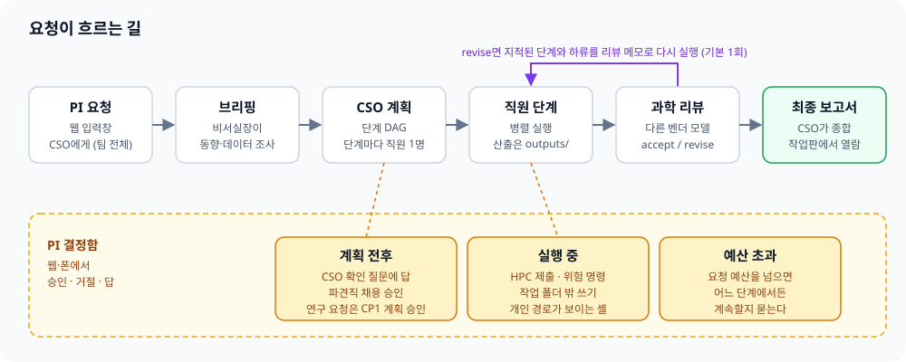
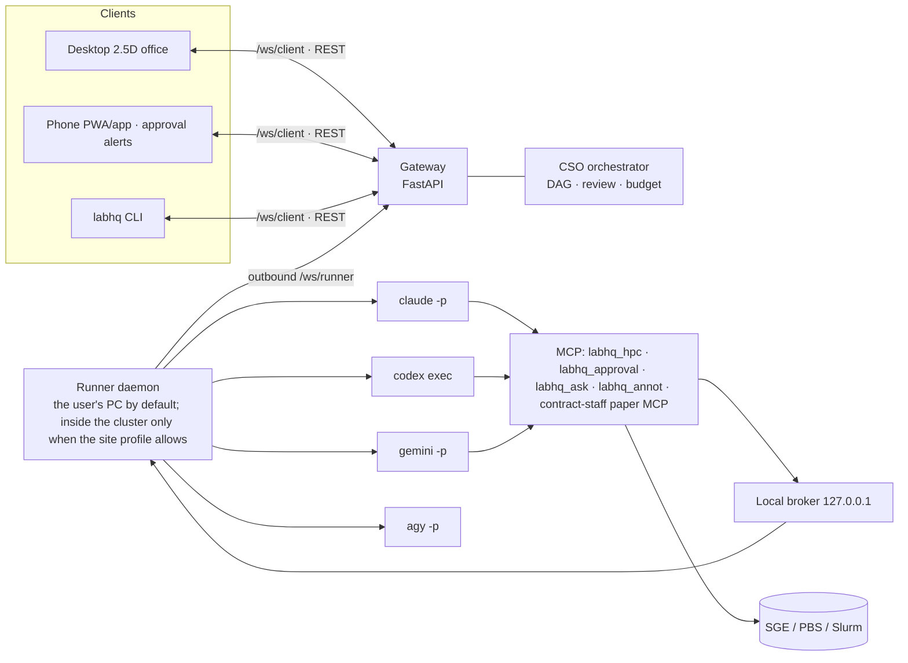
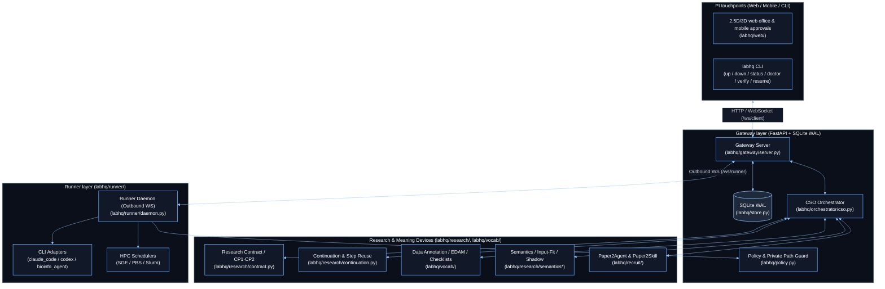

[← Manual index](../manual.en.md)

## Structure and events

A request flows in the order above. A request classified as research follows the [research lane](13-research-lane.en.md#research-lane-and-verification).

The chief of staff briefs within 400 words. It receives the same runner capability summary as the plan, distinguishes the current report from unknown for scheduler, tools and environment, and writes `none` and `no` as unavailable and unknown as unconfirmed. For a reanalysis of a public GEO, SRA or ArrayExpress accession or a named cohort, it opens the PMC or publisher full text and summarizes preprocessing and normalization, pairing and repeated measures, covariates and batch, the statistical model and thresholds, and validation in 5 lines. If it could not open the full text, it says so. The original study's Methods are only a reference; only the choices that fit the current question are rewritten.

The CSO asks only about permission, cost or access (installation, budget, controlled data, HPC), disease, cohort or sample scope that only the PI knows, and analysis depth. A depth question puts a recommendation with time and cost first among the options. The CSO decides the public dataset, model, filter, control and method, and records them with reasons under **Assumptions** of an ordinary plan. Assumptions are visible in the web, in `labhq watch` and in the final report's methods, and can be changed during a run with a [note](06-web-office.en.md#web-office). The research lane uses the same question criteria but records the assumptions in the frozen protocol.

The ordinary-lane science review attaches P1, P2 or P3 to each finding. P1 is a problem that changes the conclusion if fixed, P2 is one where the conclusion is the same but the evidence or wording is weak, and P3 is minor. Only P1 triggers a replan or revision, and the request is marked failed only when P1 remains after the revision cap. P2 is left as one line per finding (the problem only) under `Review notes` in the final report's discussion, P3 as a count only, and the original findings go in the science appendix. labhq attaches this section, and a section of the same name that the model wrote is deleted regardless of heading level (#373). Old stored reviews that had no priority are treated as P1 when restarted.

The science report is ordered title → abstract → introduction (background and question) → methods → results (figures and tables) → discussion (interpretation and limits) → conclusion → references → appendix. `report.md` is the body, and `report_appendix.md` holds the checklist table, review verdict, findings and assumptions. References gather the given accessions, PMIDs and DOIs with the same extractor as `SOURCES.md`. It keeps the easy-Korean rule (#569) and the roughly 4,000-character principle, and result numbers are written once. For now it matches the form; paper-level quality of literature, introduction and discussion is a task for after v1.

Operating information goes in `execution_record` and the bundle's `execution_record.md`. It holds step status, output paths, tool failures, cost, report warnings and bundle conversion, and the web and CLI show it separately from the science appendix. The per-staff tool table gives only step, staff, tool name, call count and failure count, not commands, paths or arguments. Success, failure, correction and resume turns are merged once per task id, and a failure without an id counts as `unknown tool error`. The round log and labhq-rounds keep only the report location, not the science body. It links only when a remote URL exists, as for a published GitHub summary, and the bundle and Nextflow local paths are shown as masked path text. The body keeps only one line on the effect of a warning and "see the execution record". Existing reports are read as they are, and the claim anchor check reads only the body.

Any step that runs a script (an analysis step, and also a QC re-computation, an interval check or a literature extraction) declares and saves its run scripts under `outputs/scripts/` and the mapping tables and gene set copies that determined the result under `outputs/reference/`, and keeps only discardable files in `.tmp`. A step that ran scripts leaves the version and package list of the interpreter that ran them (`<interpreter> --version`, `<interpreter> -m pip freeze`) in `outputs/env/<step id>.txt`. If it merely overwrites what the lock of a prior environment step wrote, it is skipped, and packages installed directly (such as `./.pylib`) always go in its own record. The reproducibility grade of a request bundle becomes `replayable` only when this record exists. The methods state the seed and the tool and data versions. A script that is not declared goes into the request bundle but not into the result repository (the published edition), so that step cannot be re-run from the edition (#792).
Files in `outputs/env/`, `outputs/scripts/` and `outputs/reference/` stay in `unreported_outputs` even if left out of the declaration, and go into the request bundle, MANIFEST and RO-Crate. A retry, a rerun after a question answer, or a review revision in the same work folder inherits the previous run's list, except for files the new run reported as official outputs. They are hidden only from the unreported-output warnings that people see, such as the runner log, the CP2 card and `labhq verify`.

### Disk writes and slow disks

labhq waits until each state write has surely reached the disk (fsync) before going to the next step. Hundreds of such writes happen while one request flows. When the disk is slow (a folder an antivirus scans, a network drive, a slow CI disk), this wait blocked the event loop, and API responses, WebSocket, heartbeat and other requests stopped together (#606).

Writes are now done by write-only threads (`labhq/durable.py`). There is one thread for work-folder files and one per SQLite file, each processing its own queue (FIFO) in order. The caller waits for completion with `await`, so "write, then the next step" is unchanged, and while it waits the loop does other work.

- Writes to the same file or the same DB finish in the order called, and a read after a write sees what was written.
- If a write fails, the exception arrives at the place that `await`ed.
- Even if the caller is cancelled, a write already queued runs to the end. Writes that must go together (a sent message and the "sent" mark, the state that closes a task and its result) go as one unit. For a task whose result has already gone out, a cancellation result is not sent separately. If the runner receives the cancel of a task it has not yet received, it records that id, and a dispatch that follows is not started but answered with a cancelled result only (#1149).
- On shutdown (gateway shutdown hook, runner shutdown, process exit), it finishes all pending writes before leaving.
- If it dies suddenly, a file is either the old version or the new one (the temp-file, fsync and replace order as is). SQLite keeps what was committed. Only writes that had not started are lost, and a step waiting for such a write could not have moved on anyway.
- fsyncs are not batched or deferred. Each write returns only after reaching the disk. There are two exceptions. First, the commit by which the runner deletes outbox rows once the gateway acks them is held back for up to 0.5 seconds after the previous such commit, and the acks that arrive meanwhile share it (#1125). The rows stay in the outbox until acked and the gateway's `runner_cursor` ignores numbers it already stored, so if the runner dies before the delete, the resend arrives once more and is ignored; the result is the same. Shutdown and reconnect do not wait for the 0.5 seconds and commit at once. Second, `RESULT.md` is the latest copy of `RESULT_<task>.md`, so it is not fsynced and only `RESULT_<task>.md` is (#1154). The same result text is also in the outbox (`task.result`), so if the runner dies suddenly only `RESULT.md` can be left old, empty or missing, and you recover from the fsynced `RESULT_<task>.md` (or the outbox).

SQLite separates read and write connections (WAL), so reads do not wait for a commit.

The gateway's event, request, result add/delete and report-review saves are awaited on the same DB writer. Saves for the same request are serialized, and state and delivery are reflected after the commit. Even on cancellation it confirms the commit result, and it records completion after the reported task cost is saved. A quota-wait cancellation is delivered before the save wait. Even if the caller of a request cancel disconnects, the cancel is delivered after the runner cancel, card cleanup and terminal record finish. A WebSocket send is at most 10 seconds per client, and on cancellation or timeout the connection is closed to trigger a reconnect replay.

Ordinary approval creation, decision, timeout, close and runner delivery/ACK are also awaited on the DB writer. Card deletion, decision and delivery rows are saved in one transaction, and races on the same card are serialized. After confirming the commit result, it removes the card, completes the future and delivers; reconnect delivery rereads the latest row after ACK or timeout. A runner approval delivery is at most 10 seconds, and on timeout it unregisters the connection and keeps the delivery row. Even if cancelled during a save, it confirms the success or error of the commit it started. A cancel during storage selection keeps the existing contract of retrying with the stored selection. Publishing an event saves the event, its request snapshot, the task activity the runner message carried and the runner's processing position (cursor) in one transaction (#1129, #1132): both are saved or neither is, and if the save fails the in-memory request is put back to the stored value. Before, the event could remain while the request save failed.

The runner's work-folder writes (`manifest.json`, `TASK*.md`, `RESULT*.md`, staff CLI config files, contract-staff contract files) and the outbox and ack were moved to the writer too. The gateway's ordinary approvals (#976), task cancel intent (#979) and plan-rehire contract save (#980) are also async. Runner activity and halt/resume task intent (#982) are awaited on the same SQLite writer and merge only the relevant field into the latest row inside the transaction. Saving of PI and runner control state, and deleting the row on result or expiry, are also serialized per task, and memory and notifications are reflected after the commit. A deletion marker prevents a late runner message from reviving it, and a new PI control controls a living step again. Step controls also serially update the latest row and handle wake-up and delivery after the commit. The runner's `task.accepted` and `task.result` records and the PI translation reservation are also awaited on the writer (#606), and the work-folder creation, the default skill copy and the private-path resolution at the start of a step run on a separate thread. The sync boundaries that remain are the task record of `dispatch` (the span where the runtime binding that would be delivered is judged once more just before it is recorded, so no await was put there, #674) and dedicated recovery, initialization and the CLI. The hiring preflight read was moved to async in #984. A step's record (`runs.<task_id>` in `manifest.json`) is written once at the start; what follows the run, the outputs' environment and the input hashes, is merged into the end-of-step write and committed with one fsync before `task.result` is sent (#1137). That is not a delayed fsync: accounting during the run is still written at once, and a step cut short writes what it had gathered. For the earlier survey list, see the [write-site map](../status/2026-10-15-1125-store-writes-off-loop.md) (Korean).

### Topic checklists and the prior-research standard

A checklist is `topic → [{id, check, why}]` in `labhq/vocab/topic_checklists.yaml`, and all 45 approved topics have items (135 items). The source literature for the items is in [topic checklist sources](../reference/topic_checklists_sources.md). A list of PMID-verified source papers per topic (30 or more, #446) is in [source papers by topic](../reference/topic_papers.md). When several topics use the same id, a single bare `id` answer applies to all of them, or you give one `topic.id` answer for every declared topic. When the check differs (such as `library_qc` for ATAC and ChIP), the correction message joins the two with ` / `. Each item is defined under an approved topic key in `output_types.yaml`, and the full table is in [Vocabulary, topics, checklists](../vocabulary.en.md). The plan and replan prompts do not carry the check text. The runner writes `topic_checklists.tsv` (topic, id, check, why) in the CSO work folder, and the prompt says only "read only the rows of the topics you declared" (PI decision 2026-10-05, #420). So even as topics grow, the prompt stays at about 650 characters. When an answer is missing, the correction request attaches that check text. A PLAN answer is `checklist: {id: "step:<step id>" | "assumption: <one line>" | "not_applicable: <reason>"}`. The ordinary lane fixes once on omission and then proceeds with a warning; the research lane stops with a PLAN validation error. An `assumption` answer leaves one line each in the report's limits. `not_applicable` is a check that does not apply to the request, so it is not used as a limit and is left out of the report body. A check that applies but could not be done (for example, no independent cohort) is answered with `assumption: <reason>` (bench C, #373).

`variant_effect` (#621) attaches to requests that interpret the effect of a specific variant (SNV, indel, missense, regulatory, splicing). It has six checks: population frequency (gnomAD), ClinVar classification and review status, VEP annotation on the MANE transcript, AlphaMissense for coding missense, predictions such as AlphaGenome (when a key exists) or SpliceAI for non-coding and splicing variants, and agreement among the evidence and its limits. Predictions are written in the limits as not clinical evidence, and an ACMG/AMP classification is made only on request. The ids do not overlap with other topics.

Before planning, `orchestrator.precedent_agent` runs in parallel with the chief of staff and, from 2–4 recent papers and best-practice reviews, finds the required and recommended analyses for the same assay and question type. Required items become a `precedent.<n>` checklist, and recommended items out of scope are left in the PLAN's `suggested_next`. On failure it only leaves a warning and plans on; stored survey results are not rerun at restart. The review and solo handling receive the same list, and the report splits what was done, what was not and the next analyses in a `Prior-research standard` section with citations. If the prior survey saved a full text (`text_file` and `text_sha256` of `fulltext_receipt`, at most 4 papers), that text is copied for every research step to the read-only `inputs/precedent/` (#951). The runner copies only when the path is a regular file inside the work root and outside the data zones, the tool receipt next to the text points to the same paper and hash, and the bytes equal the declared hash; if any one mismatches, only that text is dropped with a reason and the step continues (if all texts are dropped, `inputs/precedent` is empty). A step is told to read first, before looking things up, and to cite by file and line. The report writer receives the list of stored texts of the whole request, and distinguishes a step that did not obtain a text (a step-level gap) from a request with no source material. With no stored text, behavior is unchanged. When you press the fox in the web (2.5D staff sheet, 3D selection panel), the current request's prior-research list appears and shows, per paper, plan reference, advisory skill and whether it was hired for reproduction. Pressing a row opens the method built as a skill, its status, the generated version and hash, the steps it will be or was attached to, and the result references. A result reference is not evidence of a tool call or of utility.

Every plan also receives a list of public resources by result kind (variant, gene, region, protein, compound, literature) (`labhq/vocab/public_resources.tsv`, PI decision 2026-10-06). If a result points to a specific variant, gene or region, it adds a step that looks it up in the matching resource and has the resource's version recorded. The list is only a reference, and the CSO also plans resources outside the list (COSMIC, DisGeNET and so on) when needed. To add a resource, put one `result·resource·use` line in the TSV. For variants, staff look up through the [public-resource lookup tools](09-staff-tools.en.md#public-resource-lookup-tools).

Checklists do not act too strictly (PI decision 2026-10-07, #446). The CSO does every check the material allows, and answers a check that applies but cannot be done with `assumption: <why it could not>`. An omission with a reason is accepted. An `assumption` or `not_applicable` answer whose reason is empty or a placeholder (`-`, `n/a`, `none` and so on) is the same as an omission and takes the correction path above. An `assumption` answer with a reason leaves, per item, one plan warning `Check not done <topic>/<id>: <reason>`. It shows one line at a time in the web feed and in the warnings of the research CP1 card, and the `Report warnings` of an ordinary report count and list the items. After a replan, warnings are rebuilt against the new checklist, so old warnings for checks now done disappear and an item whose reason changed counts as one. The web feed also does not repost a line already shown for the same request. If a research plan approved at CP1 before #446 contains placeholder reasons, it does not fail on restart, and items without a reason are recorded in the request's `checklist_reasonless`. It does not create an approval card or stop the run. The research lane also requires an answer for every item, but an `assumption` with a reason passes PLAN validation. The reviewer does not flag an item omitted for a valid reason, and records an issue (then P1) only when the reason is wrong or a missing check changes the conclusion.

The reviewer answers one `checklist` line for each declared check item and each required prior standard (#586). A line has `id`, `status` (done, partly, not_done) and `evidence` (a step id or output path). The fields are optional, so old stored reviews remain valid, and a line that cannot be read drops only that field, not the whole review. If the reviewer judges partly or not_done an item the plan answered with `step:<id>`, and there is no P1 or P2 finding naming that id, labhq adds one P2 finding. Being P2, the verdict does not change, and it appears as one line in the report's `Review notes`. `assumption` and `not_applicable` answers add no finding. The execution record gets a `Checklist` table (item, owning step, review verdict, evidence). If the reviewer did not answer, or there is no review, the verdict cell is `-`. If the same id was answered differently per topic, the review context carries that id separately as `topic.id` lines (that topic's check text and plan answer) and the reviewer also answers by that id, so each verdict links only to that topic's answer, and the table has one line per topic. One topic's `done` does not make a miss for another topic's `step:` answer, nor for an `assumption` answer. A bare `id` line applies as one verdict to every topic that has no line of its own. When reviewing a solo result (`solo_review`), the plan steps did not run, so the P2 finding is attached to `solo handling` and the table's owning step is also `solo handling`.

### Common result contract for reports

The original, request bundle, GitHub summary, PDF and web report show, on the first screen, `question → answer → limits → representative figure → result table → how to reproduce → evidence footnotes → execution record` in the same order. The summary and PDF add `analysis pipeline` under the answer. If there is no figure or table, a reason for omission is written instead of a blank. The web renders this Markdown into safe HTML and does not show the internal `[[claim:…]]` notation to the reader.

A CommonMark parser splits code regions, which are skipped in asset and evidence collection and claim-number substitution. CSV, TSV and Excel links are classified as result tables.

The `Source evidence per claim` table of research reports and summaries links claim → evidence → DOI/PMID and location in the source. Full text, abstract only, not found, paywalled and unjudged are shown separately from whether it supports. It also records the first empirical source, re-citation and circular citation, Methods/QC location and missing supplements. Unresolved claims and evidence rejected at CP2 are not promoted to conclusions. The summary does not carry the source evidence of internal material steps and their substeps. [Record fields and verification scope](../reference/claim-source-display-904.md).

| Request kind | Items required before it ends |
|---|---|
| Research | question, answer, limits, how to reproduce, evidence footnotes, execution record |
| Ordinary | question, answer, limits, execution record |
| Failure | question, answer, limits, execution record |

Before the final report and research CP4, the same checker checks that referenced tables, figures and files exist, table shape, reasons for omission, exposure of internal notation, and placement of negative results in the `Results` section. If there is a problem, it leaves a warning and blocks CP4 completion. Publication approval and the internal-material check apply as before.

README, report.md and RESULT.md outputs and the web report are rendered with CommonMark, and if `**`, `__` or `[[` remain in the body, it tells you the location and how to fix it. The runner checks after writing the current response to RESULT.md, and output warnings are limited to 20 in total plus one line for the overflow. Code examples are excluded. The GitHub summary is also checked before publishing. Emphasis wraps only short words, and a particle is not attached directly after a closing emphasis mark following punctuation. Negative results also go under subheadings of the `Results` section.

### Request bundle

When a request ends, the terminal state and report are saved first, and `runner.workspace_root/requests/<request_id>/` is built once on a worker thread. It is built only when the gateway and runner are on the same PC and the host of the step manifest matches. On another PC, or when a step work folder cannot be found, a warning is left in the web, CLI and operating record instead of a path. For a cancelled step with a work folder, allowed partial files under outputs/ are collected into the bundle. Files excluded by scan or access limits may not be preserved. A request cancelled before its first work folder existed is a normal cancel and gets no such warning; a recorded work folder that has gone missing is lost data and warns even after a cancel. A request that ended without running any step (a CP1 revision request, a cancellation or failure before work) has nothing to bundle, so neither a bundle nor a warning is left. At the end, when moving the temporary folder to the final folder, if a Windows sharing lock occurs (WinError 5, when an antivirus or indexer holds the file right after copying), it retries up to four times at 0.2, 0.5, 1 and 2 second intervals, and leaves a warning if it still fails. If the terminal commit still has a bundle-pending mark, the next gateway rebuilds only that request once. Leftover temporary and partial folders are removed with the same replace rules. A rebuild failure also records a warning and clears the mark, and older requests with no mark are not touched. A build error does not change the request result.

| Path | Contents |
|---|---|
| `report.md` · `report_appendix.md` | Paper-format body and science appendix |
| `execution_record.md` | Tool call counts per step and staff, execution record, report warnings, bundle conversion |
| `claims.json` | Research requests only. Per-step claim and evidence ledger, CP2 record, anchor check. `[[claim:<step>/<claim>]]` in the report is the `id` in `ledgers.<step>.claims` |
| `steps/<step_id>/outputs/` | Outputs recorded with both path and sha256 in the final step result, then outputs the next step used without reporting |
| `steps/<step_id>/jobs/*.sh` | HPC job scripts the runner submitted, with sha256 recorded |
| `link_inputs.py` | A script linking a step folder's `inputs/<earlier step>` to `steps/<earlier step>/outputs` (only when there is a dependency) |
| `rerun_receipt.json` | A receipt created only when the bundle was rerun elsewhere and verified |
| `README.md` | The step dependency order and the script rerun commands |
| `MANIFEST.tsv` | Relative path, size, sha256, step, original absolute path, copy status |
| `INPUTS.tsv` | Path, size, mtime, sha256 or the reason for omission, of external input files opened by a step |
| `ro-crate-metadata.json` | RO-Crate 1.1 and Process Run Crate 0.5 JSON-LD metadata |

Whole-request HPC originals live in `hpc/<request>/steps/<step>/`, verified ancestor inputs in `data/<producer>/<source-task>/`, and bundles in `requests/<request>/`. Existing project/path-reference inputs and runner-root `.venv` bindings are refused before dispatch until scheduler-readable snapshots exist. [Wake, provenance, permissions, compatibility and unverified scope](../reference/hpc-step-workspaces-578.md).

A step folder keeps the structure of the original workdir's `outputs/`. The bundle does not walk the folder; it opens, with a handle that does not follow links, only the outputs that the runner recorded and hashed at run time. If the current hash differs from the record, or a file check or cap check fails, it does not copy, leaves the reason in `MANIFEST.tsv` and marks the bundle `incomplete`. Files a step wrote to `outputs/` without reporting (figures, gene-set copies and so on) can also be read by scripts, so they are copied. After copying all recorded outputs, it copies within the remaining cap, and since they have no hash from run time, writes their status as `copied (unreported)`. If such files are missing, the bundle does not become `incomplete`, and only the count is left in the appendix. A step reads earlier steps' outputs as `inputs/<earlier step id>/` inside its work folder. "Earlier steps" are not just direct dependencies but every ancestor step reached through other steps. A direct dependency's result goes up to the body; for the others only the file list enters the prompt. A new DAG dispatch passes the output list and hashes collected from the completed ancestor steps of the same request (#665). The runner checks the request, step and success state of the manifest run linked to the result task id, and the file hashes, and copies into `inputs/<step_id>/` with a handle that does not follow links. It does not open the original sibling folder as an extra work path, the copy is allowed to be read only through the existing private and read-root gates, and Codex uses a native profile that writes only `outputs/` and `.tmp/`. A rejected partial input is deleted, and if cleanup fails it blocks the run ([input evidence and caps](../reference/ancestor-inputs-665.md)). If an input is missing or the hash, path or size check fails, it records the reason and has the step ask the CSO, and does not route around to the original path. Size caps follow `runner.input_hash_max_file_bytes` and `input_hash_max_total_bytes`. A retry updates only the previous labhq copy list and preserves source files and unknown existing inputs. A legacy dispatch with no collection metadata keeps the existing link method and failure notice. In the shared-account HPC mode (`hpc.submit_prefix`) of a legacy dispatch, the job runs as another account in `hpc_out/` and the submission check rejects every link in the work folder, so it makes no links and gives the original path. In the bundle, `python link_inputs.py` sets the same links again (or copies if that fails). The README runs scripts from each `steps/<step_id>/`, and replaces the absolute paths of the steps above with paths relative to that folder. Markdown links are relative to the document. For Python it uses the command the runner reported, and if unknown, writes `python` with a warning. Other absolute paths are left in the manifest and appendix. The pre-revision version is listed only in the appendix's `Superseded` list.

The bundle README, appendix, MANIFEST, RO-Crate and the web and CLI request screens state the reproducibility grade and the reason (the distinction in `docs/research_protocol.en.md`). `replayable` applies when all recorded outputs were copied, each step that produced data has a script, each step that used a script has an environment record (`outputs/env/`) of its own or of an earlier step, and no absolute path remains in the copied scripts. If any is missing, it is `documented`. Input hashes and the omission count are not in the grade criteria. `rerun_verified` is given only when there is a valid `rerun_receipt.json` containing the request ID, time, and the sha256 of the original and rerun MANIFESTs.

Before launching a staff CLI, the runner lists and hashes the project, upstream and reference folders with the same held-directory walker as for outputs (except the step's own work folder and the run folders under `runner.workspace_root` that are reached through a parent folder). The record is the pre-run content the step read, and a file whose content changed when looked at again after the step ended gets `changed_during_step` and a warning (project and upstream folders are writable by staff). Even if a step fails or is cancelled, the pre-run record remains. It does not follow links, junctions or sub-mounts, and restricted zones and `policy.private_paths` are recorded as `restricted` and `private` respectively without opening the files. It uses `runner.input_hash_max_file_bytes` (default 2 GiB) per file, `runner.input_hash_max_total_bytes` (default 20 GiB) of cache misses per step, and `reference_scan_max_entries` and `reference_scan_max_depth` for file count and depth. The cache is the single file `runner.state_dir/input-sha256-cache.json`, and its key is (real path, size, mtime_ns) plus the file ID read from the open file and the POSIX ctime. A file swapped for the same size with mtime restored (`cp -p`, `os.utime`) is also rehashed. Windows has no ctime, so a file edited in place with size and mtime restored goes unnoticed. If the cache is corrupt, it is discarded and rebuilt.

The RO-Crate is built from the same inventory after path rewriting and the final hash. Only steps with execution results are written as `CreateAction`, and the staff CLI and engine are `SoftwareApplication`. Outputs, reports, scripts and environment records are `File`; since `INPUTS.tsv` is not an actual read, it is recorded not as the step's `object` but as a measured value of the pre-run scan `Observation`. Private and restricted rows do not export names or hashes. The crate's size and sha256 go into `MANIFEST.tsv`, and the crate does not include a manifest checksum to avoid a cycle.

| runner setting | Default | What it does in the input record |
|---|---:|---|
| `input_hash_max_file_bytes` | 2 GiB | Large files are skipped as `too_large` |
| `input_hash_max_total_bytes` | 20 GiB | If a step's new hash reads exceed it, skipped as `total_limit` |
| `reference_scan_max_entries` · `reference_scan_max_depth` | 20,000 · 16 | Caps on file count and folder depth |

The runner uses only **outbound** connections to the gateway, so no port needs to be opened on the lab PC or HPC.

**General policy for using an HPC (#1295)**

- **By default the agent stays outside the HPC.** Staff CLIs (`claude -p`, `codex exec` and so on) and the runner run on the user's PC, and only compute scripts (jobs) go to the HPC. Both the implementation that connects through `hpc.ssh_host` and the site-profile session pass the script path as it is to the remote scheduler and upload no file, so the user's PC and the login node must share the same `runner.workspace_root` (a mount); uploading and fetching files through the session shell is under way in #1308. Staff submit jobs through the `labhq_hpc` tool alone. Many institutions do not allow agents inside an HPC, so a runner placed inside the cluster (on the login node) is an exception used **only when the site profile allows it**. It is not the default. The permission setup for that layout is in [chapter 11](11-safety.en.md).
- **A login can leave a record at the institution, so logins are kept few.** With `hpc.ssh_host`, every scheduler command opens one ssh connection. What an institution counts as a login (a connection, a channel or a session) differs by site and has not been confirmed, so labhq counts every connection to be on the safe side, and the per-request and per-day limits are chosen by the user at first setup. The repository holds no institution's value, and leaving a limit empty means no limit ([chapter 15](15-config.en.md)). The manager that opens one shell session and works through it (`labhq/hpc_session.py`, #1299) is merged. The connection command, the idle-lock time and the failure texts come from the site profile, every connection goes through the login counter, and a changed host key stops it. When the site profile has a connection command (`connect_argv`), the runner and the `labhq_hpc` tool handle submit, status, queue and cancel, and the runner's status polling, all through that one shell (#1295 stage C, [chapter 9](09-staff-tools.en.md) and [chapter 15](15-config.en.md)). Without a profile it opens one ssh connection per scheduler command through `hpc.ssh_host` as before, and a profile that cannot be read fails instead of falling back to `ssh_host`.
- **Sites differ in how you connect, so a site profile carries it.** The connection method (direct SSH, gateway tunnel, VPN), scheduler, queues, paths and site rules live in a profile on the user's PC outside the repository (`~/.labhq/sites/<name>.yaml`, `labhq/hpc_site.py`, #1300). An institution's connection details are not put into the repository, logs or reports. Today they go in the uncommitted `config/labhq.yaml` on the user's PC (`hpc.ssh_host`, `hpc.user` and so on). The error text of a failed scheduler command, the session's error messages and a cancel result have the host, port and user name of the connection command masked before they reach a staff session (the `ssh_host` path too). The raw output of a command that succeeded but did not look like a job ID (for example `123;<cluster>` on a multi-cluster Slurm) is not masked yet. The site's rules come before labhq's defaults. When the scheduler is sge, pbs or slurm and the run is interactive, `labhq init` first asks whether to write a profile (the default is no) and, if yes, asks for the connection method, whether commands can be run remotely, the file-transfer method, the idle-lock time, whether an agent may run inside the cluster, and the scheduler, and saves them as the profile. An item that is not known is not guessed: it is left empty. It is asked again when you remove `hpc.site_profile` from the settings and run `labhq init` again (while the name stays in the settings, init does not ask, so an incomplete profile is not completed by itself). It does not ask with `--yes` or `--dry-run`, in a non-interactive run, or when `hpc.site_profile` is already set, and the settings keep only the profile name (`hpc.site_profile`). A profile with a connection command is read by the runner and `labhq_hpc` and used for the connection ([chapter 15](15-config.en.md)).
- Approval of a job submission follows `policy.approvals.hpc_core_hours_threshold` in [chapter 11](11-safety.en.md) (with the default 0, every submission needs approval). A connection to check this policy on a real HPC is made only when the PI approves it separately. The basis and design of this policy are in the [survey note](../reference/hpc-login-survey-1295.md); it has not been checked on a real HPC yet.

### Overall layers and module architecture

The codebase divides into four layers: **PI touchpoints (Web, Mobile, CLI)**, the **Gateway and CSO control layer**, the **research contract and Meaning Devices layer**, and the **Runner and execution layer**. The diagram below shows how requests, approvals, research contracts, meaning devices and the execution daemon mesh across the code modules.

| Layer | Core modules | Main responsibilities |
|---|---|---|
| **Orchestrator** | `labhq/orchestrator/cso.py` | Request classification (simple/research), `PLAN_SCHEMA` DAG generation, CP1 and CP2 gates, cross-vendor review, final report synthesis |
| **Gateway & Storage** | `labhq/gateway/server.py`, `labhq/store.py`, `durable.py` | FastAPI REST and WebSocket (`/ws/client`, `/ws/runner`) broadcast, approval and question lifecycle, SQLite WAL state ledger (`StateStore`) and the async fsync write queue |
| **Policy & Guard** | `labhq/policy.py`, `private_paths.py` | Bash and PowerShell command syntax checks and path extraction, blocking of external and sensitive paths (`private_paths`) and data zones (`data_zones`) |
| **Runner & Adapters** | `labhq/runner/daemon.py`, `workspace.py`, `labhq/adapters/` | Per-step isolated work folders (`inputs/`, `outputs/`), the JSON-schema structured-output contract and slot repair (`slot_repair`), CLI, WSL and HPC execution |
| **CLI & Lifecycle** | `labhq/cli.py`, `supervisor.py`, `doctor.py` | Starting, stopping and checking background daemons, supervising child processes and recording exit codes, checking environment, login and runtime readiness |
| **Research Contract** | `labhq/research/contract.py`, `continuation.py`, `labhq/evidence/claims.py` | CP1 plan-hash freeze, `result v2` claim, evidence and output sha256 matching, independent evidence-group judgment, continuation reuse |
| **Meaning Devices (6 kinds)** | `labhq/vocab/`, `labhq/research/packs.py`, `semantics*`, `semantic_device_report.py` | Vocabulary and EDAM annotation (`output_types.yaml`), 45 field checklists (`topic_checklists.yaml`), domain analysis packs, input–operation fit (`input_fit`), the meaning-device audit report (`semantic_report.md`), provenance and object shadows and A/B observation |
| **Bundle & Publication** | `labhq/request_bundle.py`, `portfolio.py`, `result_storage.py`, `reproduction_receipt.py`, `verify.py` | Request bundle and RO-Crate creation, offline integrity recheck (`labhq verify`), reproduction verification receipt, GitHub lab summary and PDF publication |

Step outputs are counted only under `outputs/` of that step's work folder. A plan's `outputs` is required, and logs, conversion records and previews can be declared as `optional_outputs`. If an optional output is missing, the step proceeds and leaves it in the step and report warnings, but a missing required output is incomplete as now. A declared output folder (`outputs/literature`) is collected not as one folder entry but as the files inside it, each with its hash (#1058). A later step takes only files that have a hash, so a folder with no hashed file (empty, too large, or only links), a step that collects more than 200 files or more bytes in total than `runner.input_hash_max_total_bytes`, a step whose declared folder holds a hard-linked file (a later step refuses it) and a step whose declared folder was not seen whole are incomplete. When the scan of the whole `outputs/` stopped at a limit, each declared folder is walked on its own with the same limits to check it was seen whole, so an undeclared subtree or a note from an earlier scan does not fail it (#1065). The inputs a later step takes from its ancestors share one total per step (`runner.input_hash_max_total_bytes`); an ancestor larger than what earlier ancestors left is refused whole, with "cumulative input budget" (needed, left, total) as the reason. It is never copied in part, and the bytes a refused ancestor copied are given back to the total so a later ancestor is not refused for them. Before, the folder was listed without a hash, the step passed, and the next step then refused all of that step's outputs. If a CSO plan tells a step to write a declared output at the work-folder root (`./answer.md`), it is corrected to `./outputs/answer.md` before running and left in a `request.plan` warning. The declared output path is also carried as is in the step prompt. A plan that declares something outside `outputs/`, such as an absolute path or `..`, is requested once more from the CSO, and if it is still wrong, no step is sent and the request ends as failed (#220). Records that labhq itself writes and reads back under `outputs/` (`outputs/external_lookup_status.jsonl`, `outputs/annotation_queries.jsonl`, `outputs/literature_access.jsonl`) can be neither declared by a plan as an output nor named in a step instruction. A plan that does, whether the instruction would read, report or write it, is requested once more from the CSO in the same way. Only an upstream step's record reached as `inputs/<step>/outputs/<name>` is allowed, and a longer file name such as `external_lookup_status.jsonl.md` is not a reserved name (#676). Of the lines a staff member wrote into such a file, a JSON object with no `tool` key is not counted in CP2's "unread malformed records" line; only a line in labhq's format that breaks its rules, and a line that is not JSON, are counted. Character substitution and format conversion are handled by the staff member with a single Python script in their own work folder (#716).

At start, the runner tells the CSO whether R, Python analysis packages, Docker, Nextflow, Java and WSL exist. For Python, it checks all of `python3`, `python` and `py` on the PATH that the staff shell calls, picks the one with the most analysis packages, and reports that command name too (on one PC the two may be different Pythons). It looks at labhq's own interpreter only when none is on the PATH. A case where the staff PATH is changed separately through `env.PATH` of the engine config is not yet reflected. The CSO installs only binary wheels, and for packages that need a build it plans an alternative and switches without asking the PI when installation fails.

Installation inside the work folder (`pip install --target ./.pylib`, a work-folder virtual environment, `./.rlib`, pinned versions) is allowed by default, and the plan prompt says not to use "no new packages" in the plan's `resource_limits` as a default. If there is finally no tool to read the downloaded material, the step leaves an `unavailable` evidence row whose `status_detail` starts with `Tool unavailable:`, and that line goes up to the CP2 warnings as "Tool unavailable". Changes to the system or shared environments stay blocked (#669). If more packages are needed, the CSO splits the environment step into one clone per consuming runner. Each clone builds that runner's virtual environment in its own work folder and declares `outputs/env/requirements.lock.txt` plus `outputs/env/runner-manifest.json`, which holds the runner, runtime and path binding. The binding is kept in the approved plan and in saved/resumed state, and dispatch is pinned to that runner. A changed runner or an unclear binding is refused, and so is a runner whose currently reported runtime (`windows`, `linux`, `wsl`) differs from the binding or is not reported at dispatch time. The extra environment clone steps added per runner do not count toward `orchestrator.max_steps`. A verified environment is used when the consuming step is a Claude, Codex or Gemini staff member (#674). For Claude its `.venv` folder becomes a read-only root like a reference folder (Edit and Write refused); Codex's sandbox already reads outside the work folder (measured on Windows), so it is not opened separately; Gemini cannot express a read-only root and gets the path only. For all three, the consuming step gets the environment variable `LABHQ_ENV_PYTHON` with the absolute path of the verified interpreter and `PYTHONDONTWRITEBYTECODE=1`, and the briefing gets a `[Runner environment]` paragraph. Before opening it the runner scans the links below `.venv` for any that lead into a controlled data zone; if one does, or the listing cannot finish (the file cap is 10 times `runner.reference_scan_max_entries`), the environment is not opened and the consuming step is refused at zero cost. An environment on a path where no write-deny rule can be made (UNC) is not opened, and a read-only consuming step is refused before it starts instead of running without the environment. The grant goes away when the task ends. The link scan, the UNC refusal and the read-only-step refusal above apply to all three engines the same way. Consuming steps of antigravity and cli staff have no way to receive the environment and are still refused. Whether Codex's sandbox on WSL and Linux reads outside the work folder, and whether Codex and Gemini actually run that interpreter, are not verified, and real WSL and engine protection (OS isolation, #666) are not verified. The environment step is also checked before it starts: the runner verifies its own binding (contract format, that the binding's runner ID equals this runner and the dispatch's session_runner, the actual runtime, and the dispatch's step ID) and, if anything differs or is missing, does not start the engine and refuses at zero cost. The environment step itself is also checked on its final turn (not while it waits for a job or a question): the runner verifies that the collected `runner-manifest.json` has the hash and content of the approved plan's binding and that the interpreter exists, and fails the step as `incomplete` if not. Before a consuming step starts, the runner checks in its own run record (`manifest.json`) that the environment step succeeded for this request, that the hash and content of the collected `runner-manifest.json` equal the approved plan's binding, and that the interpreter really exists, and it does not start the engine if any of these differ. Even when all pass, the consuming step stays refused because no protected alias that hands the verified environment to it exists yet, and the refusal reason tells the two cases apart. The runner's input validation follows the interpreter link of a Linux or WSL venv (the default `python -m venv` layout) by hand and accepts it only if the target is a plain executable inside the venv, or a root-owned executable that group and others cannot write under a system runtime (`/usr/bin`, `/usr/local/bin`, `/usr/lib`, `/bin`); any other target is refused (measured with a WSL Ubuntu-22.04 venv; other distributions and engine protection are not verified). When a step ends, the runner hashes this file and writes `complete`, `partial` or `unavailable` and the reason into `manifest.json`. An HPC analysis writes the versions and package list to `outputs/env/` inside the job script, so it does not write the login-node environment in its place. An environment step must also use the `.venv` interpreter path directly or give a `--target` inside its own folder, conda `-p`, or uv pip `--python` path. Every shell call of a step that uses a shared environment goes through the Claude approval gate, which rejects bare `pip install` and installs outside the work folder. A simple variable or `$env:NAME` assignment in PowerShell and a `NAME=value` prefix in Bash are not treated as a program if there is no install command on the right. So `PYTHONPATH=./.pylib:$PYTHONPATH python ...` is allowed, but hiding an install command in a variable and running it is rejected. Using an unquoted variable, command substitution or array in the executable position, or a non-literal in a shell-code reinterpretation position, is rejected regardless of arguments. A single variable wrapped in quotes such as `"$PY"` allows only literal arguments with no install verb. If this variable receives an R install call (`install.packages(` and so on), it is treated as Rscript and the `lib=` rule applies the same. A variable in the argument position of another program counts as an install only when an install verb follows (`python de.py "$IN" "$OUT"` and `cp "$A" "$B"` are allowed). For wrappers such as `nohup`, `sudo`, `time`, `timeout`, `nice`, `env` and `xargs`, the word after the options is treated as the executable. For `uv`, `uvx`, `conda`, `mamba`, `micromamba`, `pixi`, `poetry`, `npx` and `pnpm`, global options (`uv --project p run`, `conda -n env run`) are skipped by a table to find the subcommand, and the word that the `run` or `dlx` kind runs is treated as the executable. If an option not in the table comes before the subcommand, or the runner is unknown, every word after it is treated as an executable position (#535). R install calls are matched only on executable-position words, so text passed as a script argument such as `python wrapper.py "$IN" "install.packages('x')"` is allowed (#533). For python and Rscript, a variable before the script path (could be `-m`, `-c` or a module) and a `-c` or `-e` code starting with a variable are rejected, and a variable after the script path is allowed (but even `python "$f"` is rejected if the script path is a variable). Reflecting the work folder of a nested shell, a command whose install destination is outside is also rejected. `R CMD INSTALL` must also name a local `-l` or `--library`. Later steps only run the shared interpreter, and extra packages are installed in each step's `./.pylib` (`--target`) or `./.rlib`. The per-step `outputs/env/<step>.txt` also includes `pip freeze --path ./.pylib` or the R package table.

The runner compares `outputs/` before and after a run and leaves the size and sha256 of new and changed files in `runs.<task_id>.observed_outputs` of `manifest.json`. For Claude staff, it also attaches `tool_use_id` when the PostToolUse time and the file time are close and unique, and for Codex staff, where it is ambiguous or there is no information, leaves it empty. `TaskResult.output_sha256` records the hashes of collected outputs, and `unreported_outputs` records observed outputs the staff member did not report (`runner.output_hash_max_bytes`, default 512 MiB). A direct request has no plan output list, so it collects every allowed regular file in `outputs/`, and the request bundle, RO-Crate and `labhq verify` treat these as `direct` step outputs.

The Windows runner makes the staff Python trust the OS trust store too. If institutional security equipment inspects TLS, its root is only in the Windows store and not in the certifi that `requests` uses, so `CERTIFICATE_VERIFY_FAILED` occurs (9th mock dry run). The runner writes a PEM combining certifi and the OS store at the workspace root and sets `SSL_CERT_FILE` and `REQUESTS_CA_BUNDLE`. It rereads the store at each spawn and rewrites the file if it changed. If the PI sets only one of the two, the other variable uses the same file, and if both are set, it leaves them alone. Turn it off with `runner.system_ca_bundle: false`.

| Event | Meaning | UI mapping idea |
|---|---|---|
| `agent.status` (queued · working · waiting · hibernating · done · error) | Staff status | Typing / hand raised / sleeping zZ / applause / sweat. In both 2.5D and 3D, the owner of the current request's step takes priority, and if it has not started, it shows `Waiting for turn`. Review-pending of past requests gets the short request title, and only requests the CSO also took part in are counted. |
| `agent.tool` · `agent.log` · `agent.usage` | Tool use, speech, cost | Tool icon, speech bubble, cost gauge |
| `task.dispatched` · `task.result` | Work assigned and done | Papers move between desks |
| `approval.requested` · `approval.resolved` | Approval request and result | Phone push, a red flag on the desk |
| `job.submitted` · `job.state` · `jobs.finished` | HPC jobs | Server-room rack lights, a wake-up alarm |
| `request.plan` · `request.step_attempt` · `request.step_retry` · `request.step_skipped` · `request.step_done` · `request.review` · `request.completed` | Request progress | A failed branch is skipped, a transient failure is tried up to 2 times. A failure report opens with three lines giving the step, cause and PI action, and the full instruction and output stay in the round record and work folder (#331) |
| `request.step_quota_wait` · `request.step_quota_resumed` | Subscription limit parked and resumed | The `MM-DD HH:MM` reset time, the maximum wait deadline (`orchestrator.quota_default_wait_s` default 3600 s, `quota_max_wait_s` default 7 days) and a `Resume now` button (releases every step waiting on the same engine) |
| `request.step_login_wait` · `request.step_login_resumed` · `engine.login_wait` · `engine.login_resumed` | Login parked and resumed | The login command per engine and a `Logged in · retry` button |
| `recruit.suggested` · `recruit.status` · `recruit.done` · `roster.updated` · `contract.warning` | Contract staff | A new chick at the entrance, an expiry date on the nameplate, a rehire hash warning |
| `request.created` · `github.posted` · `github.failed` | Request intake, GitHub report | A link in the messenger |
| `request.followup` · `request.followup_done` | A follow-up question and answer on a finished request | The question and answer list on the work board |
| `request.note` | A PI note sent to a running request | Shown with the time on the request card and work board |
| `request.resume_waiting` · `request.resumed` · `request.resume_timeout` | After resume approval: runner wait, resume, wait exceeded | `Waiting for runner` (the missing staff) → `In progress`; if exceeded, `Interrupted` and a new resume card. The runner-wait target of an ordinary dispatch is also restored from the snapshot, so even if pushed outside the latest 200 events, only that staff member is shown as waiting. |
| `request.continued` | After a research-review revise, the PI approved continuing, or chose request-revision at CP2 and moved to a new plan (`round`; for CP2, `trigger: cp2_revise`) | The `Continuation round` cell of CP1, CP2 and continuation cards |

REST (Bearer `client_token`): `GET /api/agents`, `GET|POST /api/requests` (`status`, `limit`; body `references` and `default_references`. For a direct request, the staff member is accepted if present in one of the connected runner, the stored runner roster, or `runner.agents_dir`, and it waits for the runner; if in none, 404), `GET /api/requests/{id}`, `GET /api/requests/{id}/report-pdf` (a PDF with figures; without a browser, HTML and `X-Labhq-Reason`), `POST /api/requests/{id}/notes` (`{"text"}`, unfinished requests only, 2,000 characters and 20 items), `POST /api/requests/{id}/followup` (`{"text"}`, finished requests only, one at a time),
`GET|POST /api/approvals[/{id}]`, `POST /api/tasks/{id}/cancel`, `POST /api/tasks/{id}/steer|pause|resume|halt` ([Staff controls](06-web-office.en.md#staff-controls)), `POST /api/requests/{id}/steps/{step}/resume-quota`, `POST /api/recruit`, `POST /api/contracts/{agent_id}`,
`GET /api/projects`, `GET /api/approvals/history`, `POST /api/projects/{id}/prs/{n}/codex-review`, `GET /api/events`, `GET /api/health`. A phone receives a snapshot plus events through `/ws/client` and can approve directly with `{"type":"approval.resolve",...}`.

POSTs that must not apply twice on a double click (`/api/requests`, `/api/recruit`, `/api/contracts/{agent_id}`, `/api/projects/{id}/prs/{n}/codex-review`) take an `Idempotency-Key` header (up to 64 characters). A request with the same path, key and body is applied once and gets the first response again; if the first is still running, it waits for that result. A different key or body is a new request, and without a key every call applies as before. A request refused before anything was applied (4xx, or the frame could not be sent to the runner) is not remembered, so the same key may be sent again. Any other failure may have reached the runner or GitHub, so the same key gets a 409; check the state and send a new key. The memory lives inside the gateway process, up to 10 minutes and 512 entries, and is lost on restart. The web sends one key while a contract sheet stays open and until a send succeeds; the CLI (`send`, `recruit`, `contract`, `codex-review`) sends one per run.

A task cancel (`POST /api/tasks/{id}/cancel`) is sent to the runner in the task record (even after the gateway is started again). If the runner is disconnected, the cancel is kept and sent when that runner reconnects, and is deleted when the task ends or is abandoned. The prior-research survey of a request that ends early is also stopped through the same path.

Every gateway event carries `schema_version: 1` and a `seq` that continues across restarts. `/ws/client?since=<seq>` and `/api/events?since=<seq>` resend later events. For a `since` older than the retention cap, a `replay_gap` snapshot replaces the screen state.

Messenger lookup is `GET /api/messenger` and needs the PI Bearer `client_token`. Without `request_id` it returns all requests, and with it only that request. `limit` defaults to 40 with a maximum of 200 (out of range is 422), and `before` takes the `next_before` of the previous response. The events of the response `{events, has_more, next_before}` are ordered oldest to newest within the page, and the cursor points to older records excluding that `seq`. They are kept in the event replay buffer and a separate SQLite `messenger_events`, so they persist when the gateway is reopened. Report notifications do not duplicate the report body.

### Report PDF

The report body (`report.md`) holds up to 11 figures in all as Markdown images. An analysis step declares 1–2 key figures as SVG in `outputs` and `key_figures`, and the report puts them in "Results" or states in one line why they are missing. Supporting figures are not subject to a missing-figure warning. For old bundles with no declaration, it warns only when there are figure outputs but no result figure at all. The alt text is only `Figure N. Name`. One graphical abstract (`graphical_abstract.svg`) is the first figure under the title. matplotlib uses `svg.fonttype="none"` and a Korean font stack so Korean stays as `<text>`. `labhq verify` reports as WARN a missing result figure, a PNG or JPEG without an SVG, and an SVG without Korean `<text>`. A WARN does not block the exit 0/1 verdict or `--bundle` creation.

A PDF is made only when needed. For a finished request, use the **Save as PDF** button of the web request detail (2.5D and 3D) or `labhq report <request_id> --pdf [--out file]`, and the gateway builds it with `GET /api/requests/{id}/report-pdf`.

- Order: from the bundle's `report.md` and `report_appendix.md` it builds one HTML page with figures (data: URI), Korean fonts and print CSS, then runs this PC's Edge or Chrome headless and prints it to PDF. The layout is a cover (request, time, status), the paper-format body, and the science appendix. Figures at external addresses are not included, and "No figure" is written in their place.
- Figure policy (#608, #690): figures have no size limit and use the originals in the request bundle. Up to 11 figures (graphical abstract included) go into one report. The 1 MB and 5 MB caps are also not applied to the figure copies of the summary. A tall figure only has its display size reduced to fit the printable area with CSS `max-height: 220mm`. It is not re-encoded or resampled, and SVG stays vector, which matches the PI policy of preserving original quality.
- Size notice: the default of `github.edition_pdf_max_mb` is unlimited (`null`). Even with a value it only leaves a warning and does not re-encode figures to JPEG or shrink the PDF. The PDF prints the original HTML once.
- graphical abstract: the final report step declares `outputs/graphical_abstract.svg` and the generating code. The CSO is read-only and links this file as the first figure under the title. If the file is missing, labhq draws the existing SVG flow chart.
- The browser is searched in the order `gateway.report_browser`, PATH, standard install locations. If it is not found, or printing does not finish within 60 seconds, it gives HTML and says why (open it in a browser and "Save as PDF"). There are no dependencies such as LaTeX or GTK.
- The result goes in `runner.workspace_root/requests/<request_id>-report/`, and the PDF is not rewritten if the values printed on the cover (status, review stage) and the bundle's `report.md`, `report_appendix.md` and MANIFEST are unchanged. It is not written inside the bundle folder, so `labhq verify` is not affected.
- It is not made (409) for an unfinished request, a request with no report, or a request that touched a controlled data zone, and the reason is given. It uses the same judgment as the summary of result storage (#558).

### Login wait

When a Claude Code or Codex login expires, the request stops at `waiting_login`. Requests of the same engine share one wait, and the login guidance card also appears only once.

- Defaults: retry every 600 seconds, fail after 86,400 seconds (`orchestrator.login_retry_s`, `login_wait_max_s`)
- Resume at once: `Logged in · retry` in the web, or `labhq resume <request ID> <step ID>`
- The CLI also shows once, for step waits and the current wait of the new `labhq watch`, the login command that fits the runner OS and the expanded staff path.
- The wait and its deadline are kept across restarts. Credentials are not stored.
- There is one deadline per request and engine, and it is cleared only when every turn being recovered in that request (per step; per query for consultation) has ended. A turn that ends first does not restart the deadline of the remaining turns.

### Step failure and missing evidence cells

| Class | Handling |
|---|---|
| environment | The existing facilities-team recovery and diagnosis path |
| contract: only required evidence cells missing | Asks the same staff session once, per cell id, `attempted_found / attempted_none / not_attempted + reason`. Does not ask for the whole result JSON again |
| Output contract and other step failures | Skips only dependent steps and continues independent steps. The research lane proceeds to CP2 if any step succeeded, and reviews the failure list together |

- A row code makes from a cell answer is `origin: slot_repair`; if there is no answer or the session cannot be continued, `origin: omitted_by_output`. All are `unavailable` and neither support nor refute a claim. Even `attempted_found` is not accepted as a finding without original evidence.
- The cell question uses the ordinary request budget, and if one task's reserved amount does not fit within the cap, it is left as `omitted_by_output` without asking.
- Blanks, whether attempted, the reason, and failed or skipped steps are left in CP2, the reviewer and the report **Limits**. A step's success does not mean the evidence is satisfied. The plan hash, step binding and original output checks stay ([decision](../decisions.md)).
- If no step finished independently, the request fails. A budget, PI refusal (`ask_rejected`) or PI cancel/stop (`halted`) stops the request even if there are successful steps, and a change to the frozen PLAN receives a new CP1.
- The error signature and request id go into the configured development log. If there is no development-log repository, they go to `dev-reports.jsonl` in state. The PI is not asked to contact developers, and on a successful record **Automatically reported to the development team** is shown. Originals, paths and tokens are not put in this record.

### Environment failure and error signatures

A step that failed because something is missing on the runner PC is an `environment` failure (#35). The web work board, report and `labhq status` show "Environment problem: cause — what to do", and the step result and events carry the signature `id`, `cause` and `hint`.

Staff ask the facilities team for a diagnosis with `labhq_ask(to="facilities")`. The facilities team sees only the stored doctor check names and statuses and allowed excerpts of error files, and answers with the cause, the evidence and what the PI should do. The snapshot is not a live check, and `skip` means unconfirmed. It uses no shell, install, HPC, plugin or external MCP, and passes only permission and policy decisions to the CSO or PI. This consultation does not run automatic failure diagnosis or canaries.

| Signature | What |
|---|---|
| `python_module_missing` | `ModuleNotFoundError`, `No module named` |
| `command_not_found` | `command not found`, `is not recognized as an internal or external command`, Korean Windows messages (`내부 또는 외부 명령`, `용어가 cmdlet`), and the `executable not found` the adapter emits when the staff CLI executable is missing |
| `r_package_missing` | `there is no package called` |
| `disk_full` | `No space left on device`, `ENOSPC`, `There is not enough space on the disk`, `디스크 공간이 부족합니다` |
| `network_name_resolution` | `Could not resolve host`, `getaddrinfo failed`, `ENOTFOUND`, `ProxyError` |
| `docker_daemon_down` | `Cannot connect to the Docker daemon` |
| `codex_sandbox_setup` | The Codex staff home's elevated sandbox needs preparation (`sandbox_setup_required`) |

- An expired login (`login`) and a limit (`quota`) are separated first. An expired login goes to the login wait as now.
- Only failure text is examined: the step error, the tail of the staff CLI's stderr (failed runs only), and the output of failed shell and tool calls. The output of successful commands is not looked at.
- For failed-command output only the last failure is examined. If a successful shell command follows it (for example after `pip install`), it is dropped from the evidence.
- A signature found only in failed-command output or CLI stderr is weak evidence. If the step error explains it separately (timeout, rate limit, 5xx, permission denied, cancellation, turn limit and so on), that wins. If an output is missing, `Next:` names the output first.
- A skipped step (`skipped`) only carries over the error of the step above, so it is not counted separately as an environment problem.
- If a signature's `fix` points to the `labhq/facilities/fixes.yaml` allowlist, a `facilities_fix` card asks "install <name> in this step's own folder and rerun once". After approval it reruns the original step once in the same workdir and sandbox, and continues the session if resume is possible. If the request is cancelled while the card is being stored, the request stays cancelled and the card is closed; a closed card is not announced again (#1148).
- Automatic install candidates use only the verified Python import → PyPI distribution and R package → CRAN/Bioconductor tables in `labhq/facilities/packages.yaml`. A name not in the table gets no approval card.
- An `environment` failure with no approved-recovery candidate asks the facilities team for a diagnosis only once. It reads only the signature, the needed error excerpt and the stored doctor summary, and answers with advice. It does not pass on the original request, plan or conversation session, and its answer does not run commands or widen the allowlist.
- Whether a diagnosis was made is stored per request and logical step. A restart only collects existing consultation results and does not rerun an unclear result. It keeps the ask cap, budget and diagnosis deadline, and if the facilities team is absent, offline, cancelled or the budget is short, it keeps the original failure and hint. A failure of the consultation or recovery itself, an approval decline or timeout, and a failure after recovery get no further diagnosis.
- For Python, it runs `-m pip install --target ./.pylib <verified distribution>` with that step's interpreter and puts `./.pylib` first on the import path. For R, it runs `install.packages()` for CRAN and `BiocManager::install()` for Bioconductor into `./.rlib`. The runner does not run staff outputs or executables in the work folder and does not install packages itself. Versions, URLs, paths and options are refused.
- Only for `disk_full` does the runner itself empty the work folder's temporary cache. It cleans before events and `manifest.json`, and keeps earlier records in memory and writes them after the cleanup.
- After a restart, approve, decline and timeout all consume the stored decision and resume the original request. A decline, timeout, failed fix and a second environment failure end as the original `environment` failure. The research plan hash and the budget gate do not change.
- Signature matching rules: the `pattern` of `signatures.yaml` is matched against the start of the actual error line after quoted lines (`pytest` `E ` and `>`, `file:line:`, log `grep`) are stripped, and an automatic fix is linked as `fix` only for items registered in the separate allowlist (`fixes.yaml`).
