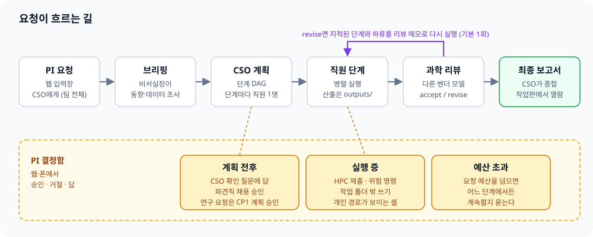
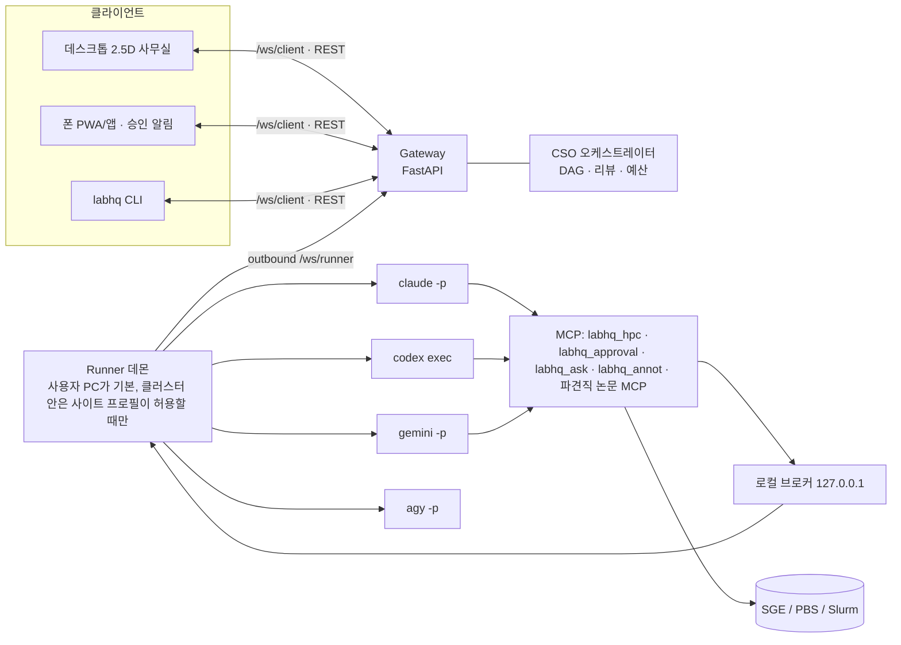
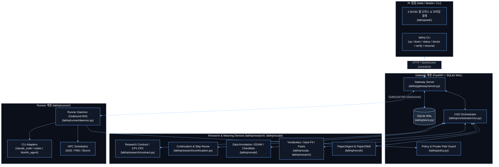

[← 매뉴얼 목차](../manual.md)

## 구조와 이벤트

요청은 위 순서로 흐릅니다. 연구로 분류된 요청은 [연구 lane](13-research-lane.md#연구-lane과-검증)을 따릅니다.

비서실장은 400단어 안에서 브리핑합니다. 계획과 같은 runner capability 요약을 받아 scheduler·도구·환경의 현재 보고와 unknown을 구분하고, `none`·`no`는 사용 불가, unknown은 미확인으로 적습니다. 공개 GEO·SRA·ArrayExpress accession이나 이름 있는 cohort의 재분석이면 PMC 또는 출판사 본문을 열고, 전처리·정규화, 짝·반복측정, 공변량·batch, 통계 모형·임계값, 검증을 5줄 안에 요약합니다. 본문을 못 열었으면 그대로 밝힙니다. 원 연구 Methods는 참고일 뿐이며, 현재 질문과 맞는 선택만 다시 씁니다.

CSO는 설치·예산·통제 데이터·HPC 같은 권한/비용/접근, PI만 아는 질병·코호트·시료 범위, 분석 깊이만 묻습니다. 깊이 질문은 시간·비용을 적은 권장안을 첫 선택지로 둡니다. 공개 데이터셋, 모형, 필터, 대조, 방법은 CSO가 정하고 일반 계획의 **가정**에 이유와 함께 남깁니다. 가정은 웹·`labhq watch`·최종 보고서의 방법에서 보이며, 실행 중에는 [메모](06-web-office.md#웹-사무실)로 바꿀 수 있습니다. 연구 lane은 같은 질문 기준을 쓰되 가정을 동결 protocol에 기록합니다.

일반 lane 과학 리뷰는 지적마다 P1·P2·P3를 붙입니다. P1은 고치면 결론이 바뀌는 문제, P2는 결론은 같지만 근거나 표현이 약한 문제, P3는 사소한 문제입니다. P1만 재계획·수정하고, 수정 상한 뒤 P1이 남을 때만 요청을 실패로 표시합니다. P2는 최종 보고서 논의의 `리뷰 참고`에 지적마다 한 줄(문제만)로, P3는 건수만 남기고 지적 원문은 과학 부록에 둡니다. 이 절은 labhq가 붙이며, 모델이 쓴 같은 이름의 절은 제목 수준과 상관없이 지웁니다(#373). 우선순위가 없던 옛 저장 리뷰는 재시작할 때 P1로 봅니다.

과학 보고서는 제목 → 요약(Abstract) → 서론(배경·질문) → 방법 → 결과(그림·표) → 논의(해석·한계) → 결론 → 참고 → 부록 순서입니다. `report.md`는 본문, `report_appendix.md`는 점검표 표·리뷰 판정과 지적·가정을 담습니다. 참고는 주어진 accession·PMID·DOI를 `SOURCES.md`와 같은 추출기로 모읍니다. 쉬운 한국어(#569)와 약 4,000자 원칙을 유지하고 결과 수치는 한 번만 적습니다. 지금은 형식을 맞추며 논문 수준의 문헌·서론·논의 품질은 v1 이후 과제입니다.

운전 정보는 `execution_record`와 묶음의 `execution_record.md`에 둡니다. 단계 상태·산출 경로·도구 실패·비용·보고서 경고·묶음 변환을 담고, 웹·CLI에서 과학 부록과 따로 보여 줍니다. 직원별 도구 표에는 단계·직원·도구 이름·호출 수·실패 수만 적고 명령·경로·인자는 적지 않습니다. 성공·실패·교정·재개 turn을 task id별로 한 번씩 합치며, id 없는 실패는 `도구 미상 오류`로 셉니다. 라운드 기록과 labhq-rounds에는 과학 본문 대신 보고서 위치만 남깁니다. 게시된 GitHub 정리본처럼 원격 URL이 있을 때만 링크하고, 묶음·Nextflow 로컬 경로는 가린 경로 텍스트로 표시합니다. 본문에는 경고의 영향과 “실행 기록 참고”만 한 줄 남깁니다. 기존 보고서는 그대로 읽고 claim anchor 검사는 본문만 읽습니다.

스크립트를 돌린 모든 단계(분석뿐 아니라 QC 재계산·신뢰구간 확인·문헌 추출 단계도)는 실행 스크립트를 `outputs/scripts/`, 결과를 좌우한 대응표·gene set 사본을 `outputs/reference/`에 선언·저장하고, `.tmp`에는 버려도 되는 파일만 둡니다. 스크립트를 돌린 단계는 그 스크립트를 실행한 인터프리터로 판과 패키지 목록(`<인터프리터> --version`·`<인터프리터> -m pip freeze`)을 `outputs/env/<단계 id>.txt`에 남깁니다. 앞 환경 단계의 lock이 쓴 것을 그대로 덮으면 생략하고, 직접 설치한 패키지(`./.pylib` 등)는 언제나 자기 기록에 넣습니다. 요청 묶음의 재현 등급은 이 기록이 있어야 `replayable`이 됩니다. 방법에는 seed와 도구·데이터 버전을 적습니다. 선언하지 않은 스크립트는 요청 묶음에는 들어가지만 결과 repo(정리본)에는 실리지 않아 그 단계를 정리본에서 다시 실행할 수 없습니다(#792).
`outputs/env/`·`outputs/scripts/`·`outputs/reference/` 파일은 선언에서 빠져도 `unreported_outputs`에 남아 요청 묶음·MANIFEST·RO-Crate에 들어갑니다. 같은 작업 폴더에서 retry·질문 답 뒤 재실행·리뷰 수정을 해도 앞 실행 목록을 이어받되, 새 실행에서 정식 산출로 보고한 파일은 뺍니다. runner 로그·CP2 카드·`labhq verify`처럼 사람이 보는 미보고 산출 경고에서만 숨깁니다.

### 디스크 쓰기와 느린 디스크

labhq는 상태를 쓸 때마다 디스크에 확실히 내려갈 때까지(fsync) 기다린 뒤 다음 단계로 갑니다. 요청 하나가 흐르는 동안 이런 쓰기가 수백 번 일어납니다. 디스크가 느리면(백신이 검사하는 폴더, 네트워크 드라이브, 느린 CI 디스크) 이 대기가 event loop을 막아서, 그동안 API 응답·WebSocket·heartbeat와 다른 요청이 같이 멈췄습니다(#606).

이제 쓰기는 쓰기 전용 thread(`labhq/durable.py`)가 합니다. 작업 폴더 파일용 thread가 하나, SQLite 파일마다 하나씩 있고, 각자 대기열(FIFO)을 순서대로 처리합니다. 부르는 쪽은 `await`으로 끝나기를 기다리므로 "쓰고 나서 다음 단계"는 그대로이고, 기다리는 동안 loop은 다른 일을 합니다.

- 같은 파일이나 같은 DB에 대한 쓰기는 부른 순서대로 끝나고, 쓴 뒤의 읽기는 쓴 내용을 봅니다.
- 쓰기가 실패하면 그 예외가 `await`한 곳으로 옵니다.
- 부른 쪽이 취소돼도 이미 넣은 쓰기는 끝까지 갑니다. 함께 가야 하는 쓰기(보낸 메시지와 "보냈다"는 표시, 작업을 닫는 상태와 결과)는 한 묶음으로 갑니다. 결과가 이미 나간 task에는 취소 결과를 따로 보내지 않습니다. runner가 아직 받지 않은 task의 취소를 먼저 받으면 그 id를 기록해 두고, 뒤따라 온 dispatch는 시작하지 않고 취소 결과로만 답합니다(#1149).
- 종료할 때(gateway 종료 hook, runner 종료, 프로세스 종료)는 대기 중인 쓰기를 모두 끝낸 뒤 나갑니다.
- 갑자기 죽어도 파일은 옛것이나 새것 한쪽입니다(임시 파일, fsync, 교체 순서 그대로). SQLite는 커밋된 데까지입니다. 아직 시작하지 않은 쓰기만 사라지는데, 그 쓰기를 기다리던 단계는 어차피 다음으로 가지 못했습니다.
- fsync를 모아서 한꺼번에 하거나 미루지 않습니다. 쓰기마다 디스크에 내려간 뒤에 돌아옵니다. 두 가지만 예외입니다. 첫째, runner가 gateway의 ack를 받아 outbox 행을 지우는 commit은 직전 commit 뒤 0.5초 안에는 미루고 그 사이 ack를 하나로 합칩니다(#1125). 행은 ack 전까지 outbox에 남고 gateway가 이미 저장한 번호는 `runner_cursor`가 걸러서, 지우기가 늦어져 죽어도 재전송은 한 번 더 도착해 무시될 뿐 결과가 같습니다. 종료·재연결은 이 0.5초를 기다리지 않고 바로 commit합니다. 둘째, `RESULT.md`는 `RESULT_<task>.md`의 최신 사본이라 fsync하지 않고 `RESULT_<task>.md`만 fsync합니다(#1154). 같은 결과 본문이 outbox(`task.result`)에도 있어서, 갑자기 죽으면 `RESULT.md`만 옛 내용이나 빈 파일로 남거나 없을 수 있고, 그때는 fsync된 `RESULT_<task>.md`(또는 outbox)에서 복구합니다.

SQLite는 읽기 연결과 쓰기 연결을 나눠(WAL) 읽기가 커밋을 기다리지 않습니다.

Gateway의 event·request·결과 추가/삭제·보고서 검토 저장은 같은 DB writer에서 await합니다. 같은 request의 저장은 직렬화하며 commit 뒤 상태와 전송을 반영합니다. 취소돼도 commit 결과를 확인하며, 보고된 task 비용 저장 뒤 완료를 기록합니다. quota 대기 취소는 저장 대기 전에 전달합니다. 요청 취소 호출자가 끊겨도 runner 취소·카드 정리·terminal 기록을 마친 뒤 취소를 전달합니다. WebSocket 전송은 client마다 최대 10초이며 취소·시간 초과 때 연결을 닫아 재연결 replay를 유도합니다.

일반 승인 생성·결정·timeout·close·runner 전달/ACK도 DB writer에서 await합니다. 카드 삭제·결정·전달 행은 한 transaction으로 저장하며 같은 카드의 경쟁을 직렬화합니다. commit 결과를 확인한 뒤 카드 제거·future 완료·전달을 진행하고, 재접속 전달은 ACK·timeout 뒤 최신 행을 다시 읽습니다. runner 승인 전달은 최대 10초이며 시간 초과 때 연결 등록을 해제하고 전달 행을 보존합니다. 저장 중 취소돼도 시작한 commit의 성공·오류를 확인합니다. storage 선택 중 취소는 저장된 선택으로 재시도하는 기존 계약을 유지합니다. 이벤트 발행은 이벤트, 그 request 저장본, runner 메시지가 가져온 task 활동, runner 처리 위치(cursor)를 한 transaction으로 저장합니다(#1129, #1132). 둘 다 저장되거나 둘 다 저장되지 않으며, 저장이 실패하면 메모리의 request도 저장된 값으로 되돌립니다. 이전에는 이벤트만 남고 request 저장이 실패하는 경우가 있었습니다.

Runner의 작업 폴더 쓰기(`manifest.json`, `TASK*.md`, `RESULT*.md`, 직원 CLI 설정 파일, 파견직 계약 파일)와 outbox·ack도 writer로 옮겼습니다. Gateway 일반 승인(#976)·task 취소 intent(#979)와 plan-rehire 계약 저장(#980)도 async입니다. runner activity·halt/resume task intent(#982)는 같은 SQLite writer에서 await하며 transaction 안의 최신 row에 해당 필드만 병합합니다. PI·runner의 control-state 저장과 result/만료에 따른 해당 row 삭제도 task별로 직렬화해 commit 뒤 memory·알림을 반영합니다. 삭제 표식은 늦은 runner 메시지의 부활을 막고 새 PI 제어는 살아 있는 step을 다시 제어합니다. step 제어도 최신 row를 직렬 갱신하고 commit 뒤 wake·전송을 처리합니다. runner의 `task.accepted`·`task.result` 기록과 PI 번역 예약도 writer에서 await하고(#606), 단계 시작 때의 작업 폴더 만들기·기본 skill 복사·개인 경로 해석은 별도 thread에서 합니다. 남은 sync 경계는 `dispatch`의 task 기록(실제로 전달되는 runtime 묶음을 기록 직전에 한 번 더 판단하는 구간이라 await을 넣지 않았습니다, #674)과 전용 복구·초기화/CLI입니다. 채용 preflight 읽기는 #984에서 async로 전환했습니다. 단계의 기록(`manifest.json`의 `runs.<task_id>`)은 시작할 때 한 번 쓰고, 단계가 끝난 뒤의 산출 환경·입력 hash는 종료 기록에 합쳐 `task.result`를 보내기 전에 한 번의 fsync로 확정합니다(#1137). 지연 fsync가 아니고, 실행 중 accounting은 즉시 쓰며, 중간에 끊긴 단계도 모은 기록을 씁니다. 이전 조사 목록은 [쓰기 지점 지도](../status/2026-10-15-1125-store-writes-off-loop.md)를 봅니다.

### topic 점검표와 선행 연구 기준

점검표는 `labhq/vocab/topic_checklists.yaml`의 `topic → [{id, check, why}]`이고, 승인된 topic 45개 모두에 항목이 있습니다(135항목). 항목의 근거 문헌은 [topic 점검표 근거](../reference/topic_checklists_sources.md)에 있습니다. topic마다 PMID를 검증한 근거 논문 목록(30편 이상, #446)은 [topic별 근거 논문](../reference/topic_papers.md)에 있습니다. 여러 topic이 같은 id를 쓰면 bare `id` 답 하나를 모두에 적용하거나, 선언한 모든 topic에 `topic.id` 답을 하나씩 냅니다. 점검 내용이 다르면(ATAC와 ChIP의 `library_qc` 등) 교정 메시지에서 두 내용을 ` / `로 잇습니다. 각 항목은 `output_types.yaml`의 승인된 topic key 아래에 정의되며 전체 표는 [어휘·topic·점검표](../vocabulary.md)에서 볼 수 있습니다. 계획·재계획 프롬프트에는 점검 내용을 싣지 않습니다. 러너가 CSO 작업 폴더에 `topic_checklists.tsv`(topic, id, check, why)를 쓰고, 프롬프트는 "선언한 topic의 줄만 읽어라"라고만 적습니다(PI 결정 2026-10-05, #420). 그래서 topic이 늘어도 프롬프트는 약 650자로 같습니다. 답이 빠지면 고침 요청에 그 점검 내용을 붙입니다. PLAN의 답은 `checklist: {id: "step:<step id>" | "assumption: <한 줄>" | "not_applicable: <이유>"}`입니다. 일반 lane은 누락 시 한 번 고친 뒤 경고로 진행하고, 연구 lane은 PLAN 검증 오류로 멈춥니다. `assumption` 답은 보고서 한계에 한 줄씩 남습니다. `not_applicable`은 요청에 해당하지 않는 점검이라 한계로 쓰지 않고 보고서 본문에서 뺍니다. 해당하는데 못 한 점검(예: 독립 코호트가 없음)은 `assumption: <이유>`로 답합니다(벤치 C, #373).

`variant_effect`(#621)는 특정 변이의 효과를 해석하는 요청(SNV·indel, missense, 조절, 스플라이싱)에 붙습니다. 점검은 여섯 가지입니다: 집단 빈도(gnomAD), ClinVar 분류와 review status, VEP의 MANE transcript 주석, 암호화 missense의 AlphaMissense, 비암호화·스플라이싱 변이의 AlphaGenome(키가 있을 때)이나 SpliceAI 같은 예측, 증거끼리의 일치와 한계. 예측은 임상 근거가 아니라고 한계에 적고, ACMG/AMP 분류는 요청이 있을 때만 합니다. id는 다른 topic과 겹치지 않습니다.

계획 전 `orchestrator.precedent_agent`가 비서실장과 병렬로 최근 논문·best-practice review 2–4편에서 같은 assay·질문 유형의 필수·권장 분석을 찾습니다. 필수 항목은 `precedent.<n>` 점검표가 되고, 범위 밖 권장 항목은 PLAN `suggested_next`에 남습니다. 실패하면 경고만 남기고 계획하며, 저장된 조사 결과는 재시작 때 다시 돌리지 않습니다. 리뷰와 단독 처리도 같은 목록을 받고, 보고서는 인용을 붙인 `선행 연구 기준` 절로 한 일·못 한 일·다음 분석을 나눕니다. 선행 조사가 본문을 저장했으면(`fulltext_receipt`의 `text_file`·`text_sha256`, 최대 4편) 연구 단계마다 그 본문이 읽기 전용 `inputs/precedent/`로 복사됩니다(#951). runner는 경로가 작업 root 안의 보통 파일이고 데이터 구역 밖이며 본문 옆의 도구 receipt가 같은 논문·hash를 가리키고 바이트가 선언한 hash와 같을 때만 복사하고, 어느 하나라도 어긋나면 그 본문만 사유와 함께 빼고 단계는 계속합니다(모든 본문이 빠지면 `inputs/precedent`는 비어 있습니다). 단계는 조회하기 전에 먼저 읽고 파일·줄로 인용하라는 안내를 받습니다. 보고서 작성자는 요청 전체의 저장 본문 목록을 받아, 한 단계가 본문을 얻지 못한 것(단계 수준 공백)과 요청에 원문 자료가 없는 것을 구분합니다. 저장 본문이 없으면 동작은 그대로입니다. 웹에서 여우를 누르면(2.5D 직원 시트, 3D 선택 패널) 현재 요청의 선행 연구 목록이 나오고 논문마다 계획 참고·자문 스킬·재현 채용 여부를 보입니다. 행을 누르면 스킬로 만든 방법, 상태, 생성 버전과 hash, 붙을·붙은 단계, 결과 참조가 열립니다. 결과 참조는 도구 호출이나 효용의 증거가 아닙니다.

모든 계획은 결과 종류(변이·유전자·영역·단백질·화합물·문헌)별 공개 자원 목록도 받습니다(`labhq/vocab/public_resources.tsv`, PI 결정 2026-10-06). 결과가 특정 변이·유전자·영역을 가리키면 맞는 자원에서 조회하는 단계를 넣고 자원의 판본을 기록하게 합니다. 목록은 참고일 뿐이고, CSO는 목록 밖 자원(COSMIC, DisGeNET 등)도 필요하면 계획합니다. 자원을 더하려면 TSV에 `result·resource·use` 한 줄을 넣습니다. 변이는 직원이 [공개 자원 조회 도구](09-staff-tools.md#공개-자원-조회-도구)로 조회합니다.

점검표는 지나치게 엄격하게 굴지 않습니다(PI 결정 2026-10-07, #446). CSO는 자료가 허락하는 점검을 모두 하고, 해당하는데 못 하는 점검은 `assumption: <못 한 이유>`로 답합니다. 이유가 있는 생략은 받아들입니다. 이유가 비었거나 자리표시(`-`, `n/a`, `없음` 등)인 `assumption`·`not_applicable` 답은 누락과 같아서 위의 교정 경로를 탑니다. 이유가 있는 `assumption` 답은 항목마다 계획 경고 `점검 못 함 <topic>/<id>: <이유>`를 한 번 남깁니다. 웹 피드에 한 줄씩 뜨고 연구 CP1 카드의 경고에도 보이며, 일반 보고서의 `보고서 경고`는 건수와 항목을 셉니다. 재계획 뒤에는 새 점검표 기준으로 경고를 다시 만들어, 이제 하는 점검의 옛 경고는 사라지고 이유가 바뀐 항목도 한 건으로 셉니다. 웹 피드도 같은 요청에서 이미 보인 줄은 다시 올리지 않습니다. #446 전에 CP1 승인된 연구 계획이 자리표시 이유를 담고 있으면 재시작해도 실패하지 않고, 이유 없는 항목을 요청의 `checklist_reasonless`에 남깁니다. 승인 카드를 만들거나 실행을 멈추지는 않습니다. 연구 lane도 모든 항목에 답을 요구하지만 이유가 있는 `assumption`은 PLAN 검증을 통과합니다. 리뷰어는 맞는 이유로 생략한 항목을 지적하지 않고, 이유가 틀렸거나 빠진 점검이 결론을 바꿀 때만 issue(그때는 P1)로 남깁니다.

리뷰어는 선언한 점검 항목과 필수 선행 기준마다 `checklist` 한 줄을 답합니다(#586). 줄은 `id`, `status`(done·partly·not_done), `evidence`(단계 id나 산출 경로)입니다. 필드는 선택이라 옛 저장 리뷰도 그대로 유효하고, 읽을 수 없는 줄은 리뷰 전체가 아니라 그 필드만 버립니다. 계획이 `step:<id>`로 답한 항목을 리뷰어가 partly나 not_done으로 판정하면, 그 id를 이름으로 든 P1·P2 지적이 없을 때 labhq가 P2 지적을 하나 더합니다. P2라 판정은 바뀌지 않고 보고서 `리뷰 참고`에 한 줄로 실립니다. `assumption`·`not_applicable` 답은 지적을 더하지 않습니다. 실행 기록에는 `점검표`(항목·담당 단계·리뷰 판정·근거) 표가 붙습니다. 리뷰어가 답하지 않았거나 리뷰가 없으면 판정 칸은 `-`입니다. 같은 id를 topic별로 다르게 답했으면 리뷰 문맥이 그 id를 `topic.id` 줄(그 topic의 점검 내용과 계획 답)로 따로 싣고 리뷰어도 그 id로 답하므로, 각 판정을 그 topic의 답에만 잇고 표도 topic마다 한 줄입니다. 한 topic의 `done`이 다른 topic의 `step:` 답에 miss를 만들지 않고, `assumption` 답에도 만들지 않습니다. bare `id` 줄은 자기 줄이 없는 topic 전체에 하나의 판정으로 적용됩니다. 단독 처리 결과를 리뷰할 때(`solo_review`)는 계획 단계가 실행되지 않았으므로 P2 지적이 `단독 처리`에 달리고 표의 담당 단계도 `단독 처리`입니다.

### 보고서 공통 결과 계약

원본·요청 묶음·GitHub 정리본·PDF·웹 보고서는 첫 화면에 `질문 → 답 → 한계 → 대표 그림 → 결과표 → 재현 안내 → 근거 각주 → 실행 기록`을 같은 순서로 표시합니다. 정리본과 PDF는 답 아래에 `분석 파이프라인`을 더합니다. 그림·표가 없으면 빈칸 대신 생략 사유를 적습니다. 웹은 이 Markdown을 안전한 HTML로 그리며 `[[claim:…]]` 내부 표기를 독자에게 보이지 않습니다.

CommonMark 파서로 코드 영역을 나눠 asset·근거 수집과 claim 번호 치환에서 건너뜁니다. CSV·TSV·Excel 링크는 결과표로 분류합니다.

연구 보고서와 정리본의 `주장별 원문 근거` 표는 claim→evidence→DOI/PMID·원문 위치를 잇습니다. 전문·초록만·못 구함·유료 막힘·미판정은 지지 여부와 따로 표시합니다. 최초 실증 출처·재인용·순환 인용, Methods/QC 위치와 보충자료 누락도 남깁니다. 미해결 claim과 CP2 거부 근거는 결론으로 승격하지 않습니다. 정리본에는 내부 자료 단계와 그 하위 단계의 원문 근거를 싣지 않습니다. [기록 필드·검증 범위](../reference/claim-source-display-904.md).

| 요청 종류 | 끝나기 전 필수 항목 |
|---|---|
| 연구 | 질문·답·한계·재현 안내·근거 각주·실행 기록 |
| 일반 | 질문·답·한계·실행 기록 |
| 실패 | 질문·답·한계·실행 기록 |

최종 보고서와 연구 CP4 전에 같은 검사기가 참조한 표·그림·파일의 존재, 표 모양, 생략 사유, 내부 표기 노출, 음성 결과의 `결과` 절 배치를 검사합니다. 문제가 있으면 경고를 남기고 CP4 완료를 막습니다. 게시 승인과 내부 자료 검사는 그대로 적용됩니다.

README·report.md·RESULT.md 산출물과 웹 보고를 CommonMark로 렌더해 본문에 `**`·`__`·`[[`가 남으면 위치와 고칠 방법을 알립니다. runner는 현재 응답을 RESULT.md에 쓴 뒤 검사하며 산출 경고는 전체 20개와 초과 안내 한 줄로 제한합니다. 코드 예시는 제외합니다. GitHub 정리본은 게시 전에도 검사합니다. 강조는 짧은 낱말만 감싸고 문장부호 뒤 닫는 강조 기호 바로 다음에 조사를 붙이지 않습니다. 음성은 `결과` 절 하위 제목에도 둡니다.

### 요청 묶음

요청이 끝나면 terminal 상태와 보고서를 먼저 저장하고 `runner.workspace_root/requests/<request_id>/`를 worker thread에서 한 번만 만듭니다. gateway와 runner가 같은 PC이고 단계 manifest의 host가 일치할 때만 생성합니다. 다른 PC이거나 단계 작업 폴더를 찾지 못하면 경로 대신 웹·CLI와 운전 기록에 경고를 남깁니다. 취소된 단계도 작업 폴더가 있으면 허용된 outputs/의 부분 산출물을 수집해 묶음에 넣습니다. 스캔 제한이나 접근 제한으로 빠진 파일은 보존되지 않을 수 있습니다. 다만 첫 작업 폴더가 생기기 전에 취소한 요청은 정상 취소이므로 이 경고를 내지 않습니다. 기록된 작업 폴더가 사라진 경우는 데이터 유실이라 취소여도 경고합니다. 단계를 하나도 돌리지 않고 끝난 요청(CP1 수정 요청, 작업 전 취소·실패)은 묶을 것이 없으므로 묶음도 경고도 남기지 않습니다. 마지막에 임시 폴더를 최종 폴더로 옮길 때 Windows 공유 잠금(WinError 5, 복사 직후 백신·색인기가 파일을 잡는 경우)이 나면 0.2·0.5·1·2초 간격으로 네 번까지 다시 시도하고, 그래도 안 되면 경고를 남깁니다. terminal commit에 묶음 대기 표시가 남아 있으면 다음 gateway가 그 요청만 한 번 다시 만듭니다. 남은 임시·부분 폴더는 같은 교체 규칙으로 지웁니다. 재생성 실패도 경고를 기록하고 표시를 지우며, 표시 없는 예전 요청은 건드리지 않습니다. 생성 오류는 요청 결과를 바꾸지 않습니다.

| 경로 | 내용 |
|---|---|
| `report.md` · `report_appendix.md` | 논문 형식 본문과 과학 부록 |
| `execution_record.md` | 단계·직원별 도구 호출 수, 실행 기록·보고서 경고·묶음 변환 |
| `claims.json` | 연구 요청만. 단계별 claim·근거 원장, CP2 기록, 앵커 검사. 보고서의 `[[claim:<단계>/<claim>]]`은 `ledgers.<단계>.claims`의 `id` |
| `steps/<step_id>/outputs/` | 최종 단계 결과에 경로와 sha256이 함께 기록된 산출물, 그다음 단계가 보고하지 않고 쓴 산출 |
| `steps/<step_id>/jobs/*.sh` | runner가 제출하며 sha256을 기록한 HPC 잡 스크립트 |
| `link_inputs.py` | 단계 폴더의 `inputs/<앞 단계>`를 `steps/<앞 단계>/outputs`로 잇는 스크립트(의존이 있을 때만) |
| `rerun_receipt.json` | 다른 곳에서 묶음을 다시 실행해 검증한 경우만 생기는 receipt |
| `README.md` | 단계 의존 순서와 스크립트 재실행 명령 |
| `MANIFEST.tsv` | 상대경로·크기·sha256·단계·원래 절대경로·복사 상태 |
| `INPUTS.tsv` | 단계에 연 외부 입력 파일의 경로·크기·mtime·sha256 또는 생략 이유. 단계에 열린 Python·conda 환경(runner가 검증해 연 앞 단계 `.venv`, `pyvenv.cfg`나 `conda-meta/`가 있는 폴더)은 파일별이 아니라 폴더 한 행으로 적고 생략 이유는 `environment`입니다. 수천 개 행이 기록을 키워 다음 단계 인계가 막히지 않게 하려는 것입니다(#1421). restricted·private 경로 안의 환경은 다른 보호 경로처럼 이름 없이 적습니다. 입력 폴더 안쪽에 든 환경은 아직 파일별로 적힙니다 |
| `ro-crate-metadata.json` | RO-Crate 1.1·Process Run Crate 0.5 JSON-LD metadata |

요청 전체 HPC 실행은 `hpc/<request>/steps/<step>/`, 검증한 조상 입력은 `data/<producer>/<source-task>/`, 묶음은 `requests/<request>/`에 보관합니다. 기존 project·경로 참고 입력은 승인한 hash와 대조한 snapshot으로 전달합니다. runner 루트 `.venv` binding은 HPC에서 거부합니다. [wake·provenance·권한·호환·미검증 범위](../reference/hpc-step-workspaces-578.md).

단계 폴더는 원래 workdir의 `outputs/` 구조를 유지합니다. 묶음은 폴더를 순회하지 않고 runner가 실행 때 기록하고 hash한 산출만 링크를 따르지 않는 handle로 엽니다. 현재 hash가 기록과 다르거나 파일 확인·상한 검사가 실패하면 복사하지 않고 `MANIFEST.tsv`에 이유를 남기며 묶음을 `incomplete`로 표시합니다. 단계가 보고하지 않고 `outputs/`에 쓴 파일(그림, gene-set 사본 등)도 스크립트가 읽을 수 있어 복사합니다. 기록된 산출을 모두 복사한 뒤 남은 상한 안에서 복사하고, 실행 때 hash가 없어 상태를 `copied (unreported)`로 적습니다. 이런 파일이 빠져도 묶음은 `incomplete`가 되지 않고 부록에 개수만 남습니다. 단계는 앞 단계 산출을 작업 폴더 안 `inputs/<앞 단계 id>/`로 읽습니다. 앞 단계는 직접 의존 단계만이 아니라 다른 단계를 거쳐 이어지는 모든 조상 단계입니다. 직접 의존 단계는 결과 본문까지, 나머지는 파일 목록만 프롬프트에 들어갑니다. 새 DAG dispatch는 같은 요청의 완료된 조상 단계에서 수집한 산출 목록·hash를 전달합니다(#665). runner는 결과 task id에 연결된 manifest run의 요청·step·성공 상태와 파일 hash를 확인하고, 링크를 따르지 않는 handle로 `inputs/<step_id>/`에 복사합니다. 원래 sibling 폴더를 추가 작업 경로로 열지 않으며, 복사본은 기존 private/read-root 게이트로 읽기만 허용하며 Codex는 `outputs/`·`.tmp/`만 쓰는 native profile을 사용합니다. 거부된 부분 입력은 지우고 정리에 실패하면 실행을 막습니다([입력 증거·상한](../reference/ancestor-inputs-665.md)). 입력이 없거나 hash·경로·크기 검사가 실패하면 이유를 남기고 CSO에게 묻게 하며 원래 경로로 우회시키지 않습니다. 크기 상한은 `runner.input_hash_max_file_bytes`·`input_hash_max_total_bytes`를 따릅니다. 재시도는 이전 labhq 복사 목록만 갱신하며 출처 파일과 알 수 없는 기존 입력은 보존합니다. 수집 메타데이터가 없는 구형 dispatch는 기존 링크 방식과 실패 안내를 유지합니다. 구형 dispatch의 공유 계정 HPC 모드(`hpc.submit_prefix`)에서는 잡이 다른 계정으로 `hpc_out/`에서 돌고 제출 검사가 작업 폴더의 링크를 모두 거부하므로 링크를 만들지 않고 원래 경로를 줍니다. 묶음에서는 `python link_inputs.py`가 같은 링크를 다시 겁니다(안 되면 복사). README는 각 `steps/<step_id>/`에서 스크립트를 실행하고, 위 단계 절대경로는 그 폴더 기준 상대경로로 바꿉니다. Markdown 링크는 문서 기준입니다. Python은 runner가 보고한 명령을 쓰고, 모르면 `python`과 경고를 함께 적습니다. 다른 절대경로는 manifest와 부록에 남깁니다. 수정 전 판은 부록의 `대체됨` 목록에만 적습니다.

묶음 README·부록·MANIFEST·RO-Crate와 웹·CLI 요청 화면에는 재현 등급과 이유를 적습니다(`docs/research_protocol.md`의 구분). `replayable`은 기록 산출이 모두 복사됐고, 데이터를 낸 단계마다 스크립트가, 스크립트를 쓴 단계마다 자기나 앞 단계의 환경 기록(`outputs/env/`)이 있고, 복사한 스크립트에 절대경로가 남지 않았을 때입니다. 하나라도 빠지면 `documented`입니다. 입력 hash·생략 수는 등급 기준에 넣지 않습니다. `rerun_verified`는 request ID·시각·원본/재실행 MANIFEST sha256이 든 유효한 `rerun_receipt.json`이 있을 때만 줍니다.

runner는 직원 CLI를 띄우기 전에 project·upstream·참고 폴더를 산출과 같은 held-directory walker로 나열하고 hash합니다(단계 자신의 작업 폴더와, 상위 폴더를 거쳐 들어가는 `runner.workspace_root` 아래 실행 폴더는 빼고). 기록은 단계가 읽은 실행 전 내용이며, 단계가 끝난 뒤 다시 보아 내용이 바뀐 파일에는 `changed_during_step`을 붙이고 경고합니다(project·upstream 폴더는 직원이 쓸 수 있습니다). 단계가 실패하거나 취소돼도 실행 전 기록은 남습니다. 링크·junction·하위 mount는 따라가지 않고, restricted 구역과 `policy.private_paths`는 파일을 열지 않은 채 각각 `restricted`·`private`로 남깁니다. 파일당 `runner.input_hash_max_file_bytes`(기본 2 GiB), 단계당 cache miss `runner.input_hash_max_total_bytes`(기본 20 GiB), 파일 수·깊이는 `reference_scan_max_entries`·`reference_scan_max_depth`를 씁니다. cache는 `runner.state_dir/input-sha256-cache.json` 하나이며, 키는 (실제 경로, 크기, mtime_ns)에 열린 파일에서 읽은 파일 ID와 POSIX ctime을 더한 것입니다. 같은 크기로 바꿔치고 mtime을 되돌린 파일(`cp -p`, `os.utime`)도 다시 hash합니다. Windows에는 ctime이 없어 같은 파일을 제자리에서 고쳐 쓰고 크기·mtime을 되돌리면 알아채지 못합니다. cache가 깨지면 버리고 다시 만듭니다.

RO-Crate는 경로 rewrite와 최종 hash 뒤의 같은 inventory에서 만듭니다. 실행 결과가 있는 단계만 `CreateAction`으로 적고 직원 CLI·engine은 `SoftwareApplication`으로 둡니다. 산출·보고서·script·환경 기록은 `File`이며, `INPUTS.tsv`는 실제 read가 아니므로 단계의 `object`가 아니라 실행 전 scan `Observation`의 측정값으로 기록합니다. private·restricted 행은 이름과 hash를 내보내지 않습니다. crate의 size·sha256은 `MANIFEST.tsv`에 들어가고, crate에는 순환을 피하려고 manifest checksum을 넣지 않습니다.

| runner 설정 | 기본값 | 입력 기록에서 하는 일 |
|---|---:|---|
| `input_hash_max_file_bytes` | 2 GiB | 큰 파일은 `too_large`로 생략 |
| `input_hash_max_total_bytes` | 20 GiB | 단계의 새 hash 읽기가 넘으면 `total_limit`로 생략 |
| `reference_scan_max_entries` · `reference_scan_max_depth` | 20,000 · 16 | 파일 수·폴더 깊이 상한 |

러너가 게이트웨이로 **나가는** 연결만 쓰므로 연구실 PC나 HPC에 포트를 열 필요가 없습니다.

**HPC를 쓰는 범용 정책(#1295)**

- **기본은 agent가 HPC 밖입니다.** 직원 CLI와 runner는 사용자 PC에서 돌고 `labhq_hpc`로 계산 잡만 보냅니다. 사이트 프로필의 `remote_workdir`가 있으면 같은 셸로 스크립트와 작은 입력을 전송합니다. 그 밖에는 공유 파일시스템이 필요합니다. 클러스터 안 runner는 사이트가 허용할 때만 씁니다([11장](11-safety.md)).
- **원격 산출은 요청별로 보존합니다(#1347).** `remote_workdir/requests/<요청 hash>/job-<무작위값>/work/`에 둔 선언 산출의 이름·크기로 완료를 판정하고 다음 단계에 경로를 전달합니다. 대용량 산출을 복사·이동하거나 hash를 새로 계산하지 않습니다. 로컬 회수 기본 상한은 파일당 1 MiB·잡당 8 MiB이며 큰 산출도 완료로 인정합니다. 원격 Linux의 `python3`가 필요합니다. 의존이 없는 단계는 `max_parallel_steps` 안에서 동시에 실행합니다. 종료 뒤 자동 삭제하지 않고 결과에 경로·용량을 남깁니다. 실제 HPC는 미검증입니다.
- **로그인은 기관에 기록으로 남을 수 있으니 적게 합니다.** `hpc.ssh_host`를 쓰면 scheduler 명령마다 ssh 연결이 하나 열립니다. 기관이 연결·채널·세션 중 무엇을 로그인으로 세는지는 사이트마다 달라 확인하지 못했으므로, labhq는 보수적으로 연결을 전부 세고, 요청당·하루 상한은 사용자가 처음 설정할 때 정합니다. 저장소에는 기관 값이 없고 비우면 제한이 없습니다([15장](15-config.md)). 접속 한 번으로 셸 세션 하나를 유지하며 일하는 관리자(`labhq/hpc_session.py`, #1299)는 병합됐습니다. 접속 명령·유휴 잠김 시간·실패 문구는 사이트 프로필이 주고, 모든 접속은 로그인 카운터를 거치며, 호스트 키가 바뀌면 멈춥니다. 사이트 프로필에 접속 명령(`connect_argv`)이 있으면 runner와 `labhq_hpc` 도구가 이 셸 하나로 제출·상태·큐·취소와 runner의 상태 조회를 모두 처리합니다(#1295 C단계, [9장](09-staff-tools.md)·[15장](15-config.md)). 프로필이 없으면 이전처럼 `hpc.ssh_host`로 scheduler 명령마다 ssh를 열고, 프로필이 있는데 읽을 수 없으면 `ssh_host`로 돌아가지 않고 실패합니다.
- **접속 전에 포트의 주인과 원격 계정을 확인합니다.** 게이트웨이 터널은 열린 로컬 포트만으로 누구의 창인지 알 수 없고, 창을 열 때 고른 원격 계정과 다른 사용자 이름으로 붙으면 게이트웨이가 접속을 끊습니다(그래도 로그인 시도로 남을 수 있습니다). 사이트 프로필의 `port_owner_check`에 확인 방법(예: 게이트웨이 클라이언트 로그의 장비 접속 기록과 포트를 연 프로세스 대조)을 적고, 접속 명령의 사용자 이름을 그 계정에 맞춥니다. "어느 60분 동안에도 N회" 같은 사이트 규칙은 프로필의 `login_limit_per_window`로 지키고, 제출을 정해진 큐·노드로 묶어야 하면 `queue`·`pinned_nodes`를 씁니다([15장](15-config.md)).
- **사이트마다 접속 방식이 달라 사이트 프로필로 다룹니다.** 접속 방식(직접 SSH·게이트웨이 터널·VPN), scheduler, 큐, 경로, 사이트 규칙은 저장소 밖 사용자 PC의 프로필(`~/.labhq/sites/<이름>.yaml`, `labhq/hpc_site.py`, #1300)에 둡니다. 기관 접속 정보는 저장소·로그·보고서에 넣지 않습니다. 지금은 커밋하지 않는 사용자 PC의 `config/labhq.yaml`(`hpc.ssh_host`·`hpc.user` 등)에 두면 됩니다. 실패한 scheduler 명령의 오류 문구와 세션의 오류 메시지, 취소 결과는 직원 세션에 가기 전에 접속 명령의 호스트·포트·사용자 이름을 가립니다(`ssh_host` 경로도 같습니다). 명령은 성공했는데 출력이 예상한 job ID 형식이 아닐 때의 원문(예: Slurm 다중 클러스터의 `123;<cluster>`)은 아직 가리지 않습니다. 사이트 규칙이 labhq 기본보다 우선합니다. `labhq init`은 scheduler가 sge·pbs·slurm이고 대화형일 때 먼저 프로필을 적어 둘지 묻고(기본은 아니오), 예이면 접속 방식·원격 명령 가능 여부·파일 전송 방법·유휴 잠김 시간·클러스터 안 agent 허용 여부·scheduler를 묻고 프로필로 저장합니다. 모르는 항목은 추측하지 않고 비워 둡니다. 비워 둔 항목은 설정의 `hpc.site_profile`을 지우고 `labhq init`을 다시 실행할 때 다시 묻습니다(이름이 설정에 남아 있으면 init은 묻지 않으므로 저절로 보완되지는 않습니다). `--yes`·`--dry-run`·비대화형 실행이나 이미 `hpc.site_profile`이 있는 설정에서는 묻지 않으며, 설정에는 프로필 이름(`hpc.site_profile`)만 남습니다. 접속 명령이 있는 프로필은 runner와 `labhq_hpc`가 읽어 접속에 씁니다([15장](15-config.md)).
- 잡 제출의 승인은 [11장](11-safety.md)의 `policy.approvals.hpc_core_hours_threshold`를 따릅니다(기본 0이면 모든 제출을 승인받음). 이 정책을 실제 HPC에서 확인하는 접속은 PI가 따로 승인할 때만 합니다. 정책의 근거와 설계는 [조사 문서](../reference/hpc-login-survey-1295.md)에 있고, 실제 HPC에서는 아직 확인하지 않았습니다.

### 전체 계층 구조와 모듈 아키텍처

코드베이스는 크게 **PI 접점(Web·Mobile·CLI)**, **Gateway·CSO 제어 계층**, **연구 계약·의미 장치(Meaning Devices) 계층**, **Runner·실행 계층**의 네 층으로 나뉩니다. 아래 다이어그램은 요청·승인·연구 계약·의미 장치·실행 데몬이 코드 모듈 사이에서 어떻게 맞물리는지 보여 줍니다.

| 계층 | 핵심 모듈 | 주요 책임 |
|---|---|---|
| **Orchestrator** | `labhq/orchestrator/cso.py` | 요청 분류(simple/research), `PLAN_SCHEMA` DAG 생성, CP1·CP2 관문, 이종 벤더 교차 리뷰, 최종 보고서 합성 |
| **Gateway & Storage** | `labhq/gateway/server.py`, `labhq/store.py`, `durable.py` | FastAPI REST·WebSocket(`/ws/client`·`/ws/runner`) 브로드캐스트, 승인·질문 수명주기, SQLite WAL 상태 원장(`StateStore`) 및 비동기 fsync 쓰기 큐 |
| **Policy & Guard** | `labhq/policy.py`, `private_paths.py` | Bash·PowerShell 명령 구문 검사와 경로 추출, 외부·민감 경로(`private_paths`) 및 데이터 구역(`data_zones`) 차단 |
| **Runner & Adapters** | `labhq/runner/daemon.py`, `workspace.py`, `labhq/adapters/` | 단계별 격리 작업 폴더(`inputs/`·`outputs/`), JSON schema 정형 출력 계약과 슬롯 복구(`slot_repair`), CLI·WSL·HPC 실행 |
| **CLI & Lifecycle** | `labhq/cli.py`, `supervisor.py`, `doctor.py` | 백그라운드 데몬 기동·중지·상태 확인, 자식 프로세스 감시·종료 코드 기록, 환경·로그인·런타임 준비도 점검 |
| **Research Contract** | `labhq/research/contract.py`, `continuation.py`, `labhq/evidence/claims.py` | CP1 계획 해시 동결, `result v2` 주장·근거·산출물 sha256 대조, 독립 근거 그룹 판정, 이어 가기(continuation) 재사용 |
| **core 점검** | `labhq/vocab/`, `labhq/research/packs.py`, `input_fit.py`, `semantic_devices.py` | 어휘·EDAM, 분야 점검표, 고정 pack, CP1 입력 적합성, 공개 안전 오류. live 그림자 제거는 #1388에서 검증 중입니다. |
| **Bundle & Publication** | `labhq/request_bundle.py`, `portfolio.py`, `result_storage.py`, `reproduction_receipt.py`, `verify.py` | 요청 묶음·RO-Crate 생성, 오프라인 무결성 재검증(`labhq verify`), 재현 검증 receipt, GitHub 연구소 정리본·PDF 출판 |

단계 산출은 그 단계 작업 폴더의 `outputs/` 아래에서만 셉니다. 계획의 `outputs`는 필수이며, 로그·변환 기록·미리보기는 `optional_outputs`로 선언할 수 있습니다. 선택 산출이 빠지면 단계는 진행하고 단계·보고서 경고에 남기지만, 필수 산출 누락은 지금처럼 incomplete입니다. 폴더를 산출로 선언하면(`outputs/literature`) 폴더 한 줄이 아니라 그 안의 파일이 파일마다 hash와 함께 수집됩니다(#1058). 다음 단계는 hash가 있는 파일만 받으므로, hash가 있는 파일이 하나도 없는 폴더(비어 있거나 너무 크거나 링크뿐), 수집 파일이 200개를 넘거나 한 단계의 수집 크기 합이 `runner.input_hash_max_total_bytes`를 넘는 단계, 그리고 선언한 폴더가 하류에서 받지 못하는 hard link 파일을 담은 단계, 선언한 폴더를 끝까지 보지 못한 단계는 incomplete입니다. `outputs/` 전체 스캔이 상한에서 멈췄을 때는 선언한 폴더 하나하나를 그 폴더만 따로 같은 상한으로 걸어 다 보았는지 확인하므로, 선언하지 않은 다른 하위 폴더나 이전 스캔의 기록 때문에 실패하지 않습니다(#1065). 하류 단계가 받는 상류 입력은 단계 하나당 한 합계(`runner.input_hash_max_total_bytes`)를 나눠 쓰며, 앞 상류가 쓰고 남은 양보다 큰 상류는 "누적 입력 예산"(필요량·남은 양·합계)을 사유로 그 상류만 통째로 거절됩니다. 일부 파일만 복사하지 않고, 거절된 상류가 복사하며 쓴 byte는 합계에 돌려주어 뒤의 상류가 그 때문에 거절되지 않습니다. 전에는 폴더 한 줄이 hash 없이 목록에 올라 단계가 통과한 뒤 다음 단계가 그 단계의 산출 전체를 거절했습니다. CSO 계획이 선언한 산출을 작업 폴더 루트(`./answer.md`)에 쓰라고 하면 실행 전에 `./outputs/answer.md`로 고치고 `request.plan` 경고에 남깁니다. 단계 prompt에도 선언한 산출 경로가 그대로 실립니다. 절대 경로나 `..`처럼 `outputs/` 밖을 선언한 계획은 CSO에게 한 번 다시 받고, 그래도 틀리면 어떤 단계도 보내지 않고 요청을 실패로 끝냅니다(#220). labhq가 `outputs/`에 직접 쓰고 읽는 기록(`outputs/external_lookup_status.jsonl`, `outputs/annotation_queries.jsonl`, `outputs/literature_access.jsonl`)은 계획이 산출로 선언할 수도, 단계 instruction에 이름으로 적을 수도 없습니다. 읽기·보고·쓰기 지시를 가리지 않고 같은 방식으로 CSO에게 한 번 다시 받습니다. 앞 단계의 기록을 읽는 `inputs/<단계>/outputs/<이름>` 경로만 허용하고, `external_lookup_status.jsonl.md`처럼 이름이 더 긴 다른 파일은 예약 이름이 아닙니다(#676). 직원이 이 파일에 직접 쓴 줄 가운데 `tool` 키가 없는 JSON 객체 줄은 CP2의 "읽지 않은 잘못된 기록" 줄 수에 세지 않고, labhq 형식인데 규칙에 어긋난 줄과 JSON이 아닌 줄만 셉니다. 글자 치환·형식 변환은 직원이 자기 작업 폴더의 Python 스크립트 하나로 처리합니다(#716).

러너는 시작할 때 R·Python 분석 패키지·Docker·Nextflow·Java·WSL 유무를 CSO에 알립니다. Python은 직원 셸이 부르는 PATH의 `python3`·`python`·`py`를 모두 검사해 분석 패키지가 가장 많은 것을 고르고, 그 명령 이름을 함께 알립니다(같은 PC에서 둘이 다른 Python일 수 있습니다). PATH에 없을 때만 labhq 자신의 interpreter를 봅니다. 엔진 설정의 `env.PATH`로 직원 PATH를 따로 바꾼 경우는 아직 반영하지 않습니다. CSO는 binary wheel만 설치하고, 빌드가 필요한 패키지는 대체안을 계획해 설치 실패 때 PI에게 묻지 않고 바꿉니다.

작업 폴더 안 설치(`pip install --target ./.pylib`, 작업 폴더 virtual environment, `./.rlib`, 판본 고정)는 기본 허용이며 계획의 `resource_limits`에 "새 패키지 금지"를 기본으로 쓰지 않도록 계획 prompt에 적습니다. 받은 자료를 읽을 도구가 끝내 없으면 단계는 `status_detail`이 `도구 없음:`으로 시작하는 `unavailable` 근거 행을 남기고, 그 줄이 CP2 경고에 "도구 없음"으로 올라옵니다. 시스템·공유 환경 변경은 계속 막습니다(#669). 패키지가 더 필요하면 CSO는 환경 단계를 소비 단계의 runner별 clone으로 나눕니다. 각 clone은 자기 작업 폴더에 해당 runner의 virtual environment를 만들고 `outputs/env/requirements.lock.txt`와 runner·runtime·경로 binding을 담은 `outputs/env/runner-manifest.json`을 선언합니다. 이 binding은 승인 계획과 저장·재개에 보존되고 dispatch는 해당 runner에 고정됩니다. runner가 바뀌거나 binding이 불명확하면 실행을 거부하고, dispatch 직전에 그 runner가 지금 알리는 runtime(`windows`·`linux`·`wsl`)이 binding과 다르거나 알리지 않아도 거부합니다. runner별로 늘어난 환경 clone 단계는 `orchestrator.max_steps`에 세지 않습니다. 검증을 통과한 환경은 소비 단계가 Claude·Codex·Gemini 직원일 때 쓰입니다(#674). Claude는 그 `.venv` 폴더가 참고 폴더처럼 읽기 전용 root가 되고(Edit·Write 거부), Codex는 sandbox가 작업 폴더 밖 읽기를 이미 허용해(Windows에서 실측) 따로 열지 않으며, Gemini는 읽기 전용 root를 표현할 수 없어 경로만 받습니다. 세 엔진 모두 소비 단계의 환경 변수 `LABHQ_ENV_PYTHON`에 검증된 interpreter의 절대 경로가, `PYTHONDONTWRITEBYTECODE=1`이 들어가며, 브리핑에 `[Runner environment]` 한 단락이 붙습니다. 열기 전에 `.venv` 아래 링크가 통제 데이터 구역을 가리키는지 훑고, 구역 안이거나 목록을 끝내지 못하면(파일 수 상한은 `runner.reference_scan_max_entries`의 10배) 환경을 열지 않고 소비 단계를 비용 없이 거부합니다. 쓰기 거부 규칙을 만들 수 없는 경로(UNC)의 환경은 열지 않고, 읽기 전용 소비 단계는 환경 없이 돌리는 대신 시작 전에 거부합니다. 작업이 끝나면 grant도 사라집니다. 위의 링크 검사·UNC 거부·읽기 전용 단계 거부는 세 엔진에 똑같이 적용됩니다. antigravity·cli 직원의 소비 단계는 환경을 전달할 방법이 없어 계속 거부되며, WSL·Linux의 Codex sandbox가 작업 폴더 밖 읽기를 허용하는지와 Codex·Gemini가 그 interpreter를 실제로 실행하는지는 확인하지 않았고, 실제 WSL·엔진 보호(OS 격리, #666)는 검증하지 않았습니다. 환경 단계는 시작 전에도 runner가 자기 binding을 확인해(계약 형식, binding의 runner ID와 이 runner·session_runner의 일치, 실제 runtime, dispatch의 step ID) 하나라도 어긋나거나 빠지면 엔진을 시작하지 않고 비용 없이 거부합니다. 환경 단계 자신도 마지막 턴(job이나 질문을 기다리는 중이 아닐 때)에 수집된 `runner-manifest.json`의 hash와 내용이 승인 계획의 binding과 같은지, interpreter가 있는지 runner가 확인하고, 어긋나면 그 단계를 `incomplete`로 실패 처리합니다. 소비 단계를 받은 runner는 실행 전에 자기 run 기록(`manifest.json`)에서 그 환경 단계가 이 요청에서 성공했는지, 수집된 `runner-manifest.json`의 hash와 내용이 승인 계획의 binding과 같은지, interpreter가 실제로 있는지를 확인하고 하나라도 어긋나면 엔진을 시작하지 않습니다. 모두 통과해도 검증한 환경을 소비 단계에 넘기는 보호된 별칭이 아직 없어서 소비 단계는 계속 거부되고, 거부 사유가 그 차이를 알려 줍니다. runner의 입력 검증은 Linux·WSL venv의 interpreter 링크(`python -m venv` 기본 구조)를 직접 따라가, 대상이 venv 안의 일반 실행 파일이거나 root 소유이고 group·other가 쓸 수 없는 시스템 runtime(`/usr/bin`·`/usr/local/bin`·`/usr/lib`·`/bin`) 안의 실행 파일일 때만 받아들이고 그 밖의 대상은 거부합니다(WSL Ubuntu-22.04 venv로 실측, 그 밖의 배포판·엔진 보호는 미검증). runner는 단계가 끝날 때 이 파일을 hash해 `manifest.json`에 `complete`·`partial`·`unavailable`과 이유를 적습니다. HPC 분석은 로그인 노드 환경을 대신 적지 않도록 잡 스크립트 안에서 판본·package 목록을 `outputs/env/`에 씁니다. 환경 단계도 `.venv`의 interpreter 경로를 직접 쓰거나 자기 폴더 안 `--target`, conda `-p`, uv pip `--python` 경로를 지정해야 합니다. 공유 환경을 쓰는 단계의 모든 shell 호출은 Claude 승인 게이트를 거치며, bare `pip install`과 작업 폴더 밖 설치를 거절합니다. PowerShell의 단순 변수·`$env:NAME` 대입과 Bash의 `NAME=value` 접두사는 오른쪽에 설치 명령이 없으면 프로그램으로 보지 않습니다. 그래서 `PYTHONPATH=./.pylib:$PYTHONPATH python ...`은 허용하지만, 변수에 설치 명령을 숨겨 실행하면 거절합니다. 실행 파일 자리에 따옴표 없이 변수·명령 치환·배열을 쓰거나 셸 코드 재해석 자리에 비리터럴을 쓰면 인자와 무관하게 거절합니다. `"$PY"`처럼 따옴표로 감싼 단일 변수는 설치 동사가 없는 리터럴 인자만 허용합니다. 이 변수가 R 설치 호출(`install.packages(` 등)을 받으면 Rscript로 보고 `lib=` 규칙을 똑같이 적용합니다. 다른 프로그램의 인자 자리에 있는 변수는 설치 동사가 뒤따를 때만 설치로 봅니다(`python de.py "$IN" "$OUT"`, `cp "$A" "$B"`는 허용). `nohup`·`sudo`·`time`·`timeout`·`nice`·`env`·`xargs` 같은 wrapper는 옵션 다음 단어를 실행 파일로 봅니다. `uv`·`uvx`·`conda`·`mamba`·`micromamba`·`pixi`·`poetry`·`npx`·`pnpm`은 전역 옵션(`uv --project p run`, `conda -n env run`)을 표로 건너뛰어 subcommand를 찾고, 그 `run`·`dlx`류가 실행하는 단어를 실행 파일로 봅니다. 표에 없는 옵션이 subcommand 앞에 있거나 모르는 실행기면 그 뒤 모든 단어를 실행 파일 자리로 봅니다(#535). R 설치 호출은 실행 파일 자리 단어에만 걸어, `python wrapper.py "$IN" "install.packages('x')"`처럼 script 인자로 넘긴 글은 허용합니다(#533). python·Rscript는 script 경로 앞의 변수(`-m`·`-c`·module이 될 수 있음)와 변수로 시작하는 `-c`·`-e` 코드를 거절하고, script 경로 뒤의 변수는 허용합니다(`python "$f"`처럼 script 경로가 변수여도 거절). 중첩 shell의 작업 폴더를 반영해 설치 목적지가 밖인 명령도 거절합니다. `R CMD INSTALL`도 로컬 `-l`·`--library`를 명시해야 합니다. 뒤 단계의 추가 패키지는 각 단계의 `./.pylib`(`--target`) 또는 `./.rlib`에 설치합니다. 단계별 `outputs/env/<단계>.txt`에는 `pip freeze --path ./.pylib` 또는 R package 표까지 넣습니다.

러너는 실행 전후의 `outputs/`를 비교해 새 파일과 바뀐 파일의 크기·sha256을 `manifest.json`의 `runs.<task_id>.observed_outputs`에 남깁니다. Claude 직원은 PostToolUse 시각과 파일 시각이 가깝고 유일할 때 `tool_use_id`도 붙이며, 애매하거나 정보가 없는 Codex 직원은 비워 둡니다. `TaskResult.output_sha256`은 수집된 산출의 해시를, `unreported_outputs`는 직원이 보고하지 않은 관찰 산출을 기록합니다(`runner.output_hash_max_bytes` 기본 512 MiB). direct 요청은 계획 산출 목록이 없으므로 `outputs/`의 허용된 정규 파일을 모두 수집하며, 요청 묶음·RO-Crate·`labhq verify`는 이를 `direct` 단계 산출로 다룹니다.

Windows 러너는 직원 Python이 OS 신뢰 저장소도 믿게 합니다. 기관 보안 장비가 TLS를 검사하면 그 루트는 Windows 저장소에만 있고 `requests`가 쓰는 certifi에는 없어 `CERTIFICATE_VERIFY_FAILED`가 납니다(9차 모의 시운전). 러너는 certifi와 OS 저장소를 합친 PEM을 workspace 루트에 쓰고 `SSL_CERT_FILE`·`REQUESTS_CA_BUNDLE`을 지정합니다. spawn마다 저장소를 다시 읽고 파일이 달라졌으면 다시 씁니다. PI가 둘 중 하나만 정하면 다른 변수도 같은 파일을 쓰고, 둘 다 정했으면 그대로 둡니다. `runner.system_ca_bundle: false`로 끕니다.

| 이벤트 | 의미 | UI 매핑 아이디어 |
|---|---|---|
| `agent.status` (queued · working · waiting · hibernating · done · error) | 직원 상태 | 타이핑 / 손들기 / 잠자기 zZ / 박수 / 땀. 2.5D·3D 모두 현재 요청의 담당 단계를 우선하고 아직 시작하지 않았으면 `차례 대기`로 표시합니다. 지난 요청의 검토 대기에는 짧은 요청 제목을 붙이며 CSO도 참여한 요청만 셉니다. |
| `agent.tool` · `agent.log` · `agent.usage` | 도구 사용·발화·비용 | 도구 아이콘, 말풍선, 비용 게이지 |
| `task.dispatched` · `task.result` | 업무 배정·완료 | 서류가 책상 사이를 이동 |
| `approval.requested` · `approval.resolved` | 승인 요청·결과 | 폰 푸시, 책상 위 빨간 깃발 |
| `job.submitted` · `job.state` · `jobs.finished` | HPC 작업 | 서버실 랙 불빛, 기상 알람 |
| `request.plan` · `request.step_attempt` · `request.step_retry` · `request.step_skipped` · `request.step_done` · `request.review` · `request.completed` | 요청 진행 | 실패한 가지는 skip, 일시적 실패는 최대 2회 시도. 실패 보고서 첫머리는 단계·원인·PI 조치를 세 줄로 알리고, 지시문·출력 전문은 round 기록과 작업 폴더에 남긴다(#331) |
| `request.step_quota_wait` · `request.step_quota_resumed` | 구독 한도 주차·재개 | `MM-DD HH:MM` reset 시각, 최대 대기 기한(`orchestrator.quota_default_wait_s` 기본 3600초, `quota_max_wait_s` 기본 7일)과 `지금 재개` 버튼(같은 엔진에서 기다리는 단계를 모두 풂) |
| `request.step_login_wait` · `request.step_login_resumed` · `engine.login_wait` · `engine.login_resumed` | 로그인 주차·재개 | 엔진별 로그인 명령과 `로그인했어요 · 다시 시도` 버튼 |
| `recruit.suggested` · `recruit.status` · `recruit.done` · `roster.updated` · `contract.warning` | 파견직 | 입구에 새 병아리, 명패에 만료일, 재고용 hash 경고 |
| `request.created` · `github.posted` · `github.failed` | 요청 접수, GitHub 보고 | 메신저에 링크 |
| `request.followup` · `request.followup_done` | 끝난 요청에 이어 묻기와 답 | 작업판의 질문·답 목록 |
| `request.note` | 실행 중 요청에 보낸 PI 메모 | 요청 카드·작업판에 시각과 함께 표시 |
| `request.resume_waiting` · `request.resumed` · `request.resume_timeout` | 재개 승인 뒤 runner 기다림·재개·기다림 초과 | `러너 기다림`(빠진 직원) → `진행 중`, 초과면 `중단됨`과 새 재개 카드. 일반 dispatch의 runner 대기 대상도 snapshot에서 복원하므로 최근 200개 이벤트 밖으로 밀려나도 해당 직원만 대기로 표시합니다. |
| `request.continued` | 연구 리뷰 revise 뒤 PI가 이어 가기를 승인했거나 CP2에서 수정 요청을 골라 새 계획으로 넘어감(`round`, CP2면 `trigger: cp2_revise`) | CP1·CP2·이어 가기 카드의 `이어 가기 차수` 칸 |

REST (Bearer `client_token`): `GET /api/agents`, `GET|POST /api/requests` (`status`, `limit`; 본문 `references`·`default_references`. direct 요청의 직원은 연결된 runner·저장된 runner roster·`runner.agents_dir` 중 한 곳에 있으면 받아서 runner를 기다리고, 어디에도 없으면 404), `GET /api/requests/{id}`, `GET /api/requests/{id}/report-pdf`(그림이 든 PDF, 브라우저가 없으면 HTML과 `X-Labhq-Reason`), `POST /api/requests/{id}/notes` (`{"text"}`, 미종료 요청만, 2,000자·20개), `POST /api/requests/{id}/followup` (`{"text"}`, 끝난 요청만, 한 번에 하나),
`GET|POST /api/approvals[/{id}]`, `POST /api/tasks/{id}/cancel`, `POST /api/tasks/{id}/steer|pause|resume|halt` ([직원 제어](06-web-office.md#직원-제어)), `POST /api/requests/{id}/steps/{step}/resume-quota`, `POST /api/recruit`, `POST /api/contracts/{agent_id}`,
`GET /api/projects`, `GET /api/approvals/history`, `POST /api/projects/{id}/prs/{n}/codex-review`, `GET /api/events`, `GET /api/health`. 폰은 `/ws/client`로 스냅샷+이벤트를 받고 `{"type":"approval.resolve",...}`로 바로 승인할 수 있습니다.

두 번 눌러도 한 번만 적용돼야 하는 POST(`/api/requests`, `/api/recruit`, `/api/contracts/{agent_id}`, `/api/projects/{id}/prs/{n}/codex-review`)는 `Idempotency-Key` 헤더(최대 64자)를 받습니다. 같은 경로·키·본문의 요청은 한 번만 적용하고 첫 응답을 그대로 돌려주며, 첫 요청이 진행 중이면 그 결과를 기다립니다. 키나 본문이 다르면 새 요청이고, 키가 없으면 전처럼 매번 적용합니다. 적용 전에 거절된 요청(4xx, runner에 프레임을 보내지 못한 경우 포함)은 기억하지 않아 같은 키로 다시 보낼 수 있습니다. 그 밖의 실패는 runner나 GitHub에 닿았을 수 있어서 같은 키에 409로 답하니, 상태를 확인한 뒤 새 키로 보내세요. 기억은 gateway 프로세스 안에 10분·512개까지만 있어 재시작하면 사라집니다. 웹은 계약 시트를 열어 둔 동안과 전송이 성공할 때까지, CLI(`send`·`recruit`·`contract`·`codex-review`)는 실행마다 키를 하나 보냅니다.

task 취소(`POST /api/tasks/{id}/cancel`)는 task 기록의 runner로 보냅니다(gateway를 다시 띄운 뒤에도). runner가 끊겨 있으면 취소를 보관했다가 그 runner가 다시 연결될 때 보내고, task가 끝나거나 버려지면 지웁니다. 일찍 끝나는 요청의 선행 연구 조사도 같은 경로로 멈춥니다.

모든 게이트웨이 이벤트에는 `schema_version: 1`과 재시작 후에도 이어지는 `seq`가 붙습니다. `/ws/client?since=<seq>`와 `/api/events?since=<seq>`는 이후 이벤트를 재전송합니다. 보관 상한을 지난 `since`에는 `replay_gap` 스냅샷으로 화면 상태를 교체합니다.

메신저 조회는 `GET /api/messenger`에 PI Bearer `client_token`이 필요합니다. `request_id`를 생략하면 전체 요청, 지정하면 해당 요청만 조회합니다. `limit`은 기본 40·최대 200(범위 밖은 422), `before`는 이전 응답의 `next_before`를 넣습니다. 응답 `{events, has_more, next_before}`의 이벤트는 페이지 안에서 과거→최근 순서이며, 커서는 해당 `seq`를 제외한 더 오래된 기록을 가리킵니다. 이벤트 재전송 버퍼와 별도 SQLite `messenger_events`에 보관하므로 gateway를 다시 열어도 유지됩니다. 보고 알림에는 보고서 본문을 중복 저장하지 않습니다.

### 보고서 PDF

보고서 본문(`report.md`)에는 그림을 모두 11장까지 마크다운 이미지로 넣습니다. 분석 단계는 핵심 그림 1~2개를 SVG로 `outputs`와 `key_figures`에 선언하고, 보고서는 이를 "결과"에 넣거나 빠진 이유를 한 줄로 적습니다. 보조 그림은 누락 경고 대상이 아닙니다. 선언이 없는 예전 묶음은 그림 산출이 있는데 결과 그림이 하나도 없을 때만 경고합니다. alt는 `그림 N. 이름`만 씁니다. graphical abstract 1장(`graphical_abstract.svg`)은 제목 아래 첫 그림입니다. matplotlib은 `svg.fonttype="none"`과 한국어 글꼴 묶음을 써서 한글을 `<text>`로 남깁니다. `labhq verify`는 결과 그림 누락, SVG 없는 PNG·JPEG, 한글 `<text>` 없는 SVG를 WARN으로 적습니다. WARN은 exit 0/1 판정과 `--bundle` 생성을 막지 않습니다.

PDF는 필요할 때만 만듭니다. 끝난 요청에서 웹 요청 상세(2.5D·3D)의 **PDF로 받기** 버튼이나 `labhq report <request_id> --pdf [--out 파일]`을 쓰면 gateway가 `GET /api/requests/{id}/report-pdf`로 만듭니다.

- 순서: 묶음의 `report.md`·`report_appendix.md`로 그림(data: URI)·한글 글꼴·인쇄 CSS를 갖춘 HTML 한 장을 만들고, 이 PC의 Edge·Chrome을 headless로 돌려 PDF로 인쇄합니다. 구성은 표지(요청·시각·상태), 논문 형식 본문, 과학 부록입니다. 외부 주소의 그림은 넣지 않고 그 자리에 "그림 없음"을 적습니다.
- 그림 정책(#608, #690): 그림에는 크기 제한이 없고 요청 묶음의 원본을 씁니다. 한 보고서에 11장(graphical abstract 포함)까지 넣습니다. 정리본의 그림 사본에도 1 MB·5 MB 상한을 적용하지 않습니다. 세로로 긴 그림은 인쇄 가능 영역에 맞춰 CSS `max-height: 220mm`로 표시 크기만 줄입니다. 재인코딩·재샘플링하지 않으며 SVG는 벡터 그대로라 PI 방침인 원본 품질 보존과 맞습니다.
- 크기 알림: `github.edition_pdf_max_mb`의 기본은 무제한(`null`)입니다. 값을 적어도 경고만 남기며 그림을 JPEG로 재인코딩하거나 PDF를 줄이지 않습니다. PDF는 원본 HTML을 한 번만 인쇄합니다.
- graphical abstract: 최종 보고서 단계는 `outputs/graphical_abstract.svg`와 생성 코드를 선언합니다. CSO는 읽기 전용이며 이 파일을 제목 아래 첫 그림으로 링크합니다. 파일이 없으면 labhq가 기존 SVG 흐름도를 그립니다.
- 브라우저는 `gateway.report_browser`, PATH, 표준 설치 위치 순으로 찾습니다. 못 찾거나 인쇄가 60초 안에 안 끝나면 HTML을 주고 이유를 알립니다(브라우저로 열어 "PDF로 저장"). LaTeX·GTK 같은 의존성은 없습니다.
- 결과는 `runner.workspace_root/requests/<request_id>-report/`에 두고, 표지에 찍히는 값(상태·검토 단계)·묶음의 `report.md`·`report_appendix.md`·MANIFEST가 그대로면 PDF를 다시 쓰지 않습니다. 묶음 폴더 안에는 쓰지 않아 `labhq verify`가 영향을 받지 않습니다.
- 끝나지 않은 요청, 보고서가 없는 요청, 통제 데이터 구역을 건드린 요청에는 만들지 않고(409) 이유를 알립니다. 결과 저장(#558)의 정리본과 같은 판정을 씁니다.

### 로그인 대기

Claude Code나 Codex 로그인이 만료되면 요청은 `waiting_login`에서 멈춥니다. 같은 엔진의 요청은 하나의 대기를 공유하며, 로그인 안내 카드도 한 번만 뜹니다.

- 기본값: 600초마다 재시도, 86,400초 뒤 실패(`orchestrator.login_retry_s`, `login_wait_max_s`)
- 즉시 재개: 웹의 `로그인했어요 · 다시 시도` 또는 `labhq resume <요청 ID> <단계 ID>`
- CLI는 단계 대기와 새 `labhq watch`의 현재 대기에도 runner OS·펼친 직원 경로에 맞는 로그인 명령을 한 번 보여 줍니다.
- 재시작해도 대기와 마감은 유지됩니다. 자격 증명은 저장하지 않습니다.
- 마감은 요청·엔진마다 하나이고, 그 요청에서 복구 중인 turn(단계마다, 상담은 질의마다)이 모두 끝나야 지웁니다. 먼저 끝난 turn이 남은 turn의 마감을 새로 시작시키지 않습니다.

### 단계 실패와 누락된 증거 칸

| 분류 | 처리 |
|---|---|
| environment | 기존 시설팀 복구·진단 경로 |
| contract: 필수 증거 칸만 누락 | 같은 직원 세션에 칸 id별 `attempted_found / attempted_none / not_attempted + reason`을 한 번 질문. 전체 결과 JSON을 다시 요구하지 않음 |
| 출력 계약·그 밖의 단계 실패 | 의존 단계만 건너뛰고 독립 단계 계속. 연구 lane은 성공한 단계가 있으면 CP2로 진행하며 실패 목록을 함께 검토 |

- 칸 답변으로 코드가 만든 행은 `origin: slot_repair`, 답이 없거나 세션을 잇지 못하면 `origin: omitted_by_output`입니다. 모두 `unavailable`이며 주장을 지지·반박하지 않습니다. `attempted_found`도 원본 근거가 없으면 발견 사실로 인정하지 않습니다.
- 칸 질문은 일반 요청 예산을 쓰며, 한 task 예약액이 상한 안에 들어오지 않으면 질문 없이 `omitted_by_output`으로 남깁니다.
- 빈칸·시도 여부·이유와 실패·건너뛴 단계는 CP2, reviewer, 보고서 **한계**에 남습니다. 단계 성공은 증거의 충족을 뜻하지 않습니다. 계획 hash·step binding·원본 산출 검사는 유지합니다([결정](../decisions.md)).
- 독립적으로 완료한 단계가 없으면 요청 실패입니다. 예산·PI 거절(`ask_rejected`)·PI 취소/중지(`halted`)는 성공 단계가 있어도 요청을 멈추며, frozen PLAN 변경은 새 CP1을 받습니다.
- 오류 서명·요청 id는 설정된 개발 기록에 포함합니다. 개발 기록 저장소가 없으면 state의 `dev-reports.jsonl`에 남깁니다. PI에게 개발자 연락을 맡기지 않고 기록 성공 시 **개발팀에 자동 보고됨**을 표시합니다. 원문·경로·토큰은 이 기록에 넣지 않습니다.

### 환경 실패와 오류 서명

runner PC에 무언가 없어서 실패한 단계는 `environment` 실패입니다(#35). 웹 작업판·보고서·`labhq status`에 "환경 문제: 원인 — 할 일"을 보여 주고, 단계 결과와 이벤트에 서명 `id`·`cause`·`hint`를 남깁니다.

직원은 `labhq_ask(to="facilities")`로 시설팀에 진단을 묻습니다. 시설팀은 저장된 doctor 검사명·상태와 허용된 오류 파일 발췌만 보고 원인·근거·PI가 할 일을 답합니다. snapshot은 실시간 검사가 아니며 `skip`은 미확인입니다. 셸·설치·HPC·plugin·외부 MCP는 쓰지 않고, 권한·정책 결정만 CSO나 PI에게 넘깁니다. 이 상담은 자동 실패 진단·canary를 실행하지 않습니다.

| 서명 | 무엇 |
|---|---|
| `python_module_missing` | `ModuleNotFoundError`, `No module named` |
| `command_not_found` | `command not found`, `is not recognized as an internal or external command`, 한국어 Windows의 `내부 또는 외부 명령`·`용어가 cmdlet`, 직원 CLI 실행 파일이 없을 때 어댑터가 내는 `executable not found` |
| `r_package_missing` | `there is no package called` |
| `disk_full` | `No space left on device`, `ENOSPC`, `There is not enough space on the disk`, `디스크 공간이 부족합니다` |
| `network_name_resolution` | `Could not resolve host`, `getaddrinfo failed`·`ENOTFOUND`, `ProxyError` |
| `docker_daemon_down` | `Cannot connect to the Docker daemon` |
| `codex_sandbox_setup` | Codex 직원 홈의 elevated sandbox 준비 필요(`sandbox_setup_required`) |

- 로그인 만료(`login`)와 한도(`quota`)를 먼저 가립니다. 로그인 만료는 지금처럼 로그인 대기로 갑니다.
- 보는 곳은 실패 문구뿐입니다: 단계 오류, 직원 CLI의 stderr 끝부분(실패한 실행만), 실패한 셸·도구 호출의 출력. 성공한 명령의 출력은 보지 않습니다.
- 실패한 명령 출력은 마지막 실패 하나만 봅니다. 그 뒤에 성공한 셸 명령이 있으면(예: `pip install` 뒤) 증거에서 뺍니다.
- 실패한 명령 출력이나 CLI stderr에서만 찾은 서명은 약한 증거입니다. 단계 오류가 따로 설명하면(timeout, rate limit, 5xx, 권한 거부, 취소, turn 한도 등) 그쪽을 따릅니다. 산출물이 빠졌으면 `Next:`는 산출물을 먼저 말합니다.
- 건너뛴 단계(`skipped`)는 위 단계의 오류를 옮겨 적을 뿐이라 따로 환경 문제로 세지 않습니다.
- 서명의 `fix`가 `labhq/facilities/fixes.yaml` allowlist를 가리키면 `facilities_fix` 카드가 "이 단계 전용 폴더에 <이름> 설치 후 한 번 다시 실행"을 묻습니다. 승인 뒤 같은 workdir·sandbox에서 원 단계를 한 번만 다시 돌리며, session resume이 가능하면 이어 씁니다. 카드를 저장하는 도중에 요청이 취소되면 요청은 취소로 남고 그 카드는 닫히며, 닫은 카드는 다시 게시되지 않습니다(#1148).
- 자동 설치 후보는 `labhq/facilities/packages.yaml`의 검증된 Python import→PyPI distribution·R package→CRAN/Bioconductor 표만 씁니다. 표에 없는 이름은 승인 카드를 만들지 않습니다.
- 승인 복구 후보가 없는 `environment` 실패는 시설팀에 한 번만 진단을 묻습니다. 서명·필요한 오류 발췌·저장된 doctor 요약만 읽고 조언을 답합니다. 원 요청·계획·대화 세션은 넘기지 않으며 답변으로 명령을 실행하거나 allowlist를 넓히지 않습니다.
- 진단 여부는 요청·논리 단계별로 저장합니다. 재시작은 기존 상담 결과만 회수하며 불명확한 결과를 다시 실행하지 않습니다. ask 상한·예산·진단 기한을 지키고 시설팀 부재·offline·취소·예산 부족이면 원 실패와 hint를 보존합니다. 상담·복구 자체의 실패, 승인 거절·시간 초과, 복구 후 재실패는 추가 진단하지 않습니다.
- Python은 그 단계 interpreter로 `-m pip install --target ./.pylib <검증된 distribution>`을 실행하고 `./.pylib`을 import 경로 맨 앞에 둡니다. R은 CRAN이면 `install.packages()`, Bioconductor면 `BiocManager::install()`을 `./.rlib`에 실행합니다. runner는 직원 산출물이나 작업 폴더 안 실행 파일을 실행하지 않으며 패키지를 직접 설치하지 않습니다. 버전·URL·경로·옵션은 거부합니다.
- `disk_full`만 runner가 직접 작업 폴더의 임시 캐시를 비웁니다. event·`manifest.json`보다 먼저 정리하고, 앞선 기록은 메모리에 두었다가 정리 뒤 씁니다.
- 재시작 뒤 승인·거절·시간 초과는 모두 저장된 결정을 소비하며 원 요청을 재개합니다. 거절·시간 초과·수정 실패·두 번째 환경 실패는 원래 `environment` 실패로 끝납니다. 연구 계획 hash와 예산 gate는 바꾸지 않습니다.
- 서명 매칭 규칙: `signatures.yaml`의 `pattern`은 인용 줄(`pytest` `E `·`>`, `파일:줄:`, 로그 `grep`)을 먼저 걷어낸 뒤 실제 오류 줄 첫머리에 맞춰 대조하며, 자동 수정은 별도 allowlist(`fixes.yaml`)에 등록된 항목만 `fix`로 연결됩니다.
