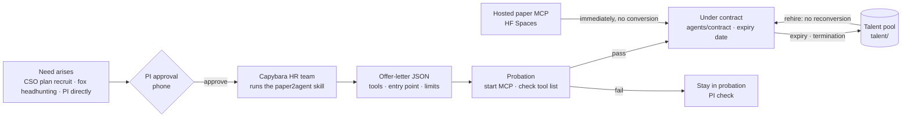

[← Manual index](../manual.en.md)

## Contract staff (Paper2Agent)

The default of `recruit.enabled` is `true`. An instance that does not use hiring or paper skills sets it to `false`. Then direct hiring and installation, plan conversion and deferred preparation, attaching paper skills, and contract activation, extension and rehire are refused, while contract release is allowed. `doctor` skips only the Paper2Agent check that is explicitly turned off, and `--fix` does not install either. With the default settings, a missing recruiter or skill keeps failing. Other staff's ordinary work and the authentication and runtime checks are unchanged.

`labhq setup-paper2agent` installs to match the recruiter's real engine. Claude puts it under `labhq-paper2agent/skills/paper2agent` in the staff `CLAUDE_CONFIG_DIR` (`~/.labhq/claude-staff` if unset) and connects it as a plugin to the recruiter only. Personal-settings isolation is kept. Codex uses the configured staff `CODEX_HOME/skills/paper2agent`, and Codex staff in the same home also see it. Since it keeps the existing home that shares login and the Windows sandbox, no Codex home dedicated to the recruiter is made.

After copying a new skill it replaces the installation, and on failure restores the existing one. If restoring fails, it shows the backup path. The old `~/.claude/skills/paper2agent` and `~/.agents/skills/paper2agent` are cleaned up only if they are labhq copies with a source and a valid commit in `.labhq-source.json`; the user's copies and links are preserved.

`labhq setup-paper2agent --commit <40-hex>` (or `recruit.skill_commit`) installs only that commit. If the checkout is at a different commit, it stops without touching the existing installation. If not pinned, it installs the latest HEAD and prints that commit. If you change `recruit.skill_source`, it compares with the origin of the cached checkout, and if different or the origin cannot be read, it does not pull but makes a new clone alongside and swaps it in (the old checkout is kept if the clone fails). The installed commit is left in `.labhq-source.json` in the skill folder and carried into the contract's `verification.paper2agent_commit` at hiring.

At install time it also patches known upstream defects into the installed copy. The four `str(path.relative_to(root))` in `paper2skill/scripts/reading_package.py` produce backslash paths on Windows and misalign the bundle's `files` and `evidence` keys, so they are changed to `.as_posix()`. An already fixed copy is not touched again, and if the text to patch does not match (upstream changed), the installation stops and the existing one is left as is. The result of applying (`applied`, `already_patched`, `file_absent`) is left in `patches` of `.labhq-source.json` with the pinned upstream commit, and `labhq doctor` reports an old unpatched installation as not ready (`--fix` installs again).

### Three types

| Type | Input | Paper2Agent path | What it can do |
|---|---|---|---|
| Consultant `consultant` | Paper PDF (+ supplements) | Paper2Skill → `SKILL.md` + text, figures, tables | Questions on methods and results, advice interpreting our results |
| Technician `technician` | Code repository | Paper2MCP → MCP tools verified by reproducing the tutorial | Apply that paper's method to new data |
| Full package `full` | Both | Both | All of the above |

### How it works
The method of prior research is used as a reference skill for this request without hiring (#549 C). Reading and utility of real institutional or PDF literature are unverified.

- The CSO picks at most 2 papers whose method fits and writes DOI/PMID, reason and owning step in `paper_skills`.
- Before CP1 it only checks the receipt declaration holding the paper ID, the stored text hash, extraction status and method/QC line ranges. If there is only an `access_level=full_text` string, or extraction is partial or needed evidence is missing, it leaves a material-request reason and omits it. Evidence that depends on supplements requests the material until a separate artifact link exists. If the body alone is enough, it does not require supplements. Automatic PDF and HTML extraction is not complete just because part of the text was obtained. If the source range is partial or unknown, no paper skill is made.
- A paper whose full text could not be reached (only the abstract was checked, or the text could not be obtained) gets no skill and is used only as plan reference. The omission reason states `Only the abstract was checked` (`access_level=abstract` in the prior-research citation) or `Could not confirm full-text access`, visible in the prior-research list and plan warnings (#670). If there is a text but extraction is partial, the existing reason is kept.
- If a paper whose title is a meta-analysis or systematic review (`meta-analysis`, `systematic review`, `메타분석`) becomes a skill, the same skill is also attached read-only to the plan's `lit_scout` step (the step that extracts included studies), besides the chosen step. The added step is left in `extraction_step_ids` and included in the plan hash. If there is no `lit_scout` step, nothing is added.
- For institutional or PI PDFs, obtaining it successfully and the extraction range are distinguished. A `pdftotext` success is still unknown, so it is not used as skill input. Either a supported JATS full text that holds the needed Methods/QC must be obtained, or PDF range verification and OCR must be added (not implemented).
- Paper2Skill checks the original receipt, text hash and evidence range after approval. Reuse also needs the same receipt and skill hash, and a changed or missing text stops for re-confirmation. The CP1 plan is kept. This check is not evidence of reading, tool calls or utility.
- [Paper-skill preparation](../reference/paper-skill-waiting-671.md): the approved at most two papers are prepared within the existing concurrency and cost limits, and steps share the build. At step start it uses only what is already prepared, and if unfinished it does not wait and records that it omitted it. Even if finished later, it does not add the file to a step that has started. `runner.task_timeout_s` is the build's lifetime cap and not a step's wait time. The time and money limits are separate.
- A temporary skill whose ownership and hash were checked, and `inputs/paper_skills/<skill_id>.md`, are injected into that step and removed after the run. The injected document gets read permission only. `called=true` requires that the exact skill ID and folder/document hash reference in the successful result match the retained copy. Without evidence it leaves `false` and the reason. This is a result-reference record and is not evidence of a real tool call or scientific utility ([contract](../reference/paper-skills-798.md)).
- Ordinary conversion, hash-check and attach failures are left as warnings, and a talent-pool skill for the same paper is reused after a hash check (no probation or contract). A change of approval or selection requires interruption and re-approval, and shutdown and cancellation propagate as is.

The flow of hiring a separate staff member is as follows.

1. **Hiring before planning** — reproducing a paper is done by a technician or full contract staff. `recruit.step_ids` names one or more steps in the plan without duplicates,
   and the draft writes the regular staff member to take over on failure. A wrong proposal is sent back to plan correction before approval.
   Hiring approval is bundled into one card before CP1 and includes **put to work immediately once probation passes**. The talent pool
   rehires only if the conversion input, probation record and hash match. If the repo or focus changed or the previous conversion input is missing, it converts again. The conversion cost is added to the request budget only once.
   The scope approval of an ordinary request is obtained before hiring. If declined, no hiring happens.
   On restart it checks the contracts of the remaining steps. An ended contract is reassigned to a regular staff member before the plan is fixed, and after it is fixed the request ends as failed.
   A valid contract waits for the runner only while there is an unfinished owning step. A resume card does not open repeatedly because of the runner of a finished step or an ended contract.
2. **Conversion** — the HR team runs the paper2agent skill in `talent/<slug>/build`. `--json-schema` enforces the offer-letter format and
   `--max-budget-usd` caps the cost.
3. **Probation** — labhq itself starts the delivered MCP server and checks the tool list (for a consultant, it checks the skill exists). If the
   `offer_status` that Paper2Agent returned is a draft state (`mechanical_failure`, `unreviewed`, `unresolved_discrepancies`, `partial`, `blocked`),
   it stays in `probation` even if the tools come up, and the reason is written in `verification.probation_reason`. If both pass, `active`.
   A `probation` contract staff member shows in the roster and staff card as `Probation (waiting for PI approval)`, but is left out of CSO assignment, direct requests and consultation, and the runner also
   refuses to run it. When the PI approves with `labhq contract activate c_<slug>`, it takes work.
4. **Contract** — `agents/contract/c_<slug>.yaml`. Secrets are stored only as `${ENV}` placeholders. When the `[contract]` tag and the tool list
   appear in the roster, it takes the matching step of **this request** and the plan is fixed. A hiring decline, failure or timeout goes to regular-staff reassignment,
   and a Paper2Agent doctor failure to skipping the hire, with the reason written in the plan and CP1. The hiring wait cap is `runner.task_timeout_s`.

   Reproducing an existing method (contract staff) and the implementation owner work in parallel and are then compared. For Nextflow, bioinfo-agent takes a supported nf-core pipeline,
   and the engineer or analyst takes a complex new implementation outside support. Contract staff handle the method and tool spec and verification. The manual hiring API (`POST /api/recruit`) is also kept.

   | Item | Source |
   |---|---|
   | `source_commit` | Offer letter. If not a 40-digit hex, it is dropped and written in `verification.provenance_notes` |
   | `code_license` · `weights_license` | Offer letter |
   | `external_services[{host, what_is_sent}]` | Offer letter. The hosts the tool connects to at run time and what it sends. host accepts only `hostname[:port]`, and if given as a URL only the hostname is kept and the rest (credentials, path, query) is dropped |
   | `skill_sha256` · `mcp_sha256` · `mcp_path` | Computed by labhq itself (the same content and mode hash as `plugin_provenance`). `.venv`, `__pycache__` and so on are excluded. If the MCP comes only as a ZIP, that file is measured, and what was measured is left in `mcp_path`. If `mcp_args` runs a server file outside it, that folder is also measured as `mcp_entry_path` and `mcp_entry_sha256`. If the hash of a delivered part cannot be measured, it is left in probation |

   The staff card and hiring feed show the first 7 characters of the commit, the license and the external-transmission hosts. `labhq talent` also prints the commit and external transmission.
   A paper advisory skill appears in `labhq talent` as "created", one line each. Which step it is attached to and whether the result referenced it is checked in the request record. The line also carries facts read from the skill folder's files: the `SKILL.md` name, the size of the paper text file (the skill folder holds the paper text, so it **lives only in this PC's talent folder and is not copied into the request bundle**), the number of figure, table, supplementary figure and supplementary table files, and whether a supplement is present. It is not a summary of the paper: it shows which files are there, not what the skill concludes. There is no "public" column, because the license is not known. The request and date that built the skill come from this PC's gateway record (`gateway.sqlite3`), opened **read-only**, as the first request that made the skill `ready` (a reuse does not count), shown as `만든 요청 req_… · date(요청 기록)`. When the record file is missing, unreadable, or does not hold that request, the receipt file's time is shown as `기록 시각(파일) date(reason)`, which is not a request's date. A folder replaced by a symlink or a Windows junction is not followed and these facts are left out. A folder with only `build/` and no receipt (an unfinished build) is counted on a last line, `빌드 미완료 폴더 N개`, and is not used as a paper skill. `labhq talent --history` shows the usage history across requests from the same record file, read-only (the gateway may be off). For each skill it lists the requests that selected it, the steps it was attached to and the result reference, based on the most recent 500 requests, and says that older requests are not counted. A result reference only records that a result cited the skill; it is no proof that a tool was called or that the skill helped. The same history is in `GET /api/paper-skills` (authentication required), and the fox panel's paper card in the request detail shows the other requests' uses in a `이전 사용` row on the same basis. The request itself is left out of its own list, the row does not appear when the gateway sends no history, and "none" means none within the most recent 500.
5. **Work** — installs the paper skill in the workspace (`.claude/skills`, `.agents/skills`) and connects the paper MCP. The contract prompt makes it a rule
   "if outside the verified scope, do not improvise, return to the CSO".
6. **Expiry and rehire** — an expired contract moves automatically to the talent pool when loaded. The build is kept, so `rehire` is immediate.
   On rehire it measures the skill and MCP folder hashes again, and if they differ from hiring, it raises a `contract.warning` feed warning and
   shows it in `verification.rehire_changed` and the staff card. A part with no recorded hash is shown like `skill (no hash)`. Rehire is not blocked.

### Cautions
- Conversion **installs and runs third-party code**. If possible, run the runner in a container or VM or under a dedicated account.
  The default is `permission_mode: auto` + phone approval of risky commands.
- The paper2agent skill needs a host that can start parallel subagents (Claude Code, Codex).
- Contract staff with `external_services` do not take a step whose input touches a restricted zone. If the request body, reference paths, project folder,
  or the instructions of that step and earlier steps contain a restricted path, it counts as that step (a path-string judgment). The CSO plan is rejected by validation and
  redone, and the runner also refuses the same work before launching the engine. A question (`colleague:<id>` ask) is the same. The runner sends the asking task's
  judgment in the ask token, and if that task or request touches restricted, it does not open a consultation with external-transmission contract staff (before copying refs).
  An undeclared external transmission cannot be stopped.
- In a consultation's reference files (refs), an entry that does not exist or is a sentence instead of a path is left out alone and the consultation goes on; the
  prompt records the entry and the reason as `참고 파일 제외` (#1043). A ref that points outside the work folder, passes through a link, is a folder or is a restricted-zone file still refuses the whole consultation.
- Passing probation means "the selected tools start and respond", not a guarantee of the scientific correctness of the whole repository.
  Before important analysis, we recommend having the QC owner reproduce the paper's example (the formal probation evaluation on the roadmap).
