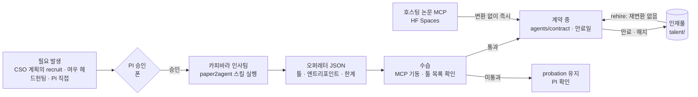

[← 매뉴얼 목차](../manual.md)

## 파견직 제도 (Paper2Agent)

`recruit.enabled`의 기본값은 `true`입니다. 채용과 논문 스킬을 쓰지 않는 인스턴스는 `false`로 설정합니다. 이때 직접 채용·설치, 계획의 변환과 지연된 준비, 논문 스킬 부착, 계약 활성화·연장·재고용을 거부하며 계약 해제는 허용합니다. `doctor`는 명시적으로 꺼진 Paper2Agent 검사만 생략하고 `--fix`도 설치하지 않습니다. 기본 설정에서는 recruiter나 스킬이 없으면 계속 실패합니다. 다른 직원의 일반 작업과 인증·runtime 검사는 그대로입니다.

`labhq setup-paper2agent`는 recruiter의 실제 엔진에 맞춰 설치합니다. Claude는 직원 `CLAUDE_CONFIG_DIR`(미설정 시 `~/.labhq/claude-staff`) 아래 `labhq-paper2agent/skills/paper2agent`에 두고 recruiter에만 plugin으로 연결합니다. 개인 설정 격리는 유지합니다. Codex는 설정된 직원 `CODEX_HOME/skills/paper2agent`를 쓰며 같은 홈의 Codex 직원도 봅니다. 로그인·Windows sandbox를 공유하는 기존 홈을 유지하므로 recruiter 전용 Codex 홈은 만들지 않습니다.

새 skill 복사 뒤 설치를 교체하고 실패하면 기존 설치를 복구합니다. 복구 실패 시 백업 경로를 표시합니다. 옛 `~/.claude/skills/paper2agent`·`~/.agents/skills/paper2agent`는 `.labhq-source.json`에 source와 유효한 commit이 있는 labhq 사본만 정리하며 사용자 사본·링크는 보존합니다.

`labhq setup-paper2agent --commit <40-hex>`(또는 `recruit.skill_commit`)는 그 commit만 설치합니다. checkout이 다른 commit이면 기존 설치를 건드리지 않고 멈춥니다. 고정하지 않으면 최신 HEAD를 설치하고 그 commit을 출력합니다. `recruit.skill_source`를 바꾸면 캐시 checkout의 origin과 비교해, 다르거나 origin을 읽을 수 없으면 pull하지 않고 옆에 새로 clone한 뒤 바꿔 끼웁니다(clone 실패 때 옛 checkout 유지). 설치한 commit은 skill 폴더의 `.labhq-source.json`에 남고, 채용 때 계약서 `verification.paper2agent_commit`으로 옮겨집니다.

설치할 때 알려진 upstream 결함도 설치본에 패치합니다. `paper2skill/scripts/reading_package.py`의 `str(path.relative_to(root))` 네 곳이 Windows에서 역슬래시 경로를 만들어 bundle의 `files`·`evidence` 키가 어긋나므로 `.as_posix()`로 바꿉니다. 이미 고쳐진 사본은 다시 건드리지 않고, 패치 대상 문구가 맞지 않으면(upstream 변경) 설치를 멈추고 기존 설치는 그대로 둡니다. 적용 결과(`applied`·`already_patched`·`file_absent`)는 `.labhq-source.json`의 `patches`에 고정한 upstream commit과 함께 남고, `labhq doctor`는 패치되지 않은 옛 설치본을 준비 안 됨으로 보고합니다(`--fix`가 다시 설치).

### 세 가지 유형

| 유형 | 입력 | Paper2Agent 경로 | 할 수 있는 일 |
|---|---|---|---|
| 자문형 `consultant` | 논문 PDF(+보충자료) | Paper2Skill → `SKILL.md` + 본문·그림·표 | 방법·결과 질의, 우리 결과 해석 자문 |
| 기술자형 `technician` | 코드 저장소 | Paper2MCP → 튜토리얼 재현으로 검증된 MCP 툴 | 새 데이터에 그 논문의 방법 적용 |
| 풀패키지 `full` | 둘 다 | 둘 다 | 위 전부 |

### 작동 방식
선행 연구의 방법은 채용 없이 이번 요청의 참고 스킬로 씁니다(#549 C). 실제 기관/PDF 문헌의 독해·효용은 미검증입니다.

- CSO는 방법이 맞는 논문을 최대 2편 골라 `paper_skills`에 DOI/PMID·이유·담당 단계를 적습니다.
- CP1 전에는 논문 ID·저장 본문 hash·추출 상태·방법/QC 줄 범위를 담은 receipt 선언만 확인합니다. `access_level=full_text` 문자열만 있거나 부분 추출·필요 근거 누락이면 자료 요청 사유를 남기고 생략합니다. 보충자료에 의존하는 근거는 별도 artifact 연결 전까지 자료를 요청합니다. 본문만으로 충분하면 보충자료를 요구하지 않습니다. 자동 PDF·HTML 추출은 일부 텍스트 확보만으로 완료가 되지 않습니다. 원문 범위가 partial/unknown이면 논문 스킬을 만들지 않습니다.
- 본문에 닿지 못한 논문(초록만 확인했거나 본문을 못 구한 경우)은 스킬을 만들지 않고 계획 참고로만 씁니다. 생략 사유에 `초록만 확인했습니다`(선행 연구 인용의 `access_level=abstract`) 또는 `본문 접근을 확인하지 못했습니다`를 적어, 선행 연구 목록과 계획 경고에서 보입니다(#670). 본문은 있으나 추출이 부분인 경우는 기존 사유를 유지합니다.
- 제목이 메타분석·체계적 문헌고찰(`meta-analysis`·`systematic review`·`메타분석`)인 논문이 스킬이 되면, 선정된 단계 외에 계획의 `lit_scout` 단계(포함 연구를 추출하는 단계)에도 같은 스킬을 읽기 전용으로 붙입니다. 더해진 단계는 `extraction_step_ids`에 남고 계획 hash에 포함됩니다. `lit_scout` 단계가 없으면 더하지 않습니다.
- 기관/PI PDF는 확보 성공과 추출 범위를 구분합니다. `pdftotext` 성공도 unknown이므로 스킬 입력에는 쓰지 않습니다. 필요한 Methods/QC가 있는 지원 JATS 본문을 확보하거나 PDF 범위 검증·OCR을 추가해야 합니다(미구현).
- Paper2Skill은 승인 뒤 원본 receipt·본문 hash·근거 범위를 검사합니다. 재사용도 같은 receipt와 skill hash가 필요하며 본문 변경·실종은 재확인으로 멈춥니다. CP1 계획은 유지합니다. 이 검사는 독해·tool 호출·효용의 증거가 아닙니다.
- [논문 스킬 준비](../reference/paper-skill-waiting-671.md): 승인된 최대 두 논문을 기존 동시·비용 한도 안에서 준비하고 단계들이 빌드를 공유합니다. 단계 시작 때 준비된 결과만 쓰며 미완료면 기다리지 않고 생략했다고 기록합니다. 나중 완료해도 시작한 단계에 파일을 더하지 않습니다. `runner.task_timeout_s`는 빌드 수명 상한이며 단계의 대기 시간이 아닙니다. 시간·금액 한도는 별도입니다.
- 소유권·hash를 확인한 임시 스킬과 `inputs/paper_skills/<skill_id>.md`를 해당 단계에 주입하고 실행 뒤 제거합니다. 주입 문서에는 읽기 권한만 줍니다. 성공 결과의 정확한 스킬 ID·폴더/문서 hash 참조와 유지된 사본이 일치해야 `called=true`입니다. 증거가 없으면 `false`와 이유를 남깁니다. 이는 결과 참조 기록이며 실제 tool 호출·과학적 효용의 증거는 아닙니다([계약](../reference/paper-skills-798.md)).
- 일반 변환·hash 확인·장착 실패는 경고로 남기며 같은 논문의 인재풀 스킬은 hash 확인 뒤 재사용합니다(수습·계약 없음). 승인·선정 변경은 중단·재승인이 필요하며 shutdown·취소는 그대로 전파합니다.

별도 직원을 채용하는 흐름은 다음과 같습니다.

1. **계획 전 채용** — 논문 재현은 기술자형/full 파견직이 맡습니다. `recruit.step_ids`는 계획에 있는 단계를 중복 없이 하나 이상
   지정하고, 초안에는 실패 시 맡을 정규직을 적습니다. 잘못된 제안은 승인 전에 계획 교정으로 돌립니다.
   채용 승인은 CP1 전 한 장으로 묶으며 **수습 통과하면 바로 투입**을 포함합니다. 인재풀은 변환 입력·수습 기록·hash가 맞아야
   재고용합니다. repo·focus가 바뀌거나 이전 변환 입력이 없으면 다시 변환합니다. 변환 비용은 요청 예산에 한 번만 합산합니다.
   일반 요청의 범위 승인은 채용보다 먼저 받습니다. 거절하면 채용하지 않습니다.
   재시작할 때 남은 단계의 계약을 확인합니다. 종료 계약은 계획 확정 전 정규직으로 재배정하고, 확정 뒤에는 요청을 실패로 끝냅니다.
   유효한 계약은 아직 끝나지 않은 담당 단계가 있을 때만 러너를 기다립니다. 끝난 단계의 러너나 종료 계약 때문에 재개 카드가 반복해서 열리지 않습니다.
2. **변환** — 인사팀이 `talent/<slug>/build`에서 paper2agent 스킬을 실행. `--json-schema`로 오퍼레터 형식을 강제하고
   `--max-budget-usd`로 비용 상한.
3. **수습** — labhq가 납품된 MCP 서버를 직접 띄워 툴 목록을 확인 (자문형은 스킬 존재 확인). Paper2Agent가 돌려준
   `offer_status`가 초안 상태(`mechanical_failure`·`unreviewed`·`unresolved_discrepancies`·`partial`·`blocked`)면
   툴이 떠도 `probation`에 남고 이유가 `verification.probation_reason`에 적힙니다. 둘 다 통과하면 `active`.
   `probation` 파견직은 명단·직원 카드에 `수습(PI 승인 대기)`로 보이지만 CSO 배정·직접 요청·상담에서 빠지고 러너도 실행을
   거부합니다. PI가 `labhq contract activate c_<slug>`로 승인하면 일을 맡습니다.
4. **계약서** — `agents/contract/c_<slug>.yaml`. 비밀값은 `${ENV}` 자리표시자만 저장. 명단에 `[파견직]` 태그와 툴 목록이
   올라가면 **이번 요청**의 해당 단계를 맡고 계획을 확정합니다. 채용 거절·실패·시간 초과는 정규직 재배정으로,
   Paper2Agent doctor 실패는 채용 생략으로 처리하며 이유를 계획·CP1에 적습니다. 채용 대기 상한은 `runner.task_timeout_s`입니다.

   기존 방법 재현(파견직)과 구현 담당은 병렬로 일한 뒤 비교합니다. Nextflow는 지원하는 nf-core pipeline이면 bioinfo-agent가 맡고,
   지원 밖의 복잡한 신규 구현은 engineer나 analyst가 맡습니다. 파견직은 방법·툴 명세와 검증을 담당합니다. 수동 채용 API(`POST /api/recruit`)도 유지합니다.

   | 항목 | 출처 |
   |---|---|
   | `source_commit` | 오퍼레터. 40자리 hex가 아니면 버리고 `verification.provenance_notes`에 적음 |
   | `code_license` · `weights_license` | 오퍼레터 |
   | `external_services[{host, what_is_sent}]` | 오퍼레터. 도구가 실행 중 접속하는 호스트와 보내는 것. host는 `hostname[:port]`만 받고, URL로 오면 hostname만 남기고 나머지(인증·경로·query)는 버림 |
   | `skill_sha256` · `mcp_sha256` · `mcp_path` | labhq가 직접 계산(`plugin_provenance`와 같은 내용·mode hash). `.venv`·`__pycache__` 등은 제외. MCP가 ZIP으로만 오면 그 파일을 재고, 잰 대상은 `mcp_path`에 남김. `mcp_args`가 그 밖의 서버 파일을 실행하면 그 폴더도 `mcp_entry_path`·`mcp_entry_sha256`으로 잼. 납품된 부분의 hash를 못 재면 수습에 남김 |

   직원 카드와 채용 피드에 commit 앞 7자리·license·외부 전송 호스트가 보입니다. `labhq talent`도 commit과 외부 전송을 출력합니다.
   논문 자문 스킬은 `labhq talent`에 "생성됨"으로 한 줄씩 나옵니다. 어느 단계에 붙고 결과에서 참조됐는지는 요청 기록에서 확인합니다. 한 줄에는 스킬 폴더의 파일을 읽은 사실이 함께 나옵니다: `SKILL.md`의 이름, 논문 본문 파일 크기(스킬 폴더에는 논문 본문이 들어 있어 **이 PC의 talent 폴더에만 있고 요청 묶음에는 들어가지 않습니다**), 그림·표·보충 그림·보충 표 파일 수, 보충자료 유무입니다. 논문 요약이 아니며, 스킬이 무엇을 담는지가 아니라 어떤 파일이 들어 있는지만 보입니다. "공개 여부" 칸은 라이선스를 알 수 없어 만들지 않았습니다. 만든 요청과 날짜는 이 PC의 gateway 기록(`gateway.sqlite3`)을 **읽기 전용**으로 열어, 그 스킬이 처음 `ready`로 만들어진 요청(재사용은 세지 않음)을 찾아 `만든 요청 req_… · 날짜(요청 기록)`로 보입니다. 기록 파일이 없거나 읽을 수 없거나 그 요청이 기록에 없으면 영수증 파일의 시각을 `기록 시각(파일) 날짜(이유)`로 보이고, 이것은 요청의 날짜가 아닙니다. 폴더가 symlink나 Windows junction으로 바뀌어 있으면 따라가지 않고 이 사실들을 생략합니다. `build/`만 있고 영수증이 없는 폴더(끝나지 않은 빌드)는 마지막 줄에 `빌드 미완료 폴더 N개`로 세어 알리고 논문 스킬로 쓰이지 않습니다. 요청 사이 사용 이력은 `labhq talent --history`가 같은 기록 파일에서 읽기 전용으로 보입니다(gateway가 꺼져 있어도 됩니다). 스킬마다 그 스킬을 고른 요청, 붙은 단계, 결과 참조를 최근 요청 500건 기준으로 나열하고, 그보다 오래된 요청은 세지 않는다고 밝힙니다. 결과 참조는 결과에 그 스킬이 인용됐다는 기록일 뿐 도구를 호출했거나 도움이 됐다는 증거가 아닙니다. 같은 이력이 `GET /api/paper-skills`(인증 필요)에 담기고, 요청 상세의 여우 패널 논문 카드는 같은 기준으로 `이전 사용` 칸에 다른 요청의 사용을 보입니다. 이 요청 자신은 목록에서 빠지고, gateway가 이력을 보내지 않으면 칸이 나타나지 않으며, 없다는 표시는 최근 500건 안에서 없다는 뜻입니다.
5. **업무** — 작업공간에 논문 스킬을 설치(`.claude/skills`, `.agents/skills`)하고 논문 MCP를 연결. 계약 프롬프트는
   “검증된 범위 밖이면 즉흥적으로 하지 말고 CSO에 반환”을 규칙으로 둡니다.
6. **만료·재고용** — 만료된 계약은 로드 시 자동으로 인재풀로 이동. 빌드가 보관되어 있어 `rehire`는 즉시.
   재고용 때 skill·MCP 폴더 hash를 다시 재서 채용 때와 다르면 `contract.warning` 피드 경고를 띄우고
   `verification.rehire_changed`와 직원 카드에 표시합니다. 기록된 hash가 없는 부분은 `skill(hash 없음)`처럼 표시합니다. 재고용은 막지 않습니다.

### 주의
- 변환은 **제3자 코드를 설치·실행**합니다. 가능하면 러너를 컨테이너/VM 또는 전용 계정에서 돌리세요.
  기본값은 `permission_mode: auto` + 위험 명령 폰 승인.
- paper2agent 스킬은 병렬 서브에이전트를 띄울 수 있는 호스트(Claude Code, Codex)가 필요합니다.
- `external_services`가 있는 파견직은 입력이 restricted 구역에 닿는 단계를 맡지 않습니다. 요청 본문·참고 경로·프로젝트 폴더,
  그 단계와 선행 단계의 지시에 restricted 경로가 있으면 그 단계로 봅니다(경로 문자열 판정). CSO 계획은 검증에서 거부돼
  다시 짜이고, 러너도 엔진을 띄우기 전에 같은 작업을 거부합니다. 질문(`colleague:<id>` ask)도 같습니다. 러너는 묻는 작업의
  판정을 ask token에 실어 보내고, 그 작업이나 요청이 restricted에 닿으면 외부 전송 파견직에게는 상담을 열지 않습니다(refs 복사 전).
  선언하지 않은 외부 전송은 막지 못합니다.
- 상담의 참고 파일(refs) 중 없는 파일·경로가 아닌 문구는 그것만 빼고 상담을 진행하며, 빠진 항목과 사유가 프롬프트에
  `참고 파일 제외`로 남습니다(#1043). 작업 폴더 밖을 가리키거나 링크를 지나거나 폴더·통제 구역 파일이면 이전처럼 상담 전체를 거부합니다.
- 수습 통과는 “선택된 툴이 기동·응답한다”는 뜻이지 저장소 전체의 과학적 정확성 보증이 아닙니다.
  중요한 분석 전에는 QC 담당에게 논문 예제 재현을 시키는 것을 권합니다 (로드맵의 정식 수습 평가).
