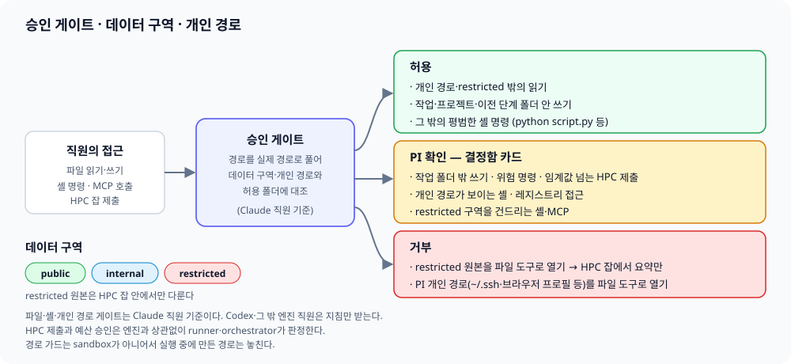

[← Manual index](../manual.en.md)

## Safety measures

### Runaway detection (shadow)

If the signal continues after a warning, the breaker rises one level at a time (warn → constrain → stop). It rises only when there is a new observation, and from one level to the next takes at least `runner.breaker_beat_s` (default 10 seconds). If only a warning is raised and things go quiet, it clears by itself, but from constrain onward it stays until the PI releases it (`POST /api/tasks/{id}/breaker/release`). constrain leaves only read tools (Read, Glob, Grep) to Claude staff whose hooks run, and an engine with no hooks is merely shown as `enforcement: unsupported` and is not counted as restricted. stop halts the session with the existing halt path, preserving it, only when `runner.breaker_hard_stop: true`, and if off (the default) only displays it. From constrain onward, consecutive tool errors no longer raise the level (a refused call is counted as an error); only repeats of the same input go up to stop. When a stop becomes a halt, the gateway records it like the PI's own halt, so it is sent again when the runner reconnects. The PI's release carries a command ID and the restriction episode, and the gateway stores it before sending; until the runner acknowledges it with `agent.breaker`, the same command is sent again on every reconnect, dispatch and gateway restart. `sent` only means the frame went out, not that it was applied. The runner applies a resent command once, and answers `stale` without applying a command that points at an earlier restriction. The episode ID includes a value made fresh for each task run, so after a runner restart or a task sent again, a command saved during the earlier run no longer matches and is answered `stale`. A staff card on the work board shows a "Release limit" button while a task is restricted. Claude Code is defined to send a `compact_boundary` frame when it compacts its context (seen in the 2.1.310 executable's frame definitions; not yet observed in a real compaction session), so the runner then restarts the repeat and error counts and lifts a warning, because redoing earlier work right after compaction is not a runaway. A restriction stays until the PI lifts it. The Codex (`exec --json`), Gemini and Antigravity adapters have no such signal and so no such exception. While restricted, a tool call outside the read tools is still put to the CSO one call at a time. The hook asks the runner broker (`/restricted`) and the gateway's CSO decides by fixed rules (no model call): the same call is judged once per restriction (asking again is refused whatever the first answer was), at most 5 calls pass per restriction, and it refuses when the restriction episode the runner reported differs from the one the gateway knows, the request is older than 90 seconds (a request replayed after a reconnect was already refused at the hook and is not judged), or the task has ended or is being cancelled. No answer within 30 seconds, or a broker that cannot be reached, is a refusal. A halt or pause the PI gives while the hook waits still wins over a yes. A yes only withdraws the objection for that one call: the normal permission checks (work folder, approval cards) still apply and the restriction stays until the PI lifts it. The decision is left in the staff record as one line, "the CSO allowed/refused". The call's content is not put in the runner record, the resend queue or the feed: only the tool name and a fingerprint are sent. The list of judged calls and the allowance count are kept in the gateway state and survive a gateway restart. It applies only to Claude staff whose hooks run.

Eight consecutive identical tool and input calls, or 5 consecutive failed tool calls, raise one warning per signal. The staff member keeps running. Claude, Codex and Antigravity compute the SHA-256 fingerprint of the tool name and original input before the preview. JSON key order is sorted and string whitespace is preserved. Events send only the existing preview and the hash. An unreported input, or a truncated preview with no fingerprint, is excluded from the repeat count and breaks the consecutive count. Several error lines of one call count as one failure.

### Approval gate and write scope

`taskkill /IM` that ends several processes by name (including Git Bash `//IM` and filters), `pkill`, `killall`, selecting by name with `skill`, `Stop-Process -Name` and `Get-Process name | Stop-Process` are refused without an approval card. It also checks inside chains, fallbacks, conditionals, wrappers, redirections and script blocks. It checks literals, locale quotes, EncodedCommand execution, substitution, PID passing, PowerShell variables, parenthesized expressions and Kill/MemberName calls, and also refuses a `kill` target of 0 or negative ([P1 basis and boundary](../reference/process-stop-681-followup.md)). Specify a PID after checking the PID and start time of a process whose command line has your own work-folder path. OS isolation of dynamically assembled commands is separate, and the existing runner cleanup that verifies PID and start time is kept. A tool to track and clean up arbitrary background PIDs (#675) is not implemented yet (#681 partly resolved).

HPC submission (by core and time criteria), risky shell commands, budget overruns and hiring contract staff are decided by the PI in the inbox. File and shell calls of Claude staff pass the approval gate, while staff on other engines rely on the sandbox and instructions (see the section below and [Known limits](17-known-limits.en.md#known-limits)). A tool with no shell, file or MCP rule is allowed only if it is in `policy.approvals.auto_allow_tools` (default: Read, Glob, Grep, LS, WebSearch, WebFetch, TodoWrite, Skill, StructuredOutput, ToolSearch, and BashOutput, KillShell, TaskOutput and TaskStop, which read or stop the background output of a Bash that already passed the approval gate), and the rest is asked of the PI. `Monitor`, which runs shell commands, is an example. `Task`, `Agent`, `Workflow`, `TeamCreate` and `TeamDelete` are refused even if put in this list (#421).
Work-folder auto-allow accepts only a closed grammar. Variables, assignments, substitution, indirect execution and Python bodies are sent to a card. `cd` is allowed only once at the very start and with `&&` chaining. Only non-writable system executables found as shell built-ins or on the staff PATH are accepted, and the resolved path is recorded. A PowerShell colon operand goes to a card unless the real working path is proven ([rules](../reference/tool-approval-grammar.md)).

| Action | Approval |
|---|---|
| `rm -rf tmp/`, `.tmp/paper-review`, absolute-path deletion inside the real work folder | Not needed |
| Deleting the folder itself, `..`, writes through link, junction or hard link, credentials, other work paths | Confirm |
| Commands outside the grammar, paths built at run time | Confirm |
| Scripts and executed code outside the write scope | Confirm every time |

A plan to reduce repeated approvals further is OS sandbox isolation, handled in a separate issue. [Grammar and replay basis](../reference/tool-approval-grammar.md).

A bare `Write` or `Edit` of Claude staff is pre-allowed narrowed to the `Edit(//…/**)` rules of the work, project and upstream folders. For a folder written as a link or junction, one rule is placed on the written form and one on the real path (Claude allows only if both match). Writes elsewhere pass the approval gate (#219). If a shell write target starts with `~`, it is expanded to that shell's home and compared with the allowed write folders. Bash looks at `HOME` (if absent, `USERPROFILE` and `HOMEDRIVE`+`HOMEPATH`), and PowerShell on Windows looks at both `USERPROFILE` and `HOMEDRIVE`+`HOMEPATH`. If it cannot be expanded, such as `~user`, `~+` or `~-`, it asks, and read paths are left as they are (#521).

In whole-request HPC mode, the job account reads only verified `data/<producer>/<source-task>/` copies and writes to its step outputs. Manifests and control files stay private; input links and hard links remain refused. Real HPC permissions and OS isolation are unverified ([scope](../reference/hpc-step-workspaces-578.md)).

**HPC access and where the agent runs (#1295):** By default the staff agents and the runner stay outside the HPC (on the user's PC) and only compute scripts go to the HPC. Many institutions do not allow agents inside an HPC, so check the institution's rules and the site profile before placing a runner in the cluster. A connection can leave a login record with the institution's IT team (what counts as a login differs by site), so logins are counted with `hpc.login_limit_per_request` and `hpc.login_limit_per_day` ([chapter 15](15-config.en.md)), and an institution's addresses, accounts and gateways are kept out of the repository, logs and reports: they live only on the user's PC: today in the uncommitted `config/labhq.yaml` (`hpc.ssh_host`, `hpc.user` and so on), and in the site profile (#1300) once that is in. They are not put into a personal skill, which a staff session can read. A host name in an ssh connection error can still reach a staff session; masking it is not done yet (follow-up). The site's rules come before labhq's defaults. The full policy is in [chapter 8](08-structure.en.md).

### Data zones

`policy.data_zones`. Attaches a public, internal or restricted grade to each path. Specify controlled originals by absolute path. For a runner placed inside the cluster (by default the agent stays outside the HPC, and this layout is used only when the site profile allows it, #1295), recommended: a dedicated Linux runner account, a zone owned by the data account with permission `0700`, `hpc.submit_prefix: ["sudo", "-n", "-u", "data-account"]`, and the required settings `hpc.user: data-account` and `hpc.job_group: lab-jobs`. Put the runner and the data account in the same group. `sudoers` allows only `qsub` and `qdel` for job submission and cancellation (`sbatch` and `scancel` for Slurm). A switched job's relative output goes to the returned `output_dir` (`hpc_out/`), and only aggregated results go in the shared folder. When a restricted zone is configured, a Windows runner refuses to start, and a POSIX runner also refuses if its account can read or traverse the original. `policy.allow_runner_read_restricted: true` is an explicit exception that leaves a warning.

An alias of a work, project or reference folder that points at an internal zone gets Claude's Read approval. Even if the link check is not finished, it does not use a bare Read and judges the real path at the gate. For an open root that overlaps an internal or restricted zone, it also gives no folder-level Read pre-allow, so an alias created inside the same root during a run is also sent to the gate.

### PI private paths

`policy.private_paths`. The gateway, runner and staff CLIs run under the PI's account by default (PI decision 2026-10-03). The PI's personal files are blocked in three layers for Claude staff, two layers for Codex staff under the Windows elevated sandbox, and one layer of instructions for staff on other engines. If the key is absent the default list is used, and `[]` turns it off. If you write the list yourself, the default list drops out, so write the items you need again.
- Default list: `~/.ssh`, `~/.aws`, `~/.azure`, `~/.gnupg`, `~/.docker`, `~/.kube`, `~/.config/gh`, `~/.config/gcloud`, `~/.git-credentials`, `~/.netrc`, `~/.claude`, `~/.claude.json`, `~/.codex`, `~/.gemini`, `~/.env`, Chrome, Edge and Firefox profiles (under `AppData` on Windows; on Linux `~/.config/google-chrome`, `~/.config/microsoft-edge`, `~/.mozilla`), the config file the runner read, the gateway state folder, `engines.claude_code.env.CLAUDE_CONFIG_DIR` (the Claude staff config folder), `engines.codex.env.CODEX_HOME` (the staff Codex login folder, when set), and the AlphaGenome key file (`annot.alphagenome_key_file`, when present).
- A file holding the gateway config separately (such as a gateway.yaml with `client_token`) is not in the default list. Add it to `policy.private_paths` yourself.
- For a research step that receives earlier steps' outputs as read-only `inputs/`, the whole work root (`runner.workspace_root`) is closed as a private path and only that step's work folder is opened. Claude's Edit/Write deny rules then attach not to the whole root but only to top-level items not on the way to the work folder (other date folders, files in the root), so the step can write to its own `outputs/` and `.tmp/` (#946; a deny rule takes precedence over an allow rule, so blocking the whole root would let it write no outputs at all). The staff-only Claude config folder keeps Edit/Write deny on the whole path. Other steps' folders inside the work folder are blocked by the approval gate without a deny rule.
- While private paths are on (it is on even if no path to block remains; only `[]` turns it off), every Claude shell command that touches the registry goes to PI approval regardless of key (the PI's `GITHUB_TOKEN` is in `HKCU\Environment`. `reg`, `HKCU:`/`HKLM:`, `Registry::`, the registry PSDrive, `winreg`, `Microsoft.Win32`, `StdRegProv`, `GetEnvironmentVariable(…, 'User')`, and line continuations are joined and examined too). It also asks when these words appear in a commit message or grep pattern, an accepted false positive. The list of notations is `REGISTRY_ACCESS` in `labhq/private_paths.py`.
- A nonexistent path is silently skipped. A path that contains or equals the work folder, `workspace_root`, reference or project folder is left out of that task and recorded in the doctor `private paths` row and the work log. The plugin and the recruiter's Paper2Agent skill open only their own paths for reading. The login, history, other tasks, settings and todos of the parent `CLAUDE_CONFIG_DIR` and `CODEX_HOME` stay protected (Read denied, Claude Bash needs PI approval). The Codex Windows elevated profile also denies the home and opens only the skill path for read.
- Claude saves long tool output (including MCP results) in `projects/<work folder slug>/` of the config folder and rereads it. So Claude staff use a dedicated config folder (`CLAUDE_CONFIG_DIR`), and inside it only that task's `projects/<slug>/` is opened for reading. Login files, history, other tasks' folders and writes are blocked, and the PI's `~/.claude` is blocked entirely.
- The PI logs in once: `CLAUDE_CONFIG_DIR="$HOME/.labhq/claude-staff" claude` then `/login` (on Windows `$env:CLAUDE_CONFIG_DIR = Join-Path $HOME '.labhq/claude-staff'; claude`). If unset, doctor `claude staff config` warns, and if it points to the PI's `~/.claude` or inside it, it fails.

| Layer | Target | What it does |
|---|---|---|
| File-tool deny | Claude | Read, Edit and Write deny rules on the path and below it (`//c/Users/...`, `/**`). Also for the real path of links and junctions and Windows 8.3 short names (`SSH~1`). The pre-allowed Read, Grep and Glob are narrowed to `Read(//folder/**)` of the work, project and reference folders, so reads outside those and reads that escape through a link are denied by the gate on the real path (including the `\\localhost\C$\` and `\\?\` notations) |
| Shell-mention approval | Claude Bash and PowerShell | Shell commands are not pre-allowed (not even `Bash(python *)`), so all go to the gate. Only a command where a private path is visible or reached through a link gets PI approval, and the rest is allowed at once. Absolute paths, `~`, `$HOME`, `%USERPROFILE%`, `$env:USERPROFILE`, `%LOCALAPPDATA%`, Git Bash `/c/...`, notations split by quotes, `/./`, `..`, regardless of `/` or `\`. Case is ignored only on Windows and case-insensitive volumes. A relative path after `cd` is read against that folder; if there is no private path under the folder, only words containing `..` are matched (words of a long `python -c` script are not counted), and if there is one, all words are matched. If words to match or path candidates to resolve exceed 256, it does not judge and goes to PI approval. A name that is not in the work folder cannot be a link and is not resolved. The `ask` rule also remains as the first layer |
| Sandbox read denial | Codex (Windows, `windows_sandbox: elevated`) | Passes that task's private paths (including real paths) as `"deny"` entries of the Codex permission profile (#382). The profile extends the same built-in as the staff member's `sandbox` (`:workspace`, `:read-only`) and is used instead of `-s`. The sandbox account cannot read those paths, so paths a shell command builds are blocked too. Unelevated refuses deny-read and does not start, so it is not passed. For `danger-full-access` staff and other OSes, instructions only |
| Instructions | All staff | The "PI personal files" section at the end of the role instructions. It uses only `~` notation and the last folder name of paths outside home, and puts no absolute path |

The Claude Bash sandbox policy contract (#666) has its capability disabled and its launcher refuses to run. Actual settings enforcement and protection are **UNVERIFIED**; it does not provide whole-process isolation.

Check a disposable fixture plan offline with `python scripts/boundary_fixture_plan.py plan.json`. It reads one JSON file; `plan_valid` checks the plan, while actual protection remains **UNVERIFIED**. See the [fixture plan guide](../reference/boundary-fixture-plan.md) for input and scope.

The independent supervisor/seal [synthetic fixture validation](../reference/process-boundary-seal-fixtures.md) checks only when simulated evidence is accepted or rejected. Real supervisor trust, file protection during execution and cleanup of remaining processes and sockets are **UNVERIFIED**; this validation does not authorize a protected run.

What it cannot block:
- Gemini, Antigravity and cli staff, and Codex staff not on Windows elevated, get only instructions. There is nothing that intercepts file or shell reads. Antigravity's `auto` and Gemini's `bypassPermissions` (yolo) run without confirmation.
- Claude staff also miss paths built at run time. Examples are a path assembled with `python -c` such as `os.path.join('..', '.ssh', 'x')`, and a path opened by a script written in the work folder (`python evil.py`) (measured in PR #324). It means a staff member allowed both work-folder writes and the shell can read every private path in two steps. This guard blocks visible access and mistakes, not a determined staff member. To block even that, a [dedicated account](../runner-account.md) (Korean) is needed. `cd ~ && cat .ssh/x` is caught because the gate rereads the relative path from the `cd` target, but a folder decided at run time such as `cd "$(…)"` and globs (`~/.ss?`) are missed. A staff member whose `permission_mode` is `auto` or `bypassPermissions` (the HR team's default is `auto`) may not go through the gate. For a staff member without `approval` in `builtin_mcp`, every shell command is refused and a warning is left in the work log.
- doctor keeps giving the `runner account isolation` warning that there is no OS account separation. Dedicated-account separation is an [advanced option](../runner-account.md) (Korean).

### Switched-job workspace

The runner makes inputs with a private umask (`077`) and, before submission, removes group and other permissions from existing inputs too. At submission it gives group traverse only to `workspace_root` and the date folder, and the parent paths beyond that must be traversable by the data-account. The data account uses only job scripts, `hpc_out/` and logs.

### Stop conditions at a glance

| Boundary | Global default and actual behavior |
|---|---|
| Work time | `runner.task_timeout_s`: 6 hours per CLI call. The wall-clock limit for a whole request is turned on with `orchestrator.request_wall_clock_s` (seconds, default 0 = off, 60 or more to turn on). It is fixed when the request is accepted; the gateway cancels an in-progress request past its deadline, time in `waiting_pi` (a PI decision card) is added to the deadline, and nothing from report review onward is cut. With it on, `labhq status` prints one line per running request, `시간 상한: 꺼짐` (off) or `시간 상한: 켜짐 90분 · 남은 N분 · PI 대기 제외 N분` (on, time left, PI waiting time not counted), and adds that the clock is stopped while it waits for the PI. The request panel of the web board shows the same line for an active request only (`시간 상한 켜짐 90분 · 남은 N분 …`, or `시간 상한 꺼짐` when off) and recomputes it every 15 seconds. The web adds its own clock to `wall_clock.deadline_at` that the gateway sent with the snapshot and with the request's creation (counted from when the request was accepted, with closed PI waits included), so a request that starts later than it was accepted never reads longer than the gateway's real deadline. Only a gateway that sends no `deadline_at` falls back to the creation time plus the limit. A PI wait still open is added by the web itself, so a PI wait that began after the snapshot is not subtracted until the next snapshot (a reconnect) and the time left can read shorter than it is (the early-warning side). With a gateway that sends no limit the line is hidden, never shown as off. The request's cost line also names a staff member that ran another model than its declared tier as `선언 등급과 다른 모델: …` (when the `model_tiers` table is filled in, see above). Details are in [Request wall-clock limit](../reference/request-deadline.en.md). The time limit of a resumed new call is distinguished from the request's original deadline. |
| Cost | `policy.budget.per_task_usd=5`, `per_request_usd=30`. If the request has `budget_usd`, that value is used. Pre-reservation defaults to `reserve_before_dispatch=true` (#1139), and unknown cost is not treated as free. |
| HTTP lookups | `annot.request_lookup_limit=null`: no count limit by default. If set, built-in annot and live source checks use the same request ledger and keep counting after a runner restart. It is not a cap on staff's direct HTTP or on all third-party MCP. |
| Failure | A transient failure is tried up to `orchestrator.step_max_attempts=2`. There is no global rule that stops a whole request at 2 failures. |
| PI cards | A decision card is 7 days by default, a tool gate 1 hour. The resume card deadline is based on its original creation time, and exceeding it is `resume_timed_out`. At restart, other decision cards are closed and return to the resume card. |

Per-request time, cost and lookup caps and the stop and response conditions follow a separate approval contract. A restart does not reset deadlines, caps or counters. A past execution approval is not a GO for a new run. For code locations and the limits of fake-recovery reproduction, see the [comparison table](../reference/recovery-stop-924.md) (Korean).

On resume, finished steps are reused. A task whose stop result was already stored continues after approval with a new task ID, and does not open a resume card repeatedly for the same stop result.

**Support and recovery conditions of the limited v1 (2026-10-26):** the goal of [#882](https://github.com/ehojune/bioinfo-team-3d/issues/882) is to verify a public-literature request end to end on a Windows gateway/runner. The integrated shutdown proof and a separate GO come first, and HPC, WSL, institutional login and raw data are outside this verification scope. It is not a state where v1 operational support is declared complete.

| Item | Implementation basis and remaining checks |
|---|---|
| Local jobs and cancellation | [#937](https://github.com/ehojune/bioinfo-team-3d/pull/937) job record reload and [#968](https://github.com/ehojune/bioinfo-team-3d/pull/968) the cancel-resend regression to a recovered runner are merged. With an alternate transport and a harmless job, zero residue in the cancel tree, no completion wake-up and preservation of other requests were checked. Job termination is not guaranteed while the runner is off. |
| Storage and ownership | #967 ownership race and the #966, #972, #976, #979, #980, #982 storage boundaries, and the #984 hiring-preflight read conversion are merged. Control state applies a per-task async commit and revival prevention after deletion. Step controls are also async, and sync boundaries such as the remaining saves and dispatch of result receipt remain, so #606 is OPEN. Real-disk and operational performance are unverified. |
| Operationally unverified | Real WebSocket reconnection, a gateway OS restart, a real request on a new installation, repeated recovery and a support request end to end are unverified. The [new-installation mock check](../reference/clean-install-922.md) and regression CI are not counted as an operational PASS. |

### Approval and budget

`policy.approvals`, `policy.budget`. With `hpc_core_hours_threshold: 0`, every submission needs approval. Even below the threshold, a script with a scheduler directive (`#SBATCH`, `#$`, `#PBS`, `#BSUB`) needs approval. `per_task_usd` is enforced only through Claude's `--max-budget-usd`. For Codex, Gemini and Antigravity, run time is limited with `runner.task_timeout_s`. A cost that was not reported is not added as 0 (#270). New records are left as `None`, and old numeric-0 records are read as they are. If only tokens are reported, as with Codex, it `estimates` using a versioned price table (`labhq/costs.py`: source, check date, model ID), converting only when the model ID matches exactly and all billable token items are present. The rest are counted separately as `N cost-unknown items`. The web, CLI and report show `confirmed $a + estimated $b + N cost-unknown items` and per-engine subtotals, and an estimate is not an invoice. Unit prices are for OpenAI API Standard and short context (up to 272K input per call, the Codex default), so if you raise `model_context_window` in the staff `CODEX_HOME`, the estimate is a lower bound. The request cap judges each cost-unknown task as having used `per_task_usd` (the whole request cap if 0), and approval of the budget is asked if exceeded (the card summary states the cap that will be raised if approved, normally twice the current cap, and for a request with reservation before sending turned on it is not smaller than the currently held amount plus the cap (`per_task_usd`) of one next task, so one raise does not immediately open a second card. #940), and the report does not write a request that still has cost-unknown items as within budget. If a research report's last turn exceeds it for the first time, there is nothing more to do, so no card is raised and an overrun record and the report are left. If the report turn waits for a question answer or an HPC job, a wake turn runs afterwards, so it is not the last. If exceeded, a budget card appears before the wake turn, and a record without a card is left only in the last turn finished through wake. If the price table's check date is over 90 days old, it warns. A research plan's `budget_usd` is the amount execution will use, so at CP1 approval it is added to the cost spent so far to become the request cap (a plan budget of $3.00 + $2.96 spent through planning gives $5.96), and it cannot exceed the configured cap (the request budget, or `per_request_usd` if none) ([research lane](13-research-lane.en.md#research-lane-and-verification)).

**Reservation before sending** (#862, on by default since #1139): for the PI-wording translation task, the cost-unknown is held not at the ordinary per-item reservation but only at that translation's reservation ceiling (#940). With `policy.budget.reserve_before_dispatch` on (the default), just before sending a model call the CSO reserves that call's cap from the request budget in advance. This covers plan, briefing, prior research, step, retry, cell question, review, report, hiring and environment diagnosis. The call cap is the smallest of the task, the staff member (`max_budget_usd`) and `per_task_usd`, and if none exists, the remaining budget. While the request has at least one cent left, what is held is the smaller of that call cap and the remaining budget (#1139), so a request budget below `per_task_usd` (default $5) is not asked about at its first call, and the call is sent capped at that amount. With less than one cent left it is not clipped and asks with a card. Every call cap is rounded down to whole cents wherever it came from (a remaining $0.019 holds $0.01, and `per_task_usd = 0.015` holds $0.01). A cap that would fall below one cent is refused rather than sent, and while reservation is on, a `per_task_usd` above 0 and below 0.01 is rejected when the settings load (0 means no cap). The reason is that the Claude CLI writes the call cap in cents, so without rounding down it could spend more than was held and more than the request has left. Float noise from a subtraction (`2.0 - 1.98`) does not cost a cent. If already-spent cost, the per-item reservation of cost-unknown items, reservations in progress and this cap together exceed the request cap, it does not send. An ordinary call asks with a budget card, and hiring and environment diagnosis skip without asking. The cap of a sent call is lowered to the reserved amount. The actual conversion task of a plan hire also inherits the smallest of the parent reservation, the remaining amount and `recruit.max_budget_usd`. It rounds down to Claude CLI's cent unit and does not send below 1 cent. Internal conversion cost is counted only once under its own task ID. Even if a cancel misses the Python return, after the same runner's durable result check it does not reserve the parent cost twice. If there is no trustworthy result or link evidence, or the runner restarted, UNKNOWN is kept. A reservation is kept in the request record and stays until that call's cost (or its cost-unknown reservation) is counted, even after cancellation, a lost result or a gateway restart. A call that resumes earlier work after a gateway restart does not reserve anew and uses the earlier work's reservation. A call cancelled or restarted before the gateway saved the task was not sent, so the reservation is released. If the remaining budget is 0 or the cap value is not a finite positive number, it does not send. If turned off with `false`, no reservation is made before sending and it allows by looking only at cost already spent, as before. If the briefing reserves all remaining budget dispatchable in whole cents, prior research starts after the briefing finishes (#1255). A budget card then appears if the remaining balance after its cost is counted is insufficient. With the default on, parallel steps each hold their call cap, and a later call whose cap would push the total past the request cap asks with a budget card before it is sent. The gateway and the runner each read this setting, so with `false` on only one of them a pre-plan hire (`plan_recruit`) ends as `failed`; keep the two config files the same. Paper-skill preparation and PI-sentence interpretation use their own original reservation. This cap is labhq's cost record and estimate basis and does not guarantee the provider's invoice. Codex has no cost-limit flag during a run, so it can spend more than the reserved amount, and the overage is recorded after it ends and only blocks the next call.

Regardless of this setting, a call that failed while the gateway was sending it to the runner after saving the task may have reached the runner, so it is recorded as cost unknown (#862). A cost-unknown item is held at `per_task_usd` and enters the request-cap judgment, so even with reservation off, the budget card can appear slightly early after such a failure.

**Decision-card deadlines** (PI check R5). The cards that decide the request itself (clarifying question `clarify`, staff question `question`, scope `scope`, budget `budget`, CP1 `research_plan`, CP2 `research_evidence`, continuation `research_continue`, resume `resume`) wait for `policy.approvals.pi_decision_timeout_s` (default 604800 s, 7 days). Meanwhile the request status is `waiting_pi` and the card can be answered at any time. If the deadline passes, the request ends as `clarify_timed_out`, `budget_timed_out`, `plan_timed_out`, `evidence_timed_out`, `out_of_scope_timed_out` or `resume_timed_out`, distinguished from a decline. `policy.approvals.timeout_s` (default 3600 s) is used only for gate cards such as tool permission, HPC submission and large downloads. When the gateway restarts, open decision cards are closed and the request returns to a resume card. The resume card states the beginning of the request sentence, the receipt time and the remaining steps. For a first research plan stopped before CP1 approval, the same card states the whole frozen plan (`plan_canonical`) as the CP1 card does, with the step summary, cost estimate and execution cap, and approving it is recorded once as the CP1 approval for that plan hash (`approval.via=resume_card`). So it does not ask the CP1 card again right after resume. If the plan changed in between (hash mismatch), it is a continuation round, it is a re-approval after steps already ran, the semantic devices stopped, or there is a paper skill or reassignment notice, the CP1 card is asked again as is (#654). The approval record is deleted together when the CP1 receipt is saved, so the answer survives even if the gateway stops before that. For a request stopped after all steps finished (CP2, review, continuation card, or report turn), the remaining steps are written as "none", and approving brings back the decision card where it stopped. If continuation was decided but there is no new plan yet, it reads "Continuation round n: from the new plan and CP1". A request with no plan (a direct request, or one stopped before planning) is written as "the whole request" and approving it runs again from the start. When the runner restarts or a staff member moves to another runner, tool-permission cards raised by the earlier runner process are closed as `expired` when the new runner attaches (PI check R2), because the process that would answer is already gone. The runner keeps the incarnation even on restart, so whether it was a restart or a reconnect is told by `process` of `runner.hello` (a new value per process). If the same process attached again, the cards remain. When the task that raised a card sends its result, that task's cards are closed the same way ("closed because that task ended"). A notification-only `codex_sandbox_setup` card is kept.

Resume cost and Codex tokens are summed as per-call increments (#82). The raw cumulative values are kept in the runner run record, and if there is no resume baseline, that increment is shown as cost unknown. The request cost summary is split by staff (`by_agent`) in addition to by engine (`by_engine`), and appears on the web request line as "who spent how much". Old records without staff information have no per-staff line.
