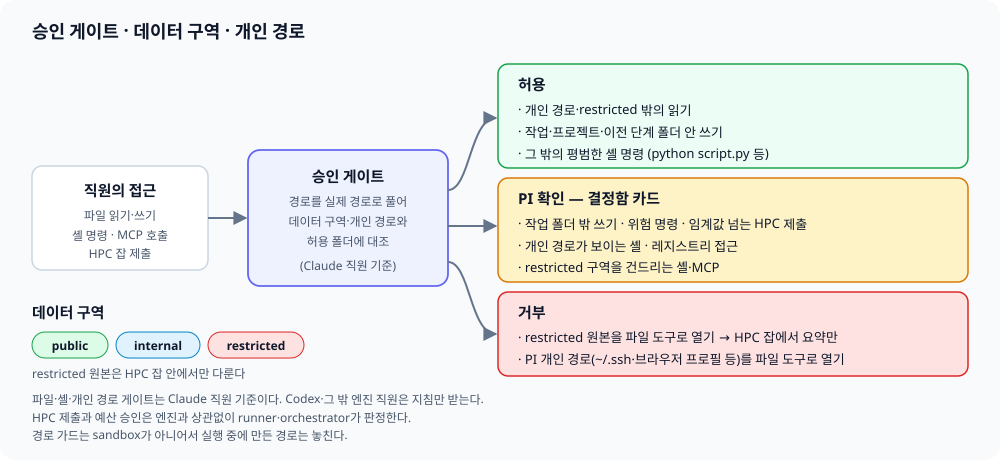

[← 매뉴얼 목차](../manual.md)

## 안전 장치

### 폭주 감지 (그림자)

경고 뒤에도 신호가 이어지면 차단기가 한 단계씩 올라갑니다(warn → constrain → stop). 올리는 것은 새 관측이 있을 때뿐이고, 한 단계에서 다음까지 `runner.breaker_beat_s`(기본 10초) 이상 걸립니다. 경고만 나고 조용해지면 저절로 풀리지만 constrain 이후는 PI가 풀 때까지 유지됩니다(`POST /api/tasks/{id}/breaker/release`). constrain은 hook이 도는 Claude 직원에게만 읽기 도구(Read·Glob·Grep)만 남기고, hook이 없는 엔진은 `enforcement: unsupported`로 표시할 뿐 제한한 것으로 세지 않습니다. stop은 `runner.breaker_hard_stop: true`일 때만 기존 halt 경로로 세션을 보존한 채 멈추고, 꺼져 있으면(기본) 표시만 합니다. constrain 이후에는 도구 오류 연속이 단계를 더 올리지 않습니다(거부된 호출이 오류로 집계되기 때문). 같은 입력의 반복만 stop까지 올립니다. stop이 halt로 이어지면 gateway가 PI의 멈추기처럼 기록해 재연결 때 다시 보내고, 해제는 명령 ID와 제한 회차(episode)를 달아 gateway가 저장한 뒤 보내고, runner가 `agent.breaker`로 확인(ACK)할 때까지 연결·배정·gateway 재시작 때마다 같은 명령을 다시 보냅니다. `sent`는 보냈다는 뜻일 뿐 적용 확인이 아닙니다. runner는 같은 명령의 재전송은 한 번만 적용하고, 이미 지나간 제한을 가리키는 명령은 적용하지 않고 `stale`로 답합니다. episode ID에는 task 실행마다 새로 만든 값이 들어 있어서, runner를 다시 켜거나 task를 다시 보내면 이전 실행 때 저장한 명령은 새 제한과 맞지 않아 `stale`이 됩니다. 작업판의 직원 카드에 제한 중이면 "제한 해제" 버튼이 뜹니다. Claude Code는 컨텍스트를 압축하면 `compact_boundary` 프레임을 보내도록 정의돼 있어(2.1.310 실행 파일의 프레임 정의에서 확인했고, 실제 압축 세션에서 받아 본 것은 아닙니다), runner가 그때 반복·오류 집계를 처음부터 다시 세고 경고 단계는 풀어 줍니다. 압축 직후 이전 일을 다시 하는 것은 폭주가 아니기 때문입니다. 제한 단계는 PI가 풀 때까지 그대로입니다. Codex(`exec --json`)·Gemini·Antigravity 어댑터에는 이런 신호가 없어 이 예외가 없습니다. constrain 중에도 읽기 밖의 도구 호출은 CSO에게 한 번씩 물어봅니다. hook이 runner broker(`/restricted`)로 묻고 gateway의 CSO가 정해진 규칙으로 판정합니다(모델 호출 없음): 같은 호출은 제한 하나에 한 번만 판정하고(같은 호출을 다시 하면 처음 답과 상관없이 거절), 허용은 제한 하나에 5번까지이며, runner가 알린 제한 회차와 gateway가 아는 회차가 다르거나 요청이 90초보다 오래됐거나(연결이 끊겼다 돌아와 다시 보낸 요청은 이미 거절된 호출이라 판정에도 쓰지 않습니다) 작업이 끝났거나 취소 중이면 거절합니다. 답이 30초 안에 없거나 broker에 닿지 않으면 거절합니다. 기다리는 동안 PI가 멈추기·일시 정지를 했다면 허용 뒤에도 그것이 먼저입니다. 허용은 그 호출 한 번의 이의를 거두는 것일 뿐이라 기존 권한 검사(작업 폴더·승인 카드)는 그대로 거치고 제한도 PI가 풀 때까지 유지됩니다. 판정은 직원 기록에 "CSO가 허용/거절했어요" 한 줄로 남습니다. 호출 내용은 runner 기록·재전송 대기열·피드 어디에도 싣지 않고 도구 이름과 fingerprint만 보냅니다. 판정한 호출 목록과 허용 횟수는 gateway state에 저장돼 gateway를 다시 켜도 이어집니다. hook이 있는 Claude 직원에게만 적용됩니다.

같은 도구·입력 8회 또는 실패한 도구 호출 5회가 연속되면 신호별로 한 번 경고합니다. 직원은 계속 실행됩니다. Claude·Codex·Antigravity는 preview 전에 도구 이름과 원본 입력의 SHA-256 fingerprint를 계산합니다. JSON 키 순서는 정렬하고 문자열 공백은 보존합니다. 이벤트에는 기존 preview와 hash만 보냅니다. 입력 미보고나 fingerprint 없는 잘린 preview는 반복 횟수에서 제외하고 연속 횟수를 끊습니다. 한 호출의 오류 여러 줄은 실패 한 번으로 셉니다.

### 승인 게이트와 쓰기 범위

이름으로 여러 프로세스를 종료하는 `taskkill /IM`(Git Bash `//IM`·필터 포함), `pkill`, `killall`, `skill`의 이름 선택, `Stop-Process -Name`, `Get-Process 이름 | Stop-Process`는 승인 카드 없이 거부합니다. 연결·fallback·조건문·wrapper·redirection·script block 안도 검사합니다. literal·locale quote·EncodedCommand 실행·치환·PID 전달·PowerShell 변수·괄호식·Kill/MemberName 호출을 검사하며, `kill`의 0·음수 target도 거부합니다([P1 근거·경계](../reference/process-stop-681-followup.md)). 자기 작업 폴더 경로가 명령줄에 있는 PID와 시작 시각을 확인한 뒤 PID를 지정하세요. 동적으로 조립한 명령의 OS 격리는 별도이며, 기존 runner의 PID·시작 시각 검증 정리는 유지합니다. 임의 백그라운드 PID 추적·정리 도구(#675)는 아직 구현하지 않았습니다(#681 부분 해결).

HPC 제출(코어·시간 기준), 위험한 셸 명령, 예산 초과, 파견직 채용은 PI가 결정함에서 정합니다. Claude 직원의 파일·셸 호출은 승인 게이트를 거치고, 다른 엔진 직원은 sandbox와 지침에 기댑니다(아래 절과 [알려진 한계](17-known-limits.md#알려진-한계)). 셸·파일·MCP 규칙이 없는 도구는 `policy.approvals.auto_allow_tools`(기본: Read·Glob·Grep·LS·WebSearch·WebFetch·TodoWrite·Skill·StructuredOutput·ToolSearch, 그리고 이미 승인 게이트를 거친 Bash의 백그라운드 출력을 읽거나 멈추는 BashOutput·KillShell·TaskOutput·TaskStop)에 있을 때만 허용하고, 나머지는 PI에게 묻습니다. 셸 명령을 돌리는 `Monitor`가 그 예입니다. `Task`·`Agent`·`Workflow`·`TeamCreate`·`TeamDelete`는 이 목록에 넣어도 거부합니다(#421).
작업 폴더 자동 허용은 닫힌 문법만 받습니다. 변수·대입·치환·간접 실행·Python 본문은 카드로 보냅니다. `cd`는 맨 앞 한 번과 `&&` 연결만 허용합니다. 셸 내장 또는 staff PATH에서 찾은 쓰기 불가한 시스템 실행 파일만 받으며 해석 경로를 기록합니다. PowerShell의 콜론 operand는 실제 작업 경로가 증명되지 않으면 카드로 보냅니다([규칙](../reference/tool-approval-grammar.md)).

| 작업 | 승인 |
|---|---|
| 실제 작업 폴더 안 `rm -rf tmp/`, `.tmp/paper-review`, 절대 경로 삭제 | 불필요 |
| 폴더 자체 삭제, `..`, link·junction·hard link 쓰기, 자격 증명, 다른 작업 경로 | 확인 |
| 문법 밖 명령·실행 중에 만드는 경로 | 확인 |
| 쓰기 범위 밖 스크립트·실행 코드 | 매번 확인 |

반복 승인을 더 줄이는 방안은 OS sandbox 격리로 별도 이슈에서 다룹니다. [문법·재생 근거](../reference/tool-approval-grammar.md).

Claude 직원의 맨 `Write`·`Edit`는 작업·project·upstream 폴더의 `Edit(//…/**)` 규칙으로 좁혀 사전 허용합니다. 링크·junction으로 적힌 폴더는 적힌 표기와 실제 경로에 규칙을 하나씩 둡니다(Claude는 둘 다 맞아야 허용). 그 밖 쓰기는 승인 게이트를 거칩니다(#219). 셸 쓰기 대상이 `~`로 시작하면 그 셸의 home으로 펼쳐 쓰기 허용 폴더와 대조합니다. Bash는 `HOME`(없으면 `USERPROFILE`과 `HOMEDRIVE`+`HOMEPATH`), PowerShell은 Windows에서 `USERPROFILE`과 `HOMEDRIVE`+`HOMEPATH`를 모두 봅니다. `~user`·`~+`·`~-`처럼 펼 수 없으면 묻고, 읽기 경로는 그대로 둡니다(#521).

요청 전체 HPC 모드의 공유 계정에는 검증된 `data/<producer>/<source-task>/` 복사본만 읽기 권한을 주고 단계별 `outputs/`에 씁니다. manifest·제어 파일은 private으로 두며 입력 링크·hardlink 거부를 유지합니다. 실제 HPC 권한 동작과 OS 격리는 미검증입니다([범위](../reference/hpc-step-workspaces-578.md)).

**HPC 접속과 agent 위치(#1295):** 기본 구성은 직원 agent와 runner가 HPC 밖(사용자 PC)에 있고 HPC에는 계산 스크립트만 보냅니다. 많은 기관이 HPC 안에서 agent를 막으므로, runner를 클러스터 안에 두기 전에 기관 규정과 사이트 프로필을 먼저 확인합니다. 접속은 기관 전산팀에 로그인 기록으로 남을 수 있으니 `hpc.login_limit_per_request`·`hpc.login_limit_per_day`로 세고([15장](15-config.md)), 기관의 접속 주소·계정·게이트웨이는 저장소·로그·보고서에 넣지 않고 사용자 PC에만 둡니다. 지금은 커밋하지 않는 `config/labhq.yaml`(`hpc.ssh_host`·`hpc.user` 등)이고, 사이트 프로필(#1300)이 들어오면 그쪽으로 옮깁니다. 직원 세션이 읽을 수 있는 개인 skill에는 넣지 않습니다. 사이트 규칙이 labhq 기본보다 우선합니다. 자세한 정책은 [8장](08-structure.md)에 있습니다.

### 데이터 구역

`policy.data_zones`. 경로마다 public·internal·restricted 등급을 붙입니다. 통제 원본은 절대경로로 지정. 클러스터 안 runner 구성(기본은 agent가 HPC 밖이고, 이 구성은 사이트 프로필이 허용할 때만 씁니다, #1295)의 권장: Linux 러너 전용 계정, 데이터 계정 소유·권한 `0700`인 구역, `hpc.submit_prefix: ["sudo", "-n", "-u", "data-account"]`, 필수 설정 `hpc.user: data-account`·`hpc.job_group: lab-jobs`. 러너·data-account를 같은 그룹에 넣습니다. `sudoers`는 잡 제출·취소용 `qsub`와 `qdel`(Slurm은 `sbatch`와 `scancel`)만 허용합니다. 전환된 잡의 상대 출력은 반환값의 `output_dir`(`hpc_out/`)에 쓰며, 공유 폴더에는 집계 결과만 둡니다. restricted 구역이 설정되면 Windows 러너는 시작을 거부하며, POSIX 러너 계정이 원본을 읽거나 통과할 수 있어도 거부합니다. `policy.allow_runner_read_restricted: true`는 경고를 남기는 명시적 예외입니다.

internal 구역을 가리키는 작업·project·참고 폴더 별칭은 Claude의 Read 승인을 받습니다. 링크 검사가 끝나지 않아도 bare Read를 쓰지 않고 실제 경로를 gate에서 판정합니다. internal·restricted 구역과 겹치는 열린 root에는 폴더 단위 Read 사전 허용도 주지 않아, 실행 중 같은 root에 생긴 별칭도 gate로 보냅니다.

### PI 개인 경로

`policy.private_paths`. gateway·runner·직원 CLI는 기본으로 PI 계정에서 돕니다(PI 결정 2026-10-03). PI 개인 파일은 Claude 직원에게 세 겹, Windows elevated sandbox의 Codex 직원에게 두 겹, 다른 엔진 직원에게는 지침 한 겹으로 막습니다. 키가 없으면 기본 목록을 쓰고 `[]`이면 끕니다. 목록을 직접 쓰면 기본 목록은 빠지니 필요한 항목을 다시 적습니다.
- 기본 목록: `~/.ssh`·`~/.aws`·`~/.azure`·`~/.gnupg`·`~/.docker`·`~/.kube`·`~/.config/gh`·`~/.config/gcloud`·`~/.git-credentials`·`~/.netrc`·`~/.claude`·`~/.claude.json`·`~/.codex`·`~/.gemini`·`~/.env`, Chrome·Edge·Firefox 프로필(Windows `AppData` 아래, Linux `~/.config/google-chrome`·`~/.config/microsoft-edge`·`~/.mozilla`), runner가 읽은 설정 파일, gateway 상태 폴더, `engines.claude_code.env.CLAUDE_CONFIG_DIR`(Claude 직원 설정 폴더), `engines.codex.env.CODEX_HOME`(직원 Codex 로그인 폴더, 설정했을 때), AlphaGenome 키 파일(`annot.alphagenome_key_file`, 있을 때).
- gateway 설정을 따로 둔 파일(`client_token`이 든 gateway.yaml 등)은 기본 목록에 없습니다. `policy.private_paths`에 직접 넣으세요.
- 선행 단계 산출을 읽기 전용 `inputs/`로 받는 연구 단계는 작업 root(`runner.workspace_root`) 전체가 개인 경로로 닫히고 그 단계의 작업 폴더만 열립니다. 이때 Claude의 Edit/Write 거부 규칙은 root 전체가 아니라 작업 폴더로 가는 길에 없는 최상위 항목(다른 날짜 폴더·root의 파일)에만 붙어서, 단계가 자기 `outputs/`·`.tmp/`에는 쓸 수 있습니다(#946, 거부 규칙이 허용 규칙보다 우선하므로 root 전체를 막으면 산출을 하나도 쓰지 못합니다). 직원 전용 Claude 설정 폴더는 계속 전체 경로에 Edit/Write 거부가 붙습니다. 작업 폴더 안 다른 단계의 폴더는 거부 규칙 없이 승인 게이트가 막습니다.
- 개인 경로가 켜져 있으면(막을 경로가 하나도 남지 않아도 켜진 것이고, `[]`만 끕니다) 레지스트리에 손대는 Claude 셸 명령은 키와 상관없이 모두 PI 승인으로 갑니다(`HKCU\Environment`에 PI `GITHUB_TOKEN`이 있습니다. `reg`·`HKCU:`/`HKLM:`·`Registry::`·레지스트리 PSDrive·`winreg`·`Microsoft.Win32`·`StdRegProv`·`GetEnvironmentVariable(…, 'User')`, 줄 이어쓰기도 이어 붙여 봅니다). 커밋 메시지나 grep 패턴에 이 단어가 들어가도 묻는데, 받아들인 오탐입니다. 표기 목록은 `labhq/private_paths.py`의 `REGISTRY_ACCESS`입니다.
- 없는 경로는 조용히 건너뜁니다. 작업 폴더·`workspace_root`·참고·프로젝트 폴더를 담거나 그와 같은 경로는 그 task에서 빼고 doctor `private paths` 행과 작업 로그에 남깁니다. plugin과 recruiter의 Paper2Agent skill은 해당 경로만 읽기로 엽니다. 상위 `CLAUDE_CONFIG_DIR`·`CODEX_HOME`의 로그인·history·다른 task·settings·todos는 계속 보호합니다(Read 거부, Claude Bash는 PI 승인). Codex Windows elevated profile도 홈을 deny하고 skill 경로만 read로 엽니다.
- Claude는 긴 도구 출력(MCP 결과 포함)을 설정 폴더의 `projects/<작업 폴더 slug>/`에 저장했다가 다시 읽습니다. 그래서 Claude 직원은 전용 설정 폴더(`CLAUDE_CONFIG_DIR`)를 쓰고, 그 안에서 그 task 몫의 `projects/<slug>/`만 읽기로 열립니다. 로그인 파일·history·다른 task 폴더와 쓰기는 막히고, PI `~/.claude`는 통째로 막힙니다.
- 로그인은 PI가 한 번 합니다: `CLAUDE_CONFIG_DIR="$HOME/.labhq/claude-staff" claude` 뒤 `/login`(Windows `$env:CLAUDE_CONFIG_DIR = Join-Path $HOME '.labhq/claude-staff'; claude`). 미설정이면 doctor `claude staff config`가 warn, PI `~/.claude`나 그 안을 가리키면 fail입니다.

| 겹 | 대상 | 하는 일 |
|---|---|---|
| 파일 도구 거부 | Claude | 경로와 그 아래(`//c/Users/...`, `/**`)의 Read·Edit·Write deny 규칙. link·junction의 실제 경로와 Windows 8.3 짧은 이름(`SSH~1`)에도. 미리 허용하는 Read·Grep·Glob은 작업·프로젝트·참고 폴더의 `Read(//폴더/**)`로 좁혀, 그 밖 읽기와 link로 빠지는 읽기는 게이트가 실제 경로로 거부(`\\localhost\C$\`·`\\?\` 표기 포함) |
| 셸 언급 승인 | Claude Bash·PowerShell | 셸 명령은 미리 허용하지 않아(`Bash(python *)`도) 모두 게이트로 감. 개인 경로가 보이거나 link로 이어지는 명령만 PI 승인을 받고 나머지는 바로 허용. 절대경로·`~`·`$HOME`·`%USERPROFILE%`·`$env:USERPROFILE`·`%LOCALAPPDATA%`·Git Bash `/c/...`, 따옴표로 쪼갠 표기·`/./`·`..`, `/`·`\` 무관. 대소문자는 Windows와 대소문자 무시 볼륨에서만 무시. `cd` 뒤 상대 경로는 그 폴더 기준으로 읽는데, 폴더 아래에 개인 경로가 없으면 `..`가 든 단어만 대조하고(긴 `python -c` 스크립트의 단어는 세지 않음), 개인 경로가 있으면 모든 단어를 대조. 대조할 단어나 해석할 경로 후보가 256개를 넘으면 판단하지 않고 PI 승인. 작업 폴더에 없는 이름은 링크일 수 없어 해석하지 않음. `ask` 규칙도 첫 겹으로 남김 |
| sandbox 읽기 거부 | Codex(Windows, `windows_sandbox: elevated`) | 그 task의 개인 경로(실제 경로 포함)를 Codex permission profile의 `"deny"` 항목으로 넘김(#382). profile은 직원의 `sandbox`와 같은 built-in(`:workspace`·`:read-only`)을 잇고 `-s` 대신 씀. sandbox 계정이 그 경로를 못 읽어 셸 명령이 만든 경로도 막힘. unelevated는 deny-read를 거부해 시작하지 않으므로 넘기지 않음. `danger-full-access` 직원과 다른 OS는 지침만 |
| 지침 | 모든 직원 | 역할 지침 끝의 "PI 개인 파일" 절. `~` 표기와 홈 밖 경로의 마지막 폴더 이름만 쓰고 절대경로는 넣지 않음 |

Claude Bash sandbox 정책 계약(#666)은 capability가 꺼져 있고 launcher가 실행을 거부합니다. 실제 설정 적용과 보호 효과는 **UNVERIFIED**이며 전체 프로세스 격리를 제공하지 않습니다.

Disposable fixture 계획은 `python scripts/boundary_fixture_plan.py plan.json`으로 offline 검사합니다. JSON 파일 하나를 읽으며 `plan_valid`는 계획 검사 결과일 뿐 실제 보호는 **UNVERIFIED**입니다. 입력 예시와 검사 범위는 [fixture 계획 안내](../reference/boundary-fixture-plan.md)를 보세요.

독립 supervisor/seal의 [synthetic fixture 검증](../reference/process-boundary-seal-fixtures.md)은 모의 증거의 수락·거부 조건만 확인합니다. 실제 supervisor의 신뢰성·실행 중 파일 보호·종료 뒤 잔류 정리는 **UNVERIFIED**이며 이 검증으로 보호 실행을 허용하지 않습니다.

막지 못하는 것:
- Gemini·Antigravity·cli 직원과 Windows elevated가 아닌 Codex 직원은 지침만 받습니다. 파일·셸 읽기를 가로채는 장치가 없습니다. Antigravity의 `auto`와 Gemini의 `bypassPermissions`(yolo)는 확인 없이 실행합니다.
- Claude 직원도 실행 중에 만든 경로는 놓칩니다. `python -c`로 `os.path.join('..', '.ssh', 'x')`처럼 조립한 경로, 작업 폴더에 써 둔 스크립트(`python evil.py`)가 여는 경로가 그렇습니다(PR #324 실측). 작업 폴더 쓰기와 셸이 둘 다 허용된 직원은 두 단계로 모든 개인 경로를 읽을 수 있다는 뜻입니다. 이 가드는 보이는 접근과 실수를 막을 뿐 작정한 직원은 못 막습니다. 그것까지 막으려면 [전용 계정](../runner-account.md)이 필요합니다. `cd ~ && cat .ssh/x`는 게이트가 `cd` 대상에서 상대경로를 다시 읽어 잡지만, `cd "$(…)"`처럼 실행 중에 정해지는 폴더와 glob(`~/.ss?`)은 놓칩니다. `permission_mode`가 `auto`·`bypassPermissions`(인사팀 기본 `auto`)인 직원은 게이트를 거치지 않을 수 있습니다. `builtin_mcp`에 `approval`이 없는 직원은 셸 명령이 모두 거부되며 작업 로그에 경고가 남습니다.
- doctor는 OS 계정 분리가 없다는 `runner account isolation` 경고를 계속 냅니다. 전용 계정 분리는 [고급 선택지](../runner-account.md)입니다.

### 전환 잡 작업공간

러너가 private umask(`077`)로 입력을 만들고, 제출 전에 기존 입력에서도 group·other 권한을 제거합니다. 제출 시 `workspace_root`와 날짜 폴더에만 group traverse를 주며, 그 밖의 상위 경로는 data-account가 통과할 수 있어야 합니다. 데이터 계정은 잡 스크립트·`hpc_out/`·로그만 사용합니다.

### 중단 조건 한눈에

| 경계 | 전역 기본값과 실제 동작 |
|---|---|
| 작업 시간 | `runner.task_timeout_s`: CLI 호출당 6시간. 요청 전체 시간 상한은 `orchestrator.request_wall_clock_s`(초, 기본 0=끔, 켜려면 60 이상)로 켭니다. 요청을 받을 때 고정하고, 기한이 지난 진행 중 요청을 gateway가 취소하며 `waiting_pi`(PI 결정 대기) 시간은 기한에 더하고 보고서 검토 이후는 끊지 않습니다. 켜면 `labhq status`가 진행 중인 요청마다 `시간 상한: 꺼짐` 또는 `시간 상한: 켜짐 90분 · 남은 N분 · PI 대기 제외 N분`을 한 줄로 보이고, 대기 중에는 시계가 가지 않는다고 덧붙입니다. 웹 작업판의 요청 패널도 활성 요청에만 같은 줄(`시간 상한 켜짐 90분 · 남은 N분 …`, 꺼져 있으면 `시간 상한 꺼짐`)을 보이고 15초마다 다시 계산합니다. 웹은 gateway가 snapshot과 요청 생성 때 보낸 `wall_clock.deadline_at`(요청을 받은 시각 기준, 끝난 PI 대기 반영)에 자기 시계를 더해 계산합니다. 그래서 요청 시작이 받은 시각보다 늦어도 남은 시간이 gateway의 실제 기한보다 길게 보이지 않습니다. `deadline_at`을 보내지 않는 gateway에서만 요청 생성 시각에 상한을 더해 계산합니다. 열려 있는 PI 대기는 웹이 직접 더하므로, snapshot 뒤에 시작한 PI 대기는 다음 snapshot(재연결)까지 빼지 못해 남은 시간이 실제보다 짧게 보일 수 있습니다(일찍 경고하는 쪽). 상한 정보를 보내지 않는 옛 gateway에서는 줄을 숨기고 `꺼짐`이라 하지 않습니다. 요청의 비용 줄은 선언한 등급과 다른 모델로 돈 직원도 `선언 등급과 다른 모델: …`로 보입니다(`model_tiers` 표를 채웠을 때, 위 설명). 세부는 [요청 전체 시간 상한](../reference/request-deadline.md)입니다. 재개한 새 호출의 시간 제한과 요청의 원래 기한을 구분합니다. |
| 비용 | `policy.budget.per_task_usd=5`, `per_request_usd=30`. 요청의 `budget_usd`가 있으면 그 값을 씁니다. 사전 예약은 `reserve_before_dispatch=true`가 기본이며(#1139), 비용 모름을 무료로 보지 않습니다. |
| HTTP 조회 | `annot.request_lookup_limit=null`: 기본 횟수 제한 없음. 설정하면 내장 annot·live 출처 검사가 같은 요청 원장을 쓰고 runner 재시작 뒤에도 이어 셉니다. 직원 직접 HTTP·타사 MCP 전체의 상한은 아닙니다. |
| 실패 | 일시적 실패는 `orchestrator.step_max_attempts=2`까지 시도합니다. 요청 전체가 실패 2회에 중단되는 전역 규칙은 없습니다. |
| PI 카드 | 결정 카드는 기본 7일, 도구 gate는 1시간입니다. 재개 카드 기한은 원래 생성 시각 기준이며, 기한 초과는 `resume_timed_out`입니다. 재시작 때 다른 결정 카드는 닫히고 재개 카드로 돌아갑니다. |

요청별 시간·비용·조회 상한과 중단·응답 조건은 별도 승인 계약을 따릅니다. 재시작으로 기한·상한·counter를 초기화하지 않습니다. 과거 실행 승인은 새 실행의 GO가 아닙니다. 코드 위치와 fake 복구 재현의 한계는 [대조표](../reference/recovery-stop-924.md)를 봅니다.

재개하면 완료 단계는 재사용합니다. 이미 중단 결과가 저장된 task는 승인 뒤 새 task ID로 이어 가며, 같은 중단 결과로 재개 카드를 반복해서 열지 않습니다.

**제한된 v1의 지원·복구 조건(2026-10-26):** [#882](https://github.com/ehojune/bioinfo-team-3d/issues/882)의 목표는 Windows gateway/runner에서 공개 문헌 요청을 끝까지 확인하는 것입니다. 통합 종료 증명과 별도 GO가 먼저이며, HPC·WSL·기관 로그인·원자료는 이 확인 범위에서 제외합니다. v1 운영 지원 완료를 선언한 상태는 아닙니다.

| 항목 | 구현 근거와 남은 확인 |
|---|---|
| 로컬 job·취소 | [#937](https://github.com/ehojune/bioinfo-team-3d/pull/937) job 기록 재로드, [#968](https://github.com/ehojune/bioinfo-team-3d/pull/968) 복구 runner에 취소 재전송 회귀가 병합됐습니다. 대체 transport·무해한 job으로 취소 트리 잔류 0·완료 깨움 없음·다른 요청 보존을 확인했습니다. runner가 꺼진 동안에는 job 종료를 보장하지 않습니다. |
| 저장·소유권 | #967 소유권 경쟁과 #966·#972·#976·#979·#980·#982 저장 경계, #984 채용 preflight 읽기 전환 병합. control-state는 task별 async commit·삭제 후 부활 방지를 적용합니다. step 제어도 async이며 result 수신의 나머지 저장·dispatch 등 sync 경계는 남아 #606은 OPEN입니다. 실디스크·운영 성능은 미검증입니다. |
| 운영 미검증 | 실제 WebSocket 재연결·gateway OS 재시작·새 설치에서의 실제 요청·반복 복구·지원 요청 end-to-end는 미검증입니다. [새 설치 mock 검사](../reference/clean-install-922.md)와 회귀 CI를 운영 PASS로 세지 않습니다. |

### 승인·예산

`policy.approvals`, `policy.budget`. `hpc_core_hours_threshold: 0`이면 모든 제출을 승인받음. 임계값 아래여도 스크립트에 스케줄러 지시(`#SBATCH`·`#$`·`#PBS`·`#BSUB`)가 있으면 승인받습니다. `per_task_usd`는 Claude의 `--max-budget-usd`에서만 강제됩니다. Codex·Gemini·Antigravity에는 `runner.task_timeout_s`로 실행 시간을 제한합니다. 보고되지 않은 비용은 0으로 더하지 않습니다(#270). 새 기록은 `None`으로 남기고 과거의 숫자 0 기록은 그대로 읽습니다. Codex처럼 token만 보고하면 판본 있는 가격표(`labhq/costs.py`: 출처·확인일·모델 ID)로 `추정`하되, 모델 ID가 정확히 일치하고 과금 token 항목이 모두 있을 때만 환산합니다. 나머지는 `비용 모름 N건`으로 따로 셉니다. 웹·CLI·보고서는 `확인 $a + 추정 $b + 비용 모름 N건`과 엔진별 소계를 보여 주며, 추정은 청구액이 아닙니다. 단가는 OpenAI API Standard·짧은 문맥(호출당 입력 272K 이하, Codex 기본값) 기준이라 staff `CODEX_HOME`에서 `model_context_window`를 키우면 추정은 하한입니다. 요청 상한은 비용 모름 task마다 `per_task_usd`(0이면 요청 상한 전체)를 쓴 것으로 보고 판정해 넘으면 예산 승인을 받으며(카드 요약에 승인하면 올라갈 상한, 보통 지금 상한의 두 배가 적히고, 보내기 전 예약을 켠 요청은 지금 묶인 금액에 다음 작업 한 건의 상한(`per_task_usd`)을 더한 값보다 작지 않아 증액 한 번으로 곧바로 두 번째 카드가 뜨지 않습니다. #940), 보고서는 비용 모름이 남은 요청을 예산 내로 적지 않습니다. 연구 보고서의 마지막 turn에서 처음 넘으면 더 할 일이 없으므로 카드를 띄우지 않고 초과 기록과 보고서를 남깁니다. 보고서 turn이 질문 답이나 HPC job을 기다리면 그 뒤 wake turn이 더 돌므로 마지막이 아닙니다. 넘었으면 wake turn 전에 예산 카드가 뜨고, 카드 없는 기록은 wake까지 끝난 마지막 turn에만 남습니다. 가격표 확인일이 90일을 넘으면 경고합니다. 연구 계획의 `budget_usd`는 집행이 쓸 금액이라 CP1 승인 때 그때까지 쓴 비용에 더해 요청 상한이 되며(계획 예산 $3.00 + 계획까지 쓴 $2.96이면 $5.96), 설정 상한(요청 예산, 없으면 `per_request_usd`)을 넘지는 못합니다([연구 lane](13-research-lane.md#연구-lane과-검증)).

**보내기 전 예약**(#862, 기본 켬 #1139): PI 문구 번역 task의 비용 모름은 건당 일반 예약이 아니라 그 번역의 예약 상한(ceiling)만큼만 묶습니다(#940). `policy.budget.reserve_before_dispatch`가 켜져 있으면(기본) CSO는 모델 호출을 보내기 직전에 그 호출의 상한을 요청 예산에서 미리 잡습니다. 대상은 계획·브리핑·선행 연구·단계·재시도·칸 질문·리뷰·보고서·채용·환경 진단입니다. 호출 상한은 task·직원(`max_budget_usd`)·`per_task_usd` 중 가장 작은 값이고, 셋 다 없으면 남은 예산입니다. 요청에 1cent 이상 남아 있으면 잡는 금액은 그 호출 상한과 남은 예산 중 작은 값입니다(#1139). 그래서 요청 예산이 `per_task_usd`(기본 $5)보다 작아도 첫 호출부터 카드가 뜨지 않고, 호출은 그 금액으로 상한이 낮춰져 나갑니다. 남은 예산이 1cent 미만이면 자르지 않고 카드로 묻습니다. 호출 상한은 어디서 왔든 센트 단위로 내립니다(남은 예산 $0.019면 $0.01, `per_task_usd = 0.015`면 $0.01). 내리면 1센트 미만이 되는 상한은 보내지 않고 거절하며, 예약이 켜져 있을 때 0보다 크고 0.01 미만인 `per_task_usd`는 설정을 불러올 때 거절합니다(0은 상한 없음). Claude CLI가 호출 상한을 센트로 적어, 내리지 않으면 보류액과 요청 상한을 넘겨 쓸 수 있기 때문입니다. 뺄셈이 만드는 부동소수점 오차(`2.0 - 1.98`)는 센트를 잃게 하지 않습니다. 이미 쓴 비용, 비용 모름 건당 예약, 진행 중인 예약, 이번 상한을 더해 요청 상한을 넘으면 보내지 않습니다. 일반 호출은 예산 카드로 묻고, 채용·환경 진단은 묻지 않고 건너뜁니다. 보낸 호출의 상한은 예약액으로 낮춰집니다. 계획 채용의 실제 변환 task도 상위 예약액·남은 금액·`recruit.max_budget_usd` 중 작은 값을 이어받습니다. Claude CLI의 cent 단위로 내림하고 1cent 미만은 보내지 않습니다. 내부 변환 비용은 자기 task ID로 한 번만 집계합니다. 취소로 Python 반환을 놓쳐도 같은 runner의 durable 결과 확인 뒤 상위 비용을 중복 예약하지 않습니다. 신뢰할 결과·연결 근거가 없거나 runner가 재시작했다면 UNKNOWN을 유지합니다. 예약은 요청 기록에 남아 취소·결과 유실·gateway 재시작 뒤에도 그 호출의 비용(또는 비용 모름 예약)이 집계될 때까지 유지됩니다. gateway 재시작 뒤 이전 작업을 이어받는 호출은 새로 예약하지 않고 이전 작업의 예약을 씁니다. gateway가 작업을 저장하기 전에 취소되거나 재시작된 호출은 보내지 않은 것이므로 예약을 풉니다. 남은 예산이 0이거나 상한 값이 유한한 양수가 아니면 보내지 않습니다. `false`로 끄면 보내기 전 예약을 하지 않고, 이전처럼 이미 쓴 비용만 보고 허용합니다. 브리핑 예약이 센트 단위로 보낼 수 있는 남은 예산을 모두 차지하면 선행 조사는 브리핑이 끝난 뒤 시작합니다(#1255). 그때 비용을 반영한 잔액이 부족하면 예산 카드가 뜹니다. 기본이 켜짐이라 병렬 단계가 각자 호출 상한을 잡고 그 합이 요청 상한을 넘으면 뒤의 호출은 보내기 전에 예산 카드로 묻습니다. 게이트웨이와 runner는 이 설정을 각자 읽으므로, 한쪽만 `false`로 두면 계획 전 채용(`plan_recruit`)이 `failed`로 끝납니다. 두 설정 파일의 값을 같게 맞추세요. 논문 스킬 준비와 PI 문장 통역은 원래의 자체 예약을 씁니다. 이 상한은 labhq의 비용 기록·추정 기준이며 공급자 청구액을 보장하지 않습니다. Codex는 실행 중 비용 제한 플래그가 없어 예약액보다 많이 쓸 수 있고, 그 초과는 끝난 뒤 기록되어 다음 호출을 막을 뿐입니다.

이 설정과 상관없이, gateway가 작업을 저장한 뒤 runner로 보내다 실패한 호출은 runner에 닿았을 수 있으므로 비용 모름으로 기록됩니다(#862). 비용 모름 건은 `per_task_usd`로 잡혀 요청 상한 판단에 들어가므로, 예약을 끈 상태에서도 그런 실패 뒤에는 예산 카드가 조금 일찍 뜰 수 있습니다.

**결정 카드의 기한**(PI 점검 R5). 요청 자체를 정하는 카드(확인 질문 `clarify`, 직원 질문 `question`, 범위 `scope`, 예산 `budget`, CP1 `research_plan`, CP2 `research_evidence`, 이어 가기 `research_continue`, 재개 `resume`)는 `policy.approvals.pi_decision_timeout_s`(기본 604800초, 7일) 동안 기다립니다. 그동안 요청 상태는 `waiting_pi`이고 카드는 언제든 답할 수 있습니다. 기한을 넘기면 요청은 `clarify_timed_out`·`budget_timed_out`·`plan_timed_out`·`evidence_timed_out`·`out_of_scope_timed_out`·`resume_timed_out`으로 끝나며 거절과 구분됩니다. `policy.approvals.timeout_s`(기본 3600초)는 도구 권한·HPC 제출·대용량 다운로드 같은 gate 카드에만 씁니다. gateway를 다시 시작하면 열린 결정 카드는 닫히고 요청은 재개 카드로 돌아옵니다. 재개 카드에는 요청 문장 앞부분, 접수 시각, 남은 단계가 적힙니다. CP1 승인 전에 멈춘 첫 연구 계획이면 같은 카드에 CP1 카드와 같은 동결 계획 전체(`plan_canonical`)와 단계 요약·비용 추정·집행 상한이 적히고, 승인하면 그 계획 hash에 대한 CP1 승인으로 한 번만 기록합니다(`approval.via=resume_card`). 그래서 재개 직후 CP1 카드를 또 묻지 않습니다. 계획이 그 사이 바뀌었거나(hash 불일치), 이어 가기 차수이거나, 단계가 이미 돈 뒤의 재승인이거나, 의미 장치가 멈췄거나 paper skill·재배정 안내가 있으면 CP1 카드를 그대로 다시 묻습니다(#654). 승인 기록은 CP1 영수증을 저장할 때 함께 지우므로 그 전에 gateway가 멈춰도 답이 남습니다. 단계가 모두 끝난 뒤(CP2·리뷰·이어 가기 카드·보고서 차례) 멈춘 요청은 남은 단계가 "없음"으로 적히고, 승인하면 멈춘 자리의 결정 카드가 다시 뜹니다. 이어 가기를 결정했지만 새 계획이 아직 없으면 "이어 가기 n차: 새 계획·CP1부터"로 적습니다. 계획이 없는 요청(direct 요청, 계획 전에 멈춘 요청)은 "요청 전체"로 적히고 승인하면 처음부터 다시 돕니다. 러너가 다시 시작되거나 직원이 다른 러너로 옮기면, 이전 러너 프로세스가 띄운 도구 권한 카드는 새 러너가 붙을 때 `expired`로 닫힙니다(PI 점검 R2). 답할 프로세스가 이미 없기 때문입니다. 러너는 다시 시작해도 incarnation을 그대로 쓰므로, 재시작인지 재연결인지는 `runner.hello`의 `process`(프로세스마다 새 값)로 가립니다. 같은 프로세스가 다시 붙은 것이면 카드는 남습니다. 카드를 띄운 작업이 결과를 보내면 그 작업의 카드도 같은 방식으로 닫힙니다("그 작업이 끝나 닫힘"). 알림만 하는 `codex_sandbox_setup` 카드는 남깁니다.

resume 비용·Codex 토큰은 호출별 증분으로 합산합니다(#82). 원 누적값은 runner run 기록에 남기며, 재개 기준값이 없으면 해당 증분은 비용 모름으로 표시합니다. 요청 비용 요약은 엔진별(`by_engine`)에 더해 직원별(`by_agent`)로도 나뉘어 웹 요청 줄에 "누가 얼마"로 보입니다. 직원 정보가 없던 예전 기록에는 직원별 줄이 없습니다.
