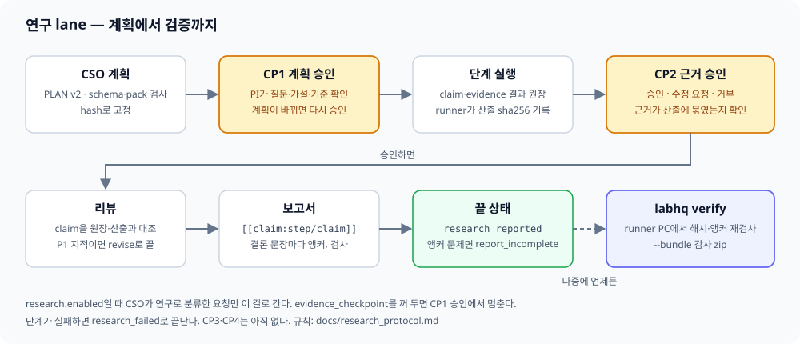

[← Manual index](../manual.en.md)

## Research lane and verification

If there is a paper-reproduction step, before CP1 it completes hiring approval → conversion and probation → active assignment. CP1 shows the confirmed assignee and the reason for reassignment.

### Turning it on

The `research` setting, off by default.
Domain rules are added with packs in `active_packs` (`id@version`) (example: `active_packs: [single_cell_de@3, bulk_tumor_normal@3]`).
`single_cell_de@3` judges single-cell donor, scale and model, and `bulk_tumor_normal@3` judges the pairing, filter, DE criteria and positive control of a bulk two-condition design.
The basis for pairing (`pairing_evidence`) is chosen only from a list of metadata sources such as GEO characteristics and sample title, and if it says there is pairing, there must be at least one source.
Expression similarity cannot be evidence (#369).
The CSO puts into the plan only packs whose `applies_when` matches.
Both versions apply by request topic (`single_cell_rna_seq`, `bulk_rna_seq` and `microarray_expression`).
Existing approved requests of `bulk_tumor_normal@1`, `@2` and `single_cell_de@2` resume with the stored version and hash.
If the config has a version that no longer exists or a pack folder that does not exist, the gateway reports the remaining versions and does not start (#170).
A request that has a research contract, continued with `research.enabled` turned off, sends nothing and stops with `research_disabled`.
If you turn off `research.enabled`, new requests go to the ordinary lane.
If you turn off only `research.evidence_checkpoint`, a new request does not run steps after CP1 approval and ends as `plan_approved`.
A request that already has a research contract uses, on resume, the frozen execution flag (`execution_enabled`) and the CP2 receipt as they are.

### CP1

With `enabled: true`, the CSO sorts a request into research and simple work.
Converting, aggregating, summarizing the original text, and organizing, extracting or downloading into tables or lists what is in the source is simple work.
If it includes inference such as analysis, prediction, comparison or relationship, or running a computation (run and so on), it is research even if a table is also requested.
A request that directly names one staff member is simple work unless it is explicitly marked research.
The classification rules are in section 1 of the [research protocol](../research_protocol.en.md).
Research validates the plan (PLAN) with a schema, fixes it by hash, and then gets PI approval (CP1).
If the plan changes after approval, it needs approval again.
If independent kinds of evidence are requested together, such as literature, public omics and domestic statistics, it makes `branches` and a per-step `branch` and puts a final synthesis step. A request that uses only one method keeps the existing PLAN.
A branch plan is limited by `orchestrator.max_branches` (default 5), `max_branch_steps` (default 8) and up to 3 synthesis steps. The total cap is `number of branches × branch cap + 3`, and if exceeded, it does not truncate but asks once to reduce and receives it again. Without branches it uses `max_steps` (default 12).
A branch that needs a data-extraction file or an internal folder asks a clarifying question before CP1. The main contrast of an exposure-group hypothesis is exposed group versus the rest or versus the least exposed group, and the reason for the reference category is written in the plan.
The plan's `protocol.packs` (id, version, sha256) is filled in by labhq from the applied pack snapshot, not by the CSO, and the CSO prompt shows `pack_values_keys` for each pack (field, validator and acceptance keys; acceptance is a rule id).
If the plan fails validation, it gathers all schema and pack problems, puts them into the correction prompt at once (the remaining problem text as is), and lets it fix up to 3 times. If problems remain after 3 times, it ends without a CP1 card, writing `outcome: plan_invalid` and the list of remaining problems in the report (#222; 3 corrections is #948). In a branch plan with a `branch: synthesis` step, if the first synthesis step does not take the last step of each branch in `depends_on`, before the check labhq fills in the dependencies of the synthesis step with the fewest missing branches (the first step on a tie) and leaves in the plan `warnings` "labhq filled in the depends_on of synthesis step … with …". If there is no synthesis step at all, or filling in would make a cycle, it does not fix and returns it as a problem. Even if the CSO separately declares a branch named `synthesis`, synthesis is a reserved combining lane, so that branch is counted neither as something to be read nor as an out-of-branch dependency to forbid.
An analysis in the request that is not negated must be in both `brief.scope` and the execution step `instruction`, and if either is missing, CP1 raises a `request scope missing` warning. A standalone `DE` is read as DEG, and wording that explicitly excludes a named analysis is dropped from the scope.
The CP1 cost basis is only completed requests with `unknown_count: 0` and overlapping topics. Retry, wake and result-correction costs are summed per plan `step_id` to give actual step averages per staff, engine and model. Even if the measurement is lower than the plan value, the execution cap is not reduced, and if there is no basis, it shows the plan value and `insufficient measured records`.
The card shows the question, hypothesis and completion condition, the branch table, the step list, the cost basis and the execution cap. The plan hash is only in the detail (`target_sha256`).
A plan may carry an optional `selection_record` (#890). When writing the plan, the CSO also writes the original question, premises, success criteria, the alternatives actually considered (each with `rejected_because`), and the observations that would change the judgment (`change_signals`), and if no alternative was considered, it leaves it empty rather than inventing any. This record is part of the plan, so it goes into the plan hash, and if you add an alternative or reason after approval, the hash changes and approval is needed again. A plan without it keeps the same hash as before. The CP1 card summary gives one line (`Selection record: n alternatives considered · m observations that would change the judgment`, or `No selection record`), and the whole is visible in the web card's `Selection record`. A missing record does not block approval. It exists only in the research lane's plan and not yet in the ordinary plan (`PLAN_SCHEMA`).
**Request revision** on the CP1 card (a note is required) ends the current request without steps as `plan_revision_requested` and opens a new research request. The new request attaches a `[CP1 revision request · <earlier request id>]` note to the same sentence and inherits the reference material (the request's own; the PI's default references as `default_references`), clarifying-question answers, notes sent during the run, the originally requested budget and the project. The planner receives the earlier plan that was not approved (`revision_of`) and the note, fixes that plan, and a new CP1 appears. The inherited clarifying-question answers are not counted in the new request's clarifying-question count. The two requests point to each other with `revised_from` and `revised_to`. If the project or CSO model has dropped out of the config and a new request cannot be opened, it ends as `plan_revision_failed` and the note stays in the report. A revision request with no note asks the card again, and if empty all three times, it ends like a decline. A revision request exists only at the first CP1 before steps run. It is not on the CP1 of a continuation round or a CP1 asked again after steps ran (`detail.revise_allowed: false`). The CLI is `labhq approve <id> --choice revise --note "what to fix"`.

### Steps and CP2

With `evidence_checkpoint: true` also on, after CP1 the research steps run under the `result v2` claim and evidence contract, and at the CP2 card the PI chooses approve, request revision or reject.
**Request revision** has the CSO make a new plan with the points to fix written in the note, and the PI approves it at a new CP1 (PI check R10). A continuation card does not appear separately.
After that it is the same as continuation after a review revise: only the steps the new plan changed and the steps below them run again, and the rest are reused (see "Review and continuation" below).
A revision request needs a note. The web does not send an empty note, and `labhq approve <id> --choice revise` refuses without `--note`. If an empty note arrives by another route, it raises the CP2 card again and asks for a note (up to three times, and if there is never one, it ends without a new plan).
If the `research.revise_continuations` cap is reached, a revision request ends the request as it does now (`evidence_revision_requested`). Then the card summary and button (`Request revision (ends the request)`) say so and no note is needed.
The CP2 card groups claim evidence by branch and shows step, status, evidence kind and marks (rejected evidence, lost evidence), and folds the ledger JSON.
The decision is read only from the web card button or the choice value of `labhq approve <id> --choice approve|revise|deny`, and the note is not read.
If there is no choice value, it does not approve and asks again (up to three times).
If an `artifact_refs` path is not an output the step collected or an output of a finished ancestor step (it need not be a direct parent) (`<workdir_id>/<path>`), that evidence is rejected, and the reason is left on the card and receipt.
Even if the ledger passes the contract when a step ends, if there is such a citation, while corrections remain it gives the once-collected output list and has the citation fixed (#485).
If this correction fails, or only writes anew or leaves as is files that were not collected, the step passes with its pre-correction result and CP2 rejects that row.
When a step ends, the runner looks at the table format and the literature access record. It warns of errors in table delimiters and cell counts, and for literature counts candidates, selected, obtained (text, abstract, bibliographic) and conclusion evidence with different denominators. For a conclusion-evidence paper that could not be read, it leaves the ID and reason. This ledger and the existing whole-lookup and conclusion-evidence tallies go into the CP2 card and the report's `## Limits` (`## Report warnings` for an ordinary request). The PMID, PMCID, DOI and OpenAlex ID in the same response are matched as aliases of one paper (#697, #710, #735, #744). Stored full-text and abstract records from the pre-CP1 precedent search (`analysis_precedents`) are merged in under the same aliases, and the line states how many papers they add and how many were partial extractions. Without stored records the line is unchanged (#1090).
Files under `__pycache__` are left out of the unreported-output list (they remain in the observation record). The staff run environment gets `PYTHONDONTWRITEBYTECODE=1` so they are not made in the first place (if the config or runner environment has a value, that value is used).
If a step stops because it needs a decision (`blocking_decision`), before the output and ledger checks the CSO answers first, and only a hard-stop question goes up to the PI. A turn that leaves only a question is not reported as step done, and once the answer arrives it continues in the same step.
A research request does not enter the ordinary replan, review and synthesis.
A staff member's StructuredOutput JSON parse error is retried automatically in the same session (`runner.structured_output_retries`, default 2, 0 turns it off). The retry is not a loop inside the runner but the gateway sending the same session again as a new dispatch, so it goes through the same request-budget check as other turns (#673). When the request has no remaining budget, or the parallel steps leave none after subtracting the share they can still use, it stops with a format error without asking the PI for more budget. This flow applies only to the step turn (`run_step`), and other calls such as planning and consultation are retried inside the runner as before. The original error text is stored in `.tmp/structured_output_failures/` in the work folder. A truncated plan is received again with step descriptions, repetition and large tables shortened, and non-ASCII characters are not expanded into `\u` escapes.
If a valid plan exceeds `orchestrator.plan_max_chars` (default 50,000 characters), the real size and the cap are recorded as a warning but it is not truncated. A retry is made only within the smaller of the task limit and the request's remaining limit, and cost and usage are summed with the earlier calls.

If a step's result ledger still breaks the contract after correction (`research.result_corrections`, default 2), only the wrong rows (links, evidence, claims) are rejected and it proceeds with the rest. A step's result, and a correction request, may state only the claims in the `claim_ids` the plan declared for that step. No claim id outside that list is created, and a row that is not evidence (a hypothesis, mechanism or background row) is never made a claim: it is linked as context to one of the declared claims or left out of the links. When the request asks for hypotheses, mechanisms or a grade-by-grade summary as findings, the plan must declare a claim for each in that step's `claim_ids` beforehand (#1066).
The rejected rows and reasons stay in the CP2 card and report metadata.
For example, if a failed or zero-result lookup was linked as supporting, only that link is removed and the attempt record stays.
Evidence that cites one source under two different independence groups is not merged into one group; only the later row is rejected. Merging would hide the independence the employee declared wrongly, while rejecting leaves "re-citation is not independent" on the CP2 card and never inflates the count of independent evidence.
A claim the step did not declare is rejected alone with its links (shown at CP2 as losing its evidence) and the rest is kept (#1054). Before, one such claim beside a row the rejection above could save failed the whole step. A step that has none of its own claims to begin with, or none left after the out-of-step claims were rejected, still fails. (When there is no out-of-step claim and the declared claims all lose their evidence, it still goes to CP2 with an empty claim ledger, as before.) The removed links are listed as rejected rows too.
Structural defects such as the plan hash, steps and required evidence cells are not patched by rejection and are treated as a step failure.
A branch PLAN is approved only if each branch terminal reaches the synthesis step through a dependency path. If a branch step fails, only that branch's later steps are skipped, and instead of the failed files, result text and work folder, only the reason and the last completed step are passed to synthesis. If there is not a single successful terminal, it leaves a per-branch status table and ends before CP2. The blocking behavior of a PLAN without branches does not change.
The synthesis report puts each branch's actual analysis and result into the summary, conclusion and graphical abstract. Even a non-significant result states the number of tests, the criterion and the number passed. An alternative analysis separates what was done and its result, its meaning and limits, and why a direct test is impossible, and states whether the representative contrast matches the hypothesis.
A research end that is not a success (`report_incomplete`, review revise, CP2 decline, revision request or timeout, budget refusal) leaves a one-line reason in the request's `error`, and the web feed shows `The request failed: <reason>`. For a `report_incomplete` where a report came out, the reason is "A report came out, but the claim check found problems" and the claim-check result is in the execution record. For a request that ended without a reason, the web shows the neutral phrase "The request was not treated as complete. Check the reason in the report and execution record".

### Review and continuation

**Blind draft** (`research.blind_draft`, default `false`, #889): if on, right after CP1 approval and before the first step is sent, the `reviewer_agent` writes one independent draft from only the original request sentence, the reference material and the PI's clarifying-question answers. The plan, steps and outputs are not put in the prompt; it runs read-only and uses the existing budget reservation and cancel paths. Isolation is by input (there is no separate file isolation). The draft body, sha256 and UTC time are sealed as `sealed` in `research_contract.blind_draft` and not rewritten after restart. If you resume a request that already has a main result, it does not write the draft and records `unavailable` (`results_exist`); if a main result already existed when the draft finished, `late`; and if the draft task fails, `unavailable`. In every case it is not used in review and the request continues. Because it runs sequentially, the request is delayed by the draft task's time. The research review receives the sealed draft (only when the hash matches) and leaves the comparison in the optional field `blind_comparison` of the review JSON (`missed_alternatives`, `differing_conclusions`, `evidence_gaps`). That the draft and the main answer agree is not counted as evidence, and an unreadable `blind_comparison` drops only that field, not the whole review. A continuation round uses the first round's sealed draft as is.

On approval at CP2, the `reviewer_agent` reviews the claims once against the ledger and output files.
A CP2 revision request enters the same continuation. The difference is only that it writes a new plan directly without a card and puts the PI note (`continuation.pi_request`) into the new plan and new review prompts instead of the review's P1 findings. The new CP1 card summary begins with "Continuation round n plan (reflecting the CP2 revision request)".
If there are P1 findings and it is revise, it does not rerun the fixed plan as is.
Instead, a **continuation** card (`research_continue`) appears. The card lays out the review's P1 findings in the order step, problem, fix, and the original JSON is folded.
If declined or unanswered, it ends as `research_review_revise` as now.
On approval, the CSO receives the review's P1 findings and the earlier plan and writes a new plan, the PI approves a new CP1 (a new `plan_sha256`), and then only changed steps and new steps run.
After that, CP2, review and report are the same. The report writer receives the earlier round review's P1 findings (the PI note, for a CP2 revision request) and in the "What was fixed in the previous round" section writes one line per finding on how it was fixed or that it could not be, and the finding also remains in the audit appendix. If the writer leaves that section out, labhq attaches the section from the earlier round's findings list (it does not make the request fail).
Reuse is allowed only when the per-step normalized spec, declared inputs, dependency output hashes, declared tool settings, that step's paper-skill selection and conversion result, and the scientific brief and scope, hypothesis, protocol and pack contracts all match. Similar wording is not taken to mean the same thing. A revision of an independent step or branch does not remove unaffected candidates, but a change to the global scientific contract or a pack definition is rechecked conservatively.
**Before** the CP1 card, outputs are verified with the existing safe walker. For a request's file and folder inputs, the gateway and runner compare sha256 and sorted lists before and after the run and preserve them per step. The next round reuses only when inputs, spec, tools and outputs are the same, and the card shows the reason for rejection. Past runs with no record, references whose content is unconfirmed such as URLs and GitHub, and read failures or changes are not reused. DOI and PMID references are the exception: only the identifier list is pinned in the receipt (`unreceipted`, #1061), so the same list is reused. A reference added, removed or replaced, or a changed order or spelling, is not reused, and a revision, correction or retraction of the work a DOI names is not checked. The evidence of a reused step still shows its first lookup date in each row's `accessed_at`; the continuation card and the report show one line saying that the DOI and PMID references of the reused steps were pinned by identifier only and their content was not checked. An older request recorded without this receipt is still not reused. It keeps the reference-roots, controlled-zone and private-path checks, and also rejects links, hard links, special files, exceeding the scan cap and exceeding a total of 256 MiB. If the gateway cannot read the runner's input, it rejects. A directory **output** has no manifest contract and is not reused.
Only verified candidates go into `continuation.reuse_snapshot`, tying the plan hash and snapshot hash to the CP1 receipt and shown as is on the card. After approval, at resume and right before actual dispatch, it rechecks the evidence, and if it changed it **does not silently rerun but stops and requires a new CP1 approval**. It is not a feature that locks files against change.
A re-approval also checks the evidence of the current round's completed results and keeps them as candidates, and does not run them again. If the input, tool or output evidence of such a result is broken, it stops with the record preserved. Tool settings are recorded at step dispatch, not the value before waiting at CP1.
A reused result is a copy tied to the new plan hash, and the original round and task are left in `continuation.reused_from`. See [evidence contract and limits](../reference/continuation-reuse-797.md) (Korean).
The earlier rounds' plan, results, CP2 and review remain in `research_contract.rounds`.
The number of continuations is set by `research.revise_continuations` (default 2, 0 means do not ask), counting review revise and CP2 revision requests together. The clarifying-question card cap is counted anew each round, but the record that filters out already-answered questions looks at all rounds. An old answer with no round written (a version before counting per round) is counted toward the current round's cap since it is not known which round it belongs to. Cost accumulates in the same request budget. If the new plan changes the question or protocol, no step is reused and a cost similar to round 1 is spent again, and if round 1 used close to the cap, a budget card appears as soon as you continue (dry run 10-08: round 1 $25.86, cap $30).
Even if the gateway comes back up midway, an answered card is not asked again.
Even if the new plan is byte-identical to the earlier plan (the same `plan_sha256`), it gets new CP1, CP2 and review again and does not use the earlier round's approval.
If a continuation ends before step execution (cancel, resume decline or timeout, new CP1 decline or timeout, plan failure, budget-card decline, error), it restores the earlier round's plan, hash, CP1 approval, pack snapshot, CP2 receipt, review, results and the request's execution cap and then writes the terminal record. For a cancel, resume decline or timeout, whether steps ran is determined by whether the gateway task record has a step task of that round. It also restores if the gateway stopped after the new CP1 and the reuse check and before the first step was sent.
A new plan that did not run is left in `continuation.declined_plan`, and the reason it ended in `continuation.ended_before_dispatch`.
`labhq verify` reports as a problem a completed-step ledger tied to a `plan_sha256` different from the fixed plan.
A continuation card also, like other decision cards, closes as a timeout after `policy.approvals.pi_decision_timeout_s` (default 7 days).
A finished request cannot be continued later, so make a new request.

### Report and verify

On accept, the CSO writes a report with `[[claim:<step_id>/<claim_id>]]` on every conclusion and numeric sentence, labhq checks the anchors, and if there is no problem it is `research_reported`. If there is a problem, it does not end at once; it gives the CSO the problem text and the list of citable claims and sends it back at most 2 times (`REPORT_CORRECTIONS`) to fix, saying "do not redo the analysis, attach an anchor to each conclusion" (#956; the correction count is `research_contract.report_corrections`). It rechecks with the fixed report, and if problems remain to the end, it appends a "Claim check" after the body and ends as `report_incomplete`.

Then labhq compares the body with the result tables (`.tsv`, `.csv`) the report links (#1374), deterministically and without a model. A number in a sentence that links a table must be in that table, allowing the rounding the sentence shows and a fraction written as a percentage. Increase/decrease, up/down and higher/lower are compared with a log2FC's sign, with whether an HR, OR, RR or fold change is above or below 1, and, when the sentence names an identifier such as a gene in the table, with that row's log2FC. Thresholds (`padj < 0.05`), interval levels (`95% CI`), years and integers below 10 are not compared, A hazard ratio about survival (OS, PFS, ...) has death or progression as its event, so an HR below 1 is compared as survival going up. A ratio about another endpoint such as response or remission, or a non-hazard ratio about survival, does not state its modelled event and is not compared. With mismatches the CSO gets the report back **once** to fix those sentences only; the fix is kept only when it leaves fewer mismatches and no more claim-check problems. The request is not blocked. What is left shows in the execution record under `## 본문·결과표 대조` and at the top of the report under `## 검증 상태` as "검증 전 초안" (unverified draft). Without a receipt that reran the reproduction scripts successfully, the same place says "재현 실행 안 함" (not rerun), with "(HPC)" for a cluster run. General-lane reports get the same check and single correction. A sentence the checker cannot read is skipped, so zero mismatches is not proof of consistency.

Whether the analysis reproduces is checked by the PI with `labhq verify <request_id> --rerun` ([chapter 7](07-cli.en.md)); when that record exists, the published receipt and the reproduction line at the top of the report follow it.
Failed lookups are kept separately in the report.
The protocol is [`docs/research_protocol.en.md`](../research_protocol.en.md) (#90).

A card note is not a decision and is passed to whoever takes the next work (PI check R11). A CP1 approval note goes into the prompts of all steps of that plan, a CP2 approval note into the review and report prompts (for a continued request, the earlier round's CP2 note too), and a continuation note and the immediately preceding CP2 note into the new plan prompt (a CP2 revision-request note goes into the new plan only once as the revision request itself, and also goes into the new review prompt). The prompt takes at most 2,000 characters and marks it as truncated, and the full text remains in the receipt and the report audit appendix. A reused step does not run again, so it does not receive the new CP1 note. A plan may carry a numeric `budget_usd` (optional). When CP1 is approved, the cost spent up to approval (briefing, precedent, clarifying questions, planning steps; for a continued request, including work of earlier rounds) plus `budget_usd` becomes the request's execution cap, and if exceeded, a budget card appears (R17). But if the PI wrote a budget on the request (`--budget`, the request's `budget_usd`), the execution cap is that request budget, and the sum of the plan's `budget_usd` and the cost spent is shown on the CP1 card only as a reference estimate (#944: a $40 request fell to a plan estimate of $9.70 and the budget card appeared twice from just two task reservations). If the request has no budget, the sum above is the cap within the range that does not exceed the configured cap `policy.budget.per_request_usd`. Either way, work whose held amount (cost spent plus task reservations) exceeds the cap is not sent and a budget card appears. The last line of the CP1 card summary (`Execution cap $5.96 (plan budget $3.00 + $2.96 spent through planning)`) and `detail.budget` (`plan_budget_usd`, `spent_before_plan_usd`, `cap_usd`) show the cap and its breakdown. A continuation round recounts with the cost spent up to that round's CP1. Right after approval it judges once with the cost spent so far against the new cap, so even a request that ends without running steps (`plan_only`, `evidence_checkpoint` off) gets a budget card if the configured cap is lower than the cost already spent. The step and review prompts get one line of the actual execution cap, separately from the `protocol.resource_limits` wording. A plan that wrote true/false in `budget_usd` fails validation and gets corrected. The audit appendix of a continued request keeps the earlier round's CP2 note in full with its round. A plan with no `budget_usd` uses the request budget or policy cap as now.

`labhq verify <request_id>` reads the gateway's request record, and in the work folder on the runner PC rehashes the outputs under the same rules (read only up to the cap, do not follow links or junctions, controlled zones excluded) and compares them with the record. If there is a request bundle, it first refuses links and junctions and then checks JSON structure, references, path containment, the request ID, the format of MANIFEST required fields, and the size and sha256 across file ↔ `MANIFEST.tsv` ↔ crate. For a file the crate declares as `File`, it checks existence and hash regardless of MANIFEST status, and if the status differs from the crate's record, it reports a problem (#475). Metadata JSON that is nested too deeply does not end in an error and is reported as a problem. If the crate or README recorded in MANIFEST is missing or the README cannot be read, it is not treated as the older format. External inputs are compared only between the hashes written in `INPUTS.tsv` and the crate, and it is not shown as having rehashed the original. An older bundle with no crate keeps the existing judgment. A research request also reruns the report anchor check, and unreported outputs appear as warnings. With no problem it is exit 0; a mismatch, missing file or anchor problem is 1; and if it could not inspect to the end because the request or work folder is missing, 2. A figure WARN does not change the verdict and `--bundle` is made even at exit 0/1. `--bundle out.zip` and the **Audit bundle** in the web request detail contain `README.md`, `report.md`, `report_appendix.md`, `execution_record.md`, `claims.json` and `artifacts.json` and do not include output files. The old `Appendix: execution record` is also split into operating records when made. If the gateway has no work folder, it contains only the records and points to rechecking with `labhq verify` on the runner PC. A failure of the built-in MCP (hpc, ask) returns as isError and ends with "This failure is neither evidence nor proof of absence". An ordinary step leaves Findings, Evidence, Not established and Method changes blocks, and an Evidence path that was not collected and a failed tool call go up as final-report warnings instead of being rejected (#58).

### Final draft acceptance (CP4)

`research.final_checkpoint: true` applies only to new research execution requests (default `false`). CP1-only, `plan_only`, simple and direct are excluded, and the value fixed at creation and the contract version do not change by a config change or restart.

- A draft that passed review accept and the report check is reviewed on the existing **Report review pending** card. **Review done** is the CP4 acceptance and there is no separate card.
- The CLI uses `review-done <id> --revision <n> --sha256 <hash>` as shown in `status`. To reject, add `--reject`.
- It is `done` only if the body, audit and claim hashes and the receipt match. A rejection, deadline passing, cancellation or content change is not completion. The deadline is fixed at draft save time from `policy.approvals.pi_decision_timeout_s`.
- A restart reuses the stored draft and a valid receipt. CP4 revision and resynthesis are not supported. GitHub reporting and issue closing already configured, publishing the editor summary, and the local search index proceed after acceptance. A rejection or expiry is reported as a failure and the issue is left open. The acceptance itself grants no new publishing, sending or HPC permission.
- The request bundle's `final_checkpoint.json` preserves the pre-path-substitution draft and the receipt. After the decision, the existing bundle is also updated. The same hash is linked in `claims.json`, and `verify` checks for omissions and mismatches. An old bundle keeps the existing judgment.
