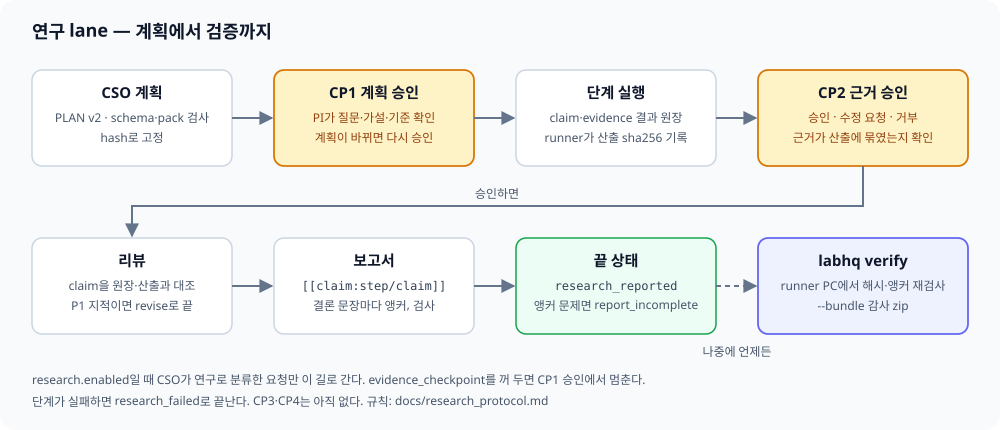

[← 매뉴얼 목차](../manual.md)

## 연구 lane과 검증

논문 재현 단계가 있으면 CP1 전에 채용 승인 → 변환·수습 → active 배정을 마칩니다. CP1은 확정된 담당자와 재배정 사유를 보여줍니다.

### 켜기

`research` 설정, 기본 꺼짐.
도메인 규칙은 `active_packs`의 pack(`id@version`)으로 더합니다(예: `active_packs: [single_cell_de@3, bulk_tumor_normal@3]`).
`single_cell_de@3`은 단일세포 donor·scale·model을, `bulk_tumor_normal@3`은 벌크 두 조건의 pairing·filter·DE 기준·양성 대조를 판정합니다.
짝의 근거(`pairing_evidence`)는 GEO characteristics·sample title 같은 메타데이터 출처 목록에서만 고르고, 짝이 있다고 하면 출처가 하나 이상 있어야 합니다.
발현 유사도는 근거가 될 수 없습니다(#369).
CSO는 `applies_when`이 맞는 pack만 계획에 넣습니다.
두 version 모두 요청 topic으로 적용됩니다(`single_cell_rna_seq`, `bulk_rna_seq`·`microarray_expression`).
기존 `bulk_tumor_normal@1`·`@2`·`single_cell_de@2` 승인 요청은 저장된 version과 hash로 재개합니다.
없어진 version이나 없는 pack 폴더가 설정에 있으면 gateway가 남은 version을 알리고 시작하지 않습니다(#170).
연구 계약이 있는 요청을 `research.enabled`를 끈 채 이어 가면 아무것도 보내지 않고 `research_disabled`로 멈춥니다.
`research.enabled`를 끄면 새 요청은 일반 lane으로 갑니다.
`research.evidence_checkpoint`만 끄면 새 요청은 CP1 승인 뒤 단계를 돌리지 않고 `plan_approved`로 끝납니다.
이미 연구 계약이 있는 요청은 재개할 때 고정된 실행 여부(`execution_enabled`)와 CP2 receipt를 그대로 씁니다.

### CP1

`enabled: true`면 CSO가 요청을 연구와 단순 작업으로 나눕니다.
변환·집계·원문 요약과 출처에 있는 내용을 표·목록으로 정리·추출·다운로드하는 일은 단순 작업입니다.
분석·예측·비교·관계 같은 추론이나 계산 실행(돌려·run 등)이 들어가면 표를 함께 요청해도 연구입니다.
직원 한 명을 직접 지정한 요청은 연구로 명시하지 않는 한 단순 작업입니다.
분류 규칙은 [연구 수행 규약](../research_protocol.md) 1절에 있습니다.
연구는 계획(PLAN)을 schema로 검증해 hash로 고정한 뒤 PI 승인(CP1)을 받습니다.
승인 뒤 계획이 바뀌면 다시 승인받습니다.
문헌·공개 오믹스·국내 통계처럼 독립된 근거 종류를 함께 요청하면 `branches`와 단계별 `branch`를 만들고 마지막 종합 단계를 둡니다. 한 방법만 쓰는 요청은 기존 PLAN 그대로입니다.
갈래 계획은 `orchestrator.max_branches`(기본 5)·`max_branch_steps`(기본 8), 종합 3단계까지입니다. 전체 상한은 `갈래 수 × 갈래 상한 + 3`이며 넘으면 자르지 않고 한 번 줄여 다시 받습니다. 갈래가 없으면 `max_steps`(기본 12)를 씁니다.
자료 추출 파일이나 내부 폴더가 필요한 갈래는 CP1 전에 확인 질문을 냅니다. 노출군 가설의 주 대비는 노출군 대 나머지 또는 가장 덜 노출된 집단이며, 기준 범주 이유를 계획에 적습니다.
계획의 `protocol.packs`(id·version·sha256)는 CSO가 아니라 labhq가 적용 pack snapshot으로 채우고, CSO prompt에는 pack마다 `pack_values_keys`(field·validator·acceptance 키, acceptance는 rule id)를 보여 줍니다.
계획이 검증에 걸리면 schema·pack 문제를 모두 모아 교정 prompt에 한 번에 넣고(남은 문제 원문 그대로), 최대 3번 고치게 합니다. 3번 뒤에도 남으면 CP1 카드 없이 `outcome: plan_invalid`와 남은 문제 목록을 보고서에 적어 끝냅니다(#222, 교정 3회는 #948). 갈래 계획에서 `branch: synthesis` 단계가 있는데 첫 synthesis 단계가 각 갈래의 마지막 단계를 `depends_on`으로 받지 않으면, 검사 전에 labhq가 빠진 갈래가 가장 적은 synthesis 단계(동률이면 첫 단계)의 의존성을 채우고 계획 `warnings`에 "labhq가 synthesis 단계 …의 depends_on에 … 채웠습니다"로 남깁니다. synthesis 단계가 아예 없거나 채우면 순환이 되는 경우는 고치지 않고 문제로 돌려줍니다. CSO가 `synthesis`라는 이름의 갈래를 따로 선언해도 synthesis는 예약된 종합 lane이라 그 갈래를 읽어야 할 대상이나 갈래 밖 의존 금지 대상으로 세지 않습니다.
부정하지 않은 요청 분석은 `brief.scope`와 실행 단계 `instruction` 양쪽에 있어야 하며, 한쪽이라도 빠지면 CP1에 `요청 범위 누락` 경고가 뜹니다. 독립된 `DE`는 DEG로 보고, 이름 붙은 분석을 명시적으로 제외한 문구는 범위에서 뺍니다.
CP1 비용 근거는 `unknown_count: 0`이고 topic이 겹치는 완료 요청뿐입니다. 재시도·wake·결과 교정 비용은 계획 `step_id`별로 합쳐 직원·engine·model별 실제 단계 평균을 냅니다. 실측이 계획값보다 낮아도 집행 상한을 줄이지 않으며, 근거가 없으면 계획값과 `실측 기록 부족`을 보입니다.
카드는 질문·가설·완료 조건, 갈래 표, 단계 목록, 비용 근거와 집행 상한을 보입니다. plan hash는 detail(`target_sha256`)에만 있습니다.
계획에는 선택 사항 `selection_record`(#890)를 둘 수 있습니다. CSO가 계획을 쓸 때 원 질문·전제·성공 기준·실제로 검토한 대안(각각 `rejected_because`)·판단을 바꿀 관측(`change_signals`)을 함께 적고, 검토한 대안이 없으면 지어 내지 않고 비웁니다. 이 기록은 계획의 일부라 plan hash에 들어가므로 승인 뒤에 대안이나 이유를 더하면 hash가 달라져 다시 승인받아야 합니다. 없는 계획은 이전과 같은 hash를 유지합니다. CP1 카드 요약은 한 줄(`선택 기록: 검토한 대안 n개 · 판단을 바꿀 관측 m개`, 없으면 `선택 기록 없음`)로 알리고, 웹 카드의 `선택 기록`에 전체가 보입니다. 기록이 없어도 승인은 막지 않습니다. 연구(research) lane의 계획에만 있고 일반 계획(`PLAN_SCHEMA`)에는 아직 없습니다.
CP1 카드의 **수정 요청**(메모 필수)은 지금 요청을 단계 없이 `plan_revision_requested`로 끝내고 새 연구 요청을 엽니다. 새 요청은 같은 문장에 `[CP1 수정 요청 · <이전 요청 id>]` 메모를 붙이고, 참고 자료(요청의 것, PI 기본 참고는 `default_references`로)·확인 질문 답·실행 중 메모·처음 요청한 예산·프로젝트를 이어받습니다. 계획자는 승인받지 못한 이전 계획(`revision_of`)과 메모를 받아 그 계획을 고치고, 새 CP1이 뜹니다. 이어받은 확인 질문 답은 새 요청의 확인 질문 횟수에 세지 않습니다. 두 요청은 `revised_from`·`revised_to`로 서로 가리킵니다. 프로젝트나 CSO 모델이 설정에서 빠져 새 요청을 열 수 없으면 `plan_revision_failed`로 끝나고 보고서에 메모가 남습니다. 메모 없는 수정 요청은 카드를 다시 묻고, 세 번 모두 비면 거절처럼 끝납니다. 수정 요청은 단계가 돌기 전 첫 CP1에만 있습니다. 이어 가기 차수의 CP1이나 단계가 돈 뒤 다시 묻는 CP1에는 없습니다(`detail.revise_allowed: false`). CLI는 `labhq approve <id> --choice revise --note "고칠 점"`입니다.

### 단계와 CP2

`evidence_checkpoint: true`를 함께 켜면 CP1 뒤 연구 단계가 `result v2` claim·evidence 계약으로 실행되고, CP2 카드에서 PI가 승인·수정 요청·거부를 고릅니다.
**수정 요청**은 메모에 적은 고칠 점으로 CSO가 새 계획을 세우고 PI가 새 CP1에서 승인합니다(PI 점검 R10). 이어 가기 카드는 따로 뜨지 않습니다.
그 뒤는 리뷰 revise 뒤 이어 가기와 같습니다: 새 계획이 바꾼 단계와 그 아래 단계만 다시 돌고 나머지는 재사용합니다(아래 "리뷰·이어 가기").
수정 요청에는 메모가 필요합니다. 웹은 빈 메모로 보내지 않고, `labhq approve <id> --choice revise`는 `--note`가 없으면 거절합니다. 다른 경로로 빈 메모가 오면 CP2 카드를 다시 띄워 메모를 묻습니다(세 번까지, 끝내 없으면 새 계획 없이 끝남).
`research.revise_continuations` 상한에 닿았으면 수정 요청도 지금처럼 요청을 끝냅니다(`evidence_revision_requested`). 이때 카드 요약과 버튼(`수정 요청(요청 끝남)`)이 그렇게 알리고 메모는 필요 없습니다.
CP2 카드는 claim 근거를 갈래별로 묶어 단계·상태·근거 종류·표시(거부된 근거, 근거 잃음)를 보여 주고 원장 JSON은 접어 둡니다.
결정은 웹 카드 버튼이나 `labhq approve <id> --choice approve|revise|deny`의 선택값으로만 읽고 메모는 읽지 않습니다.
선택값이 없으면 승인하지 않고 다시 묻습니다(세 번까지).
`artifact_refs` 경로가 그 단계가 모은 산출이나 끝난 조상 단계(직접 상위가 아니어도 됨)의 산출(`<workdir_id>/<path>`)이 아니면 그 evidence는 거부되고, 카드와 receipt에 이유가 남습니다.
단계가 끝날 때 원장이 계약을 통과해도 이런 인용이 있으면, 교정 횟수가 남은 동안 한 번 모은 산출 목록을 주고 인용을 고치게 합니다(#485).
이 교정이 실패하거나 모으지 않은 파일만 새로 쓰거나 그대로 두면 단계는 교정 전 결과로 통과하고 CP2가 그 행을 거부합니다.
단계가 끝나면 runner가 표 형식과 문헌 접근 기록을 봅니다. 표의 구분자·칸 수 오류를 경고하고, 문헌은 후보·선정·확보(본문·초록·서지)·결론 근거를 서로 다른 분모로 셉니다. 못 읽은 결론 근거 논문은 ID와 사유를 남깁니다. 이 원장과 기존 조회 전체·결론 근거 집계는 CP2 카드와 보고서 `## 한계`(일반 요청은 `## 보고서 경고`)에 들어갑니다. 같은 응답의 PMID·PMCID·DOI·OpenAlex ID는 한 논문의 별칭으로 맞춥니다(#697, #710, #735, #744). CP1 전 선행 검색(`analysis_precedents`)에서 저장된 본문·초록 기록도 같은 별칭으로 합쳐 세고, 그 편수와 부분 추출 편수를 줄에 밝힙니다. 저장된 기록이 없으면 이전과 같습니다(#1090).
보고하지 않은 산출 목록에서 `__pycache__` 아래 파일은 뺍니다(관찰 기록에는 남음). 직원 실행 환경에는 `PYTHONDONTWRITEBYTECODE=1`을 넣어 처음부터 만들지 않습니다(설정이나 runner 환경에 값이 있으면 그 값을 씁니다).
단계가 결정이 필요해 멈추면(`blocking_decision`) 산출·원장 검사 전에 CSO가 먼저 답하고, hard-stop 질문만 PI에게 올립니다. 질문만 남긴 turn은 단계 완료로 알리지 않으며 답을 받으면 같은 단계에서 계속합니다.
연구 요청은 일반 재계획·리뷰·합성에 들어가지 않습니다.
직원의 StructuredOutput JSON 파싱 오류는 같은 세션에서 자동 재시도합니다(`runner.structured_output_retries`, 기본 2회, 0이면 끔). 재시도는 runner 안의 반복이 아니라 gateway가 같은 세션을 새 dispatch로 다시 보내는 것이어서 다른 턴과 같은 요청 예산 확인을 거칩니다(#673). 요청의 남은 예산이 없거나 병렬 단계가 아직 쓸 수 있는 몫을 빼면 남지 않을 때는 PI에게 예산을 더 묻지 않고 형식 오류로 멈춥니다. 이 흐름은 단계 turn(`run_step`)에만 적용되고 계획·상담 등 다른 호출은 이전처럼 runner 안에서 재시도합니다. 오류 원문은 작업 폴더의 `.tmp/structured_output_failures/`에 저장합니다. 잘린 계획은 단계 설명·반복·큰 표를 줄여 다시 받고, 비ASCII 문자는 `\u` escape로 늘리지 않습니다.
유효한 계획이 `orchestrator.plan_max_chars`(기본 50,000자)를 넘으면 실제 크기와 상한을 경고로 기록하되 자르지 않습니다. 재시도는 task 한도와 요청 잔여 한도 중 작은 금액 안에서만 하며, 비용·사용량을 앞선 호출까지 합산합니다.

단계의 결과 원장이 교정(`research.result_corrections`, 기본 2회) 뒤에도 계약을 어기면, 잘못된 행(링크·evidence·claim)만 거부하고 나머지로 진행합니다. 단계의 결과와 교정 요청은 계획이 그 단계에 선언한 `claim_ids` 안의 주장만 허용합니다. 목록 밖 claim id를 새로 만들지 않고, 가설·기전·배경처럼 evidence가 아닌 행(hypothesis row)은 claim으로 만들지 않고 선언한 claim에 context로 연결하거나 링크에서 뺍니다. 요청이 가설·기전·등급별 정리를 결과로 요구하면 계획이 그 몫의 claim을 단계 `claim_ids`에 미리 선언해야 합니다(#1066).
거부한 행과 이유는 CP2 카드와 보고서 메타데이터에 남습니다.
예를 들어 실패하거나 0건인 조회를 근거(supports)로 연결했다면 그 링크만 빼고 시도 기록은 남깁니다.
같은 출처를 서로 다른 independence group으로 적은 근거는 group을 합쳐 주지 않고 뒤 행만 거부합니다. 합치면 직원이 잘못 적은 독립성이 보이지 않게 되기 때문이고, 거부하면 CP2 카드에 "재인용은 독립이 아님"으로 남아 독립 근거를 부풀려 세지 않습니다.
그 단계가 선언하지 않은 claim은 그 claim과 링크만 거부하고(CP2의 근거 잃음으로 표시) 나머지를 지킵니다(#1054). 이전에는 이런 claim이 한 개만 섞여도 위 거부로 살릴 수 있는 행까지 함께 버려 단계 전체가 실패했습니다. 그 단계 자신의 claim이 처음부터 하나도 없거나, 범위 밖 claim을 거부한 뒤 단계 자신의 claim이 하나도 남지 않으면 여전히 실패입니다. (범위 밖 claim이 없을 때 선언된 claim이 근거를 잃어 모두 빠지는 경우는 이전처럼 빈 claim 원장으로 CP2에 갑니다.) 제거한 링크도 거부 행으로 남깁니다.
계획 hash·단계·필수 evidence 칸 같은 구조 결함은 거부로 메우지 않고 단계 실패로 봅니다.
갈래 PLAN은 각 갈래 terminal이 의존 경로로 종합 단계에 닿아야 승인됩니다. 갈래 단계가 실패하면 그 갈래의 뒤 단계만 건너뛰며, 실패한 파일·결과 본문·작업 폴더 대신 이유와 마지막 완료 단계만 종합에 넘깁니다. 성공한 terminal이 하나도 없으면 갈래별 상태 표를 남기고 CP2 전에 끝냅니다. 갈래가 없는 PLAN의 차단 방식은 바뀌지 않습니다.
종합 보고서는 갈래마다 실제 분석과 결과를 요약·결론·그래픽 초록에 넣습니다. 유의하지 않은 결과도 검정 수·기준·통과 수를 씁니다. 대체 분석은 수행·결과, 뜻과 한계, 직접 검정 불가 이유를 나눠 쓰고 대표 대비가 가설과 맞는지 밝힙니다.
성공이 아닌 연구 종료(`report_incomplete`, 리뷰 revise, CP2 거절·수정 요청·시간 초과, 예산 거부)는 요청의 `error`에 한 줄 사유를 남기고, 웹 피드가 `요청이 실패했어요: <사유>`로 보입니다. 보고서가 나온 `report_incomplete`는 사유가 "보고서는 나왔지만 claim 검사에서 문제가 있어요"이고 claim 검사 결과는 실행 기록에 있습니다. 사유 없이 끝난 요청은 웹이 "요청을 완료로 보지 않았어요. 보고서와 실행 기록에서 이유를 확인하세요"라는 중립 문구를 보입니다.

### 리뷰·이어 가기

**블라인드 초안**(`research.blind_draft`, 기본 `false`, #889): 켜면 CP1 승인 직후 첫 단계를 보내기 전에 `reviewer_agent`가 원 요청 문장·참고 자료·PI의 확인 질문 답만으로 독립 초안을 한 번 씁니다. 계획·단계·산출은 prompt에 넣지 않으며 read-only로 실행하고 기존 예산 예약·취소 경로를 그대로 씁니다. 격리는 입력 기준입니다(별도 파일 격리는 없음). 초안 본문·sha256·UTC 시각은 `research_contract.blind_draft`에 `sealed`로 봉인되며 재시작해도 다시 쓰지 않습니다. 주 결과가 이미 있는 요청을 재개하면 초안을 쓰지 않고 `unavailable`(`results_exist`)로, 초안이 끝났을 때 이미 주 결과가 있었으면 `late`로, 초안 task가 실패하면 `unavailable`로 기록합니다. 어느 쪽이든 리뷰에 쓰지 않고 요청은 계속 진행합니다. 순차 실행이라 초안 task 시간만큼 요청이 늦어집니다. 연구 리뷰는 봉인된 초안(해시가 맞을 때만)을 받아 review JSON의 선택 필드 `blind_comparison`(`missed_alternatives`·`differing_conclusions`·`evidence_gaps`)에 대조 결과를 남깁니다. 초안과 주 답이 같다는 사실은 근거로 세지 않으며, 읽을 수 없는 `blind_comparison`은 리뷰 전체가 아니라 그 필드만 버립니다. 이어 가기 차수는 첫 차수의 봉인된 초안을 그대로 씁니다.

CP2에서 승인하면 `reviewer_agent`가 claim을 원장·산출 파일과 대조해 한 번 리뷰합니다.
CP2 수정 요청도 같은 이어 가기로 들어갑니다. 다른 점은 카드 없이 바로 새 계획을 쓰고, 리뷰 P1 지적 대신 PI 메모(`continuation.pi_request`)를 새 계획·새 리뷰 prompt에 넣는다는 것뿐입니다. 새 CP1 카드 요약은 "이어 가기 n차 계획(CP2 수정 요청 반영)"으로 시작합니다.
P1 지적이 있어 revise면 고정된 계획을 그대로 다시 돌리지 않습니다.
대신 **이어 가기** 카드(`research_continue`)가 뜹니다. 카드에는 리뷰 P1 지적이 단계·문제·고칠 점 순서로 펼쳐져 있고, 원문 JSON은 접혀 있습니다.
거절하거나 답이 없으면 지금처럼 `research_review_revise`로 끝납니다.
승인하면 CSO가 리뷰 P1 지적과 이전 계획을 받아 새 계획을 쓰고, PI가 새 CP1(새 `plan_sha256`)을 승인한 뒤 바뀐 단계와 새 단계만 실행합니다.
그 뒤 CP2·리뷰·보고서는 같습니다. 보고서 작성자는 이전 차수 리뷰의 P1 지적(CP2 수정 요청이면 PI 메모)을 받아 "이전 차수에서 고친 것" 절에 지적마다 어떻게 고쳤는지, 못 고쳤는지 한 줄씩 적고, 감사 부록에도 그 지적이 남습니다. 작성자가 그 절을 빠뜨리면 labhq가 이전 차수 지적 목록으로 절을 붙입니다(요청을 실패로 만들지는 않음).
재사용은 단계별 정규화 사양·선언 입력·의존 산출 hash·선언된 도구 설정·해당 단계의 paper-skill 선정/변환 결과·과학적 brief/scope·가설·protocol·pack 계약이 맞을 때만 허용합니다. 문구가 비슷하다는 이유로 같은 뜻이라고 보지 않습니다. 독립 단계/갈래의 수정은 영향 없는 후보를 없애지 않지만, 전역 과학 계약이나 pack 정의 변경은 보수적으로 다시 검사합니다.
CP1 카드 **전에** 기존 안전 walker로 산출을 검증합니다. 요청의 파일·폴더 입력은 gateway와 runner가 실행 전후 sha256·정렬된 목록을 대조해 단계별로 보존합니다. 다음 라운드는 입력·사양·도구·산출이 같을 때만 재사용하며 카드에 거부 이유를 표시합니다. 기록 없는 과거 실행, URL·GitHub 같은 content 미확인 reference, 읽기 실패·변경은 재사용하지 않습니다. 다만 DOI·PMID 참조는 식별자 목록만 영수증에 고정해(`unreceipted`, #1061) 같은 목록이면 재사용합니다. 참조가 추가·삭제·교체되거나 순서·표기가 바뀌면 재사용하지 않고, 그 DOI가 가리키는 논문 본문의 개정·정정·철회는 확인하지 않습니다. 재사용한 단계의 근거는 각 행의 `accessed_at`이 처음 조회한 날짜를 보여 주며, 이어 가기 카드와 보고서에는 "재사용한 단계가 쓴 DOI·PMID 참조 N건은 식별자만 고정했고 내용은 확인하지 않았습니다"를 한 줄 표시합니다. 이 영수증이 없던 옛 요청은 그대로 재사용하지 않습니다. reference roots·통제 구역·private path 검사를 지키며 링크·hard link·특수 파일, scan 상한 초과와 총 256 MiB 초과도 거절합니다. gateway에서 runner 입력을 읽지 못하면 거절합니다. 디렉터리 **산출**은 manifest 계약이 없어 재사용하지 않습니다.
검증된 후보만 `continuation.reuse_snapshot`에 넣어 계획 hash·snapshot hash를 CP1 receipt와 묶고 카드에 그대로 보입니다. 승인 뒤·재개 때·실제 dispatch 직전에 증거를 다시 확인하며, 달라졌으면 **조용히 재실행하지 않고 중단하여 새 CP1 승인을 요구**합니다. 파일 변경을 잠그는 기능은 아닙니다.
재승인은 현재 차수의 완료 결과도 증거를 검사해 후보로 보존하며 다시 실행하지 않습니다. 그 결과의 입력·도구·산출 증거가 깨져 있으면 기록을 보존한 채 중단합니다. 도구 설정은 CP1 대기 전 값이 아니라 단계 dispatch에서 기록합니다.
재사용 결과는 새 계획 hash로 묶은 사본이고, 원래 차수·task는 `continuation.reused_from`에 남습니다. [증거 계약과 한계](../reference/continuation-reuse-797.md)를 참고하세요.
이전 차수의 계획·결과·CP2·리뷰는 `research_contract.rounds`에 남습니다.
이어 가기 횟수는 `research.revise_continuations`(기본 2, 0이면 묻지 않음)로 정하며 리뷰 revise와 CP2 수정 요청을 합쳐 셉니다. 확인 질문 카드 상한은 차수마다 다시 세되, 이미 답한 질문을 거르는 기록은 모든 차수를 봅니다. 차수가 적히지 않은 예전 답(차수별로 세기 전 버전)은 어느 차수 것인지 모르므로 지금 차수 상한에 셉니다. 비용은 같은 요청 예산에 쌓입니다. 새 계획이 질문·protocol을 바꾸면 재사용되는 단계가 없어 1차와 비슷한 비용이 다시 들고, 1차가 상한 가까이 썼으면 이어 가자마자 예산 카드가 뜹니다(시운전 10-08: 1차 $25.86, 상한 $30).
중간에 gateway가 다시 떠도 답한 카드는 다시 묻지 않습니다.
새 계획이 이전 계획과 바이트까지 같아도(같은 `plan_sha256`) 새 CP1·CP2·리뷰를 다시 받고, 이전 차수의 승인을 쓰지 않습니다.
이어 가기가 단계 실행 전에 끝나면(취소, 재개 거절·시간 초과, 새 CP1 거절·시간 초과, 계획 실패, 예산 카드 거절, 오류) 이전 차수의 계획·hash·CP1 승인·pack snapshot·CP2 receipt·리뷰·결과·요청 집행 상한을 되돌린 뒤 terminal 기록을 씁니다. 취소·재개 거절·시간 초과 때 단계가 돌았는지는 gateway task 기록에 그 차수의 단계 task가 있는지로 정합니다. 새 CP1 뒤 재사용 검사까지 마치고 첫 단계를 보내기 전에 gateway가 멈췄어도 되돌립니다.
돌지 않은 새 계획은 `continuation.declined_plan`에, 끝난 이유는 `continuation.ended_before_dispatch`에 남습니다.
`labhq verify`는 완료 단계 ledger가 고정 계획과 다른 `plan_sha256`에 묶여 있으면 문제로 적습니다.
이어 가기 카드도 다른 결정 카드처럼 `policy.approvals.pi_decision_timeout_s`(기본 7일)가 지나면 시간 초과로 닫힙니다.
이미 끝난 요청은 나중에 이어 갈 수 없으니 새 요청을 냅니다.

### 보고서·verify

accept면 CSO가 결론·수치 문장마다 `[[claim:<step_id>/<claim_id>]]`를 단 보고서를 쓰고, labhq가 앵커를 검사해 문제가 없으면 `research_reported`입니다. 문제가 있으면 바로 끝내지 않고 CSO에게 문제 원문과 인용 가능한 claim 목록을 주며 "분석을 다시 하지 말고 결론마다 앵커를 달라"고 최대 2번(`REPORT_CORRECTIONS`) 되돌려 고치게 합니다(#956, 교정 횟수는 `research_contract.report_corrections`). 고친 보고서로 다시 검사하고, 끝까지 문제가 남으면 본문 뒤에 "Claim check"를 붙여 `report_incomplete`로 끝냅니다.
실패한 조회는 보고서에 따로 남습니다.
규약은 [`docs/research_protocol.md`](../research_protocol.md)(#90).

카드 메모는 결정이 아니고 다음 일을 맡은 쪽에 전달됩니다(PI 점검 R11). CP1 승인 메모는 그 계획의 모든 단계 prompt에, CP2 승인 메모는 리뷰와 보고서 prompt에(이어 간 요청은 앞 차수 CP2 메모도), 이어 가기 메모와 직전 CP2 메모는 새 계획 prompt에 들어갑니다(CP2 수정 요청 메모는 새 계획의 수정 요청 자체로 한 번만 들어가고, 새 리뷰 prompt에도 들어갑니다). prompt에는 2,000자까지만 넣고 잘렸다고 표시하며, 전문은 receipt와 보고서 감사 부록에 남습니다. 재사용된 단계는 다시 돌지 않으므로 새 CP1 메모를 받지 않습니다. 계획에는 숫자 `budget_usd`(선택)를 둘 수 있습니다. CP1을 승인하면 승인 때까지 쓴 비용(브리핑·선례·확인 질문·계획 단계, 이어 간 요청은 앞 차수 작업까지)에 `budget_usd`를 더한 값이 요청의 집행 상한이 되고, 넘으면 예산 카드가 뜹니다(R17). 단 PI가 요청에 예산을 적었으면(`--budget`, 요청의 `budget_usd`) 집행 상한은 그 요청 예산이고, 계획의 `budget_usd`와 쓴 비용의 합은 CP1 카드에 참고 추정으로만 보입니다(#944: 요청 $40이 계획 추정 $9.70으로 내려가 작업 예약 두 건만으로 예산 카드가 두 번 떴습니다). 요청 예산이 없으면 설정 상한 `policy.budget.per_request_usd`를 넘지 않는 범위에서 위 합이 상한입니다. 어느 쪽이든 묶인 금액(쓴 비용과 작업 예약)이 상한을 넘는 작업은 보내지 않고 예산 카드를 띄웁니다. CP1 카드 요약 끝줄(`집행 상한 $5.96(계획 예산 $3.00 + 계획까지 쓴 $2.96)`)과 `detail.budget`(`plan_budget_usd`·`spent_before_plan_usd`·`cap_usd`)에 그 상한과 내역이 보입니다. 이어 가기 차수는 그 차수 CP1 때까지 쓴 비용으로 다시 셉니다. 승인 직후 지금까지 쓴 비용을 새 상한으로 한 번 판정하므로, 단계를 돌리지 않고 끝나는 요청(`plan_only`, `evidence_checkpoint` 꺼짐)도 설정 상한이 이미 쓴 비용보다 낮으면 예산 카드가 뜹니다. 단계와 리뷰 prompt에는 `protocol.resource_limits` 문구와 별도로 실제 집행 상한이 한 줄 들어갑니다. `budget_usd`에 true/false를 쓴 계획은 검증에 걸려 교정을 받습니다. 이어 간 요청의 감사 부록에는 앞 차수 CP2 메모도 차수와 함께 전문으로 남습니다. `budget_usd`가 없는 계획은 지금처럼 요청 예산이나 정책 상한을 씁니다.

`labhq verify <request_id>`는 gateway의 요청 기록을 읽고, runner PC의 작업 폴더에서 산출을 같은 규칙(상한까지만 읽기, 링크·junction 안 따라감, 통제 구역 제외)으로 다시 해시해 기록과 비교합니다. 요청 묶음이 있으면 link·junction을 먼저 거부한 뒤 JSON 구조·reference·경로 containment, 요청 ID, MANIFEST 필수 필드 형식, 파일↔`MANIFEST.tsv`↔crate의 size·sha256을 검사합니다. crate가 `File`로 선언한 파일은 MANIFEST status와 상관없이 있는지와 hash를 보고, status가 crate 기록과 다르면 문제로 적습니다(#475). 너무 깊게 중첩된 metadata JSON은 오류로 끝나지 않고 문제로 적습니다. MANIFEST에 기록된 crate·README가 없거나 README를 읽지 못하면 이전 형식으로 간주하지 않습니다. 외부 입력은 `INPUTS.tsv`와 crate에 적힌 hash끼리만 대조하며 원본을 재해시했다고 표시하지 않습니다. crate가 없는 이전 묶음은 기존 판정을 유지합니다. 연구 요청은 보고서 앵커 검사도 다시 돌리고, 보고하지 않은 산출은 경고로 보입니다. 문제가 없으면 exit 0, 불일치·없는 파일·앵커 문제는 1, 요청이나 작업 폴더가 없어 끝까지 검사하지 못하면 2입니다. 그림 WARN은 판정을 바꾸지 않고 exit 0/1에서도 `--bundle`을 만듭니다. `--bundle out.zip`과 웹 요청 상세의 **감사 번들**은 `README.md`·`report.md`·`report_appendix.md`·`execution_record.md`·`claims.json`·`artifacts.json`을 담고 산출 파일은 넣지 않습니다. 예전 `부록: 실행 기록`도 만들 때 운전 기록으로 분리합니다. gateway에 작업 폴더가 없으면 기록만 담고 runner PC의 `labhq verify` 재검사를 안내합니다. 내장 MCP(hpc·ask)의 실패는 isError로 돌아가며 끝에 "이 실패는 증거도 부재 증명도 아닙니다"가 붙습니다. 일반 단계는 Findings·Evidence·Not established·Method changes 블록을 남기며, 모으지 않은 Evidence 경로와 실패한 도구 호출은 거부 대신 최종 보고서 경고로 올라갑니다(#58).

### 최종 초안 수용(CP4)

`research.final_checkpoint: true`는 새 연구 실행 요청에만 적용합니다(기본 `false`). CP1-only·`plan_only`·simple·direct는 제외하며 생성 때 고정한 값과 계약 version은 설정 변경·재시작으로 바뀌지 않습니다.

- 리뷰 accept와 보고서 검사를 통과한 초안을 기존 **보고서 검토 대기** 카드에서 검토합니다. **검토 완료**가 CP4 수용이며 별도 카드는 없습니다.
- CLI는 `status`에 표시된 `review-done <id> --revision <n> --sha256 <hash>`를 씁니다. 거부는 `--reject`를 붙입니다.
- 본문·감사·claim hash와 receipt가 맞아야 `done`입니다. 거부·기한 초과·취소·내용 변경은 완료가 아닙니다. 기한은 초안 저장 시 `policy.approvals.pi_decision_timeout_s`로 고정합니다.
- 재시작은 저장 초안과 유효 receipt를 재사용합니다. CP4 수정·재합성은 지원하지 않습니다. 이미 설정한 GitHub 보고·issue 종료와 편집자 정리본 게시, 로컬 검색 색인은 수용 뒤에 진행합니다. 거부·만료는 실패로 알리고 issue를 열어 둡니다. 수용 자체는 새 게시·전송·HPC 권한을 부여하지 않습니다.
- 요청 묶음의 `final_checkpoint.json`은 경로 치환 전 초안과 receipt를 보존합니다. 결정 뒤에는 기존 묶음도 갱신합니다. `claims.json`에 같은 hash를 연결하고 `verify`가 누락·불일치를 검사합니다. 옛 묶음은 기존 판정을 유지합니다.
