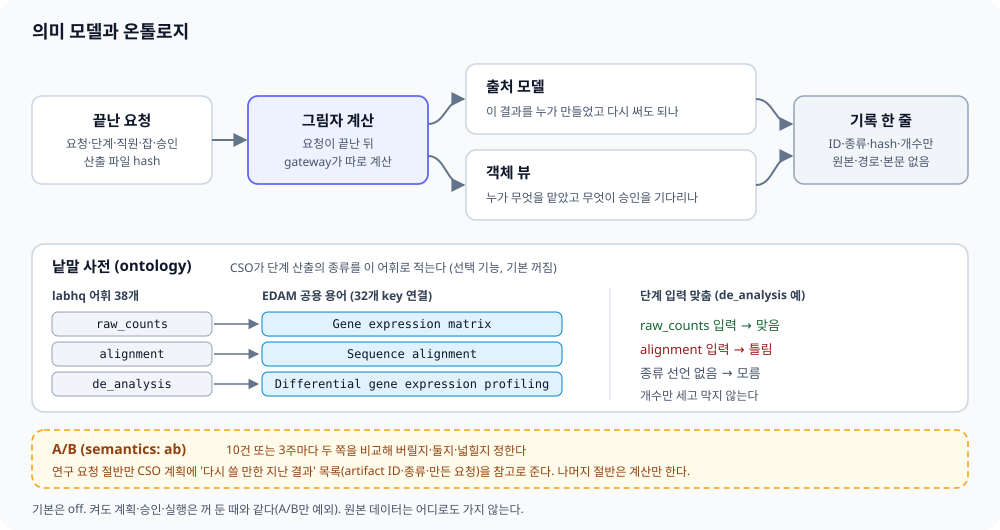

[← 매뉴얼 목차](../manual.md)

## 의미 모델과 온톨로지

단계 산출의 종류를 선언하면 계획 승인(CP1) 전에 입력과 방법의 알려진 불일치를 확인하고 CSO에 계획 수정을 요청합니다. 선언이 없는 항목은 "모름"으로 남깁니다. 장치 보고서는 점검표·선언·고정 pack·재사용의 근거와 아직 측정하지 않은 항목을 구분합니다. 연구 성과가 좋아졌다는 근거는 아직 없습니다.

계획 단계의 입력 검증과 요청이 끝난 뒤의 그림자 계산은 별개입니다. 입력 검증은 그림자를 꺼도 유지됩니다. 그림자는 지난 결과의 출처와 재사용 후보를 기록해 효과를 측정하는 데 쓰입니다.

| 말 | 뜻 |
|---|---|
| 의미 모델 | 끝난 요청의 기록을 묶은 지도. 출처 모델(#136)은 "이 결과를 누가 만들었고 다시 써도 되나", 객체 뷰는 "누가 무엇을 맡았고 무엇이 승인을 기다리나"에 답한다 |
| 온톨로지 | 지도에 쓰는 낱말 사전. labhq 어휘(`labhq/vocab/output_types.yaml`)는 data 30·format 28·operation 22·topic 45, 총 125개 key다(PI 검토 2026-10-04, topic 23개는 2026-10-06 #420). branch 상한은 data 36·format 32·operation 24이고 topic은 상한이 없다(PI 2026-10-05). 계획 프롬프트에는 topic 이름만 들어가고, 조사에서 나온 별칭(`hic` → `hi_c` 등)은 승인된 키로 바뀐다 |
| EDAM | 생물정보학 공용 ontology. 125개 key 중 79개가 EDAM 용어 75개에 이어진다(`edam_subset.yaml`). 판정은 로컬 key로 하고 EDAM ID는 메타데이터로만 붙인다 |
| 데이터 종류 선언 | CSO가 단계 산출에 종류 key를 적는다(`plan.declare_output_types`, 기본 꺼짐). 선언이 없으면 아래 판정은 모두 "모름"이다 |
| 입력–방법 맞춤 | 단계 입력의 선언 종류를 로컬 관계표(`labhq/research/input_fit.yaml`)와 대조한다. CP1 전 기존 검증(첫 계획 + 교정 3회)에서 알려진 불일치를 교정하고, 그림자는 개수만 관측한다 |
| 데이터-도구 적합성 참고 | 단계를 시작할 때 `inputs/` 아래 파일을 확장자와 헤더로 읽어 형식·데이터 종류·저장된 EDAM ID를 5~10줄로 단계 프롬프트에 붙인다(#1352). 헤더로 확인한 형식과 확장자로만 추정한 형식을 구분한다. 단계 작업을 알 때는 `input_fit.yaml`로 맞는지 보고, 맞지 않으면 맞는 입력 종류만 알린다(도구는 권하지 않는다). semantics가 꺼져 있어도 동작하고, 카드·실행 차단·모델 호출·설치는 없다. 오류나 모르는 파일이면 참고를 붙이지 않는다 |
| 그림자 | `semantics: shadow`. 요청이 끝난 뒤 gateway가 따로 계산해 `state_dir/semantics/`에 ID·종류·hash·개수만 남긴다. 계획·승인·실행·웹 화면은 꺼 둔 때와 같다 |
| A/B·판단 창 | `semantics: ab`. 연구 요청을 ID hash로 반씩 나눠 한쪽(advisory)에만 재사용 후보(artifact ID·data type·만든 요청 ID)를 CSO 계획 참고로 준다. 10건 또는 3주 가운데 먼저 오는 쪽에서 버릴지·둘지·넓힐지 정한다 |

연구 요청 하나에서는 이렇게 끼어듭니다.

1. CSO의 첫 계획 초안을 보고 A/B가 한 번 낍니다. 결과는 `정상 · 후보 N건`, `정상인데 후보 0건`, `미평가(사유)`, `오류(code)`로 남습니다. 후보가 있으면 두 쪽 모두 계획을 한 번 더 세우고 advisory 쪽만 목록을 받습니다.
2. 단계 실행·리뷰·보고서에는 끼지 않습니다.
3. 요청이 끝나면 그림자가 단계마다 입력–방법 맞춤을 세고 이번 결과를 지도에 더합니다.

데이터 원본·경로·요청 본문은 기록에 들어가지 않고, 통제 구역 파일은 hash도 읽지 않습니다. 다만 request ID와 hash는 남으니 `state_dir`을 공개 위치에 두지 않습니다.
보는 법: `labhq semantics report`는 전체 집계, `labhq semantics report --request req_...`는 요청 하나의 비교입니다(`--json` 지원). 켜고 끄는 값과 자동 중단 조건은 [설정 포인트](15-config.md#설정-포인트), 한계는 [알려진 한계](17-known-limits.md#알려진-한계)를 봅니다.

연구 계약이 있는 요청만 `semantic_report.md`·`semantic_report.json`에 단어장·EDAM, 체크리스트, 분석 pack, semantics, 운영 ontology, 그림자 요청의 판단과 영향을 기록합니다. CP2 카드에서 실제 Markdown을 열 수 있고, 종료 묶음은 실행 당시 체크리스트와 완료된 shadow 관측을 고정합니다. 정리본 경로는 `run/semantic_report.md`이며 `research.semantic_report: false`로 끌 수 있습니다. #796: CP1의 mainline 평가기(`research/input_fit.py`)는 Shadow off·제거와 독립이며 observer adapter와 같은 관계표·의미 hash를 씁니다. 기존 두 번의 계획 검증에서 알려진 입력 종류–operation 불일치를 교정하고 전후 경고를 카드에 남깁니다. 모르는 선언은 unverified이며 EDAM 매핑 자체는 fit 증거가 아닙니다. 같은 보고서와 bench 비교는 checklist 초기 누락/교정·review 판정, 선언/fit, 고정 pack 값, 재사용 후보/계획 채택을 분모·근거와 함께 표시합니다. 독립 기준 충족·실제 사용·과학 성능 효과는 미측정이면 그대로 적습니다. 제거 검사 통과는 과학 효용의 증거가 아닙니다. Shadow 관측은 효용 측정용으로 유지하되 actions/Shadow 부가 확장은 동결하고, 효용 판정 뒤 비활성화·정리를 검토합니다. 지금 observer를 지우거나 제거 스크립트를 실행하지 않습니다.

요청별 보기는 저장된 그림자의 입력–방법 판정·산출 종류·재사용 후보·경고·행동 판단과 실제 단계·보고된 산출·승인 결정을 평문으로 보여 줍니다. 기록이 없으면 그대로 알리며 재계산으로 채우지 않습니다. 입력 종류별 목록은 기존 그림자 기록에 없어 확인 불가로 표시합니다. 파일 내용 검증은 하지 않습니다.

일반·단독 요청도 `shadow`와 `ab`에서 종료 시 기록합니다. 연구 요청만 A/B 계획 참고를 받으며, 재시작 뒤 재개해 끝난 요청도 같은 종료 경로를 씁니다. epoch는 `semantics enable`로 새로 열 때만 바뀝니다. 다른 설정 파일로 뜬 gateway가 같은 상태 폴더를 쓰면 요청별 보기가 불일치를 알리고 `labhq up`도 성공으로 처리하지 않습니다. 현재 설정이나 PID 기록만으로 과거 설정을 단정하지는 않습니다.

연구 요청은 CP1 전에 semantics 상태·epoch·마지막 기록과 단어장·EDAM·체크리스트·pack의 hash·개수를 점검합니다. CP1·CP2 카드와 요청별 report는 꺼짐·미평가·오류·정상 0건을 나눠 보여 줍니다. 미평가·오류 요청은 A/B 분모에서 빼고 각각 셉니다. 오류는 `code·device·stage·at·message`만 저장하며 정보 경계 위반은 계속 자동 중단합니다.

report는 중첩 집계의 구조와 개수(0 이상의 정수)를 확인합니다. 손상된 요청 행은 통째로 제외하고 JSON의 `broken_lines`와 텍스트의 `깨진 줄`에 셉니다. 이전 판본의 선택 필드 부재와 worker가 남긴 `declarations: null`은 허용하며 소수 지연값도 보존합니다. 저장 로그는 바꾸지 않습니다.
