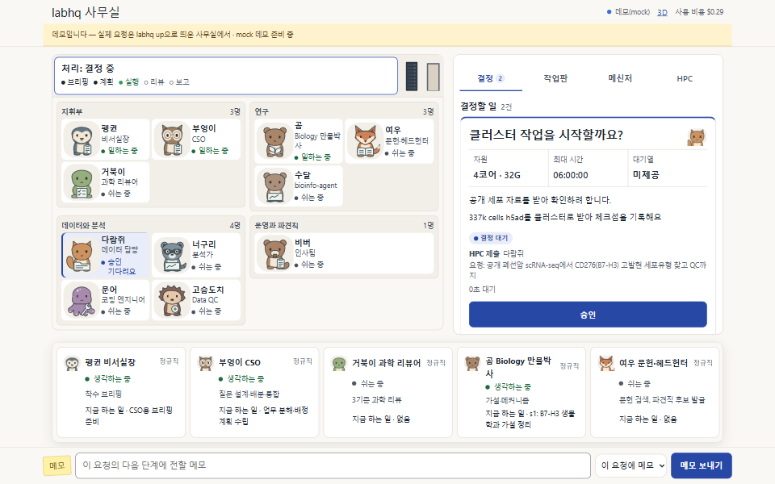

## 결론

Refs #546. 디자인 리뉴얼 5번째 PR입니다. 데모 화면의 레이아웃을 Chrome으로 비교하는 test와 README 데모 움짤을 새로 만들었고, #590에서 넘어온 편집자(비버) 소품·구역 누락을 고쳤습니다. 앱 동작과 3D는 바꾸지 않았습니다.

## 바뀐 것

- **화면 비교 test** `tests/web_visual_demo.cjs`: 데모(`?demo=1`)를 데스크톱 1440×900과 폰 390×844 headless Chrome으로 열어 시작 · 요청 진행 · 결정 대기 · 보고서 검토 네 장면을 찍습니다. 각 장면에서 결정·작업판·메신저 탭과 직원 줄을 펼친 모습까지 모두 32개 화면의 탭·결정/검토 카드·작업판·메신저·직원 카드·사무실 위치와 크기, 보임 여부, 주요 색, 상태 글자를 `tests/visual/demo-layout.baseline.json`과 비교합니다. 픽셀은 비교하지 않습니다. 허용 오차는 4px 또는 화면의 1%, 색은 채널 2입니다.
- **OS가 달라도 같은 값**: 시험 전용 글꼴(글자 폭만 있는 작은 TrueType, 파일 없이 메모리에서 생성)과 가상 페이지 시계(Date·setTimeout을 대신함)를 씁니다. 단계를 "화면이 이 상태가 될 때까지 시계를 돌린다"로 기다리므로 고정 sleep이 없습니다. 다른 로케일·시간대·글꼴 힌팅 옵션으로 돌려도 같은 기준선과 일치했습니다.
- Chrome이 없으면 이유를 적고 건너뜁니다. Node 22 미만에는 전역 `WebSocket`이 없어 `tests/support/mini_ws.cjs`의 작은 클라이언트로 대신합니다. 새 `tests/web_*.cjs`라서 pytest(`test_web_3d.py`)가 그대로 모아 돌립니다(제한 시간만 260초로).
- **기준선을 일부러 바꾸려면** `node scripts/update_visual_baseline.cjs`. 이전 기준선과 달라진 항목을 출력하니 의도한 변화인지 보고 `demo-layout.baseline.json`을 커밋합니다. 설명은 `tests/visual/README.md`.
- **README 데모 움짤** `docs/media/office-25d.gif`: `node scripts/record_demo_gif.cjs`가 같은 데모를 시작 → 요청 → 직원 작업 → 결정 카드 → 승인 → 보고서 순서로 녹화(11장면)합니다. 960×600, 13.1초, 0.62MB. 같은 코드로 다시 녹화하면 바이트까지 같습니다. GIF는 표준 라이브러리만 쓰는 `scripts/gif_encode.py`(PNG 읽기, median cut 팔레트, LZW)가 조립하며 새 의존성은 없습니다. README 한국어·영어의 그림과 대체 텍스트, 정지 화면(`office-25d.png`)을 바꾸고 옛 webp는 지웠습니다.
- **편집자(비버)**: 소품 표에 없어 파견직 배지로, 구역 표에 없어 연구 구역으로 떨어지던 것을 고쳤습니다. 운영과 파견직 구역에 펜과 종이 소품으로 앉습니다. `agents/core/*.yaml`의 핵심 직원이 모두 구역과 소품 표에 있는지 확인하는 node test를 더했고, main의 화면 파일로 돌리면 실패합니다.

## 확인

- 새 화면 test 로컬 10회 연속 통과(회당 약 4.5초). 일부러 탭 높이·강조색·대기 개수 배지를 바꾼 복사본으로 돌리면 실패해 어디가 달라졌는지 출력합니다.
- `for f in tests/*.cjs; do node --test "$f"; done` 57개 파일, 198건 통과. 관련 pytest(`test_web_3d`·`test_gif_encode`·`test_integrations`·`test_lab3d`) 135 passed, 1 skipped. 전체 pytest는 CI에 맡깁니다.
- GIF 인코더는 test 안의 독립 GIF/LZW 디코더로 왕복 검증합니다(필터 5종 PNG 읽기, LZW 표 넘침·clear 코드 포함).
- `python scripts/patch_notes.py check`, `bash scripts/check_public.sh` 통과.
- 작업은 scratch clone의 별도 venv에서만 했고 PI 인스턴스·8787·55921 포트·`~/.labhq`는 쓰지 않았습니다.

## 정지 화면

## 남은 지적

- 기준선은 Windows Chrome에서 만들었습니다. Linux CI에서 처음 도는 것이라 그쪽 결과는 CI로 확인합니다.
- 데모 roster에는 편집자가 없어 화면 기준선은 편집자 변경에 영향받지 않습니다. 그 변경은 node test가 확인합니다.
